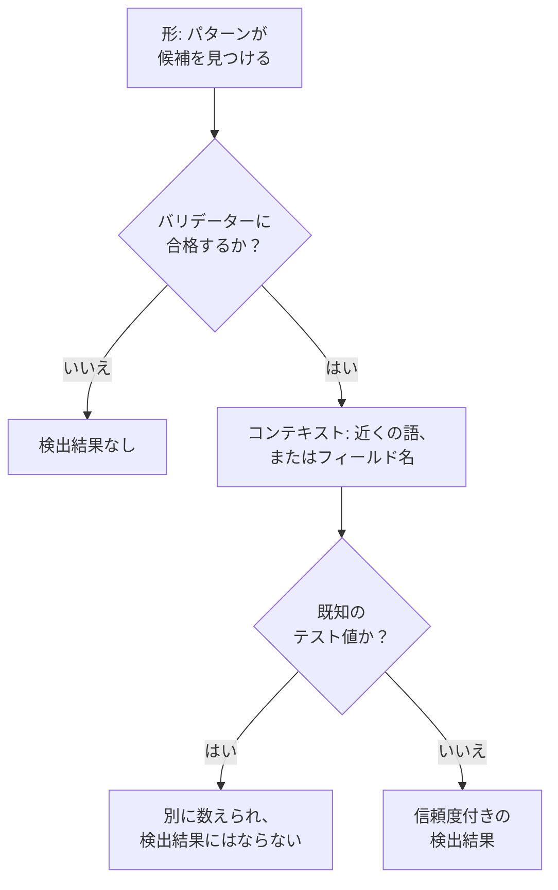

# 機密データタイプ

データセキュリティは 143 種類の機密データを知っています: カード番号、銀行口座、43 か国の国民 ID、医療関連の識別子、API キーとトークン、そして特別なカテゴリの個人データです。それぞれにカテゴリと機密度があり、1 つの国に属するものには、その国も設定されています。このページでは、値がどのように見つかるかを説明し、すべてのデータタイプを一覧するので、何かが見つかった理由を理解し、どう対処するかを決められます。

:::cards
- [値の見つけ方](#値の見つけ方): 形、バリデーター、コンテキスト、テスト値、信頼度。
- [フィールドと列](#フィールドと列): 列や属性全体がどう判定されるか。
- [すべてのデータタイプ](#組み込みデータタイプ): 143 種類すべてをカテゴリ別に。
- [独自のデータタイプ](#独自のデータタイプ): 社員 ID、保険証券番号、そして「テスト」ボックス。
:::

## 値の見つけ方

ログ行、CSV のセル、データベースの行、オブジェクトの先頭のバイトなど、どのスキャンも同じ手順を実行します。

1. **形。** 各データタイプには候補を見つけるパターンがあります: 16 桁の数字、 `AKIA` と 16 文字、語と `@` とドメインなどです。パターンはより長いトークンの内部では一致しないので、より長い数字の並びの中からカード番号が見つかることはありません。
2. **バリデーター。** 候補は、そのタイプ独自のルールに合格する必要があります: チェックサム (カードには Luhn、IBAN には mod 97、Aadhaar 番号には Verhoeff、ほとんどの国民 ID にはチェックディジット)、実在する日付、既知のプレフィックス、シークレットであれば十分なランダム性です。合格しなかった候補は、検出結果にはまったくなりません。 `000000000` や `123456789` のようなプレースホルダーは、どの数値タイプにも合格しません。
3. **コンテキスト。** 候補の近く (デフォルトでは前 64 文字、後ろ 32 文字まで) に、それが何であるかを示す語があると信頼度が 1 段階上がり、名前がそのタイプを示すフィールドにある場合も同様です。注文番号や追跡番号など、別のものであることを示す語があると、信頼度は 1 段階下がります。パスポート番号や銀行口座のように、チェックサムがなくありふれた形の番号は、それを名指しする語の隣にある場合にだけ数えられます。
4. **既知のテスト値。** 公開されているテスト用のカード番号 (Stripe の `4242 4242 4242 4242` など)、例示用の IBAN、 `example.com` などの予約済みドメインのアドレス、ドキュメント用の IP アドレス、政府の資料に印刷されているサンプルの ID、 `sk_test_` のようなテストモードのキー、プレースホルダーのキーは別に数えられます。これらが検出結果になることはないので、これらだらけのデータストアは漏えいではなく、テスト環境として扱われます。
5. **信頼度。** 残ったものが検出結果になり、その確かさは証拠が許す範囲までです。

| 信頼度 | 意味 |
| --- | --- |
| **高** | 値がバリデーターに合格し、周囲の語や値があるフィールドが、それが何であるかを示している。または、フィールドの場合は、値の大半がそのタイプである。 |
| **中** | 値はバリデーターに合格したが、周囲にそれを裏付けるものがない。または、フィールド名が保持しているものを示し、一部の値がそれと一致する。 |
| **低** | 形は一致するが、それを裏付けるものがない。 |

数えられるのは高と中の検出結果だけです: これらはデータストアを機密にし、問題を開くことがあります。低の検出結果はデータストアに折りたたまれて一覧され、人が判断します。

2 つのデータタイプが同じ文字列を主張したときは、より確かな検出結果が優先されます: 信頼度が高いもの、次に独自のルールがより多くを証明する検出器、次により長い一致です。

長い値は 4 KB ずつ重なる 64 KB のウィンドウで読み取られるので、値はどこにあっても丸ごと見つかります。1 つの値から読み取るのは最大 4 MB です。

## フィールドと列

列、JSON のフィールド、ログの属性は、全体として判定されます。その名前はデータタイプを示唆し、サンプリングした値がそれを証明します。値のうちそのタイプを含むものの割合で、検出結果の確かさが決まります。

| そのタイプを含む値 | 信頼度 |
| --- | --- |
| 60% 以上 | 高 |
| 25% 以上 | フィールド名がそのタイプを示していれば高、そうでなければ中 |
| それ未満 | フィールド名がそのタイプを示していれば中、そうでなければ低: ほかのものの列に少しだけ含まれるメールアドレスなど |

値の平均が 80 文字を超えるフィールドは自由テキスト (メモ、メッセージ、説明) であり、1 つのタイプを保持するとは想定されていません。その検出結果は、それぞれの一致が単独で得た信頼度を保持し、自由テキストで見つかったことが示されます。分類されるのは 1 つのフィールドにつき最大 1,000 個の値で、それぞれ最大 16 KB です。

フィールド名は語に分割され ( `customerEmail` 、 `customer_email` 、 `customer-email` はすべて「customer email」になります)、タイプの名前のヒントは、その語が同じ順序で隣り合って現れたときに一致します: 「date of birth」は `customer_date_of_birth` に一致しますが、 `birth_city` には一致しません。ドット区切りのパスでは最後の部分だけがフィールド自身の名前で、最後の部分が `number` 、 `id` 、 `value` のような一般的な語の場合はその前の部分も含みます: `customer.address.city` は住所ではなく、 `card.number` はカード番号のままです。

値からは判別できないデータタイプもあります: 人名と通りの名前、宗教とほかの語を区別できるパターンはありません。これらは、フィールドに値がある場合に、フィールド名だけから見つかります: 人名、ユーザー名、性別、国籍、健康情報、人種または民族的出身、宗教的信条、性的指向、政治的意見、労働組合への加入、生体データ、遺伝データ、犯罪歴です。名前、ユーザー名、性別、国籍は、値の 60% 以上がそれらしく見える場合は高、そうでなければ中になります。

名前がパスワードを保持していることを示すフィールド ( `password` 、 `passwordHash` 、 `pwd` 。 `password_changed_at` は除く) は、ハッシュを保持しているはずです: bcrypt、argon2、scrypt、PBKDF2、またはデータストアが使いそうなほかの方式です。空の値、 `********` のようなプレースホルダー、暗号化された値は除外されます。残りのうちハッシュでないものがハッシュより多い場合、そのフィールドはパスワードそのものを保持しています。これはどのパターンにも見えないもので、データストアは [パスワードが平文で保存されている](/docs/data-security/checks-and-issues#データの衛生管理) チェックに不合格になります。

## 機密度

| 機密度 | 意味 |
| --- | --- |
| **制限** | 漏えいすると害が生じるもの: シークレット、カード番号、診療記録、政府発行の ID。 |
| **機密** | 個人データと、機密と記された文書。 |
| **内部** | 部外者向けではない、企業自身のデータ。 |
| **公開** | 機密のものは何も見つからなかった。 |

データストアの機密度は、少なくとも中の信頼度で見つかったデータタイプのうち、最も機密度の高いものと同じになります。テスト値と、機密ではないとマークされた検出結果は数えられず、何も見つからなかったデータストアは公開です。検出結果が示すよりも機密度を高く、または低く扱うには、データストアの **設定** で機密度を自分で設定します: その後はチェックがその値を使います。

## データカテゴリ

| カテゴリ | 対象 | 個人データ |
| --- | --- | --- |
| シークレットと認証情報 | ほかのシステムを開けるパスワード、API キー、トークン、秘密鍵。 | いいえ |
| 金融 | カード番号、銀行口座、IBAN、暗号資産のウォレット。 | はい |
| 健康 | 診療記録番号、医療関連の識別子、診断、処方。 | はい |
| 政府発行の ID | 国民 ID、税、パスポート、社会保障の番号。 | はい |
| 特別なカテゴリ | GDPR 第 9 条が最も強く保護するもの: 民族、宗教、性的指向、政治、組合への加入、生体データ、遺伝データ。 | はい |
| 連絡先と本人情報 | その人が誰で、どう連絡を取るか: メール、電話、住所、生年月日、IP アドレス。 | はい |
| 企業の機密情報 | 機密、社内限定、または秘匿特権付きと記された文書。 | いいえ |

個人データとは、GDPR、CCPA、LGPD、DPDP が意味する、人に関するデータです。シークレットと業務文書だけを保持するデータストアは、プライバシーのフレームワークの対象外になりますが、セキュリティのフレームワークの対象外になることはありません ( [データセキュリティのコンプライアンス](/docs/data-security/compliance) を参照)。

## 組み込みデータタイプ

1 つの国に属するデータタイプは、その国を ISO 3166-1 のコードで示します: データ所在地ルールと、国に結び付いたフレームワークがそれを読み取ります ( [データ所在地](/docs/data-security/flows-access-residency#データ所在地ルール) を参照)。ID は、API と検出結果がそのタイプを指すときに使う名前です。

### 連絡先と本人情報

| データタイプ | ID | 内容 | 機密度 | 国 |
| --- | --- | --- | --- | --- |
| メールアドレス | `email-address` | 人のメールアドレス。 | 機密 | — |
| 電話番号 | `phone-number` | 国際形式または国内形式の電話番号。 | 機密 | — |
| 人名 | `person-name` | 人の名、姓、またはフルネーム。フィールド名から見つかる。 | 機密 | — |
| 住所 | `postal-address` | 番号、通りの名前、通りの種類からなる住所。 | 機密 | — |
| 郵便番号 | `postal-code` | 郵便番号。それだけでも住んでいる場所を絞り込める。 | 社内 | — |
| 生年月日 | `date-of-birth` | 誰かの生年月日であることを示す語の隣にある日付。 | 機密 | — |
| IP アドレス | `ip-address` | パブリックな IPv4 または IPv6 アドレス。GDPR では個人データとして扱われる。 | 機密 | — |
| MAC アドレス | `mac-address` | デバイスを識別する、ネットワークカードのハードウェアアドレス。 | 機密 | — |
| 広告 ID | `advertising-id` | 1 台のデバイスを追跡するモバイル広告 ID (IDFA、GAID、AAID)。 | 機密 | — |
| 正確な位置情報 | `geolocation` | 建物を特定できるほど正確な緯度と経度。 | 機密 | — |
| ユーザー名 | `username` | 人のサインイン名またはアカウント名。フィールド名から見つかる。 | 機密 | — |
| 性別 | `gender` | 人のジェンダーまたは性別。フィールド名から見つかる。 | 機密 | — |
| 国籍 | `nationality` | 人の国籍または市民権。フィールド名から見つかる。 | 機密 | — |
| 車両識別番号 | `vehicle-identification-number` | 有効なチェックディジットを持つ 17 文字の VIN。 | 機密 | — |

### 政府発行の ID

| データタイプ | ID | 内容 | 機密度 | 国 |
| --- | --- | --- | --- | --- |
| 米国社会保障番号 | `us-ssn` | 米国の社会保障番号。 | 制限 | US |
| 米国納税者番号 (ITIN) | `us-itin` | 米国の個人納税者番号 (Individual Taxpayer Identification Number)。 | 制限 | US |
| 米国雇用主番号 (EIN) | `us-ein` | それを示す語の隣にある、米国の雇用主識別番号 (Employer Identification Number)。 | 機密 | US |
| 米国パスポート番号 | `us-passport` | それを示す語の隣にある、米国のパスポート番号。 | 制限 | US |
| 米国運転免許証番号 | `us-drivers-license` | それを示す語の隣にある、米国の運転免許証番号。 | 制限 | US |
| 英国国民保険番号 | `uk-nino` | 英国の国民保険番号 (National Insurance number)。 | 制限 | GB |
| 英国パスポート番号 | `uk-passport` | それを示す語の隣にある、英国のパスポート番号。 | 制限 | GB |
| 英国運転免許証番号 | `uk-driving-licence` | 16 文字の英国の運転免許証番号。 | 制限 | GB |
| カナダ社会保険番号 | `ca-sin` | 有効なチェックディジットを持つカナダの社会保険番号 (Social Insurance Number)。 | 制限 | CA |
| メキシコ CURP | `mx-curp` | メキシコの Clave Única de Registro de Población。 | 制限 | MX |
| メキシコ RFC | `mx-rfc` | メキシコの納税者番号 Registro Federal de Contribuyentes。 | 制限 | MX |
| ブラジル CPF | `br-cpf` | ブラジルの Cadastro de Pessoas Físicas の番号。 | 制限 | BR |
| ブラジル CNPJ | `br-cnpj` | ブラジルの企業登録番号 (CNPJ)。 | 機密 | BR |
| アルゼンチン CUIT / CUIL | `ar-cuit` | アルゼンチンの税務または労働の識別コード。 | 制限 | AR |
| チリ RUT | `cl-rut` | 有効なチェックディジットを持つチリの Rol Único Tributario。 | 制限 | CL |
| スペイン DNI | `es-dni` | チェック文字付きのスペインの国民身分証明書番号。 | 制限 | ES |
| スペイン NIE | `es-nie` | チェック文字付きのスペインの外国人識別番号。 | 制限 | ES |
| ポルトガル NIF | `pt-nif` | ポルトガルの納税者番号。 | 制限 | PT |
| フランス社会保障番号 (NIR) | `fr-nir` | 2 桁のキー付きのフランスの INSEE 番号。 | 制限 | FR |
| ドイツ納税者番号 | `de-tax-id` | ドイツの Steuerliche Identifikationsnummer。 | 制限 | DE |
| イタリア codice fiscale | `it-codice-fiscale` | 有効なチェック文字を持つイタリアの納税者コード。 | 制限 | IT |
| オランダ BSN | `nl-bsn` | 11 テストに合格するオランダの市民サービス番号。 | 制限 | NL |
| ベルギー国民番号 | `be-national-number` | ベルギーの国民登録番号。 | 制限 | BE |
| ポーランド PESEL | `pl-pesel` | ポーランドの国民識別番号。 | 制限 | PL |
| スウェーデン個人識別番号 | `se-personnummer` | 有効なチェックディジットを持つスウェーデンの personnummer。 | 制限 | SE |
| ノルウェー国民識別番号 | `no-fodselsnummer` | 両方のチェックディジットを持つノルウェーの fødselsnummer。 | 制限 | NO |
| デンマーク CPR 番号 | `dk-cpr` | それを示す語の隣にある、デンマークの住民登録番号。 | 制限 | DK |
| フィンランド個人識別コード | `fi-hetu` | チェック文字付きのフィンランドの henkilötunnus。 | 制限 | FI |
| アイルランド PPS 番号 | `ie-ppsn` | アイルランドの Personal Public Service Number。 | 制限 | IE |
| スイス AHV 番号 | `ch-ahv` | スイスの社会保障番号 (AHV / AVS)。 | 制限 | CH |
| ルーマニア CNP | `ro-cnp` | ルーマニアの個人番号コード。 | 制限 | RO |
| ブルガリア EGN | `bg-egn` | ブルガリアの統一市民番号。 | 制限 | BG |
| クロアチア OIB | `hr-oib` | クロアチアの個人識別番号。 | 制限 | HR |
| ギリシャ AMKA | `gr-amka` | ギリシャの社会保障番号。 | 制限 | GR |
| トルコ身分証明番号 | `tr-tckn` | トルコの T.C. Kimlik 番号。 | 制限 | TR |
| イスラエル身分証明番号 | `il-teudat-zehut` | イスラエルの Teudat Zehut 番号。 | 制限 | IL |
| 南アフリカ ID 番号 | `za-id` | 有効な日付とチェックディジットを持つ南アフリカの身分証明番号。 | 制限 | ZA |
| UAE エミレーツ ID | `ae-emirates-id` | アラブ首長国連邦の身分証明書番号。 | 制限 | AE |
| サウジアラビア国民 ID | `sa-national-id` | サウジアラビアの国民 ID またはイカーマ番号。 | 制限 | SA |
| インド Aadhaar 番号 | `in-aadhaar` | Verhoeff チェックに合格する 12 桁の Aadhaar 番号。 | 制限 | IN |
| インド PAN | `in-pan` | インドの Permanent Account Number。 | 制限 | IN |
| 中国居民身分証番号 | `cn-resident-id` | 18 文字の中国の居民身分証番号。 | 制限 | CN |
| 日本のマイナンバー | `jp-my-number` | 有効なチェックディジットを持つ日本の個人番号。 | 制限 | JP |
| 韓国住民登録番号 | `kr-rrn` | 韓国の住民登録番号。 | 制限 | KR |
| シンガポール NRIC / FIN | `sg-nric` | シンガポールの身分証明書番号または外国人識別番号。 | 制限 | SG |
| 香港身分証番号 | `hk-hkid` | チェックディジット付きの香港の身分証番号。 | 制限 | HK |
| 台湾国民 ID | `tw-national-id` | 台湾の国民身分証番号。 | 制限 | TW |
| タイ国民 ID | `th-national-id` | タイの国民識別番号。 | 制限 | TH |
| マレーシア MyKad 番号 | `my-mykad` | マレーシアの身分証明書番号。 | 制限 | MY |
| インドネシア NIK | `id-nik` | インドネシアの住民識別番号。 | 制限 | ID |
| オーストラリア納税者番号 | `au-tfn` | 有効なチェックに合格するオーストラリアの納税者番号 (tax file number)。 | 制限 | AU |
| ニュージーランド IRD 番号 | `nz-ird` | 有効なチェックディジットを持つニュージーランドの内国歳入庁番号。 | 制限 | NZ |
| ロシア SNILS | `ru-snils` | チェック番号付きのロシアの保険口座番号。 | 制限 | RU |
| ロシア INN | `ru-inn` | ロシアの納税者番号。 | 制限 | RU |
| パスポート番号 | `passport-number` | それを示す語の隣にある、任意の国のパスポート番号。 | 制限 | — |

### 金融

| データタイプ | ID | 内容 | 機密度 | 国 |
| --- | --- | --- | --- | --- |
| カード番号 | `credit-card-number` | Luhn チェックに合格し、カードブランドに属する支払いカードの番号。 | 制限 | — |
| カードのセキュリティコード | `card-verification-code` | CVV または CVC。PCI DSS は支払いの承認後に保持することを禁じている。 | 制限 | — |
| カードの有効期限 | `card-expiration-date` | それを示す語の隣にある、カードの有効期限。 | 機密 | — |
| IBAN | `iban` | mod-97 チェックに合格する国際銀行口座番号。 | 制限 | — |
| 銀行口座番号 | `bank-account-number` | それを示す語の隣にある、銀行口座番号。 | 制限 | — |
| SWIFT / BIC コード | `swift-bic` | それを示す語の隣にある、銀行の SWIFT または BIC コード。 | 社内 | — |
| 米国銀行ルーティング番号 | `us-bank-routing-number` | それを示す語の隣にある、有効なチェックサムを持つ ABA ルーティング番号。 | 社内 | US |
| 英国ソートコード | `uk-sort-code` | それを示す語の隣にある、英国の銀行のソートコード。 | 社内 | GB |
| インド IFSC | `in-ifsc` | 銀行の支店を示すインドの Indian Financial System Code。 | 社内 | IN |
| オーストラリア BSB | `au-bsb` | それを示す語の隣にある、オーストラリアの BSB (bank-state-branch) 番号。 | 社内 | AU |
| Bitcoin アドレス | `bitcoin-address` | 有効なチェックサムを持つ Bitcoin アドレス。 | 機密 | — |
| Ethereum アドレス | `ethereum-address` | それを示す語の隣にある、Ethereum アドレス。 | 機密 | — |

### 健康

| データタイプ | ID | 内容 | 機密度 | 国 |
| --- | --- | --- | --- | --- |
| 英国 NHS 番号 | `uk-nhs-number` | 有効なチェックディジットを持つ英国の国民保健サービス (NHS) 番号。 | 制限 | GB |
| 米国 Medicare 受給者 ID | `us-medicare-mbi` | 米国の Medicare Beneficiary Identifier。 | 制限 | US |
| オーストラリア Medicare 番号 | `au-medicare-number` | 有効なチェックディジットを持つオーストラリアの Medicare カード番号。 | 制限 | AU |
| ドイツ健康保険番号 | `de-health-insurance-number` | 有効なチェックディジットを持つドイツの Krankenversichertennummer。 | 制限 | DE |
| 診療記録番号 | `medical-record-number` | それを示す語の隣にある、患者の診療記録番号。 | 制限 | — |
| 健康保険の加入者 ID | `health-plan-id` | それを示す語の隣にある、健康保険の加入者番号または保険証券番号。 | 制限 | — |
| 診断コード (ICD-10) | `diagnosis-code` | それを示す語の隣にある、ICD-10 の診断コード。 | 制限 | — |
| 医薬品コード (NDC) | `drug-code` | それを示す語の隣にある、米国の National Drug Code。 | 機密 | — |
| 米国 DEA 番号 | `us-dea-number` | 有効なチェックディジットを持つ、処方者の麻薬取締局 (DEA) 番号。 | 機密 | US |
| 米国医療提供者 ID (NPI) | `us-npi` | National Provider Identifier。患者ではなく医療提供者を示す。 | 社内 | US |
| 健康情報 | `health-information` | 診断、病状、薬剤などの健康に関する詳細。フィールド名から見つかる。 | 制限 | — |

### シークレットと認証情報

| データタイプ | ID | 内容 | 機密度 | 国 |
| --- | --- | --- | --- | --- |
| AWS アクセスキー ID | `aws-access-key-id` | AWS アクセスキーの公開側の半分。シークレットと組み合わせて AWS のリクエストに署名する。 | 制限 | — |
| AWS シークレットアクセスキー | `aws-secret-access-key` | それを示す語の隣にある、AWS アクセスキーの秘密側の半分。 | 制限 | — |
| Google API キー | `google-api-key` | Google Cloud または Maps の API キー。 | 制限 | — |
| Google サービスアカウントキー | `google-service-account-key` | 秘密鍵を含む Google Cloud のサービスアカウントキーファイル。 | 制限 | — |
| Google OAuth クライアントシークレット | `google-oauth-client-secret` | Google OAuth のクライアントシークレット。 | 制限 | — |
| Azure ストレージアカウントキー | `azure-storage-account-key` | Azure ストレージアカウントのキー、またはそれを含む接続文字列。 | 制限 | — |
| Azure SAS トークン | `azure-sas-token` | サインインなしでアクセスを許可する、Azure の共有アクセス署名。 | 制限 | — |
| Azure クライアントシークレット | `azure-client-secret` | Microsoft Entra ID アプリケーションのクライアントシークレット。 | 制限 | — |
| GitHub トークン | `github-token` | GitHub の個人用アクセストークン、OAuth トークン、アプリトークン、または fine-grained トークン。 | 制限 | — |
| GitLab トークン | `gitlab-token` | GitLab の個人用アクセストークン。 | 制限 | — |
| Slack トークン | `slack-token` | Slack のボット、ユーザー、またはアプリのトークン。 | 制限 | — |
| Slack Webhook URL | `slack-webhook-url` | 誰でもチャンネルに投稿できる、Slack の Incoming Webhook。 | 制限 | — |
| Stripe シークレットキー | `stripe-secret-key` | 送金できる、Stripe の本番用シークレットキーまたは制限付きキー。 | 制限 | — |
| Twilio API キー | `twilio-api-key` | シークレット付きの Twilio API キー SID。 | 制限 | — |
| SendGrid API キー | `sendgrid-api-key` | SendGrid の API キー。 | 制限 | — |
| Mailgun API キー | `mailgun-api-key` | Mailgun の API キー。 | 制限 | — |
| Mailchimp API キー | `mailchimp-api-key` | Mailchimp の API キー。 | 制限 | — |
| OpenAI API キー | `openai-api-key` | アカウントのクレジットを消費する、OpenAI の API キー。 | 制限 | — |
| Anthropic API キー | `anthropic-api-key` | Anthropic の API キー。 | 制限 | — |
| Hugging Face トークン | `huggingface-token` | Hugging Face のトークン。 | 制限 | — |
| npm トークン | `npm-token` | パッケージを公開できる、npm のアクセストークン。 | 制限 | — |
| PyPI トークン | `pypi-token` | PyPI のアップロードトークン。 | 制限 | — |
| Docker Hub トークン | `docker-hub-token` | Docker Hub の個人用アクセストークン。 | 制限 | — |
| Shopify トークン | `shopify-token` | Shopify のアクセストークンまたはアプリトークン。 | 制限 | — |
| Square トークン | `square-token` | Square のアクセストークンまたはシークレット。 | 制限 | — |
| Braintree アクセストークン | `braintree-access-token` | Braintree の本番用アクセストークン。 | 制限 | — |
| DigitalOcean トークン | `digitalocean-token` | DigitalOcean の個人用アクセストークン。 | 制限 | — |
| New Relic API キー | `new-relic-api-key` | New Relic のユーザー API キー。 | 制限 | — |
| Datadog API キー | `datadog-api-key` | それを示す語の隣にある、Datadog の API キーまたはアプリケーションキー。 | 制限 | — |
| HashiCorp Vault トークン | `vault-token` | HashiCorp Vault のサービストークン。 | 制限 | — |
| Terraform Cloud トークン | `terraform-cloud-token` | Terraform Cloud または Enterprise の API トークン。 | 制限 | — |
| Atlassian API トークン | `atlassian-api-token` | Atlassian の API トークン。 | 制限 | — |
| Linear API キー | `linear-api-key` | Linear の API キー。 | 制限 | — |
| JSON Web Token | `json-web-token` | 署名済みの JWT。多くはセッショントークンまたはアクセストークン。 | 制限 | — |
| 秘密鍵 | `private-key` | PEM、OpenSSH、または PGP の秘密鍵ブロック。 | 制限 | — |
| URL 内のパスワード | `password-in-url` | データベースの接続文字列など、ユーザー名とパスワードを含む URL。 | 制限 | — |
| 接続文字列内のパスワード | `connection-string-password` | 接続文字列内の Password= または Pwd= の値。 | 制限 | — |
| Authorization ヘッダー | `authorization-header` | HTTP の Authorization ヘッダーからコピーされた Basic または Bearer の認証情報。 | 制限 | — |
| パスワードまたはシークレット | `generic-secret` | パスワード、シークレット、API キー、トークンに割り当てられた値で、本物と思えるほどランダムなもの。 | 制限 | — |
| Bitcoin 秘密鍵 | `bitcoin-private-key` | 有効なチェックサムを持つ、ウォレットインポート形式の Bitcoin 秘密鍵。 | 制限 | — |

### 特別なカテゴリ

| データタイプ | ID | 内容 | 機密度 | 国 |
| --- | --- | --- | --- | --- |
| 人種または民族的出身 | `racial-or-ethnic-origin` | 人種または民族。フィールド名から見つかる。 | 制限 | — |
| 宗教的信条 | `religious-belief` | 宗教または信条。フィールド名から見つかる。 | 制限 | — |
| 性的指向 | `sexual-orientation` | 性的指向。フィールド名から見つかる。 | 制限 | — |
| 政治的意見 | `political-opinion` | 政治的意見または政党への所属。フィールド名から見つかる。 | 制限 | — |
| 労働組合への加入 | `trade-union-membership` | 労働組合への加入。フィールド名から見つかる。 | 制限 | — |
| 生体データ | `biometric-data` | 指紋、顔のテンプレート、声紋などの生体情報。フィールド名から見つかる。 | 制限 | — |
| 遺伝データ | `genetic-data` | DNA とゲノムのデータ。フィールド名から見つかる。 | 制限 | — |
| 犯罪歴 | `criminal-record` | 有罪判決と犯罪 (GDPR 第 10 条)。フィールド名から見つかる。 | 制限 | — |

### 企業の機密情報

| データタイプ | ID | 内容 | 機密度 | 国 |
| --- | --- | --- | --- | --- |
| 法的秘匿特権のある文書 | `privileged-document` | 弁護士・依頼者間の秘匿特権付き、または法的秘匿特権付きと記された文書。 | 制限 | — |
| 機密と記された文書 | `confidential-document` | 機密、極秘、または営業秘密と記された文書。 | 機密 | — |
| 社内と記された文書 | `internal-document` | 社内限定、または配布禁止と記された文書。 | 社内 | — |

## 独自のデータタイプ

社員 ID、保険証券番号、プロジェクトコードなど、自社にしかないもののためにデータタイプを追加できます。 **データセキュリティ → 設定 → データタイプ** を開き、 **独自のデータタイプ** の下に追加します。次のスキャン以降、組み込みのものとまったく同じように、バケット、データベース、テレメトリでスキャンされます。

:::steps
### それが何かを指定する

**名前** (社員 ID など)、 **カテゴリ** 、そして **感度** (それを保持するデータストアがどれだけ機密になるか) を指定します。 **説明** には、その検出結果を読む人のために、それが何であるかを書きます。

### 見つけ方を指定する

**パターン** を入力します: `EMP-\d{6}` のような、1 つの値を表す JavaScript の正規表現です。 `employee id` のような、それを保持する **フィールド名** と、値の近くにあればこのタイプであることを裏付ける **キーワード** を追加します。フィールド名だけからタイプを見つけるには、パターンを空のままにします。

### テストする

**テスト** にサンプルのテキストを貼り付けると、データタイプがその中で何を見つけるかを確認できます。ブラウザー内で、スキャナー自身のコードがテキストに対して実行されます: テキストが OneUptime に送られることはなく、テストされるのは最初の 64 KB だけです。
:::

**その他の項目** では、 **大文字と小文字を区別しない** を使うと文字の大小に関係なくパターンが一致し、 **キーワードが必要** を使うとキーワードが近くにあるかフィールド名がこのタイプを示している場合にだけ値が数えられ、 **チェックサム** では値が合格すべきチェックを指定します: **なし** 、 **Luhn** (カード番号が持つチェックディジット)、 **Mod97** (IBAN のチェックディジット)、 **Verhoeff** (Aadhaar 番号のチェックディジット) のいずれかです。

パターンは保存時にチェックされます: コンパイルでき、空のテキストに一致せず、テキストの長さに比例した時間で実行できる必要があります。パターンはバックトラックしないマッチャーで実行されるので、どう書かれていても、パターンがスキャンを止めることはありません。1 つのタイプに指定できるのは、最大 50 個のキーワードと 50 個のフィールド名です。

独自のタイプの値は、チェックサムに合格する場合、単独では中、近くにキーワードがあれば高になり、チェックサムがない場合、単独では低、キーワードがあれば中になります。列では、ほかのすべてのタイプと同じく、一致する値の割合で決まります。

## 機密ではない値と、機密扱いしない値

スキャンでは、見た目どおりではないものが見つかることがあります: Luhn チェックに合格する注文番号の列や、すべてのログ行にある自社のサポート用アドレスなどです。そのことを OneUptime に伝えると、数えるのをやめます。

- **検出結果を機密ではないとマークする。** データストアの **内容** ページで、検出結果の **機密ではないとマーク** を選び、理由を書きます。その検出結果はデータストアの機密度にもチェックにも数えられなくなり、データストアはすぐに再チェックされます。検出結果はマークと理由が付いたままデータストアに残るので、次の人も何が決まったかがわかります。
- **値を「機密扱いしない」に追加する。** データセキュリティの設定で、 `support@yourcompany.com` のように、どこでも決して検出結果にならない値に使います。値は、スキャナーが正規化した後に、大文字と小文字を区別せずに比較されます。
- **組み込みデータタイプをオフにする。** **データセキュリティ → 設定 → データタイプ** の **組み込みデータタイプ** の下で、すべてのデータタイプにスイッチがあり、切り替えた瞬間に保存されます。オフにしたタイプは、プロジェクトのどのスキャンでも探されません。

## 次のステップ

:::cards
- [データセキュリティのチェックと問題](/docs/data-security/checks-and-issues): データストアの機密度によって、その問題の何が変わるか。
- [テレメトリ内の機密データ](/docs/data-security/telemetry): ログ、トレース、プロンプトで見つかるデータタイプ。
- [データセキュリティのコンプライアンス](/docs/data-security/compliance): 各データタイプが対象にするフレームワーク。
:::
