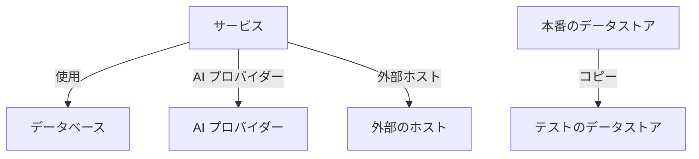

# データフロー、アクセス、データ所在地

データストアに何が入っているかを知るのは、まだ半分です。データセキュリティは、そのデータがどこへ行くか (どのサービスがデータストアを使い、データがどの AI プロバイダーや外部ホストに届き、どこにコピーされたか)、各データストアに誰がアクセスできるか、そしてデータが許されたリージョンにあるかも明らかにします。そのすべては、OneUptime がすでに持っている証拠から得られます。トレース、クラウド自身のアクセス設定、そしてスキャンで見つかったもののフィンガープリントです。

:::cards
- [データフロー](#データフロー): サービス、AI プロバイダー、外部ホスト、コピー。
- [データストアにアクセスできる人](#データストアにアクセスできる人): クラウドが報告するすべての付与と、データストアの露出の度合い。
- [データ所在地ルール](#データ所在地ルール): 各種類のデータが置かれてよいリージョン。
:::

## データフロー

| フロー | 意味 | 情報源 |
| --- | --- | --- |
| **使用** | サービスがデータストアと通信している。 | サービスマップ。OneUptime がサービスのクライアントスパンから 10 分ごとに作成します。マップ上の各データベースは名前、アドレス、エンドポイントでそのデータストアに結び付けられるため、ほかのどのソースにも載っていないデータベースは独立したデータストアになります。 |
| **AI プロバイダー** | サービスが AI プロバイダーにデータを送っている。 | サービスの過去 7 日間のトレースにある AI 呼び出し。呼び出し先のプロバイダーが示されています。 |
| **外部ホスト** | サービスがシステム外のホストを呼び出している。 | サービスマップのリモートサービス。呼び出されるアドレスで識別します。 |
| **コピー** | あるデータストアが別のデータストアの値を持っている。 | 各スキャンで見つかった値のフィンガープリント。あるデータタイプのフィンガープリントが半分以上重なると、2 つのデータストアはデータを共有しているとみなされます。 |

フローは、その送り元が持つデータタイプとその機密度を運びます。フローが確認済みになるのは、データへの経路があるだけでなく、データがそこにあることをスキャンが証明したときです。コピーは常に確認済みで、AI プロバイダーのフローはサービスの AI の会話に機密または制限のデータが含まれるときに確認済みになります。30 日間再び確認されなかったフローは削除されます。

2 つのチェックがフローを読み取ります。 [本番データが本番以外のデータストアにコピーされた](/docs/data-security/checks-and-issues#データの衛生管理) は、コピー先で失敗します。2 つのうち一方だけが本番環境にある場合、コピーは本番のデータストアから流れるものとされ、それ以外の場合は OneUptime が先に見つけたデータストアから流れるものとされます。 [機密データが AI プロバイダーに送信されている](/docs/data-security/checks-and-issues#ai) は、サービスの AI の会話に機密データが含まれるときにその会話で失敗し、届いたプロバイダーを示します。

### フィンガープリントを非公開に保つしくみ

コピーは、どちらのデータストアの値も使わずに見つけられます。スキャンが高い信頼度で見つけたデータタイプごとに、読み取った値を MinHash としてスケッチします。128 個のスロットからなり、各スロットは値全体に対する 1 つのハッシュ関数の最小値で、その下位 16 ビットだけが保持されます。2 つのスケッチが一致するスロットの割合は、2 つの値の集合が重なる割合とほぼ同じなので、スケッチを比べると一方のデータストアのどれだけがもう一方にあるかを推定できます。

- **値はプロジェクト独自のキーでハッシュされます** (HMAC-SHA256)。そのため、キーを持たない人は既知の値をスケッチと照合できず、2 つのプロジェクトのスケッチを比べることもできません。
- **スキャンの外に出るのは、各最小値の 16 ビットだけです。** スケッチから値やそのハッシュを読み戻すことはできません。
- **スケッチはフィールドではなくデータタイプについてのものです。** データストアには、高い信頼度で見つかったデータタイプごとに 1 つのスケッチがあり、それ以上はありません。

## データストアにアクセスできる人

設定の読み取りは、各クラウド自身のアクセス設定 (バケットポリシーと ACL、Azure のロール割り当て、Google Cloud の IAM バインディング、スナップショットの共有) を、データストアにアクセスできる人の 1 つの一覧にまとめ、データストアの **アクセスできる人** ページに表示します。

| 列 | 内容 |
| --- | --- |
| **プリンシパル** | アクセス権を持つ人またはもの。クラウドでの名前で示します: `*`、アカウント ID、ARN、メールアドレス、サービスアカウント。 |
| **プリンシパルの種類** | 公開、アカウント、ロール、ユーザー、グループ、サービスプリンシパル、サービスアカウント、サービスのいずれか。 |
| **アクセスレベル** | 読み取り、書き込み、管理者のいずれか。 |
| **付与経路** | アクセス権を付与しているもの: バケットポリシー、ACL、ロールの割り当て、IAM バインディング、スナップショットの共有のいずれか。 |
| **外部** | プリンシパルが、OneUptime に接続されたアカウント、サブスクリプション、プロジェクトの外にある。 |
| **公開** | プリンシパルがインターネット上の全員を指す。 |

一覧は設定の読み取りのたびに読み直され、クラウドが報告しなくなった付与は削除されます。 [25 を超える ID が制限データを読み取れる](/docs/data-security/checks-and-issues#アクセス) は、この一覧で読み取りができる主体を数えます。データストアを使うサービスは、その **使用** フローです。

読み取った内容から、すべてのデータストアに露出が割り当てられます。

| 露出 | 意味 |
| --- | --- |
| **公開** | インターネット上の誰でも読み取れる。 |
| **他のアカウント** | 接続済みのアカウント以外のアカウントがアクセスできる。 |
| **インターネットから到達可能** | ネットワークエンドポイントがインターネットからの接続を受け付ける。 |
| **非公開** | 自分のアカウントとネットワークだけがアクセスできる。 |
| **不明** | OneUptime が判断に足るだけの設定を読み取れなかった。 |

公開は共有より、共有は到達可能より優先されます。別のアカウントとも共有されている公開バケットは公開です。露出は問題の [リスクスコア](/docs/data-security/checks-and-issues#リスクスコア) に加算されます。

## データ所在地ルール

データ所在地ルールは、ある種類のデータをどこに置いてよいかを定めます。 **データセキュリティ → 設定 → データ所在地ルール** で追加します。

| 項目 | 内容 |
| --- | --- |
| **名前** | ルールの内容。たとえば「EU の個人データは EU 内にとどめる」。 |
| **許可されたリージョン** | そのデータを保存しコピーしてよいリージョン。クラウドでの名前で書きます。リージョンがないルールは何もチェックしません。 |
| **データカテゴリ** | ルールが対象とするデータのカテゴリ。空の場合は、あらゆる種類の個人データが対象です。 |
| **データ主体の所在地** | これらの国にいる人についてのデータだけ。 `DE` や `IN` のような ISO 3166-1 コードで指定します。空の場合は、どこにいる人のデータも対象です。 |
| **説明** | ルールの目的。たとえば「EU の顧客のデータは EU 内にのみ保存する」。 |
| **有効** | データストアをこのルールに照らしてチェックするかどうか。 |

データストアがルールに違反するのは、ルールの対象となるデータを持ち、そのデータストア自身のリージョン、またはデータのコピー先のリージョンが、許可されたリージョンのどれにも一致しないときです。コピーとは、データストアのデータが複製されるリージョンのことで、S3 のレプリケーション、ストレージアカウントの geo 冗長コピー、データベースのレプリカなどです。そのデータストアは [許可されたリージョンの外にデータが保存されている](/docs/data-security/checks-and-issues#データ所在地) で失敗し、そのリージョンと違反したルールが示されます。

### リージョンとワイルドカード

許可されたリージョンの `*` は任意の文字を表し、大文字と小文字は区別されません。パターンはリージョン全体に一致する必要があります。

| 許可されたリージョン | 一致する | 一致しない |
| --- | --- | --- |
| `eu-*` (AWS) | `eu-west-1`、`eu-central-1` | `us-east-1`、`us-eu-1` |
| `europe-*` (Google Cloud) | `europe-west1`、`europe-north1` | `us-central1` |
| `westeurope` (Azure) | `westeurope` | `northeurope` |

使用するクラウドごとに 1 つのパターンを挙げます。 `eu-*`、`europe-*`、`westeurope`、`northeurope` を合わせて指定すると、3 つのクラウドすべてでデータをヨーロッパ内にとどめられます。

### データストアが持つのは誰のデータか

OneUptime は、データストアが誰のデータを持っているかをデータそのものから読み取ります。1 つの国に属するデータタイプは、その人々がその国にいることを示します。ドイツの税 ID は `DE`、インドの Aadhaar 番号は `IN`、英国の NHS 番号は `GB` を示します。データストアはそれらの国をデータ主体の国として一覧にし、一部の国の人々に限ったルールは、その人々のデータを持つデータストアだけを対象にします。 [機密データタイプ](/docs/data-security/data-types#組み込みデータタイプ) には、国を持つすべてのデータタイプの国が記載されています。

## 次のステップ

:::cards
- [データセキュリティのチェックと問題](/docs/data-security/checks-and-issues): これらのフロー、付与、ルールが情報を提供するすべてのチェック。
- [データセキュリティのコンプライアンス](/docs/data-security/compliance): データ所在地とアクセスが GDPR、LGPD、DPDP にどう反映されるか。
- [トポロジー](/docs/telemetry/topology): フローの元になるサービスマップ。
:::
