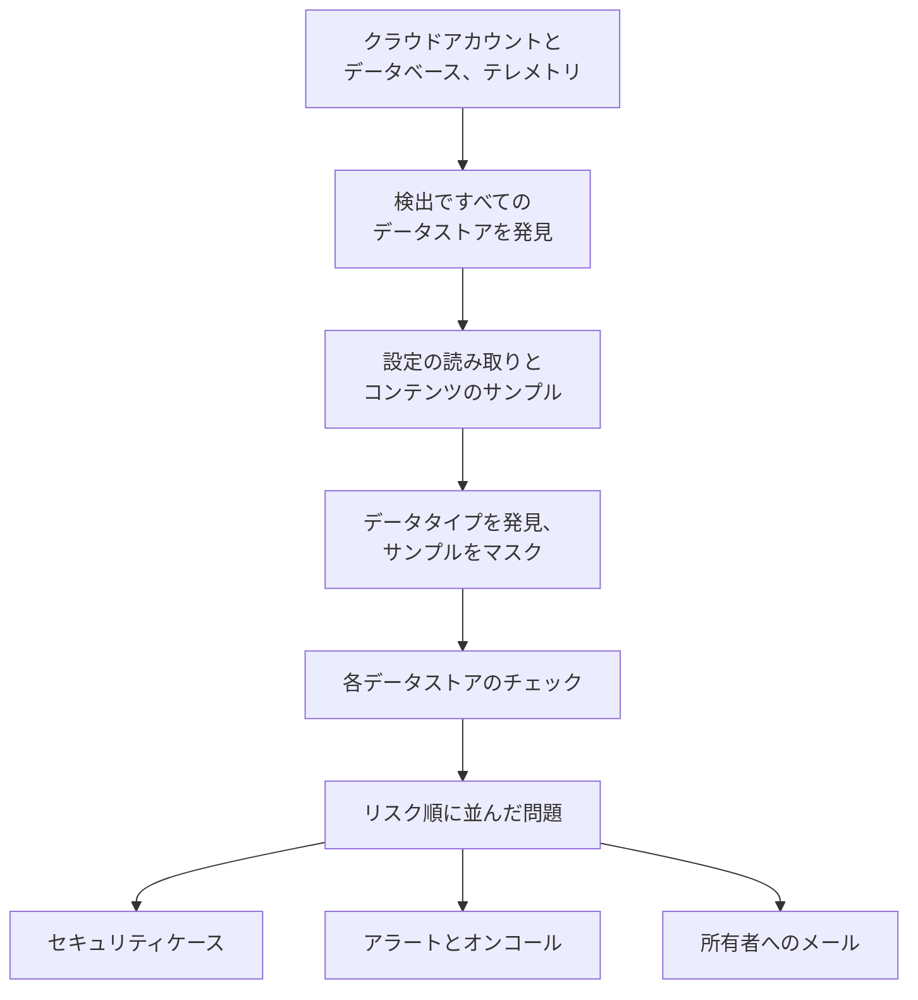

# データセキュリティ

データセキュリティは、クラウドのバケット、データベースやデータウェアハウス、そして OneUptime に送っているテレメトリの中から、会社が保持している機密データを見つけ、その保管のしかたの何が問題なのかを伝えます。データストアを自動で見つけ、それぞれの設定を読み取り、保持している内容をサンプリングし、不備ごとに問題を開いて、リスクの高い順に並べます。

次の 4 つの問いに答えます。

:::cards
- [機密データはどこにあるか？](/docs/data-security/data-types): カード番号や国民 ID から API キーまで、143 のデータタイプを、バケット、テーブル、テレメトリの中から見つけます。
- [露出していないか？](/docs/data-security/checks-and-issues): 各データストアに対する 32 のチェック。パブリックアクセス、暗号化、バックアップ、ログ記録、シークレット、コピー。
- [誰がアクセスでき、データはどこへ流れるか？](/docs/data-security/flows-access-residency): 各データストアを誰が読めるか、どのサービスが使っているか、そのデータがどの AI プロバイダーとホストに届くか。
- [ルールを満たしているか？](/docs/data-security/compliance): データ所在地ルールと、スキャンで見つかったものからスコアを付ける 9 つのフレームワーク。
:::

## 仕組み

1. **検出** は、OneUptime がすでに知っているデータストアを見つけます: クラウドのインベントリ、データベース製品が監視しているデータベース、サービスマップ上でサービスが通信しているデータベース、そして各サービスのテレメトリです。データストアを手動で追加するのは、どのソースにも載っていない場合だけです。
2. **設定の読み取り** は、すべてのデータストアがどう設定されているかを各クラウドに問い合わせます: 誰がアクセスできるか、どのように暗号化、バックアップ、ログ記録されているか。読み取るのは設定だけで、データは決して読みません。
3. **コンテンツのサンプル** は、許可した場合に、データストアが保持しているものを少しだけ読み取ります: バケットでは種類ごとにいくつかのオブジェクト、テーブルごとに数行、各サービスのテレメトリでは最新のレコードです。
4. **分類** は、サンプルの中から機密の値を見つけ、件数とマスクされたサンプルを保持します。値そのものは決して保持しません。
5. **チェック** は、各データストアの何が問題なのか、そしてそれが保持するデータにとってどれほど深刻なのかを判定します。不合格になったチェックはそれぞれ問題を開き、その問題はチェックに合格すると自動でクローズされます。

## ほかとの違い

- **テレメトリもデータストアです。** 各サービスのログ、トレース、例外、セッションリプレイ、AI の会話は、バケットと同じように 1 時間ごとにチェックされます。ログ行にあるメールアドレスは検出結果になり、 **スクラブ** を使うと、それ以降は取り込み時にマスクされます。 [テレメトリ内の機密データ](/docs/data-security/telemetry) を参照してください。
- **データフローは実際のトラフィックから得られます。** サービスマップはどのサービスがどのデータベースを使っているかを示し、AI の呼び出しは到達先のプロバイダーを名指しし、本番データのコピーはフィンガープリントの比較で見つかります。 [データフロー、アクセス、データ所在地](/docs/data-security/flows-access-residency) を参照してください。
- **証拠は常にマスクされます。** 検出結果が保持するのは件数と、 `j***@e******.com` のような最大 3 つのマスクされたサンプルだけで、マスクは何かがスキャナーの外に出る前にスキャナーの中で行われます。サンプルをオフにすると、件数だけを保持します。
- **スキャナーはオープンソースです。** すべてのデータタイプのパターン、チェックサム、コンテキストの語、テスト値は OneUptime のソースコードにあるので、何が検出結果になるのかを正確に読めます。同じコードが OneUptime のワーカー、プローブ、そして **テスト** ボックスで動きます。
- **OneUptime のほかの機能と連携します。** 重大度が「重大」の問題はそのデータストアについてセキュリティケースを開くので、 [セキュリティオペレーション](/docs/telemetry/security-cases) がほかの脅威と同じように対応します。オンコール担当者を呼び出すアラートを発生させることもでき、データストアの所有者にはメールが届きます。 [データセキュリティの連携](/docs/data-security/integrations) を参照してください。
- **OneUptime AI が修正を手伝います。** **AI で説明** はデータストアの所有者に、何が問題で、そのクラウドでどう修正するかを伝えます。 **AI で修正** はインフラストラクチャのコードにプルリクエストを作成します。

## 始める前に

- **設定できるロール。** データセキュリティの設定を変更できるのは Project Owner、Project Admin、Security Admin です。Security Member は問題に対応してデータストアをスキャンし、Security Viewer は見つかったものを閲覧します。それ以外のロールには、チームにその権限が与えられない限り何も表示されません: どのバケットにカード番号があるかは、まさに攻撃者が知りたい情報だからです。 [ロール](/docs/permissions/reference#ロール) を参照してください。
- **読み取るクラウドアカウント、またはデータベース。** データセキュリティは、クラウドアカウントを [クラウド接続](/docs/telemetry/cloud-accounts) を通じて、自分で運用しているデータベースを読み取り専用の接続文字列を通じて読み取ります。テレメトリには何も必要ありません: 1 時間ごとにスキャンされます。

## クイックスタート

:::steps
### クラウドアカウントを接続する

**クラウド → 接続** を開き、クラウドを選びます。アカウントがすでに接続されている場合は、代わりにその接続の **編集** を選びます。各クラウドの手順は [クラウドアカウントを接続する](/docs/telemetry/cloud-accounts) で説明しています。

### データセキュリティのレベルを選ぶ

**その他の項目** で **データセキュリティ** を設定します。すべてのデータストアの設定状況をチェックするには **設定のみ** 、その中の機密データも見つけるには **設定とコンテンツのサンプル** を選びます。フォームに表示されるコマンドは選択に応じて変わります: フォームの指示どおり、クラウドのシェルで実行してください。各レベルが付与するものは [データセキュリティを設定する](/docs/data-security/setup) に正確に一覧され、各レベルのコマンドは [クラウドアカウントを接続する](/docs/telemetry/cloud-accounts#データセキュリティ) に示されています。

### 問題を確認する

**データセキュリティ** を開きます。データストアは、15 分ごとの検出で見つかるたびに **データストア** の下に表示され、接続の設定は 1 時間以内に読み取られます。問題は読み取りやスキャンが終わるとすぐに、それぞれのリスクスコアとともに **問題** の下で開き、 **概要** にはリスクの最も高い 5 件が表示されます。各問題には、何が問題か、なぜ重要か、どう修正するかが、クラウド向けのコマンドとともに書かれています。
:::

## データストアとみなされるもの

| 場所 | データストア | コンテンツのサンプル |
| --- | --- | --- |
| AWS | AWS S3 Bucket、AWS RDS Instance、AWS Aurora Cluster、AWS RDS Snapshot、AWS DynamoDB Table、AWS Redshift Cluster、AWS DocumentDB Cluster、AWS OpenSearch Domain、AWS ElastiCache Cluster、AWS EFS File System | AWS S3 Bucket |
| Azure | Azure Storage Account、Azure SQL Database、Azure Cosmos DB Account、Azure PostgreSQL Server、Azure MySQL Server | Azure Storage Account |
| Google Cloud | Google Cloud Storage Bucket、Google Cloud SQL Instance、Google BigQuery Dataset、Google Firestore Database、Google Spanner Instance、Google Bigtable Instance | Google Cloud Storage Bucket、Google BigQuery Dataset |
| 自分で運用するデータベース | PostgreSQL、MySQL、MongoDB、SQL Server、Oracle、Redis、Elasticsearch | PostgreSQL、MySQL |
| OneUptime | ログ、トレース、例外、セッションリプレイ、AI の会話 | ログ、トレース、例外、セッションリプレイ、AI の会話 |

すべてのデータストアに、その種類に当てはまるチェックが行われます。コンテンツをサンプリングできないデータストアもチェックされます: 公開されたバケットや暗号化されていないデータベースは、何を保持していても問題だからです。

ソースに載らなくなったデータストアは、履歴とともにアーカイブされ、そのオープンの問題は解決済みになります: データセキュリティのメニューの最後にある **アーカイブ済みのデータストア** に残ります。ソースに再び載ると、自動で戻ってきて、チェックがまだ不合格の問題は再びオープンになります。

データストアの **タイムライン** には、そのデータストアに何が起きたか、誰が行ったかが表示されます: いつ見つかったか追加されたか、設定と所有者への各変更、いつアーカイブされたか戻ってきたか、そして問題やプレイブックから解消した各露出です。

## 実行の頻度

| 内容 | タイミング |
| --- | --- |
| 新しいデータストアを見つける | 15 分ごと |
| クラウド接続の設定を読み取る | 1 日 1 回。また、AWS のデータストアのアクセス、暗号化、バックアップ、共有への変更を CloudTrail が記録してから 1 時間以内 |
| データストアのコンテンツをサンプリングする | 24 時間ごと、または **スキャン間隔 (時間)** で指定した頻度 |
| 各サービスのテレメトリをサンプリングする | 1 時間ごと、直近 1 時間分 |
| すべてのデータストアを再チェックする | 読み取りとスキャンのたび、チェックが依存するものを変更したとき、そして 1 日 1 回 |

データストアの **今すぐスキャン** はすぐにコンテンツをサンプリングし、 **今すぐチェック** は設定を再度読み取ります。

## 次のステップ

:::cards
- [データセキュリティを設定する](/docs/data-security/setup): 3 つのレベル、それぞれが付与する権限、自分で運用するデータベースのスキャン。
- [機密データタイプ](/docs/data-security/data-types): 値の見つけ方と、データセキュリティが知っているすべてのデータタイプ。
- [データセキュリティのチェックと問題](/docs/data-security/checks-and-issues): すべてのチェック、リスクスコア、問題がたどる流れ。
- [データセキュリティの連携](/docs/data-security/integrations): セキュリティケース、アラート、所有者、ワークフロー、OneUptime AI。
:::
