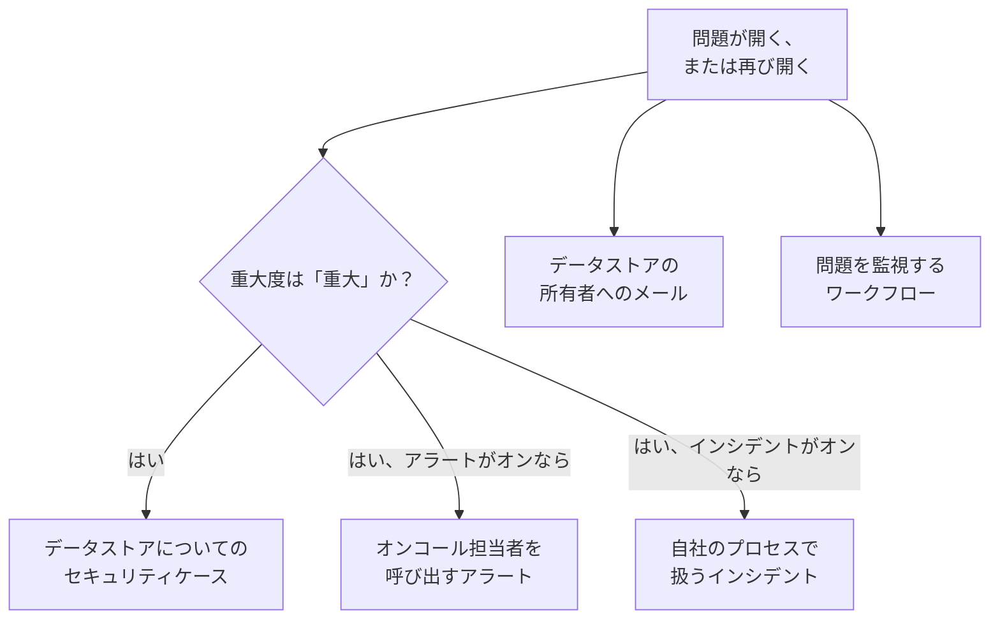

# データセキュリティの連携

データセキュリティは、オンコールの呼び出しやセキュリティのキューを独自には持ちません。見つけたものは、すでにそれを担っている OneUptime の機能に渡します: 重大度が「重大」の問題はセキュリティケースになり、オンコール担当者を呼び出すことも、インシデントを宣言することもでき、新しい問題はすべてデータストアの所有者にメールで送られます。ワークフロー、OneUptime AI、API、Terraform、MCP サーバーからは、データセキュリティが保持するすべてのものにアクセスできます。

:::cards
- [セキュリティオペレーション](#セキュリティオペレーション): 重大度が「重大」の問題があるデータストアごとのセキュリティケース。
- [アラートとオンコール](#アラートとオンコール): 重大度が「重大」の問題が開いたときに、オンコール担当者を呼び出します。
- [インシデント](#インシデント): インシデント対応プロセスで扱うべき侵害について、インシデントを宣言します。
- [所有者](#所有者): 手動またはルールで設定する各データストアの所有者と、所有者に届くメール。
- [OneUptime AI](#oneuptime-ai): 問題の説明、問題を修正するプルリクエストの作成、そして「AI に質問」でのデータについての質問。
- [露出を解消する](#露出を解消する): 問題やプレイブックから、パブリックアクセスをブロックするか、共有を停止します。
:::

## 仕組み

これらはそれぞれ、評価で問題が開いたとき、または再び開いたときに実行されます。どれもベストエフォートです: 問題はすでに開いていて、そのタイムラインにも載っているため、失敗した連携はログに記録されてスキップされ、再試行されて 2 つ目のケースや 2 回目の呼び出しになることはありません。それぞれが何をしたかは、問題の **タイムライン** に書き込まれ、問題のページには、その問題から始まったケース、アラート、インシデントへのリンクがあります。

| 設定 | デフォルト | 内容 |
| --- | --- | --- |
| **セキュリティケースを開く** | オン | 重大度が「重大」の問題が、データストアごとにまとめたセキュリティケースを開きます。 |
| **アラートを発生** | オフ | 重大度が「重大」の問題が、オンコール担当者を呼び出すアラートを発生させます。 |
| **アラートの重大度** | 空 | それらのアラートの重大度。空の場合は、プロジェクトで最も重い重大度になります。 |
| **インシデントを宣言** | オフ | 重大度が「重大」の問題が、インシデント対応プロセスで扱うインシデントを宣言します。 |
| **インシデントの重大度** | 空 | それらのインシデントの重大度。空の場合は、プロジェクトで最も重い重大度になります。 |
| **所有者に通知** | オン | 新しい問題はすべて、そのデータストアの所有者にメールで送られます。 |

## セキュリティオペレーション

すべてのデータストアは、セキュリティオペレーションの中で独立したエンティティであり、その種類は **データストア** です。 **セキュリティケースを開く** がオンの場合、重大度が「重大」の問題は、データストアについての検出としてセキュリティオペレーションに送られます。

- ソースは **データセキュリティ** で、ルールには `Data Security: public-read` のように、チェックにちなんだ名前が付きます。
- 重大度は「重大」なので、開くケースにはプロジェクトの「重大」の優先度が付きます。
- データストアごとにまとめられます: 同じデータストアで重大度が「重大」の 2 つ目の問題が開くと、別のケースを開くのではなく、そのデータストアについての未解決のケースに加わります。

その後は、ほかのケースと同じように処理されます: 担当者の割り当て、メモ、クローズ、そしてプロジェクトのプレイブックによる対応です。データストアの検出は、ほかのエンティティと同じく、 [エンティティリスク](/docs/telemetry/security-entity-risk) でそのリスクに加算されます。 [セキュリティケースとプレイブック](/docs/telemetry/security-cases) を参照してください。

## アラートとオンコール

**アラートを発生** がオンの場合、重大度が「重大」の問題はアラートを発生させます。アラートの名前は、「Data Security:」に問題のタイトルとデータストアを続けたものです。アラートは、ほかのアラートと同じく、それ自身のルールに従ってオンコール担当者を呼び出します ( [アラート](/docs/alerts/index) と [オンコール](/docs/on-call/index) を参照)。何回評価されても、1 つの問題について同時に開いているアラートは最大 1 件です。 **アラートの重大度** でアラートの重大度を設定します。空のままにすると、プロジェクトで最も重い重大度になります。

アラートは、その問題とともに終わります: 問題がオープンでなくなると (チェックに合格したとき、または人が問題を解決済みにしたとき、リスクを受容したとき、問題ではないと判断したとき)、アラートは解決され、問題の **タイムライン** にそのことが記録されます。再び開いた問題は、新しいアラートを発生させます。

アラートがデフォルトでオフなのは、ほとんどのチームが、データセキュリティの検出結果をまずセキュリティケースで扱いたいと考えるからです。カード番号の入った公開バケットで誰かを起こすべきなら、オンにしてください。

## インシデント

**インシデントを宣言** がオンの場合、重大度が「重大」の問題は、アラートと同じ形式の名前でインシデントを宣言します。これは、オンコール、ワークスペースのチャンネル、ステータスページ、ポストモーテムといったインシデント対応プロセスで扱うべき侵害のためのものです ( [インシデント](/docs/incidents/index) を参照)。1 つの問題について同時に開いているインシデントは最大 1 件です。 **インシデントの重大度** でインシデントの重大度を設定します。空のままにすると、プロジェクトで最も重い重大度になります。

データセキュリティは、問題が解決された後でも、インシデントを解決することはありません: インシデントにはステータスページやポストモーテムが伴うことがあるため、インシデントを担当する人がクローズします。セキュリティケースは、インシデントに至るもう 1 つの方法です: ケースで **インシデントを宣言** を使うと、そのケースにリンクされたインシデントが開きます ( [インシデントを宣言する](/docs/telemetry/security-cases#インシデントを宣言する) を参照)。

## 所有者

データストアの所有者は個人とチームで、データストアの **所有者** ページに表示されます。問題は所有者に向けたものです: 所有者がメールを受け取り、所有者のいない機密データストアは **この機密データストアには所有者がいない** チェックに不合格になります。

**所有者に通知** がオンの場合、データストアで問題を開いた評価ごとに、その所有者 (データストアを所有する個人と、所有するチームのメンバー。最大 50 人) にメールが 1 通送られます。件名は「Data Security: 2 new issues on orders-db」のように、データストアの新しい問題の数を示します。メールには新しい各問題の重大度とタイトル、データストアの機密度が載り、データストアへのリンクがあります。サンプルが含まれることはありません。

### 所有者ルールとラベルルール

ルールは、データストアが見つかるたびに、所有者とラベルを自動で設定します。

| ルール | 場所 | 内容 |
| --- | --- | --- |
| **所有者ルール** | **データセキュリティ → ルール → 所有者ルール** | 一致するすべてのデータストアに、所有者のユーザーとチームを追加します |
| **ラベルルール** | **データセキュリティ → ルール → ラベルルール** | 一致するすべてのデータストアにラベルを追加します |

ルールは、データストアのラベル、名前か説明のパターン、または **クラウド タグのパターン** でデータストアに一致します。これは、`key=value` の形で書かれた、データストアの各クラウドタグに照合されるパターンです。 `^team=payments$` は `team=payments` のタグが付いたすべてのデータストアに、 `^env=` は `env` タグを持つすべてのデータストアに一致します。新しいデータストアには、見つかった瞬間にプロジェクトのルールが適用されます。所有者ルールの **所有者に通知** は、そのルールが追加した所有者に通知するかどうかを決めます。 [ラベルルールと所有者ルール](/docs/configuration/label-and-owner-rules) に、各ルールの一致のしかたと、ルールが実行されるタイミングが説明されています。

## ワークフロー

**データストア** と **データセキュリティの問題** はワークフローのトリガーで、それぞれに **作成時** 、 **更新時** 、 **作成時または更新時** 、 **削除時** があります。 **トリガーを追加** パネルの **OneUptime のリソース** の下で選びます。

- **データセキュリティの問題 → 作成時** は、問題が初めて開いたときに実行されます。 **条件分岐 (If / Else)** ブロックで重大度を読み取り、重大度が「重大」のものをチャンネルに投稿したり、トラッカーでチケットを作成したりできます。
- **データセキュリティの問題 → 更新時** は、 **監視するフィールド** をステータスに設定すると、問題が解決されたとき、受容されたとき、または再び開いたときに実行されます。
- **データストア → 作成時** は、検出でデータストアが見つかったときに実行されます。たとえば、新しいバケットをすべてチームに知らせるのに使えます。

各トリガーが渡すフィールドについては、 [ワークフローのトリガー](/docs/workflows/triggers) を参照してください。

## OneUptime AI

問題に対する 2 つの操作で、OneUptime AI に助けを求められます。どちらも OneUptime AI に、問題のタイトルと重大度、データストアの名前、種類、リージョン、クラウドでの ID、その機密度とデータタイプ、証拠、チェックが重要な理由、そしてデータストアのクラウドでの修正方法を送り、検出結果のサンプルは決して送りません。どちらも、プロジェクトの OneUptime AI のスイッチと上限の範囲内で実行されます。

- **AI で説明** は、データストアの所有者に向けて、何が問題か、何が起こりうるか、そして所有者のクラウドで修正する正確な手順を書きます。説明は問題の **タイムライン** に保存されます。データセキュリティを閲覧できる人なら誰でも依頼できます。
- **AI で修正** は、チェックに合格する最小限の変更でインフラストラクチャのコード (Terraform、CloudFormation、Bicep など) の問題を修正し、プルリクエストを作成するよう OneUptime AI に依頼します。データストアのインフラストラクチャのコードがあるリポジトリが **コード** の下で接続されている必要があります: プロジェクトに複数ある場合は **リポジトリ** で選びます。プルリクエストは **コード** の下に表示されます ( [コード](/docs/ai/ai-agent) を参照)。Security Member 以上のロールが依頼できます。

### AI に質問

**AI に質問** はデータセキュリティも読み取ります。データセキュリティのどのページでも、どのデータストアがカード番号を保持しているか、何から修正すべきか、あるロールが漏えいした場合にどのデータストアに到達できるかを尋ねられます。データストアや問題のページでは、まずそのレコードを読み取ります。回答には 3 つの読み取りツールを使い、それらはあなた自身の権限で実行されます。

| ツール | 読み取るもの |
| --- | --- |
| `query_data_stores` | 機密度、データタイプ、露出、プロバイダー、名前で絞り込んだデータストアを、リスクの高い順に。または 1 つのデータストアについて、どこで何が見つかったか、誰がアクセスできるか、未解決の問題 |
| `query_data_security_issues` | ステータス、重大度、データストア、チェックで絞り込んだ問題を、リスクの高い順に。または 1 つの問題について、その証拠とクラウドでの修正方法 |
| `query_data_store_access` | データストアに誰がアクセスできるか、または 1 つのプリンシパルがアクセスできるすべてのデータストア |

これらが読み取るのはデータタイプ、場所、件数で、検出結果のサンプルは、マスクされていてもいなくても決して読み取りません。「AI に質問」がデータセキュリティの何かを変更することはありません。

## 露出を解消する

クラウドのデータストアの露出を解消する変更は 2 つあり、どちらも **データセキュリティ対応** をオンにしたデータストアのクラウド接続を通じて行われます ( [データセキュリティを設定する](/docs/data-security/setup#データセキュリティに露出を解消させる) を参照)。

- **パブリックアクセスをブロック** は、S3 バケット、Azure ストレージアカウント、Cloud Storage バケットで行えます。
- **共有を取り消す** は、RDS スナップショット、または RDS データベース、Aurora クラスター、DocumentDB クラスターの共有された手動スナップショットで行えます。

人が実行するときは、それで解消される未解決の問題から **ここで修正** を使います ( [データセキュリティのチェックと問題](/docs/data-security/checks-and-issues#ここで修正) を参照)。セキュリティオペレーションのプレイブックは、これらを **封じ込め** カテゴリのステップ **データストアへのパブリックアクセスをブロック** と **データストアの共有を取り消す** として実行します: ケースが対象とするすべてのデータストア (最大 10 個) が対象で、どちらのステップも **承認が必要** がオンの状態で始まります。 **意図的に公開** とマークされたデータストアがブロックされることはありません。どちらの場合も、何が行われたかがデータストアのタイムラインに記録され、データストアはすぐに再チェックされるので、変更が反映されていれば問題は解決します。

## API、Terraform、MCP

データセキュリティが保持するものはすべて OneUptime API のレコードで、ダッシュボードと同じ権限で読み取れます ( [API リファレンス](/docs/api-reference/api-reference) を参照)。

| レコード | API パス |
| --- | --- |
| データストアとそのタイムライン、検出結果、アクセスできる人 | `/data-store`、`/data-store-feed`、`/data-store-finding`、`/data-store-access` |
| 問題とそのタイムライン、データフロー | `/data-security-issue`、`/data-security-issue-feed`、`/data-security-flow` |
| スキャン | `/data-security-scan` |
| カスタムデータタイプ、チェックの設定、データ所在地ルール | `/data-security-custom-data-type`、`/data-security-check-setting`、`/data-security-residency-rule` |
| プロジェクトの設定 | `/data-security-setting` |
| 所有者、所有者ルール、ラベルルール | `/data-store-owner-user`、`/data-store-owner-team`、`/data-store-owner-rule`、`/data-store-label-rule` |

いくつかの回答は、保存されているのではなく、リクエストのたびに算出されます。どれも `POST` です。

| パス | 内容 |
| --- | --- |
| `/data-security/overview` | 概要の数値: 機密度別とカテゴリ別のデータストア、重大度別の未解決の問題、リスクの最も高い問題、そして直近 30 日間の問題 |
| `/data-security/compliance` | すべてのフレームワークのスコアと要件 |
| `/data-security/record-of-processing` | GDPR の処理の記録。個人データを保持するデータストアごとに 1 行 |
| `/data-store/<id>/scan-now` | **今すぐスキャン**: データストアのコンテンツをすぐにサンプリングします |
| `/data-store/<id>/check-now` | **今すぐチェック**: データストアの設定を再度読み取り、チェックを実行します |
| `/data-store-finding/<id>/scrub` | テレメトリの検出結果での **スクラブ** |
| `/data-security-issue/<id>/explain` | 問題での **AI で説明** |
| `/data-security-issue/<id>/fix-with-ai` | 問題での **AI で修正** |
| `/data-store/<id>/response-actions` | データストアでいま実行できる対応アクションと、実行できない場合はその理由 |
| `/data-store/<id>/respond` | 実行元の問題を指定して、データストアに **パブリックアクセスをブロック** または **共有を取り消す** を実行します |

[Terraform プロバイダー](/docs/terraform/index) には、作成する各種類のレコード (自分で追加するデータストア、カスタムデータタイプ、チェックの設定、データ所在地ルール、所有者ルールとラベルルール) ごとに、 `oneuptime_residency_rule` のようにレコードにちなんだ名前のリソースがあります。

[MCP サーバー](/docs/ai/mcp-server) には、次のレコードの作成・取得・一覧・更新・削除・件数のツールがあります: Data Store、Data Store Finding、Data Store Access Entry、Data Flow、Data Security Issue、Data Security Scan、Custom Data Type、Check Setting、Residency Rule、Data Security Setting。これにより AI アシスタントは、どのデータストアがカード番号を保持しているか、あるバケットで何が未解決かを、あなたの権限で尋ねられます。

## 次のステップ

:::cards
- [セキュリティケースとプレイブック (SOAR)](/docs/telemetry/security-cases): データセキュリティが開くケースに対応します。
- [ラベルルールと所有者ルール](/docs/configuration/label-and-owner-rules): ルールの一致のしかたと、実行されるタイミング。
- [ワークフローのトリガー](/docs/workflows/triggers): 問題が開いたとき、またはデータストアが見つかったときにワークフローを実行します。
- [データセキュリティのチェックと問題](/docs/data-security/checks-and-issues): 各問題の意味と、その修正方法。
:::
