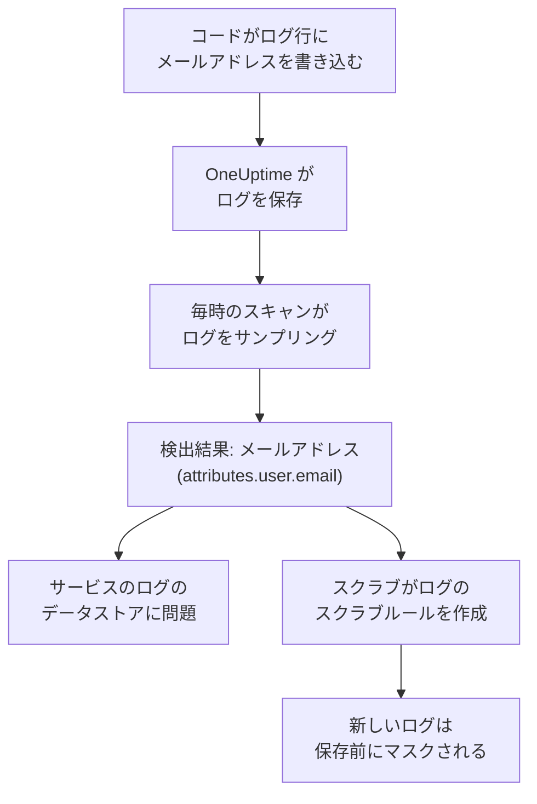

# テレメトリ内の機密データ

テレメトリには、コードが書き込んだものが何でも入ります。ログ行のメールアドレス、スパン属性のカード番号、スタックトレースのトークン、プロンプトに含まれる顧客の質問、メトリクスのラベルに含まれるユーザーの IP アドレスなどです。データセキュリティは、各サービスのログ、トレース、メトリクス、例外、AI の会話と、各 RUM アプリケーションのセッションを、それぞれ独立したデータストアとして扱います。それらを毎時サンプリングし、バケットと同じように機密データを見つけます。**スクラブ** を使うと検出結果がルールになり、以後そのデータは、見つかったサービスで取り込み時に隠されます。

設定は不要です。プロジェクトの設定で **テレメトリをスキャン** がオフになっていない限り、各サービスのテレメトリは毎時スキャンされます。あるサービスのログ、トレース、その他のシグナルを除外するには、そのデータストアの **設定** で **コンテンツをスキャン** をオフにします。次回のスキャンから、その内容は一切読み取られません。

:::cards
- [読み取られるもの](#読み取られるもの): 各シグナルの属性、本文、メッセージ、プロンプト。
- [スキャンのサンプリング方法](#スキャンのサンプリング方法): 各サービスの最新のレコードを毎時読み取ります。
- [スクラブ](#スクラブ): 検出結果を、見つかったサービスで取り込み時に隠します。
- [自動で封じ込め](#自動で封じ込め): 安全だと証明された場合に、誰も何も押さずにシークレットを隠します。
- [このメトリクスを破棄](#このメトリクスを破棄): 名前に機密データを含むメトリクスの保存を止めます。
- [スクラブ済みとみなされる条件](#スクラブ済みとみなされる条件): スクラブルールがすでに検出結果をカバーしているとき。
:::

## 仕組み

スクラブルールがカバーする検出結果は、スクラブ済みとして示されます。OneUptime が保存しているそのデータは、保持期間の終わりを待つ古いデータです。ただしコードは今もそのデータを書き込んでいるため、テレメトリの 2 つのチェックはそれを修正済みではなく封じ込め済みとして数えます。すべての検出結果がスクラブされると、その問題は **取り込み時に封じ込め済み** として解決し、**コードで修正済み** として解決するのは、コード修正の新しいバージョンがそのデータを書き込まなくなってからです ( [問題がたどる流れ](/docs/data-security/checks-and-issues#問題がたどる流れ) を参照)。

## 読み取られるもの

| データストア | 読み取られるもの | 検出結果が指す場所 |
| --- | --- | --- |
| ログ | すべての属性と本文 | `attributes.<key>`、`body` |
| トレース | すべてのスパン属性と、すべてのスパンイベントの属性 | `attributes.<key>`、`events.<event>.<key>` |
| 例外 | メッセージ、スタックトレース、属性 | `message`、`stackTrace`、`attributes.<key>` |
| AI の会話 | GenAI の規約が定めるキーに入った、すべての AI 呼び出しのプロンプトと回答、およびその他すべての属性 | それらが入っているキー。 `gen_ai.input.messages` や `gen_ai.prompt[].content` など |
| セッションリプレイ | RUM アプリケーションのスパンとログの属性、そのセッションの属性、 `identify()` がユーザーに与えた特性、アプリケーションに伝えられたユーザー参照 | `spans.attributes.<key>`、`logs.attributes.<key>`、`sessions.attributes.<key>`、`sessions.identifiedUserTraits.<key>`、`sessions.identifiedUserLabel` |
| メトリクス | データポイントのすべての属性 (リソースの属性を含む) と、メトリクスの名前 | `attributes.<key>`、`attributes.resource.<key>`、`name` |

番号付きのキーは 1 つの場所にまとめられます。 `gen_ai.prompt.3.content` は `gen_ai.prompt[].content` になるため、チャットの 20 件のメッセージは 20 件ではなく 1 件の検出結果になります。OneUptime 自身が追加する、 `oneuptime.` で始まる属性は読み取られません。

### メトリクス

メトリクスの属性は、その系列のラベルです。ラベルは 1 つの系列のどのデータポイントでも同じなので、1 分間に 1,000 個のポイントを書き込むメトリクスでも値は 3 つしかないことがあり、ユーザーのメールアドレスを漏らすラベルは、ポイントではなく系列を 1 つ増やします。そのため、メトリクスはポイントではなく系列ごとにサンプリングされます。

- **各系列のポイント 1 つ。** 各メトリクスは、直近 1 時間に書き込んだ最新の 1 分間で読み取られます。読み取るのは、その 1 分間の系列のうち最大 100 個について、各系列のデータポイント 1 つずつです。メトリクスの送信頻度にかかわらずこうするため、活発な系列が静かな系列を押しのけることはありません。値は、それを繰り返す系列がいくつあっても 1 回だけ分類されるため、検出結果はその場所にある異なる値の数を数えます。
- **新しいメトリクスを先に、残りは順番に。** サービスがどのメトリクスを書き込んだか、そして各メトリクスが直近 1 日で最初に書き込んだのはいつかは、メトリクスのテーブルが保持する 1 分ごとのロールアップから得られ、ポイントそのものからは決して読み取りません。各スキャンは、まずサービスの最も活発なメトリクス (系列が多い可能性が最も高いもの) を読み取ります。次に、新しい漏えいはたいてい新しいコードから生じるため、直近 2 時間に書き込みを始めたメトリクスを読み取り、続いてそれ以外のメトリクスを、前回のスキャンが止まったところから決まった順序で読み取ります。新しいメトリクスが使うのはそれらの枠の半分までなので、それ以外のメトリクスの枠は常に残ります。
- **どのメトリクスも一定時間内に。** 1 回のスキャンでは各サービスに読み取り枠を 10 個ずつ割り当てます (プロジェクトのサービスが 10 を超える場合はそれより少なくなります)。メトリクスが少ないためにサービスが使わなかった読み取り枠は、まだ順番を待っているメトリクスがあるサービスに 1 つずつ回されるので、無駄になる枠はなく、どのサービスも自分の割り当てより少なくなることはありません。各サービスの最も活発な 5 個が 5 枠を使い、残りの枠で他のメトリクスを順番に読み取ります。メトリクスが M 個で、順番の読み取りを r 枠受け取るサービスでは、各メトリクスが少なくとも M ÷ r 時間 (切り上げ) ごとに 1 回読み取られます。300 個のメトリクスを持つサービスが自分の 5 枠しか受け取らない場合は 60 時間、300 個のメトリクスを持つ他の 2 つのサービスと同じプロジェクトにある場合は、それぞれが 28 か 29 枠を受け取るので 11 時間です。新しいメトリクスを毎時間始め続けている間は、最大でその 2 倍になります。
- **メトリクスごとの範囲。** メトリクスはまとめて読み取られ、それぞれがテーブルの主キーのうち自分の範囲で読み取られます。ユーザーごとのメールアドレスをラベルに付けたメトリクスのように、最新の 1 分間に 16,384 個を超えるポイントがあるメトリクスは単独で読み取られ、その読み取りは最初のポイントで止まります。そのため、ほかのメトリクスより多くのコストはかかりません。

検出結果は、 `attributes.user.email` のような属性を示し、メトリクスの名前にあるデータなら `name` を示します。そのレコードは、データが見つかったデータポイントです。各レコードにはそのメトリクスと、マスクされた属性の値が表示され、 **メトリクス** でそのメトリクスを、その属性でグループ化して開きます。メトリクスの名前に機密データが含まれる場合は、名前もマスクされ、レコードは代わりにサービスのメトリクスを開きます。

### リプレイの録画を読み取らない理由

セッションリプレイの録画には、ユーザーが見たページのテキストが含まれます。録画を見るには専用の権限が必要で、そこから読み取った検出結果は、データセキュリティを閲覧できる全員にマスクされたページのテキストを見せてしまいます。そのため、リプレイは属性だけが読み取られます。録画に付随するスパン、ログ、セッションの詳細です。レコーダーはブラウザーで記録する時点ですでにマスクしており、ログのスクラブルールは録画にも適用されます ( [セッションリプレイ](/docs/telemetry/session-replay) を参照)。

### AI の会話

AI 呼び出しのプロンプトには、その人の最新のメッセージより前のチャット全体が含まれるため、AI 呼び出しの各値は最大 16,384 文字まで読み取られます。AI の会話に機密データが含まれる場合は、さらに 2 つのことが起こります。呼び出し先の AI プロバイダーがそのデータのデータフローになり、そのデータストアで [機密データが AI プロバイダーに送信されている](/docs/data-security/checks-and-issues#ai) が失敗します。

[会社の AI ツール](/docs/telemetry/ai-company-tools) の会話は対象外です。それを読めるのはプロジェクト所有者とプロジェクト管理者だけですが、検出結果はデータセキュリティを閲覧する全員が読める場所に置かれます。そのため、それらのサービスのスパンは読み取られず、その AI の会話は読み取られていないと報告されます。

## スキャンのサンプリング方法

毎時、各シグナルの直近 1 時間の最新レコードが読み取られ、ほかのデータストアと同じようにフィールドごとに分類されます ( [フィールドと列](/docs/data-security/data-types#フィールドと列) を参照)。

| 上限 | 値 |
| --- | --- |
| 各サービスとシグナルのレコード数 | **テレメトリのサンプルサイズ**。既定は 500 で、1,000 を超えることはない |
| シグナルごとに読み取るサービスまたは RUM アプリケーション | 最も活発な 200 件 |
| 1 回の読み取りのレコード数 | 5,000 (サービス間で共有)。AI 呼び出しは 500 |
| ログの本文、例外のメッセージ、スタックトレースの文字数 | 8,192 |
| 属性値の文字数 | 4,096 |
| AI 呼び出しの値の文字数 | 16,384 |
| 1 件のレコードの属性数 | 128。AI 呼び出しは 64 |
| 1 つのスパンのイベント数と、1 つのイベントの属性数 | 16 と 32 |
| 1 つのデータストアの場所の数 | 500 |
| 1 回のスキャンで読み取るメトリクスの数 | 100 (サービス間で共有し、各サービスから少なくとも 1 つ)。各サービスから 10 で、半分は最も活発なもの、残り半分は新しいものとそれ以外のものから順番に。サービスが使わなかった枠は順番に他のサービスへ回されます |
| 新しいメトリクス | 直近 24 時間で最初のポイントが直近 2 時間以内に届いたもの |
| 1 つのメトリクスの系列数 | 最新の 1 分間の各系列のデータポイント 1 つずつ。最大 100 |

すべての値はデータベース内で切り詰められるため、長い値がデータベースの外に出ることはありません。各読み取りは 30 秒で停止します。失敗した読み取りは対象のデータストアの警告になり、スキャンは次の読み取りに進みます。

何かを対象外にするには、データストアの **スキャン除外** に追加します。完全な名前の場所 (`attributes.http.url`)、ある場所の下のすべて (`attributes.http`)、または属性キーだけの名前 (`http.url`) を指定できます。

## スクラブ

検出結果の **スクラブ** は、その場所のそのデータタイプを以後隠すルールを作成するか、すでにそうしている有効なルールを示します。

:::steps
### 検出結果を開く

問題を開くか (その **見つかった場所** に、背後にある各検出結果が一覧表示されます)、 **データセキュリティ > テレメトリ内** を開きます。ここでは **レコードを表示** を押すと、検出結果が見つかったレコードが一覧の横に開きます。

### スクラブを押す

**スクラブ** をクリックします。何かが作成される前に、ルールが何をするかをダイアログが示します。どのレコードを変えるか、見つけたものをどうするか、隠すことになる値を何が読み取っているかです。ダイアログの **スクラブ** をクリックするとルールが作成されます。OneUptime は、ログと RUM アプリケーションのログにはログのスクラブルールを、スパン、例外、AI 呼び出しにはトレースのスクラブルールを、検出結果があるレコードの部分に対して作成し、メトリクスの属性にはメトリクスのパイプラインルールを作成します。

### コードも修正する

ルールは新しいデータを保存前に隠します。すでに保存されたデータは保持期間が終わるまで残るため、それを書き込んでいるコードを修正してください。検出結果にはサービスと属性が示されています。
:::

ルールには、「Data Security: Email address in log attributes of checkout」のように、属性を指定するルールなら「Data Security: Password or secret in db.password of checkout」のように、隠すものにちなんだ名前が付き、ほかのスクラブルールと一緒に一覧表示されます ( [ドロップフィルターとスクラブルール](/docs/telemetry/drop-filters-and-scrub-rules#機密データをスクラブする) を参照)。ルールは検出結果のデータを隠す最も狭いルールで、次のうち最初に当てはまるものです。

| 検出結果 | スクラブが作成するルール |
| --- | --- |
| メールアドレス、カード番号、米国の社会保障番号、電話番号、IP アドレス | そのタイプの組み込みパターンで、マスクされます。IP アドレスは伏せ字になります。[セキュリティイベント](/docs/telemetry/security-events) がそれらのレコードを読む場合はハッシュされ、ブロックすべきアドレスを引き続き示せます。 |
| GitHub のトークンのように、パターンだけで見つかるその他のデータタイプ | データタイプ自身のパターンから作られた **カスタム正規表現** のルール。シークレットは伏せ字になります。 |
| パターンのある独自のデータタイプ | そのパターン。見つかった属性の中だけ |
| ルーティング番号のように、周囲の語で区別されるデータタイプ | その形。見つかった属性の中だけ |
| `customer_name` の中の人の名前のようにフィールド名から見つかるデータタイプ、またはシークレットを示すキーの値 | **指定した属性** のルール。その属性の値全体を隠します |
| 機密に見えるキーの値で、より狭いもので隠せない場合 | **機密属性のキー** のルール。そのような属性の値全体を伏せ字にします |
| メトリクスの属性にある任意のデータタイプ | サービス用の **属性を秘匿化** のメトリクスのパイプラインルール。属性の値のうちそのデータタイプの形をしたものを `[REDACTED]` に置き換えます。そのデータタイプを見つけるパターンがない場合は、属性のすべての値を置き換えます |

### 見つかったレコードで検証

ダイアログがルールの動作を示す前に、OneUptime は作成しうる各ルールを、検出結果が見つかったレコードと、その場所に値があるサービスの最新のレコードで、取り込みと同じコードを使って実行し、残ったものをスキャナーに確認します。データを含んでいたすべての値でデータを隠し、その場所のほかの値の変更が 100 個中 5 個以下のルールのうち、最初のものが選ばれます。ダイアログには、実行したレコードの数、データを含んでいた値の数、変更したほかの値の数が表示されます。それより多くを変更するパターンは提示されません。代わりに属性を指定するルールが、ほかに何を変更するかとともに提示されます。

検証結果はルールとともに保存され、ルールが変更されるまで、スクラブルールの一覧の行に **検証済み** と表示されます。例外やセッションリプレイのレコード、保持期間を過ぎたレコードのように、ルールを実行できるレコードが残っていない場合、ルールは計画どおりに作成され、ダイアログにそう表示されます。

ログまたはトレースのルールは、検出結果が見つかったサービス用です。そのサービスのログまたはスパンをスクラブし、ほかのサービスのものはそのままなので、それらを読み取るものは何も変わりません。スクラブルールの一覧の **スコープ** 列に、ルールがどのサービス用かが表示されます。RUM アプリケーションのセッションリプレイで見つかった検出結果からは、プロジェクトのすべてのサービスとアプリ用のルールが作成されます。ログのルールはリプレイもスクラブするためで、ダイアログにもそう表示されます。サービスがもう存在しない場合、**スクラブ** はその旨を示し、ルールを作成しません。

ダイアログには、ルールが隠すことになる値を読み取っているモニター、ウィジェット付きのダッシュボード、保存済みビュー、記録ルール、SLO が、それぞれリンクとして表示され、それらに何が起きるかも示されます。隠された値に対するフィルターは一致しなくなり、それによるグループ化では実際の値が表示されなくなります。また、それらのレコードを読み取る [セキュリティイベント](/docs/telemetry/security-events) が失うものも示します。IP アドレスが隠されると、そのイベントはブロックすべきアドレスを示せません。表示権限のないものは件数だけが示され、名前は表示されません。ダイアログがルールを止めることはありません。何が起きるかを示し、判断はあなたが行います。スクラブルールのフォームでも、ルールを保存または有効にする前に同じ内容が表示されます。

ルールではスクラブできない検出結果もあり、その場合は **スクラブ** が理由を示します。メトリクスの属性は、そのルールが属性のすべての値を隠せるため、常にスクラブできます。

- 人の名前のように、ログ本文の中でフィールド名だけから見つかるデータタイプ: どのルールもメッセージのほかの部分と区別できません。**指定した属性** のルールが隠す属性として送信するか、送信をやめてください。
- 試したどのルールもデータよりはるかに多くを隠した場合: 各ルールは見つかったレコードで実行され、ほかのものを変更しすぎました。それを書き込むコードで送信をやめてください。
- 文書のマーキング: その語を隠しても文書は隠れません。
- セッション自体の詳細 (`sessions.*`): セッションリプレイの取り込みではスクラブルールが実行されません。
- メトリクスの名前 (`name`): 名前はメトリクスを作成するコードが設定し、パイプラインルールはメトリクスの名前を丸ごと変更することしかできません。メトリクスの名前を変更し、名前の中で変化する部分は代わりに属性として送信してください。それまでは、 **このメトリクスを破棄** でそれらのメトリクスの保存を止められます。

**スクラブ** は、あなたとして、あなた自身の権限でルールを作成します。プロジェクト所有者とプロジェクト管理者は押すことができ、ログのスクラブルールを作成できるチームも押せます。スパン、例外、AI 呼び出しでは、トレースのスクラブルールを作成できるチームが押せます。メトリクスでは、メトリクスのパイプラインルールを作成できるチームが押せます。

## 自動で封じ込め

OneUptime AI がデータセキュリティの問題に対応している間 ( [データセキュリティの OneUptime AI](/docs/data-security/ai) を参照)、安全だと証明された場合には、誰も何も押さずにテレメトリの問題が封じ込められます。問題が数える各場所について、OneUptime AI は **スクラブ** が作成するルールを同じ方法で検証して計画し、次のすべてが成り立つ場合にだけ自動で作成します。

- **データがシークレットである**: パスワード、トークン、キーなど。
- **ルールが検証済みである**: データが見つかったレコードで、データを含んでいたすべての値でデータを隠しました。
- **その場所でほかに何も変更しない**: その場所のほかの値を 1 つも変更しません。
- **隠すものを何も読んでいない**: モニター、ダッシュボード、保存ビュー、記録ルール、SLO のどれも読まず、セキュリティイベントが必要とするものもありません。
- **データが見つかったサービス用である**。

それ以外はすべて、代わりに **データセキュリティ → AI** と問題のページで提案され、ルールがどう検証されたか、ルールが隠すものを何が読んでいるかが示されます。個人データ、何かが読んでいるルール、ほかの値を変更するルール、実行できるレコードが残っていないルール、すべてのサービス用のルール、メトリクスのパイプラインルール、以前のルールを誰かが元に戻したか却下した場所が対象です。問題に対して **封じ込め** を **自動** に設定したデータセキュリティの AI ルールがあれば、検証済みの個人データも自動で隠せます。安全だと証明されていない変更を自動で実行させるルールはありません。

独自のデータタイプにパターンがない場合のように、**スクラブ** のどのルールでもデータを隠せないときは、OneUptime AI がルールを書きます。データのパターン、または全体を隠す属性です。OneUptime AI に伝えられるのは、データタイプ、その場所、横にある属性の名前、`AB-1234` なら `AA-9999` のような値の形だけで、値は伝えられません。書かれたルールは、提案または作成される前に、ほかのルールと同じようにレコードで検証されます。

OneUptime AI が自動で行った変更は次のとおりです。

- **問題のタイムラインに表示されます**: 作成したルール、各ルールの検証方法、それらを削除する **元に戻す** が表示されます。**データセキュリティ → AI** にも同じ **元に戻す** があります。ルールを元に戻した場所は、二度と自動で封じ込められず、OneUptime AI は代わりに提案します。
- **メールで通知されます**: データストアの所有者とサービスの所有者に送られます。
- **シークレットのローテーションを求めます。** シークレットを隠しても止まるのは新しいコピーだけです。シークレットは引き続き有効で、ルールより前に保存されたレコードは保持期間が終わるまでそれを保持します。タイムラインとメールには、それが見つかった場所が示されます。

問題がすでに開いているサービスの新しい検出結果も、1 時間ごとのスキャンで見つかりしだい、同じ方法で封じ込められます。

## このメトリクスを破棄

メトリクスの名前からデータを取り除けるルールはないため、メトリクスに名前を付けるコードが修正されるまで、データは届き続けます。メトリクスの名前にある検出結果で **このメトリクスを破棄** を使うと、名前にそのデータを含むメトリクスの保存を止めます。その代わりにそれらのデータは失われるため、あなたが求めたときにだけ行われます。

- **1 つのサービスのメトリクス。** 検出結果のサービスに対して、 **破棄** のメトリクスのパイプラインルールを作成します。名前にそのデータ型を含むメトリクスの新しいデータポイントは、保存される前にすべて破棄されます。フィルターは **スクラブ** がその型に使うパターンなので、人名のようにどのパターンでも見つけられない型は破棄できず、ダイアログがその理由を示します。
- **実行する前に伝えます。** ダイアログは、それらのデータポイントが完全に失われること、サービスのメトリクスのうち直近 1 日に書き込まれたものでこのような名前のものがいくつあるか、何がそれらを読み取っていて新しいデータを受け取らなくなるか、すでに保存されているものは保持期間が終わるまで残ること、そして元に戻す方法を伝えます。理解したことにチェックを入れるまで、何も破棄されません。
- **それらを読み取るものと、それに起きること。** ダイアログは、各モニター、それらのメトリクスを読み取るウィジェットとともに各ダッシュボード、サービスの各メトリクス SLO、そしてそれらを読み取る各メトリクス記録ルールを、それぞれリンクとして名前で示します。モニターはその値でアラートを出せなくなり、ウィジェットには新しいデータが表示されなくなり、SLO はそれらの新しいイベントを数えなくなり、記録ルールの出力メトリクスにもそれらは含まれなくなります。各記録ルールの下には、そのルールの出力メトリクスを読み取るものと、さらにそれらの出力メトリクスを読み取るものも、連鎖をたどって出力メトリクス 3 つ先まで示します。ウィジェットのリンクは、そのダッシュボードをそのウィジェットの位置で開きます。表示できないものは数だけが示され、名前は示されません。
- **あなたとして、記録に残して。** ルールは、メトリクスのパイプラインルールを作成するあなた自身の権限で作成されます。プロジェクト所有者とプロジェクト管理者が作成でき、メトリクスのパイプラインルールを作成できるチームも作成できます。誰が作成したかは監査ログに記録されます。
- **ルールを削除すれば元に戻せます。** ルールには、たとえば「Data Security: drop metrics named with Email address」のように破棄する対象にちなんだ名前が付き、 **メトリクス → 設定 → パイプラインルール** にほかのメトリクスのパイプラインルールと並んで表示されます。削除するか無効にすると、それ以降それらのメトリクスは再び保存されます。その間に破棄されたものは戻りません。

その後、検出結果は **破棄済み** と表示され、スクラブ済みとして数えられます。そのデータはそれ以上保存されません。

## スクラブ済みとみなされる条件

検出結果がスクラブ済みとして示されるのは、取り込み時に有効なルールがそれに対して実行され、そのルールがそのデータタイプを見つける場合だけです。

- **対象のレコードが正しい。** ログのルールはログと RUM アプリケーションのログをカバーします。トレースのルールはスパン、例外、AI 呼び出しをカバーします。例外はそのスパンの例外イベントのコピーなので、イベントをスクラブするルールが例外もスクラブします。
- **対象の部分が正しい。** ルールの **スクラブするフィールド** に検出結果があるレコードの部分が含まれているか、既定のままになっています。
- **正しいサービス。** 1 つのサービス用のログまたはトレースのルールは、そのサービスの検出結果だけを対象にします。サービスのないルールはすべてのサービスの検出結果を対象にします。
- **そのタイプを見つけるパターンがある。** 組み込みの **パターンタイプ** は、それ自身のデータタイプを見つけます。 **メールアドレス** はメールアドレス、 **クレジットカード番号** はカード番号、 **SSN (社会保障番号)** は米国の社会保障番号、 **電話番号** は電話番号、 **IP アドレス** は IP アドレスを見つけます。 **機密属性のキー** は、値が何であれ、機密に見えるキーの値をすべてカバーします。
- **検出結果のレコードで検証されたルール。** OneUptime が検出結果の見つかったレコードで作成・検証したルールは、パターンにかかわらず、検証されたルールのままである間、その検出結果をカバーします。パターン、属性、アクション、フィールド、サービスのいずれかを変更すると、カバーしなくなります。
- **指定した属性のルール** は、それが指定する属性、またはその下にネストされた属性の検出結果をカバーします。
- **それ以外の独自のカスタムパターンは数えられない。** 自分で書いた **カスタム正規表現** が検出結果をカバーするのは、それがそのタイプに対して **スクラブ** が作成するパターンとまったく同じ場合だけです。検出結果にはマスクされたサンプルしか残らず、それに対してパターンを試すことはできないため、OneUptime はあなたのパターンがデータを隠すことを証明できません。誤ってスクラブ済みとされた検出結果は、誰も目を向けない漏えいになります。
- **メトリクスの属性。** その属性のキーに対する **属性を秘匿化** または **属性を削除** のメトリクスのパイプラインルールは、検出結果のサービス用でもプロジェクト全体用でも、フィルターがないか、 **スクラブ** が作成するフィルターとまったく同じフィルターを持つ場合に、検出結果をカバーします。自分で書いたフィルターは、同じ理由で決して数えられません。
- **メトリクスの名前。** 検出結果のサービス用またはプロジェクト全体用の **破棄** のメトリクスのパイプラインルールは、 **このメトリクスを破棄** が作成するフィルターとまったく同じフィルターを持つか、フィルターがまったくない場合に、検出結果をカバーします。フィルターがなければ、そのルールはサービスのメトリクスを 1 つも保存しません。フィルターのないそのようなルールは、それらのメトリクスのすべての検出結果をカバーします。

オフになっているルールや、何もスクラブしないルールは数えられません。カバー範囲はスキャンのたびに計算し直されるため、手動で追加または削除したルールは、1 時間以内にスクラブ済みの表示に反映されます。

## 次のステップ

:::cards
- [ドロップフィルターとスクラブルール](/docs/telemetry/drop-filters-and-scrub-rules): スクラブルールのすべてのオプションと、自分で書くルール。
- [データセキュリティのチェックと問題](/docs/data-security/checks-and-issues): テレメトリの 2 つのチェックと AI のチェック。
- [データフロー、アクセス、データ所在地](/docs/data-security/flows-access-residency): サービスがデータを送る AI プロバイダーとホスト。
:::
