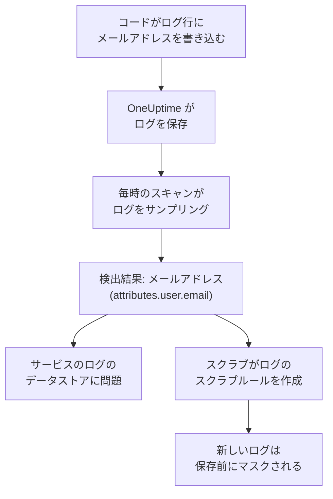

# テレメトリ内の機密データ

テレメトリには、コードが書き込んだものが何でも入ります。ログ行のメールアドレス、スパン属性のカード番号、スタックトレースのトークン、プロンプトに含まれる顧客の質問、メトリクスのラベルに含まれるユーザーの IP アドレスなどです。データセキュリティは、各サービスのログ、トレース、メトリクス、例外、AI の会話と、各 RUM アプリケーションのセッションを、それぞれ独立したデータストアとして扱います。それらを毎時サンプリングし、バケットと同じように機密データを見つけます。**スクラブ** を使うと検出結果がルールになり、以後そのデータは取り込み時にマスクされます。

設定は不要です。プロジェクトの設定で **テレメトリをスキャン** がオフになっていない限り、各サービスのテレメトリは毎時スキャンされます。あるサービスのログ、トレース、その他のシグナルを除外するには、そのデータストアの **設定** で **コンテンツをスキャン** をオフにします。次回のスキャンから、その内容は一切読み取られません。

:::cards
- [読み取られるもの](#読み取られるもの): 各シグナルの属性、本文、メッセージ、プロンプト。
- [スキャンのサンプリング方法](#スキャンのサンプリング方法): 各サービスの最新のレコードを毎時読み取ります。
- [スクラブ](#スクラブ): 検出結果をワンクリックで取り込み時にマスクします。
- [スクラブ済みとみなされる条件](#スクラブ済みとみなされる条件): スクラブルールがすでに検出結果をカバーしているとき。
:::

## 仕組み

スクラブルールがカバーする検出結果は、スクラブ済みとして示されます。そのデータの残りは保持期間の終わりを待つ古いデータであり、今も流れ続けている漏えいではありません。テレメトリの 2 つのチェックは、どのルールもカバーしていないものだけを数えるため、すべての検出結果がスクラブされるとその問題は解決します ( [テレメトリのチェック](/docs/data-security/checks-and-issues#テレメトリ) を参照)。

## 読み取られるもの

| データストア | 読み取られるもの | 検出結果が指す場所 |
| --- | --- | --- |
| ログ | すべての属性と本文 | `attributes.<key>`、`body` |
| トレース | すべてのスパン属性と、すべてのスパンイベントの属性 | `attributes.<key>`、`events.<event>.<key>` |
| 例外 | メッセージ、スタックトレース、属性 | `message`、`stackTrace`、`attributes.<key>` |
| AI の会話 | GenAI の規約が定めるキーに入った、すべての AI 呼び出しのプロンプトと回答、およびその他すべての属性 | それらが入っているキー。 `gen_ai.input.messages` や `gen_ai.prompt[].content` など |
| セッションリプレイ | RUM アプリケーションのスパンとログの属性、そのセッションの属性、 `identify()` がユーザーに与えた特性、アプリケーションに伝えられたユーザー参照 | `spans.attributes.<key>`、`logs.attributes.<key>`、`sessions.attributes.<key>`、`sessions.identifiedUserTraits.<key>`、`sessions.identifiedUserLabel` |
| メトリクス | データポイントのすべての属性 (リソースの属性を含む) と、メトリクスの名前 | `attributes.<key>`、`attributes.resource.<key>`、`name` |

番号付きのキーは 1 つの場所にまとめられます。 `gen_ai.prompt.3.content` は `gen_ai.prompt[].content` になるため、チャットの 20 件のメッセージは 20 件ではなく 1 件の検出結果になります。OneUptime 自身が追加する、 `oneuptime.` で始まる属性は読み取られません。

### メトリクス

メトリクスの属性は、その系列のラベルです。ラベルは 1 つの系列のどのデータポイントでも同じなので、1 分間に 1,000 個のポイントを書き込むメトリクスでも値は 3 つしかないことがあり、ユーザーのメールアドレスを漏らすラベルは、ポイントではなく系列を 1 つ増やします。そのため、メトリクスはポイントではなく系列ごとにサンプリングされます。

- **最新の 1 分間。** 各メトリクスは、直近 1 時間に書き込んだ最新の 1 分間で読み取られます。読み取るのはその 1 分間のデータポイントの最大 100 個で、OpenTelemetry の既定どおり 1 分に 1 回送られるメトリクスなら、各系列のポイント 1 つずつにあたります。値は、それを繰り返すポイントがいくつあっても 1 回だけ分類されるため、検出結果はその場所にある異なる値の数を数えます。
- **最も活発なものから、残りは順番に。** サービスがどのメトリクスを書き込んだかは、メトリクスのテーブルが保持する 1 分ごとのロールアップから得られ、ポイントそのものからは決して読み取りません。各スキャンは、サービスの最も活発なメトリクス (系列が多い可能性が最も高いもの) と、それ以外のメトリクスのいくつかを読み取ります。それ以外のメトリクスは 1 時間ごとに次のものへ進むため、どのメトリクスにも順番が回ってきます。
- **メトリクスごとの範囲。** メトリクスはまとめて読み取られ、それぞれがテーブルの主キーのうち自分の範囲で読み取られます。ユーザーごとのメールアドレスをラベルに付けたメトリクスのように、最新の 1 分間に 16,384 個を超えるポイントがあるメトリクスは単独で読み取られ、その読み取りは最初のポイントで止まります。そのため、ほかのメトリクスより多くのコストはかかりません。

検出結果は、 `attributes.user.email` のような属性を示し、メトリクスの名前にあるデータなら `name` を示します。そのレコードは、データが見つかったデータポイントです。各レコードにはそのメトリクスと、マスクされた属性の値が表示され、 **メトリクス** でそのメトリクスを、その属性でグループ化して開きます。メトリクスの名前に機密データが含まれる場合は、名前もマスクされ、レコードは代わりにサービスのメトリクスを開きます。

### リプレイの録画を読み取らない理由

セッションリプレイの録画には、ユーザーが見たページのテキストが含まれます。録画を見るには専用の権限が必要で、そこから読み取った検出結果は、データセキュリティを閲覧できる全員にマスクされたページのテキストを見せてしまいます。そのため、リプレイは属性だけが読み取られます。録画に付随するスパン、ログ、セッションの詳細です。レコーダーはブラウザーで記録する時点ですでにマスクしており、ログのスクラブルールは録画にも適用されます ( [セッションリプレイ](/docs/telemetry/session-replay) を参照)。

### AI の会話

AI 呼び出しのプロンプトには、その人の最新のメッセージより前のチャット全体が含まれるため、AI 呼び出しの各値は最大 16,384 文字まで読み取られます。AI の会話に機密データが含まれる場合は、さらに 2 つのことが起こります。呼び出し先の AI プロバイダーがそのデータのデータフローになり、そのデータストアで [機密データが AI プロバイダーに送信されている](/docs/data-security/checks-and-issues#ai) が失敗します。

[会社の AI ツール](/docs/telemetry/ai-company-tools) の会話は対象外です。それを読めるのはプロジェクト所有者とプロジェクト管理者だけですが、検出結果はデータセキュリティを閲覧する全員が読める場所に置かれます。そのため、それらのサービスのスパンは読み取られず、その AI の会話は読み取られていないと報告されます。

## スキャンのサンプリング方法

毎時、各シグナルの直近 1 時間の最新レコードが読み取られ、ほかのデータストアと同じようにフィールドごとに分類されます ( [フィールドと列](/docs/data-security/data-types#フィールドと列) を参照)。

| 上限 | 値 |
| --- | --- |
| 各サービスとシグナルのレコード数 | **テレメトリのサンプルサイズ**。既定は 500 で、1,000 を超えることはない |
| シグナルごとに読み取るサービスまたは RUM アプリケーション | 最も活発な 200 件 |
| 1 回の読み取りのレコード数 | 5,000 (サービス間で共有)。AI 呼び出しは 500 |
| ログの本文、例外のメッセージ、スタックトレースの文字数 | 8,192 |
| 属性値の文字数 | 4,096 |
| AI 呼び出しの値の文字数 | 16,384 |
| 1 件のレコードの属性数 | 128。AI 呼び出しは 64 |
| 1 つのスパンのイベント数と、1 つのイベントの属性数 | 16 と 32 |
| 1 つのデータストアの場所の数 | 500 |
| 1 回のスキャンで読み取るメトリクスの数 | 100 (サービス間で共有し、各サービスから少なくとも 1 つ)。1 つのサービスからは最大 10 で、半分は最も活発なもの、残り半分はそれ以外のものから順番に |
| 1 つのメトリクスのデータポイント数 | 最新の 1 分間のもの。最大 100 |

すべての値はデータベース内で切り詰められるため、長い値がデータベースの外に出ることはありません。各読み取りは 30 秒で停止します。失敗した読み取りは対象のデータストアの警告になり、スキャンは次の読み取りに進みます。

何かを対象外にするには、データストアの **スキャン除外** に追加します。完全な名前の場所 (`attributes.http.url`)、ある場所の下のすべて (`attributes.http`)、または属性キーだけの名前 (`http.url`) を指定できます。

## スクラブ

検出結果の **スクラブ** は、その場所のそのデータタイプを以後隠すルールを作成するか、すでにそうしている有効なルールを示します。

:::steps
### 検出結果を開く

問題を開くか (その **見つかった場所** に、背後にある各検出結果が一覧表示されます)、 **データセキュリティ > テレメトリ内** を開きます。ここでは **レコードを表示** を押すと、検出結果が見つかったレコードが一覧の横に開きます。

### スクラブを押す

**スクラブ** をクリックします。OneUptime は、ログと RUM アプリケーションのログにはログのスクラブルールを、スパン、例外、AI 呼び出しにはトレースのスクラブルールを、検出結果があるレコードの部分に対して作成し、メトリクスの属性にはメトリクスのパイプラインルールを作成します。

### コードも修正する

ルールは新しいデータを保存前にマスクします。すでに保存されたデータは保持期間が終わるまで残るため、それを書き込んでいるコードを修正してください。検出結果にはサービスと属性が示されています。
:::

ルールには、「Data Security: Email address in attributes.user.email」のように隠すものにちなんだ名前が付き、ほかのスクラブルールと一緒に一覧表示されます ( [ドロップフィルターとスクラブルール](/docs/telemetry/drop-filters-and-scrub-rules#機密データをスクラブする) を参照)。ルールは次のいずれかです。

| 検出結果 | スクラブが作成するルール |
| --- | --- |
| メールアドレス、カード番号、米国の社会保障番号、電話番号、IP アドレス | そのタイプの組み込みパターン。カード番号、社会保障番号、電話番号はマスクされ、それ以外は伏せ字になります。 |
| `password` や `token` のように機密に見えるキーの値 | **機密属性のキー** のルール。そのような属性の値全体を伏せ字にします |
| パターンで見つけられるその他のデータタイプ | データタイプ自身のパターンから作られた **カスタム正規表現** のルール。その形のすべての値を伏せ字にします |
| メトリクスの属性にある任意のデータタイプ | サービス用の **属性を秘匿化** のメトリクスのパイプラインルール。属性の値のうちそのデータタイプの形をしたものを `[REDACTED]` に置き換えます。そのデータタイプを見つけるパターンがない場合は、属性のすべての値を置き換えます |

ルールではスクラブできない検出結果もあり、その場合は **スクラブ** が理由を示します。メトリクスの属性は、そのルールが属性のすべての値を隠せるため、常にスクラブできます。

- 人の名前のように、フィールド名だけから見つかるデータタイプ: パターンでは見つけられません。属性の名前を機密キーのルールが隠すキーに変えるか、送信をやめてください。
- ルーティング番号のように、周囲の語によってのみほかの値と区別されるデータタイプ: ルールはそのデータタイプよりはるかに多くのものを隠してしまいます。
- 文書のマーキング: その語を隠しても文書は隠れません。
- 独自のデータタイプ: そのパターンでカスタムのスクラブルールを自分で追加してください。
- セッション自体の詳細 (`sessions.*`): セッションリプレイの取り込みではスクラブルールが実行されません。
- メトリクスの名前 (`name`): 名前はメトリクスを作成するコードが設定し、パイプラインルールはメトリクスの名前を丸ごと変更することしかできません。メトリクスの名前を変更し、名前の中で変化する部分は代わりに属性として送信してください。

**スクラブ** は、あなたとして、あなた自身の権限でルールを作成します。プロジェクト所有者とプロジェクト管理者は押すことができ、ログのスクラブルールを作成できるチームも押せます。スパン、例外、AI 呼び出しでは、トレースのスクラブルールを作成できるチームが押せます。メトリクスでは、メトリクスのパイプラインルールを作成できるチームが押せます。

## スクラブ済みとみなされる条件

検出結果がスクラブ済みとして示されるのは、取り込み時に有効なルールがそれに対して実行され、そのルールがそのデータタイプを見つける場合だけです。

- **対象のレコードが正しい。** ログのルールはログと RUM アプリケーションのログをカバーします。トレースのルールはスパン、例外、AI 呼び出しをカバーします。例外はそのスパンの例外イベントのコピーなので、イベントをスクラブするルールが例外もスクラブします。
- **対象の部分が正しい。** ルールの **スクラブするフィールド** に検出結果があるレコードの部分が含まれているか、既定のままになっています。
- **そのタイプを見つけるパターンがある。** 組み込みの **パターンタイプ** は、それ自身のデータタイプを見つけます。 **メールアドレス** はメールアドレス、 **クレジットカード番号** はカード番号、 **SSN (社会保障番号)** は米国の社会保障番号、 **電話番号** は電話番号、 **IP アドレス** は IP アドレスを見つけます。 **機密属性のキー** は、値が何であれ、機密に見えるキーの値をすべてカバーします。
- **独自のカスタムパターンは数えられない。** **カスタム正規表現** が検出結果をカバーするのは、それがそのタイプに対して **スクラブ** が作成するパターンとまったく同じ場合だけです。検出結果にはマスクされたサンプルしか残らず、それに対してパターンを試すことはできないため、OneUptime はあなたのパターンがデータを隠すことを証明できません。誤ってスクラブ済みとされた検出結果は、誰も目を向けない漏えいになります。
- **メトリクスの属性。** その属性のキーに対する **属性を秘匿化** または **属性を削除** のメトリクスのパイプラインルールは、検出結果のサービス用でもプロジェクト全体用でも、フィルターがないか、 **スクラブ** が作成するフィルターとまったく同じフィルターを持つ場合に、検出結果をカバーします。自分で書いたフィルターは、同じ理由で決して数えられません。

オフになっているルールや、何もスクラブしないルールは数えられません。カバー範囲はスキャンのたびに計算し直されるため、手動で追加または削除したルールは、1 時間以内にスクラブ済みの表示に反映されます。

## 次のステップ

:::cards
- [ドロップフィルターとスクラブルール](/docs/telemetry/drop-filters-and-scrub-rules): スクラブルールのすべてのオプションと、自分で書くルール。
- [データセキュリティのチェックと問題](/docs/data-security/checks-and-issues): テレメトリの 2 つのチェックと AI のチェック。
- [データフロー、アクセス、データ所在地](/docs/data-security/flows-access-residency): サービスがデータを送る AI プロバイダーとホスト。
:::
