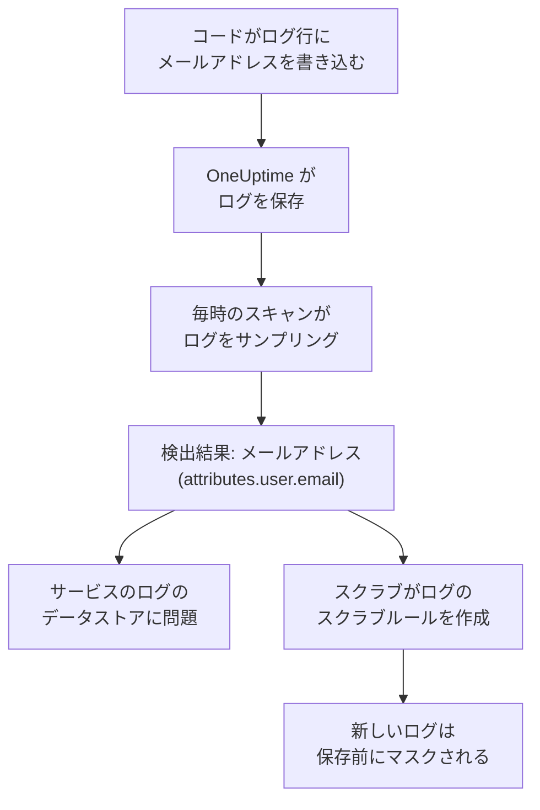

# テレメトリ内の機密データ

テレメトリには、コードが書き込んだものが何でも入ります。ログ行のメールアドレス、スパン属性のカード番号、スタックトレースのトークン、プロンプトに含まれる顧客の質問などです。データセキュリティは、各サービスのログ、トレース、例外、AI の会話と、各 RUM アプリケーションのセッションを、それぞれ独立したデータストアとして扱います。それらを毎時サンプリングし、バケットと同じように機密データを見つけます。**スクラブ** を使うと検出結果がスクラブルールになり、以後そのデータは取り込み時にマスクされます。

設定は不要です。プロジェクトの設定で **テレメトリをスキャン** がオフになっていない限り、各サービスのテレメトリは毎時スキャンされます。

:::cards
- [読み取られるもの](#読み取られるもの): 各シグナルの属性、本文、メッセージ、プロンプト。
- [スキャンのサンプリング方法](#スキャンのサンプリング方法): 各サービスの最新のレコードを毎時読み取ります。
- [スクラブ](#スクラブ): 検出結果をワンクリックで取り込み時にマスクします。
- [スクラブ済みとみなされる条件](#スクラブ済みとみなされる条件): スクラブルールがすでに検出結果をカバーしているとき。
:::

## 仕組み

スクラブルールがカバーする検出結果は、スクラブ済みとして示されます。そのデータの残りは保持期間の終わりを待つ古いデータであり、今も流れ続けている漏えいではありません。テレメトリの 2 つのチェックは、どのルールもカバーしていないものだけを数えるため、すべての検出結果がスクラブされるとその問題は解決します ( [テレメトリのチェック](/docs/data-security/checks-and-issues#テレメトリ) を参照)。

## 読み取られるもの

| データストア | 読み取られるもの | 検出結果が指す場所 |
| --- | --- | --- |
| ログ | すべての属性と本文 | `attributes.<key>`、`body` |
| トレース | すべてのスパン属性と、すべてのスパンイベントの属性 | `attributes.<key>`、`events.<event>.<key>` |
| 例外 | メッセージ、スタックトレース、属性 | `message`、`stackTrace`、`attributes.<key>` |
| AI の会話 | GenAI の規約が定めるキーに入った、すべての AI 呼び出しのプロンプトと回答、およびその他すべての属性 | それらが入っているキー。 `gen_ai.input.messages` や `gen_ai.prompt[].content` など |
| セッションリプレイ | RUM アプリケーションのスパンとログの属性、そのセッションの属性、 `identify()` がユーザーに与えた特性、アプリケーションに伝えられたユーザー参照 | `spans.attributes.<key>`、`logs.attributes.<key>`、`sessions.attributes.<key>`、`sessions.identifiedUserTraits.<key>`、`sessions.identifiedUserLabel` |

番号付きのキーは 1 つの場所にまとめられます。 `gen_ai.prompt.3.content` は `gen_ai.prompt[].content` になるため、チャットの 20 件のメッセージは 20 件ではなく 1 件の検出結果になります。OneUptime 自身が追加する、 `oneuptime.` で始まる属性は読み取られません。

### リプレイの録画を読み取らない理由

セッションリプレイの録画には、ユーザーが見たページのテキストが含まれます。録画を見るには専用の権限が必要で、そこから読み取った検出結果は、データセキュリティを閲覧できる全員にマスクされたページのテキストを見せてしまいます。そのため、リプレイは属性だけが読み取られます。録画に付随するスパン、ログ、セッションの詳細です。レコーダーはブラウザーで記録する時点ですでにマスクしており、ログのスクラブルールは録画にも適用されます ( [セッションリプレイ](/docs/telemetry/session-replay) を参照)。

### AI の会話

AI 呼び出しのプロンプトには、その人の最新のメッセージより前のチャット全体が含まれるため、AI 呼び出しの各値は最大 16,384 文字まで読み取られます。AI の会話に機密データが含まれる場合は、さらに 2 つのことが起こります。呼び出し先の AI プロバイダーがそのデータのデータフローになり、そのデータストアで [機密データが AI プロバイダーに送信されている](/docs/data-security/checks-and-issues#ai) が失敗します。

[会社の AI ツール](/docs/telemetry/ai-company-tools) の会話は対象外です。それを読めるのは Project Owner と Project Admin だけですが、検出結果はデータセキュリティを閲覧する全員が読める場所に置かれます。そのため、それらのサービスのスパンは読み取られず、その AI の会話は読み取られていないと報告されます。

## スキャンのサンプリング方法

毎時、各シグナルの直近 1 時間の最新レコードが読み取られ、ほかのデータストアと同じようにフィールドごとに分類されます ( [フィールドと列](/docs/data-security/data-types#フィールドと列) を参照)。

| 上限 | 値 |
| --- | --- |
| 各サービスとシグナルのレコード数 | **テレメトリのサンプルサイズ**。既定は 500 で、1,000 を超えることはない |
| シグナルごとに読み取るサービスまたは RUM アプリケーション | 最も活発な 200 件 |
| 1 回の読み取りのレコード数 | 5,000 (サービス間で共有)。AI 呼び出しは 500 |
| ログの本文、例外のメッセージ、スタックトレースの文字数 | 8,192 |
| 属性値の文字数 | 4,096 |
| AI 呼び出しの値の文字数 | 16,384 |
| 1 件のレコードの属性数 | 128。AI 呼び出しは 64 |
| 1 つのスパンのイベント数と、1 つのイベントの属性数 | 16 と 32 |
| 1 つのデータストアの場所の数 | 500 |

すべての値はデータベース内で切り詰められるため、長い値がデータベースの外に出ることはありません。各読み取りは 30 秒で停止します。失敗した読み取りは対象のデータストアの警告になり、スキャンは次の読み取りに進みます。

何かを対象外にするには、データストアの **スキャン除外** に追加します。完全な名前の場所 (`attributes.http.url`)、ある場所の下のすべて (`attributes.http`)、または属性キーだけの名前 (`http.url`) を指定できます。

## スクラブ

検出結果の **スクラブ** は、その場所のそのデータタイプを以後隠すスクラブルールを作成するか、すでにそうしている有効なルールを示します。

:::steps
### 検出結果を開く

テレメトリのデータストア (たとえばサービスの **ログ**) を開き、検出結果を開きます。

### スクラブを押す

**スクラブ** をクリックします。OneUptime は、ログと RUM アプリケーションのログにはログのスクラブルールを、スパン、例外、AI 呼び出しにはトレースのスクラブルールを、検出結果があるレコードの部分に対して作成します。

### コードも修正する

ルールは新しいデータを保存前にマスクします。すでに保存されたデータは保持期間が終わるまで残るため、それを書き込んでいるコードを修正してください。検出結果にはサービスと属性が示されています。
:::

ルールには、「Data Security: Email address in attributes.user.email」のように隠すものにちなんだ名前が付き、ほかのスクラブルールと一緒に一覧表示されます ( [ドロップフィルターとスクラブルール](/docs/telemetry/drop-filters-and-scrub-rules#機密データをスクラブする) を参照)。ルールは次のいずれかです。

| 検出結果 | スクラブが作成するルール |
| --- | --- |
| メールアドレス、カード番号、米国の社会保障番号、電話番号、IP アドレス | そのタイプの組み込みパターン。カード番号、社会保障番号、電話番号はマスクされ、それ以外は伏せ字になります。 |
| `password` や `token` のように機密に見えるキーの値 | **機密属性のキー** のルール。そのような属性の値全体を伏せ字にします |
| パターンで見つけられるその他のデータタイプ | データタイプ自身のパターンから作られた **カスタム正規表現** のルール。その形のすべての値を伏せ字にします |

ルールではスクラブできない検出結果もあり、その場合は **スクラブ** が理由を示します。

- 人の名前のように、フィールド名だけから見つかるデータタイプ: パターンでは見つけられません。属性の名前を機密キーのルールが隠すキーに変えるか、送信をやめてください。
- ルーティング番号のように、周囲の語によってのみほかの値と区別されるデータタイプ: ルールはそのデータタイプよりはるかに多くのものを隠してしまいます。
- 文書のマーキング: その語を隠しても文書は隠れません。
- 独自のデータタイプ: そのパターンでカスタムのスクラブルールを自分で追加してください。
- セッション自体の詳細 (`sessions.*`): セッションリプレイの取り込みではスクラブルールが実行されません。

**スクラブ** は、あなたとして、あなた自身の権限でルールを作成します。Project Owner と Project Admin は押すことができ、ログのスクラブルールを作成できるチームも押せます。スパン、例外、AI 呼び出しでは、トレースのスクラブルールを作成できるチームが押せます。

## スクラブ済みとみなされる条件

検出結果がスクラブ済みとして示されるのは、取り込み時に有効なルールがそれに対して実行され、そのルールがそのデータタイプを見つける場合だけです。

- **対象のレコードが正しい。** ログのルールはログと RUM アプリケーションのログをカバーします。トレースのルールはスパン、例外、AI 呼び出しをカバーします。例外はそのスパンの例外イベントのコピーなので、イベントをスクラブするルールが例外もスクラブします。
- **対象の部分が正しい。** ルールの **スクラブするフィールド** に検出結果があるレコードの部分が含まれているか、既定のままになっています。
- **そのタイプを見つけるパターンがある。** 組み込みの **パターンタイプ** は、それ自身のデータタイプを見つけます。 **メールアドレス** はメールアドレス、 **クレジットカード番号** はカード番号、 **SSN (社会保障番号)** は米国の社会保障番号、 **電話番号** は電話番号、 **IP アドレス** は IP アドレスを見つけます。 **機密属性のキー** は、値が何であれ、機密に見えるキーの値をすべてカバーします。
- **独自のカスタムパターンは数えられない。** **カスタム正規表現** が検出結果をカバーするのは、それがそのタイプに対して **スクラブ** が作成するパターンとまったく同じ場合だけです。検出結果にはマスクされたサンプルしか残らず、それに対してパターンを試すことはできないため、OneUptime はあなたのパターンがデータを隠すことを証明できません。誤ってスクラブ済みとされた検出結果は、誰も目を向けない漏えいになります。

オフになっているルールや、何もスクラブしないルールは数えられません。カバー範囲はスキャンのたびに計算し直されるため、手動で追加または削除したルールは、1 時間以内にスクラブ済みの表示に反映されます。

## 次のステップ

:::cards
- [ドロップフィルターとスクラブルール](/docs/telemetry/drop-filters-and-scrub-rules): スクラブルールのすべてのオプションと、自分で書くルール。
- [データセキュリティのチェックと問題](/docs/data-security/checks-and-issues): テレメトリの 2 つのチェックと AI のチェック。
- [データフロー、アクセス、データ所在地](/docs/data-security/flows-access-residency): サービスがデータを送る AI プロバイダーとホスト。
:::
