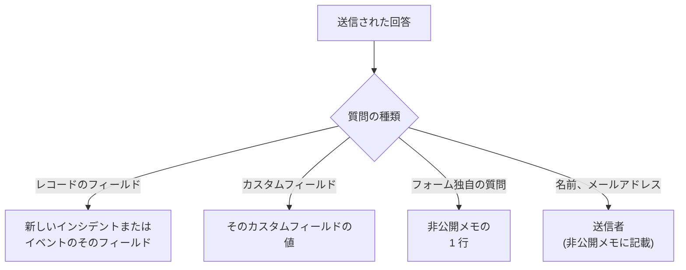

# フォームの作成

フォームの **作成** ページでは、フォームが何を尋ねるかと、そのページの見た目を決めます。質問は左側に、公開ページで表示される順に並びます。右側の **質問を追加** には、追加できるものがすべて表示されます。質問の上には、折りたたまれた状態でフォームの [ブランディング](#ブランディング) (ロゴとファビコン) があります。フォームの開始点にできる名前付きの回答のセット (それぞれ、自分のケースに合わせて質問を必須、任意、非表示にすることもできます) は、フォームの **テンプレート** ページにあります。[テンプレート](#テンプレート) を参照してください。

:::cards
- [ビルダー](#ビルダー): 質問を追加、編集、移動、保存します。
- [追加できるもの](#追加できるもの): 独自の質問、レコードのフィールド、カスタムフィールド、送信者。
- [非表示の質問](#非表示の質問): 送信する人ではなく、テンプレートが回答します。
- [テンプレート](#テンプレート): チームがよく報告するケースごとに、1 つのフォームと 1 つのリンク。
:::

## 各回答の行き先

すべての回答は、フォームの **送信履歴** ページで送信内容とともに保存されます。フォームが尋ねないフィールドや、空のままのフィールドは、フォームの [送信時の設定](/docs/forms/on-submit) で入力されます。

## ビルダー

:::steps
### 質問を追加する

**質問を追加** で追加するものを選びます。新しい質問は選択中の質問の後ろ (または末尾) に挿入され、選択された状態になります。

### その場で編集する

カードを選択して編集します。質問、ヘルプテキスト、回答の種類とオプション、必須か非表示か、そして複製と削除のボタンがあります。 **完了** で閉じます。

### 場所を決める

カードのハンドルをドラッグして移動するか、選択中のカードで **上へ移動** と **下へ移動** を使います。スマートフォンやキーボードでも使えます。

### フォームを保存する

**変更を保存** はすべての変更を一度に保存します。保存するまで、ビルダーには **未保存の変更** と表示されて **変更を破棄** が提示され、ページを離れる前にブラウザーが確認します。
:::

- **フォームのヘッダー** には、公開ページと同じようにフォームの名前と説明が表示されます。 **名前と説明を編集** で変更します。
- **質問** はカードです。各カードには、表示されるとおりの質問と、何にリンクしているかを示すバッジが表示されます。 **インシデント · 重大度**、 **カスタムフィールド · Region**、 **送信者 · メール**、またはフォーム独自の質問なら回答の種類です。赤いアスタリスクは必須の質問を、 **非表示** バッジは [非表示](#非表示の質問) の質問を示します。
- **上限。** 1 つのフォームには最大 50 個の質問を置けます。フォームを読めても編集できない人には、ビルダーが読み取り専用で表示されます。

## ブランディング

質問の上に折りたたまれている **ブランディング** は、フォームのページの見た目です。ページ上部のフォーム名の上にロゴが、フォームを開いている間はブラウザーのタブにファビコンが表示されます。自分のものをアップロードするまでは、OneUptime のロゴとファビコンが表示されます。

折りたたまれた状態では、このセクションに **ロゴ** と **ファビコン** (フォーム独自のものがあれば設定済みとして表示) が並び、OneUptime のものがまだ使われているのはどれかがわかります。展開すると、ページでの表示どおりに両方を確認できます。ロゴはページ上部に置かれる様子で、ファビコンはフォーム名 (タブのタイトル) の隣にあるブラウザーのタブで表示されます。

**ブランディングを編集** で、1 つのダイアログからそれらを変更します。

| フィールド | 内容 |
| --- | --- |
| **ロゴ** | フォームのページ上部、名前の上に、OneUptime のロゴの代わりに表示されます。512 KB 以下の PNG、JPEG、GIF、WebP、SVG の画像です。削除すると OneUptime のロゴに戻ります。 |
| **ロゴの代替テキスト** | スクリーンリーダーが読み上げる、ロゴの内容です。通常は組織の名前です。ロゴがあるときに尋ねられます。空のままにするとスクリーンリーダーはロゴを読み飛ばします。いずれにしてもフォームの名前がロゴの後に続きます。ロゴを削除すると、この値も消去されます。 |
| **ファビコン** | フォームを開いている間のブラウザーのタブのアイコンで、OneUptime のファビコンの代わりに表示されます。128 KB 以下の PNG、JPEG、GIF、WebP、SVG、ICO の画像で、正方形の PNG、SVG、ICO が最適です。削除すると OneUptime のファビコンに戻ります。 |

ロゴは置き換える OneUptime のロゴと同じ高さを保ち、横長のロゴはページの幅に収まるように調整されます。すべての画像は保存時 (ダッシュボード、API、Terraform、ワークフローのいずれからでも) に確認されます。フォーム自身のプロジェクトでアップロードされたもので、上記の種類のいずれかであり、上限を超えていない必要があります。これらの画像に当てはまらないロゴは "The logo must be a PNG, JPEG, GIF, WebP or SVG image."、大きすぎるロゴは "The logo must be 512 KB or smaller."、アップロードがなくなった (または別のプロジェクトでアップロードされた) ロゴは "The logo's file could not be found. Upload the logo again." で拒否されます。ファビコンも同じように "The favicon must be a PNG, JPEG, GIF, WebP, SVG or ICO image."、 "The favicon must be 128 KB or smaller."、 "The favicon's file could not be found. Upload the favicon again." で拒否されます。

**プレビュー** には、ページと同じようにロゴが表示されます。フォームを読めても編集できない人には、 **ブランディングを編集** なしでブランディングが表示されます。ロゴとファビコンがフォームのページに届くのは、フォーム自体の中だけです。[共有とセキュリティ](/docs/forms/sharing-and-security#フォームを守るもの) を参照してください。

## 追加できるもの

**質問を追加** には 4 つのグループがあります。フォーム独自の **質問**、フォームが作成するものの **インシデントの項目** または **定期メンテナンスの項目**、 **カスタムフィールド**、 **送信者** です。

### フォーム独自の質問

| 回答の種類 | 送信者が入力するもの |
| --- | --- |
| **短い回答** | 1 行のテキスト。 |
| **段落** | 複数行のテキスト。 |
| **リッチテキスト** | 書式とリンクを含むテキスト。 |
| **数値** | 数値。 |
| **ドロップダウン** | 一覧からの 1 つの選択。 |
| **複数選択** | 一覧からの任意の数の選択。 |
| **チェックボックス** | 確認などのためのチェックボックス。 |
| **日付** | 日付。 |
| **日時** | 日付と時刻。 |

ドロップダウンや複数選択には、指定した **選択肢** が 1 個から 100 個まで表示され、それぞれに任意の色を付けられます (オプションの横のボタンで名前付きの色のセットが開き、 **カスタムカラー** で正確なコードを指定できます)。質問を **ドロップダウン** と **複数選択** の間で切り替えてもオプションは保たれます。これらの種類になった質問には名前を変えられるオプションが 2 つ用意され、これらの種類でなくなった質問のオプションは削除されます。 **複製** は、フォーム独自の質問をそのすぐ下にコピーします。

これらの質問への回答は送信内容とともに保存され、フォームが作成するものの非公開メモに一覧表示されます。フィールドには入力されません。フィールドに入力するには、次の 2 つのグループからフィールド自体を追加します。

### フォームが作成するもののフィールド

送信者が回答できる、インシデントまたは定期メンテナンスイベントのフィールドです。回答がフィールドの値になります。

| インシデントのフィールド | 回答の内容 |
| --- | --- |
| **タイトル** | 最大 500 文字の 1 行。 |
| **説明** | 最大 20,000 文字のリッチテキスト。 |
| **重大度** | インシデントの重大度のいずれか。 |
| **モニター** | 提示したモニターのいずれか (インシデントの影響を受けるモニター)。 |
| **ラベル** | 提示したラベルのいずれか。 |
| **影響の開始日時** | 日付と時刻。送信者が覚えている、問題が始まった時刻です。 |

| 定期メンテナンスのフィールド | 回答の内容 |
| --- | --- |
| **タイトル** | 最大 100 文字の 1 行。 |
| **説明** | 最大 20,000 文字のリッチテキスト。 |
| **開始日時** | 日付と時刻。常に尋ねられ、常に必須です。 |
| **終了日時** | **開始日時** より後の日付と時刻。常に尋ねられ、必須です。 |
| **モニター** | 提示したモニターのいずれか。 |
| **ステータスページ** | 提示したステータスページのいずれか。 |
| **ラベル** | 提示したラベルのいずれか。 |

各フィールドは 1 回だけ尋ねることができ、すでにフォームにあるものは一覧で **追加済み** と表示されます。フォームが尋ねないフィールド (または空のままのフィールド) は、フォームの [送信時の設定](/docs/forms/on-submit) で入力されます。

**提示する選択肢。** 公開ページで見知らぬ人にプロジェクト全体を見せてはいけないので、レコードを選んで回答するフィールドでは、あなたが選んだものだけが提示されます。 **モニター**、 **ラベル**、 **ステータスページ** には提示した選択肢だけが表示され、少なくとも 1 つ提示するまでは尋ねられません。重大度は秘密ではないので、 **重大度** は絞り込まない限りインシデントのすべての重大度を提示します。提示した選択肢以外の回答は拒否されます。

### カスタムフィールド

インシデントのカスタムフィールド (メンテナンスのフォームでは定期メンテナンスのカスタムフィールド) は、それぞれ回答がフィールドの値になる質問です。質問の種類とオプションはカスタムフィールドから取られ、最初はその名前が質問、説明がヘルプテキストになります。どちらも変更できます。

フォームが尋ねるのは、 **作成時に表示** の設定にかかわらず、フォームに追加したカスタムフィールドだけです。フォームが尋ねるフィールドはすべて、リンクを知っている人に名前、説明、オプションを見せます。カスタムフィールドが削除されると、その質問はフォームに残りますが尋ねられなくなり、カードにその旨が表示されます。質問を削除してください。同じ名前で作り直したフィールドは新しいフィールドなので、もう一度追加してください。

モニターのカスタムフィールドから値をコピーするカスタムフィールドは、カードにその旨が表示されます。インシデントやイベントのモニターがそのフィールドの値で一致している場合、その値が送信者の回答を置き換えます。

### 送信者

**お名前** と **メールアドレス** は、誰が送信しているかを尋ねます。これらは送信内容とともに保存されて非公開メモに記載されるのでチームがフォローアップでき、インシデントやイベント自体に表示されることはありません。OneUptime が送信者にメールを送ることはありません。匿名の送信を受け付けるには、これらを外すか任意にします。

メールアドレスは、 `ada@example.com` のような 1 つの通常のアドレスである必要があります。山括弧でアドレスを囲んだ名前や、アドレスのリストは使えません。名前とメールアドレスはそれぞれ最大 100 文字です。

## 新しいフォームの質問

新しいフォームは、作成した時点で機能するように、ほぼ常に尋ねるべき質問から始まります。必須の **タイトル**、 **説明**、メンテナンスのフォームでは **開始日時** と **終了日時**、そして必須の **お名前** と **メールアドレス** です。文言はダッシュボードの言語で表示されます。自由に変更、非表示、削除できますが、メンテナンスイベントの開始と終了は例外です。これらがないとイベントを予定できません。独自の質問ですべて伝わる場合は、誰も入力すべきでない欄を残す代わりに **説明** を非表示にしてください。[非表示の質問](#非表示の質問) を参照してください。

## 必須の質問

**必須** は、回答がないとフォームを送信できないことを意味します。スペース、タブ、改行だけの回答は回答なしとして扱われ、必須の **チェックボックス** はチェックする必要があります。フォームの送信時にサーバーがすべての必須の質問を再度確認するので、ページを使わずに行われたリクエストにも同じ条件が適用されます。

必須ではない質問は空のままにできます。その場合、フォームが尋ねなかったものとして、そのフィールドは送信時の設定で入力されます。

## 非表示の質問

カードで **非表示** をオンにすると、その質問はフォームに表示されなくなります。誰にも尋ねられないので必須になることはなく、送信で回答することもできません。リクエストからその質問の値が読み取られることさえありません。回答するのは送信の開始点になった [テンプレート](#テンプレート) だけで、送信者がテンプレートを使わずに始めた場合や、その質問を空のままにするテンプレートから始めた場合は、未回答のままです。テンプレートは、自分のケースのために非表示の質問をあえて尋ねることもできます。[テンプレートが各質問を尋ねる方法](#テンプレートが各質問を尋ねる方法) を参照してください。

回答を決めるのが送信者ではなくチームである場合は、質問を非表示にします。

- **インシデントの説明**。追加した質問ですべて伝わる場合です。非表示にすると、そこに入力するよう促すことはなくなります。各テンプレートにそのケースで送る標準のテキストを持たせるか、説明なしでインシデントを始めます。
- **ワークフローやルールが読み取るカスタムフィールド**。たとえば通知の種類で、各テンプレートが設定します。
- **フォーム独自の質問** のうち、チームが非公開メモで必要とするだけの回答。

非表示の質問は位置、ラベル、設定を保持するので、いつでも再び表示できます。フォームの作成対象を作成するのに欠かせないフィールド (メンテナンスイベントの **開始日時** と **終了日時** ) は非表示にできません。非表示の質問の回答は、入力された回答とまったく同じように確認・保存され、送信内容とともに保持されます。

## テンプレート

フォームの **テンプレート** ページには、フォームの開始点にできる名前付きの回答のセットがあります。 **アプリケーション障害**、 **計画メンテナンス**、 **サービス復元済み** のように、チームがよく報告するケースごとに 1 つずつ用意すれば、1 つのフォームと 1 つのリンクですべてに対応できます。

:::steps
### テンプレートを追加する

**テンプレートを追加** をクリックします。エディターは 2 つの部分からなります。 **質問** には、フォームの各質問と、このテンプレートでのその尋ね方が表示されます。[テンプレートが各質問を尋ねる方法](#テンプレートが各質問を尋ねる方法) を参照してください。 **回答** には、非表示のものも含めて、どれも必須ではない状態で質問が再び表示されます。テンプレートが回答すべきものを入力し、残りは送信する人に任せます。テンプレートが尋ねない質問への回答には、その下にその旨が表示され、そのまま使われます。

### デフォルトを選ぶ

**デフォルト** で、フォームを開いたときのテンプレートにします。デフォルトにできるテンプレートは 1 つだけで、デフォルトのテンプレートしかないフォームは、単に入力済みのフォームです。

### リンクを共有する

**リンクをコピー** でテンプレート専用のリンクをコピーします。そのリンクは、テンプレートで入力された状態のフォームを開きます。[共有とセキュリティ](/docs/forms/sharing-and-security#テンプレートごとのリンク) を参照してください。
:::

各テンプレートには、入力する内容と、独自の方法で尋ねる質問 ( **定期メンテナンスの日付 · 非表示** など) が表示され、 **編集**、 **複製** (すぐ後ろに **アプリケーション障害 2** のような名前でコピーを作成)、フォームでの表示順のための **上へ移動** と **下へ移動**、 **削除** があります。

公開ページでは、テンプレートのあるフォームは質問の上の **テンプレートから始める** の下にテンプレートを表示します。テンプレートを選ぶとフォームが入力され、そのテンプレートの尋ね方で質問が表示されます。送信者は送信前にどの回答でも変更でき、別のテンプレートを選ぶと、そのテンプレートからフォームをやり直します。ページは、リンクが指定するテンプレート、なければデフォルト、それもなければテンプレートなしで開きます。 **プレビュー** もテンプレートを表示し、デフォルトで開きます。

> [!IMPORTANT]
> リンクを開いた人は全員、各テンプレートの名前と、テンプレートが尋ねる質問へのその回答を見られます。ページはそうやって自動で入力されます。テンプレートが尋ねない質問へのテンプレートの回答はサーバーから出ないので、内部向けの情報は非表示の質問に入れてください。

テンプレートを保存すると、各テンプレートのすべての回答がその質問と照合されます (質問が提示するオプション、フォームが提示するレコード、収まるテキスト)。テンプレートが独自の方法で尋ねる各質問も同様で、ダッシュボード、API、Terraform のどこから保存しても、問題があればテンプレートと問題を示すメッセージで保存が拒否されます。テンプレートの名前は最大 100 文字でフォーム内で一意である必要があり、1 つのフォームには最大 50 個のテンプレートを置けます。後で質問を変更した場合、削除した質問や合わなくなった質問へのテンプレートの回答は単に使われなくなり、そのテンプレートを次に保存したときに破棄されます。そのせいでほかのテンプレートの保存が拒否されることはありません。テンプレートがすでに持っていた内容が再確認されることはないからです。

### テンプレートが各質問を尋ねる方法

ケースが違えば必要な質問も違います。障害には影響を受けたアプリケーションが必要でメンテナンスの時間枠は不要ですが、計画メンテナンスには時間枠が必要です。ケースごとにフォームを作る代わりに、各テンプレートにフォームの質問を独自の方法で尋ねさせます。テンプレートの **質問** では、各質問に次のいずれかを設定します。

| 設定 | テンプレートから始めたとき |
| --- | --- |
| **フォームのデフォルト** | 質問はフォームと同じ方法で尋ねられます。ビルダーのカードの設定どおり、必須、任意、非表示のいずれかです。ピッカーには **フォームのデフォルト（非表示）** のようにどれかが表示され、カードを変更するとそれに従います。 |
| **必須** | 質問が尋ねられ、回答がないとフォームを送信できません。 |
| **任意** | 質問が尋ねられ、空のままにできます。 |
| **非表示** | 質問は尋ねられません。テンプレート自身の回答があれば、フォームが非表示にする質問と同じく、それが回答になります。 |

こうして 1 つのインシデントのフォームで両方のケースに対応できます。

| 質問 | アプリケーション障害 | 計画メンテナンス |
| --- | --- | --- |
| アプリケーション名 | 必須 | 必須 |
| 影響を受けた施設 | 必須 | 任意 |
| 定期メンテナンスの日付 | 非表示 | 必須 |

すべての質問は **フォームのデフォルト** から始まり、後でフォームに追加した質問も、すべてのテンプレートで同じです。メンテナンスイベントの **開始日時** と **終了日時** は常に尋ねられ、常に必須で、どのテンプレートでも変更できません。テンプレートはほかのすべての質問を非表示にして自分で回答できます。その場合、そのリンクは **送信** ボタンが 1 つだけのフォームになり、 **サービス復元済み** のようなケースに便利です。

ページは送信者が選んだテンプレートに従います。別のテンプレートを選ぶとそのテンプレートの質問でフォームが描き直され、 **プレビュー** も同じです。サーバーは、何から送信されたかにかかわらず、各送信を、指定されたテンプレートが尋ねる質問と照合します。テンプレートが必須にする質問には回答が必要で、テンプレートが非表示にする質問はリクエストから読み取られず、テンプレート自身の回答が使われます。テンプレートを指定しない送信や、その後に削除されたテンプレートを指定する送信は、フォーム自身の設定と照合されます。フォームが非表示にする質問が公開ページに表示されるのは、テンプレートがそれを尋ねるときだけです。

## ビルダーが質問にフラグを付けるとき

問題があるカードは、何が問題かを琥珀色で表示します。

| カードの表示 | 問題 |
| --- | --- |
| **このカスタムフィールドは削除されたため、質問は表示されません。質問を削除してください。** | 公開ページではその質問が省かれます。 |
| **提示するものを少なくとも 1 つ選んでください。選ばないと質問は表示されません。** | レコードを選んで回答するフィールドが何も提示していません。提示するモニター、ラベル、ステータスページを選んでください。 |
| **選択肢を少なくとも 1 つ追加してください。** | ドロップダウンや複数選択に選べるものがありません。 |
| **質問を入力してください。** | 質問にテキストがありません。 |

最後の 3 つのいずれかがある質問があると、フォームを保存できません。 **変更を保存** はどの質問に何の問題があるかを示し、プレビューではそのような質問が省かれます。保存時には質問全体も確認され、たとえば 2 つの質問が同じフィールドを求めている場合や、メンテナンスのフォームがメンテナンスの開始と終了を尋ねていない場合は、質問がビルダー、API、Terraform、ワークフローのどこから来たかにかかわらず、問題を示すメッセージで拒否されます。

## プレビュー

**プレビュー** は、リンクで表示されるとおりにフォームを開きます。同じロゴ、質問、入力欄、オプション、チェック、テンプレートの一覧が表示され、選んだテンプレートが尋ねる質問だけが表示されます。そのまま入力することもできます。そこで入力したものは送信されません。 **送信** は回答を確認するだけで、 **もう一度入力** で最初からやり直します。プレビューには、保存済みかどうかにかかわらずビルダーにあるとおりの質問が表示され、フラグの付いた質問を省くときはその旨が表示されます。

## 送信者に表示されるもの

公開ページには、フォームのロゴ (自分のものをアップロードするまでは OneUptime のロゴ)、フォームの名前と説明、テンプレートがあればその一覧、フォームが尋ねる質問 (選んだテンプレートの尋ね方で、テンプレートを選んでいない場合は非表示になっていない質問)、 **送信** が表示され、ブラウザーのタブにはフォームの名前とファビコンが表示されます。OneUptime が送信者の言語に対応していればその言語 (そのブラウザーで OneUptime で最後に選んだ言語、なければブラウザーが求める言語) で、対応していなければ英語で表示されます。質問、オプション、ヘルプテキストは、あなたが書いたとおりに表示されます。

送信後、ページには "ありがとうございます。回答を送信しました。" と表示され、作成されたものの番号 ("参照番号は INC-42 です。") が示されます。続いて、 **共有** ページでお礼のメッセージを書いていればそれが表示されます。 **別の回答を送信** で空のフォームが開きます。送信者にはメールは届かず、インシデントやイベントに戻る手段もありません。

## サイズの上限

| 回答 | 上限 |
| --- | --- |
| インシデントの **タイトル** | 500 文字 (両端のスペースは数えません)。 |
| メンテナンスイベントの **タイトル** | 100 文字。 |
| **説明** | 20,000 文字。 |
| そのほかのテキストの回答 | 10,000 文字。 |
| 複数選択の回答 | 100 個の選択。 |
| **お名前**、 **メールアドレス** | それぞれ 100 文字。 |

上限を超えた送信、必須の回答が抜けている送信、質問に合わない回答を含む送信は、どの点が問題かを示すメッセージで拒否され、何も作成されません。フォームが尋ねない質問への回答は無視されます。

## 次のステップ

:::cards
- [送信で作成されるもの](/docs/forms/on-submit): 回答と送信時の設定が、インシデントやメンテナンスイベントになるまで。
- [共有とセキュリティ](/docs/forms/sharing-and-security): リンクの共有、テンプレートごとのリンク、それらを守るもの。
- [インシデントの設定と自動化](/docs/incidents/settings): インシデントのカスタムフィールドとテンプレート。
:::
