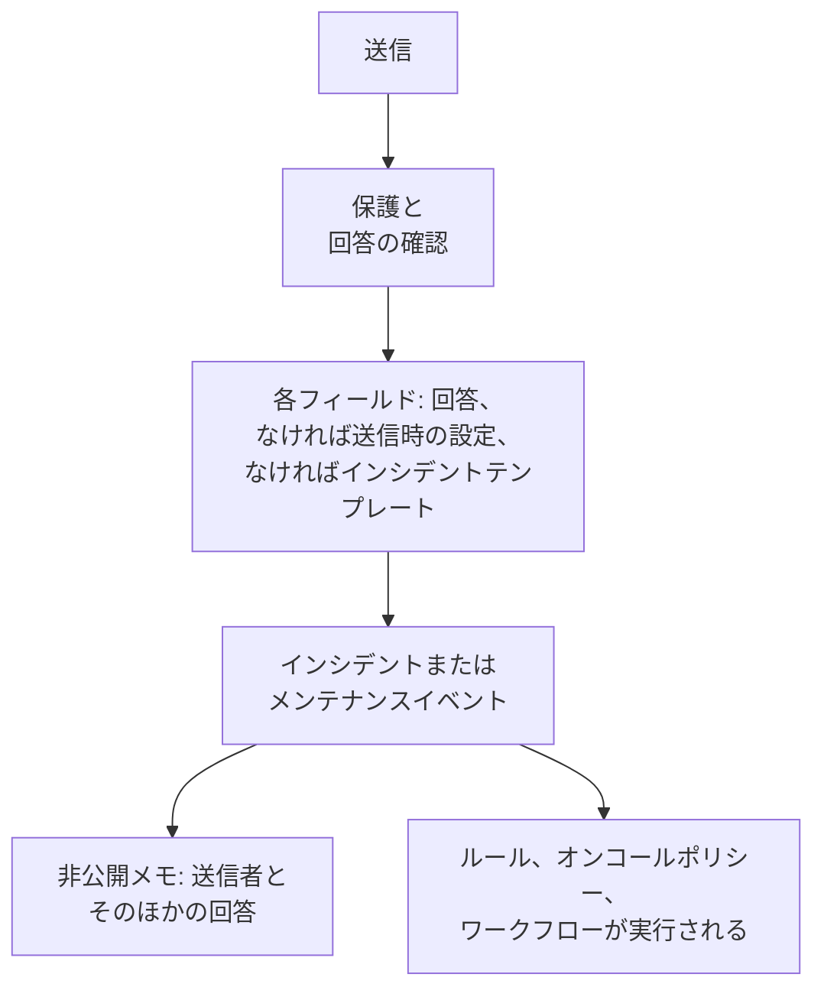

# 送信で作成されるもの

フォームからの各送信は、プロジェクトにレコードを 1 つ作成します。 **インシデント** または **定期メンテナンスイベント** です。フォームの **送信時** ページには、どちらを作成するかと、新しいレコードの各フィールドがどのように入力されるか (回答、デフォルト、常に適用される設定、インシデントテンプレートのいずれから入力されるか) が表示されます。 **設定を編集** で、デフォルトと常に適用されるものを変更します。

:::cards
- [送信がインシデントになるまで](#送信がインシデントになるまで): 新しいインシデントの各フィールドと、その値の出どころ。
- [送信が定期メンテナンスイベントになるまで](#送信が定期メンテナンスイベントになるまで): メンテナンスの依頼の場合も同じです。
- [送信時の設定](#送信時の設定): デフォルト、常に添付するもの、所有者、公開。
- [非公開メモ](#非公開メモ): 誰が送信したかと、どのフィールドにも入らない回答。
:::

## 送信時に起きること

確認に通らなかった送信は何も作成しません。[フォームを守るもの](/docs/forms/sharing-and-security#フォームを守るもの) を参照してください。

## 各送信が作成するもの

**送信ごとに作成されるもの** カードには、フォームを作成したときに選んだものが保存されています。

- **インシデント** — 各送信がインシデントを宣言するので、オンコールチームにすぐに通知が届きます。問題の報告に使います。
- **定期メンテナンス** — 各送信がメンテナンスイベントを予定します。変更やメンテナンスの依頼に使います。

もう一方を選ぶと、フォームも変わるので確認を求められます。

- タイトル、説明、モニター、ラベルはリンクされたままです。どちらの種類のレコードにもあるからです。
- そのほかのリンクされた質問 (重大度、ステータスページの選択、以前の種類のカスタムフィールド) は、同じ文言のフォーム独自の質問になり、その回答は非公開メモに一覧表示されます。
- インシデントとイベントでは設定が異なるので、送信時の設定は最初からやり直しになります。
- メンテナンスイベントを作成するようになったフォームは、メンテナンスの開始と終了を尋ねます。

質問は変更と一緒にすぐ保存されます。 **作成** ページで確認してください。

## 送信がインシデントになるまで

カードには、新しいインシデントの各フィールドと、その値の出どころが表示されます。

| フィールド | 値の出どころ |
| --- | --- |
| **タイトル** | **タイトル** の質問への回答。フォームが尋ねない場合や空のままの場合は **デフォルトのタイトル**、それもなければフォームの名前。 |
| **説明** | **説明** の質問への回答。尋ねない場合や空のままの場合は、フォームにテンプレートがあればインシデントテンプレートの説明。 |
| **重大度** | フォームが尋ねる場合は送信者の選択。そうでなければフォームの **重大度** の設定、それもなければインシデントテンプレートの重大度。 |
| **モニター** | 送信者が選んだモニターと、設定で常に添付するモニター。どちらもなければインシデントテンプレートのもの。 |
| **ラベル** | 送信者が選んだラベルと、設定で常に追加するラベル。どちらもなければインシデントテンプレートのもの。 |
| **影響の開始日時** | フォームが尋ねる場合は **影響の開始日時** への回答。 |
| **インシデントテンプレート** | フォームの **インシデントテンプレート** の設定。回答と設定で決まらないものをすべて埋めます。 |
| **オンコールポリシー** | 設定で指定したポリシーで、フォームが宣言するすべてのインシデントで実行されます。なければインシデントテンプレートのもの。 |
| **所有者** | 設定で指定した人とチーム、そしてテンプレートの所有者。すべてのインシデントについて通知を受けます。 |
| **カスタムフィールド** | カスタムフィールドの各質問への回答。ただし、フィールドがモニターのカスタムフィールドから値をコピーし、インシデントのモニターにその値がある場合は除きます。残りはテンプレートが埋めます。 |
| **ステータスページ** | チームの誰かが公開するまで、ステータスページには表示されず、購読者にも通知されません。 |
| **その他の回答** | 送信者とともに、インシデントの非公開メモに一覧表示されます。 |

> [!IMPORTANT]
> **重大度がなければインシデントはない。** インシデントには重大度が必要です。フォームが重大度を尋ねず、設定でも指定されておらず (または指定したものが削除され)、テンプレートでも設定されていない場合、 **重大度** の行に警告が表示され、すべての送信が "このフォームには重大度が設定されていないため、インシデントを作成できません。フォームを共有したチームにお知らせください。" で拒否されます。 **設定を編集** で重大度を選ぶか、重大度を設定するテンプレートを選んでください。

### インシデントテンプレート

設定で **インシデントテンプレート** を選ぶと、フォームが宣言するすべてのインシデントは、サーバーがどこでもテンプレートを適用するのと同じ方法で、そのテンプレートから宣言されます。[テンプレートが適用されるしくみ](/docs/incidents/settings#テンプレートが適用されるしくみ) を参照してください。回答とフォームの設定が優先され、テンプレートがそれ以外のすべてを埋めます。初期状態、説明、重大度、影響を受けるリソース、オンコールポリシー、所有者、ラベル、カスタムフィールドの値、モニターのステータスの変更です。

> [!WARNING]
> **モニターに注意してください。** フォームを通じてモニターでインシデントを宣言すると、手動でそのモニターにインシデントを宣言した場合とまったく同じ影響がモニターに及びます。インシデントが解決されるまでモニターのアクティブな監視が一時停止し、テンプレートの **変更後のモニターステータス** はモニターのステータスをすぐに変更します。インシデント自体が非表示でも、そのモニターを掲載するすべてのステータスページで変更されます。フォームなら、リンクを知っている誰でもこれを行えます。フォームでモニターを添付するのは、すべての送信でモニターを一時停止すべき場合だけにしてください。

### インシデントの見え方

フォームを通じて宣言されたインシデントは通常のインシデントですが、いくつか独自の設定があります。

- **ステータスページには非表示。** **ステータスページに表示** はオフで、 **ステータスページの購読者に通知** もオフです。対応者が公開するまで、インシデントのどの情報もステータスページや購読者には届きません。例外は、前述のテンプレートによるモニターのステータスの変更です。
- **宣言者なし。** 送信者は OneUptime のユーザーではないので、インシデントを宣言したユーザーは記録されません。
- **所有者に通知される。** 設定とテンプレートが指定する所有者は、インシデントの Slack と Microsoft Teams のチャネルができた時点で追加され、通知を受けます。インシデントの **インシデントが作成されました** 通知は、それらの人が所有者になるまで待つので、プロジェクトの所有者ではなく彼らに届きます。
- **非公開メモに送信が記録される** — [非公開メモ](#非公開メモ) を参照してください。

新しいインシデントで実行されるものは、これらのインシデントでもすべて実行されます。プライバシー、所有者、ラベル、オンコール、Runbook の各ルール、オンコールポリシー、 **On Create Incident** のワークフローです。オンコールルールは、ほかのインシデントと同じようにフォームのインシデントに一致します。送信者が書いたタイトルと説明でも一致します。

:::steps
#### 送信者が書いた内容を読む

タイトルと説明は、インシデントを公開するとステータスページに表示されます。

#### インシデントを公開する

インシデントの **設定** ページで **ステータスページに表示** をオンにします。

#### 必要なら購読者に知らせる

インシデントは **ステータスページの購読者に通知** がオフの状態で宣言されているので、公開しても「インシデントの作成」の通知は送信されません。購読者に知らせるには、 **ステータスページの購読者に通知** をチェックして公開メモを投稿します。[公開メモを投稿する](/docs/incidents/notes-owners-and-feed#公開メモを投稿する) を参照してください。
:::

## 送信が定期メンテナンスイベントになるまで

| フィールド | 値の出どころ |
| --- | --- |
| **タイトル** | **タイトル** の質問への回答。フォームが尋ねない場合や空のままの場合は **デフォルトのタイトル**、それもなければフォームの名前。 |
| **説明** | **説明** の質問への回答。 |
| **開始日時**、 **終了日時** | **開始日時** と **終了日時** への回答。すべてのメンテナンスのフォームが尋ね、必須にしています。終了は開始より後である必要があります。 |
| **モニター** | 送信者が選んだモニターと、設定で常に添付するモニター。 |
| **ステータスページ** | 送信者が選んだステータスページと、設定で指定したステータスページ。 |
| **ラベル** | 送信者が選んだラベルと、設定で常に追加するラベル。 |
| **所有者** | 設定で指定した人とチーム。フォームが予定するすべてのイベントの所有者になります。 |
| **ステータスページに表示** | 設定でオンにしない限り **いいえ**。 |
| **購読者に通知** | 設定でオンにしない限り **いいえ**。 |
| **カスタムフィールド** | カスタムフィールドの各質問への回答。ただし、フィールドがモニターのカスタムフィールドから値をコピーし、イベントのモニターにその値がある場合は除きます。 |
| **その他の回答** | 送信者とともに、イベントの非公開メモに一覧表示されます。 |

イベントはプロジェクトの **Scheduled** 状態で始まり、ほかのイベントと同じように進みます。開始すると進行中になり、終了すると終わります。

送信は誰かの依頼であり、依頼は公開前に確認されます。そのため、変更しない限り、チームの誰かが表示するまでイベントはステータスページに表示されず、作成、開始、終了のときに購読者へ通知されることもありません。設定の **公開** ステップにある **ステータスページに表示** と **購読者に通知** で、フォームが予定するすべてのイベントについてこれを変更できます。リンクを知っている全員を信頼できる場合にだけオンにしてください。

## 送信時の設定

**設定を編集** は設定をステップごとに開きます。 **次へ** で次に進み、 **変更を保存** は最後のステップにあります。どのステップもすでに入力されているので、フォームの横のステップの一覧から最後のステップを含めてどれでも開けます。設定をそのステップで変更してから、最後のステップを開いて保存します。

| ステップ | インシデントのフォーム | メンテナンスのフォーム |
| --- | --- | --- |
| **デフォルト値** | **デフォルトのタイトル**、 **重大度**、 **インシデントテンプレート** | **デフォルトのタイトル** |
| **常に関連付け** | **モニター**、 **ラベル**、 **オンコールポリシー** | **モニター**、 **ステータスページ**、 **ラベル** |
| **所有者** | **所有者** | **所有者** |
| **公開** | — | **ステータスページに表示**、 **購読者に通知** |

**所有者** は人とチームのための 1 つのピッカーです。 **所有者を追加** で両方を含む 1 つの検索リストが開き、選んだものはそれぞれ削除できるチップとして表示されます。設定で指定するものはすべてフォームのプロジェクトに属している必要があり、所有者はそのプロジェクトのメンバーである必要があります。選んだ後に削除されたレコードは、送信の作成時にスキップされ、残りはそのまま適用されます。

## 非公開メモ

各送信は、作成したものに非公開メモを残します。

> Submitted through the form **Report a Problem** by Ada Lovelace (<ada@example.com>).
>
> **Which office are you in?**\
> Berlin

メモにはフォームと送信者が記載されます (フォームが誰かを尋ねなかった場合は "Submitted anonymously through the form **Report a Problem**." )。送信がフォームのテンプレートのいずれかから始まった場合は、どのテンプレートかが記載され ( "Started from the template **Application Outage**." )、続いてフォーム独自の質問への回答が、フォームの順序で、それぞれの質問の下に一覧表示されます。リンクされた質問への回答 (タイトル、重大度、カスタムフィールド) は、すでにレコードにあります。非公開なのでメモがステータスページに届くことはありませんが、ほかのメモと同じように、レコードの Slack と Microsoft Teams のチャネルに投稿されます。

アドレスは、まさにそのアドレス宛てに書くリンクです。ダッシュボード、Slack、所有者へのメールのいずれでも同じです。

## 非表示の質問とテンプレート

[非表示の質問](/docs/forms/building#非表示の質問) には、送信の開始点になった [テンプレート](/docs/forms/building#テンプレート) から回答が入り、リクエストから入ることはありません。その回答は、入力された回答とまったく同じ場所に入ります。非表示の **説明** はインシデントの説明に、非表示のカスタムフィールドはその値に、フォーム独自の非表示の質問は非公開メモの 1 行になります。テンプレートを使わずに始まった送信では非表示の質問は未回答のままで、そのフィールドは、空のままのほかの質問と同じく送信時の設定で入力されます。誰かがフォームを開いている間にテンプレートが削除されても、その人の送信は止まりません。テンプレートの非表示の回答なしで、その人の回答どおりに作成されます。

テンプレートはフォームの質問を [独自の方法で](/docs/forms/building#テンプレートが各質問を尋ねる方法) 尋ねることができ、サーバーは送信を、指定されたテンプレートが尋ねるとおりの質問と照合します。テンプレートが非表示にする質問は、フォームが尋ねる場合でも、非表示の質問と同じくテンプレートから回答されます。テンプレートが尋ねる質問は、フォームが非表示にする場合でもリクエストから読み取られます。テンプレートが必須にする質問には回答が必要で、回答がなければ送信は拒否され、何も作成されません。

テンプレートがページで入力した回答は、送信した時点で送信者の回答になります。サーバーは、テンプレートの内容にかかわらず、ページが尋ねる質問についてリクエストが送る回答を使います。

## 送信者が書くテキスト

送信は、テキストが自ら動作しうる場所 (Slack と Microsoft Teams のチャネル、各対応者のブラウザー、所有者へのメール) に直接届き、事前に誰かが読むことはありません。そのため、レコードを作成する前に次のように処理します。

| 送信者が書くもの | 保存されるもの |
| --- | --- |
| タイトル、説明、任意のテキストの回答の中の、 \<!channel\>、 \<!here\>、 \<@U0123ABC\> のようなメンション | **メンションは誰にも通知しません。** Slack がメンションとして読むものにはすべて、開き括弧の後に不可視の文字が入ります。どこでも同じように読めますが、どのチャットツールも反応しません。 |
| 説明や **リッチテキスト** の回答の中の画像 | **画像はリンクになります。** すべての画像は同じアドレスへのリンクになるので、対応者がクリックするまで、送信者が選んだ場所から何も読み込まれません。 |
| 言語が `mermaid` のコードブロック (表記を問わない) | **図はコードになります。** 単なるコードとして保存されるので、図を描く代わりにそのテキストが表示されます。 |
| タイトルの中の画像の構文や図のブロック | **タイトルはプレーンテキストです。** これらにも不可視の文字が入るので、タイトルがどこに使われても (エピソード、チャットのメッセージ、メモのテンプレート)、何も読み込まず、何も描きません。不可視の文字もタイトルの上限に数えられます。 |

それ以外のもの (リンク、そのほかの Markdown、ドロップダウンの選択、数値、日付、チェックしたチェックボックス) は送信者が入力したとおりに保存され、送信には送信者の名前とメールアドレスが入力どおりに保持されます。

## 次のステップ

:::cards
- [フォームの作成](/docs/forms/building): これらのフィールドに入る質問、非表示の質問、テンプレート。
- [インシデントの設定と自動化](/docs/incidents/settings): インシデントテンプレートとカスタムフィールド。
- [インシデントのメモ、オーナー、フィード](/docs/incidents/notes-owners-and-feed): 非公開メモ、公開メモ、所有者。
- [共有とセキュリティ](/docs/forms/sharing-and-security): 誰がどのくらいの頻度で送信できるか。
:::
