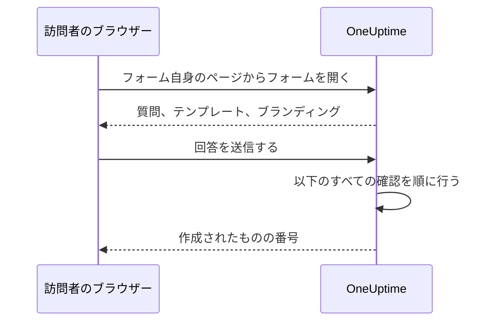

# 共有とセキュリティ

フォームはリンクを知っている誰にでも開かれており、各送信でオンコールチームを呼び出したり、カレンダーにメンテナンスの時間枠を入れたりできます。このページでは、フォームの **共有** ページ (リンク、フォームのオフ、送信後のメッセージ、IP 許可リスト) と、リクエストが途中で通過するそのほかのすべての確認について説明します。

:::cards
- [リンクを共有する](#リンクを共有する): コピーして開き、広まりすぎたらリセットします。
- [テンプレートごとのリンク](#テンプレートごとのリンク): ケースごとに 1 つのブックマーク、その背後に 1 つのフォーム。
- [フォームを守るもの](#フォームを守るもの): リクエストが通過するすべての確認を順に説明します。
- [トラブルシューティング](#トラブルシューティング): フォームのページの各メッセージの意味と、その対処法。
:::

## 共有ページ

| カード | 内容 |
| --- | --- |
| **ステータス** | **送信を受け付ける** — フォームのリンクが機能するかどうか。 |
| **共有リンク** | **リンクをコピー**、 **フォームを開く**、 **リンクをリセット** 付きのリンク。 |
| **送信後** | 送信後に、フォームが作成したものの番号の下に表示される **お礼のメッセージ**。 |
| **アクセス** | **IP 許可リスト**。 |

## リンクを共有する

**共有リンク** カードには、 `https://oneuptime.com/accounts/form/<share-key>` のようなフォームのリンクが表示されます。

- **リンクをコピー** でコピーします。
- **フォームを開く** で、表示されるとおりのフォームを新しいタブで開きます。
- **リンクをリセット** は、確認の後でフォームに新しいリンクを発行します。古いリンクはすぐに機能しなくなり、利用できないというメッセージを表示するので、共有したすべての人に新しいリンクが必要です。リンクが必要以上に広まったときに使います。

リンクを知っている人は誰でも、OneUptime のアカウントもサインインもなしに、フォームを開いて送信できます。サインインしていても何も変わりません。OneUptime が送信者を知る手がかりは、フォームに入力された名前とメールアドレスだけです。そのため、リンクはオンコールチームの電話番号のように扱ってください。使うべき人が見つけられる場所 (イントラネットのページ、サポートの Runbook、チャットのピン留めされたメッセージ) で共有し、誰からでも送信を受け付けたい場合を除いて、公開 Web サイトには載せないでください。

リンクには、フォームの ID ではなく独自のランダムなキーが含まれます。セルフホストのインストールでは、リンクは自分の OneUptime ホストから提供され、 `HTTP_PROTOCOL` と `HOST` で設定したアドレスでだけ機能します。サーバーの別の名前や IP アドレスで開くと、フォームのリクエストは別の Web サイトからのものとして拒否されます。

古いインシデントフォームへのリンク ( `/accounts/incident-form/<share-key>` ) は、同じフォームを新しいアドレスで開きます。

### テンプレートごとのリンク

フォームの各 [テンプレート](/docs/forms/building#テンプレート) には専用のリンクがあります。フォームのリンクに `?template=` とテンプレートの ID を付けたもので、たとえば `https://oneuptime.com/accounts/form/<share-key>?template=<template-id>` です。フォームの **テンプレート** ページの **リンクをコピー** でコピーします。そのテンプレートで入力された状態のフォームが開くので、フォームは 1 つのまま、チームはケースごとにリンクをブックマークできます。送信者が別のテンプレートを選ぶとブラウザーのアドレスも追従するので、コピーしたリンクは表示されているとおりのフォームになります。

テンプレートのリンクはフォームのリンクです。フォームが **送信を受け付ける** である間は機能し、 **リンクをリセット** でほかのリンクと一緒に無効になります。削除したテンプレートを指定するリンクは、テンプレートを指定しない場合と同じようにフォームを開きます。デフォルトのテンプレートがあれば、それで開きます。

### フォームをオフにする

フォームを削除せずに送信の受け付けをやめるには、 **送信を受け付ける** をオフにします。リンクには "このフォームは利用できません。無効になっているか、リンクが古くなっている可能性があります。" と表示され、 **共有リンク** カードには、フォームがオフになっていることが表示されます。再びオンにすると、同じリンクが再び機能します。

### お礼のメッセージ

送信後、ページには "ありがとうございます。回答を送信しました。" と表示され、作成されたものの番号に続いて、Markdown で書いた **お礼のメッセージ** が表示されます。次に何が起きるか、急ぎのときはどこに連絡すればよいかを伝えるのに使います。書いていない場合、ページには標準のメッセージだけが表示されます。

フォームの説明やお礼のメッセージに含まれる画像は、フォームが **送信を受け付ける** である間、リンクを開いた全員に表示されます。フォームをオフにするか画像を取り除くと、全員が見られるほかの場所にまだその画像が含まれていない限り、画像は再び非公開になります。

## フォームを守るもの

すべてのリクエストは、次の確認を次の順序で通過します。

1. リクエストは別の Web サイトではなく、フォーム自身のページから来る必要があります。[ほかの Web サイトからのリクエスト](#ほかの-web-サイトからのリクエスト) を参照してください。
2. レート制限の範囲内である必要があります。
3. フォームが存在し、 **送信を受け付ける** であり、フォームを含むプランのプロジェクトに属している必要があります。
4. フォームに **IP 許可リスト** がある場合は、そこに含まれるアドレスから来る必要があります。
5. インスタンスでキャプチャがオンの場合、送信はキャプチャに合格する必要があります。
6. すべての回答はサイズの上限の範囲内で、質問に合っている必要があります。[フォームの作成](/docs/forms/building#サイズの上限) を参照してください。
7. 回答と設定から作られるものが作成可能である必要があります。インシデントには重大度が、イベントには開始より後の終了が必要です。
8. 送信はフォームの 1 時間あたりの許容量に収まる必要があります。[レート制限](#レート制限) を参照してください。

フォームのロゴとファビコンはフォームの一部です。最初の 4 つの確認を通過した後でだけ、フォームを開く応答の中に base64 で含めて送られ、独自のアドレスから送られることはありません。フォームなしでそれらを取得することはできず、フォームを通じて ID でファイルを取得することもできません。ファイル自体は非公開のままです。フォームが表示するのは、フォーム自身のプロジェクトでアップロードされた画像だけです。別のプロジェクトのファイルは、フォームの保存時に拒否され、フォームのページに送られることはありません。

### IP 許可リスト

フォームを自分のネットワークだけに制限するには、次の手順を行います。

:::steps
1. フォームの **共有** ページを開きます。
2. **アクセス** カードで **IP 許可リストを編集** をクリックします。
3. 1 行に 1 つのネットワークを入力して保存します。カードの **IP 許可リスト** の下にそれらが表示されます。
:::

各行は次のいずれかです。

| エントリー | 例 | 注記 |
| --- | --- | --- |
| IPv4 アドレス | `203.0.113.7` | |
| IPv6 アドレス | `2001:db8::7` | 大文字で書いても、ゼロを省略せずに書いても一致します。 |
| CIDR 表記の IPv4 の範囲 | `10.0.0.0/8` | IPv6 の範囲には対応していません。IPv6 アドレスは 1 行に 1 つずつ書いてください。 |

IPv4 アドレスは IPv4 として書く必要があります。 `::ffff:203.0.113.7` のように IPv6 の書き方で書くと拒否されます。リストは保存のたびに (ダッシュボード、API、Terraform、ワークフローのいずれからでも) 確認され、決して一致しない行は、その行を示すメッセージで拒否されます。すべてのネットワークを許可するには、リストを空のままにします。エントリーが 1 つでもあると、アドレスを特定できないリクエストは拒否されます。

OneUptime Cloud では、IP 許可リストの設定には **Scale** プランが必要です。API で IP 許可リスト付きのフォームを作成するときも、編集するときも同じです。[公開ダッシュボード](/docs/dashboards/sharing) の IP 許可リストと同様です。リストを空にするのはどのプランでもできます。

### ほかの Web サイトからのリクエスト

ブラウザーは、どのページがリクエストを送ったかをサーバーに伝えます。別の Web サイトのページが訪問者のブラウザーにフォームを開かせたり送信させたりすると、リクエストは "This form can only be used from its own page." で拒否されます。これはレート制限で数えられる前に、リンクにかかわらず行われるので、どのフォームが存在するかは応答からはわかりません。

リクエストは、 `Sec-Fetch-Site` ヘッダーがあって `same-origin` または `none` 以外を示している場合や、 `Origin` ヘッダーがあって OneUptime のアドレス ( `HTTP_PROTOCOL` と `HOST`、 `HOST` にポートがあればそのポートも含む) ではない場合に拒否されます。送信は JSON ( `application/json` ) で送る必要もあります。Web ページのフォームフィールドとして、またはプレーンテキストとして送られた送信は、 "The request must be a JSON object holding the form's answers in "data"." で拒否されます。フォームの読み取りには、フォームのページが自分のすべてのリクエストに付けるヘッダー `X-OneUptime-Form: 1` も必要です。ページはスクリプトなしでブラウザーにヘッダーを追加させることはできず、ヘッダーを追加する別の Web サイトのスクリプトは、その `Origin` で正体がわかります。

### レート制限

フォームを開くことと送信することはネットワークのアドレスごとに制限され、送信はフォームごとにも制限されます。

- **フォームを開く** — 1 つのアドレスからのフォームごと、およびすべてのフォームにまたがるアドレスごとに制限されます。オフィス全体が同時にリンクを開いても大丈夫な余裕があります。どちらかを超えると、ページに "リクエストが多すぎます。しばらくしてから再度お試しください。" と表示されます。レートリミッターに到達できない場合でも、フォームは開きます。
- **送信 (アドレスごと)** — 1 つのアドレスからのフォームごと、およびすべてのフォームにまたがるアドレスごとに制限されます。どちらかを超えると、送信者には "お使いのネットワークからの送信が多すぎます。数分待ってから再度お試しください。" と表示されます。1 つのアドレスの背後にいる全員 (オフィスのネットワーク、VPN ゲートウェイ) がこれらの制限を共有し、誤った回答で後から拒否される送信も含めて、すべての送信が数えられます。
- **送信 (フォームごと)** — 1 つのフォームが 1 時間に作成できるレコードの数で、すべてのアドレスを合計します。そのため、多数のアドレスから同時に送信されても、あなたが呼び出されるのは 1 時間に限られた回数だけです。数えられるのは、ほかのすべての確認を通過した送信だけで、レコードが作成される直前に数えられます。超えると、時間枠が終わるまで全員に "現在、このフォームには送信が集中しています。しばらくしてから再度お試しください。" と表示されます。 **リンクをリセット** で、新しいリンクが新しい許容量で始まります。

すべての制限は、秒数を示す `Retry-After` ヘッダー付きの `429` で応答し、ページは送信者にいつ再試行すればよいかを伝えます。時間枠は固定で、スライドしません。レートリミッターに到達できない場合、送信は数えられないまま通されるのではなく拒否されます。API は `503` で応答し、送信者には "現在、送信を受け付けることができません。数分後に再度お試しください。" と表示されます。

セルフホストのインストールでは、OneUptime アプリの次の環境変数で制限を変更できます。

| 変数 | デフォルト | 設定する内容 |
| --- | --- | --- |
| `FORM_RATE_LIMIT_WINDOW_SECONDS` | `60` | フォームを開くときの時間枠 (秒)。 |
| `FORM_RATE_LIMIT_PER_FORM_AND_IP_PER_WINDOW` | `120` | 1 つのアドレスが時間枠あたりに 1 つのフォームを開ける回数。 |
| `FORM_RATE_LIMIT_PER_IP_PER_WINDOW` | `600` | 1 つのアドレスが時間枠あたりにフォームを開ける回数 (すべてのフォームの合計)。 |
| `FORM_SUBMIT_RATE_LIMIT_WINDOW_SECONDS` | `900` | アドレスごとの送信制限の時間枠 (秒)。 |
| `FORM_SUBMIT_RATE_LIMIT_PER_FORM_AND_IP_PER_WINDOW` | `10` | 時間枠あたりの、1 つのアドレスから 1 つのフォームへの送信数。 |
| `FORM_SUBMIT_RATE_LIMIT_PER_IP_PER_WINDOW` | `30` | 時間枠あたりの、1 つのアドレスからの送信数 (すべてのフォームの合計)。 |
| `FORM_SUBMIT_RATE_LIMIT_PER_FORM_WINDOW_SECONDS` | `3600` | フォームごとの制限の時間枠 (秒)。 |
| `FORM_SUBMIT_RATE_LIMIT_PER_FORM_PER_WINDOW` | `60` | 時間枠あたりに 1 つのフォームが作成できるレコード数 (すべてのアドレスの合計)。 |

各変数は、 `FORM_` の代わりに `INCIDENT_FORM_` を先頭に付けた古い名前 (たとえば `INCIDENT_FORM_SUBMIT_RATE_LIMIT_PER_FORM_PER_WINDOW` ) も読み取るので、インシデントフォームを調整していたインストールは制限を保持します。両方が設定されている場合は新しい名前が優先されます。 `config.env` も Helm チャートの値もこれらを渡さないので、 `app` コンテナーの環境に自分で追加してください。Helm チャートでは `app.extraEnv` またはチャート全体の `extraEnv` を、Docker Compose では `docker-compose.override.yml` を使います。アドレスごとの制限がどのアドレスを数えるかは `TRUSTED_PROXY_HOPS` で決まります。

### キャプチャ

OneUptime インスタンスで hCaptcha がオンの場合、フォームにはキャプチャが表示され、キャプチャに合格していない送信は拒否されます。フォームごとの設定はありません。セルフホストのインストールでは、 `CAPTCHA_ENABLED`、 `CAPTCHA_SITE_KEY`、 `CAPTCHA_SECRET_KEY` でキャプチャをオンにします。サインアップを保護するのと同じ設定です。キャプチャがない場合は、レート制限と IP 許可リストが負荷を担います。

## トラブルシューティング

:::details リンクにフォームが利用できないと表示される
"このフォームは利用できません。無効になっているか、リンクが古くなっている可能性があります。" ページは理由にかかわらず同じ応答を返すので、フォームが存在するかどうかを見知らぬ人に伝えることはありません。

- **共有** ページで **送信を受け付ける** がオフになっている。
- リンクが **リンクをリセット** で置き換えられた。新しいリンクを共有してください。
- フォームが削除された。
- OneUptime Cloud で、プロジェクトが **Growth** プラン未満であるか、サブスクリプションが未払いである。
- コピーしたときにリンクが途中で切れた。
:::

:::details 許可されたネットワークからしかフォームを開けない
"このフォームは許可されたネットワークからのみ開くことができます。" 送信者のアドレスがフォームの **IP 許可リスト** にありません。そのネットワークを追加するか、リストを空にします。プロキシやロードバランサーの背後にあるセルフホストのインストールでは、 `TRUSTED_PROXY_HOPS` を確認してください。値が小さすぎると、OneUptime は送信者のアドレスではなくプロキシのアドレスを見ます。フォームが自分の OneUptime のアドレス以外で開かれた場合も、ページは同じことを表示します。 **共有リンク** カードに表示されるとおりにリンクを開いてください。
:::

:::details 送信が多すぎる
"お使いのネットワークからの送信が多すぎます。数分待ってから再度お試しください。" 1 つのアドレスの背後にいる全員がアドレスごとの制限を共有します。これは、大規模な障害で多くの人が同時に報告するときに影響します。ページには、いつ再試行すればよいかが表示されます。 "現在、このフォームには送信が集中しています。しばらくしてから再度お試しください。" は、代わりにフォームごとの許容量です。送信者のネットワークとは関係なく、時間枠が終わると再び報告を受け付けます。リンクが必要以上に広まって本物ではない送信が来ている場合は、 **リンクをリセット** で古いリンクをすぐに止めます。
:::

:::details 今は送信を受け付けられない
"現在、送信を受け付けることができません。数分後に再度お試しください。" レートリミッターに到達できなかったので、送信は数えられないまま通されるのではなく拒否されます。フォームを開くことは引き続きできます。セルフホストのインストールでは、レートリミッターが数えるキャッシュである Valkey が稼働していて、OneUptime アプリから到達できることを確認してください。
:::

:::details 重大度がないため、このフォームはインシデントを作成できない
フォームが重大度を尋ねず、設定でも指定されておらず (または指定したものが削除され)、インシデントテンプレートでも設定されていません。フォームの **送信時** ページで重大度を選んでください。[重大度がなければインシデントはない](/docs/forms/on-submit#送信がインシデントになるまで) を参照してください。
:::

:::details 送信が拒否される
メッセージに問題が示されます。必須の回答がない、またはスペースだけである、回答が長すぎる、または質問に合わない、メールアドレスが 1 つの通常のアドレスではない、またはメンテナンスの時間枠が開始前に終わっている、のいずれかです。 "キャプチャの認証に失敗しました。もう一度お試しください。" は、キャプチャに合格しなかったか、期限が切れたことを意味します。もう一度解いてください。すべての送信がキャプチャで失敗するセルフホストのインストールでは、 `CAPTCHA_SITE_KEY` と `CAPTCHA_SECRET_KEY` の両方が設定されていることを確認してください。
:::

:::details 質問がフォームにない
ビルダーは、公開フォームから省く質問 (削除されたカスタムフィールドなど) にフラグを付け、 **プレビュー** は質問を省くときにその旨を表示します。[ビルダーが質問にフラグを付けるとき](/docs/forms/building#ビルダーが質問にフラグを付けるとき) を参照してください。 **非表示** バッジの付いた質問は意図的に省かれています。回答するのはテンプレートだけです。[非表示の質問](/docs/forms/building#非表示の質問) を参照してください。質問は、あるテンプレートではフォームにあり、別のテンプレートではないこともあります。各テンプレートは質問を非表示にしたり、フォームが非表示にする質問を尋ねたりできます。テンプレートの **編集** を開き、その **質問** を確認してください。[テンプレートが各質問を尋ねる方法](/docs/forms/building#テンプレートが各質問を尋ねる方法) を参照してください。
:::

:::details テンプレートが質問に入力しない
テンプレートの回答が使われるのは、その回答がまだ質問に合っている間だけです。質問がまだ提示しているオプション、フォームがまだ提示しているレコード、長すぎないテキストです。テンプレートを編集し、もう一度その質問に回答して保存してください。[テンプレート](/docs/forms/building#テンプレート) を参照してください。
:::

:::details インシデントやイベントがステータスページにない
これは仕様です。フォームからのインシデントは非表示で宣言され、メンテナンスイベントは、フォームの **公開** の設定で別の指定をしない限り非表示のままです。[送信で作成されるもの](/docs/forms/on-submit) を参照してください。
:::

:::details 誰も呼び出されなかった
フォームのインシデントは、ほかのインシデントと同じく、設定とテンプレートが指定するオンコールポリシーと、オンコールルールが追加するものを実行します。どれもない場合、誰も呼び出されません。フォームの **送信時** ページでオンコールポリシーを追加するか、フォームのインシデントに一致するオンコールルール (たとえば、フォームが常に追加するラベルによるもの) を作成してください。
:::

## 次のステップ

:::cards
- [フォームの概要](/docs/forms/index): フォームの用途、権限、API。
- [フォームの作成](/docs/forms/building): 質問、非表示の質問、テンプレート。
- [送信で作成されるもの](/docs/forms/on-submit): 各送信が作成するインシデントまたはイベント。
:::
