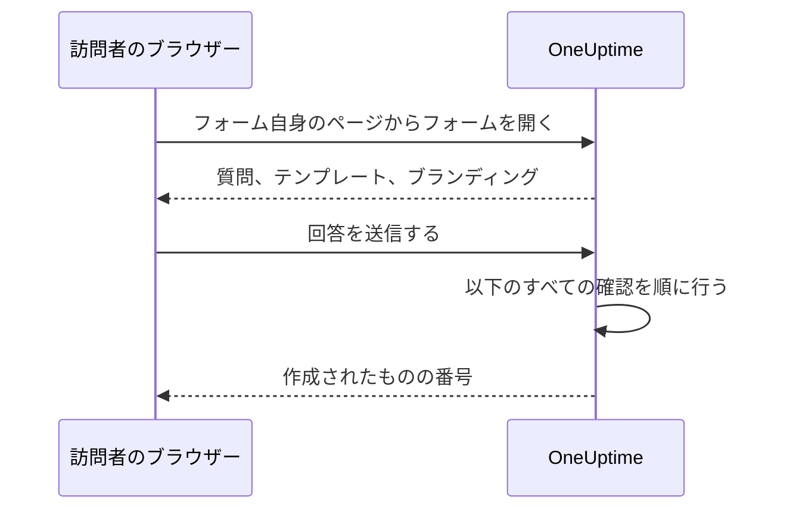

# 共有とセキュリティ

フォームはリンクを知っている誰にでも開かれており、各送信でオンコールチームを呼び出したり、カレンダーにメンテナンスの時間枠を入れたりできます。このページでは、フォームの **共有** ページ (リンク、フォームのオフ、送信後のメッセージ、IP 許可リスト) と、リクエストが途中で通過するそのほかのすべての確認について説明します。 フォームを自社のドメインで公開する方法も説明します。

:::cards
- [リンクを共有する](#リンクを共有する): コピーして開き、広まりすぎたらリセットします。
- [テンプレートごとのリンク](#テンプレートごとのリンク): ケースごとに 1 つのブックマーク、その背後に 1 つのフォーム。
- [カスタムドメイン](#カスタムドメイン): フォームを自社のドメインで、無料の証明書付きで公開します。
- [フォームを守るもの](#フォームを守るもの): リクエストが通過するすべての確認を順に説明します。
- [トラブルシューティング](#トラブルシューティング): フォームのページの各メッセージの意味と、その対処法。
:::

## 共有ページ

| カード | 内容 |
| --- | --- |
| **ステータス** | **送信を受け付ける** — フォームのリンクが機能するかどうか。 |
| **共有リンク** | フォームが応答するすべてのアドレス。それぞれに **リンクをコピー** があり、 **リンクをリセット** もあります。 |
| **送信後** | 送信後に、フォームが作成したものの番号の下に表示される **お礼のメッセージ**。 |
| **その他の設定** | **IP 許可リスト**。開くまで折りたたまれています。 |

## リンクを共有する

**共有リンク** カードには、フォームが応答するすべてのアドレスが並びます。最初にフォームの [カスタムドメイン](#カスタムドメイン)、次に `https://oneuptime.com/accounts/form/<share-key>` のような OneUptime 上のリンクです。

- 各アドレスは、ほかの人が見るのと同じ形でフォームを新しいタブで開きます。隣の **リンクをコピー** でアドレスをコピーできます。
- まだ使えないカスタムドメインには、理由とともに **準備中** と表示されます。カスタムドメインがない場合は、リンクの下の行に **カスタムドメインを追加** が表示されます。
- **リンクをリセット** は、確認の後でフォームに新しいリンクを発行します。古いリンクはすぐに機能しなくなり、利用できないというメッセージを表示するので、共有したすべての人に新しいリンクが必要です。リンクが必要以上に広まったときに使います。 フォームのカスタムドメインにはキーが含まれないので、そのまま使えます。

リンクを知っている人は誰でも、OneUptime のアカウントもサインインもなしに、フォームを開いて送信できます。サインインしていても何も変わりません。OneUptime が送信者を知る手がかりは、フォームに入力された名前とメールアドレスだけです。そのため、リンクはオンコールチームの電話番号のように扱ってください。使うべき人が見つけられる場所 (イントラネットのページ、サポートの Runbook、チャットのピン留めされたメッセージ) で共有し、誰からでも送信を受け付けたい場合を除いて、公開 Web サイトには載せないでください。

リンクには、フォームの ID ではなく独自のランダムなキーが含まれます。セルフホストのインストールでは、リンクは自分の OneUptime ホストから提供され、 `HTTP_PROTOCOL` と `HOST` で設定したアドレスでだけ機能します。サーバーの別の名前や IP アドレスで開くと、フォームのリクエストは別の Web サイトからのものとして拒否されます。

古いインシデントフォームへのリンク ( `/accounts/incident-form/<share-key>` ) は、同じフォームを新しいアドレスで開きます。

### テンプレートごとのリンク

フォームの各 [テンプレート](/docs/forms/building#テンプレート) には専用のリンクがあります。フォームのリンクに `?template=` とテンプレートの ID を付けたもので、たとえば `https://oneuptime.com/accounts/form/<share-key>?template=<template-id>` です。フォームの **テンプレート** ページの **リンクをコピー** でコピーします。そのテンプレートで入力された状態のフォームが開くので、フォームは 1 つのまま、チームはケースごとにリンクをブックマークできます。送信者が別のテンプレートを選ぶとブラウザーのアドレスも追従するので、コピーしたリンクは表示されているとおりのフォームになります。 [カスタムドメイン](#カスタムドメイン) では、テンプレートのリンクは同じ `?template=` を付けたドメインで、たとえば `https://report.acme.com/?template=<template-id>` です。 **リンクをリセット** の後も使えます。

テンプレートのリンクはフォームのリンクです。フォームが **送信を受け付ける** である間は機能し、 **リンクをリセット** でほかのリンクと一緒に無効になります。削除したテンプレートを指定するリンクは、テンプレートを指定しない場合と同じようにフォームを開きます。デフォルトのテンプレートがあれば、それで開きます。

### フォームをオフにする

フォームを削除せずに送信の受け付けをやめるには、 **送信を受け付ける** をオフにします。リンクには "このフォームは利用できません。無効になっているか、リンクが古くなっている可能性があります。" と表示され、 **共有リンク** カードには、フォームがオフになっていることが表示されます。再びオンにすると、同じリンクが再び機能します。 フォームがオフの間は、フォームのカスタムドメインにも同じメッセージが表示されます。

### お礼のメッセージ

送信後、ページには "ありがとうございます。回答を送信しました。" と表示され、作成されたものの番号に続いて、Markdown で書いた **お礼のメッセージ** が表示されます。次に何が起きるか、急ぎのときはどこに連絡すればよいかを伝えるのに使います。書いていない場合、ページには標準のメッセージだけが表示されます。

フォームの説明やお礼のメッセージに含まれる画像は、フォームが **送信を受け付ける** である間、リンクを開いた全員に表示されます。フォームをオフにするか画像を取り除くと、全員が見られるほかの場所にまだその画像が含まれていない限り、画像は再び非公開になります。

## カスタムドメイン

フォームは最初、OneUptime 自身のアドレス上のリンクで公開されます。 `report.acme.com` のような自社のドメインで公開するには、フォームのサイドメニューで **共有** のすぐ後にある **カスタムドメイン** ページを開きます。 [ステータスページのカスタムドメイン](/docs/status-pages/branding-and-domains#カスタムドメイン) と同じように動作します。

フォームを自社のドメインに置く手順は 3 つで、あなたが行うのは最初の 2 つだけです。

1. **ドメインを追加する**: サブドメインと、確認済みのドメインの 1 つ。
2. **その CNAME レコードを追加する**: DNS プロバイダーで追加します。ドメインを追加するとすぐ、 **DNS 設定** ダイアログがレコードとともに開きます。
3. **無料の SSL 証明書は自動で発行されます**: レコードが見つかるとすぐに発行されます。押すボタンはありません。

ドメインが使えるようになると、 **共有リンク** カードでフォームのリンクの上に表示されます。どちらも同じフォームを開きます。

### ドメインの追加

**フォームのドメインを作成** をクリックします。ダイアログは 1 ページです。

- **サブドメイン**: ラベルだけを入力します。プレースホルダーは `report (leave blank for root)` です。ホスト名全体ではなく `report` だけを入力します。ルートドメインを使うには空のままにするか `@` を入力します。
- **ドメイン**: **プロジェクト設定** > **詳細** > **ドメイン** で確認済みのドメインの 1 つです。そこでは TXT レコードで、ドメインを所有していることを証明します。フィールドの横の **ドメインを追加** リンクは、そのページを新しいタブで開きます。
- **その他の項目**: 折りたたまれています。独自の証明書を使う場合にだけ開きます。 **カスタム証明書をアップロード** をオンにして、 **証明書** とその **証明書の秘密鍵** を貼り付けます。

もう一度 **フォームのドメインを作成** をクリックして追加します。ダイアログが閉じ、新しいドメインの **DNS 設定** が開きます。ドメインの名前とフォームは追加した時点で固定されるので、 **編集** で変えられるのは証明書だけです。どちらかを変えるには、新しいドメインを追加して古いドメインを削除します。

1 つのドメインが表示できるのは 1 つのステータスページ、ダッシュボード、またはフォームだけなので、どのプロジェクトであれ、そのいずれかがすでに持つ名前は拒否されます: "report.acme.com is already in use: a domain can show only one status page, dashboard or form. Choose another subdomain, or remove report.acme.com where it is used first."

### DNS 設定と今すぐ確認

**DNS 設定** ダイアログには、DNS プロバイダーで追加するレコードが、各フィールドにコピーボタン付きで表示されます。 **種類** は `CNAME`、 **名前** は追加したドメインの完全な名前、 **値** はインストールの CNAME レコードです。ルートドメインでは、多くの DNS プロバイダーが CNAME レコードを許可しません。代わりに、プロバイダーの ALIAS、ANAME、または CNAME フラット化のレコードを同じ値で使います。

OneUptime は未確認のドメインを 15 分ごとに確認し、レコードが見つかると、同じ確認の中でドメインの無料の Let's Encrypt 証明書を注文します。すぐに確認するには **今すぐ確認** をクリックします。ドメインが使えるようになるまで、その行には同じダイアログを開く **DNS 設定** 操作があり、そこでの **今すぐ確認** は、失敗した証明書や期限切れの証明書の再注文も行います。再注文はドメインごとに 15 分に 1 回までです。更新は自動で、証明書の期限が切れるかなり前に行われます。

**ステータス** 列には、各ドメインが HTTPS までのどの段階にあるかが、ステータスページのドメインと同じ 8 つの状態で表示されます。 [ドメインのステータス列の読み方](/docs/status-pages/branding-and-domains#ドメインのステータス列の読み方) を参照してください。注文が失敗した場合は、その下の行に理由が表示されます。よくある原因は、 `letsencrypt.org` を許可していないドメインの CAA レコードと、セルフホストのインストールで Let's Encrypt がポート 80 でサーバーに到達できないことです。

ドメインの無料の証明書が注文されると、その行に **SSL を再発行** が表示されます。これは自動更新の前に Let's Encrypt にまったく新しい証明書を求めるもので、ドメインごとに 24 時間に 1 回使えます。その間も、フォームは現在の証明書で公開されたままです。アップロードした証明書はご自身で更新します。ドメインを編集して新しい証明書を貼り付けてください。

### ドメインに表示されるもの

ドメインは、 `https://report.acme.com` のようにルートでフォームを表示し、OneUptime のほかのものは表示しません。サインインページもほかのフォームもありません。ドメイン上のほかのアドレスはすべて、クエリを保ったままルートでフォームを開くので、テンプレートのリンクもそこで使えます。ページはフォーム自身のものです。フォームのロゴ (なければ何も表示せず、OneUptime のロゴは決して表示しません)、タブのタイトルにはフォームの名前、ライトテーマで、OneUptime の分析はありません。キャプチャ、ファイル、お礼のメッセージはリンクと同じように動作し、 [フォームを守るもの](#フォームを守るもの) のすべてのチェックが、ドメインをフォーム自身のページとして適用されます。

- **リンクをリセット** が変えるのは OneUptime 上のフォームのリンクだけです。ドメインにはキーが含まれないので、そのまま使えます。
- **送信を受け付ける** をオフにすると、利用できないというメッセージとともに、ドメイン上でもフォームが閉じます。
- フォームを削除するとそのドメインも削除され、 **フォームを複製** はドメインを 1 つもコピーしません。削除したドメインには、すぐにフォームが表示されなくなります。

### セルフホストのインストールでは

フォームはステータスページの CNAME レコードを使います。 `config.env` の `STATUS_PAGE_CNAME_RECORD`、または Helm チャートの `statusPage.cnameRecord` です。フォームのドメインに独自のターゲットを与えるには `FORM_CNAME_RECORD` を設定します。Docker Compose なら `config.env` で、Helm チャートならチャート全体の `extraEnv` で設定します。どちらもない場合、 **カスタムドメイン** ページはレコードの代わりにカスタムドメインが有効になっていないことを表示し、OneUptime はフォームのドメインを確認せず、証明書も注文しません。

サーバーは、Let's Encrypt が各ドメインを確認するポート 80 で応答する必要があります。Let's Encrypt のアカウントキー `LETS_ENCRYPT_ACCOUNT_KEY` (Helm チャートでは `letsEncrypt.accountKey`) がないインストールは証明書を注文しません。フォームのドメインはレコードが確認されるとすぐに使えるようになり、独自のプロキシの HTTPS か、アップロードした証明書で配信されます。キャプチャがオンの場合、動作するホスト名を列挙するサイトキーには、フォームのドメインも含める必要があります。

### ドメインを管理できる人

プロジェクトのオーナーと管理者、そして **Edit Form** を持つ人は、フォームのドメインを追加し、確認し、証明書を再発行し、削除できます。フォームのドメインだけの権限、たとえば **Edit Form Domain** でも同じことができます。 [フォームの概要](/docs/forms/index#権限) にその一覧があります。フォームを読める人は、そのドメイン、その **ステータス**、 **DNS 設定** のレコードを見られますが、その人には **今すぐ確認** と **SSL を再発行** がロックされ、必要な権限が表示されます。API キーも `/form-domain` で同じように動作し、 `verify-cname`、 `order-ssl`、 `reissue-ssl` には **Edit Form Domain** か **Edit Form** が必要です。

## フォームを守るもの

すべてのリクエストは、次の確認を次の順序で通過します。

1. リクエストは別の Web サイトではなく、フォーム自身のページから来る必要があります。[ほかの Web サイトからのリクエスト](#ほかの-web-サイトからのリクエスト) を参照してください。
2. レート制限の範囲内である必要があります。
3. フォームが存在し、 **送信を受け付ける** であり、フォームを含むプランのプロジェクトに属している必要があります。
4. フォームに **IP 許可リスト** がある場合は、そこに含まれるアドレスから来る必要があります。
5. インスタンスでキャプチャがオンの場合、送信はキャプチャに合格する必要があります。
6. すべての回答はサイズの上限の範囲内で、質問に合っている必要があります。[フォームの作成](/docs/forms/building#サイズの上限) を参照してください。
7. 回答と設定から作られるものが作成可能である必要があります。インシデントには重大度が、イベントには開始より後の終了が必要です。
8. 送信はフォームの 1 時間あたりの許容量に収まる必要があります。[レート制限](#レート制限) を参照してください。
9. 送信のファイルは、保存される直前に、フォームの 1 時間あたりのファイル許容量に収まる必要があります。

フォームのロゴとファビコンはフォームの一部です。最初の 4 つの確認を通過した後でだけ、フォームを開く応答の中に base64 で含めて送られ、独自のアドレスから送られることはありません。フォームなしでそれらを取得することはできず、フォームを通じて ID でファイルを取得することもできません。ファイル自体は非公開のままです。フォームが表示するのは、フォーム自身のプロジェクトでアップロードされた画像だけです。別のプロジェクトのファイルは、フォームの保存時に拒否され、フォームのページに送られることはありません。

### IP 許可リスト

フォームを自分のネットワークだけに制限するには、次の手順を行います。

:::steps
1. フォームの **共有** ページを開きます。
2. **その他の設定** を開き、**IP 許可リストを編集** をクリックします。
3. 1 行に 1 つのネットワークを入力して保存します。カードの **IP 許可リスト** の下にそれらが表示されます。
:::

各行は次のいずれかです。

| エントリー | 例 | 注記 |
| --- | --- | --- |
| IPv4 アドレス | `203.0.113.7` | |
| IPv6 アドレス | `2001:db8::7` | 大文字で書いても、ゼロを省略せずに書いても一致します。 |
| CIDR 表記の IPv4 の範囲 | `10.0.0.0/8` | IPv6 の範囲には対応していません。IPv6 アドレスは 1 行に 1 つずつ書いてください。 |

IPv4 アドレスは IPv4 として書く必要があります。 `::ffff:203.0.113.7` のように IPv6 の書き方で書くと拒否されます。リストは保存のたびに (ダッシュボード、API、Terraform、ワークフローのいずれからでも) 確認され、決して一致しない行は、その行を示すメッセージで拒否されます。すべてのネットワークを許可するには、リストを空のままにします。エントリーが 1 つでもあると、アドレスを特定できないリクエストは拒否されます。

OneUptime Cloud では、IP 許可リストの設定には **Scale** プランが必要です。API で IP 許可リスト付きのフォームを作成するときも、編集するときも同じです。[公開ダッシュボード](/docs/dashboards/sharing) の IP 許可リストと同様です。リストを空にするのはどのプランでもできます。セルフホストでは、変更は Enterprise Edition の一部です。Community Edition では、すでに設定されたリストは引き続き適用され、削除することだけができます。

### ほかの Web サイトからのリクエスト

ブラウザーは、どのページがリクエストを送ったかをサーバーに伝えます。別の Web サイトのページが訪問者のブラウザーにフォームを開かせたり送信させたりすると、リクエストは "This form can only be used from its own page." で拒否されます。これはレート制限で数えられる前に、リンクにかかわらず行われるので、どのフォームが存在するかは応答からはわかりません。

リクエストは、 `Sec-Fetch-Site` ヘッダーがあって `same-origin` または `none` 以外を示している場合や、 `Origin` ヘッダーがあって OneUptime のアドレス ( `HTTP_PROTOCOL` と `HOST`、 `HOST` にポートがあればそのポートも含む) ではない場合に拒否されます。送信は JSON ( `application/json` ) で送る必要もあります。Web ページのフォームフィールドとして、またはプレーンテキストとして送られた送信は、 "The request must be a JSON object holding the form's answers in "data"." で拒否されます。フォームの読み取りには、フォームのページが自分のすべてのリクエストに付けるヘッダー `X-OneUptime-Form: 1` も必要です。ページはスクリプトなしでブラウザーにヘッダーを追加させることはできず、ヘッダーを追加する別の Web サイトのスクリプトは、その `Origin` で正体がわかります。

### レート制限

フォームを開くことと送信することはネットワークのアドレスごとに制限され、送信はフォームごとにも制限されます。

- **フォームを開く** — 1 つのアドレスからのフォームごと、およびすべてのフォームにまたがるアドレスごとに制限されます。オフィス全体が同時にリンクを開いても大丈夫な余裕があります。どちらかを超えると、ページに "リクエストが多すぎます。しばらくしてから再度お試しください。" と表示されます。レートリミッターに到達できない場合でも、フォームは開きます。
- **送信 (アドレスごと)** — 1 つのアドレスからのフォームごと、およびすべてのフォームにまたがるアドレスごとに制限されます。どちらかを超えると、送信者には "お使いのネットワークからの送信が多すぎます。数分待ってから再度お試しください。" と表示されます。1 つのアドレスの背後にいる全員 (オフィスのネットワーク、VPN ゲートウェイ) がこれらの制限を共有し、誤った回答で後から拒否される送信も含めて、すべての送信が数えられます。
- **送信 (フォームごと)** — 1 つのフォームが 1 時間に作成できるレコードの数で、すべてのアドレスを合計します。そのため、多数のアドレスから同時に送信されても、あなたが呼び出されるのは 1 時間に限られた回数だけです。数えられるのは、ほかのすべての確認を通過した送信だけで、レコードが作成される直前に数えられます。超えると、時間枠が終わるまで全員に "現在、このフォームには送信が集中しています。しばらくしてから再度お試しください。" と表示されます。 **リンクをリセット** で、新しいリンクが新しい許容量で始まります。
- **ファイル (フォームごと)** — 1 つのフォームが 1 時間に受け取れるファイルのメガバイト数で、すべてのアドレスを合計します。数えるのは、ほかのすべてのチェックを通過した送信のファイルだけで、保存される直前に数えます。上限を超えると、ファイル付きの送信は時間枠が終わるまで "現在、このフォームにはファイルが集中しています。しばらくしてから再度お試しください。" で拒否されます。ファイルのない送信はそのまま通ります。

すべての制限は、秒数を示す `Retry-After` ヘッダー付きの `429` で応答し、ページは送信者にいつ再試行すればよいかを伝えます。時間枠は固定で、スライドしません。アドレスごとの各制限は、1 つの IPv6 /64 のアドレスもまとめて数え、その上限は 10 倍です。レートリミッターに到達できない場合、送信は数えられないまま通されるのではなく拒否されます。API は `503` で応答し、送信者には "現在、送信を受け付けることができません。数分後に再度お試しください。" と表示されます。

セルフホストのインストールでは、OneUptime アプリの次の環境変数で制限を変更できます。

| 変数 | デフォルト | 設定する内容 |
| --- | --- | --- |
| `FORM_RATE_LIMIT_WINDOW_SECONDS` | `60` | フォームを開くときの時間枠 (秒)。 |
| `FORM_RATE_LIMIT_PER_FORM_AND_IP_PER_WINDOW` | `120` | 1 つのアドレスが時間枠あたりに 1 つのフォームを開ける回数。 |
| `FORM_RATE_LIMIT_PER_IP_PER_WINDOW` | `600` | 1 つのアドレスが時間枠あたりにフォームを開ける回数 (すべてのフォームの合計)。 |
| `FORM_SUBMIT_RATE_LIMIT_WINDOW_SECONDS` | `900` | アドレスごとの送信制限の時間枠 (秒)。 |
| `FORM_SUBMIT_RATE_LIMIT_PER_FORM_AND_IP_PER_WINDOW` | `10` | 時間枠あたりの、1 つのアドレスから 1 つのフォームへの送信数。 |
| `FORM_SUBMIT_RATE_LIMIT_PER_IP_PER_WINDOW` | `30` | 時間枠あたりの、1 つのアドレスからの送信数 (すべてのフォームの合計)。 |
| `FORM_SUBMIT_RATE_LIMIT_PER_FORM_WINDOW_SECONDS` | `3600` | フォームごとの制限の時間枠 (秒)。 |
| `FORM_SUBMIT_RATE_LIMIT_PER_FORM_PER_WINDOW` | `60` | 時間枠あたりに 1 つのフォームが作成できるレコード数 (すべてのアドレスの合計)。 |
| `FORM_SUBMIT_FILE_RATE_LIMIT_WINDOW_SECONDS` | `3600` | フォームごとのファイル上限の時間枠 (秒)。 |
| `FORM_SUBMIT_FILE_RATE_LIMIT_MEGABYTES_PER_FORM_PER_WINDOW` | `200` | 1 つのフォームが時間枠ごとに受け取れるファイルのメガバイト数 (すべてのアドレスの合計)。 |

各変数は、 `FORM_` の代わりに `INCIDENT_FORM_` を先頭に付けた古い名前 (たとえば `INCIDENT_FORM_SUBMIT_RATE_LIMIT_PER_FORM_PER_WINDOW` ) も読み取るので、インシデントフォームを調整していたインストールは制限を保持します。両方が設定されている場合は新しい名前が優先されます。 `config.env` も Helm チャートの値もこれらを渡さないので、 `app` コンテナーの環境に自分で追加してください。Helm チャートでは `app.extraEnv` またはチャート全体の `extraEnv` を、Docker Compose では `docker-compose.override.yml` を使います。アドレスごとの制限がどのアドレスを数えるかは `TRUSTED_PROXY_HOPS` で決まります。

### キャプチャ

OneUptime インスタンスで hCaptcha がオンの場合、フォームにはキャプチャが表示され、キャプチャに合格していない送信は拒否されます。フォームごとの設定はありません。セルフホストのインストールでは、 `CAPTCHA_ENABLED`、 `CAPTCHA_SITE_KEY`、 `CAPTCHA_SECRET_KEY` でキャプチャをオンにします。サインアップを保護するのと同じ設定です。キャプチャがない場合は、レート制限と IP 許可リストが負荷を担います。

## トラブルシューティング

:::details リンクにフォームが利用できないと表示される
"このフォームは利用できません。無効になっているか、リンクが古くなっている可能性があります。" ページは理由にかかわらず同じ応答を返すので、フォームが存在するかどうかを見知らぬ人に伝えることはありません。

- **共有** ページで **送信を受け付ける** がオフになっている。
- リンクが **リンクをリセット** で置き換えられた。新しいリンクを共有してください。
- フォームが削除された。
- OneUptime Cloud で、プロジェクトが **Growth** プラン未満であるか、サブスクリプションが未払いである。
- コピーしたときにリンクが途中で切れた。
:::

:::details フォームのドメインにフォームが表示されない
フォームの **カスタムドメイン** ページを開き、ドメインの **ステータス** 列を確認します。レコードが確認され、証明書が用意されるまでは、ブラウザーに証明書の警告が表示されるか、何も表示されません。ドメインやそのフォームが削除されてページにもうないドメインは、見つからないというページを表示し、親ドメインがもう確認済みでないドメインは、利用できないというメッセージを表示します。セルフホストのインストールでは、レコードが OneUptime サーバーを指していること、サーバーがポート 80 と 443 で応答することを確認してください。
:::

:::details 許可されたネットワークからしかフォームを開けない
"このフォームは許可されたネットワークからのみ開くことができます。" 送信者のアドレスがフォームの **IP 許可リスト** にありません。そのネットワークを追加するか、リストを空にします。プロキシやロードバランサーの背後にあるセルフホストのインストールでは、 `TRUSTED_PROXY_HOPS` を確認してください。値が小さすぎると、OneUptime は送信者のアドレスではなくプロキシのアドレスを見ます。フォームが自分の OneUptime のアドレス以外で開かれた場合も、ページは同じことを表示します。 **共有リンク** カードに表示されるとおりにリンクを開いてください。
:::

:::details 送信が多すぎる
"お使いのネットワークからの送信が多すぎます。数分待ってから再度お試しください。" 1 つのアドレスの背後にいる全員がアドレスごとの制限を共有します。これは、大規模な障害で多くの人が同時に報告するときに影響します。ページには、いつ再試行すればよいかが表示されます。 "現在、このフォームには送信が集中しています。しばらくしてから再度お試しください。" は、代わりにフォームごとの許容量です。送信者のネットワークとは関係なく、時間枠が終わると再び報告を受け付けます。リンクが必要以上に広まって本物ではない送信が来ている場合は、 **リンクをリセット** で古いリンクをすぐに止めます。
:::

:::details 今は送信を受け付けられない
"現在、送信を受け付けることができません。数分後に再度お試しください。" レートリミッターに到達できなかったので、送信は数えられないまま通されるのではなく拒否されます。フォームを開くことは引き続きできます。セルフホストのインストールでは、レートリミッターが数えるキャッシュである Valkey が稼働していて、OneUptime アプリから到達できることを確認してください。
:::

:::details 重大度がないため、このフォームはインシデントを作成できない
フォームが重大度を尋ねず、設定でも指定されておらず (または指定したものが削除され)、インシデントテンプレートでも設定されていません。フォームの **送信時** ページで重大度を選んでください。[重大度がなければインシデントはない](/docs/forms/on-submit#送信がインシデントになるまで) を参照してください。
:::

:::details 送信が拒否される
メッセージに問題が示されます。必須の回答がない、またはスペースだけである、回答が長すぎる、または質問に合わない、メールアドレスが 1 つの通常のアドレスではない、またはメンテナンスの時間枠が開始前に終わっている、のいずれかです。 "キャプチャの認証に失敗しました。もう一度お試しください。" は、キャプチャに合格しなかったか、期限が切れたことを意味します。もう一度解いてください。すべての送信がキャプチャで失敗するセルフホストのインストールでは、 `CAPTCHA_SITE_KEY` と `CAPTCHA_SECRET_KEY` の両方が設定されていることを確認してください。
:::

:::details 質問がフォームにない
ビルダーは、公開フォームから省く質問 (削除されたカスタムフィールドなど) にフラグを付け、 **プレビュー** は質問を省くときにその旨を表示します。[ビルダーが質問にフラグを付けるとき](/docs/forms/building#ビルダーが質問にフラグを付けるとき) を参照してください。 **非表示** バッジの付いた質問は意図的に省かれています。回答するのはテンプレートだけです。[非表示の質問](/docs/forms/building#非表示の質問) を参照してください。質問は、あるテンプレートではフォームにあり、別のテンプレートではないこともあります。各テンプレートは質問を非表示にしたり、フォームが非表示にする質問を尋ねたりできます。テンプレートの **編集** を開き、その **質問** を確認してください。[テンプレートが各質問を尋ねる方法](/docs/forms/building#テンプレートが各質問を尋ねる方法) を参照してください。
:::

:::details テンプレートが質問に入力しない
テンプレートの回答が使われるのは、その回答がまだ質問に合っている間だけです。質問がまだ提示しているオプション、フォームがまだ提示しているレコード、長すぎないテキストです。テンプレートを編集し、もう一度その質問に回答して保存してください。[テンプレート](/docs/forms/building#テンプレート) を参照してください。
:::

:::details インシデントやイベントがステータスページにない
これは仕様です。フォームからのインシデントは非表示で宣言され、メンテナンスイベントは、フォームの **公開** の設定で別の指定をしない限り非表示のままです。[送信で作成されるもの](/docs/forms/on-submit) を参照してください。
:::

:::details 誰も呼び出されなかった
フォームのインシデントは、ほかのインシデントと同じく、設定とテンプレートが指定するオンコールポリシーと、オンコールルールが追加するものを実行します。どれもない場合、誰も呼び出されません。フォームの **送信時** ページでオンコールポリシーを追加するか、フォームのインシデントに一致するオンコールルール (たとえば、フォームが常に追加するラベルによるもの) を作成してください。
:::

## 次のステップ

:::cards
- [フォームの概要](/docs/forms/index): フォームの用途、権限、API。
- [フォームの作成](/docs/forms/building): 質問、非表示の質問、テンプレート。
- [送信で作成されるもの](/docs/forms/on-submit): 各送信が作成するインシデントまたはイベント。
:::
