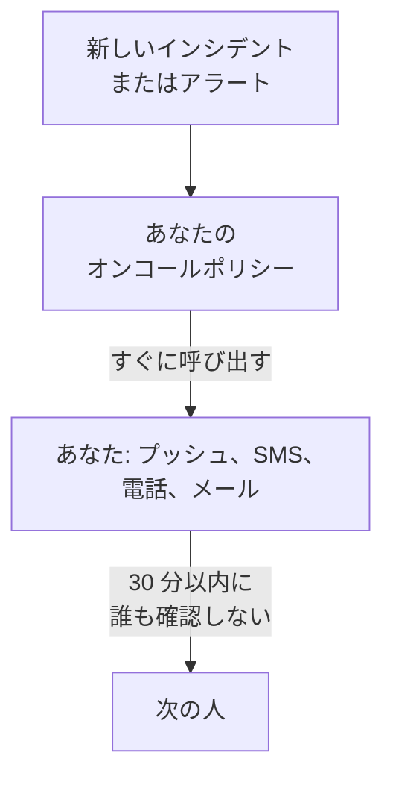

# 電話、SMS、プッシュで呼び出しを受ける

このガイドを終えると、プロジェクトで新しいインシデントやアラートが発生するたびに、プッシュ通知、SMS、電話でスマートフォンに呼び出しが届き、30 分以内に誰も確認しなければ次の人が呼び出されます。そして、あなたが確認したテスト呼び出しで、正しく動くことを確かめられます。ガイド付きセットアップ **障害時に適切な担当者を呼び出す** に沿って進め、所要時間は約 10 分です。

## 必要なもの

- 自分が所有するプロジェクト: SMS と電話をオンにできるのはプロジェクトの所有者だけで、オンコールポリシーを作成できるのは所有者か管理者です。
- あなたのスマートフォン。
- 呼び出したいチームメンバーが、プロジェクトのメンバーになっていること: 方法は [メンバーの招待](/docs/permissions/inviting-people) で説明しています。

:::tabs
@tab OneUptime Cloud
プッシュ通知はどのプランでも無料です。SMS と電話はプロジェクトの残高から支払われます。残高は 0.00 USD から始まり、電話番号を追加すると SMS が送信されるため、先に残高を 1.00 USD より多くしておく必要があります。残高を追加すると、プロジェクトのカードに請求されます。Free プランで使えるのはユーザー一人とエスカレーションルール一つだけです。呼び出されるのはあなただけで、呼び出しはほかの人に回らずに繰り返されます。
@tab セルフホスト
サーバーがメール、SMS、電話を送信できる必要があります。 [セルフホスティングガイド](/docs/installation/self-hosting-guide) にあるとおり、サーバーのマスター管理者が `/admin/setup` で、それぞれテストしながら設定します。プッシュ通知は OneUptime のプッシュリレーを通じてアプリに届くので、設定は不要です。
:::

## 手順

:::steps
### ガイド付きセットアップを開く

プロジェクトの **ホーム** で、 **OneUptime へようこそ 👋** チェックリストにある **オンコールポリシーを設定** をクリックします。新しいプロジェクトのホームでは、最初に **まず何をしますか？** と尋ねられます。 **障害時に適切な担当者を呼び出す** にチェックを入れて **続行** をクリックします。この項目がない、またはすでに完了している場合は、 `Ctrl+K` (Mac では `Cmd+K`) を押して `get paged` と入力し、 **障害時に適切な担当者を呼び出す** を選びます。

### スマートフォンにアプリを入れる

App Store または Google Play から OneUptime On-Call をインストールしてサインインします。これで、スマートフォンがプッシュ通知の送信先として登録されます。セットアップに戻って **再確認** をクリックすると、 **どのように連絡しますか？** の **モバイルアプリまたはブラウザー** にスマートフォンが表示されます。

### SMS と電話をオンにする

新しいプロジェクトでは、SMS と電話はオフになっています。プロジェクトの所有者なら **SMS と電話を有効にする** をクリックします。それ以外の人には、誰がオンにできるかが表示されます。OneUptime Cloud で残高が 1.00 USD 以下の場合は、 **残高を追加** をクリックし、 **金額（USD）** に 20 から 1,000 USD までの金額を入力して **チャージ** をクリックします。

### 電話番号を追加する

**あなたの電話番号** に、 `+15551234567` のように国番号付きで携帯電話の番号を入力し、 **SMS でコードを送信** をクリックします。SMS で届いたコードを入力して **確認** をクリックします。呼び出しの電話も、この番号にかかります。 **続行** をクリックします。アプリとメールだけで呼び出しを受ける場合は、番号を入力せずにそのまま **続行** をクリックします。

### ほかに呼び出す人を選ぶ

**ほかに誰がオンコールですか？** では、あなたはすでに **最初に呼び出す** に入っています。ほかの人も一緒に呼び出すには **チームメンバーを追加** をクリックし、 **保存して続行** をクリックします。まだオンコールポリシーがないプロジェクトでは、これで `Default on-call policy` が作成され、新しいインシデントとアラートのたびにこの人たちを呼び出します。すでにポリシーがあるプロジェクトでは、 **オンコールポリシー** でそのポリシーを選び、代わりに **最初のエスカレーションルールに追加** で人を追加します。まだ呼び出しが届かない人がいると、この手順は **呼び出しは届きますか？** で止まります。その人の **セットアップのリマインダーを送信** をクリックしてから、 **続行** をクリックします。

### 誰も応答しないときの動きを決める

**誰も応答しなかったら？** では **別の人を呼び出す** のままにして、 **次に呼び出す** で呼び出す人を選び、 **待機時間(分)** は `30` のままにするか変更します。 **保存して続行** をクリックします。Free プランでは、代わりに **同じ人をもう一度呼び出す** が表示され、 **再呼び出しの回数** は `2` になっています。

### テスト呼び出しを送る

**テスト呼び出しを送信** の下にある **このポリシーをテスト** をクリックします。 **重大度** を選び、 **テスト呼び出しを送信** をクリックします。ポリシーの最初のエスカレーションルールが本物のインシデントと同じように呼び出され、どのメッセージにも TEST と表示されます。インシデントは作成されず、ステータスページや購読者にも通知されません。

### テスト呼び出しを確認する

SMS かメールのリンクを開いてそこで呼び出しを確認するか、電話の通話中に 1 を押します。アプリには呼び出しが届いたことが表示されますが、アプリからテストを確認することはできません。そのあとダイアログで **完了** をクリックし、 **続行** をクリックします。
:::

## うまくいったか確かめる

- テストの手順に、誰が、どの方法で、どれだけ早く呼び出しを確認したかが表示されます。
- セットアップは **呼び出しを設定しました** で終わり、記録から読み取った **呼び出し先**、 **誰も応答しない場合**、 **テスト済み** が表示されます。連絡できない人がいるなど、ポリシー自体に問題がある場合は **対応が必要** に表示されます。
- **ホーム** では、チェックリストの **オンコールポリシーを設定** が完了になります。それが最後の項目だった場合、チェックリストは表示されなくなります。

ポリシーが次に別の人を呼び出す設定なら、エスカレーションも確かめられます。まとめで **オンコールポリシーを開く** をクリックし、 **このポリシーをテスト** をクリックします。 **すべてのエスカレーションレベルをたどる** をオンにして送信し、最初の呼び出しを確認せずにおくと、最大 2 分後に次の人が呼び出されます。

## うまくいかない場合

:::details 「SMS でコードを送信」ボタンがない
SMS がオフになっているか送信できない状態で、その理由が手順に表示されています。 **SMS と電話を有効にする** が表示されるのは、プロジェクトの所有者か請求を管理する人だけです。OneUptime Cloud では、残高が 1.00 USD 以下だと電話番号の入力欄が表示されません。SMS を送信できないセルフホストのサーバーでは、マスター管理者に **SMS と電話を設定** が表示されます。これをクリックすると Admin Dashboard が開き、 [Twilio 統合](/docs/self-hosted/twilio-integration) にあるとおり Twilio を追加できます。
:::

:::details 残高の追加で、支払い方法が見つからないと表示される
残高を追加すると、プロジェクトのカードに請求されます。 **プロジェクト設定 → 請求と請求書 → 請求** で **支払い方法を追加** からカードを追加してから、もう一度残高を追加します。それまでの間も、アプリとメールでは呼び出しが届きます。
:::

:::details セルフホスト: Twilio アカウントが設定されていないため、番号が拒否される
サーバーが SMS を送信できないことを前もって知らされるのは、マスター管理者だけです。 `/admin/setup` で SMS と電話を設定するよう依頼してください。それまでは **続行** をクリックします。アプリとメールでは引き続き呼び出しが届きます。
:::

:::details コードやテスト呼び出しが届かない
まず、番号の国番号を確認します。テスト呼び出しのあとなら、 **完了** でダイアログを閉じて **届いていません** をクリックします。確認すべきことが表示され、 **自分の通知方法を開く** では、あなたに連絡できるすべての方法が一覧表示されます。セルフホストのサーバーでは、 `/admin/setup` からテスト SMS を送信し、サーバーで `npm run doctor` を実行します。
:::

## 次のステップ

:::cards
- [オンコールスケジュール](/docs/on-call/schedules): 交代で担当し、呼び出しがその時のオンコール担当者に届くようにします。Cloud では Growth プランから。
- [エスカレーションルール](/docs/on-call/escalation-rules): ポリシーにレベル、チーム、スケジュールを追加します。
- [私への連絡方法](/docs/notifications/on-call-rules): 最初にどの方法で、いつ連絡を受けるかを選びます。
- [ステータスページを公開する](/docs/guides/status-page): 何が起きているかを、自分のドメインで顧客に伝えます。
:::
