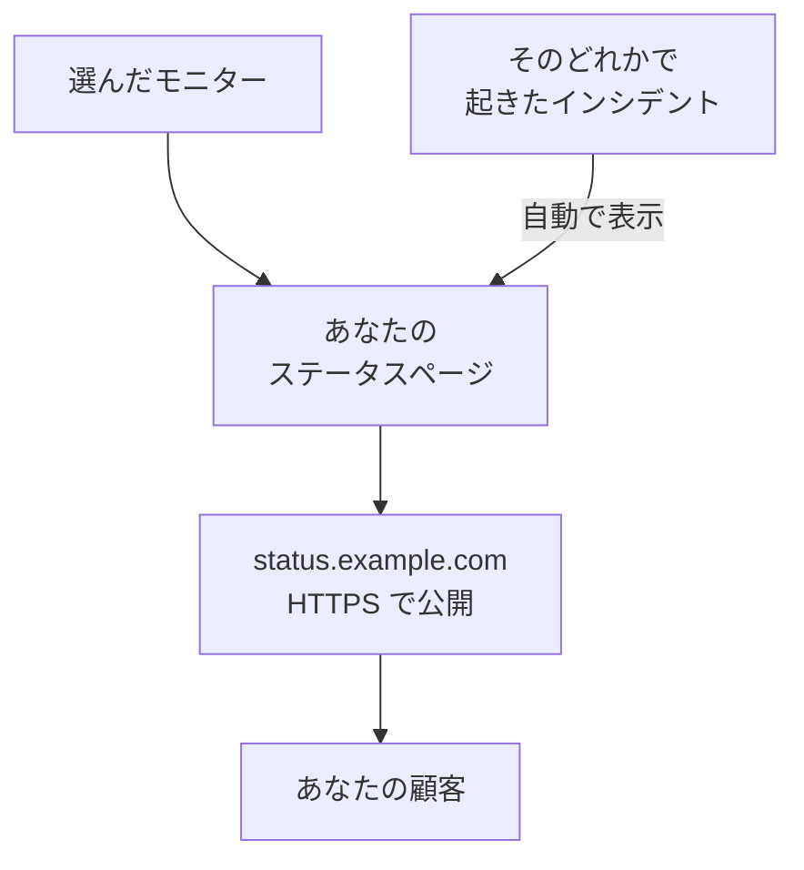

# ステータスページを公開する

このガイドを終えると、顧客は `status.example.com` のようなあなた自身のアドレスで、HTTPS 経由でステータスページを開けるようになります。ページには選んだモニターがステータスと稼働率付きで表示され、そのどれかでインシデントが起きると、自動でページに表示されます。ガイド付きセットアップ **ステータスページを公開** に沿って進め、そのあとページの **カスタムドメイン** でドメインを追加します。所要時間は約 15 分と、DNS プロバイダーでの反映にかかる時間です。

## 必要なもの

- 一つ以上のモニター: ステータスページに表示するのはモニターです。まだない場合は、ガイド付きセットアップが先に **モニターをセットアップ** を案内します。
- プロジェクトの所有者または管理者のロール: ページにはステータスページを作成する権限が、ドメインにはプロジェクトのドメインを追加して確認する権限が必要です。
- 自分が管理するドメインと、DNS プロバイダーでそのドメインの DNS レコードを編集できるアクセス権。

:::tabs
@tab OneUptime Cloud
カスタムドメインと無料の SSL 証明書は、どのプランにも含まれます。Free プランで作れるステータスページはプロジェクトごとに一つです。すでにある場合は、そのページの **カスタムドメイン** を開き、ドメインを追加する手順から始めてください。新しいステータスページは公開されます。非公開にするには Growth プランが必要です。
@tab セルフホスト
サーバーには、サーバーを指す A レコードを持ち、ポート 80 と 443 で応答する専用のホスト名が必要です。たとえば `oneuptime.example.com` です。そのホスト名を、 `config.env` の `STATUS_PAGE_CNAME_RECORD` (Helm チャートでは `statusPage.cnameRecord`) に、そこにある例の値の代わりに設定します。無料の証明書には `LETS_ENCRYPT_ACCOUNT_KEY` (`letsEncrypt.accountKey`) も必要です。これは openssl で作成し、base64 でエンコードした秘密鍵です。変更したら OneUptime を再起動します。 **カスタムドメインを追加** は最初にサーバーをチェックし、まだ足りないものを一覧にします。
:::

## 手順

:::steps
### ガイド付きセットアップを開く

プロジェクトの **ホーム** で、 **OneUptime へようこそ 👋** チェックリストにある **ステータスページを公開** をクリックします。新しいプロジェクトのホームでは、最初に **まず何をしますか？** と尋ねられます。 **ステータスページで顧客に伝える** にチェックを入れて **続行** をクリックします。この項目がない、またはすでに完了している場合は、 `Ctrl+K` (Mac では `Cmd+K`) を押して `status page` と入力し、 **ステータスページを公開** を選びます。

### 名前を付けて、表示する内容を選ぶ

**名前を付けて、表示する内容を選ぶ** では、提案された **ステータスページ名** をそのまま使うか、自分で入力します。 **表示する内容** で顧客に見せるモニターにチェックを入れるか、 **すべて選択** をクリックします。 **ステータスページを作成** をクリックします。この時点から、ページはそのリンクで公開され、チェックを入れたモニターだけが表示されます。

### 顧客に見える内容を確かめる

**お客様に見える内容** で、 **公開リンク** のアドレスを開きます。モニターがステータス付きで一覧表示されます。セットアップに戻り、 **問題なし** をクリックします。

### カスタムドメインを開く

セットアップは、まとめの画面で終わります。 **自分らしくカスタマイズ（任意）** で **独自ドメイン** をクリックします。ステータスページの **カスタムドメイン** が開きます。

### ドメインを追加する

**カスタムドメインを追加** をクリックします。 **ドメイン** に、 `status.example.com` のように顧客が開くアドレスを入力し、 **続行** をクリックします。追加するレコードを表示した **DNS 設定** が開きます。

### DNS レコードを追加する

DNS プロバイダーで、 **DNS 設定** に表示された各レコードを、その **種類**、 **名前**、 **値** のとおりに追加します。アドレスを OneUptime に向ける CNAME レコードと、プロジェクトがこのドメインを初めて使うときは、プロジェクトがドメインを所有していることを示す TXT レコードです。プロバイダーが各名前にドメインを自動で付け足す場合は、 `status` のようにドメインより前の部分だけを入力し、ドメイン自体には `@` を入力します。

### レコードを確認する

**DNS 設定** を開いたまま、 **今すぐ確認** をクリックします。各レコードの下に、何を照会し、何が返ってきたかが表示されます。最初は TXT レコードです。これが見つかるまでドメインは追加されないので、見つかるまで **今すぐ確認** をもう一度クリックします。CNAME レコードが見つかると、ダイアログに **CNAME レコードが確認されました。** と表示され、無料の SSL 証明書が発行されます。通常は 15 分以内です。
:::

## うまくいったか確かめる

- `https://status.example.com` を自分のアドレスに置き換えて開きます。証明書の警告なしにステータスページが開きます。
- **カスタムドメイン** で、ドメインの **ステータス** に **証明書は発行済みで、自動的に更新されます。** と表示されます。ページがすでに開けるようになってからも、しばらくは **無料の証明書を発行しています。通常 15 分以内に完了します。** と表示されることがあります。
- **ホーム** では、チェックリストの **ステータスページを公開** が完了になります。ステータスページがモニターを表示した時点で完了です。それが最後の項目だった場合、チェックリストは表示されなくなります。

ほかに必要なことはありません。証明書は OneUptime が自動で更新します。ドメインが一覧に載ったら、 **DNS 設定** を閉じても、OneUptime は 15 分ごとにその CNAME レコードをチェックし、レコードが有効になりしだい確認します。

## うまくいかない場合

:::details DNS 設定を閉じたら、ドメインが一覧にない
TXT レコードが見つかる前に **DNS 設定** を閉じたため、ドメインが追加されていません。 **カスタムドメインを追加** をクリックして同じアドレスを入力し、 **続行** をクリックしてから、ダイアログが両方のレコードを見つけるまで **今すぐ確認** をクリックします。
:::

:::details ドメインが「DNS 待ち」のまま
ドメインの行から **DNS 設定** を開き、 **今すぐ確認** をクリックします。何が見つかったかが表示されます。レコードの名前が `status.example.com` のような完全なアドレスになっているか、値が **DNS 設定** に表示されたものと同じかを確認してください。名前がアドレスで応答する場合は、その名前に A レコードがあるか、DNS プロバイダーがプロキシしています。A レコードを置き換えるか、名前を「DNS のみ」に設定してください。 `example.com` のようなルートドメインでは、プロバイダーの ALIAS、ANAME、またはフラット化した CNAME レコードを使います。
:::

:::details ステータスに、無料の証明書を発行できなかったと表示される
ドメインに `letsencrypt.org` を含まない CAA レコードがあると、証明書は発行できません。セルフホストのサーバーでは、Let's Encrypt がポート 80 でサーバーに到達できる必要があります。原因を直してください。OneUptime は自動で再試行を続けます。 **DNS 設定** の **今すぐ確認** でも再注文できますが、ドメインごとに 15 分に一回までです。
:::

:::details セルフホスト: サーバーがカスタムドメインを使える状態ではない
**カスタムドメインを追加** に **このサーバーはまだカスタムドメインを使える状態ではありません** と表示され、まだ足りないものと変更すべきことが一行ずつ示されます。対象は [必要なもの](#必要なもの) の設定です。 `LETS_ENCRYPT_ACCOUNT_KEY` がない場合、確認済みのドメインには **確認済みです。独自のプロキシの HTTPS を使用しています。** と表示されます。その HTTPS は独自のプロキシで提供してください。詳しくは [ステータス ページのブランディングとドメイン](/docs/status-pages/branding-and-domains#始める前に) を参照してください。
:::

## 次のステップ

:::cards
- [ステータス ページのブランディングとドメイン](/docs/status-pages/branding-and-domains): ロゴ、色、ヘッダーリンク、フッター。
- [購読者とお知らせ](/docs/status-pages/subscribers): 顧客が購読できるようにし、お知らせを投稿します。
- [定期メンテナンス](/docs/scheduled-maintenance/index): 計画作業を、始まる前に顧客に知らせます。
- [電話、SMS、プッシュで呼び出しを受ける](/docs/guides/paging): それらのモニターのどれかがダウンしたときに呼び出しを受けます。
:::
