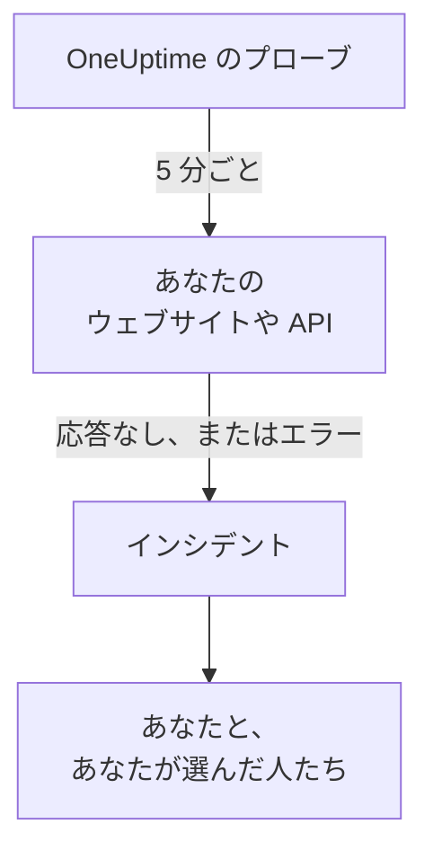

# ウェブサイトや API が落ちたときに知る

このガイドを終えると、OneUptime が 5 分ごとにウェブサイトや API をチェックし、応答しなくなったりエラーで応答したりするとインシデントを作成して、あなたに知らせます。そして、あなたが確認したテスト呼び出しで、メッセージが届くことを確かめられます。ガイド付きセットアップ **Web サイトや API のダウンを知る** に沿って進め、所要時間は約 5 分です。

## 必要なもの

- モニターを作成できる OneUptime プロジェクト: 所有者、管理者、メンバーのいずれかなら作成できます。アカウントとプロジェクトを作るには、 [クイックスタート](/docs/introduction/quickstart#プロジェクトを作成する) の最初の部分に沿って進めてください。
- `https://example.com` のような、チェックするアドレス。API の場合は、ヘルスチェックのように、キーなしの単純な `GET` に応答するエンドポイントを選びます。 `401` のような応答はダウンとみなされます。

:::tabs
@tab OneUptime Cloud
複数のリージョンにあるプローブがアドレスをチェックするので、アドレスはインターネットから到達できる必要があります。Free プランでは、アクティブなモニターを 10 個まで使えます。
@tab セルフホスト
アドレスはサーバー自身のプローブからチェックされるので、そこから到達できる必要があります。メールを受け取るには、サーバーがメールを送信できる必要があります。 [セルフホスティングガイド](/docs/installation/self-hosting-guide) にあるとおり、サーバーのマスター管理者が `/admin/setup` で設定します。マスター管理者は自分が作成したものの所有者にはならないため、メールを受け取るには、モニターの **所有者** ページで自分を追加します。
:::

## 手順

:::steps
### ガイド付きセットアップを開く

新しいプロジェクトの **ホーム** では、最初に **まず何をしますか？** と尋ねられます。 **Web サイトや API のダウンを知る** にチェックを入れて **続行** をクリックします。次に、 **OneUptime へようこそ 👋** チェックリストにある **最初のモニターを作成** をクリックします。チェックリストにこの項目が表示されない場合は、 `Ctrl+K` (Mac では `Cmd+K`) を押して `website down` と入力し、 **Web サイトや API のダウンを知る** を選びます。

### アドレスを入力する

**何を確認しますか？** で、 **Web サイトまたは API のアドレス** にアドレスを入力します。API エンドポイントの場合は、 **これは API エンドポイントです** にチェックを入れます。 **確認を開始** をクリックすると、プローブがすぐにチェックし、その結果が一文で表示されます。 **続行** をクリックします。

### 誰に知らせるかを選ぶ

**誰に知らせますか？** で表示される内容は、プロジェクトによって異なります。

- オンコールポリシーもオンコールルールもまだない場合、あなたはすでに **呼び出し先** に入っています。すでにプロジェクトに参加している人を追加するには **チームメンバーを追加** をクリックし、 **保存して続行** をクリックします。これで `Default on-call policy` が作成され、プロジェクトの新しいインシデントとアラートのたびにこの人たちを呼び出します。
- オンコールポリシーかルールがすでにある場合は、プロジェクト自身のルールで呼び出す人が決まります。 **続行** をクリックします。
- 呼び出しを設定できないメンバーの場合は、モニターの所有者としてメールを受け取ることが表示されます。 **続行** をクリックします。

### 自分にテストを送る

**テストを送信する** の下にある **自分にテスト呼び出しを送信** をクリックします。 **重大度** を選び、 **テスト呼び出しを送信** をクリックします。テストは本物の呼び出しと同じようにあなたに届き、どのメッセージにも TEST と表示されます。インシデントは作成されません。

### テスト呼び出しを確認する

メールのリンクを開いて、そこで呼び出しを確認します。プロジェクトで SMS と電話がオンになっていれば、確認済みの電話番号も使えます。SMS のリンクを開くか、通話中に 1 を押します。そのあとダイアログで **完了** をクリックし、 **続行** をクリックします。
:::

## うまくいったか確かめる

- セットアップはまとめの画面で終わり、記録から読み取った **チェック日時**、 **ダウンしたとき**、 **通知先**、 **テスト済み** が表示されます。
- **モニターを開く** をクリックし、モニターの **ダウンしたとき** カードで **通知の流れを表示** をクリックします。モニターから通知が届く人までの流れが表示され、流れを止めるものが何もなければ **通知の流れを止めるものはありません。** と表示されます。
- **ホーム** では、最初のチェック結果が届くと、チェックリストの **最初のモニターを作成** が完了になります。それが最後の項目だった場合、チェックリストは表示されなくなります。

あとで別のアドレスを設定するには、セットアップをもう一度開いて **別のアドレスを確認** をクリックします。

## うまくいかない場合

:::details 最初のチェック結果が返ってこない
どの場所からもアドレスをチェックしていないという文が表示される場合は、モニターにプローブがありません。チェック中という表示が続く場合は、そのプローブが接続されていません。各プローブのステータスを見るには、 **モニター → 設定 → プローブ** を開きます。セルフホストのサーバーでは、マスター管理者が `/admin/setup` でサーバーのプローブを確認します。そのあとモニターを開いて接続済みのプローブを追加し、セットアップをもう一度開きます。
:::

:::details サイトは動いているのに、モニターではダウンになっている
モニターは、応答がないか、200 から 399 の範囲外の応答が返った場合をダウンとみなします。ファイアウォールがプローブをブロックしていると、応答なしと同じに見えます。OneUptime Cloud では [IP アドレス](/docs/configuration/ip-addresses) に載っているアドレスを許可し、セルフホストのサーバーではプローブが動いているマシンを許可します。このルールを変えるには、 [Web サイト モニター](/docs/monitor/website-monitor) または [API モニター](/docs/monitor/api-monitor) を参照してください。
:::

:::details テスト呼び出しを確認できない
呼び出しを確認するためのメッセージが何も届いていません。セルフホストのサーバーでは、たいていはまだメールを送信できないことが原因です。その場合は手順にそう表示され、マスター管理者には **メールを設定** が表示されます。メールを設定してから **もう一度テストを送信** をクリックするか、 **テストをスキップ** をクリックしてあとで戻ってきます。テストのあとなら、 **完了** でダイアログを閉じて **届いていません** をクリックします。確認すべきことが表示されます。
:::

## 次のステップ

:::cards
- [電話、SMS、プッシュで呼び出しを受ける](/docs/guides/paging): スマートフォンで呼び出しを受け、誰も応答しなければ次の人を呼び出します。
- [ステータスページを公開する](/docs/guides/status-page): 自分のドメインで、モニターを顧客に見せます。
- [条件とステータス](/docs/monitor/criteria-and-statuses): モニターがどんなときにダウンとみなされるかを、正確に決めます。
:::
