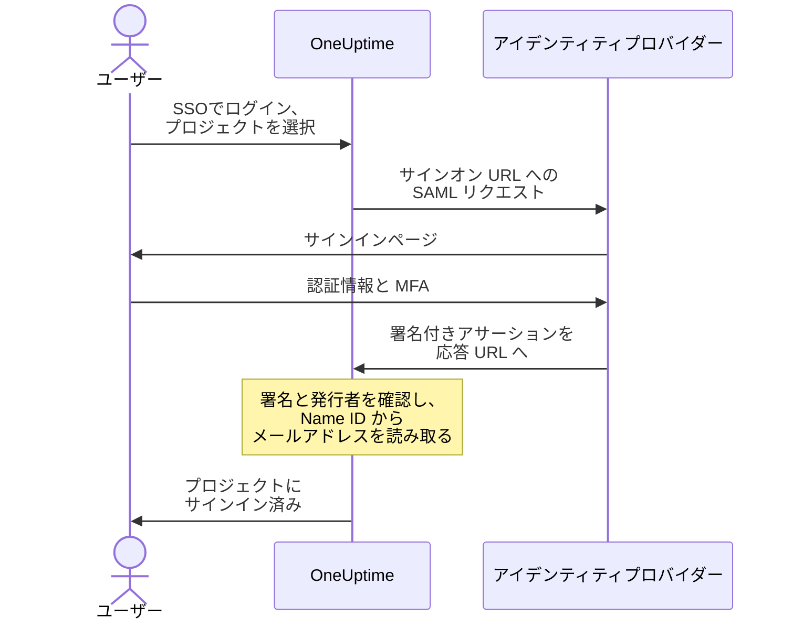

# SSO

シングルサインオン（SSO）を使うと、プロジェクトのメンバーは組織のアイデンティティプロバイダー（IdP）を通じて、SAML 2.0 または OpenID Connect で OneUptime にサインインできます。アクセス、パスワード、多要素認証を 1 か所で管理でき、プロジェクトの全員に SSO を必須にすることもできます。

> [!NOTE]
> **エディション:** SSO（「Require SSO to sign in」を含む）は OneUptime のすべてのエディションに含まれます。セルフホスト環境では Community Edition で利用でき、ライセンスは不要です。OneUptime Cloud では **Scale** プラン以上で利用できます。各エディションに含まれる機能については [エンタープライズ版](/docs/self-hosted/enterprise) をご覧ください。

:::cards
- [SAML プロバイダーを設定する](#sso-の設定): OneUptime で作成し、IdP に 2 つの URL を渡します。
- [アイデンティティプロバイダー別のガイド](#アイデンティティプロバイダー別のガイド): Keycloak、Microsoft Entra ID、Okta の手順。
- [OpenID Connect](#openid-connect-oidc): 代わりに OIDC アプリでサインインします。
- [SSO を必須にする](#プロジェクトで-sso-を必須にする): SSO をプロジェクトに入る唯一の方法にします。
:::

## SAML サインインの仕組み

SAML プロバイダーは、1 つのプロジェクトをアイデンティティプロバイダー内の 1 つのアプリケーションに結び付けます。サインインする人は OneUptime の **SSOでログイン** ページでプロジェクトを選び、IdP でサインインして、サインインした状態で戻ってきます。



OneUptime は、IdP が送信するアサーションから次のものだけを読み取ります。

| アサーションの項目 | OneUptime での扱い |
| --- | --- |
| 署名 | プロバイダーの **公開証明書** と照合します。レスポンスは署名されている必要があり、暗号化されていてはいけません。 |
| Issuer | プロバイダーの **発行者** と完全に一致する必要があります。 |
| Audience | プロバイダーの **識別子（エンティティ ID）** である必要があります。IdP が別のアプリケーション向けに作成したレスポンスは拒否されます。 |
| Recipient と Destination | プロバイダーの **応答 URL**、つまりレスポンスの送信先アドレスである必要があります。 |
| `NotBefore` と `NotOnOrAfter` | レスポンスは、これらが許す間だけ、かつ発行から 10 分以内に限って受け付けられます。ずれている時計のために 3 分の猶予があります。 |
| Name ID | その人のメールアドレスです。有効なメールアドレスである必要があります。 |
| 名前の属性 | その人の名前で、OneUptime がアカウントを作成するときに使います。表示名（`displayName` または `http://schemas.microsoft.com/identity/claims/displayname`）か、名と姓（`firstName` と `lastName`、または Microsoft Entra ID がデフォルトで送る `givenname` と `surname` のクレーム）です。省略可能です。 |
| `http://schemas.microsoft.com/identity/claims/objectidentifier` | その人のオブジェクト ID で、Microsoft Entra ID がデフォルトで送ります。プロバイダーを通じた最初のサインインでアカウントがこの ID に紐付けられ、その後、アカウントのメールアドレスを別のオブジェクト ID とともに示すサインインは拒否されます。省略可能です。 |

各レスポンスでサインインできるのは 1 回だけです。サインイン後にブラウザーで戻るなどして再送されたレスポンスは拒否されます。もう一度サインインしてください。

初めてサインインした人はプロバイダーの **チーム** に参加し、そのチームによってできることが決まります。[SSO ユーザーのロールとチーム](#sso-ユーザーのロールとチーム) をご覧ください。

> [!NOTE]
> OneUptime Cloud では、プロジェクトの SAML または OIDC プロバイダーで初めてそのプロジェクトにサインインする人に対して、OneUptime はサインインさせる代わりにリンクをメールで送ります。その人はリンクを開き、プロジェクトのシングルサインオンによるサインインを確認してから、サインインを続けます。リンクの有効期間は 24 時間です。これはプロジェクトごとに 1 回行われ、プロジェクトを離れて戻ってきたときにも再度行われます。招待した相手のサインインが SSO で管理されている場合、すでに OneUptime アカウントを持っているかどうかにかかわらず、このメールは届きません。招待で開くページでプロジェクトのプロバイダーを選ぶと、招待のリンクによってメールボックスが本人のものであることがすでに証明されているため、すぐにサインインします。セルフホスト環境では、すぐにサインインします。OneUptime Cloud では、すぐにサインインできないサインインには、アドレスにアカウントがあるかどうかにかかわらず、すべて同じ応答が返されます。まだアカウントのない人にも同じメールが届き、確認したときにアカウントが作成されます。ブロックされたアカウントや OneUptime 管理者にはメールは送られません。セルフホスト環境では、代わりにその両方を同じメッセージで拒否します。

OneUptime Cloud では、SSO でプロジェクトに参加した人も、招待した人と同じようにシートを使います。プランのシート数が決まっていて、すべて使用中の場合、シートが空くまで新しい人は SSO で参加できません。

## SSO の設定

SSO プロバイダーを追加する権限（**プロジェクト所有者**、**プロジェクト管理者**、または **Create Project SSO**）が必要です。OneUptime Cloud では、さらに **Scale** プランが必要です。アイデンティティプロバイダー側の設定については、[アイデンティティプロバイダー別のガイド](#アイデンティティプロバイダー別のガイド) をご覧ください。

:::steps
1. **プロジェクト設定に移動する**

   - OneUptime プロジェクトを開きます
   - **プロジェクト設定** > **セキュリティ** > **SSO** に移動します

2. **SSO 設定を作成する**

   - **SAML プロバイダーを追加** をクリックします
   - SSO 設定の **名前** を入力します（例: "Keycloak SAML" または "Okta SAML"）
   - アイデンティティプロバイダーの **サインオン URL** を入力します
   - アイデンティティプロバイダーの **発行者**（エンティティ ID）を入力します
   - アイデンティティプロバイダーの **公開証明書** を貼り付けます
   - **サインイン** ステップでは、**チーム** にプロジェクトのメンバーチームが最初から入っています。初めてサインインした人はこれらのチームに参加します。受け付けられるのは、自分が誰かを招待できるチームだけです。自分より多くのアクセス権を与えるチームは **チーム** の下に表示されます
   - それ以外は **その他の項目** に入力済みです: **署名方式**（`RSA-SHA256`）、**ダイジェストメソッド**（`SHA256`）、説明（「Sign in with」と名前）。アイデンティティプロバイダーが必要とする場合にのみ変更してください

3. **OneUptime の SSO メタデータを取得する**
   - 保存すると **SSO の設定** ダイアログが開きます。**SSO 設定を表示** ボタンでもう一度開けます
   - **識別子（エンティティ ID）** をコピーします。たとえば `https://oneuptime.com/<project-id>/<provider-id>` で、IdP の設定に必要です
   - **応答 URL（Assertion Consumer Service URL）** をコピーします。たとえば `https://oneuptime.com/identity/idp-login/<project-id>/<provider-id>` で、IdP の設定に必要です
   - 新しいプロバイダーはオフの状態で作成されます。IdP にこの 2 つの値を登録したら、プロバイダーを編集して **有効** をオンにしてください

4. **プロバイダーをテストする**
   - **SSO サインインリンク** カードのリンクを開き、表示されたページでプロバイダーを選びます。アイデンティティプロバイダーのサインインページに移動し、サインインした状態で OneUptime に戻ります
   - 動作を確認できたら、プロジェクトで [SSO を必須にする](#プロジェクトで-sso-を必須にする) ことができます
:::

## アイデンティティプロバイダー別のガイド

使っているアイデンティティプロバイダーを選んでください。各ガイドでは、IdP の値を取得し、OneUptime でプロバイダーを作成してから、OneUptime の **識別子（エンティティ ID）** と **応答 URL** を IdP に渡します。

:::tabs
@tab Keycloak
Keycloak は、人気のあるオープンソースの ID およびアクセス管理ソリューションです。レルムのある稼働中の Keycloak インスタンスと、Keycloak と OneUptime の両方への管理者アクセスが必要です。

:::steps
1. **レルムの値を集める**

   - **サインオン URL**: `https://<your-keycloak-domain>/auth/realms/<your-realm>/protocol/saml`
   - **発行者**: `https://<your-keycloak-domain>/auth/realms/<your-realm>`
   - **証明書**: レルムの署名証明書です。`https://<your-keycloak-domain>/auth/realms/<your-realm>/protocol/saml/descriptor` を開いて `X509Certificate` の値をコピーするか、**Realm settings** > **Keys** を開いて RS256 キーの **Certificate** をクリックします

   Keycloak 17 以降では、これらの URL に `/auth` プレフィックスが付きません。証明書は、次のように専用の行で挟んで入力します。

   ```text
   -----BEGIN CERTIFICATE-----
   MIICnzCCAYcCBgFyPZ8QFzANBgkqhkiG.......
   -----END CERTIFICATE-----
   ```

2. **OneUptime でプロバイダーを作成する**

   **プロジェクト設定** > **セキュリティ** > **SSO** に移動し、**SAML プロバイダーを追加** をクリックして次のように入力します。
   - **名前**: わかりやすい名前（例: `my-project-oneuptime`）
   - **サインオン URL** と **発行者**: 上の値
   - **公開証明書**: 専用の `BEGIN CERTIFICATE` 行と `END CERTIFICATE` 行で挟んだ証明書
   - **署名方式** と **ダイジェストメソッド**: **その他の項目** に設定済みです（`RSA-SHA256` と `SHA256`）

   保存し、開いたダイアログから **識別子（エンティティ ID）** と **応答 URL（Assertion Consumer Service URL）** をコピーします。

3. **Keycloak クライアントを作成する**

   Keycloak でレルムの **Clients** を開き、クライアントを作成するか、既存のクライアントを編集します。
   - **Client Protocol**（クライアントタイプ）: `saml`
   - **Client ID**: OneUptime の **識別子（エンティティ ID）**
   - **Root URL** と **Valid Redirect URIs**: OneUptime の URL
   - **Assertion Consumer Service POST Binding URL**: OneUptime の **応答 URL（Assertion Consumer Service URL）**

4. **クライアントの設定を調整する**

   - **Name ID Format** を `email` に設定し、**Force Name ID Format** をオンにして、Keycloak が常にメールアドレスを Name ID として送るようにします
   - クライアントの **Keys** タブで、**Client signature required**（**Signing keys config** 内）をオフにします。OneUptime はサインインのリクエストに署名しません

5. **プロバイダーをオンにしてテストする**

   OneUptime でプロバイダーを編集して **有効** をオンにし、**SSO サインインリンク** カードのリンクを開いてプロバイダーを選びます。Keycloak のサインインページに移動し、OneUptime に戻れば成功です。
:::
@tab Microsoft Entra ID
Microsoft Entra ID（旧称 Azure AD / Active Directory）は、Microsoft のクラウド ID サービスです。SAML SSO のエンタープライズアプリケーションに対応したテナントと、Entra ID と OneUptime の両方への管理者アクセスが必要です。OneUptime Cloud では、Microsoft Entra アプリケーション ギャラリーに OneUptime が掲載されていれば、そこから追加してください。OneUptime が読み取るクレームと、OneUptime の URL のパターンがあらかじめ設定されています。

:::steps
1. **Entra ID でエンタープライズアプリケーションを作成する**

   - [Microsoft Entra admin center](https://entra.microsoft.com) にサインインします
   - **Identity** > **Applications** > **Enterprise applications** に移動し、**+ New application** をクリックします
   - ギャラリーから追加する場合: OneUptime を検索して選び、**Create** をクリックします
   - それ以外の場合: **+ Create your own application** をクリックし、名前（例: "OneUptime"）を入力し、**Integrate any other application you don't find in the gallery (Non-gallery)** を選んで **Create** をクリックします

2. **Entra ID の SAML の値をコピーする**

   - アプリケーションで **Single sign-on** に移動し、**SAML** を選びます
   - **SAML Certificates** で **Certificate (Base64)** をダウンロードし、ファイルをテキストエディターで開いて内容をコピーします
   - **Set up OneUptime** で **Login URL** と **Microsoft Entra Identifier**（古いテナントでは **Azure AD Identifier**）をコピーします

3. **OneUptime でプロバイダーを作成する**

   **プロジェクト設定** > **セキュリティ** > **SSO** に移動し、**SAML プロバイダーを追加** をクリックして次のように入力します。
   - **名前**: わかりやすい名前（例: `Azure AD SAML`）
   - **サインオン URL**: **Login URL**
   - **発行者**: **Microsoft Entra Identifier**
   - **公開証明書**: `BEGIN CERTIFICATE` 行と `END CERTIFICATE` 行を含む Base64 の証明書
   - **署名方式** と **ダイジェストメソッド**: **その他の項目** に設定済みです（`RSA-SHA256` と `SHA256`）

   保存し、開いたダイアログから **識別子（エンティティ ID）** と **応答 URL（Assertion Consumer Service URL）** をコピーします。

4. **OneUptime の URL を Entra ID に渡す**

   **Basic SAML Configuration** で **Edit** をクリックし、次のように設定します。
   - **Identifier (Entity ID)**: OneUptime の **識別子（エンティティ ID）**
   - **Reply URL (Assertion Consumer Service URL)**: OneUptime の **応答 URL**

   **Save** をクリックします。

5. **メールアドレスを Name ID として送る**

   **Attributes & Claims** で **Edit** をクリックします。ギャラリーから追加したアプリケーションでは、次の項目がすでに設定されているので、確認してください。
   - **Unique User Identifier (Name ID)** をユーザーのメールアドレスに設定します。`user.mail`、またはメールアドレスになっている場合は `user.userprincipalname` です
   - **Name identifier format** を `Email address` に設定します
   - Entra ID のデフォルトのクレームはそのまま残します。新しいアカウントには `givenname` と `surname` からその人の名前が入り、アカウントはその人のオブジェクト ID（`objectidentifier`）に紐付けられます。必要に応じて、名前が `http://schemas.microsoft.com/identity/claims/displayname` でソース属性が `user.displayname` のクレームを追加すると、代わりに表示名が新しいアカウントの名前になります。OneUptime はそれ以外のクレームを無視します

6. **ユーザーとグループを割り当てる**

   アプリケーションの **Users and groups** で **+ Add user/group** をクリックし、SSO でアクセスさせるユーザーとグループを選んで **Assign** をクリックします。

7. **プロバイダーをオンにしてテストする**

   OneUptime でプロバイダーを編集して **有効** をオンにし、**SSO サインインリンク** カードのリンクを開いてプロバイダーを選びます。Microsoft のサインインページに移動し、OneUptime に戻れば成功です。
:::
@tab Okta
Okta は、SAML SSO を備えた広く使われている ID プラットフォームです。管理者アクセスのある Okta の組織と、OneUptime への管理者アクセスが必要です。OneUptime Cloud では、Okta Integration Network に OneUptime が掲載されていれば、そこから追加してください。このアプリでは、OneUptime の **SSOでログイン** ページからも Okta ダッシュボードからもサインインでき、初めてサインインしたときにアカウントが作成されます。また、OneUptime の URL の代わりに 2 つの ID を入力します。

:::steps
1. **Okta に OneUptime を追加する**

   - Okta Admin Console で **Applications** > **Applications** に移動します
   - Okta Integration Network から追加する場合: **Browse App Catalog** をクリックし、OneUptime を検索して **Add Integration** をクリックします。Okta は **OneUptime Project ID** と **OneUptime SSO Provider ID** を求めますが、この時点ではまだ OneUptime で確認できません。ひとまずどちらにも `0` を入力してください。ステップ 4 で置き換えます。**Done** をクリックし、ステップ 2 に進みます
   - それ以外の場合は、**Create App Integration** をクリックし、**SAML 2.0** を選んで **Next** をクリックし、**App name** に "OneUptime" と入力して **Next** をクリックします
   - Okta は自分の URL を表示する前に OneUptime の URL を求めます。ひとまず OneUptime のアドレス（例: `https://oneuptime.com`）を **Single sign-on URL** と **Audience URI (SP Entity ID)** に入力してください。どちらもステップ 4 で置き換えます
   - **Name ID format** を `EmailAddress` に、**Application username** を `Email` に設定します
   - **Next** をクリックし、**I'm an Okta customer adding an internal app** を選んで **Finish** をクリックします

2. **Okta の SAML の値をコピーする**

   アプリケーションの **Sign On** タブの **SAML Signing Certificates** で、有効な証明書を探します。
   - **Actions** > **View IdP metadata** をクリックし、**サインオン URL**（Identity Provider Single Sign-On URL）と **発行者**（Identity Provider Issuer）をコピーします
   - **Actions** > **Download certificate** をクリックし、`.cert` ファイルをテキストエディターで開いて内容をコピーします

3. **OneUptime でプロバイダーを作成する**

   **プロジェクト設定** > **セキュリティ** > **SSO** に移動し、**SAML プロバイダーを追加** をクリックして次のように入力します。
   - **名前**: わかりやすい名前（例: `Okta SAML`）
   - **サインオン URL** と **発行者**: Okta の値
   - **公開証明書**: `BEGIN CERTIFICATE` 行と `END CERTIFICATE` 行を含む証明書
   - **署名方式** と **ダイジェストメソッド**: **その他の項目** に設定済みです（`RSA-SHA256` と `SHA256`）

   保存し、開いたダイアログから **識別子（エンティティ ID）** と **応答 URL（Assertion Consumer Service URL）** をコピーします。

4. **OneUptime の URL を Okta に渡す**

   Okta Integration Network から追加したアプリケーションでは、**General** タブの **App Settings** で **Edit** をクリックし、次のように設定します。
   - **OneUptime Project ID** と **OneUptime SSO Provider ID**: OneUptime の **識別子（エンティティ ID）** `https://oneuptime.com/<project-id>/<provider-id>` に含まれる 2 つの ID

   **Save** をクリックし、**Sign On** タブで **Application username format** が `Email` になっていることを確認します。

   独自に作成したアプリケーションでは、**General** タブで **SAML Settings** の **Edit** と **Next** をクリックし、次のように設定します。
   - **Single sign-on URL**: OneUptime の **応答 URL（Assertion Consumer Service URL）**
   - **Audience URI (SP Entity ID)**: OneUptime の **識別子（エンティティ ID）**

   必要に応じて、名前が `firstName` で値が `user.firstName` の attribute statement と、名前が `lastName` で値が `user.lastName` の attribute statement を追加すると、新しいアカウントにその人の名前が入ります。**Next**、続いて **Finish** をクリックします。

5. **ユーザーを割り当てる**

   **Assignments** タブで **Assign** > **Assign to People** または **Assign to Groups** をクリックし、SSO でアクセスさせる人を選んで、それぞれ **Assign** をクリックしてから **Done** をクリックします。

6. **プロバイダーをオンにしてテストする**

   OneUptime でプロバイダーを編集して **有効** をオンにし、**SSO サインインリンク** カードのリンクを開いてプロバイダーを選びます。Okta のサインインページに移動し、OneUptime に戻れば成功です。
:::
@tab その他
OneUptime の SSO は SAML 2.0 を使い、準拠したあらゆるアイデンティティプロバイダーで動作します。

:::steps
1. アイデンティティプロバイダーの **サインオン URL**（SSO エンドポイント）、**発行者**（エンティティ ID）、**公開証明書**（X.509 署名証明書）を取得します。アプリケーションを作成しないと IdP に表示されない場合は、OneUptime のアドレスを仮の URL にしてアプリケーションを作成します。
2. OneUptime でこれらの値を使ってプロバイダーを作成し、**SSO の設定** ダイアログ（または **SSO 設定を表示**）から **識別子（エンティティ ID）** と **応答 URL（Assertion Consumer Service URL）** をコピーします。
3. アイデンティティプロバイダーの SAML アプリケーションで、**Assertion Consumer Service URL / Reply URL** と **Entity ID / Audience URI** を OneUptime の値に、**Name ID Format** をメールアドレスに設定します。
4. **署名方式**（`RSA-SHA256`）と **ダイジェストメソッド**（`SHA256`）は **その他の項目** に設定済みです。アイデンティティプロバイダーの署名方法が異なる場合にのみ変更してください
5. プロバイダーの **有効** をオンにし、**SSO サインインリンク** カードのリンクでテストします。
:::
:::

## OpenID Connect (OIDC)

プロジェクトは、Google Workspace、Okta、Microsoft Entra ID、Auth0、Keycloak などの OpenID Connect プロバイダーでサインインすることもできます。OIDC プロバイダーを追加する権限（**プロジェクト所有者**、**プロジェクト管理者**、または **Create Project OIDC**）が必要で、OneUptime Cloud ではさらに **Scale** プランが必要です。

:::steps
1. アイデンティティプロバイダーに、PKCE 付きの認可コードフローを使えるアプリ（OIDC クライアント）を登録し、その **発行者 URL**、**クライアント ID**、**クライアントシークレット** をコピーします。
2. OneUptime で **プロジェクト設定** > **セキュリティ** > **SSO** に移動し、SAML プロバイダーの下にある **OIDC プロバイダーを追加** をクリックします。
3. **名前**（サインインページに表示されます）、**発行者 URL**、**クライアント ID**、**クライアントシークレット** を入力します。**発行者 URL** には、プロバイダーのディスカバリ URL を貼り付けることもできます。
4. **サインイン** ステップでは、**チーム** にプロジェクトのメンバーチームが最初から入っています。初めてサインインした人はこれらのチームに参加します。それ以外は **その他の項目** に入力済みです: **ディスカバリ URL**（発行者の後に `/.well-known/openid-configuration` を付けたもの）、**スコープ**（`openid email profile`）、`email` と `name` のクレーム名、説明（「Sign in with」と名前）。プロバイダーが必要とする場合にのみ変更してください。受け付けられるのは、自分が誰かを招待できるチームだけです。自分より多くのアクセス権を与えるチームは **チーム** の下に表示されます。
5. 保存します。**OIDC の設定** ダイアログが開き、**リダイレクト URI** が表示されます。これをアプリの許可されたリダイレクト URI に追加してください。新しいプロバイダーはオフの状態で作成されるので、その後プロバイダーを編集して **有効** をオンにします。
6. プロジェクトで SSO を必須にする前に、**SSO サインインリンク** カードのリンクを開いてプロバイダーを選び、そのプロバイダーでサインインしてみてください。
:::

## ID プロバイダーからもサインアウトする

OneUptime からサインアウトしても、ID プロバイダーへのサインインは残ります。そのため、NOC の画面やキオスクのような共用コンピューターでは、次にサインインページでそのプロバイダーを選んだ人が、去った人としてサインインしてしまいます。OneUptime からのサインアウトでプロバイダーのセッションも終わらせるには、SAML または OIDC のプロバイダーで、**その他の項目** の **ID プロバイダーからもサインアウト** をオンにします。既定ではオフです。個人のノート PC では、そのプロバイダーを使うほかのすべてのアプリからもサインアウトしてしまうためです。オンにしたあとにブラウザーでサインインした人に適用され、モバイルアプリは OneUptime からだけサインアウトします。

:::tabs
@tab SAML
ID プロバイダーのサインアウト URL を、**その他の項目** にあるプロバイダーの **サインアウト URL** に入力します。これがないとスイッチをオンにできません。次に、**SSO の設定** ダイアログの **シングルログアウト URL** と、OneUptime がサインアウト要求の署名に使う証明書を ID プロバイダーに渡します。証明書は同じダイアログの **署名証明書をダウンロード** から取得できます。

| ID プロバイダー | サインアウト URL | シングルログアウト URL と証明書の設定先 |
| --- | --- | --- |
| Okta | **Sign On** タブの **View SAML setup instructions** にある **Identity Provider Single Logout URL** | **General** タブで **SAML Settings** を編集し、**Show Advanced Settings** をクリックして **Allow application to initiate Single Logout** を選びます。**Single Logout URL** にシングルログアウト URL を、**SP Issuer** に識別子（エンティティ ID）を設定し、証明書を **Signature Certificate** としてアップロードします。 |
| Microsoft Entra ID | **Set up OneUptime** にある **Logout URL** | **Basic SAML Configuration** で、**Logout Url (Optional)** にシングルログアウト URL を設定します。Entra ID に証明書は不要です。 |
| Keycloak | レルムの SAML エンドポイント。サインオン URL と同じです | クライアントの **Advanced** タブで、**Logout Service Redirect Binding URL** にシングルログアウト URL を設定します。**Front channel logout** はオンのままにします。上記の設定どおり **Client signature required** がオフの間は、Keycloak に証明書は不要です。 |

そこでサインアウトすると、ID プロバイダーはブラウザーをシングルログアウト URL へ戻し、サインインページが開くか、ID プロバイダーがサインアウトを確認しなかったことが表示されます。本人が ID プロバイダーや、それを使う別のアプリでサインアウトしたときは、Keycloak や Microsoft Entra ID のように自分のアプリへサインアウト要求を送る ID プロバイダーなら、OneUptime からもサインアウトさせます。OneUptime が受け付けるのは、ID プロバイダーが署名した要求だけです。
@tab OpenID Connect
OneUptime がサインアウトしたあと、ブラウザーはプロバイダー自身のサインアウトへ進み、プロバイダーが OneUptime のサインインページへ戻します。そのページをプロバイダーに登録してください。**OIDC の設定** ダイアログに、サインアウト後のリダイレクト URI として表示されます。プロバイダーでは post-logout redirect URI と呼ばれます。Google のように、ディスカバリードキュメントに `end_session_endpoint` がないプロバイダーではオンにできません。

| ID プロバイダー | サインアウト後のリダイレクト URI の登録先 |
| --- | --- |
| Okta | アプリ統合の **General** タブで、**General Settings** の **Edit** をクリックし、**Sign-out redirect URIs** に追加します。 |
| Microsoft Entra ID | アプリの登録の **Authentication** で、**Web** プラットフォームの **Redirect URIs** に追加します。**Front-channel logout URL** は別の設定で、OneUptime は使いません。 |
| Auth0 | アプリケーションの **Settings** で、**Allowed Logout URLs** に追加します。2023 年 11 月 14 日より前に作成したテナントでは、ディスカバリードキュメントに `end_session_endpoint` が載るように、テナントの **Advanced** 設定で **RP-Initiated Logout End Session Endpoint Discovery** もオンにします。 |
| Keycloak | クライアントの設定で、**Valid post logout redirect URIs** に追加します（Keycloak 19 以降）。 |

登録していないプロバイダーは、OneUptime からのサインアウト後に本人を戻さず、プロバイダー自身のエラーページを表示します。それでも OneUptime からはサインアウトしています。
:::

## 本人確認のためにもう一度サインインする

サインイン方法を変更したりアカウントを削除したりする前に、OneUptime は [本人確認](/docs/introduction/your-account#本人確認) を求めます。OneUptime にパスワードもパスキーもなく、ID プロバイダーだけでサインインする人は、 **もう一度サインイン** で確認します。OneUptime はその人をプロバイダーに送り、もう一度サインインさせるよう求めます。確認になるのは、その時点以降にサインインしたとプロバイダーが伝えた場合だけです (2 つの時計のずれとして前後 1 分を許容します)。すでにあるセッションでそのままサインインさせ直すプロバイダーや、サインインした時刻を伝えないプロバイダーでは本人確認にならず、その人には設定の変更をあなたに頼むよう表示されます。

:::tabs
@tab SAML
OneUptime は `ForceAuthn="true"` を送り、サインインした時刻をアサーションの `AuthnInstant` から読み取ります。

| ID プロバイダー | 設定する内容 |
| --- | --- |
| Okta | **General** タブで **SAML Settings** を編集し、 **Show Advanced Settings** をクリックして **Honor Force Authentication** を **Yes** にします。 **No** のままだと、Okta は要求を無視します。OneUptime は Okta のプロバイダーの横でこのことを知らせます。 |
| Microsoft Entra ID | なし。Entra ID は要求に従い、その `AuthnInstant` はその人がサインインした時刻です。 |
| Keycloak | なし。Keycloak は要求に従いますが、26.8.2 以前は Keycloak のサインインページでサインインがやり直されると要求を飛ばすことがあり、26.8.3 と 27.0.0 で修正されています。その `AuthnInstant` はサインインした時刻ではなく応答した時刻なので、Keycloak がもう一度尋ねたかどうかを OneUptime は確かめられず、そのことをプロバイダーの横に表示します。OneUptime 自身が確かめられるよう、Keycloak は OpenID Connect で接続してください。 |
| Google Workspace | 設定は不要です。Google は要求に従うかどうかを明らかにしていません。その `AuthnInstant` はその人が最後に Google にサインインした時刻なので、まだ Google にサインインしている人は、先に Google からサインアウトします。 |
@tab OpenID Connect
OneUptime は `prompt=login` と `max_age=0` を送り (Microsoft Entra ID には `prompt=login` だけ)、サインインした時刻を ID トークンの `auth_time` から読み取ります。

| ID プロバイダー | 設定する内容 |
| --- | --- |
| Okta | なし。Okta は両方に従い、常に `auth_time` を送ります。 |
| Microsoft Entra ID | アプリ登録の **Token configuration** で **Add optional claim** をクリックし、 **ID** を選んで `auth_time` を追加します。Entra ID はこれを省略可能な要求としてのみ送ります。`prompt=login` には従います。OneUptime は `max_age` を送りません。Microsoft はこれを文書化しておらず、これを送ると Entra ID がすでに期限切れの ID トークンを返すと報告されています。 |
| Keycloak | クライアントに `basic` クライアントスコープを残してください。これに `auth_time` が含まれます。Keycloak 25 以降は、すべてのクライアントにこのスコープを付けます。 |
| Google Workspace | OAuth クライアントの **Session age claims** を、 **Google Auth Platform** > **Settings** > **Advanced Settings** でオンにします。アプリは公開済みで確認済みである必要があります。Google はどちらの要求も受け付けないため、OneUptime は代わりに `auth_time` を求めます。まだ Google にサインインしている人は、先に Google からサインアウトします。 |
:::

## SSO ユーザーのロールとチーム

OneUptime は、アイデンティティプロバイダーのロールやグループを取り込みません。その人ができることは、所属するチームで決まります。プロバイダーは新しい人を自分の **チーム** に追加し、チームとその権限は、[ユーザー、チーム、権限](/docs/permissions/index) で説明しているとおり OneUptime で管理します。チームのメンバー構成をアイデンティティプロバイダーと同期させるには、[SCIM](/docs/identity/scim) を使ってください。サインイン時に参加したチームは、それぞれそのチームの **監査ログ** ページに、サインインした人による変更として記録されます。

プロバイダーのチームが、そのプロバイダーでサインインする人のできることを決めるので、プロバイダーは、保存する人が誰かを招待できるチームとだけ保存できます。保存するたびにチームが再確認されます。自分より多くのアクセス権を与えるチームを持つプロバイダーは、プロジェクト所有者など、そのチームをカバーするアクセス権を持つ人しか変更できません。この確認が導入される前に保存されたプロバイダーは、引き続き人をそのチームにサインインさせます。プロバイダーを編集できる人は誰でも、すぐに止められるように、引き続きプロバイダーをオフにできます。

## ドメイン

**SSOでログイン** はメールアドレスを尋ね、そのアドレスのドメインを担当するプロバイダーを表示します。アカウントは読みません。プロジェクトにアカウントがあるアドレスも、アカウントがまったくないアドレスも同じ答えを受け取るため、このページは誰がアカウントを持っているかを何も示しません。そこに表示されるには、プロバイダーに担当するドメインを指定します。

1. **プロジェクト設定** > **詳細** > **ドメイン** でドメインを追加し、その行の **ドメインを確認** をクリックして、表示された TXT レコードをドメインの DNS に追加します。レコードが見つかると、ドメインは確認済みになります。
2. プロバイダーを編集し、**サインイン** ステップの **ドメイン** でドメインを選択します。表示されるのはプロジェクトの確認済みドメインだけです。

その後、**SSOでログイン** は、誰が入力したかにかかわらず、そのドメインのすべてのアドレスにプロバイダーを表示します。ドメインは完全に一致する必要があります。`acme.com` は `eu.acme.com` を含まないため、ユーザーがサインインに使うドメインをそれぞれ追加してください。

ドメインの機能ができる前に設定したプロバイダーには、OneUptime のアップグレード時にプロジェクトの確認済みドメインが付与されました。プロジェクトが確認したすべてのドメインですが、別のプロジェクトも確認していたドメインは除きます。そのようなドメインが自分のものであれば、自分で選んでください。追加されたものの確認されなかったドメインは、どのプロバイダーにも付与されていません。

確認済みのドメインがないプロバイダーは、そこでは誰にも表示されません。その **ドメイン** 列には **確認済みのドメインなし** と表示され、プロバイダーの上の通知がそのプロバイダー名と対処方法を示します。プロジェクトに確認済みのドメインがない間は、通知の **ドメインを確認** で **ドメイン** が開きます。

メールアドレスが別のドメインにある人（外部の協力者など）も、そこではプロバイダーが見つかりません。プロジェクトの SSO サインインリンクを共有してください。プロバイダーの下にある **SSO サインインリンク** カードからコピーできます。このリンクはプロジェクトのプロバイダーを表示し、メールアドレスを尋ねないため、誰がアカウントを持っているかは何もわかりません。ID プロバイダーから始めるサインインも、ドメインに関係なく使えます。

## プロジェクトで SSO を必須にする

プロバイダーを設定しても、パスワードでのサインインは止まりません。SSO をプロジェクトに入る唯一の方法にするには、**プロジェクト設定** > **セキュリティ** > **SSO** のプロバイダーの下にある **サインインに SSO を必須にする** スイッチを使います。

:::steps
1. まず **SSO サインインリンク** カードのリンクでプロバイダーをテストします。
2. **サインインに SSO を必須にする** をオンにします。OneUptime は保存する前に確認します。以後、あなたを含むプロジェクトの全員がプロジェクトを開くには SSO でサインインする必要があり、パスワードでサインインしている人は SSO でサインインするまでプロジェクトから締め出されます。
3. **SSO を必須にする** をクリックして確定します。スイッチはすぐに保存され、別の保存ボタンはありません。
:::

**サインインに SSO を必須にする** をオンにするには、プロジェクトに人をサインインさせるプロバイダーが必要です。オンになっているプロジェクト自身の SAML または OIDC プロバイダーか、オンになっていてそのプロジェクトに人をサインインさせるグローバルプロバイダーです。どちらもない場合、OneUptime は拒否し、先にプロジェクトのプロバイダーをオンにしてテストするよう求めます。プロジェクトで必須にするプロバイダーを選ぶ場合はそのどちらかである必要があり、後で別のプロバイダーを必須にするときにも同じ確認が行われます。

すでにオンになっている **サインインに SSO を必須にする** をオンとして送る保存や、プロジェクトがすでに必須にしているプロバイダーを指定する保存も、同じように確認されます。API、Terraform などのツールは、保存のたびにすべての設定を送ることがよくあるためです。そのため、プロジェクトに人をサインインさせるプロバイダーがない間や、必須のプロバイダーがその後オフにされた場合、そのような保存は、ほかに何を変更していても同じ文言で拒否されます。先にプロバイダーをオンにするか、別のプロバイダーを必須にするか、**サインインに SSO を必須にする** をオフにしてください。

新しいプロジェクトにも同じルールが適用されます。新しいプロジェクトにはまだ自身のプロバイダーがないので、**サインインに SSO を必須にする** をオンにした状態で作成する（これができるのはマスター管理者だけです）には、オンになっていてすべてのプロジェクトに人をサインインさせるグローバルプロバイダーが必要で、ない場合は同じ文言で拒否されます。プロジェクトを作成し、そのプロバイダーを設定してテストしてから、スイッチをオンにしてください。

サーバー全体で SSO が必須になっている間（**Admin** > **設定** > **シングルサインオン** > **サインインに SSO を必須にする**）は、どのプロジェクトを作成するにもそのようなグローバルプロバイダーが必要です。そうでないと、作成者を含めて誰もプロジェクトを開けなくなるからです。ない場合、プロジェクトの作成は拒否され、メッセージはサーバー管理者にプロバイダーをオンにするよう求めます。マスター管理者は引き続きプロジェクトを作成できます。

**サインインに SSO を必須にする** をオフにすると、スイッチを切り替えた時点で保存され、メンバーはすぐにパスワードで入れるようになります。ただし、まさに同じ瞬間に誰かが再びオンにした場合は、アプリサーバーが追従するまで最大 1 分かかることがあります。変更できるのは、プロジェクト所有者、プロジェクト管理者、**Edit Project** 権限を持つメンバーです。それ以外の人にはスイッチがロックされた状態で表示され、必要な権限も表示されます。

> [!NOTE]
> OneUptime Cloud では、SSO を必須にするには **Scale** プランが必要ですが、オフにすることはどのプランでもできます。Scale 未満では、**プロジェクト設定** > **セキュリティ** > **SSO** にプランのアップグレード案内が表示されます。Scale の試用期間が終わって SSO が必須のまま残ったプロジェクトでは、オフにできるように、その案内の下に **サインインに SSO を必須にする** も表示されます。再びオンにするには **Scale** が必要です。

### メンバーのサインインを SSO で管理する

SSO を必須にすると、プロジェクトのデータは ID プロバイダーの背後で守られますが、メンバーは引き続き OneUptime でパスワード、パスキー、2 要素認証を設定できます。これらはプロジェクトが求めることのないものです。 **サインインに SSO を必須にする** がオンの間は、その下にある 2 つ目のスイッチ **SSO でサインインを管理** でこれを止められます。

招待されているプロジェクトも含め、参加しているすべてのプロジェクトが SSO を必須にし、 **SSO でサインインを管理** をオンにしている場合、その人のサインインは SSO で管理されます。その人はパスワード、パスキー、セキュリティキー、認証アプリ、バックアップコード、2 要素認証を設定できず、 **パスワードをお忘れですか？** でもリンクはメールで届かず、 **ユーザープロフィール** にはそれらの設定の代わりに ID プロバイダーが表示されます。サインイン自体は何も変わりません。その人のパスワードでは引き続き OneUptime にサインインでき、プロジェクトはこれまでどおり SSO を求めます。

このルールは毎回確認されるため、次のようになります。

- **サインインを管理していないプロジェクトにいる人**: SSO を必須にしていない、または **SSO でサインインを管理** をオンにしていないプロジェクトのメンバーになるか招待されると、すぐに設定が戻り、 **ユーザープロフィール** にはその理由としてそのプロジェクトが表示されます。そのプロジェクトを離れると、再びサインインが管理されます。アカウントは多くの組織に属することができるため、ある組織が別の組織のプロジェクトについて決めることはありません。
- **プロバイダーが異なるプロジェクト**: それぞれ独自の ID プロバイダーでサインインを管理している 2 つのプロジェクトに参加している人は管理対象となり、プロフィールには両方のプロバイダーが表示されます。
- **マスター管理者** は常に自分の設定を使えます。
- **メンバーが以前に設定したもの** は保持されますが、消去されるまでプロジェクトでは使われません。消去できるのは、プロジェクト所有者（下記参照）と、Admin Dashboard のその人の **認証** ページで **サインイン設定を消去** を使うサーバー管理者です。

**SSO でサインインを管理** は切り替えた時点で保存され、何も削除せず、オフにすると全員の設定がすぐに戻ります。 **サインインに SSO を必須にする** を変更できる人がこれも変更でき、プランも同じです。 **サインインに SSO を必須にする** がオフの間は、非表示になり、何も変わりません。

### メンバーが以前に保存したものを消去する

**SSO でサインインを管理** がオンの間、プロジェクト所有者にはその下に、OneUptime にパスワードまたは 2 要素認証をまだ保存しているメンバーの数が表示されます。 **サインイン設定を消去** は、確認のうえで、それらの人のパスワード（リセット用やサインイン用のリンクを含む）、パスキー、セキュリティキー、認証アプリ、バックアップコードを削除し、2 要素認証をオフにして、SSO を使わずにサインインしたセッションを終了します。元に戻すことはできません。

アカウントは多くの組織に属することができるため、消去できるのは、自分の組織が責任を負う人の設定だけです。自分の組織とは、自分が所有するプロジェクトのことです。招待されているプロジェクトも含め、その人が参加しているすべてのプロジェクトが、自分が **プロジェクト所有者** であり、 **SSO でサインインを管理** をオンにしているプロジェクトである場合にのみ、その人の設定が消去されます。それ以外の人は設定を保持します。

- 自分が所有していないプロジェクト、または SSO でサインインを管理していないプロジェクトのメンバーである人、またはそうしたプロジェクトに招待されている人。
- 自分のプロジェクトに招待されただけで、まだ参加していない人。
- マスター管理者と自分自身。自分の設定は **ユーザープロフィール** で変更してください。

1 人だけを消去するには、**ユーザー** を開きます。消去できるユーザーの行には **サインイン設定が保存済み** と表示され、その行のメニューの **サインイン設定を消去** で、同じルールのもと、削除される内容を一覧で確認したうえで、そのユーザーの設定だけを消去できます。

設定が消去された各ユーザーには、削除されたものと、今後は SSO でサインインすることがメールで届き、プロジェクトの監査ログには、その消去が自分によるものとして記録されます。消去できるのは、ダッシュボードにサインインしている **プロジェクト所有者** だけで、API キーでは消去できません。

## プロバイダーをオフにする、または削除する

| 変更内容 | そのプロバイダーでサインインした人 |
| --- | --- |
| オフにする、または削除する | SSO が必須の場所では、次のリクエストで SSO で再度サインインする |
| 新しい証明書やクライアントシークレット、別の URL、新しい名前、別のチーム | サインインしたまま |
| オンにする | すぐにそのプロバイダーでサインインできる |

SAML または OIDC プロバイダーをオフにするか削除すると、そのプロバイダーで行われたサインインは終了します。プロジェクト自身が SSO を必須にしている場合、またはサーバー全体が必須にしているためにプロジェクトで SSO が必須の場合は次のようになります。

- そのプロバイダーでサインインした人は全員、次のリクエストで SSO で再度サインインする必要があり、開いているページはすぐにライブ更新を受け取らなくなります。
- そのプロバイダーでサインインした後に誰かが接続した MCP クライアントは、そのプロジェクトで動作しなくなります。SSO でサインインしてから接続し直してください。
- プロバイダーを再びオンにしても、それらのサインインは戻りません。そのプロバイダーで改めてサインインします。

プロバイダーのそれ以外の変更では、全員がサインインしたままです。新しい証明書やクライアントシークレット、別の URL、新しい名前、別のチームなどです。サインインは行われた時点で確認されており、次のサインインでは新しい設定が使われます。

プロジェクトで SSO が必須の間、OneUptime は入り口を確保します。プロジェクトにサインインできる最後のプロバイダー（そのプロジェクトに人をサインインさせるグローバルプロバイダーも数えます）や、プロジェクトが必須にしているプロバイダーは、オフにすることも削除することもできません。先に **サインインに SSO を必須にする** をオフにしてください。

プロバイダーをオンにすると、すぐにそのプロバイダーでサインインできるようになります。

サーバー全体で SSO が必須の場合（**Admin** > **設定** > **シングルサインオン** > **サインインに SSO を必須にする**）は、プロジェクト自身が SSO を必須にしていなくても、すべてのプロジェクトで同じように入り口が確保されます。先にそのプロジェクトの別のプロバイダーをオンにしてください。

グローバルプロバイダーにも同じルールが適用されます。グローバルプロバイダーやその接続先プロジェクトへの変更によって、SSO が必須のプロジェクトにプロバイダーがなくなる場合、その変更はプロジェクト名を示して拒否されます。[グローバル SSO](/docs/identity/global-sso#プロバイダーをオフにするまたは削除する) をご覧ください。

プロジェクトでもサーバーでも SSO が必須でない場合、プロバイダーをオフにすると、そのプロバイダーでの新しいサインインが止まります。すでにサインインしている人は、パスワードでサインインした人と同じように、サインインしたままです。

## Scale プラン未満に残ったプロバイダー

プロジェクトに残っている SAML または OIDC プロバイダーは、Scale の試用期間が終わったりプランが下がったりした後も、人をサインインさせ続けます。そのため Scale 未満では、**SSO** ページに、アップグレード案内の下にプロジェクトのプロバイダーが一覧表示されます（**まだ設定されている SAML プロバイダー**、**まだ設定されている OIDC プロバイダー**）。

- **オフにする** は、プロバイダーをすぐに止めます。OneUptime は事前に確認します。
- **削除** は、プロバイダーを削除します。

プロバイダーの追加、変更、再びオンにするには **Scale** が必要です。それぞれを行える人は Scale のときと同じです。プロバイダーをオフにするにはその編集権限が、削除するにはその削除権限が必要です。

プロジェクトでまだ SSO が必須の間は、**SSO** ページに **サインインに SSO を必須にする** も表示されます。最後のプロバイダーをオフにする前に、これをオフにしてください。それまでは、人がサインインできる最後のプロバイダーはオフにすることも削除することもできないので、誰もプロジェクトから締め出されません。

ステータスページの **シングルサインオン** ページにも、 **SAML** タブと **OIDC** タブで、同じようにそのステータスページ自身のプロバイダーが一覧表示されます。ステータスページでまだ SSO が必須の間は、両方のタブに **サインインに SSO を必須にする** も表示されます。プロバイダーをオフにする前にこれをオフにしてください。そうしないと、そのステータスページのプライベートユーザーはまったくサインインできなくなります。

## トラブルシューティング

:::details "SSO Config not found"
プロバイダーがオフになっているか、リンクが存在しなくなったプロバイダーを指しています。新しいプロバイダーはオフの状態で作成されます。プロバイダーを編集して **有効** をオンにしてください。
:::

:::details "No teams added."
その人はまだプロジェクトに参加しておらず、プロバイダーにはその人を追加する **チーム** がありません。プロバイダーを編集して、プロジェクトのメンバーチームなど、少なくとも 1 つのチームを選んでください。
:::

:::details "Issuer URL does not match"
IdP のアサーションに含まれる発行者が、プロバイダーの **発行者** と一致していません。IdP から（Keycloak のレルム URL、**Microsoft Entra Identifier**、Okta の Identity Provider Issuer を）コピーし直して、2 つが完全に一致するようにしてください。
:::

:::details "SAML Audience does not match"
レスポンスの audience が、このプロバイダーの **識別子（エンティティ ID）** ではありません。IdP が別のアプリケーション向けにレスポンスを作成しています。IdP で、アプリケーションの entity ID を **SSO 設定を表示** の **識別子（エンティティ ID）** に設定してください（Keycloak では **Client ID**、Entra ID では **Identifier (Entity ID)**、Okta では **Audience URI (SP Entity ID)**）。OneUptime のアドレスだけ（`https://oneuptime.com` など）を entity ID として設定した IdP は、そのまま使えます。
:::

:::details "SAML Recipient does not match"
レスポンスの recipient が、このプロバイダーの **応答 URL** ではありません。レスポンスは別のアドレス宛てに送られています。IdP で、アプリケーションの reply URL を **SSO 設定を表示** の **応答 URL（Assertion Consumer Service URL）** に設定してください（Keycloak では **Assertion Consumer Service POST Binding URL**、Entra ID では **Reply URL (Assertion Consumer Service URL)**、Okta では **Single sign-on URL**）。"SAML Destination does not match" も原因と対処は同じです。
:::

:::details "SAML response has expired"
レスポンスが OneUptime に届いたのが、IdP が許すより遅いか、発行から 10 分より後でした。もう一度サインインしてください。何度も起きる場合は、IdP か OneUptime サーバーの時計がずれています。OneUptime が許すずれは 3 分までです。"SAML response is not valid yet" は、同じ問題が逆向きに起きたものです。
:::

:::details "SAML response was already used"
IdP の各レスポンスでサインインできるのは 1 回だけです。サインイン後にブラウザーで戻ったり、IdP に経由させられたページを再読み込みしたりすると、同じレスポンスが再送されます。OneUptime から、または IdP から、もう一度サインインしてください。
:::

:::details "This account is linked to someone else."
Microsoft Entra ID が、このプロバイダーを通じて別のオブジェクト ID に紐付けられているアカウントのメールアドレスで、誰かをサインインさせました。そのアドレスを現在は Entra ID で別の人が使っているか、その人の Entra ID アカウントが作り直されています。OneUptime はこのサインインを拒否するので、次にそのアドレスを持つことになった人がアカウントを使うことはできません。アカウントがその人のものであれば、その人をプロジェクトから削除してから追加し直してください。次のサインインで、アカウントがその人の新しいオブジェクト ID に紐付けられます。
:::

:::details 署名または証明書のエラーでサインインに失敗する
IdP の現在の署名証明書を、`BEGIN CERTIFICATE` 行と `END CERTIFICATE` 行を含めて **公開証明書** に貼り付けてください。Entra ID では未加工の証明書ではなく **Base64** の証明書を、Okta では有効な署名証明書を、Keycloak では正しいレルムの証明書をダウンロードします。
:::

:::details "Encrypted SAML Responses are not supported"
OneUptime はアサーションを復号しません。IdP でアプリケーションのアサーション暗号化をオフにし、暗号化されていない署名付きアサーションを送るようにしてください。
:::

:::details "SAML response did not include a valid email address"
OneUptime はメールアドレスを Name ID から読み取ります。Name ID をユーザーのメールアドレスに設定してください。Keycloak では **Name ID Format** `email` と **Force Name ID Format**、Entra ID では **Unique User Identifier (Name ID)**、Okta では **Name ID format** `EmailAddress` と **Application username** `Email` です。アドレスは、その人の OneUptime アカウントと一致している必要があります。
:::

:::details Entra ID: AADSTS700016
Entra ID の **Identifier (Entity ID)** が OneUptime の値と一致していません。**SSO 設定を表示** からコピーし直してください。2 つの値は同一である必要があります。
:::

:::details Okta: 404、または audience の不一致
Okta の **Single sign-on URL** は OneUptime の **応答 URL** と、**Audience URI** は OneUptime の **識別子（エンティティ ID）** と完全に一致している必要があります。どちらも仮の値から置き換えたことを確認してください。
:::

:::details ユーザーがアプリケーションに割り当てられていない
Entra ID と Okta は、アプリケーションに割り当てられた人しかサインインさせません。ユーザー、またはそのユーザーが所属するグループを割り当ててください。
:::

:::details Keycloak: リダイレクトのループ
正しいレルムのクライアントで、**Valid Redirect URIs** と **Assertion Consumer Service POST Binding URL** が上記のとおりに設定されていることを確認してください。
:::

## 次のステップ

:::cards
- [グローバル SSO](/docs/identity/global-sso): セルフホストのインスタンス上のすべてのプロジェクトに、1 つのアイデンティティプロバイダーを使う。
- [SCIM](/docs/identity/scim): アイデンティティプロバイダーに人の追加と削除を自動で任せる。
- [ユーザー、チーム、権限](/docs/permissions/index): 新しい人が参加するチームで何ができるようになるか。
:::
