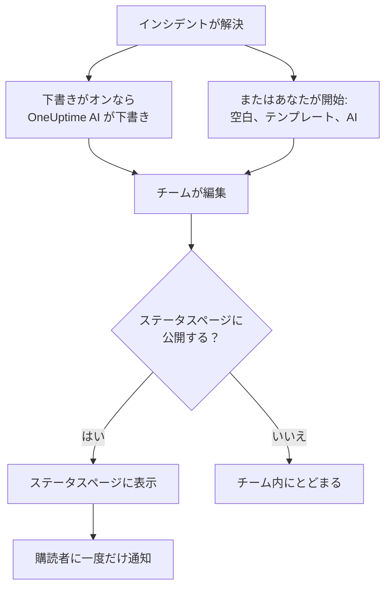

# ポストモーテム

ポストモーテムは、インシデントの後にまとめる振り返りです。何が起きたか、なぜ起きたか、ユーザーにどんな影響があったか、そしてこれから何を変えるかを書きます。OneUptime では、インシデントそのものの上に書きます。独自のテンプレートや OneUptime AI の下書きから始めることができ、インシデントの締めくくりの更新としてステータスページに公開できます。すべてのポストモーテムにはステータスもあり、**インシデント → ポストモーテム** にはすべてのインシデントのポストモーテムが並ぶので、まだ書かれていないものがひと目でわかります。

:::cards
- [ポストモーテムを書く](#ポストモーテムを書く): インシデントのポストモーテムページで、5 つのステップで。
- [テンプレートや AI の下書きから始める](#テンプレートや-ai-の下書きから始める): 独自のアウトライン、または OneUptime AI が埋めるアウトライン。
- [ステータスページに公開する](#ステータスページに公開する): 顧客に見せ、購読者に一度だけ知らせます。
- [各ポストモーテムの進み具合を追う](#各ポストモーテムの進み具合を追う): 未開始、下書き、完了、または独自のステータス。
- [すべてのポストモーテムを見る](#すべてのポストモーテムを見る): 所有者、重大度、ステータスで絞り込み、まだ書かれていないものを探します。
- [エピソードのポストモーテム](#エピソードのポストモーテム): インシデントのグループにひとつの振り返り。
:::

## ポストモーテムのまとまり方

ポストモーテムには 3 つの部分があり、すべてインシデントにあります。Markdown で書くメモ、スクリーンショットやレポートなどの添付ファイル、そしてステータスページに表示するかどうかです。これらはインシデントのサイドメニューの **調査** の下にある **ポストモーテム** ページにあります。ポストモーテムには、どこまで進んだかを示すステータスと、所有者 (インシデントの所有者) もあります。

## ポストモーテムを書く

:::steps
### ポストモーテムを開く

インシデントを開き、サイドメニューの **調査** の下にある **ポストモーテム** をクリックします。**ポストモーテム** カードには、ポストモーテムの **ステータス** と **所有者**、メモ、添付ファイル、そしてポストモーテムがステータスページに表示されているかどうかが表示されます。

### 「ポストモーテムを書く」をクリックする

**ポストモーテムを書く** ダイアログが、最初のステップ **ポストモーテム** で開きます。ポストモーテムが書かれたあとは、カードのボタンが **ポストモーテムのメモを編集** になり、同じステップを開きます。

### メモを書いてファイルを添付する

**ポストモーテムのメモ** を Markdown で書きます。何が起きたか、影響、どう解決したか、フォローアップです。スクリーンショット、レポート、タイムラインは **ポストモーテムの添付ファイル** に追加します。

### 公開するかどうかを選ぶ

**次へ** をクリックします。**ステータスページ** ステップでは **ステータスページに公開** が最初はオフなので、ポストモーテムはチーム内にとどまります。顧客に見せるには、[ステータスページに公開する](#ステータスページに公開する) を参照してください。

### ポストモーテムを保存する

**変更を保存** をクリックします。カードにメモと添付ファイルが表示されます。ポストモーテムのステータスは **未開始** から **下書き** に移ります。[ポストモーテムの進み方](#ポストモーテムの進み方) を参照してください。
:::

メモへの変更はすべてインシデントのフィードに記録され、インシデントに Slack または Microsoft Teams のチャンネルがあれば、そこにも投稿されます。ポストモーテムが公開されていない間は、ステータスページの購読者に知らされることはありません。

ポストモーテムを書くには、Project Owner、Project Admin、Project Member、Incident Admin、Incident Member のいずれかのロール、または Edit Incident 権限を持つカスタムロールが必要です。インシデントを読めるユーザーは誰でも、そのポストモーテムを読めます。

## テンプレートや AI の下書きから始める

2 つのボタンがメモを埋めてくれます。まだ何も書かれていない間は、**ポストモーテムを書く** の横に **テンプレートから始める** (プロジェクトにポストモーテムテンプレートがある場合) と **AI で生成** があります。ポストモーテムが書かれたあとは、**ポストモーテムのメモを編集** の横の **⋯** メニューに **テンプレートを適用** と **AI で生成** として入っています。どちらも同じエディターをメモが埋まった状態で開き、ポストモーテムのほかの部分はそのままです。**変更を保存** をクリックするまで何も保存されないので、先にメモを読んで直してください。

### テンプレートを適用する

**テンプレートを適用** は、プロジェクトにポストモーテムテンプレートがあると表示されます。テンプレートは **インシデント → 設定 → ポストモーテムテンプレート** で作成します。[ポストモーテムテンプレート](/docs/incidents/settings#ポストモーテムテンプレート) を参照してください。OneUptime Cloud では、テンプレートに Growth プランが必要です。

**テンプレートから始める**、または **⋯** メニューの **テンプレートを適用** をクリックし、**ポストモーテムテンプレートを適用** ダイアログの **テンプレートを選択** でテンプレートを選んで、**テンプレートを適用** をクリックします。テンプレートがひとつしかないプロジェクトでは、すでに選ばれています。

### AI で生成する

**AI で生成** をクリックします。**AI でポストモーテムを生成** ダイアログの **テンプレートを選択** には、アウトラインとして **Standard Postmortem**、**Detailed Technical Postmortem**、**Brief Postmortem**、続いてプロジェクト独自のポストモーテムテンプレートが並びます。**テンプレートのプレビュー** にアウトラインが表示され、生成する前に変更できます。

ダイアログ下部の **AI で生成** をクリックします。OneUptime AI がインシデント（説明、根本原因と修復、状態のタイムライン、公開メモと非公開メモ、Slack または Microsoft Teams のチャンネルのメッセージ、 [通話](/docs/workspace-connections/video-calls#通話の文字起こし) で話された内容）を読み、アウトラインに沿ってポストモーテムを書きます。その後、その結果でエディターが開きます。

生成するには、**プロジェクト設定 → AI → AI 機能** でプロジェクトの AI がオンになっていることと、LLM プロバイダーが必要です。[LLM プロバイダー](/docs/ai/llm-provider) を参照してください。また、Project Owner または Project Admin のロール、または Edit Incident 権限を持つカスタムロールも必要です。ほかのロールはポストモーテムを書けますが、生成はできません。

### インシデントが解決したら OneUptime AI に下書きさせる

**インシデントが解決したらポストモーテムの下書きを作成する** がオンだと、インシデントが解決されるたびに OneUptime AI がポストモーテムを下書きし、メモとして保存して、チームが確認できるようインシデントのフィードに投稿します。スイッチは **インシデント → AI → 設定** にあり、新しいプロジェクトではオンです。

- すでに書かれたメモを置き換えることはありません。
- すでに公開されているポストモーテムに書き込むことはありません。そうすると、下書きが確認されないままステータスページに届いてしまうためです。
- プロジェクトの AI がオンである必要があり、プロジェクトが 1 日の AI の上限に達すると、その日は止まります。[自動ポストモーテム](/docs/ai/ai-sre#自動ポストモーテム) を参照してください。
- インシデントの解決時に通話の文字起こしがまだ届いていない場合は、通話で話された内容を下書きに反映できるよう、OneUptime AI がそれを読み取るまで待ちます。プロバイダーが文字起こしを準備している間は最大 6 時間です。[すべての通話を録画して文字起こしする](/docs/workspace-connections/video-calls#すべての通話を録画して文字起こしする) を参照してください。

#### 下書きを作成するインシデントとそのテンプレートを選ぶ

ルールがなければ、解決されたすべてのインシデントに、OneUptime AI の標準の構成で下書きが作成されます。同じページの **その他の設定** にある **ポストモーテムルール** で、これを変えられます。

- ルールは **すべてのインシデント** か、モニター、重大度、ラベル、モニターのラベル、タイトルと説明についての **条件に一致するインシデントのみ** に一致します。AI ルールと同じです。
- ルールの **テンプレート** は、下書きが従ってよいポストモーテムテンプレートです。一つもなければ下書きは標準の構成に従い、一つならそのテンプレートに、複数なら OneUptime AI がインシデントに最も合うと判断したものに従います。フィードへの下書きの投稿には、従ったテンプレートの名前が示されます。
- ルールの **その他の項目** にある **LLM プロバイダー** は、OneUptime AI が下書きを書き、そのテンプレートを選ぶのに使うプロバイダーです。何も選ばない場合は、プロジェクトの既定のプロバイダー、なければグローバルプロバイダーです。フィードへの下書きの投稿には、ルールが選んだプロバイダー、または代わりに使ったプロバイダーとその理由が示されます。[ルールが使う LLM プロバイダー](/docs/ai/ai-sre#ルールが使う-llm-プロバイダー) を参照してください。
- 一覧の上から順に見て、インシデントに一致する最初の有効なルールが決めます。位置を変えるにはルールをドラッグします。どのルールにも一致しないインシデントには下書きは作成されず、ルールを読み取れない間はどのインシデントにも作成されません。
- 下書きをオフにするスイッチは、引き続き **インシデントが解決したらポストモーテムの下書きを作成する** だけです。ルールが決めるのは OneUptime AI が自ら作成する下書きだけで、**AI で生成** はルールにかかわらずすべての構成を提示します。
- ルールの作成、編集、並べ替えには Project Owner または Project Admin のロールが必要です。OneUptime Cloud では、テンプレートに Growth プランが必要です。それより下のプランでも、ルールはどのインシデントに下書きを作成するかを決めますが、下書きはすべて標準の構成に従います。

## ステータスページに公開する

公開されたポストモーテムは、顧客に向けたインシデントの締めくくりの更新です。ステータスページはメモをインシデントのタイムラインで目立たせて表示し、添付ファイルもダウンロードできます。

:::steps
### 「ステータスページ」ステップを開く

**ポストモーテムのメモを編集** をクリックし、**次へ** をクリックして **ステータスページ** ステップに進みます。

### 「ステータスページに公開」をオンにする

**ステータスページに公開** をオンにします。さらに 2 つのフィールドが表示されます。オンになっている **購読者に通知** と、現在時刻が入った **ポストモーテムの公開日時** です。

### 誰に知らせるか、どの時刻を表示するかを決める

購読者に知らせずに公開するには、**購読者に通知** をオフにします。ポストモーテムの横に別の時刻を表示するには、**ポストモーテムの公開日時** を変更します。

### 公開する

**変更を保存** をクリックします。カードに **ポストモーテムをステータスページに表示しますか？**、**購読者に通知**、**購読者通知ステータス**、**ポストモーテムの公開日時** が表示されるようになります。
:::

顧客がポストモーテムを見られるか、知らされるかは、次のことで決まります。

- **インシデントがステータスページに表示されていること。** ステータスページがポストモーテムを表示するのは、そのページが表示しているインシデントだけです。**ステータスページに表示** がオンで、インシデントが非公開でないことが条件です。
- **メモに中身があること。** 空のメモで公開されたポストモーテムは表示されず、誰にも知らされません。
- **購読者への通知は一度だけ**、ステータスページが初めてポストモーテムを表示したときです。もう一度保存したり、公開中に編集したりするとページは更新されますが、誰にも知らされません。公開を取り下げて再び公開すると、もう一度知らされます。インシデントが非表示の間に公開されたポストモーテムは、インシデントが表示されたときに送られます。
- **「購読者に通知」は通知の送信時に読み取られます。** ポストモーテムの公開後にオンにしても、何も送られません。

**購読者通知ステータス** には通知が送られたかどうかが表示され、失敗したときは **再試行** が表示されます。各ケースについては [ポストモーテム](/docs/status-pages/subscribers#ポストモーテム) を、あわせて [再試行と再送信](/docs/status-pages/subscribers#再試行と再送信) を参照してください。

**ポストモーテムの公開日時** は、**ポストモーテムまでの時間** の測定でポストモーテムが公開されたとみなされる時刻でもあります。[既製の測定値](/docs/incidents/settings#既製の測定値) を参照してください。

## 各ポストモーテムの進み具合を追う

各インシデントのポストモーテムは、プロジェクトのポストモーテムのステータスのいずれかにあり、**ポストモーテム** カード上部の **ステータス** に表示されます。新しいプロジェクトには 4 つあります。**未開始** または **下書き** のポストモーテムはまだ書くべきもので、**完了** または **不要** のものはそうではありません。

| ステータス | 意味 | まだ書くべきか |
| --- | --- | --- |
| **未開始** | このポストモーテムはまだ誰も書いていません。 | はい |
| **下書き** | ポストモーテムを作成中です。 | はい |
| **完了** | ポストモーテムは作成済みで完了しています。 | いいえ |
| **不要** | このインシデントにポストモーテムは不要です。 | いいえ |

### ポストモーテムの進み方

OneUptime は、次の 3 つのタイミングでポストモーテムを自動で移動します。

- 新しいインシデントのポストモーテムは **未開始** から始まります。インシデントがメモ付きで宣言された場合は **下書き**、そのメモが同時に公開された場合は **完了** から始まります。
- **未開始** のポストモーテムに最初のメモが入ると、**下書き** に移ります。誰かが書いても、テンプレートを適用しても、OneUptime AI が下書きしても同じです。
- ステータスページに公開すると **完了** に移ります。すでに完了している場合を除きます。

後ろに戻ることはありません。メモを空にしても、ポストモーテムをステータスページから外しても、ステータスはそのままです。同じ保存で誰かが選んだステータスは、常にそのまま使われます。

### 自分で移動する

インシデントの **ポストモーテム** ページ、またはポストモーテムの一覧のその行でステータスをクリックし、**ポストモーテムの移動先** でステータスを選びます。ポストモーテムはすぐに移動します。ポストモーテムを移動できるのはポストモーテムを書けるロールで、インシデントを読める人なら誰でも、そのポストモーテムの進み具合を見られます。

### 独自のステータスを作る

レビューなど、プロセスに独自のステップがある場合は、そのためのステータスを追加します。**インシデント → 設定 → ポストモーテムのステータス** を開き、**ポストモーテムのステータスを作成** をクリックして、**レビュー中** のような名前、色、説明を付けます。新しいステータスは **完了** のすぐ上に入ります。ステータスをドラッグすると位置を変えられます。

ステータスの位置によって扱いが決まり、**扱い** に表示されます。**下書き** より上は **未開始**、**下書き** 以下は **実施中**、**完了** 以下は **完了** で、もう書くべきものではなくなります。その間にある **レビュー中** はまだ書くべきもので、**完了** の下にある **不要** はそうではありません。

**未開始**、**下書き**、**完了** は組み込みで、OneUptime がポストモーテムをこれらに移動するため、名前や色は変えられますが、削除やアーカイブはできず、順序も保たれます。使わなくなったステータスは、その行の **⋯** メニューからアーカイブします。アーカイブしたステータスにはポストモーテムを移動できなくなり、そこにあるポストモーテムは誰かが移動するまでそのままで、一覧ではそのステータスで絞り込み続けられます。表の下に折りたたまれた **アーカイブ済みのポストモーテムステータス** にそれらが一覧され、**アーカイブ解除** で元に戻せます。ステータスの作成、編集、削除には、Project Owner、Project Admin、Incident Admin のいずれかのロール、またはポストモーテムのステータスに対応する権限を持つカスタムロールが必要です。

## すべてのポストモーテムを見る

**インシデント → ポストモーテム** には、プロジェクトのすべてのインシデントのポストモーテムが新しい順に、**インシデント**、**タイトル**、**ポストモーテムのステータス**、**重大度**、**所有者**、**宣言済み** の列とともに並びます。行の **表示** で、そのインシデントの **ポストモーテム** ページが開きます。

一覧の上には、ステータスごとにタイルがあり、そのステータスのポストモーテムの数を示します。タイルをクリックするとそれだけが一覧され、もう一度クリックするとすべてに戻ります。

一覧の上にあるチップで絞り込みます: **所有者** (人またはチーム)、**重大度**、**ポストモーテムのステータス**、**インシデントの状態**、**ラベル**、**影響を受けるリソース** です。最も重大なインシデントについて、あるチームがまだ書いていないポストモーテムを見るには、**所有者** でそのチーム、**重大度** でその重大度、**ポストモーテムのステータス** で **未開始** と **下書き** を選びます。フィルターはページのアドレスに保存されるので、一覧をブックマークしたり共有したりできます。

まとめて変更するには、対象を選んで **一括操作** を開きます。**ポストモーテムのステータスを変更** はすべてをひとつのステータスに移します (ポストモーテムが不要なインシデントを **不要** にするなど)。**所有者を追加** と **所有者を削除** は所有者を変更します。

## エピソードのポストモーテム

インシデントのエピソードにも、**調査** の下に **ポストモーテム** ページがあります。エピソード内のすべてのインシデントについてのひとつの振り返りです。書くには **ポストモーテムを編集** をクリックします。**テンプレートを適用** と **AI で生成** はインシデントと同じように動き、AI はエピソードとそのメンバーのインシデントを読みます。

エピソードのポストモーテムはメモだけです。添付ファイルはなく、どのステータスページにも表示されません。エピソードが解決しても、OneUptime AI が自動で下書きすることはありません。生成するには、Project Owner または Project Admin のロール、または Edit Incident Episode 権限を持つカスタムロールが必要です。ステータスもなく、ポストモーテムの一覧にも含まれません。

アラートと定期メンテナンスのイベントには、ポストモーテムはありません。

## API から

ポストモーテムはインシデントのフィールドの集まりで、インシデントのほかの部分と同じように `/api/incident` で読み書きします。

| フィールド | 内容 |
| --- | --- |
| `postmortemNote` | Markdown で書かれたメモ。 |
| `showPostmortemOnStatusPage` | ポストモーテムがステータスページに公開されているかどうか。最初は `false`。 |
| `notifySubscribersOnPostmortemPublished` | 公開時に購読者に知らせるかどうか。最初は `true`。 |
| `postmortemPostedAt` | ステータスページがポストモーテムの横に表示する時刻。 |
| `postmortemStatusId` | ポストモーテムのステータス。`/api/incident-postmortem-status` にあるプロジェクトのステータスのいずれかです。 |

書かれた `postmortemNote` に対して `showPostmortemOnStatusPage` を `true` として書き込むと、ダイアログと同じようにポストモーテムが公開されます。同じ書き込みで `postmortemStatusId` を指定しない限り、ポストモーテムは **完了** にも移ります。

## トラブルシューティング

:::details カードに「テンプレートを適用」がない
プロジェクトにまだポストモーテムテンプレートがないか、あなたのロールがテンプレートを読めません。**インシデント → 設定 → ポストモーテムテンプレート** で作成してください。OneUptime Cloud では、テンプレートに Growth プランが必要です。
:::

:::details 「AI で生成」で、AI がオフ、または権限がないと表示される
**プロジェクト設定 → AI → AI 機能** で AI をオンにしてください。生成するには、ポストモーテムを編集できるユーザーであっても、Project Owner または Project Admin のロール、または Edit Incident 権限を持つカスタムロールが必要です。
:::

:::details ポストモーテムがステータスページに表示されない
3 つの点を確認してください。**ステータスページに公開** がオンであること、メモが空でないこと、そしてインシデントがステータスページに表示されていること（**ステータスページに表示** がオンで、非公開でないこと）です。
:::

:::details 購読者にポストモーテムが知らされなかった
公開したときに **購読者に通知** がオフだったか、インシデントが非表示です。その場合は、インシデントが表示されたときに送られます。どちらだったかは、カードの **購読者通知ステータス** でわかります。
:::

:::details インシデントが解決しても AI の下書きが現れなかった
インシデントにすでにメモがあったか、ポストモーテムがすでに公開されていたか、どのポストモーテムルールにも一致しなかったか、**インシデントが解決したらポストモーテムの下書きを作成する** がオフです。プロジェクトの AI がオンで、プロジェクトが 1 日の AI の上限に達していない必要があります。インシデントの通話の文字起こしが届く途中の場合、下書きは OneUptime AI がそれを読み取ってから作成されます。
:::

:::details メモを書いたのにポストモーテムのステータスが変わらない
自動で進むのは、**未開始**、または **下書き** より上にある独自のステータスのポストモーテムだけで、最初のメモが入ったときです。すでに進行中または完了のものはそのままで、同じ保存で誰かが選んだステータスもそのままです。ステータスから自分で移動してください。[自分で移動する](#自分で移動する) を参照してください。
:::

## 次のステップ

:::cards
- [インシデント 概要](/docs/incidents/index): 宣言から解決までの、インシデントのほかのページ。
- [インシデントの設定と自動化](/docs/incidents/settings): ポストモーテムテンプレートと、ポストモーテムまでの時間の測定。
- [購読者とお知らせ](/docs/status-pages/subscribers): ステータスページが購読者に伝えるすべてのこと。
- [AI SRE](/docs/ai/ai-sre): インシデントの後に OneUptime AI が自動で行うこと。
:::
