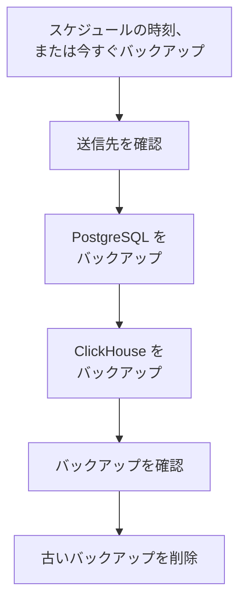

# バックアップ

セルフホストの OneUptime を、自分が所有するストレージにスケジュールに従ってバックアップし、Admin Dashboard から復元します。バックアップには、プロジェクト、モニター、インシデント、ステータスページ、ユーザーを保持する PostgreSQL と、ログ、トレース、メトリクスを保持する ClickHouse が含まれます。バックアップは指定した日数だけ保持され、古いものは自動的に削除され、どのバックアップもその場で復元できます。バックアップはエンタープライズ版の機能です。

:::cards
- [バックアップを設定する](#バックアップを設定する): 送信先を選び、テストし、スケジュールを決めます。
- [送信先](#送信先): 推奨される各送信先で必要なもの。
- [バックアップを復元する](#バックアップを復元する): 何が置き換えられ、現在のデータがどう守られるか。
- [新しいサーバーに移行する](#新しいサーバーに移行する): あるインストールのバックアップを別のインストールで復元します。
:::

## バックアップのしくみ



- **一貫性。** PostgreSQL は 1 つのトランザクションでダンプされるため、ダンプは OneUptime が動き続けている間のある一時点のデータベースそのものです。ClickHouse は各テーブルを、そのパーツを読み取った時点の状態でバックアップします。
- **送信先へ直接。** `pg_dump` の出力は書き込まれるそばからストレージへストリーミングされ、ClickHouse は自身のバックアップを直接ストレージに書き込みます。データの量にかかわらず、サーバーのディスクには何も書き込まれません。
- **確認済み。** バックアップとして扱われる前に、`pg_restore` が送信先からダンプを読み戻し、ClickHouse が自身のバックアップについて残す記録も送信先で確認されます。ダンプの SHA-256 はバックアップと一緒に保存され、復元は何かを置き換える前にそれを確認します。失敗またはキャンセルされたバックアップは書き込んだものを削除するため、送信先には完全なバックアップだけが残ります。
- **暗号化。** バックアップは HTTPS でストレージに送られます (`http://` のエンドポイントを入力した場合を除く)。Amazon S3、Google Cloud Storage、Azure Blob Storage、Cloudflare R2 は保存するものをすべて暗号化します。その他のストレージでは、バケットの保存時の暗号化を有効にしてください。送信先の認証情報は暗号化して保存され、二度と表示されません。
- **一度に 1 つ。** インストール全体で、同時に実行されるバックアップまたは復元は 1 つだけです。ほかは順番を待ちます。

各バックアップは、送信先のフォルダー (別のフォルダーを選ばない限り `oneuptime/backups/`) の中にある専用のフォルダーで、開始時刻 (UTC) にちなんだ名前が付きます。

```text
oneuptime/backups/20261024T020000Z-3f2a9c1b/manifest.json
oneuptime/backups/20261024T020000Z-3f2a9c1b/postgres.dump
oneuptime/backups/20261024T020000Z-3f2a9c1b/clickhouse/
```

`manifest.json` は最後に書き込まれ、バックアップの内容と、それを作成した OneUptime のバージョンを記録します。

## 始める前に

- **エンタープライズ版**と、バックアップを含むライセンス。試用期間と猶予期間中はバックアップが実行されます。ライセンスがない場合、新しいバックアップは作成されませんが、バックアップの復元と削除は引き続き利用できます。[エンタープライズ版](/docs/self-hosted/enterprise)を参照してください。
- **マスター管理者。** バックアップは Admin Dashboard で設定します。
- **バックアップ専用のバケットまたはコンテナー**と、その中で読み取り、書き込み、一覧表示、削除ができる認証情報。
- **ClickHouse からも到達できる送信先。** ClickHouse は自身でストレージにバックアップを書き込むため、OneUptime のネットワークと同様に、ClickHouse のネットワークからもストレージに到達できる必要があります。
- **PostgreSQL を復元するには、データベースを作成できるデータベースユーザー。** 復元では、稼働中のデータベースの隣に新しいデータベースを作って書き込みます。OneUptime に同梱の PostgreSQL はスーパーユーザーとして接続するため、作成できます。

## バックアップを設定する

:::steps
### バックアップのページを開く

Admin Dashboard で **設定 → バックアップ** に移動し、**バックアップを設定** をクリックします。

### バックアップの保存先を選ぶ

推奨される送信先のいずれかを選びます。それぞれで必要なものは[送信先](#送信先)にあります。

### 接続情報を入力する

送信先が求める内容を入力します。フォルダー、リージョン、ほとんどの人が変更しない設定は **その他の項目** にあり、**セットアップガイド** をクリックするとこのページの該当する送信先のセクションが開きます。

### 送信先をテストする

**送信先をテスト** をクリックします。OneUptime は小さなテストファイルの書き込み、読み取り、一覧表示、削除を行い、`pg_dump` で PostgreSQL をバックアップできることを確認し、ClickHouse にテーブル定義のテストバックアップの書き込みを依頼します。何も保存されず、失敗した確認項目には変更すべき点が表示されます。

### バックアップを実行するタイミングを選ぶ

**頻度** と **時刻 (UTC)** の時刻を選び、毎週のバックアップでは **曜日** も選びます。**バックアップの保持期間 (日)** は変更しない限り 30 です。PostgreSQL だけをバックアップするには **ClickHouse もバックアップ** をオフにします。

### バックアップを開始する

**バックアップを開始** をクリックします。最初のバックアップは次のスケジュール時刻に実行され、**今すぐバックアップ** ですぐに開始することもできます。
:::

その後ページには、前回のバックアップの実行時刻、サイズ、所要時間と、次回の実行時刻が表示されます。実行中のバックアップには現在のステップが表示され、**ステップを表示** では各ステップを実行中に確認できます。

## 送信先

| 送信先 | ストレージ | 認証方法 |
| --- | --- | --- |
| [Amazon S3](#amazon-s3) | Amazon S3 | アクセスキー |
| [Cloudflare R2](#cloudflare-r2) | S3 互換ストレージ | R2 API トークン |
| [Backblaze B2](#backblaze-b2) | S3 互換ストレージ | アプリケーションキー |
| [Wasabi](#wasabi) | S3 互換ストレージ | アクセスキー |
| [MinIO](#minio) | S3 互換ストレージ | アクセスキー |
| [Google Cloud Storage](#google-cloud-storage) | Google Cloud Storage | HMAC キー |
| [Azure Blob Storage](#azure-blob-storage) | Azure Blob Storage | SAS トークンまたはアクセスキー |
| [その他の S3 互換ストレージ](#その他の-s3-互換ストレージ) | S3 互換ストレージ | アクセスキー |

Amazon S3 またはその他の S3 互換ストレージのキーには、フォルダーに対する `s3:PutObject`、`s3:GetObject`、`s3:ListBucket`、`s3:DeleteObject`、`s3:AbortMultipartUpload` が必要で、それ以外は不要です。

```json
{
  "Version": "2012-10-17",
  "Statement": [
    {
      "Effect": "Allow",
      "Action": "s3:ListBucket",
      "Resource": "arn:aws:s3:::my-backups"
    },
    {
      "Effect": "Allow",
      "Action": [
        "s3:PutObject",
        "s3:GetObject",
        "s3:DeleteObject",
        "s3:AbortMultipartUpload"
      ],
      "Resource": "arn:aws:s3:::my-backups/oneuptime/backups/*"
    }
  ]
}
```

### Amazon S3

| フィールド | 入力する内容 |
| --- | --- |
| **バケット** | バックアップの書き込み先のバケット。バックアップ専用にしてください。 |
| **リージョン** | バケットのリージョン。最初は `us-east-1` です。 |
| **アクセス キー ID** | 上記の権限を持つアクセスキー。 |
| **シークレット アクセス キー** | キーのシークレット。 |
| **フォルダー** | **その他の項目** にあります。空欄の場合、バックアップは `oneuptime/backups/` に保存されます。 |

Amazon S3 は保存するすべてのファイルを暗号化し、OneUptime は書き込むすべてのファイルについてそれ (SSE-S3) を要求します。

### Cloudflare R2

**エンドポイント** に、R2 のバケット設定にあるアカウントの S3 API アドレス `https://<account-id>.r2.cloudflarestorage.com` を入力します。続いて **バケット** と、そのバケット内のオブジェクトを読み書きできる R2 API トークンの **アクセス キー ID** と **シークレット アクセス キー** を入力します。R2 からバックアップを読み戻す料金はかかりません。

### Backblaze B2

**エンドポイント** に、Backblaze のバケットの Buckets ページに表示される S3 エンドポイント (例: `https://s3.us-west-004.backblazeb2.com`) を入力します。続いて **バケット** を入力し、アプリケーションキーのキー ID とキーを **アクセス キー ID** と **シークレット アクセス キー** に入力します。リージョンはエンドポイントから読み取られます。

### Wasabi

**エンドポイント** にバケットのリージョンのサービス URL (例: `https://s3.us-east-1.wasabisys.com`) を入力し、続いて **バケット** とアクセスキーを入力します。リージョンはエンドポイントから読み取られます。

### MinIO

**エンドポイント** に MinIO サーバーの S3 API アドレス (例: `https://minio.example.com:9000`) を入力し、続いて **バケット** と、そのバケット内で読み取り、書き込み、一覧表示、削除ができるポリシーを持つアクセスキーを入力します。OneUptime と ClickHouse の両方がこのアドレスに到達できる必要があります。

### Google Cloud Storage

**バケット** と、バケットに対する Storage Object Admin ロールを持つサービス アカウントの **HMAC アクセスキー** と **HMAC シークレット** を入力します。キーは Cloud Storage の設定の [相互運用性] タブで作成します。OneUptime と ClickHouse は、Cloud Storage の S3 互換 API を通じてバケットにアクセスします。

### Azure Blob Storage

**ストレージ アカウント** と **コンテナ** を入力し、**サインイン方法** で認証方法を選びます。コンテナーに対する読み取り、追加、作成、書き込み、削除、一覧の権限を持つ **SAS トークン** か、ストレージ アカウントの **アクセス キー** です。SAS トークンはコンテナーに限定できるため、より安全な選択です。**クラウド** と **フォルダー** は **その他の項目** にあります。

### その他の S3 互換ストレージ

Ceph、DigitalOcean Spaces、Hetzner Object Storage など、S3 API を備えたストレージでは、その S3 アドレスを **エンドポイント** に入力し、続いて **バケット** とアクセスキーを入力します。**その他の項目** にある **リージョン** は、ストレージが要求する場合にのみ必要です。空欄の場合はエンドポイントから読み取られ、読み取れなければ `us-east-1` になります。

## スケジュールと保持

| 設定 | 内容 |
| --- | --- |
| **頻度** | **1 時間ごと**、**6 時間ごと**、**12 時間ごと**、**毎日**、**毎週** のいずれか。ほとんどの環境では毎日で十分です。 |
| **時刻 (UTC)** | バックアップを開始する時刻 (UTC)。隣に現地時刻が表示されます。6 時間ごと・12 時間ごとはこの時刻から数えます。`02:00` の場合、6 時間ごとのバックアップは 02:00、08:00、14:00、20:00 に実行されます。1 時間ごとのバックアップは毎正時に実行されます。 |
| **曜日** | 毎週のバックアップを実行する曜日。 |
| **バックアップの保持期間 (日)** | 1 から 3650 日まで。変更しない限り 30 日です。 |
| **ClickHouse もバックアップ** | オフにしない限りオンです。PostgreSQL は常にバックアップされます。 |

各バックアップの後、**バックアップの保持期間 (日)** より前に開始されたバックアップが送信先と一覧から削除されます。ただし、成功した最新のバックアップは、どれほど古くても残ります。そのため、バックアップをオフにしても、ライセンスが失効しても、復元できるバックアップがなくなることはありません。

ステータスカードのメニューにある **スケジュールされたバックアップをオフにする** はスケジュールを停止します。**今すぐバックアップ** は引き続き使え、バックアップは削除されません。**オンにする** でスケジュールを再開します。

## バックアップを復元する

:::warning 復元で置き換えられるもの
復元すると、現在のデータがバックアップのデータに置き換えられます。先に現在のデータをバックアップしない限り、バックアップ作成後に変更された内容はすべて失われます。
:::

:::steps
### バックアップを選ぶ

**バックアップ** テーブルで、戻したいバックアップの **復元** をクリックします。OneUptime はまずバックアップを確認します。ファイルが送信先にあり変更されていないこと、どのバージョンの OneUptime で作成されたか、このサーバーで復元できるかを確認します。

### 復元する対象を選ぶ

**PostgreSQL: プロジェクト、モニター、インシデント、ユーザー**、**ClickHouse: ログ、トレース、メトリクス**、またはその両方をオンにします。ダイアログには、バックアップに含まれるプロジェクト、ユーザー、モニターの数と、現在の数が表示されます。

### 現在のデータを守る

**先に現在のデータをバックアップ** はオンになっています。復元は置き換えるデータのバックアップから始まるため、元に戻すことができます。オフにするのは別のコピーがある場合だけにしてください。オフにすると復元は元に戻せません。

### 確認する

`restore` と入力し、**復元** をクリックします。
:::

復元はステップごとに実行され、ページに各ステップが表示されます。

| ステップ | 内容 |
| --- | --- |
| **バックアップを確認** | バックアップのファイルがそろっていて、このインストールで復元できることを確認します。 |
| **現在のデータをバックアップ** | オフにしていなければ、現在のデータをバックアップします。 |
| **PostgreSQL を復元** | 稼働中のデータベースの隣の新しいデータベースにバックアップを復元し、確認します。 |
| **ClickHouse を復元** | 稼働中のテレメトリを退避し、その場所にバックアップのテレメトリを復元します。 |
| **復元したデータに切り替え** | 復元したデータベースが、一瞬で稼働中のデータベースの名前を引き継ぎます。 |
| **復元したデータを最新化** | このバージョンのデータベース移行を、復元したデータに対して実行します。 |
| **後片付け** | 退避したものを削除します。 |

切り替えまで OneUptime は現在のデータで動き続け、それまでに OneUptime が使うものは何も変わりません。切り替え前に失敗またはキャンセルされた復元はすべてを元のままにし、切り替え中に失敗した復元は退避したものを元に戻します。ClickHouse の復元中に届いたテレメトリは保存されません。PostgreSQL の復元後はサインアウトされる場合があります。バックアップに含まれるアカウントでサインインしてください。

:::details 別の ENCRYPTION_SECRET で作成されたバックアップだと表示される
OneUptime が保存する認証情報 (送信先のキーなど) は `ENCRYPTION_SECRET` で暗号化されています。復元の前に、バックアップを作成したときの `ENCRYPTION_SECRET` を設定してください。設定しないと、復元後にそれらの認証情報を読み取れません。
:::

## 新しいサーバーに移行する

:::steps
### 新しいサーバーに OneUptime をインストールする

バックアップを作成したバージョンか、それより新しいバージョンのエンタープライズ版をインストールします。

### 同じ送信先を設定する

**設定 → バックアップ** で、バックアップがある送信先を設定します。ページはそこにあるバックアップを見つけて一覧に表示し、すぐに復元できるようにします。ステータスカードのメニューにある **バックアップを検索** で再度検索できます。

### 最新のバックアップを復元する

上記の手順で復元します。古いバージョンの OneUptime で作成されたバックアップは、このバージョンに更新されます。新しいバージョンで作成されたバックアップは、OneUptime を更新すれば復元できます。
:::

## バックアップが失敗したとき

ステータスカードにエラーとともに **前回のバックアップは失敗しました** と表示され、**ステップを表示** で停止したステップとその理由を確認できます。また、すべてのマスター管理者にメールが届きます。バックアップの失敗が続く間、メールは 12 時間に 1 回までです。復元の失敗は必ずメールで通知されます。

## トラブルシューティング

:::details ClickHouse が送信先に到達できない
ClickHouse は自身でストレージに接続します。OneUptime のネットワークと同様に、ClickHouse のネットワークから送信先のアドレスに到達できるようにしてから、送信先をもう一度テストしてください。
:::

:::details pg_dump がない、または古すぎる
エンタープライズ版のイメージには `pg_dump` と `pg_restore` の 16、17、18 が含まれており、PostgreSQL 18 とそれ以前のすべてのバージョンをバックアップできます。ほかのイメージでは、PostgreSQL のクライアントツールをインストールするか、それらがあるディレクトリを `BACKUP_POSTGRES_BIN_DIR` に設定してください。`pg_dump` は PostgreSQL サーバーと同じかそれより新しいバージョンである必要があります。
:::

:::details PostgreSQL の復元には 1 つの変更が必要
復元ではデータベースを作成するため、OneUptime のデータベースユーザーにその権限が必要です。スーパーユーザーとして PostgreSQL で次を実行し (`oneuptime` の部分は自分の `DATABASE_USERNAME` に置き換えます)、もう一度復元してください。

```sql
ALTER USER oneuptime CREATEDB;
```
:::

:::details バックアップが以前の送信先にある
送信先を変更した後も、以前の送信先で作成されたバックアップは **以前の送信先** と表示されて一覧に残ります。復元するにはその送信先を再度設定するか、一覧から削除してください。ファイルは元の場所に残ります。
:::

## 次のステップ

:::cards
- [エンタープライズ版](/docs/self-hosted/enterprise): ライセンスと、エンタープライズ版で追加される機能。
- [アップグレード](/docs/installation/upgrading): アップグレードの前には毎回バックアップします。
- [Docker Compose](/docs/installation/docker-compose): 1 台のサーバーで OneUptime を運用します。
:::
