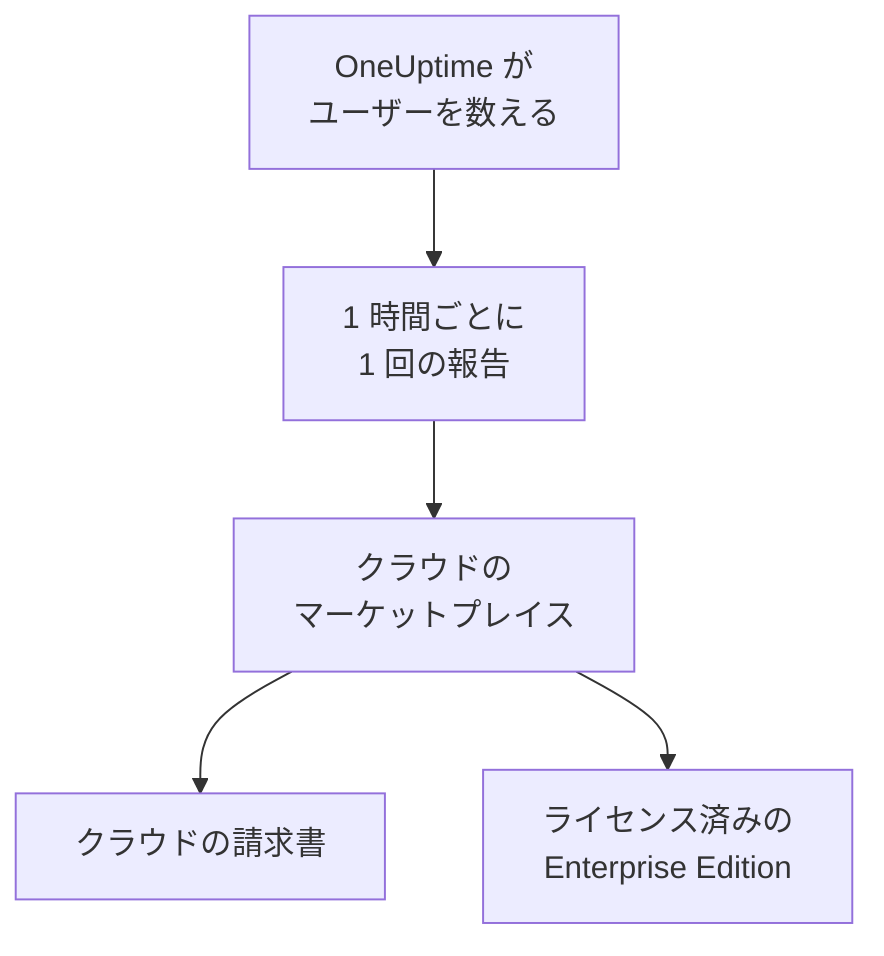

# クラウドマーケットプレイス

AWS Marketplace、Microsoft Marketplace、Google Cloud Marketplace で購入した OneUptime Enterprise を、自分の Kubernetes クラスターで実行します。インストールのすべてのユーザーはマーケットプレイスによって時間単位で課金され、クラウドの請求書に計上されます。また、サブスクリプションがそのまま Enterprise Edition のライセンスになるため、有効化するライセンスキーはありません。

:::cards
- [OneUptime をインストールする](#oneuptime-をインストールする): Amazon EKS、Azure Kubernetes Service、Google Kubernetes Engine で実行します。
- [課金の仕組み](#課金の仕組み): ユーザー 1 人 1 時間あたり USD 0.10 で、1 時間ごとに報告されます。
- [アップグレード](#アップグレード): 新しいリリースがどのようにクラスターに届くか。
- [トラブルシューティング](#トラブルシューティング): エディションラベルがマーケットプレイスについて警告するとき。
:::

## 仕組み

OneUptime は 15 分ごとにユーザー数を数え、1 時間ごとに、その 1 時間で最も多かったユーザー数を購入元のマーケットプレイスに 1 回だけ報告します。マーケットプレイスはその 1 時間分をクラウドの請求書に加算します。マーケットプレイスが報告を受け付けるたびに、サブスクリプションが有効であることも OneUptime に伝わり、それによって Enterprise Edition のライセンスが維持されます。



| | AWS | Microsoft | Google Cloud |
| --- | --- | --- | --- |
| リスティング | まだ公開されていません ([お問い合わせ](https://oneuptime.com/enterprise/demo)) | [OneUptime Enterprise](https://marketplace.microsoft.com/en-us/product/oneupitme.oneuptime-enterprise) | まだ公開されていません ([お問い合わせ](https://oneuptime.com/enterprise/demo)) |
| 実行環境 | Amazon EKS | Azure Kubernetes Service (AKS) | Google Kubernetes Engine (GKE) |
| インストール方法 | リスティングのレジストリから Helm で | Azure portal | Google Cloud コンソール |
| OneUptime が報告に使うもの | Kubernetes サービスアカウントの IAM ロール | Azure がインストールに付与するマネージド ID | Google Cloud Marketplace がデプロイ用に作成する報告用シークレット |
| 新しいリリース | Helm で自分でアップグレードする | マイナーリリースは自動でインストールされる | 手動でアップグレードする |

## 始める前に

- マーケットプレイスのクラウド上の **Kubernetes クラスター**。4 vCPU とメモリ 16 GiB のノードが 3 台以上あり、デフォルトの StorageClass があって、`LoadBalancer` サービスに対応している必要があります。OneUptime は自前の PostgreSQL、ClickHouse、Valkey をクラスター内で実行します。これらのサイズは [サイジングとキャパシティプランニング](/docs/installation/sizing) を参考に決めてください。
- クラスターのロードバランサーに向けられる、OneUptime 用の **ドメイン名** (`oneuptime.example.com` など)。
- クラスターからマーケットプレイスへの **送信 HTTPS**。OneUptime がユーザー数を報告するために使います。宛先は、AWS では `metering.marketplace.<region>.amazonaws.com` と `sts.<region>.amazonaws.com`、Azure では `marketplaceapi.microsoft.com`、Google Cloud では `servicecontrol.googleapis.com` と `oauth2.googleapis.com` です。

## OneUptime をインストールする

### AWS Marketplace

AWS では、OneUptime は EKS が Kubernetes サービスアカウントに付与する IAM ロール (サービスアカウントの IAM ロール) を使ってユーザー数を報告します。AWS Marketplace が EKS からの使用量を受け付けるのは、この方法で署名されている場合だけです。

:::steps
1. AWS Marketplace で OneUptime Enterprise をサブスクライブし、**Continue to Configuration** を選び、バージョンを選んでから **Continue to Launch** を選びます。
2. クラスターに IAM OIDC プロバイダーがまだなければ関連付け、下のコマンドで `oneuptime` サービスアカウントを、`AWSMarketplaceMeteringFullAccess` ポリシーを持つ IAM ロール付きで作成します。これらは、起動ページの **General launch instructions** のステップ 1 にある `eksctl` コマンドの代わりに実行します。そのコマンドは、先に自分で作成しておく必要があるロールを関連付けるものです。
3. **General launch instructions** のステップ 2 のコマンドで Helm をリスティングのレジストリにログインさせ、チャートをインストールします。`helm install` コマンドでは、`serviceAccount.name` を `oneuptime` に、`host` をドメイン名に、OneUptime の前に証明書がある場合は `httpProtocol` を `https` に設定します。
4. [OneUptime を開きます](#oneuptime-を開く)。
:::

```bash
eksctl utils associate-iam-oidc-provider --cluster <cluster> --approve
eksctl create iamserviceaccount --name oneuptime --namespace oneuptime --cluster <cluster> \
  --attach-policy-arn arn:aws:iam::aws:policy/AWSMarketplaceMeteringFullAccess \
  --approve --override-existing-serviceaccounts
```

ステップ 3 の値はファイルに保存しておき、`helm upgrade` を実行するたびに渡します。

```yaml title="values.yaml"
host: oneuptime.example.com
httpProtocol: https
serviceAccount:
  name: oneuptime
```

### Microsoft Marketplace

Azure では、OneUptime は Kubernetes アプリケーションとして提供されます。AKS がクラスター拡張機能としてインストールし、ユーザー数の報告に使うマネージド ID を付与します。

:::steps
1. Azure portal で Microsoft Marketplace の OneUptime Enterprise を開くか、AKS クラスターを開いて **Extensions + applications** > **Add** を選択します。続いてプランを選び、**Create** を選択します。
2. サブスクリプションとリソースグループを選び、既存の AKS クラスターにインストールするか、新しいクラスターを作成するかを選びます。
3. **OneUptime** ステップで、インストールの名前、ドメイン名、そのプロトコルを入力します。
4. **Review + create** を選択し、続いて **Create** を選択します。インストールには数分かかります。**Extensions + applications** にプロビジョニング状態が **Succeeded** と表示されれば完了です。
5. [OneUptime を開きます](#oneuptime-を開く)。
:::

カスタムメーターが使えるのは AKS クラスターだけで、Azure Arc 対応の Kubernetes では使えません。そのため、Microsoft Marketplace の OneUptime Enterprise は AKS にのみインストールできます。

### Google Cloud Marketplace

Google Cloud では、Marketplace がデプロイヤーを実行し、選んだ名前空間に OneUptime をインストールします。あわせて、OneUptime がユーザー数の報告に使う報告用シークレットも作成されます。

:::steps
1. Google Cloud コンソールで Google Cloud Marketplace の OneUptime Enterprise を開き、**Configure** を選択します。
2. GKE クラスターと名前空間を選び、インストールの名前、ドメイン名、そのプロトコルを入力します。
3. **Deploy** を選択します。デプロイには数分かかります。**Kubernetes Engine** > **Applications** でアプリケーションが準備完了と表示されれば完了です。
4. [OneUptime を開きます](#oneuptime-を開く)。
:::

## OneUptime を開く

OneUptime は起動するとまずデータベースのマイグレーションを行います。新しいインストールでは数分かかります。その後、ドメイン名を OneUptime のロードバランサーに向けます。

```bash
kubectl get service --namespace <namespace>
```

名前が `-nginx` で終わるサービスに `EXTERNAL-IP` があります。そのアドレスを指す DNS レコードをドメイン名に作成してください。ドメイン名を開いてサインアップします。新しいインストールの最初のアカウントはマスター管理者になり、`/admin` で管理者ダッシュボードを開けます。

1 時間以内に、エディションラベルに Enterprise Edition が表示され、マーケットプレイス経由でライセンスされていることが示されます。マスター管理者には、エディションラベルが管理者ダッシュボードのヘッダーと Dashboard のフッターに表示されます。

## 課金の仕組み

| 項目 | 仕組み |
| --- | --- |
| 料金 | ユーザー 1 人 1 時間あたり USD 0.10、ユーザー 1 人 1 か月あたり約 USD 73 です。 |
| 課金対象 | インストールで OneUptime にログインできるすべての人。ステータスページの購読者と、プライベートなステータスページにサインインする人は数えません。 |
| タイミング | OneUptime は 15 分ごとにユーザー数を数え、1 時間ごとに 1 回、その 1 時間で最も多かったユーザー数を報告します。OneUptime が動いていなかった時間は課金されません。 |
| 請求先 | マーケットプレイスを通じて、AWS、Azure、Google Cloud の請求書に計上されます。 |
| 含まれないもの | クラスター自体。ノード、ディスク、ロードバランサーは、通常どおりクラウドから請求されます。 |

インストールはそれぞれ個別に課金されるため、ステージング用のインストールも課金されます。年額料金、ボリュームディスカウント、本番以外のインストール向けの料金については、[sales@oneuptime.com](mailto:sales@oneuptime.com) にプライベートオファーを依頼してください。プライベートオファーはマーケットプレイスで承諾します。

ネットワークの問題やマーケットプレイスの障害で報告を送れなかったときは、OneUptime が次回の実行時にもう一度送信します。どの報告にもその時間を表すキーが付いているため、同じ時間が二重に課金されることはありません。

## ライセンスの仕組み

マーケットプレイスのサブスクリプションが、そのままライセンスになります。マーケットプレイスが報告を 1 件受け付けるごとに、その後 72 時間、すべてのユーザーに対してすべてのエンタープライズ機能がライセンスされます。OneUptime から入手したライセンスキーも同じインストールで使えます。その場合、インストールは二つのうち有利なほうで動作します。

| 起こること | エディションラベルの表示 |
| --- | --- |
| マーケットプレイスが 1 時間ごとの報告を受け付けている | マーケットプレイス経由でライセンスされた Enterprise Edition。 |
| 72 時間、報告が 1 件も受け付けられていない | **Enterprise Edition（マーケットプレイスへの報告が失敗中）**: 30 日間の猶予期間のあいだ、すべてのエンタープライズ機能が引き続き動作します。 |
| インストールがサブスクライブされていないとマーケットプレイスが応答する、または猶予期間が終わる | **Enterprise Edition（マーケットプレイスのサブスクリプション終了）**: [ライセンスが失効した](/docs/self-hosted/enterprise#ライセンスの期限切れまたは未設定のとき) ときと同じように、エンタープライズ機能が止まります。 |

マーケットプレイスが拒否するのは、解約または一時停止されたサブスクリプションと、購入したものとは別のインストールです。どの場合でも、監視、アラート、インシデント、オンコール、ステータスページは動作し続け、何も削除されません。もう一度サブスクライブすれば、次に受け付けられた報告で Enterprise Edition が再びライセンスされます。再起動は不要です。

## アップグレード

| マーケットプレイス | 新しいリリースがクラスターに届く方法 |
| --- | --- |
| AWS Marketplace | 各リリースは、リスティングの新しいバージョンです。リスティングのレジストリにあるチャート、新しいバージョン、値ファイルを指定して `helm upgrade` を実行します。 |
| Microsoft Marketplace | 新しいマイナーリリースとパッチリリースは、AKS が自動でインストールします。新しいメジャーリリースは、承認するまでインストールされません。自動アップグレードは、**Extensions + applications** にあるインストールのページでオフにできます。 |
| Google Cloud Marketplace | Google Cloud Marketplace はデプロイをインストール時のバージョンのまま保ち、更新することはありません。デプロイを新しいバージョンに移す前に、[サポート](https://oneuptime.com/support) に連絡してください。 |

OneUptime は、新しいリリースの起動時にデータベースのマイグレーションを実行します。新しいメジャーリリースに移行する前に、[アップグレードノート](/docs/installation/upgrading) を読んでください。

アップグレードはマーケットプレイスを通じて行ってください。マーケットプレイスからのインストールは、GitHub 上の OneUptime リリースと自身を比較しません。マーケットプレイスが提供するバージョンがアップグレード先です。

## 設定とスケーリング

スケールしても請求額は変わりません。OneUptime はユーザー単位で課金されるからです。レプリカを増やしたりノードを大きくしたりして変わるのは、クラウドがクラスターに対して請求する額だけです。

| マーケットプレイス | 設定の場所 |
| --- | --- |
| AWS Marketplace | 値ファイル。同梱のオペレーターを除き、[Helm チャート](https://artifacthub.io/packages/helm/oneuptime/oneuptime) のすべての設定が使えます。 |
| Microsoft Marketplace | インストールの構成設定。**Extensions + applications** にあるインストールのページか、`az k8s-extension update --configuration-settings` で設定します。各設定はチャートの値で、たとえば `autoscaling.enabled=true` のようになります。 |
| Google Cloud Marketplace | デプロイフォームのフィールド。それ以外は、デプロイ自身のリソースに対して `kubectl` で変更します。 |

- **OneUptime をスケールする** には、チャートのレプリカとオートスケーリングの設定 (`deployment.replicaCount`、`autoscaling.enabled`、各サービス独自の上書き) を使い、ノードはクラスターのオートスケーラーでスケールします。
- **マーケットプレイスの設定は、リスティングが設定したとおりに保ってください**: `enterpriseMarketplace` と、AWS では `serviceAccount` です。これらがないと OneUptime は報告できず、Enterprise Edition はライセンスされません。
- **KEDA、CloudNativePG、Altinity ClickHouse のオペレーターは含まれません**。マーケットプレイスが配布するのは、リスティングに載っているイメージだけだからです。データストアを高可用性にするには、`externalPostgres`、`externalRedis`、`externalClickhouse` で OneUptime の接続先にマネージドサービスを指定してください。

課金は、実行されるレプリカの数に左右されません。報告を行うのは一度に一つの実行だけで、1 時間につき報告は 1 件だからです。

## トラブルシューティング

:::details エディションラベルに Enterprise Edition（マーケットプレイスへの報告が失敗中）と表示される
OneUptime がマーケットプレイスに報告できていません。これについて OneUptime が出力するログ行は、すべて `OneUptime Enterprise marketplace billing` で始まります。使用量が「cannot be reported」と書かれた行には、何が足りないかが示されています。よくある原因は次のとおりです。

- **AWS:** `oneuptime` サービスアカウントに IAM ロールがないか、ロールに `AWSMarketplaceMeteringFullAccess` ポリシーがありません (`AWSMarketplaceMeteringRegisterUsage` では足りません)。ロールにポリシーを関連付けるか、[AWS Marketplace](#aws-marketplace) の `eksctl` コマンドでロールを作成してから、`kubectl rollout restart deployment --namespace oneuptime` で OneUptime の Pod を再起動してください。
- **Azure:** インストールが Microsoft Marketplace のアプリケーションではないため (Helm でインストールした場合など)、報告に使う ID もプランもありません。Azure portal からインストールしてください。
- **Google Cloud:** デプロイの報告用シークレットが削除されたか、置き換えられています。
- **すべてのマーケットプレイス:** ファイアウォールかプロキシが送信 HTTPS ([始める前に](#始める前に) を参照) をブロックしています。

修正している間も使用量は保持され、OneUptime が再び報告できるようになった時点で課金されます。30 日より古い使用量は課金されません。
:::

:::details エディションラベルに Enterprise Edition（マーケットプレイスのサブスクリプション終了）と表示される
マーケットプレイスがインストールを拒否しました。サブスクリプションが解約または一時停止されたか、インストールがマーケットプレイスで購入したものではありません。マーケットプレイスでサブスクリプションを確認し、もう一度サブスクライブしてください。次に受け付けられた報告で、Enterprise Edition が再びライセンスされます。猶予期間のあいだずっと報告が失敗し続けた場合にも、同じラベルが表示されます。
:::

:::details インストール後に Pod が Pending のままになる
OneUptime のデータベースには永続ボリュームが必要です。クラスターにデフォルトの StorageClass を用意してください。Amazon EKS では、Amazon EBS CSI ドライバーのアドオンをインストールします。
:::

## 次のステップ

:::cards
- [エンタープライズ版](/docs/self-hosted/enterprise): Enterprise Edition が追加するものと、ライセンスが失効したときに止まるもの。
- [アップグレード](/docs/installation/upgrading): 各リリースのアップグレードノート。
- [サイジングとキャパシティプランニング](/docs/installation/sizing): テレメトリに合わせてデータストアのサイズを決めます。
- [アーキテクチャ](/docs/self-hosted/architecture): クラスターで動くもの。
- [Kubernetes エージェント](/docs/telemetry/kubernetes-agent#amazon-eks-アドオンとしてインストールする): OneUptime にデータを送信するクラスター向けに、AWS Marketplace でも Amazon EKS アドオンとして無料で提供されています。
:::
