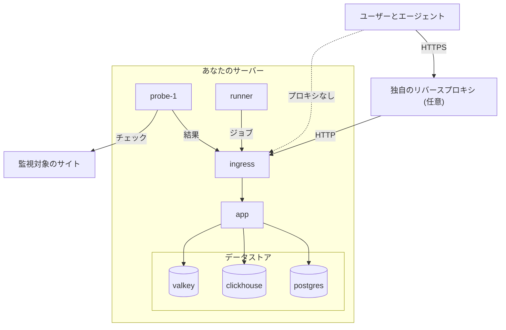

# Docker Compose

Docker Compose を使って、完全で無料の OneUptime インスタンスを 1 台の Linux サーバーで動かします。このページでは、新しいサーバーからインスタンスが動き出すまでを案内し、続いて HTTPS、本番向けの強化、バックアップ、アップデート、削除について説明します。

:::cards
- [OneUptime をインストールする](#oneuptime-をインストールする): 新しいサーバーから最初のアカウントまで 6 ステップ。
- [HTTPS を設定する](#https-を設定する): OneUptime に証明書を取得させるか、自分のプロキシを前に置きます。
- [本番環境のチェックリスト](#本番環境のチェックリスト): 実際のトラフィックが来る前に決めておくこと。
- [OneUptime をアップデートする](#oneuptime-をアップデートする): 最新リリースに移行します。
:::

## 仕組み

Docker Compose は OneUptime の各部分をサーバー上のコンテナーとして実行します。すべてのトラフィックは `ingress` コンテナーから入り、`app` にルーティングされます。アプリはデータを PostgreSQL、ClickHouse、Valkey に保存します。同梱のプローブがモニターのチェックを実行し、結果を ingress 経由で報告します。



| サービス | イメージ | 役割 |
| --- | --- | --- |
| `ingress` | `oneuptime/nginx` | ポート 80 と 443 ですべてのトラフィックを受け、アプリにルーティングします。OneUptime が証明書を管理する場合は HTTPS を提供します。 |
| `app` | `oneuptime/app` | ダッシュボード、API、ステータスページ、テレメトリの取り込み、バックグラウンドワーカー。 |
| `probe-1` | `oneuptime/probe` | モニターのチェックを実行するグローバルプローブ。ホストのネットワークを使います。 |
| `runner` | `oneuptime/runner` | AI によるコード修正を実行する、インスタンスの Runner。ホストのネットワークを使います。 |
| `postgres` | `postgres:15` | 設定と状態: モニター、インシデント、ユーザー。`postgres` ボリュームに保存されます。 |
| `clickhouse` | `clickhouse/clickhouse-server:26.7` | テレメトリ: ログ、メトリクス、トレース、例外。`clickhouse` ボリュームに保存されます。 |
| `valkey` | `valkey/valkey:9.1-alpine` | キャッシュとキュー。ディスクには何も保存しません。 |

> [!NOTE]
> `valkey` サービスは、Redis 7.2 の BSD ライセンスのフォークである [Valkey](https://valkey.io) を実行し、`config.env` の `VALKEY_*` 設定で構成します。Redis プロトコルを話すサーバーならどれでも動作します。必要ならマネージド Redis に `VALKEY_HOST` を向けてください。これらの設定は 13.0.0 までは `REDIS_*` という名前でした。古い名前も引き続き読み込まれ、コンテナーは引き続きホスト名 `redis` にも応答し、`npm run update` はそれらを書き換えないため、古い `config.env` を編集する必要はありません。

大規模な本番環境や高可用性が必要な場合は、代わりに Kubernetes で [Helm チャート](https://artifacthub.io/packages/helm/oneuptime/oneuptime) を使ってください。Docker Compose は 1 台のサーバーで各サービスを 1 つずつ実行します。

## 要件

サーバーのサイズは、そこで何を動かすかで選びます。メモリとディスクを左右するのはテレメトリ (ログ、メトリクス、トレース) です。データ量がわかったら [サイジングとキャパシティプランニング](/docs/installation/sizing) を参照してください。

| | 推奨 | ホームラボの最小構成 |
| --- | --- | --- |
| **メモリ** | 16 GB | 8 GB |
| **CPU** | 8 コア | 4 コア |
| **ディスク** | 400 GB | 20 GB |
| **システム** | Ubuntu 22.04、または Debian、Ubuntu、RHEL ベースの Linux | 同じ |
| **アーキテクチャ** | x86-64 (`amd64`) または ARM (`arm64`) | 同じ |

ホームラボの最小構成は、個人利用や実験向けです。Raspberry Pi で OneUptime を動かしているユーザーもいます。

ほかにも次のものが必要です。

- **Docker** と **Docker Compose v2** プラグイン (`docker compose` コマンド)。
- **Git**。OneUptime の取得に使います。
- **Node.js と npm**。Docker Compose をラップする `npm start` と `npm run update` スクリプトを実行します。
- **空いているポート 80 と 443**。下の表に、OneUptime がホストで使うすべてのポートを示します。

| ホストのポート | 使用元 | 設定 | 用途 |
| --- | --- | --- | --- |
| 80 | `ingress` | `ONEUPTIME_HTTP_PORT` | ダッシュボード、API、テレメトリの取り込み、Let's Encrypt の検証。 |
| 443 | `ingress` | `STATUS_PAGE_HTTPS_PORT` | OneUptime が証明書を管理する場合のインスタンスの HTTPS、およびカスタムドメインのステータスページとダッシュボード。 |
| 5400 | `postgres` | `docker-compose.yml` で設定 | `npm run backup` が PostgreSQL に到達するためのもの。インターネットには閉じておいてください。 |
| 3874 | `probe-1` | `GLOBAL_PROBE_1_PORT` | プローブ自身のサーバー。サーバーの外からは必要ありません。 |
| 3876 | `runner` | `ONEUPTIME_RUNNER_PORT` | Runner 自身のサーバー。サーバーの外からは必要ありません。 |

インストールの [動画ウォークスルー](https://youtu.be/j1SWmMW2oL4) もあります。

## OneUptime をインストールする

:::steps
### release ブランチをクローンする

`release` ブランチには最新リリースのファイルが入っています。

```bash
git clone --depth 1 --single-branch --branch release https://github.com/OneUptime/oneuptime.git
cd oneuptime
```

### config.env を作成する

OneUptime の設定はすべて `config.env` にあります。サンプルから始めます。

```bash
cp config.example.env config.env
```

### ホスト名を設定する

`config.env` を開き、`HOST` に OneUptime へのアクセスに使うドメイン名または IP アドレスを `http://` なしで設定します。`localhost` のままにするのは、自分のコンピューターで OneUptime を試す場合だけにしてください。

```ini title="config.env"
HOST=oneuptime.example.com
```

### ランダムなシークレットを生成する

サンプルファイルには、GitHub で公開されているプレースホルダーのシークレットが入っています。それぞれを独自のランダムな値に置き換えます。

```bash
while grep -q "please-change-this-to-random-value" config.env; do
  sed -i "0,/please-change-this-to-random-value/{s/please-change-this-to-random-value/$(openssl rand -hex 32)/}" config.env
done
grep -c "please-change-this" config.env
```

最後のコマンドが `0` を出力すれば、プレースホルダーは残っていません。ループは GNU `sed` を使い、これはどの Linux サーバーにもあります。埋められる設定は次のとおりです。

| 設定 | 保護するもの |
| --- | --- |
| `ONEUPTIME_SECRET` | OneUptime の内部サービス間の呼び出し。 |
| `ENCRYPTION_SECRET` | OneUptime が保存するシークレット (統合のトークンや SMTP パスワードなど) と、発行するサインイントークン。 |
| `DATABASE_PASSWORD`、`CLICKHOUSE_PASSWORD`、`VALKEY_PASSWORD` | 3 つのデータストア。 |
| `REGISTER_PROBE_KEY` | インスタンスへのプローブの登録。 |
| `GLOBAL_PROBE_1_KEY`、`GLOBAL_PROBE_2_KEY` | Docker Compose が実行できるグローバルプローブ (デフォルトでは `probe-1` が動きます)。 |
| `ONEUPTIME_RUNNER_KEY` | 同梱の Runner。 |

> [!IMPORTANT]
> シークレットは最初の起動前に設定し、その後は変えないでください。PostgreSQL はデータベースを作成するときにしかパスワードを受け取りません。また、あとから `ENCRYPTION_SECRET` を変えると、古い値で暗号化されたものはすべて読めなくなります。

### OneUptime を起動する

:::tabs
@tab npm
```bash
npm start
```
@tab Docker CLI
```bash
(export $(grep -v '^#' config.env | xargs) && docker compose up --remove-orphans -d)
```
:::

最初の起動には数分かかります。Docker がイメージをダウンロードし、OneUptime がデータベースを作成するためです。`npm start` はすべての部分が応答するまで待ち、最後に **OneUptime is up!** と表示して終了します。

### 最初のアカウントを作成する

`http://` に続けて `HOST` を開き (例: `http://localhost`)、サインアップします。新しいインスタンスの最初のアカウントはマスター管理者になり、`/admin` で Admin Dashboard を開けます。

ページにアクセスできる人は誰でも、あなたのあとにサインアップできます。それを止めるには、Admin Dashboard を開いて **設定 > 認証** に移動し、 **サインアップを許可** をオフにします。プロジェクトに招待した人は引き続きアカウントを作成できます。
:::

## HTTPS を設定する

OneUptime は、HTTPS を追加する 2 つの方法のどちらかを選ぶまで、通常の HTTP で提供します。

| | OneUptime に証明書を取得させる | 独自のリバースプロキシを使う |
| --- | --- | --- |
| **TLS の終端** | OneUptime の `ingress`。無料の Let's Encrypt 証明書を自分で更新します | あなたのプロキシ: Caddy、Nginx、またはロードバランサー |
| **必要なもの** | サーバーを指す公開ドメイン名と、インターネットから到達できるポート 80 と 443 | プロキシと、ドメインの証明書 |
| **設定** | `PROVISION_SSL=true`、`HTTP_PROTOCOL=https` | `PROVISION_SSL=false`、`HTTP_PROTOCOL=https`、`TRUSTED_PROXY_HOPS=2` |
| **カスタムドメインのステータスページ** | 追加の設定なしで動作します | プロキシがそのドメインも提供する必要があります |

ステータスページやダッシュボードをカスタムドメインに置く場合は、OneUptime に TLS を任せるほうが簡単です。ingress がそれらのドメインの証明書を自分で注文し、提供します。

### OneUptime に証明書を取得させる

:::steps
#### ドメインをサーバーに向ける

ドメインの DNS `A` レコード (IPv6 の場合は `AAAA`) を作成し、値にサーバーの公開 IP アドレスを設定します。

#### 証明書の取得をオンにする

`config.env` に次の値を設定します。

```ini title="config.env"
HOST=oneuptime.example.com
PROVISION_SSL=true
HTTP_PROTOCOL=https
```

`HOST` はドメイン名である必要があります。OneUptime は IP アドレスや `localhost` の証明書は取得できません。

#### 新しい設定で再起動する

```bash
npm start
```

#### HTTPS でインスタンスを開く

`https://oneuptime.example.com` を開きます。OneUptime は起動時に証明書を注文し、その後は 1 時間ごとに確認して、残りが 30 日を切ると更新します。最初の証明書が届くまで (通常は数分以内)、ingress は一時的な自己署名証明書を提供し、ブラウザーが警告を表示します。
:::

### 独自のリバースプロキシを使う

この手順では、OneUptime と同じサーバーでプロキシを実行します。プロキシが別のマシンで動いている場合は最初の手順を飛ばし、このサーバーのポート 80 にプロキシを向けてください。

:::steps
#### ingress をポート 80 と 443 から移す

プロキシがポート 80 と 443 を使うので、ingress を別のポートに移します。プローブと Runner はホストのネットワークを使い、`http://localhost` 経由で OneUptime に到達するため、一緒に移ります。

```ini title="config.env"
ONEUPTIME_HTTP_PORT=8080
STATUS_PAGE_HTTPS_PORT=8443
GLOBAL_PROBE_1_ONEUPTIME_URL=http://localhost:8080
ONEUPTIME_RUNNER_ONEUPTIME_URL=http://localhost:8080
```

#### プロキシの背後にあることを OneUptime に伝える

```ini title="config.env"
HOST=oneuptime.example.com
HTTP_PROTOCOL=https
PROVISION_SSL=false
TRUSTED_PROXY_HOPS=2
```

`HTTP_PROTOCOL=https` を設定すると、OneUptime が作るリンクが HTTPS になります。`TRUSTED_PROXY_HOPS=2` はあなたのプロキシと OneUptime の ingress を数えるので、OneUptime は IP 許可リストとレート制限に訪問者の実際のアドレスを使います。CDN やロードバランサーなど、`X-Forwarded-For` に追記するプロキシがほかにもあれば、その分だけ 1 ずつ増やしてください。

#### 新しいポートで OneUptime を再起動する

```bash
(export $(grep -v '^#' config.env | xargs) && docker compose up --remove-orphans -d)
bash Tests/Scripts/status-check.sh localhost:8080
```

`npm start` はポート 80 の `http://localhost` を確認しますが、そこにはプロキシが入るので、新しいポートは自分で確認してください。スクリプトは最後に **OneUptime is up!** と表示して終了します。

#### プロキシを構成する

:::tabs
@tab Caddy
```text title="Caddyfile"
oneuptime.example.com {
	reverse_proxy localhost:8080
}
```
Caddy は証明書を自分で取得・更新し、HTTP を HTTPS にリダイレクトし、WebSocket 接続を通します。ファイルを変更したら、`sudo systemctl reload caddy` などで Caddy を再読み込みしてください。
@tab Nginx
```nginx title="/etc/nginx/conf.d/oneuptime.conf"
map $http_upgrade $oneuptime_connection_upgrade {
    default upgrade;
    ""      close;
}

server {
    listen 80;
    server_name oneuptime.example.com;
    return 301 https://$host$request_uri;
}

server {
    listen 443 ssl;
    server_name oneuptime.example.com;

    ssl_certificate     /etc/letsencrypt/live/oneuptime.example.com/fullchain.pem;
    ssl_certificate_key /etc/letsencrypt/live/oneuptime.example.com/privkey.pem;

    # The limits OneUptime's own ingress uses.
    client_max_body_size 50M;
    proxy_read_timeout 300s;
    proxy_send_timeout 300s;

    proxy_http_version 1.1;
    proxy_set_header Host $host;
    proxy_set_header X-Forwarded-For $proxy_add_x_forwarded_for;
    proxy_set_header X-Forwarded-Proto $scheme;
    proxy_set_header Upgrade $http_upgrade;
    proxy_set_header Connection $oneuptime_connection_upgrade;

    location / {
        proxy_pass http://127.0.0.1:8080;
    }

    # MCP clients keep a stream open.
    location /mcp {
        proxy_pass http://127.0.0.1:8080;
        proxy_buffering off;
        proxy_read_timeout 86400s;
        proxy_send_timeout 86400s;
    }
}
```
証明書のパスは、Certbot が Let's Encrypt 証明書を置く場所です。証明書をほかから入手した場合は、そのパスを使ってください。`sudo nginx -t && sudo systemctl reload nginx` でファイルを確認し、Nginx を再読み込みします。
:::

#### プロキシ経由でインスタンスを開く

`https://oneuptime.example.com` を開きます。プロキシの証明書で提供された OneUptime のサインインページが表示されるはずです。
:::

> [!NOTE]
> 独自のプロキシの背後では、テレメトリを OTLP/HTTP (`/otlp`) で送信してください。gRPC による OTLP が OneUptime に届くのは、OneUptime 自身の ingress が TLS を終端する場合 (`PROVISION_SSL=true`) だけです。

## 本番環境のチェックリスト

Docker Compose は 1 台のサーバーで各サービスを 1 つずつ実行するため、小規模なチームやホームラボに向いています。本番で使う前に、このリストを確認してください。

| 項目 | やること |
| --- | --- |
| **シークレット** | `config.env` に `please-change-this-to-random-value` のプレースホルダーが残っていない。 [ランダムなシークレットを生成する](#ランダムなシークレットを生成する) を参照してください。 |
| **HTTPS** | OneUptime に HTTPS でアクセスでき、`HTTP_PROTOCOL=https` が設定されている。 [HTTPS を設定する](#https-を設定する) を参照してください。 |
| **サインアップ** | チームのアカウントがそろったら、Admin Dashboard の **設定 > 認証** で **サインアップを許可** をオフにする。 |
| **ファイアウォール** | インターネットに開いているのはポート 80 と 443 (と SSH) だけ。PostgreSQL はバックアップのためにポート 5400 で公開されています。`ufw` のルールは Docker が公開するポートには適用されないため、クラウドプロバイダーのファイアウォールで閉じてください。 |
| **バックアップ** | PostgreSQL を毎日バックアップし、コピーをサーバーの外に置く。 [バックアップと復元](#バックアップと復元) を参照してください。 |
| **メール** | OneUptime が招待と通知を送れるよう、Admin Dashboard の **設定 > 通知 > メール** でメールサーバーを設定する。 [SMTP](/docs/emails/smtp) を参照してください。 |
| **ディスク** | 空き容量を監視する。ClickHouse は保持するテレメトリに応じて大きくなります ( [サイジングとキャパシティプランニング](/docs/installation/sizing) を参照)。各コンテナーのログは 1000 MB が上限です。 |
| **アップデート** | OneUptime を少なくとも週に 1 回アップデートする。リリースは頻繁に出ます。 [OneUptime をアップデートする](#oneuptime-をアップデートする) を参照してください。 |
| **高可用性** | 必要なら、Kubernetes の [Helm チャート](https://artifacthub.io/packages/helm/oneuptime/oneuptime) に移行する。 |

## バックアップと復元

PostgreSQL には、モニター、インシデント、ステータスページ、ユーザーなど、設定したものがすべて入っています。`npm run backup` はそれを `Backups` フォルダーのファイルにダンプします。

:::steps
### バックアップスクリプトにデータベースのパスワードを渡す

`config.env` で、`DATABASE_BACKUP_PASSWORD` に `DATABASE_PASSWORD` の値を設定します。スクリプトは `config.env` をプレーンテキストとして読むため、同梱の `${DATABASE_PASSWORD}` が置き換えられることはありません。

### バックアップを実行する

```bash
npm run backup
```

sudo のパスワードを求められ、`Backups/db-<day of the month>.backup` が書き込まれます。そのため、毎日のバックアップは 1 か月前のものを置き換えます。少なくとも 1 日 1 回は実行してください。

### バックアップをサーバーの外にコピーする

データベースと同じディスクにあるバックアップは、そのディスクが失われると一緒に失われます。
:::

ClickHouse はテレメトリを Docker ボリューム `oneuptime_clickhouse` に保存しており、これをバックアップするスクリプトはありません。そのテレメトリを残す必要がある場合は、[clickhouse-backup](https://github.com/Altinity/clickhouse-backup) などの ClickHouse ツールでボリュームをバックアップするか、OneUptime を停止してからコピーしてください。

PostgreSQL を復元するには、`config.env` で `DATABASE_RESTORE_*` の値を設定します。`DATABASE_RESTORE_PASSWORD` にはバックアップのときと同じく `DATABASE_PASSWORD` の値を、`DATABASE_RESTORE_FILENAME` には復元するバックアップ (例: `db-31.backup`) を設定します。続いて `bash restore.sh` を実行します。復元先のデータベースはすでに存在している必要があります。稼働中のインストールであれば存在します。

> [!CAUTION]
> `restore.sh` は、バックアップに含まれる各オブジェクトを復元先のデータベースから削除してから作り直します。開始前に確認を求めるので、表示されるデータベース名を確かめてください。

## OneUptime をアップデートする

まずバックアップを取り、次に以下を実行します。

```bash
git checkout release
git pull
npm run update
```

`npm run update` は sudo のパスワードを求め、`config.example.env` の新しい設定を `config.env` に追加し (独自の値はそのまま残ります)、新しいイメージを取得して OneUptime を再起動します。`npm start` と同様に、最後に **OneUptime is up!** と表示して終了します。

新しいメジャーバージョンへの移行 (たとえば 13 から 14) では、さらに作業が必要な場合があります。始める前に [OneUptime のアップグレード](/docs/installation/upgrading) を読んでください。

`config.env` の `APP_TAG=release` は、常に Community Edition の最新リリースを取得します。特定のバージョンにとどまるには、`APP_TAG` にその番号 (例: `14.0.22`) を設定します。Enterprise Edition のタグは `enterprise-release` と `enterprise-14.0.22` です。

## OneUptime をアンインストールする

OneUptime を停止し、コンテナーとネットワークを削除します。

```bash
npm run down
```

データは `oneuptime_postgres` と `oneuptime_clickhouse` のボリュームに残り、`oneuptime` フォルダーには `config.env` とバックアップが残ります。データも削除するには次を実行します。

```bash
(export $(grep -v '^#' config.env | xargs) && docker compose down --volumes --remove-orphans)
```

その後、`oneuptime` フォルダーを削除します。

> [!CAUTION]
> `--volumes` は、すべてのモニター、インシデント、ユーザー、テレメトリを完全に削除します。どれかが必要になる可能性があるなら、先にバックアップを取ってください。

## トラブルシューティング

:::details npm start を実行すると Docker が "permission denied" と表示する
ユーザーが Docker デーモンにアクセスできません。ユーザーを `docker` グループに追加し、サインアウトしてからサインインし直します。

```bash
sudo usermod -aG docker $USER
```
:::

:::details ポート 80 または 443 が使用中で ingress が起動できない
サーバー上の別のプログラム (多くの場合は Web サーバー) がポートを使っています。そのプログラムを停止するか、ingress を別のポートに移し、 [独自のリバースプロキシを使う](#独自のリバースプロキシを使う) の説明どおりにそのプログラムを OneUptime の前に置きます。
:::

:::details npm start が "Maximum retries reached" で終了する
`npm start` の最後のチェックが、OneUptime が応答する前にあきらめました。イメージのダウンロードとデータベースの作成が進む最初の起動では、チェックの待ち時間より長くかかることがあります。何が動いているかを確認し、ログを読みます。

```bash
npm run ps
npm run logs
```

すべてのコンテナーが動いたら、`npm run status-check` でもう一度チェックします。ingress をポート 80 から移した場合は、代わりに新しいポートを確認します: `bash Tests/Scripts/status-check.sh localhost:8080`。
:::

:::details 一部のページは表示されるが、ライブ更新やアップロードが失敗する
`HOST` のアドレスで OneUptime を開いてください。ingress はホスト名でリクエストをルーティングします。アプリケーション全体に到達するのは `HOST` と `localhost` だけで、サーバーの IP アドレスなどそれ以外の名前はステータスページのドメインとして扱われます。`HOST` を実際に使う名前に設定し、`npm start` を実行してください。
:::

:::details PROVISION_SSL を設定したあと、ブラウザーが証明書について警告する
Let's Encrypt が証明書を発行するまで、ingress は一時的な自己署名証明書を提供します。数分たっても警告が消えない場合は、次を確認します。

- `HOST` が IP アドレスや `localhost` ではなく、ドメイン名であること。
- ドメインの DNS レコードがこのサーバーを指していること。
- Let's Encrypt がドメインを検証できるよう、ポート 80 にインターネットから到達できること。

注文が失敗すると、アプリは `CoreSSL:EnsurePrimaryHostCertificate` で始まり、理由が続くエラーをログに記録します。

```bash
(export $(grep -v '^#' config.env | xargs) && docker compose logs app) | grep -A 5 CoreSSL
```
:::

:::details ingress のポートを移したあと、同梱のプローブが切断済みと表示される
Admin Dashboard は **設定 > 監視 > グローバルプローブ** でプローブを表示します。プローブは `GLOBAL_PROBE_1_ONEUPTIME_URL` で OneUptime に到達し、その値はデフォルトで `http://localhost` (ポート 80) です。これを ingress の新しいポート (例: `http://localhost:8080`) に設定し、`ONEUPTIME_RUNNER_ONEUPTIME_URL` も同じように設定してから OneUptime を再起動します。
:::

## 次のステップ

:::cards
- [OneUptime のアップグレード](/docs/installation/upgrading): 各メジャーバージョンで必要な作業。
- [サイジングとキャパシティプランニング](/docs/installation/sizing): テレメトリに必要なメモリとディスクを計画します。
- [セルフホストのアーキテクチャ](/docs/self-hosted/architecture): コンポーネントの組み合わさり方。
- [エンタープライズ版](/docs/self-hosted/enterprise): Enterprise イメージで追加されるものと、そのライセンス。
:::
