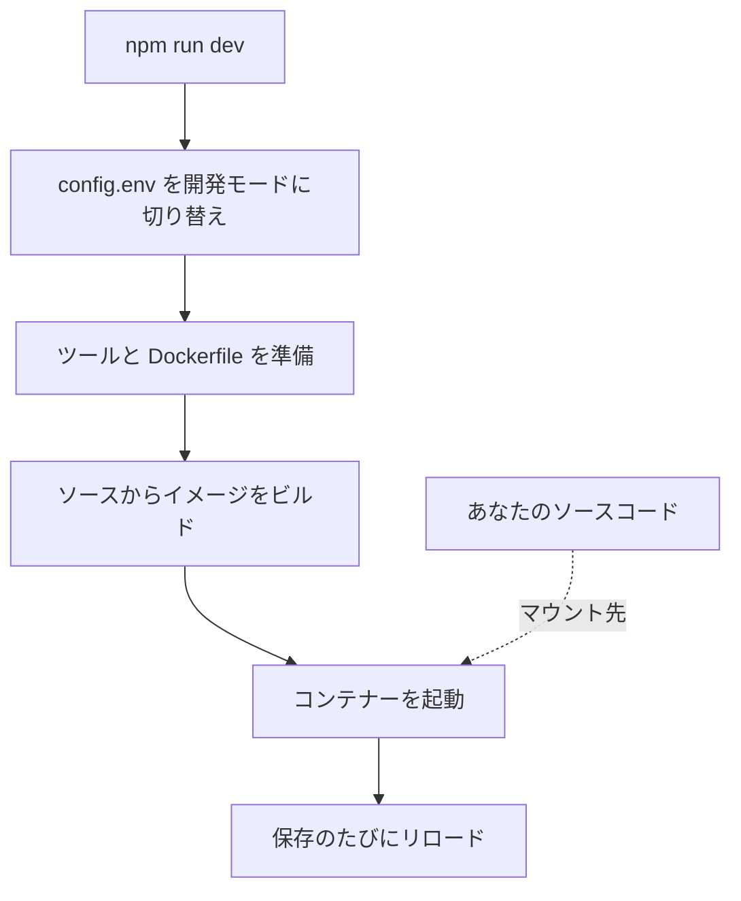

# ローカル開発

OneUptime をソースコードから自分のコンピューターで実行し、開発に取り組みます。開発スタックは、チェックアウトしたコードからすべてのサービスをビルドし、ソースコードをコンテナーにマウントして、ファイルを保存するたびにリロードします。

リリース済みのバージョンを実行する場合は、[Docker Compose](/docs/installation/docker-compose) を使用してください。

## 開発スタックの仕組み

`npm run dev` はチェックアウトを準備してから、`Scripts/Dev/docker-compose.dev.yml` で定義されたスタックを起動します。



| 段階 | 処理内容 |
| --- | --- |
| 開発モードへの切り替え | `config.env` に `ENVIRONMENT=development` を設定します。 |
| 準備 | sudo パスワードを尋ね、不足しているツール (Git、curl、Node.js、Docker、gomplate、ts-node) をインストールし、現在のブランチで `git pull` を実行し、`config.example.env` の新しい設定を `config.env` に追加して、すべての `Dockerfile.tpl` から `Dockerfile` を生成します。 |
| ビルド | サービスごとにソースからイメージをビルドします。最初のビルドには時間がかかります。 |
| 実行 | ソースコードをマウントした状態でコンテナーを起動します。 |
| リロード | App はサーバーのファイルが変わると API を再起動し、編集に合わせてダッシュボードを再ビルドします。 |

リポジトリに `ee/` フォルダーがある場合、App はそこから Enterprise Edition を読み込みます。代わりに Community Edition を実行するには、`config.env` に `ONEUPTIME_EDITION=community` を設定します。

## 始める前に

| 必要なもの | 補足 |
| --- | --- |
| **Docker** | macOS と Windows では Docker Desktop、Linux では Docker Compose v2 プラグイン付きの Docker Engine。 |
| **Node.js 26 以降と npm** | リポジトリの `package.json` が求めるバージョンで、CI でも使われています。 |
| **Git** | リポジトリのクローンに使います。 |
| **sudo 権限** | `npm run dev` は何かをインストールする前にパスワードを尋ねます。 |
| **空いているポート 80 と 443** | スタックは `http://localhost` (ポート 80) で OneUptime を提供し、ポート 443 で HTTPS を提供します。 |

## 開発スタックを起動する

:::steps
### リポジトリをクローンする

```bash
git clone https://github.com/OneUptime/oneuptime.git
cd oneuptime
```

### config.env を作成する

```bash
cp config.example.env config.env
```

サンプルの値は開発用にそのまま使えます。変更してもかまいませんが、必須ではありません。

### スタックを起動する

```bash
npm run dev
```

sudo パスワードを尋ねたあと、イメージをビルドしてコンテナーをバックグラウンドで起動します。App の起動は `docker logs -f oneuptime-app-1` で確認できます。

### OneUptime を開く

`http://localhost` を開いてサインアップします。最初のアカウントがマスター管理者になり、`http://localhost/admin` で Admin Dashboard を開けます。
:::

## コードに取り組む

`packages/` 以下のファイルを編集して保存すると、コンテナーが変更を取り込みます。

プルリクエストを作成する前に、コンテナーの外、つまり自分のコンピューター上で変更を確認します。そのための依存関係は一度だけインストールします。リポジトリのルートで `npm install` を実行し (ESLint とマイグレーションツール用)、次に `npm run install-modules` を実行します。これはすべてのパッケージの `node_modules` を削除して再インストールするため、時間がかかります。

:::steps
### 変更した部分をコンパイルする

変更したパッケージごとにコンパイラーを実行します。たとえば App の場合:

```bash
cd packages/App
npm run compile
```

### 自分のファイルだけを lint する

リポジトリのルートから、変更したファイルを指定します。

```bash
npx eslint --fix packages/App/path/to/File.ts
```

`npm run lint` と `npm run fix-lint` は使わないでください。リポジトリ全体を lint します。

### 変更に関係するテストを実行する

パッケージのディレクトリで、スイート全体ではなく関係するテストファイルを実行します。

```bash
cd packages/App
npx jest Tests/path/to/YourChange.test.ts
```
:::

### データベースのマイグレーション

| データベース | マイグレーションの追加方法 |
| --- | --- |
| PostgreSQL | モデルを変更し、マイグレーションを手で書かずに `npm run generate-postgres-migration` を実行します。新しいファイルを `packages/Common/Server/Infrastructure/Postgres/SchemaMigrations/Index.ts` に登録してください。登録するまで実行されません。`npm run check-postgres-schema-drift` は、まだ足りないステートメントを表示します。 |
| ClickHouse | 既存のものにならい、`packages/App/FeatureSet/Workers/DataMigrations` にマイグレーションを手で書きます。 |

## リファレンス

### コマンド

これらはリポジトリのルートで実行します。

| 目的 | コマンド |
| --- | --- |
| スタックを起動する、または `config.env` の変更を反映する | `npm run dev` |
| 依存関係を変更したあとにイメージを再ビルドする | `npm run build` のあと `npm run dev` |
| イメージを一から再ビルドする | `npm run force-build-dev` のあと `npm run dev` |
| 実行中のコンテナーを一覧表示する | `docker ps` |
| 1 つのサービスのログを追う | `docker logs -f oneuptime-app-1` |
| スタックを停止してコンテナーを削除する | `npm run down` |

`npm run down` はデータを残します。PostgreSQL と ClickHouse のボリュームは削除されません。

### ポート

開発スタックはデータストアを公開するため、自分のツールで接続できます。パスワードは `config.env` にあります。

| サービス | アドレス | サインイン情報 |
| --- | --- | --- |
| OneUptime | `http://localhost` | 作成したアカウント |
| PostgreSQL | `localhost:5400` | ユーザー `postgres`、データベース `oneuptimedb`、パスワード `DATABASE_PASSWORD` |
| ClickHouse | `localhost:8189` (HTTP)、`localhost:9034` (ネイティブ) | ユーザー `default`、データベース `oneuptime`、パスワード `CLICKHOUSE_PASSWORD` |
| Valkey | `localhost:6310` | パスワード `VALKEY_PASSWORD` |

## トラブルシューティング

:::details npm run dev が git pull で止まる
`npm run dev` はビルドの前に現在のブランチで `git pull` を実行します。アップストリームのないブランチや、pull によってコミットしていない変更が上書きされる場合、Git は実行を拒否します。ブランチのアップストリームを設定する (たとえば `git push -u origin <branch>` でプッシュする) か、作業をコミットしてから、もう一度 `npm run dev` を実行してください。
:::

:::details npm run dev がツールのインストール中に止まる
そのツール (たとえば gomplate や ts-node) を自分でインストールし、もう一度 `npm run dev` を実行してください。インストール済みのツールはすべてスキップされます。
:::

:::details 依存関係を変更したあとにサービスが失敗する
イメージにはまだ古い依存関係が入っています。`npm run build` で再ビルドしてから、`npm run dev` でスタックを再起動してください。それでも解決しない場合は、`npm run force-build-dev` で一から再ビルドします。
:::

:::details ポート 80 または 443 がすでに使われている
コンピューター上の別のプログラム (多くはローカルの Web サーバー) がそのポートを使っています。そのプログラムを停止してから、もう一度 `npm run dev` を実行してください。
:::

## 次のステップ

:::cards
- [セルフホストのアーキテクチャ](/docs/self-hosted/architecture): 起動したサービスがどのように連携するか。
- [Docker Compose](/docs/installation/docker-compose): リリース済みのバージョンをサーバーで実行します。
- [API リファレンス](/docs/api-reference/api-reference): ローカルインスタンスの API を呼び出します。
:::
