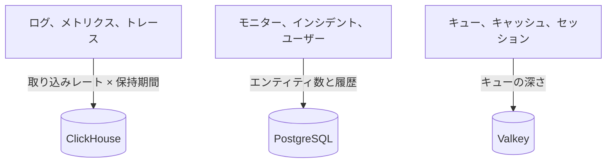

# サイジングとキャパシティプランニング

[Helm チャート](https://artifacthub.io/packages/helm/oneuptime/oneuptime)を使って Kubernetes 上でセルフホストする OneUptime の CPU、メモリ、ディスクを計画します。3 つのデータストア (**ClickHouse**、**PostgreSQL**、**Valkey**) とアプリケーションを別々にサイジングし、下のいずれかの段階から始めて、実際の数値が得られたら調整してください。

> [!IMPORTANT]
> チャートのデフォルト値は本番向けのサイジングではありません。デフォルトで動くサービスには **CPU とメモリのリクエストもリミットも設定されておらず**、PostgreSQL と ClickHouse には **25 Gi** の小さなボリュームしか割り当てられません。これはどのクラスターにもインストールできるようにするためです。試用を超える用途では、このページの数値を使ってリソースとストレージを自分で設定してください。

代わりに 1 台のサーバーで Docker Compose を使ってインストールしている場合は、サイジングはもっと簡単です。[要件](/docs/installation/docker-compose#要件)を参照してください (推奨はメモリ 16 GB、8 コア、ディスク 400 GB)。

:::cards
- [各データストアを大きくする要因](#各データストアを大きくする要因): 3 つのストアは、それぞれ別のものに応じて大きくなります。
- [開始時の段階](#開始時の段階): 小・中・大の出発点。
- [高可用性](#高可用性): 各データストアのレプリカとフェイルオーバー。
- [保持期間](#保持期間とストレージへの影響): ディスクを何倍にもする設定。
:::

## インストールをサイジングする

:::steps
1. 送信するテレメトリの量、つまり 1 日あたりのログ、メトリクス、トレースの GB 数を把握します。できれば小さなインストールで測定してください。
2. 何日間保持するかを決めます。保持期間は ClickHouse のディスクを何倍にもします ([保持期間](#保持期間とストレージへの影響)を参照)。
3. [ストレージの計算式](#ストレージの計算式)で ClickHouse のディスクを計算し、続いてそれぞれのセクションから PostgreSQL と Valkey の分を見積もります。
4. 自分の数値に最も近い[開始時の段階](#開始時の段階)を選び、その CPU、メモリ、ストレージを Helm の values に設定します。
5. 必要なデータストアで[高可用性](#高可用性)を有効にし、実際の使用状況を見ながら調整します。
:::

## 各データストアを大きくする要因

OneUptime を本番で動かすには 3 つのデータストアが必要です。それぞれ別のものに応じて大きくなるので、個別にサイジングしてください。



| データストア | 保存するもの | サイズを決めるもの |
| --- | --- | --- |
| **ClickHouse** | すべてのテレメトリ (ログ、メトリクス、トレース、例外、プロファイル) | テレメトリの **取り込みレート × 保持期間** 。ストレージの約 95% を占め、最大のコストになります。 |
| **PostgreSQL** | 設定と状態 (モニター、インシデント、アラート、ユーザー、チーム、プロジェクト、ワークフロー、ステータスページ、ダッシュボード) | テレメトリの量ではなく、 **エンティティ数と履歴** 。ゆっくり大きくなります。 |
| **Valkey** | キャッシュ、作業キュー、セッション | **キューの深さとアクティブなセッション** 。メモリ依存で控えめです。信頼できる唯一のデータ源ではありません。 |

OneUptime の実行にオブジェクトストレージ (S3、MinIO) が必要になることはなく、古いテレメトリをオブジェクトストレージに移すこともありません。オブジェクトストレージが必要なのは、オブジェクトストレージへのバックアップを選んだ場合だけです。CloudNativePG 用の Barman Cloud プラグイン、または ClickHouse 用の [clickhouse-backup](https://github.com/Altinity/clickhouse-backup) です。チャート自身の CloudNativePG バックアップ (`postgresOperator.cnpg.backup`) はボリュームスナップショットを取得し、オブジェクトストレージを必要としません。CloudNativePG は古いスナップショットを削除しないため、自分で整理してください。そうしないと増え続けます。

## ClickHouse: 最大の要因

ストレージのほぼすべてとメモリの大部分は ClickHouse に使われます。ログの 1 行、メトリクスの各ポイント、トレースの各スパン、各例外がすべてそこに保存されるからです。

### ストレージの計算式

```text
ClickHouse disk ≈ (daily raw telemetry GB ÷ compression) × retention days × replicas × 1.3 (headroom)
```

圧縮率はシグナルによって異なります。

| シグナル | 一般的な圧縮率 | 変動の要因 |
| --- | --- | --- |
| ログ | 約 5:1 | ログはよく圧縮されます。 |
| メトリクス | 約 2:1 | ラベルの **カーディナリティ** が高いと、生の量以上の速さでディスクとメモリが膨らみます。ラベルのカーディナリティは低く保ってください。 |
| トレース | 両者の中間 | 送信するスパン属性によります。 |

### 計算例

**10 個のクラスター** からなるフリートで、各クラスターに約 10 ノードと INFO レベルでログを出す 100 個の Pod があるとすると、おおよそ **クラスターあたり 30 日で 50〜150 GB の生ログ** (クラスターあたり 1 日約 1.7〜5 GB) が生成されます。フリート全体では、メトリクスとトレースを加えて圧縮したあとで、おおよそ **1 日あたり 5〜15 GB の圧縮済みテレメトリ** を見込んでください。

| 保持期間 | レプリカ 1 つ | レプリカ 2 つ + 30% の余裕 |
| --- | --- | --- |
| 30 日 | ~150〜450 GB | **~0.4〜1.2 TB** |
| 90 日 | ~0.45〜1.35 TB | **~1.2〜3.5 TB** |

ストレージは **保持期間に比例して** 増えます。90 日の期間は 30 日の約 3 倍のコストになります。

### メモリとディスクの種類

- **NVMe か SSD を使ってください。** テレメトリは書き込みが多く、集計の読み取りが集中的に発生します。回転ディスク上の ClickHouse では性能が追いつきません。
- **ClickHouse には十分なメモリを割り当ててください。** 集計クエリは大量のメモリを使います。目安として、*ホット*な (最近クエリされた) 圧縮済みデータの 25〜50% のメモリを用意し、本番のフリートでは実用上の下限を 16 GB としてください。
- **メトリクスのカーディナリティを管理してください。** ClickHouse のメモリとディスクの両方に対して、最も効果の大きい要因です。メトリクスを収集する場所で低カーディナリティのラベル規約を徹底し、アクティブな系列の数を監視してください。

## PostgreSQL: 設定と状態

PostgreSQL が保存するのはテレメトリではなく、設定と運用上の状態です。そのため増加はゆっくりで、ClickHouse と比べて小さいままです。大規模なインストールでも、通常は数十 GB 程度に収まります。小規模なインストールならデフォルトの **25 Gi** ボリュームで十分です。大規模な場合は、インシデントとアラートの履歴の余裕を含めて 50〜100 GB を計画してください。

アプリ、ワーカー、プローブのレプリカが多いと、ストレージより先にデータベース接続が足りなくなることがあります。各 Pod はデフォルトで最大 50 の接続を開き、同梱の PostgreSQL は 500 まで許可します。まさにこのために、チャートにはオプションの接続プーラー **PgBouncer** (`pgbouncer.enabled`) が含まれています。レプリカが多いインストールでは有効にしてください。

## Valkey: キャッシュ、キュー、セッション

キャッシュ層では、Redis 7.2 の BSD ライセンスのフォークである [Valkey](https://valkey.io) を、キャッシュ、作業キュー、セッションストアとして実行します。Redis プロトコルのサーバーであれば代わりに使え、以下のサイジングはどちらにも当てはまります。Valkey は **メモリ依存** で、永続化は **デフォルトで無効** です。信頼できる唯一のデータ源ではなく、再構築できます。キューの深さと同時セッション数でサイジングしてください。ほとんどのインストールでは 2〜8 GB のメモリで足ります。エビクションポリシーは `noeviction` なので、持続的な負荷でキューが詰まったときはメモリを監視してください。

## アプリケーションのコンピュート

データストアのほかに、ステートレスなワークロードもサイジングします。いずれも、自分で設定するまでは **リソースのリクエストもリミットもない** 状態で動きます。レプリカは 1 つですが、テレメトリライターだけは 2 つです。

| ワークロード | values のキー | 増える要因 |
| --- | --- | --- |
| App: ダッシュボード、API、取り込み | `app` | ユーザー、API 呼び出し、受信するテレメトリ |
| ワーカー (アプリから分離した場合) | `worker` | テレメトリとバックグラウンドジョブの処理 |
| プローブ | `probes` | アクティブなモニターの数 |
| イングレスゲートウェイ | `nginx` | リクエスト量 |
| テレメトリライター (有効にした場合) | `telemetryWriter` | 負荷では増えません。すべてのテレメトリの挿入を ClickHouse にまとめて送るため、ClickHouse が受け止められる量に合わせてサイジングします |

チャートには **KEDA** が同梱されており、アプリ、ワーカー、プローブ、Runner をキューの滞留に応じてスケールできます。`keda.enabled` と、各サービス自身の `keda.enabled` (たとえば `app.keda.enabled`) をあわせて有効にしてください。まだ KEDA がないクラスターでは、最初のインストールに追加の手順が必要です。チャートの [KEDA ガイド](https://github.com/OneUptime/oneuptime/blob/master/HelmChart/Docs/Keda.md)を参照してください。KEDA が管理しないサービスは、代わりに CPU またはメモリのオートスケーラー (`autoscaling`) を使えます。

## 開始時の段階

自分の環境に最も近い段階を出発点として選び、実際の使用状況 (`kubectl top pods`、ClickHouse と PostgreSQL のディスクの増加) を見て調整します。

- **小規模 / PoC**: 1〜3 クラスター、30 ノード以下、生テレメトリ 1 日 5 GB 以下、保持期間 30 日。
- **中規模 / 本番フリート**: 約 10 クラスター、約 100 ノード、生テレメトリ 1 日 10〜30 GB、保持期間 30〜90 日。
- **大規模 / 複数フリート**: 50 以上のクラスター、500 以上のノード、生テレメトリ 1 日 100 GB 以上、保持期間 90 日。

| | 小規模 / PoC | 中規模 / 本番フリート | 大規模 / 複数フリート |
| --- | --- | --- | --- |
| **ClickHouse** | 4 vCPU / 16 GB / 200 GB NVMe | 8 vCPU / 32 GB / 1〜3 TB NVMe | 16+ vCPU / 64〜128 GB / 5〜15 TB NVMe、 **シャード構成** |
| **PostgreSQL** | 2 vCPU / 4 GB / 50 GB SSD | 4 vCPU / 8 GB / 100 GB SSD | 8 vCPU / 16〜32 GB / 250 GB SSD (+ PgBouncer) |
| **Valkey** | 1 vCPU / 2 GB | 2 vCPU / 4 GB | 4 vCPU / 8〜16 GB |
| **想定する保持期間** | 30 日 | 30〜90 日 | 90 日 |

これらの段階は OneUptime のバックエンドのサイジングです。監視対象の各クラスターにインストールするエージェントについては [Kubernetes エージェント](/docs/telemetry/kubernetes-agent)のページで説明しており、送信するデータ量を減らす方法も紹介しています。

## 高可用性

チャートに組み込まれたデータストアは、デフォルトでは **単一インスタンス** で動きます。本番で高可用性を得るには:

| データストア | 高可用性の構成 |
| --- | --- |
| **PostgreSQL** | 同梱の [CloudNativePG](https://cloudnative-pg.io) オペレーター (`postgresOperator.cnpg.enabled`) を **3 インスタンス** (`postgresOperator.cnpg.instances`) で有効にします。プライマリ 1 つとホットスタンバイ 2 つで、自動フェイルオーバーが働きます。 |
| **ClickHouse** | 同梱の [Altinity](https://github.com/Altinity/clickhouse-operator) オペレーター (`clickhouseOperator.altinity.enabled`) を **シャードあたり 2 つ以上のレプリカ** (`clickhouseOperator.altinity.cluster.replicasCount`) で有効にします。同梱の ClickHouse Keeper は、クォーラムのために **3 ノード** で動きます。1 ノードのディスクやメモリが限界になったら、シャード (`shardsCount`) を追加してください。 |
| **Valkey** | チャートでは複製されません。自動フェイルオーバーのある外部のマネージド Redis または Valkey を OneUptime の接続先に指定します (`externalValkey`)。OneUptime は単一のホストとポートに接続するため、クラスターモードのエンドポイントではなく、サービスのプライマリエンドポイントを使ってください。 |

> [!WARNING]
> 既存のインストールでどちらかのオペレーターを有効にすると、新しい空のデータベースが起動します。どちらも、置き換える単一インスタンスのデータベースのデータをコピーしません。チャートのガイドに従ってデータを移行してください。[PostgreSQL](https://github.com/OneUptime/oneuptime/blob/master/HelmChart/Docs/MigratePostgresStandaloneToOperator.md) 用と [ClickHouse](https://github.com/OneUptime/oneuptime/blob/master/HelmChart/Docs/MigrateClickhouseStandaloneToOperator.md) 用があります。

## 保持期間とストレージへの影響

テレメトリの保持期間は、 **日数で数える ClickHouse の TTL** です。どのエディションにもプロジェクトのデフォルトがあり、 **プロジェクト設定 > テレメトリと APM > データ保持** (**デフォルトの保持期間（日数）**) で設定します。何も設定しない場合は 15 日です。[Enterprise Edition](/docs/self-hosted/enterprise) ではオーバーライドを追加できます。シグナル別 (ログ、トレース、メトリクス、プロファイル)、ログの重大度とトレースのステータス別、サービスやリソース別です。

ログとメトリクスは、保持期間が終わったあとの最初の深夜 0 時 (ClickHouse サーバーの時刻) に 1 日分ずつ削除されます。これにより、期限切れになるまでの間、ClickHouse が数時間ごとに各日のデータを書き直さずに済みます。深夜 0 時の直前には、保持期間より最大 1 日多いデータがまだディスクに残っています。ログとメトリクスは **保持日数 + 1** でサイジングしてください。

保持期間は ClickHouse のストレージを何倍にもするので、ディスクをサイジングする前に決めてください。OneUptime は古いテレメトリをアーカイブすることも、オブジェクトストレージに移すことも **ありません** 。コンプライアンスのために数年間保持する場合は、保持期間を延ばして ClickHouse のストレージをそれに合わせるか、任意の外部アーカイブにエクスポートしてください。

## 決める前に測定する

テレメトリの量は、アプリケーションログの詳細さ、namespace の数、スクレイプ間隔、どこかで DEBUG ログが有効になっているかどうかによって大きく変わります。上の段階は出発点として扱い、 **少なくとも 4 週間は自分の環境からデータを収集し**、シグナルごとに実際の 1 日あたりの GB を測定してから、実データに基づいて保持期間とストレージをサイジングしてください。

## 次のステップ

:::cards
- [Docker Compose](/docs/installation/docker-compose): 1 台のサーバーにインストールする場合の要件。
- [セルフホストのアーキテクチャ](/docs/self-hosted/architecture): コンポーネントがどのように連携するか。
- [Kubernetes エージェント](/docs/telemetry/kubernetes-agent): クラスターのテレメトリを送信するコレクター。
- [Enterprise Edition](/docs/self-hosted/enterprise): 保持期間のオーバーライドとその他の Enterprise 機能。
:::
