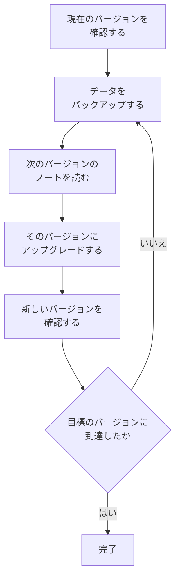

# アップグレード

セルフホスト版の OneUptime インストール（Docker Compose、または Kubernetes と Helm）を新しいバージョンにアップグレードします。以下の手順に従い、現在実行しているバージョンから移行先のバージョンまでの各メジャーバージョンのノートを読んでください。

:::cards
- [アップグレードの方法](#アップグレードの方法): Docker Compose と Kubernetes の手順。
- [各バージョンのノート](#バージョンごとのノートを見つける): 各メジャーバージョンで必要な作業の一覧。
- [Community Edition と Enterprise Edition のイメージ](#community-edition-と-enterprise-edition-のイメージ): 14 以降に実行するイメージ。
- [OneUptime 13 → 14 へのアップグレード](#oneuptime-13-14-へのアップグレード): 最新のメジャーバージョン。
:::

## アップグレードの方法

次の 3 つのルールを守れば、アップグレードを安全に行えます。

- **メジャーバージョンは 1 つずつアップグレードします**（例: 6 → 7 → 8）。メジャーバージョンを飛ばさないでください。
- **マイナーリリースとパッチリリースは自由に飛ばせます**（例: 8.1 → 8.4）。ただし、そのリリースノートに従ってください。
- **アップグレードの前には毎回バックアップを取り**、それを復元できることを確認してください。



:::steps
### 現在のバージョンを確認する

マスター管理者として管理者ダッシュボードのヘッダーにあるエディションラベルを開きます。 **This installation** に実行中のバージョンが表示されます。インスタンスは `/version` でもバージョンを返します。

```bash
curl http://localhost/version
```

`http://localhost` はインスタンスのアドレスに置き換えてください。応答は `{"version":"14.0.22","commit":"..."}` のような JSON です。

### データをバックアップする

PostgreSQL をバックアップし、ClickHouse のテレメトリが必要な場合は ClickHouse もバックアップします。Docker Compose の場合は [バックアップと復元](/docs/installation/docker-compose#バックアップと復元) を参照してください。Kubernetes では、ボリュームのスナップショットか、チャートの CloudNativePG バックアップを使います。

### 次のメジャーバージョンのノートを読む

ノートは [下の表](#バージョンごとのノートを見つける) にあります。アップグレードの前に、ノートで求められている作業を行ってください。Helm の値の名前変更など、一部の手順は先に行う必要があります。

### アップグレードを実行する

:::tabs
@tab Docker Compose
```bash
git checkout release
git pull
npm run update
```
`npm run update` は、既存の設定を変更せずに新しい設定を `config.env` に追加し、新しいイメージを取得して OneUptime を再起動します。
@tab Kubernetes
```bash
helm repo update
helm upgrade my-oneuptime oneuptime/oneuptime -f values.yaml
```
リリース名と値ファイルは自分のものを使ってください。チャートは、新しい Pod がトラフィックを処理する前に、専用の Job でデータベースのマイグレーションを実行します。
:::

### 新しいバージョンを確認する

Docker Compose では、`npm run update` は **OneUptime is up!** と表示して終了します。Kubernetes では、すべての Pod が `Running` になり準備完了になるまで待ちます。

```bash
kubectl get pods -n <namespace>
```

その後、最初の手順と同じようにバージョンをもう一度確認します。まだ目標のバージョンに達していない場合は、[データをバックアップする](#データをバックアップする) に戻って次のメジャーバージョンに進みます。
:::

### バージョンごとのノートを見つける

| アップグレード | 必要な作業 |
| --- | --- |
| [13 → 14](#oneuptime-13-14-へのアップグレード) | エディションを選びます。`IS_ENTERPRISE_EDITION=true` を設定している Docker Compose のインストールは `APP_TAG=enterprise-release` に切り替えます。Enterprise Edition ではライセンスを有効化します。IPv6 の Ping、Port、SSL モニターを保存し直します。 |
| [12 → 13](#oneuptime-12-13-へのアップグレード) | 通常は何もありません。Redis は Valkey に置き換わり、古い設定名も引き続き使えます。Docker Compose を手動で実行していますか？ `--remove-orphans` を追加してください。独自のキャッシュを使っていますか？ [独自のキャッシュを運用している場合](#独自のキャッシュを運用している場合) を読んでください。 |
| [11 → 12](#oneuptime-11-12-へのアップグレード) | Runbook Agent を Runner として再デプロイします。Docker Compose では `ONEUPTIME_RUNNER_KEY` を設定します。Helm では `aiAgent:` を `runner:` に名前変更します。API キーに直接付与されていた Runner の権限を付与し直します。 |
| [10 → 11](#oneuptime-10-11-へのアップグレード) | SCIM とチームのコンプライアンス設定には Enterprise Edition が必要です。テレメトリの履歴を残すには、アップグレードの前に古い ClickHouse テーブルの名前を変更します。 |
| [9 → 10](#oneuptime-9-10-へのアップグレード) | 何もありません。 |
| [8 → 9](#oneuptime-8-9-へのアップグレード) | Helm では、値から `oneuptimeIngress` の上書きを削除します。 |
| [7 → 8](#oneuptime-7-8-へのアップグレード) | Helm では、Postgres、Redis、ClickHouse の新しい値の構造に移行します。先にバックアップを取ってください。 |

## Community Edition と Enterprise Edition のイメージ

OneUptime はアプリケーションを 2 つのイメージで提供するようになりました。 **Community Edition** は Apache 2.0 ライセンスのオープンソースで、SAML と OIDC のシングルサインオン、グローバル SSO、「Require SSO for login」を含みます。 **Enterprise Edition** は、リポジトリの `ee/` ディレクトリにあるエンタープライズモジュール（SCIM、チームのコンプライアンス、監査ログ、管理者ダッシュボードのエンタープライズ向け Health ダッシュボード）を追加します。この変更までは両エディションが同じコードを実行し、どの機能を有効にするかは `IS_ENTERPRISE_EDITION` が決めていました。現在はイメージが決め、Community のイメージには `ee/` ディレクトリが含まれません。

機能の完全な比較、ライセンスの詳細、エディションを切り替えたときに起こることは、[エンタープライズ版](/docs/self-hosted/enterprise) のページにあります。

### アップグレード前に行うこと

- **SCIM を使わない Community Edition:** 何もありません。いつもどおりアップグレードしてください。
- **`image.type: enterprise-edition` を使う Helm:** 何もありません。チャートはすでに `enterprise-` イメージを取得しており、それにエンタープライズモジュールが含まれるようになりました。
- **`IS_ENTERPRISE_EDITION=true` を使う Docker Compose:** アップグレード時に `config.env` で `APP_TAG=enterprise-release`（または `enterprise-<version>`）を設定して Enterprise のイメージに切り替えます。`APP_TAG=release` は Community のイメージで、`IS_ENTERPRISE_EDITION=true` はもう何も有効にしません。`IS_ENTERPRISE_EDITION=true` である限り、`npm run update` がこの変更を代わりに行い（`release` は `enterprise-release` に、固定した `13.0.7` は `enterprise-13.0.7` になります）、変更内容を表示します。Community のイメージで `IS_ENTERPRISE_EDITION=true` が設定されていると、アプリケーションは SCIM プロビジョニングと監査ログの記録を黙って止めるのではなく、 **起動を拒否する** ようになりました。エラーには、Enterprise Edition を使い続けるなら `APP_TAG=enterprise-<version>`、Community Edition を実行するなら `IS_ENTERPRISE_EDITION=false` と、設定すべき内容が示されます。
- **SCIM を設定済みの Community のイメージ:** このアップグレードで、デプロビジョニングを含め SCIM プロビジョニングが止まります。使い続けるには Enterprise のイメージに切り替えます。そうしない場合は、アップグレードの前に [Enterprise から Community への切り替え](/docs/self-hosted/enterprise#enterprise-から-community-への切り替え) を読んでください。何が止まるか、誰を先に削除すべきかが説明されています。Community Edition を実行するには、`IS_ENTERPRISE_EDITION=false` も設定します。シングルサインオンには影響しません。Community のイメージもシングルサインオンを提供します。

設定が削除されることはなく、どちらの方向にエディションを切り替えてもマイグレーションは不要です。

### アップグレード後のライセンス

Enterprise Edition は自身のライセンスを確認するようになりました。

- **ライセンスキーのあるインストール** は動作を続けます。起動時と 1 日 1 回、OneUptime でライセンスを確認します。ライセンスの期限が切れても、30 日間の猶予期間はすべてが動作し続け、その後はライセンスのないインストールと同じことが起こります。
- **ライセンスのないインストール**（たとえば `IS_ENTERPRISE_EDITION=true` だけで Enterprise Edition を実行していたもの）は、このバージョンの初回起動から 14 日間の試用期間を得ます。 **SCIM または監査ログを使っている場合は、試用期間が終わる前にライセンスを有効化してください。** 試用期間の後は SCIM プロビジョニングが止まり、監査ログの記録が止まります。エンタープライズの設定も読み取り専用になり、エンタープライズ向け Health ダッシュボードはロックされます。シングルサインオンには影響しません。ライセンスを有効化すれば、再起動なしですぐにすべてが再開します。試用期間は評価用です。Enterprise Edition を本番環境で使うには OneUptime Enterprise のサブスクリプションが必要です。[ライセンスの期限切れまたは未設定のとき](/docs/self-hosted/enterprise#ライセンスの期限切れまたは未設定のとき) を参照してください。
- **ネットワークから隔離されたインストール** は、キーの代わりに署名付きライセンストークンで有効化できます。[オフラインでの有効化](/docs/self-hosted/enterprise#オフラインでの有効化-ネットワークから隔離されたインストール) を参照してください。

### OneUptime Cloud のお客様

お客様にとって変わることはありません。OneUptime Cloud は Enterprise Edition を実行しており、どの機能を使えるかは引き続きプランで決まります。SSO、OIDC、SCIM、チームのコンプライアンスは Scale プラン以上、監査ログは Enterprise プランです。Scale プランのプロジェクトでは、以前はアップグレードの案内が表示されていた SSO、OIDC、SCIM、チームのコンプライアンスの設定が表示されるようになりました。

### API とエンドポイントの変更

- `GET /api/global-config/license` は、ライセンスキー、ライセンストークン、インスタンスの一覧、インスタンス ID、バージョンの詳細をマスター管理者にだけ返します。ほかの呼び出し元は、エディションとライセンスの状態を受け取ります。
- セルフホスト版のインストールは、`/api/enterprise-license/` 以下のライセンスサーバーのエンドポイントを提供しなくなりました。これを使うのは oneuptime.com だけです。
- SCIM のエンドポイントは Enterprise Edition でまったく同じパスを保つため、ID プロバイダーの設定は変わりません。Community Edition では `404` を返します。Enterprise Edition では、ライセンスが期限切れの間（試用期間または猶予期間の後）はリクエストを拒否し、ライセンスが有効化されるとすぐにまた応答します。
- SSO と OIDC のエンドポイント（SAML のサインイン URL と ACS URL、OIDC のリダイレクト URI、グローバル SSO のエンドポイント）はまったく同じパスを保ち、ライセンスの状態にかかわらず両エディションで提供されます。

## OneUptime 13 → 14 へのアップグレード

OneUptime 14 はアプリケーションを 2 つのエディションに分け、どちらを実行するかは取得するイメージで決まります。 **Community Edition**（Apache-2.0、タグ `release` と `<version>`）には SAML SSO、OpenID Connect、グローバル SSO、「Require SSO for login」が含まれます。リポジトリの `ee/` ディレクトリを含まないため、SCIM プロビジョニング、チームのコンプライアンス設定、監査ログ、管理者ダッシュボードの **Health** ダッシュボード、管理者ダッシュボードの **Query Console** は、このイメージにはまったく含まれません。 **Enterprise Edition**（タグ `enterprise-release` と `enterprise-<version>`）にはそれらが含まれ、実行中に Enterprise ライセンスを確認します。OneUptime 13 ではこの確認は一度も行われていませんでした。シングルサインオンはこのライセンスに依存しません。

上の [Community Edition と Enterprise Edition のイメージ](#community-edition-と-enterprise-edition-のイメージ) がこの変更のリファレンスです。各エディションの内容、デプロイの種類ごとに設定する内容、ライセンスの働きを説明しています。このセクションはアップグレードそのものです。13 からアップグレードしてください。まだ 12 の場合は、先に 12 → 13 を行ってください。

どちらのエディションでも、削除されるものはありません。シングルサインオンは両エディションで同じように動作し、SSO と OIDC の設定、「Require SSO for login」の設定はそのまま保持されます。SCIM の設定と、これまでに記録された監査ログはデータベースに残ります。Community Edition はそれらを提供しないだけで、どちらの方向にエディションを切り替えてもマイグレーションは不要です。

### 必要な作業

1. **このインストールで実行するエディションを決めます。** SCIM プロビジョニング、チームのコンプライアンス設定、監査ログを使っている場合、または管理者ダッシュボードの **Health** ダッシュボードが必要な場合は Enterprise Edition です。それ以外は決めることはありません。Community Edition はすでにお使いのもので、SAML SSO と OpenID Connect を含みます。
2. **Helm では、値ファイルでエディションを設定します:** `image.type: enterprise-edition`（既定値は `community-edition`）。`image.tag` には触れないでください。チャートが自動で `enterprise-` という接頭辞を付けるため、`image.tag: release` は `oneuptime/app:enterprise-release` を取得します。この値は新しいものではありません。すでに `enterprise-edition` を使っている場合は、変更する必要はありません。すでに取得しているタグに `ee/` が含まれるようになりました。
3. **Docker Compose では、`config.env` で `APP_TAG=enterprise-release` を設定します**（バージョンを固定するには `enterprise-<version>`）。`APP_TAG=release` は Community のイメージです。13 のインストールを止める要因はこれだけです。13 では、Compose での Enterprise のインストールは `APP_TAG=release` と `IS_ENTERPRISE_EDITION=true` の組み合わせでしたが、この組み合わせは、SCIM プロビジョニングと監査ログの記録を黙って止めた Community Edition として起動する代わりに、 **起動を拒否する** ようになりました。`IS_ENTERPRISE_EDITION=true` である限り、`npm run update` が代わりに `APP_TAG` を書き換え（`release` は `enterprise-release` に、固定した `13.0.8` は `enterprise-13.0.8` になります）、変更内容を表示します。代わりにイメージを手動で取得する場合は、先に自分で `APP_TAG` を設定してください。
4. **Enterprise Edition では、ライセンスを有効化します。** ライセンスのないインストールは、Enterprise Edition の初回起動から数えて 14 日間の試用期間を得ます。アップグレードの場合、これは OneUptime を最初にインストールした日ではなく、アップグレードした日です。マスター管理者が管理者ダッシュボードのヘッダーにあるエディションラベルから有効化します。ネットワークから隔離されたインストールは、代わりに署名付きトークンで有効化します。[ライセンス](/docs/self-hosted/enterprise#ライセンス) を参照してください。
5. **ID プロバイダーが SCIM でユーザーをデプロビジョニングしている状態で、このインストールを Community Edition で実行する場合は、アップグレードの前にアクセス権を持つユーザーを確認してください。** SCIM のデプロビジョニングが止まるため、ID プロバイダーで削除したユーザーも OneUptime のアカウントを保持します。そのユーザーに「Require SSO for login」が適用されていない限り、そのアカウントのメールボックスにまだアクセスできる人は、「パスワードを忘れた場合」からパスワードを設定してサインインできます。先にそのユーザーを削除してください: [Enterprise から Community への切り替え](/docs/self-hosted/enterprise#enterprise-から-community-への切り替え)。
6. **Ping、Port、SSL モニターで IPv6 アドレスを監視している場合は、アップグレード後にそれらのモニターを保存し直してください。** 14 より前に保存したターゲットは、切り詰められて保存されている可能性があります。[IPv6 の Ping、Port、SSL モニター](#ipv6-の-pingportssl-モニター) を参照してください。

### エディション: 変わったことと変わらないこと

| | 13 まで | 14 から |
| --- | --- | --- |
| エンタープライズのコード | すべてのイメージに含まれ、`IS_ENTERPRISE_EDITION=true` で有効化 | `ee/` にあり、`enterprise-` イメージにだけ含まれる |
| Helm での切り替え | `image.type` | `image.type`。変更はないが、イメージの中身が異なるようになった |
| Compose での切り替え | `IS_ENTERPRISE_EDITION=true` | `APP_TAG=enterprise-release` |
| Enterprise ライセンス | 実行中に確認されることはなかった | 起動時と 1 日 1 回確認される |
| SSO と OIDC のエンドポイント | 両エディションで同じパス | 両エディションで同じパス。ライセンスの状態にかかわらない |
| SCIM のエンドポイント | 両エディションで同じパス | Enterprise では同じパス。Community では `404` |
| エンタープライズの設定 | 保存され、適用される | どちらでも保存され、Enterprise で適用される |

マイグレーションが 1 つ実行されます。1 行しかない `GlobalConfig` テーブルへの、NULL を許容する列 `enterpriseEditionFirstSeenAt` の追加で、すぐに終わります。ClickHouse のマイグレーションはなく、削除されるものもなく、どちらの方向にエディションを切り替えてもマイグレーションは不要です。

### Enterprise Edition でのライセンスの流れ

- **ライセンスのないインストール** は、Enterprise Edition の初回起動から数えて 14 日間の試用期間で動作します。試用期間中はすべてのエンタープライズ機能が動作し、終了前にはエディションラベルが警告します。試用期間は評価用です。Enterprise Edition を本番環境で使うには、OneUptime Enterprise License に基づくサブスクリプションが必要です。
- **期限が切れるライセンス** には、期限日から 30 日間の猶予期間があり、その間はすべてのエンタープライズ機能が動作し、エディションラベルが警告します。
- **試用期間の後、またはその猶予期間の後**、ライセンスが有効化されるまで: ID プロバイダーからの SCIM リクエストは拒否され、監査ログは記録を止めます。エンタープライズの設定は読み取り専用になります。引き続き表示と削除、SCIM のベアラートークンのリセットはでき、インシデント対応で必要なのはこれです。管理者ダッシュボードの Health ダッシュボードと Query Console はロックされます。
- **削除されるものはなく、中核の監視にはまったく影響しません。** モニター、アラート、インシデント、オンコール、ステータスページ、テレメトリはライセンスの対象外で、サインインも同様です。SSO と OIDC によるサインイン、「Require SSO for login」、マスター管理者を含むすべてのユーザーのパスワードによるサインインは、ライセンスの状態にかかわらず同じように動作します。ライセンスを有効化すると、再起動なしで、すでにある設定のまま SCIM プロビジョニングと監査ログの記録が元に戻ります。
- **すでにお持ちのライセンスキーは受け付けられます**。「unverified」のライセンスとして扱われ、期限日と席数の上限はライセンスサーバーがこのインストールにすでに伝えた内容に基づき、その期限の後に同じ 30 日間の猶予期間を得ます。今後発行されるライセンスは署名付きで、アプリケーション自体が検証します。このアップグレードのために新しいキーは必要ありません。
- **このインストールが期限を一度も記録していないキー** は、止まらずに試用期間中は動作し続けます。ライセンスサーバーはキーと期限日を別々に書き込むため、期限を一度も伝えられていないキーを持つインストールがありえます。そのようなインストールは、ライセンスのないインストールとまったく同じに扱われます。Enterprise Edition の初回起動から数えて 14 日間の試用期間中はすべてのエンタープライズ機能が動作し、試用期間の後は上と同じものが止まります。ライセンスがこの状態の間は、インストールが持つライセンスの記録がすでに不完全なため、席数の上限は適用されません。マスター管理者がエディションラベルからライセンスを有効化し直すか、毎日のライセンス同期が oneuptime.com から期限を取得すれば、再起動なしで元に戻ります。

状態の完全な表は [ライセンスの期限切れまたは未設定のとき](/docs/self-hosted/enterprise#ライセンスの期限切れまたは未設定のとき) にあります。

### Docker Compose: イメージタグを選ぶ

```bash
git checkout release # Please make sure you're on release branch.
git pull
npm run update
```

- **`IS_ENTERPRISE_EDITION=true` である限り、`npm run update` は `APP_TAG` を** 同じバージョンの Enterprise のイメージに移し、変更内容を表示します。コメントと引用符は保持され、すでに `enterprise-` タグになっている `APP_TAG` には触れず、2 回目の実行では何も変更しません。
- **イメージを手動で取得するとこの処理は行われず**、アプリケーションは起動時に、設定すべき内容を正確に示すエラーで終了します。Enterprise Edition を使い続けるなら `APP_TAG=enterprise-<version>`、Community Edition を実行するなら `IS_ENTERPRISE_EDITION=false` です。
- **意図的に Community Edition に移行するには**、`APP_TAG=release` と `IS_ENTERPRISE_EDITION=false` を設定します。ID プロバイダーが SCIM でユーザーをデプロビジョニングしている場合は、先に上の 5 を読んでください。
- このリリースのために `config.env` で変更する必要があるものはほかにありません。

### Helm: イメージの種類を選ぶ

```bash
helm repo update
helm upgrade my-oneuptime oneuptime/oneuptime -f values.yaml
```

- **すでに `image.type: enterprise-edition` のインストールは、値を変更する必要はありません。** チャートは以前からタグに接頭辞を付けています。新しいのは、`enterprise-` イメージに `ee/` が含まれる点です。このリリースから、上の流れに従ってライセンスが適用されます。
- **`image.tag: release` が既定値です**。そのため、浮動タグのままのチャートは、値を変更しなくても次のアップグレードで 14 に移行します。そのインストールで `community-edition` のまま SCIM を設定している場合は、同じアップグレードで `image.type: enterprise-edition` を設定してください。
- **`IS_ENTERPRISE_EDITION` は引き続きチャートが出力します**。`image.type` から導き出されるため、両者が食い違うことはありません。これは何も制御しません。Community のイメージで `extraEnv` を使って `true` を強制しても、アプリケーションが起動を拒否するだけです。チャートで `ONEUPTIME_EDITION` を設定しないでください。
- **チャートのプローブは再び `probes.<key>.allowPrivateNetworkMonitors` に従います**（[#3879](https://github.com/OneUptime/oneuptime/issues/3879)）。設定しない限り何も変わらず（既定値は `false` のまま）、チャートのプローブはグローバルプローブなので、インスタンス上のすべてのプロジェクトのモニターに適用されます。ループバック、リンクローカル、`169.254.169.254` は、何を設定してもブロックされたままです。

### 14 のその他の変更

これらの変更はアップグレード後の OneUptime の動作を変えますが、ほとんどは何の作業も必要ありません。個別の権限で構成したカスタムロールや API キー、インシデント・アラート・メンテナンスの独自の状態、Terraform や API、SSO、Slack や Microsoft Teams のアプリを使っている場合は読んでください。

:::details 14 のその他の変更を読む
- **OTLP の取り込みは、キューが受け付けてからバッチを確認応答します。** 13 は先に `200` を返してから後でキューに入れていたため、キューが拒否したバッチは黙って失われていました。14 は代わりに `Telemetry queue unavailable. Please retry.` とともに `503` を返し、gRPC のエンドポイントは `UNAVAILABLE` を返します。どちらも再試行でき、エクスポーターは再試行します。これはログ、メトリクス、トレース、プロファイルに適用されます。何もする必要はありませんが、以前はデータが消えていた場所で、エクスポーターの再試行とキューのバックプレッシャーが見えるようになりました。取り込み容量を見積もる場合は知っておくと役立ちます。
- **管理者ダッシュボードの Health ダッシュボードと Query Console には Enterprise Edition が必要です**。PostgreSQL と Valkey のヘルスアラートも同様です。13 では `IS_ENTERPRISE_EDITION=true` だけで使えたため、これらを使っていた Community のインストールにとっては目に見える機能の喪失です。ClickHouse の容量監視とその削除処理、マイグレーションの状態、グローバルプローブ、サポートバンドルは両エディションにあります。
- **プローブのプロキシ経由で IP アドレスにアクセスする HTTPS モニターが、再び動作するようになりました。** プローブは IP アドレスを TLS のサーバー名として送っていましたが、これは有効なサーバー名ではなく Node が即座に拒否するため、`PROBE_ALLOW_PRIVATE_NETWORK_MONITORS` を設定したグローバルプローブからの `https://<private IP>` のモニターはハンドシェイクに失敗していました。現在、プローブは IP のターゲットに対してサーバー名を省略し、IP 自体に対して証明書を検証します。ホスト名のターゲットは変わりません。
- **`oneuptime` CLI は本当のバージョンを報告します**。`--version` でプレースホルダーではなく実際のバージョンを返します。
- **新しいアラートやエピソードは、作成時に指定した状態で始まります。** API、Terraform（`current_alert_state_id`、`current_incident_state_id`）、ワークフローは、ダッシュボードの **初期状態** フィールドと同じように、アラート、アラートのエピソード、インシデントのエピソードが始まる状態を指定できます。以前はその状態がプロジェクトの作成時の状態に置き換えられていたため、それを設定した Terraform の構成は計画と異なる値を受け取っていました。状態を指定しない作成は引き続き作成時の状態で始まり、ほかのプロジェクトの状態は拒否されます。[新しいレコードが始まる状態](/docs/api-reference/api-reference) を参照してください。
- **確認済みまたは解決済みとして作成されたレコードは、誰も呼び出しません。** **初期状態**、テンプレートの開始状態、API、Terraform、ワークフローのいずれかで、後の状態で作成されたインシデント、アラート、エピソードは、オンコールポリシーを実行しなくなりました。代わりにフィードにその旨が記録されます。解決済みとして作成されたものは、エピソードへのグループ化、修復、OneUptime AI による調査、Slack や Microsoft Teams のチャンネルの作成も行われなくなり、解決済みとして作成されたインシデントはモニターのステータスと監視に手を触れず、SLA も開始しません。確認済みとして作成されたものは、すでに応答済みとして SLA を開始します。モニターが開くものすべてを含め、作成時の状態で作成されたレコードは変わりません。[確認済みまたは解決済みとして宣言されたインシデント](/docs/incidents/declaring-incidents#確認済みまたは解決済みの状態で宣言されたインシデント) を参照してください。
- **解決済みの状態より後の状態は、どこでも解決済みとして数えられます。** 解決済みの状態より後に置いた状態（たとえば **解決済み** の下の **Closed** という状態）にあるインシデント、アラート、エピソードは、場所によって解決済みと数えられたり未解決と数えられたりしていました。現在はすべてが 1 つのルールに従います。プロジェクトの解決済みの状態と、その後のすべての状態は解決済みです。そのような状態のレコードは、 **アクティブなインシデント** と **アクティブなアラート** の一覧とサイドメニューのカウンター、ダッシュボードのインシデントとアラートの一覧、アクティブなエピソード、モバイルアプリの未解決レコードの一覧から外れます。Slack と Microsoft Teams のサマリーはそれらを解決済みとして数え、ステータスページのタイムラインはそのような行を解決済みとして表示します。インシデントやアラートがそのような状態にあるモニターや SLO バーンレートのルールは、以前は古いものをまだ未解決とみなしていましたが、次に発火したときに新しいものを開きます。インシデントをそのような状態に直接移すと **解決済み** と同じように解決し、 **解決済み** より後に移しても、エピソードを再オープンしたり、インシデントの新しい SLA を開始したりしなくなりました。独自の状態がすべて解決済みの状態より上にあるプロジェクトでは、変化はありません。[アクティブなインシデントの一覧](/docs/incidents/states-and-severities#アクティブなインシデントの一覧) を参照してください。
- **確認済みの状態より後の状態は、どこでも確認済みとして数えられます。** 確認済みと解決済みの状態の間に置いた状態（たとえば **確認済み** の下の **Investigating** という状態）にあるインシデント、アラート、エピソードは、すでにオンコールの呼び出しを止めていましたが、モバイルアプリと Microsoft Teams はまだ **Acknowledge** を表示しており、その状態のアラートやエピソードを（Teams、Slack、オンコールページから）確認すると **確認済み** に戻っていました。現在はすべてが 1 つのルールに従います。プロジェクトの確認済みの状態、その後のすべての状態、解決済みの状態は確認済みとして数えられます。そのようなレコードには **Acknowledge** がどこにも表示されず、確認しようとしても元に戻すのではなく拒否されます（"... is already acknowledged."）。そのレコードについて自分の呼び出しを確認した対応者は、単にその呼び出しを完了します。レコードをそのような状態に直接移すと、インシデントの SLA が応答済みになり（以前はインシデントが解決されるまで未応答のままで、応答目標に違反することがありました）、概要の確認までの時間、 **Time to Acknowledge** メトリクス、測定値、Slack と Microsoft Teams のサマリーの MTTA で、その確認として数えられます。確認されずに解決されたレコードは、概要がすでに示していたとおり、解決された時点で確認済みとして数えられるようになりました。 **確認済み** の一覧フィルターもそれらの状態のレコードを表示し、 **Time in State** メトリクスの `isAcknowledgedState` 属性はそれらに対して `true` です。独自の状態がすべて確認済みの状態より上にあるプロジェクトでは、変化はありません。[確認で行われること](/docs/incidents/states-and-severities#確認が行うこと) を参照してください。
- **エピソードは、インシデントやアラートと同じルールで状態を移ります。** インシデントやアラートのエピソードは、ダッシュボードの状態タイムライン、Slack、Microsoft Teams、API、Terraform から状態の一覧の上の方へ戻すこと（たとえば解決済みのエピソードを **確認済み** に戻すこと）ができ、その移動はエピソードのインシデントやアラートにも伝わっていました。現在は、順序でエピソードの現在の状態より前にある状態への移動は、インシデントが受けるのと同じエラーで拒否され（"Episode cannot transition to Acknowledged state from Resolved state because Acknowledged is before Resolved in the order of incident states."）、何も変わりません。グループ化ルールの **最近解決したエピソードを再オープンする** オプションは、OneUptime 自身の移動として、引き続きエピソードを再オープンします。誤って設定した状態を直すには、インシデントと同じように、エピソードの状態タイムラインからその行を削除します。エピソードは残った最後の行の状態に戻り、エピソードを解決した行を削除すると解決時刻がクリアされます。エピソードは、各インシデントやアラートを、それ自身の状態が進む先にだけ移します。すでにその状態かそれより先にあるものは、その場にとどまります。
- **レコードの現在の状態の書き込みも同じルールに従います。** API や Terraform（`currentIncidentStateId`、`currentAlertStateId`、`currentScheduledMaintenanceStateId`）でインシデント、アラート、エピソード、定期メンテナンスイベントの現在の状態を更新したとき、それがレコードを一覧の上の方へ戻すものであれば、何も保存される前に同じエラーで拒否されます。以前は書き込みがレコードに届いた後で状態タイムラインがそれを拒否していたため、レコードはタイムラインに一度もなかった状態のままになっていました。インシデントのエピソードの状態を書き込むと、アラートのエピソードの状態の書き込みがすでにそうしていたように、エピソードの状態タイムラインに記録され、そのインシデントが移動するようになりました。以前の状態を設定する Terraform のプランは apply で失敗します。状態は順序どおりに設定するか、状態タイムラインの行で状態を変更してください。
- **Slack と Microsoft Teams の Change State は、レコードが次に移れる状態だけを表示します。** 到達できる最後の状態にあるレコードには、どれを選んでも拒否されるフォームの代わりに "There is no later state to move this incident to." という応答が返ります。ダッシュボードのヘッダーにある **変更後の状態** メニューも同じルールに従います。
- **一覧の上の方へ戻された定期メンテナンスイベントのエラーは、ほかと同じ書き方になりました:** "Scheduled Maintenance cannot transition to Scheduled state from Ongoing state because Scheduled is before Ongoing in the order of scheduled maintenance states."（以前は `ScheduledMaintenance` と `scheduledMaintenance states` でした）。古い文言と照合していたスクリプトは新しい文言に合わせる必要があります。[順序は実際の制約](/docs/incidents/states-and-severities#順序は表示上の好みではなく実際の制約) を参照してください。
- **インシデントを解決すると、そのインシデントが保持しているモニターだけが戻ります。** OneUptime は、インシデントがモニターのステータスを保持しているかどうかを記録するようになりました。一度解決されてから再オープンされたインシデントは、もう一度解決されてもモニターを稼働中に戻さなくなったため、その間にモニターが受けたステータス（プローブ、メンテナンス、手動設定によるもの）はそのまま残ります。インシデントが開いている間にそのモニターや、モニターを移すステータスを変更すると、インシデントは再びそれらを保持します。アップグレード前のインシデントは、これまでどおり次の解決時にモニターを戻します。[解決で行われること](/docs/incidents/states-and-severities#解決が行うこと) を参照してください。
- **インシデントやアラートのエピソードは、エピソードのメンバーを通じてだけ設定されます。** `incidentEpisodeId` と `alertEpisodeId`（およびリレーション `incidentEpisode` と `alertEpisode`）は読み取り専用です。API、Terraform（`incident_episode_id`、`alert_episode_id`）、MCP ツール、ワークフローは、レコードをエピソードに追加せずにこれらを書き込めていたため、エピソードの概要に、その **メンバー** ページにないインシデントやアラートが表示されたり、エピソードを設定して作成したレコードがグループ化されなかったりしていました。これらを送る作成や更新は拒否されるようになり、エピソードのメンバーを案内するメッセージが返ります。`POST /api/incident-episode-member`（または `/api/alert-episode-member`）でレコードを追加し、そのメンバーを削除して外すと、エピソードへの参照もそれに従います。読み取りは変わりません。`incident_episode_id` や `alert_episode_id` を設定している Terraform の構成は、これらを読み取るだけになったプロバイダーにアップグレードしたらすぐに、その設定を削除する必要があります。メンバーシップはリソース `oneuptime_incident_episode_member` と `oneuptime_alert_episode_member` で管理します。[インシデントやアラートが属するエピソード](/docs/api-reference/api-reference) を参照してください。
- **新しい着信のエスカレーションルールの呼び出し時間は、30 秒ではなく 20 秒です。** 多くの電話は応答のない着信を 30 秒以内に留守番電話に送り、応答した留守番電話は、着信を次のルールに渡さずにそこで通話を終えてしまいます。ダッシュボードの **呼び出し時間（秒）** フィールド、API（`escalateAfterSeconds`）、Terraform プロバイダー（`escalate_after_seconds`）は、新しいルールを 20 で開始するようになりました。既存のルールは呼び出し時間を保持します。アップグレードで変わるのは列の既定値だけです。`escalate_after_seconds` を省略している Terraform の構成は、プロバイダーをアップグレードするとすぐに、管理しているルールについて `30 -> 20` を計画します。30 を保つには `escalate_after_seconds = 30` を設定してください。[着信ポリシー](/docs/on-call/incoming-call-policy) を参照してください。
- **Slack と Microsoft Teams のサマリーは、時計が切り替わっても同じ時刻を保ちます。** サマリーにはタイムゾーンがあり、スケジュールはその時計で読み取られるようになりました。これまではスケジュールが UTC で読み取られていたため、ベルリンで 09:00 に設定したサマリーは、冬時間に戻ると現地で 08:00 に届いていました。アップグレードでは、既存の各サマリーに、作成者のプロフィールのタイムゾーン（ダッシュボードがそのサマリーを表示していた時計）を設定し、タイムゾーンを持つ作成者がいない場合（API キーが作成した場合）は、これまで読み取られていた UTC を設定します。アップグレード中に次回の送信がずれることはありません。次回の送信からは、1 時間ずれていたサマリーは最初のサマリーの時刻に戻り、29 日から 31 日の月次サマリーが 28 日にずれることもなくなります。API と Terraform（`timezone`）は IANA タイムゾーン名を受け付けます。タイムゾーンなしで作成したサマリーは作成者のプロフィールのタイムゾーンを、API キーが作成した場合は UTC を受け取り、タイムゾーンでない名前は拒否されます。[サマリー](/docs/workspace-connections/slack#サマリー) を参照してください。
- **インシデントやアラートのフィードの「更新」エントリには、変更されたものだけが記録されます。** タイトルだけを変更して **インシデントの詳細** カードを保存したときや、API クライアント、ワークフロー、スクリプトがインシデントやアラートをそのまま書き戻したときに、それが持っていたタイトル、説明、根本原因、修復メモ、ラベルを繰り返すエントリが追加され（インシデントやアラートの Slack と Microsoft Teams のチャンネルにも投稿されていました）、ラベルや **リマインダーを送信** スイッチを含む書き込みは、何も変わらなくてもリマインダーの間隔を再開していたため、頻繁に編集されるインシデントはリマインダーを先延ばしし続けていました。現在は、変更された値ごとに 1 行が書き込まれ、何も変わらなかった保存では何も書き込まれません。リマインダーのルールが再適用されて間隔が再開されるのは、重大度かラベルが変わったとき、または **リマインダーを送信** を切り替えたときだけです。同じように読めるテキストは（改行と前後の空白を除いて）同じとみなされ、ラベルは順序にかかわらず同じ集合とみなされます。アラートは、以前はタイトルが一緒に変わらない限り失われていた、ページで変更された根本原因も記録するようになり、空にした説明、根本原因、修復メモも記録します。すべてのラベルの削除は "All labels removed." と記録されます。[フィードに記録される内容](/docs/incidents/notes-owners-and-feed#フィードが記録するもの) を参照してください。
- **定期メンテナンスイベントやモニターのフィードの「更新」エントリにも、変更されたものだけが記録されます。** 何も変更せずにイベントの **メンテナンスの詳細** カードや **影響を受けるリソース** カード、モニターの詳細を保存したときや、API クライアント、ワークフロー、Terraform、スクリプトがイベントやモニターをそのまま書き戻したときに、それが持っていたタイトル（モニターの名前）、期間、説明、リマインダー、ステータスページ、影響を受けるリソース、ラベルを繰り返すエントリが追加され（その Slack と Microsoft Teams のチャンネルにも投稿されていました）、イベントのラベルや **リマインダーを送信** スイッチを含む書き込みは、そのリマインダーの間隔を再開していました。現在は、変更された値ごとに 1 行が書き込まれ、何も変わらなかった保存では何も書き込まれません。イベントのリマインダーのルールが再適用されるのは、そのラベルが変わったとき、または **リマインダーを送信** を切り替えたときだけです。時刻は、書き方にかかわらず同じ瞬間を表していれば同じとみなされ、リマインダー、ステータスページ、影響を受けるリソース、ラベルは順序にかかわらず同じ集合とみなされます。イベントの説明、リマインダー、ステータスページ、ラベル、またはモニターの説明やラベルを空にしたことも記録されるようになり、モニターの名前、説明、ラベル名は Markdown として読まれずに入力どおりに表示されます。 **予定** から **進行中** と **終了** の間に置いた独自の状態へ直接移したイベントは、 **進行中** と同じように始まるようになりました。モニターは、これまでそのままだった代わりに、イベントの **変更後のモニターステータス** に移ります。[定期メンテナンスイベント](/docs/status-pages/subscribers#定期メンテナンスのイベント) を参照してください。
- **進行中より前の独自の状態にあるメンテナンスイベントは、予定の時刻に始まり、今後の予定として一覧に表示されます。** **予定** から **進行中** より上に置いた独自の状態（たとえば "Confirmed" という段階）に移した定期メンテナンスイベントは、 **開始日時** になっても開始されませんでした。誰かが手動で移すまで、モニターはメンテナンスに入らず、オーナーと購読者にも通知されませんでした。ステータスページとその RSS および Atom フィードの今後のイベント、Microsoft Teams アプリの定期メンテナンスからも消え、イベント前の購読者へのリマインダーは破棄されていました。現在は、 **予定** のままのイベントと同じように予定の時刻に始まり、それまでは今後のイベントとして一覧に表示され、リマインダーも送られます。そのような状態にあり、開始時刻がすでに過ぎたイベントは、アップグレード後 1 分以内に開始され（ **終了日時** も過ぎていれば 1 分後に終了され）、すべての開始と終了と同じようにオーナーと購読者に通知されます。そのため、アップグレードの前に、取り残されたそのようなイベントを先に進めるか削除してください。 **予定** より前に置いた独自の状態（下書きや承認の段階）は、これまでどおり人の判断に委ねられます。あわせて 4 つの小さな変更があります。イベントの状態が変わるたびに、それが対象とするネットワークサイトのステータスがすぐに計算されるようになりました。現在の状態のエントリが **状態タイムライン** から削除されたためにイベントが戻る場合も同様で、これまでは戻る場合に 5 分ごとのスキャンを待っていました。イベントは **完了** とその後に置いたすべての独自の状態（"Archived"）で完了とみなされます。リマインダーのルールを変更しても、オーナーへのリマインダーがそのイベントに再スケジュールされることはなくなり、Microsoft Teams はメモに変えるリアクションを探すときにそのイベントを終了済みとして扱い、フィードとステータスページのタイムラインはそのイベントを完了済みとして示します。イベントの **測定値** カードは、ヘッダーと同じように、 **終了** より後に置いた独自の状態にあるイベントを終了済みとして扱い、「終了の状態に入ること」と「完了の状態に入ること」は、イベントが終了または完了している状態への移行を指すため、 **進行中** から直接完了したイベントはそこで終了を記録します。また、4 つの組み込みフラグのうち複数を持つ状態は、イベントのヘッダーとサーバーで同じように読まれるようになりました。独自の状態のないプロジェクトで変わるのは、ネットワークサイトと測定値だけです。[定期メンテナンスイベント](/docs/status-pages/subscribers#定期メンテナンスのイベント) を参照してください。
- **進行中より後の独自の状態にあるメンテナンスイベントは、どこでも進行中として数えられます。** **進行中** から **終了** より上に置いた独自の状態（たとえば "Verifying" という段階）に移した定期メンテナンスイベントは、モニターをメンテナンス中に保っていましたが、それ以外はどこも進行中とみなしていませんでした。ステータスページの概要からは完全に外れ、そのイベントが対象とするネットワークサイトとテレメトリの系列はミュートされなくなり、そのモニターの SLO バーンレートのアラートは発火し、 **定期メンテナンス** と **ホーム** の下の **進行中** の一覧、そのメニューのバッジ、 **実施中のメンテナンス** タイルからも外れ、Microsoft Teams アプリにも表示されず、 **終了日時** になっても何も終了させませんでした。誰かが移すまで、モニターをメンテナンス中にしたままその状態にとどまっていました。現在はすべてが 1 つのルールに従います。イベントは、進行中の状態と、 **進行中** と **終了** の間に置いたすべての独自の状態で進行中です。そのようなイベントは進行中のものと同じように **終了日時** に終了し、 **イベントの終了時** がオンなら購読者に通知します。そのため、終了時刻を過ぎて "Verifying" にとどまっているイベントは、アップグレード後 1 分以内に終了されます。 **終了** より後に置いた独自の状態（"Reviewing"）は終了済みです。 **進行中** や "Verifying" からそこへイベントを移すと、これまではモニターがずっとメンテナンス中のままでしたが、 **終了** と同じように終了するようになり、イベントのヘッダーはそのイベントに **「終了」にする** を表示しなくなりました。 **進行中** より前に置いた状態は、引き続き開始を待ちます。イベントを、開始または終了させる独自の状態に手動で移すと、 **「進行中」にする** や **「終了」にする** と同じように **ステータスページの購読者に通知** が実行されます。ステータスページの予定イベントのページとその RSS および Atom フィードは、ページの履歴期間より前に始まった進行中のイベントも表示します。独自の状態がすべて **進行中** より前にあるプロジェクトでは、変化はありません。あわせて 3 つの小さな修正があります。リマインダーのルールが開始を待つ場合、イベントの **開始日時** を移すと最初のリマインダーも一緒に移ります。モニター以外の最後の影響を受けるリソースを外すと、フィードに "No other affected resources." と記録されます。タイムゾーンなしで書かれた **開始日時** や **終了日時** は、保存されるときと同じく UTC として比較されるため、UTC 以外で動作しているサーバーが、実際にはなかった移動を記録することはなくなりました。[定期メンテナンスイベント](/docs/status-pages/subscribers#定期メンテナンスのイベント) を参照してください。
- **シークレットをそのまま保存し直しても、何も変わりません。** モニターのシークレット、ワークフローの変数、Runbook のシークレットや認証情報、LLM プロバイダーの API キー、OIDC のクライアントシークレットなど、OneUptime が暗号化して保存する値は保存のたびに暗号化し直されるため、それらを変更せずに送り返す保存が変更のように見えていました。レコードの **On Update** ワークフローを実行し、開いているダッシュボードにレコードを送り、監査ログにエントリを追加していました。そのまま書き戻された値は変更なしとみなされるようになりました。新しい値は引き続きこの 3 つをすべて行い、暗号化されたまま保存されます。
- **OneUptime Cloud では、プランを下回ると API キーが動作しなくなり、SCIM はユーザーの削除だけを行います。** プロジェクトの API キーには **Growth** が必要で、その SCIM 接続（プロジェクトとそのステータスページのもの）には **Scale** が必要です。これまでは、試用期間が終わったりプロジェクトが下位のプランに移ったりしても動作し続けていました。現在は、プロジェクトの API キーを使ったすべてのリクエスト（REST API、Terraform、CLI、API キーで接続した MCP クライアント）は、プランを示すメッセージとともに `402` で拒否され、ユーザーやグループを追加または変更する SCIM リクエストはすべて、SCIM のエラー形式で `402` で拒否されます。SCIM はどのプランでもユーザーの無効化、削除、除去を続けるため、去った人はやはりアクセスを失います。削除されるものはありません。プロジェクトがプランに戻れば、1 分以内にそのまま完全に動作するようになります。プランの変更でこれらが止まるとプロジェクトのオーナーにメールが届き、すでにこれらのプランを下回っていたプロジェクトのオーナーには、このアップグレードの後に、何が止まったか、どう再び有効にするかを伝えるメールが 1 通届きます。 **プロジェクト設定** > **請求** には、下位のプランで止まる、または制限される数が表示されます。サインインするユーザー、サインインで接続した MCP クライアント、テレメトリの取り込みキー、プローブのキー、エージェントのキーには影響がなく、セルフホスト版のインストール（プランなし）では変化はありません。[プランを下回った API キーと SCIM](/docs/api-reference/api-reference) を参照してください。
- **テキストとして書かれたスイッチは、保存されるスイッチそのものになり、何も変えない保存は何も開始しません。** API、Terraform、ワークフローは、オン/オフのフィールドをテキストまたは数値で送れます。オンは `"true"`、`"yes"`、`"on"`、`"1"`、`1`、オフは `"false"`、`"no"`、`"off"`、`"0"`、`0` です。データベースは常にこれらをオンまたはオフとして保存していましたが、OneUptime 自身はテキストを読んでいました。`"isVisibleOnStatusPage": "true"` で送った定期メンテナンスイベントは画像が非公開のままステータスページに表示されたため、そこで画像が読み込まれず、`"isArchived": "false"` で送ったモニターはアーカイブされないままなのに、誰がいつアーカイブしたかが記録されていました。現在は、OneUptime が読み取るすべての場所で、これらの値はデータベースが保存するオンまたはオフになります。`"maybe"`、`""`、`2` のようにデータベースが保存できない値は、サーバーエラーではなく、フィールドを示すメッセージ（`isEnabled must be true or false.`）とともに `400` で拒否されます。これには、以前は既定値として読まれていた、SLO バーンレートのルールのアラートとインシデントのオプションに対する `""` も含まれます。レコードがすでに持つ値（オフとして送ったオフのスイッチ、0 として送った 0 のカウント、順序だけが違う同じラベル）でレコードを書き戻しても、 **On Update** ワークフローは実行されず、リアルタイムの更新も送られず、監査ログにエントリも追加されなくなりました。実際の変更のエントリには、変更されたフィールドだけが記載されます。ワークフローの **Listen on** は、更新で変わったフィールドだけを検知し、そのすべての変更を検知するようになりました。スイッチを監視するワークフローは、以前は見逃していた、スイッチがオフになったときにも実行されます。[スイッチ](/docs/api-reference/api-reference) を参照してください。
- **Runner はプロジェクト設定から Runbook に移りました。** Runner は **Runbook → Runner**（`…/runbooks/runners`）に、Runner の認証情報は **Runbook → Runner → 認証情報**（`…/runbooks/runner-credentials`）に、その手順を実行する Runbook の隣に置かれるようになりました。古い URL `…/settings/runners` と `…/settings/runner-credentials` はリダイレクトされるため、ブックマークは引き続き使えます。ほかに変わることはありません。Runner は ID、キー、機能、権限を保持し、引き続き AI コード修正と AI 修復コマンドを実行します。このリリースより古い Runner のイメージは、ログメッセージにまだ "Project Settings > Runners" と書き出します。これは Runbook → Runner と読み替えてください。
- **リアルタイムの更新は、それを開いたサインインとともに終わり、すべてのリクエストと同じ条件を求めます。** 開いているページのリアルタイムの更新（ヘッダーのカウンター、ライブログ、AI チャット）は、そのサインインが終わると止まるようになりました。サインアウト、パスワードの変更、ブロック、15 分のアクセストークンの期限切れのときです。トークンの期限が切れる 1 分前に、ページはサインインを更新して自動的に再接続するため、リアルタイムの更新は続きます。更新できないサインインでは、これまでどおりサインインページに移ります。SSO を必須にしているプロジェクトやインスタンスは、SSO でサインインしたページにだけリアルタイムの更新を提供し、そうでないページには SSO でのサインインを求めます。これはリクエストがすでにそうしていたとおりで、要件をオンにした時点ですでに開いていたページも含みます。ある人の権限の変更、ブロック、マスター管理者のロールの喪失は、変更を行ったサーバーだけでなく、すべてのアプリサーバーで、その人の開いているページにすぐに届きます。各アプリサーバーは、チャンネル `oneuptime:realtime:access-changes` を購読する Valkey への接続を 1 つ追加で保持します。そのチャンネルに到達できない場合、サーバーは権限については 30 秒以内、ブロックについては 1 分以内、セッションや新たに必須になった SSO サインインについてはアクセストークンの 15 分以内に追いつきます。[ユーザー、チーム、権限](/docs/permissions/index) を参照してください。
- **プロジェクトの SSO プロバイダーをオフにするか削除すると、それが与えたサインインが終わります。** SSO が必須の場合、オフにされたか削除された SAML または OIDC プロバイダーでサインインしていた人は、次のリクエストで SSO によるサインインをやり直す必要があり、開いているページはリアルタイムの更新を受け取らなくなり、そのサインインで接続した MCP クライアントは再接続が必要です。プロバイダーをオンに戻しても、それらのサインインは戻りません。アップグレード時点ですでにオフだったプロバイダーは、アップグレード時にオフになったものとみなされます。新しい証明書やクライアントシークレットでは、全員がサインインしたままです。プロジェクトが SSO を必須にしている間は、"Require SSO for Login" をオフにするまで、その最後のプロバイダーと必須にしているプロバイダーをオフにしたり削除したりできません。サーバー全体が SSO を必須にしている場合、プロジェクトの最後のプロバイダーは、ほかのプロバイダーがオンになるまでオフにしたり削除したりできません。[SSO](/docs/identity/sso#プロバイダーをオフにするまたは削除する) を参照してください。
- **グローバル SSO プロバイダーとステータスページの SSO プロバイダーも同じようにサインインを終わらせ、"Require SSO for Login" をオンにするにはプロバイダーが必要です。** グローバルの SAML または OIDC プロバイダーをオフにするか削除すると、プロジェクトのプロバイダーと同じように、それが与えたサインインが終わり、オンに戻してもそれらは戻りません。アップグレード時点ですでにオフだったグローバルプロバイダーは、アップグレード時にオフになったものとみなされます。SSO を必須にしているプロジェクト（自身の設定によるか、サーバー全体が必須にしているため）に、サインインに使えるプロバイダーがなくなるような、グローバルプロバイダーやそのリンク先のプロジェクトへの変更は、該当するプロジェクトを示して拒否されます。プロジェクトまたはサーバー全体で "Require SSO for Login" をオンにすることは、そこにユーザーをサインインさせるプロバイダーがない限り拒否され、メッセージには先に設定すべきものが示されます。ステータスページの SSO または OIDC プロバイダーをオフにするか削除すると、それがサインインさせた非公開ユーザーがサインアウトされ、SSO を必須にしているステータスページは、パスワードで開始したセッションを維持しなくなりました。SSO でしかサインインしたことのない非公開ユーザーは、アップグレード後にもう一度サインインします。[グローバル SSO](/docs/identity/global-sso#プロバイダーをオフにするまたは削除する) と [ステータスページ](/docs/status-pages/index#sso-と-oidc) を参照してください。
- **プロジェクトの作成も SSO のルールに従い、ユーザーのサインインを可能にする変更はすべてのアプリサーバーにすぐに届きます。** サーバー全体がサインインに SSO を必須にしている間は、新しいプロジェクトにはまだ独自のプロバイダーがないため、プロジェクトを作成するには、すべてのプロジェクトにユーザーをサインインさせる有効なグローバル SSO プロバイダーが必要です。それがないとプロジェクトの作成は拒否され、メッセージはサーバー管理者にプロバイダーを有効にするよう求めます。マスター管理者は引き続きプロジェクトを作成できます。"Require SSO for Login" をすでにオンにして作成したプロジェクトにも、同じものが必要です。プロバイダーやグローバルプロバイダーのリンクを有効にすること、グローバルプロバイダーのリンク先のプロジェクトへの制限を外すこと、プロジェクトまたはサーバー全体で "Require SSO for Login" をオフにすることは、サインインを終わらせる変更がすでにそうだったように、別のサーバーのキャッシュされた応答が 1 分後に期限切れになるのを待たずに、すべてのアプリサーバーにすぐに届くようになりました。同じ設定への 2 つの変更がまったく同時に保存された場合に限り、アプリサーバーが追いつくまでに最大 1 分かかることがあります。[SSO](/docs/identity/sso#プロジェクトで-sso-を必須にする) と [グローバル SSO](/docs/identity/global-sso#sso-を必須にする) を参照してください。
- **"Require SSO for Login" をオンのまま保存し直すと、オンにするときと同じようにチェックされます。** プロジェクトまたはサーバー全体の "Require SSO for Login" をオンとして送る保存や、プロジェクトの必須プロバイダーを指定する保存は、設定がすでにその値であってもチェックされるようになりました。API、Terraform など、保存のたびにすべての設定を送るツールの保存がこれに当たります。そこにユーザーをサインインさせるプロバイダーがない間、またはプロジェクトの必須プロバイダーがオフの間は、ほかに何が変わっても、そのような保存はオンにするときと同じメッセージで拒否されます。先にプロバイダーを有効にするか、設定をオフにしてください。設定をオフにすることと、必須プロバイダーを空にすることは拒否されません。[SSO](/docs/identity/sso#プロジェクトで-sso-を必須にする) を参照してください。
- **読み取れないレコードは変更も削除もできなくなり、何にも届かない ID 指定の変更はその旨を伝えます。** ダッシュボード、API、Terraform、MCP ツール、ワークフローからの変更や削除は、呼び出し元が読み取れるレコードだけに届くようになりました。ほかのレコードを通じて読み取るレコードには、呼び出し元が読み取れるレコードを通じてだけ届きます。OneUptime が提供するロールはこれまでどおりに動作します。ある種類のレコードを変更または削除できるロールはすべてそれを読み取れ、アラートのロールはアラートがどのインシデントにリンクされているかを引き続き確認でき、テレメトリのロールはメトリクスパイプラインのルールとソースマップを引き続き読み取れ、全員が自分に送られた通知のログを引き続き読み取れます。変わるのは、個別の権限で構成したカスタムロールと API キーです。
  - ある種類のレコードを変更または削除する権限には、それを読み取る権限が必要です。インシデントを読み取る権限のない `EditProjectIncident` は、どのインシデントも変更しません。読み取りが一部のラベルや一部のオーナーに制限されたロールは、変更や削除の権限がどれほど広くても、それらのレコードだけを変更、削除します。読み取りへのブロックは、変更と削除も取り除きます。
  - ほかのレコードを通じて読み取るレコード（インシデントやアラートのメモ、ステータスページのお知らせやドメイン、オンコールポリシーのエスカレーションルールなど）には、そのほかのレコードを読み取る権限が必要です。インシデントを読み取る権限のない `ReadIncidentInternalNote` は、以前はすべてのインシデントのメモに届いていましたが、現在はどのメモにも届きません。インシデントの読み取りに対するラベル付きのブロックは、そのラベルを持つインシデントのメモを除外します。
  - ID によるレコードの変更や削除（`PUT` または `DELETE /api/<resource>/<id>`、およびルート `update-item` と `delete-item`）は、レコードが存在しないか呼び出し元が読み取れない場合は `404`、呼び出し元が読み取れても変更できない場合は `422` を返します。以前は、削除は何も削除せずに `200` を返し、更新はどちらの場合も `422` を返していました。Terraform は、destroy 中の `404` を削除済みとして扱います。

  カスタムロールや API キーには、変更や削除の各権限と一緒に読み取りの権限を、メモやお知らせの権限と一緒に親の読み取りの権限を付与してください。Project Admin を持つ API キーは、すでに変更できていたプロジェクトの SSO と OIDC のプロバイダーも読み取れるようになりました。[読み取れないレコードの変更や削除](/docs/api-reference/api-reference) と [ユーザー、チーム、権限](/docs/permissions/index) を参照してください。
- **ほかのレコードを通じて読み取るレコードは、作成者が読み取れるレコードの下にだけ作成されます。** インシデント、アラート、エピソード、定期メンテナンスイベントのメモ、状態タイムライン、フィード、ステータスページのお知らせ、ドメイン、グループ、オーナー、オンコールポリシーのエスカレーションルールなど、ほかのレコードを通じて読み取るレコードは、ダッシュボード、API、Terraform、MCP ツールのどこからでも、呼び出し元が読み取れるレコードの下にだけ作成されます。その判断は読み取りと同じルールに従います。呼び出し元の読み取りの権限が届くラベルやオーナーから、読み取りに対するラベル付きのブロックが取り除くものを差し引いたものです。呼び出し元が読み取れないレコードは、存在しないものとして、フィールドと ID を示す `400` で拒否され、何も書き込まれません。非公開のインシデント、アラート、エピソードは、直接またはチームを通じたオーナーと、プロジェクトのオーナーと管理者からだけ、これらを受け付けます。お知らせは、呼び出し元が読み取れるステータスページ（そのすべて）にだけ作成され、ステータスページを読み取る権限が一部にしか届かない呼び出し元は、少なくとも 1 つを指定します。OneUptime が提供するロールはこれまでどおりに動作し、作成先のレコードをプロジェクト全体で読み取れるカスタムロールや API キーも同様です。変わるのは、個別の権限で構成したものです。インシデントを読み取る権限のない `CreateIncidentInternalNote` は、以前はどのインシデントにもメモを追加できましたが、現在はメモを作成しません。一部のラベルや **所有** スコープに制限された `ReadProjectIncident` があれば、それらのインシデントにだけメモを追加します。モニターのステータスタイムラインも同じルールに従います。誰かが宣言または変更したインシデントは、その人が読み取れるモニターのステータスを変え、それ以外はそのままにします。カスタムロールや API キーには、これらの作成の各権限と一緒に、作成先のレコードを読み取る権限を付与してください。[リクエストが指定するレコード](/docs/api-reference/api-reference) と [ユーザー、チーム、権限](/docs/permissions/index) を参照してください。
- **別のレコードの下に移したり一覧にレコードを追加したりするときは、変更する人が読み取れるレコードだけが対象になり、ラベルや所有スコープに限定した作成権限は作成するレコードにも適用されます。** ほかのレコードを通じて読み取るレコードを移す変更（より多くのステータスページに掲載するお知らせ、別のサービスに移すルールなど）は、作成と同じルールに従います。親として追加する各レコードは呼び出し元が読み取れるものでなければならず、そうでなければ変更は、フィールドと ID を示す `400` で拒否され、何も書き込まれません。作成や変更が列挙するレコード（インシデントのモニター、アラートのサービス、定期メンテナンスイベントのステータスページ）は、呼び出し元にその種類のレコードを読み取る権限があればそれに従い、いずれにしても読み取りに対するラベル付きのブロックに従います。変更が親や一覧としてそのまま残すものは、再チェックされません。ラベルに制限された作成の権限は、そのラベルのいずれかを持つレコード（独自のラベルを持たないレコードの場合は、ラベルを持つレコードの下のレコード）だけを作成します。ただし、その種類のレコードを作成する別の権限がプロジェクト全体に届く場合は除きます。作成の権限に対するラベル付きのブロックは、そのラベルのいずれかを持つレコードを拒否します。どちらも、ラベルを示す `422` で拒否されます。 **所有** スコープの作成の権限は、モニター、ステータスページ、そのほか独自のオーナーを持つレコードを、そのオーナーになる人のためにだけ作成し、メモはその人またはその人のチームが所有するインシデントにだけ作成します。権限がプロジェクト全体に届くロールと API キーは、これまでどおりに動作します。ラベルに制限されたものには、作成するすべてのレコードにそのラベルのいずれかを付けてください。モニター、インシデント、アラート、定期メンテナンスイベント、ステータスページ、テンプレートの作成時に選んだオーナーと、オンコールポリシーの作成時に選んだ最初のエスカレーションルールは、作成者の読み取りが新しいレコードに届かなくても、作成者のために追加されます。追加する権限が届かない選択（たとえば、新しいレコードが持たないラベルに制限されている場合）は作成を拒否させ、何も保存されません。[リクエストが指定するレコード](/docs/api-reference/api-reference) と [ユーザー、チーム、権限](/docs/permissions/index) を参照してください。
- **書き込みが指定する 1 件のレコードと、レコードのラベルの変更も、呼び出し元の権限に従います。** 作成や変更が独自のフィールドで指定する 1 件のレコード（アラートのモニター、ステータスページのリソースが表示するモニター、コスト予算のサービス、Runbook の実行がリンクされているインシデント）は、どちらの名前で指定しても、書き込みが列挙するレコードと同じルールに従います。その種類のレコードを読み取る呼び出し元の権限の外にあるもの、または読み取りへのブロックが取り除くラベルを持つものは、フィールドと ID を示す `400` で拒否され、何も書き込まれません。変更がこれをチェックするのは、別のレコードを指定する場合だけです。OneUptime のグローバルプローブと AI エージェントは、引き続きすべてのプロジェクトに開かれています。サービスが呼び出し元のために埋めるレコード（インシデントテンプレートから宣言したインシデントに、そのテンプレートが追加するモニター、ステータスページ、オンコールポリシー）も、何かが保存される前、インシデントに番号が付く前に、同じようにチェックされます。レコードが持つラベルの変更は、そのレコードを変更する呼び出し元の権限の範囲内にとどめられます。権限がラベルに制限されている場合、レコードはそのラベルのいずれかを保持し、レコードの変更に対するラベル付きのブロックは、そのラベルのいずれかを付けることを拒否します。どちらも、ラベルを示す `422` で拒否されます。作成の権限が自分の所有するものにしか届かない作成者は、保存の直後、レコードにほかの何かが起こる前にオーナーになり、それに失敗するとレコードは再び削除され、作成は `500` で拒否されます。モニター、インシデント、アラート、定期メンテナンスイベントとそのテンプレートのオーナーは、ステータスページやサービスのオーナーと同じように、所有するレコードを通じて読み取られるようになりました。権限がプロジェクト全体に届くロールと API キーは、これまでどおりに動作します。ラベルに制限されたカスタムロールや API キーには、指定するレコードの読み取りを付与してください。[リクエストが指定するレコード](/docs/api-reference/api-reference) と [ユーザー、チーム、権限](/docs/permissions/index) を参照してください。
- **購読、ルールの「今すぐ実行」、LLM プロバイダーの一覧、AI コマンドプランの承認が届く範囲は、許可された範囲内にとどまります。**
  - ステータスページの購読は、自分のステータスページのリソースだけを指定します。ステータスページでの登録や変更は、ページが表示するリソース（つまりモニターがアーカイブされたものは除く）だけを指定し、チーム、API キー、ワークフローによる作成や変更は、購読者のページのリソースだけを指定します。それ以外のリソースは、存在しないものと同じく、フィールドと ID を示す `400` で拒否されます。変更は追加するリソースについてだけ確認するため、購読はすでに指定しているものを保持します。これより前に保存された、別のページのリソースを指定する購読はそのまま残ります。これまでどおり、自分のページのリソースを通じてだけイベントの通知を受けます。
  - ネットワークのサイト割り当て、デバイスラベル、自動インポートのルールの **今すぐ実行** には、ほかのすべてのルールの **今すぐ実行** と同じく、プロジェクト全体に届く権限が必要です。ルールの編集と `EditNetworkDevice`、自動インポートのルールでは `CreateNetworkDevice`、ルールにモニターテンプレートがある場合は `CreateProjectMonitor` です。ラベルや所有するリソースに制限された権限は `422` で拒否され、実行が変更するリソースに対するチームのラベル付きのブロックも、すべてのルールの **今すぐ実行** で同様に拒否されます。実行は、そのラベルを持つリソースも変更してしまうためです。ルールを実行するロールや API キーには、これらの権限をプロジェクトのすべてのリソースを対象とするスコープで付与してください。
  - LLM プロバイダーを読み取れるのは、プロジェクトの設定を読み取れるプロジェクトのメンバー（`ProjectOwner`、`ProjectAdmin`、`ProjectMember`、`Viewer`、`SettingsAdmin`、`SettingsMember`、`SettingsViewer`、`ReadProjectLlm`）だけです。サインインしていないリクエストは `401` を受け取ります。 **プロジェクト設定 → AI → LLM プロバイダー** にあるグローバル LLM プロバイダーの一覧は、サインインしている人なら誰にでも、その名前、説明、価格を表示します。
  - SSH コマンドを含む AI コマンドプランを承認するには、Runbook の手順で認証情報を指定するのと同じく、Runbook の認証情報を読み取る権限（`ReadRunbookCredential`、または `ProjectOwner` か `ProjectAdmin`）が必要です。この権限がないと、承認は `422` で拒否され、何も実行されません。OneUptime AI に確認なしでコマンドを実行させる自動修復ルール（OneUptime AI によるコマンドの作成、 **確認せずに修正する**、コマンドの許可リスト）を保存するには、保存によってそれがオンになる場合（そのようなルールをオンにする場合を含む）や、許可リストのパターンや Runner を追加する場合に、同じ権限が必要です。すでにそのように動作しているルールは動作を続け、範囲を狭めたりそれをオフにしたりするのに追加の権限は不要です。SSH の認証情報を持つ Runner で **AI 修復コマンドを実行** をオンにするにも同じ権限が必要です。すでにそれを実行している Runner は実行を続けます。`ProjectMember` と Runbook のロールは、チームに `ReadRunbookCredential` が追加されれば、そのようなプランを承認できます。
  [購読者がリソースとイベントの種類を選べるようにする](/docs/status-pages/subscribers#購読者にリソースとイベントタイプを選ばせる)、[既存のリソースにルールを実行する](/docs/configuration/run-rules-now#始める前に)、[ユーザー、チーム、権限](/docs/permissions/index) を参照してください。
- **リソースのオーナーと、認証情報を保持する設定は、それを読み取れる人だけが指定できます。** すべてのリソース（オンコールポリシーとスケジュール、モニターグループ、ダッシュボード、着信ポリシー、ワークフロー、Runbook、プローブ、ホストとクラスター、SLO など）のオーナーは、モニター、ステータスページ、サービスのオーナーと同じように、所有するリソースを通じて一覧表示、読み取り、追加、削除されるようになりました。ラベルに制限されたロールや API キーは、そのラベルを持つリソースのオーナーに届き、リソースの読み取りに対するラベル付きのブロックはそのオーナーを除外し、オーナーだけに対する権限はどのオーナーにも届きません。着信ポリシーのオーナーは、オンコールのロールではなく、ポリシー自身のロール（`SettingsAdmin`、`SettingsMember`、`SettingsViewer`）に従うようになりました。SMTP サーバー、通話と SMS のプロバイダー、Runbook の認証情報、SNMP の認証情報、ビデオ通話の接続、API キーを指定する作成や変更（ステータスページの SMTP サーバーや通話と SMS のプロバイダー、着信ポリシーのプロバイダー、Kubernetes クラスターが OneUptime AI に渡す認証情報、ネットワークデバイスやサイトの SNMP の認証情報、ビデオ通話の接続、API キーの権限のキー、Runbook の SSH と Kubernetes の手順の認証情報）には、その種類の設定を読み取る権限が必要で、ない場合はフィールドと ID を示す `400` で拒否されます。レコードがすでに指定している設定を保持する変更は確認されません。`StatusPageAdmin` のように、ステータスページを編集できてもプロジェクトの SMTP サーバーや通話と SMS のプロバイダーを読み取れないロールは、ステータスページにそれらを選べなくなりました。Runbook の作成者が手順で認証情報を指定するには `ReadRunbookCredential` が必要です。購入する番号の検索と、通話と SMS のプロバイダーが所有する番号の一覧表示には、指定するプロバイダーについて同じ読み取りが必要です。プロジェクトがどこで購入されたか（リセラー、リセラーのプラン、ライセンス）は OneUptime だけが設定します。`resellerId`、`resellerPlanId`、`resellerLicenseId` やそのリレーションを送るプロジェクトの作成は、それらの変更がすでにそうだったように、フィールドを示す `400` で拒否されます。[リクエストが指定するレコード](/docs/api-reference/api-reference) と [ユーザー、チーム、権限](/docs/permissions/index) を参照してください。
- **すべての付与とスコープは届く範囲を狭め、読み取れないレコードを ID で読み取ると `404` が返ります。** これまで同じルールが届いていなかった場所にも、それが適用されるようになりました。
  - ID による 1 件のレコードの読み取り（`POST /api/<resource>/<id>/get-item`）は、レコードが存在しない場合、別のプロジェクトにある場合、呼び出し元が読み取れない場合に `404` を返します。ID による変更や削除がすでにそうしているように、どの場合も同じ応答です。以前は空の本文とともに `200` を返していました。ダッシュボードは、そのようなレコードをこれまでどおり見つからないものとして表示します。MCP ツールは一覧ツールを案内する「見つからない」エラーで応答し、CLI はコード `3` で終了します。Terraform プロバイダーは、更新時に読み取れなくなったリソースを state から削除し、次のプランでそれを再作成します。Terraform が使う API キーには、管理するすべてのリソースを読み取るための権限とラベルを付与してください（[トラブルシューティング](/docs/terraform/troubleshooting#a-resource-leaves-the-state-and-the-next-apply-creates-it-again) を参照）。
  - ラベルに制限された **All Operational Resources** の権限（`ReadAllOperationalResources`、`EditAllOperationalResources`、`DeleteAllOperationalResources`）は、ラベルにかかわらず、プロジェクトのすべてのモニター、インシデント、ステータスページ、そのほかの運用リソースに届いていました。現在は、同じラベルに制限された各リソース自身の権限と同じように、そのラベルのいずれかを持つリソースに届き、それに対するラベル付きのブロックは、そのラベルを持つリソースを付与の範囲から取り除きます。すべてのリソースが必要なチームや API キーは、 **すべて** スコープでこの権限を持ちます。
  - ロールが **所有** スコープでしかインシデントを読み取れない場合、インシデントを通じて読み取るレコード（メモ、状態タイムライン、フィードなど）は、レコード自体に対する権限のスコープにかかわらず、読み取り、変更、削除のいずれでも、そのロールのユーザーまたはそのチームが所有するインシデントのものになります。アラート、エピソード、定期メンテナンス、モニター、オンコールポリシー、ステータスページなど、ほかのレコードを通じて読み取るすべてのレコードも同様です。エピソードのメモやステータスページのお知らせは、以前はすべてのエピソードやステータスページのものに届いていました。
  - テレメトリ（ログ、トレース、メトリクス、例外、プロファイル、セッションリプレイ）の削除は、呼び出し元がテレメトリを読み取りかつ削除できるリソースから、ラベル付きのブロックが取り除くものを差し引いた範囲にとどまり、1 回に 1 つのプロジェクトで行われます。呼び出し元のすべてのプロジェクトにまたがるリクエストは拒否されます。何にも届かない ID による 1 行の削除は `404` を返し、呼び出し元が行を読み取れても削除できない場合は `422` を返します。
  - ステータスページの SAML と OIDC のサインインプロバイダーを読み取れるのは、`ProjectOwner`、`ProjectAdmin`、`ProjectMember`、`Viewer` と、 **Read Status Page SSO** および **Read Status Page OIDC** の権限で、ステータスページを読み取れるすべてのメンバーではなくなりました。ステータスページ自体のサインインページには影響しません。

  [ID による 1 件のレコードの読み取り](/docs/api-reference/api-reference) と [ユーザー、チーム、権限](/docs/permissions/index) を参照してください。
- **Runbook Member は Runbook を実行し、作成はしません。** `RunbookMember` は、編集はできないものの、Runbook、Runner、そのオーナーを作成、削除できていました。現在は、Runbook とその実行を開いて実行し（実行の開始、手順の完了やスキップ、キャンセル）、どれも作成、変更、削除しません。Runbook を作成する人には `RunbookAdmin` を付与してください。ロールが実行するのも、そのロール自身の付与で読み取った、ラベルと所有スコープが届く Runbook だけです。以前は、一部のラベルに制限された `RunbookMember` が、Runbook のページ、その API、修復の提案の承認から、プロジェクトのすべての Runbook を実行できました。Runbook を実行できない人には、 **今すぐ実行** がロックされ、ツールチップに理由が表示されます。`WorkflowMember` は、ワークフローのオーナーを追加、削除しなくなりました。[権限](/docs/runbooks/configuration#権限) を参照してください。
- **請求のロールは、名前どおりのことを行います。** `BillingViewer` は、プロジェクトの請求のページとレコード（プランとサブスクリプション、請求書、使用量、残高、AI クレジット、支払い方法、請求先の連絡先）を読み取り、何も変更しません。`BillingMember` は、さらに請求書をダウンロードし、請求先の連絡先を変更します。`BillingAdmin` は `BillingMember` と同じことを行い、SMS、電話、WhatsApp、Telegram のオン/オフを切り替えます。以前は、`BillingViewer` または `BillingMember` だけを持つチームや API キーはそのどれも読み取れず、請求のページはオーナー以外の全員に対して失敗していました。 **Manage Billing** は、請求書の読み取りと支払いもできるようになりました。プラン、支払い方法、残高の変更と請求書の支払いには、引き続き `ProjectOwner` か **Manage Billing** が必要です。それ以外の人にはこれらのボタンがロックされ、誰ができるかが表示されます。
- **オーナー宛てのメールは、チームのブロックに従います。** プロジェクトのオーナーが受け取るメール（プランの変更、プランによる停止、AI の上限とクレジット、残高の不足）は、`ProjectOwner` を持つメンバーに届き、チームがそれをブロックしている人には届かなくなりました。保留中の招待はメンバーシップではありません。
- **各ロールの説明は、そのロールが行うことを示します。** ロールの選択画面の説明を、各ロールの権限と照合しました。ロールが実際に行う以上のことを約束していた説明（`SettingsAdmin` の API キー、チーム、ラベル、SSO、ドメイン、`TelemetryAdmin` のパイプラインと取り込みキー、`MonitorAdmin` のプローブとシークレット、`StatusPageAdmin` の SSO）は、ロールが行うことを示すようになり、`ProjectMember` の「can view most resources」のように説明が足りなかったものは、ロールが変更するものを示すようになりました。ほかのロールで、できていたことを失ったものはありません。失ったのは、上の `RunbookMember` と `WorkflowMember` だけです。 **Create Team** は `ProjectMember`、`SettingsAdmin`、`SettingsMember` に表示されなくなりました。チームの名前には `ProjectAdmin` か **Create Team** が必要なため、これらのロールはチームを作成できたことがありませんでした。
- **完了しなかった Slack、Microsoft Teams、GitHub への接続は、開始したページで理由を伝えます。** 完了の途中で失敗した接続（Slack が拒否したトークンの交換、失敗した読み取りや書き込み）では、ブラウザーが何の応答もないまま待ち続けることがありました。拒否された Slack や GitHub の接続は簡素なエラーページで終わり、Microsoft Teams と GitHub の接続では Microsoft や GitHub の応答がそのまま表示されることがありました。現在は、ブラウザーは常に接続を開始したページ（プロジェクト設定またはご自身のユーザー設定の Slack や Microsoft Teams、コードリポジトリの GitHub）に戻り、そのページが、接続されなかったことと理由をご利用の言語で伝え、その場に接続ボタンを表示します。プロバイダーの応答はサーバーのログにだけ残ります。使えなくなったリンクは `/dashboard/connect-return` に移動し、開いているプロジェクトでプロバイダーのページを開きます。設定は不要です。Slack アプリ、Microsoft のアプリ登録、GitHub App のリダイレクト URL は変わりません。[Slack](/docs/self-hosted/slack-integration#トラブルシューティング)、[Microsoft Teams](/docs/self-hosted/microsoft-teams-integration#接続が完了しなかった)、[GitHub](/docs/self-hosted/github-integration#トラブルシューティング) を参照してください。
- **サーバー管理者は、プロジェクト内でどのプランにも縛られません。** 請求がオンの場合、サーバー管理者が API 独自のルートでプロジェクト内に行ったリクエスト（テスト通知、GitHub 接続の開始）はプロジェクトのプランに縛られていましたが、レコードの作成は縛られていませんでした。現在はどこでも 1 つのルールが適用されます。プロジェクト内で操作するサーバー管理者はどのプランにも縛られず、それ以外の人はプロジェクトのプランに縛られます。請求がオフのインストール（セルフホスト版の既定）では変化はありません。
- **状態の変更に必要なのは状態タイムラインの権限だけです。** インシデント、アラート、エピソード、定期メンテナンスイベントは状態を、モニターはステータスを、状態タイムラインの新しい行によって変え、その後レコードが新しい状態をとります。この 2 回目の書き込みはご自身の権限で行われていたため、 **Create Incident State Timeline** を持ち **Edit Incident** を持たないカスタムロール（または **Edit Incident** にブロックのあるチーム）は、変更がタイムラインに記録されてもインシデントでは拒否され、インシデントは古い状態のままでした。現在は、タイムラインの行が許可されれば OneUptime 自身がレコードの状態を書き込むため、それらのロールは状態を変更できます。チームが状態を変えられないように編集へのブロックを使っていた場合は、代わりに状態タイムラインの作成の権限をブロックしてください。変更と一緒に投稿するメモには、引き続きメモ自身の権限が必要です。開始後に失敗した状態の変更が、同じレコードの次の変更を止めることもなくなりました。次の変更はすぐに進みます。以前は約 10 秒待った後、2 つの変更の交差を防ぐロックなしで進んでいました。[状態の変更](/docs/permissions/index#状態を変更する) を参照してください。
- **インシデントの宣言と同時にアラートを確認するのに必要なものは、ほかの場所でアラートを確認するのと同じです。** アラートを確認するチェックボックスをオンにしてアラートからインシデントを宣言すると（API では `acknowledgeAlertsToLink`）、確認するアラートごとに **Create Alert State Timeline** に加えて **Edit Alert** が必要で、同じアラートを各ページで 1 つずつ確認するより多くを求めていました。現在は、アラートのページと同じように、ラベル、オーナー、各アラートのプライバシーで絞り込まれた **Create Alert State Timeline** だけが必要です。そのため、この権限を持ち **Edit Alert** を持たないカスタムロール（または **Edit Alert** にブロックのあるチーム）は、宣言と同時にアラートを確認します。 **Create Alert State Timeline** へのブロックは引き続きチームにこれを禁じ、組み込みのロールに変化はありません。ダッシュボードのチェックボックスも同じものを求め、Terraform はアラートからインシデントを宣言しないため、そちらは変わりません。[宣言と同時にアラートを確認する](/docs/incidents/linked-alerts#宣言と同時にアラートを確認する) を参照してください。
- **着信ポリシーの電話番号は、ポリシーのロールに従います。** 番号の検索（`POST /api/notification/phone-number/search` と `/list-owned`）には、着信ポリシーを読み取る権限と、通話と SMS の構成を読み取る権限が必要です。そのため、 **Viewer** と **Settings** のロールが番号を検索できるようになり、 **Read Incoming Call Policy** だけを持つカスタムロールは、以前は通過した後で構成が見つからないと告げられていましたが、"Looking up phone numbers needs permission to read incoming call policies and call and SMS settings." で拒否されるようになりました。番号の購入、割り当て、解放（`/purchase`、`/assign-existing`、`/release`）には着信ポリシーを編集する権限が必要で、 **Settings Admin** と **Settings Member** は、ポリシー自体と同じく、ここでもその権限を持つようになりました。どちらかの権限に対するチームのラベルなしのブロックは、以前は無視されていましたが、その権限を取り除くようになりました。ダッシュボードの **電話番号を追加** ボタンと **解放** ボタンは、API が拒否する人に対しても、ロックされた状態で画面に残ります。番号の購入は引き続きご自身の Twilio アカウントに課金され、請求の権限は不要です。Terraform は電話番号を管理しないため、そちらは変わりません。[電話番号を追加、解放できる人](/docs/on-call/incoming-call-policy#電話番号を追加解放できる人) を参照してください。
- **Slack と Microsoft Teams のフォームは、それを使う OneUptime のメンバーとして動作します。** Slack の `/incident` と `/maintenance`、Microsoft Teams の `create incident` と `create maintenance` カード、 **Execute On-Call Policy** の選択肢は、プロジェクトのすべての重大度、モニター、モニターのステータス、オンコールポリシー、ラベルを一覧表示しており、Slack の `/incident` は、接続しているかどうかにかかわらず、ワークスペースの誰にでも開かれていました。現在は、チャットのアカウントを OneUptime に接続していない人には接続を求め、インシデントの宣言、イベントの作成、ポリシーの実行ができない人には、フォームが開く前にその旨を伝え、各一覧にはそのメンバーが読み取れるものだけを含め、送信はメンバー自身の権限で行います。読み取れないレコードや別のプロジェクトのレコードは、プロジェクトにないものと同じように拒否され、何も作成されません。Teams のモニターとオンコールポリシーの表示もメンバーとして読み取り、カードからポリシーをエスカレーションするにはポリシーを実行する権限が必要です。接続していないアカウントから Slack で宣言できるようにするプロジェクト設定はありません。REST API と Terraform は変わりません。[Slack](/docs/workspace-connections/slack#slack-からインシデントとメンテナンスを作成する) と [Microsoft Teams](/docs/workspace-connections/microsoft-teams#microsoft-teams-からインシデントとメンテナンスを作成する) を参照してください。
- **Slack と Microsoft Teams のボタンは、それを押した OneUptime のメンバーとして動作します。** インシデント、アラート、エピソード、定期メンテナンスイベントの **Acknowledge**、 **Resolve**、 **Change State**、 **Mark as Ongoing**、 **Mark as Complete**、 **Add Note**、 **Execute On-Call Policy** と、リアクションでメッセージから保存するメモは、同じ操作でダッシュボードが行うのと同じ変更を、メンバー自身の権限で行い、そのメンバーの操作として記録するようになりました。OneUptime でその変更を行えないメンバー、メンバーのラベルの外や別のプロジェクトのレコード、プロジェクトのプランに含まれない変更は拒否され、何も変わりません。Microsoft Teams の **Acknowledge** と **Resolve** はインシデントやアラートを編集する権限を必要としていましたが、ダッシュボードの状態パネルと同じく、状態を変更する権限（ **Create Incident State Timeline**、 **Create Alert State Timeline**）を必要とするようになりました。どちらか一方だけを持つカスタムロールを確認してください。 **Change State** は、メンバーが読み取れる状態だけを一覧表示します。Teams の **Escalate** は、カードが対象とするインシデント、アラート、エピソードに対してポリシーを実行し、どれも対象としないカードには代わりに応答が返ります。アーカイブ済みのオンコールポリシーを実行しても、レコードの **オンコールポリシーを実行** からでも API からでも誰も呼び出されず、その実行ログに理由が記録されます。そのようなポリシーでインシデントを宣言したときにすでにそうなっていたのと同じです。[Slack](/docs/workspace-connections/slack#slack-からインシデントアラートイベントを操作する) と [Microsoft Teams](/docs/workspace-connections/microsoft-teams#microsoft-teams-からインシデントアラートイベントを操作する) を参照してください。
- **Ask AI の操作は、質問した人として行われます。** Ask AI からのインシデントやアラートの確認や解決、オンコールポリシーによる呼び出し、Runbook の実行、インシデントの重大度の変更、AI 調査の開始、リポジトリへのコードの書き込みは、同じ操作でダッシュボードが行うのと同じ変更を、質問した人自身の権限、ラベル、オーナーで行い、その人の操作として記録するようになりました。確認と解決はインシデントやアラートを編集する権限を必要としていましたが、ダッシュボードの状態パネルと同じく、状態を変更する権限（ **Create Incident State Timeline**、 **Create Alert State Timeline**）を必要とするようになりました。呼び出しはインシデントを編集する権限を必要としていましたが、オンコールポリシーを実行する権限（ **Create On-Call Duty Policy Execution Log**）を必要とするようになり、Runbook の実行は Runbook を編集する権限を必要としていましたが、Runbook の実行を開始する権限（ **Create Runbook Execution**）を必要とするようになりました。古い権限だけを持ち新しい権限を持たないカスタムロールを確認してください。拒否された操作は何も変えず、Ask AI が理由を伝えます。Slack と Microsoft Teams での AI の回答と、自律的な AI 調査は、これらの操作をどれも行いません。[Ask AI](/docs/ai/ask-ai#actions-are-made-as-you) を参照してください。
- **SSH の認証情報が OneUptime AI のコマンドを実行する Runner に届くのは、Runbook の認証情報を読み取れる人を通じてだけです。** **AI 修復コマンドを実行** がオンの Runner を指定して SSH の Runbook 認証情報を作成すること、またはそのような Runner を認証情報に追加することには、SSH の認証情報を持つ Runner でそのスイッチをオンにするのにすでに必要だったのと同じく、Runbook の認証情報を読み取る権限（`ReadRunbookCredential`、または `ProjectOwner` か `ProjectAdmin`）が必要になりました。この権限がないと、保存は Runner を示す `422` で拒否されます。認証情報はアップグレード前に割り当てられていた Runner を保持し、Runner の削除、既存の Runner のままの認証情報の保存、Kubernetes の認証情報には追加の権限は不要です。この権限を持たない人による、そのような認証情報の作成とスイッチをオンにすることは、プロジェクト内で 1 件ずつ保存されます。ほかの保存を長く待ちすぎた保存や、Valkey に到達できない保存は、少し待ってから再試行するよう求める `400` で拒否されます。スイッチを変更せずに Runner を保存すること（たとえば説明の編集）は、誰が保存しても待つことはなく、Valkey も不要です。ワークフローの手順は Project Admin として動作しますが、Runbook の認証情報や、認証情報を保持するほかの設定の読み取りを借りることはありません。OneUptime AI のコマンドに Runbook の認証情報を使わせる手順や、SMTP サーバー、通話と SMS のプロバイダー、SNMP の認証情報、ビデオ通話の接続、API キー、Runbook の認証情報を指定する手順は拒否され、その実行ログには、それらを読み取れる人が変更を行う必要があると記録されます。14.0.26 から 14.0.31 までからのアップグレード: これらのリリースでは代わりに、ワークフローの手順を最後に保存した人について確認しており、その人はワークフローの読み取り専用の列 `lastSavedByUserId` に記録されていました。この列は起動時に削除され、API と Terraform はもう返さず、手順は誰がワークフローを保存したかにかかわらず拒否されます。[OneUptime AI のコマンドを実行する Runner](/docs/runbooks/credentials#oneuptime-ai-のコマンドを実行する-runner) と [ワークフローの手順でできること](/docs/workflows/configuration#ワークフローのステップができること) を参照してください。
- **LLM プロバイダーの追加パラメーターは API キーと同じように読み取られ、ベース URL はそれを読み取れる人だけが変更できます。** プロバイダーの **追加パラメーター** はリクエストごとにプロバイダーに送られ、トークンやヘッダーを含むことがあるため、 **API キー** と同じく、プロジェクトのオーナーと管理者（`ProjectOwner`、`ProjectAdmin`）だけが読み取れるようになりました。ほかのメンバーと、そのロールを持つ API キーは、`additionalParams` を求めると `422` を受け取ります。代わりに、新しい読み取り専用フィールド `hasAdditionalParams` を読み取れます。これはパラメーターが保存されているかどうかを示し、読み取りのたびにパラメーターから算出されます。プロバイダーを編集できるメンバーは、引き続きその API キーとパラメーターを置き換えられます。API キーとパラメーターはプロバイダーの **ベース URL** に送られるため、`baseUrl` の変更にも `ProjectOwner` か `ProjectAdmin` が必要になりました。それ以外の人は、変更できる人を示す `422` を受け取ります。Terraform プロバイダーと MCP サーバーは、API キーが読み取れないものを含めないため、`additional_params` や `base_url` を管理する Terraform の API キーには `ProjectOwner` か `ProjectAdmin` が必要です。プロバイダーを読み取る人は誰でもその **ベース URL** を読み取るため、そこにキーやトークンを含めないでください。[プロバイダーを表示できる人](/docs/ai/llm-provider#llm-プロバイダーのセットアップ) を参照してください。
- **プローブと AI エージェントを読み取れるのは、そのプロジェクトのメンバーだけです。** プロジェクトのプローブや AI エージェントを読み取るには、 **Viewer**、 **Settings Viewer**、 **Read Probe**、 **Read AI Agent** など、それを読み取れるロール（プローブについてはモニターのロールも）が必要で、サインインしたユーザーも API キーもないリクエストには `401` が返ります。モニター、モニターのプローブ、ネットワークデバイス、その検出スキャン、ネットワークサイトを読み取り、作成、編集できる人は、プローブの選択肢がプロジェクトのプローブについて表示するもの（名前、説明、アイコン、ステータス、新しいモニターがそのプローブで始まるかどうか）を読み取れますが、プローブのキー、バージョン、ラベル、パケットキャプチャのレポートは読み取れません。プローブのキーは、プロジェクトのオーナーと管理者だけが扱います。グローバルプローブとグローバル AI エージェントの一覧は、サインインしたユーザーにだけ応答します。
- **更新や削除はプロジェクトを指定します。** サインインしたユーザーによるプロジェクトのレコードの更新や削除で、プロジェクトを指定しないもの（`tenantid` ヘッダーなし）や、自分のすべてのプロジェクトにまたがるもの（`is-multi-tenant-query` ヘッダー）は、プロジェクト ID を渡すよう伝える `400` で拒否されます。以前、このようなリクエストは `500` で失敗していました。API キーは自身のプロジェクトで動作し、Dashboard とモバイルアプリは変更とともに常にプロジェクトを送るため、どちらにも影響はありません。[変更は 1 回に 1 つのプロジェクトで行われる](/docs/api-reference/api-reference) を参照してください。
- **アプリが待つのをやめたデータベースのステートメントは、キャンセルされます。** ステートメントが `DATABASE_QUERY_TIMEOUT_MS`（既定値は 35 秒）を超えて実行されると、アプリはそれを単にあきらめるのではなく、データベース上でキャンセルし、それが実行されていた接続を閉じるようになりました。PgBouncer の背後では、そのようなステートメントは実行され続け、それを含む作成は、最初のリクエストが失敗を告げられた後で、その接続を使う次のリクエストによってコミットされることがありました。ステートメントがそれだけ長く実行されたリクエストは、データベースがキャンセルを確認するまで最大 5 秒長く待ち、その後これまでどおり失敗します。チャートの PgBouncer は、空いたサーバー接続を待ってキューで 30 秒待ったステートメントを拒否するようになったため（`pgbouncer.queryWaitTimeoutSeconds`。PgBouncer 自身の既定値は 120 秒）、アプリがあきらめた後にそれが始まることはありません。独自の PgBouncer やマネージドのプール付きエンドポイントを運用している場合は、その `query_wait_timeout` を `DATABASE_QUERY_TIMEOUT_MS` より小さく設定し、アプリのデータベースロールには `statement_timeout` を設定したままにしてください。キャンセルがデータベースに届かないステートメントは、引き続きこれで終了します。SSO のサインイン設定や、OneUptime AI が使える Runner と認証情報への変更で、その書き込みがキャンセルされたものは、ほかのそのような変更を最大 1 分止めるのではなく、すぐにロックを返すようになりました。
- 移動したり厳しくなったりしたエンドポイント（`GET /api/global-config/license` や、セルフホスト版のインストールが提供しなくなったライセンスサーバーのエンドポイントを含む）については、上の [API とエンドポイントの変更](#api-とエンドポイントの変更) を参照してください。
:::

### ワークフローの手順は Project Admin として動作します

ワークフローの Find、Create、Update、Delete の手順と、On Create、On Update、On Delete のトリガーは、これまで OneUptime 自身として動作しており、権限、列、プランのチェックは何も適用されていませんでした。現在は、ワークフローのプロジェクトの **Project Admin** として、プロジェクトのプランのもとで動作します。[ワークフローの手順でできること](/docs/workflows/configuration#ワークフローのステップができること) を参照してください。

既存のワークフローで変わること:

- Project Admin が持たない権限（ **Project Owner**、請求やプロジェクトの削除、そのほか Project Admin の権限の外にある権限）をチームや API キーに付与していた手順は拒否されます。オーナーのチームなど、Project Admin より多くの権限を持つチームに誰かを追加する手順も同様です。
- フィードのエントリを編集または削除した手順、通知ログを書き込んだ手順、OneUptime が自分で管理する値（検証済みの CNAME、チームの保護スイッチ、主要なインシデントロール、通知とリマインダーのフィールド、現在のオンコール担当者、SLO の結果、非公開ユーザーのパスワードリセットトークン…）を設定した手順、レコードを別の親に移した手順は拒否されます。一覧はそのページにあります。
- `createdIncidentTemplateId` を送ってテンプレートから宣言していた **Create One Incident** の手順は拒否されます。代わりに、手順の **Incident Template** 設定でテンプレートを選び、その **JSON Object** から `createdIncidentTemplateId` を取り除いてください。すると手順は、ダッシュボードと同じようにテンプレートからインシデントを宣言し（手順が設定するものは状態も含めてすべて優先されます）、テンプレートのオーナーを追加し、テンプレートを記録します。まだこの列を送っている手順の実行ログは、その設定を案内します。[テンプレートからインシデントを宣言する](/docs/workflows/components#テンプレートからインシデントを宣言する) を参照してください。
- プローブや AI エージェントを誰が作成したかを選択する手順は拒否されます。
- SMTP サーバー、通話と SMS のプロバイダー、SNMP の認証情報、ビデオ通話の接続、API キー、Runbook の認証情報を指定する手順は拒否されます。たとえば、ステータスページの SMTP サーバーを設定する手順や、API キーに権限を付与する手順です。手順が、認証情報を保持する設定の読み取りを借りることはありません。その変更は、それらを読み取れる人が行う必要があります。レコードがすでに指定しているものを保持する手順や、それを空にする手順は拒否されません。
- OneUptime Cloud では、プロジェクトのプランに含まれないものを作成または変更する手順は、ダッシュボードと同じく、必要なプランを示して拒否されます。
- Update の手順はプロジェクトを書き込まなくなりました。これまでどおり、レコードは自分のプロジェクトにとどまります。

拒否された手順は、拒否された変更を行わずに **Error** 出力に進み、その実行ログには手順と理由が記録されます（Create Many の手順は拒否されたレコードで止まり、それより前に作成したものは残ります）。アップグレードの後、ワークフローの **実行履歴** で拒否された手順がないか確認してください。

変わらないこと: API、Terraform、MCP サーバーはすでに呼び出し元にこれらのチェックを適用しており、それは今も同じなので、これらには何も変わりません。ほかのシステムとやり取りするワークフローの手順（API、メール、チャット、Custom Code、AI）には影響しません。ワークフローを編集または実行できる人も変わりません。

監査ログは、ワークフローの手順が行う変更を記録し、その時点の名前でワークフローを示すようになりました。以前はシステムイベントで、 **システムイベントを保存** がオンのときにだけ記録されていました。監査ログの 2 つの新しい列 `workflowId` と `workflowName` は起動時に追加されます。アップグレード前に書き込まれたエントリは、これまでどおりに読み取れます。

Slack と Microsoft Teams の操作も、プロジェクトのプランに従います。オンコールを含まないプランでチャットからオンコールポリシーで呼び出すと、ダッシュボードと同じく、必要なプランを示して拒否されます。

### IPv6 の Ping、Port、SSL モニター

前後に空白を付けて貼り付けた Ping や Port のターゲット（ルッキンググラスやルーターの設定からアドレスをコピーするとこうなります）は、切り詰められて保存されていました。`2001:518:2800:9::2 ` はホスト `2001` とポート `518` になっていました。どちらの部分も有効なため、何も失敗せず、エラーも表示されませんでした。モニターは誰も入力していないホストを監視していただけです。IPv4 アドレスは、区切るコロンがないため影響を受けませんでした。14 は解析を修正し、あわせて、macOS と FreeBSD のプローブで IPv6 の Ping モニターが即座に恒久的に失敗していた問題（実際の障害として報告されていました）と、IPv6 の SSL モニターが `ENOTFOUND` で失敗していた問題も修正しています。

すでに保存されたターゲットのマイグレーションはないため、 **アップグレードの後、IPv6 の Ping、Port、SSL モニターをそれぞれ開き直して保存し直し**、表示されるターゲットを確認してください。macOS や FreeBSD のプローブで恒久的に失敗していたモニターが正しい状態を報告し始め、それによってインシデントが解決されたり、新しいインシデントが発生したりすることがあります。

### Kubernetes エージェントのチャート: Kubernetes AI エージェント

`kubernetes-agent` チャートは、既定で **Kubernetes AI エージェント** を実行するようになりました。これは 1 つの小さな読み取り専用の Pod（`component=ai-agent`、イメージ `oneuptime/kubernetes-ai-agent`）で、OneUptime AI がそのクラスターのインシデントやアラートを調査する間に `kubectl` を実行できるようにします。`aiAccess.enabled=true` でインストールされていたクラスター内の Runner を置き換えます。OneUptime 12 で廃止された AI Agent とは関係ありません（[スタンドアロンの AI Agent を実行していた場合](#スタンドアロンの-ai-agent-を実行していた場合)）。

- **チャートより先に OneUptime サーバーをアップグレードしてください。** AI エージェントには、古いサーバーにはない API が必要です。古いサーバーに対しては "This OneUptime server does not have the Kubernetes AI agent API" とログに記録して 5 分ごとに再試行しますが、チャートのアップグレードによって、古いクラスター内の Runner はすでに削除されています。サーバーをアップグレードできるまでは、サーバーに合ったバージョンのチャートをインストールしてください（`--version <your OneUptime version>`）。
- **アップグレードが待機する場合は、イメージをミラーするか、エージェントを無効にしてください。** チャートのアップグレードは、`docker.io/oneuptime/kubernetes-ai-agent` を取得する Pod を追加します。ノードがミラーやイメージの許可リストを通じてイメージを取得し、`--wait` や `--atomic`、Terraform、Flux でアップグレードしている場合は、イメージをミラーして `aiAgent.image.repository`（プライベートレジストリの場合は `aiAgent.imagePullSecrets` も）を設定するか、`--set aiAgent.enabled=false` を渡してください。そうしないと Pod が準備完了にならず、アップグレードはタイムアウトし、`--atomic` はリリース全体をロールバックします。
- **`aiAccess` の設定は引き継がれます。** 書き込みアクセス、名前空間の一覧、ノード操作のスイッチ、`aiAccess.extraEnv` は、対応する `aiAgent.*` の値を設定するまで適用され続け、その値は常に優先されます。`aiAccess.enabled=false` は AI エージェントをオフにしません（オフにするのは `--set aiAgent.enabled=false` です）。`aiAccess.image` と `aiAccess.resources` は引き継がれません。
- **クラスターの AI 設定は保持され**、サーバーのアップグレードによって 2 つの変更が加えられます。誰かが Runner（クラスター内の Runner でもそれ以外でも）のバインドを解除するか削除していたクラスターは、kubectl アクセスがオフの状態で始まり、 **Enable AI Command Execution** を一度もオンにしなかったプロジェクトのクラスターでの **自動** または **承認をバイパス** は、 **承認を求める** になります。
- **チャートをダウングレードするには `helm rollback` を使い**、`helm upgrade --version <older version>` は使わないでください。古いチャートのスキーマは、リリースに保存された `aiAgent` の値を拒否します。アップグレードから 1 週間以内なら、ロールバックでクラスター内の Runner が戻り、AI エージェントが停止すると自動的に再接続します。それ以降は OneUptime が古い Runner を削除している可能性があり、ロールバックした Runner は、API か Terraform でクラスターに再びバインドする（クラスターの **AI アクセスの Runner**。Project Owner、Project Admin、 **Edit Auto Remediation Rule** がこれを行えます）か、チャートを再びアップグレードするまで使われません。

```bash
helm repo update
helm upgrade kubernetes-agent oneuptime/kubernetes-agent \
  --namespace oneuptime-agent --reset-then-reuse-values \
  --set aiAgent.enabled=true
```

リリース名と名前空間が異なる場合は、自分のものを使ってください。詳細は Kubernetes エージェントのページの [エージェントのアップグレード](/docs/telemetry/kubernetes-agent) にあり、[AI SRE – クラスターへのアクセス](/docs/ai/ai-sre#cluster-access-let-oneuptime-ai-run-kubectl) では、エージェントが行えることと、見つけた問題を修正させる方法を説明しています。

### AI が行えることは AI エージェントで設定します

Kubernetes クラスターやインフラストラクチャのリソースでの調査と修正は、AI エージェント自身の設定になりました。チャートの `aiAgent.investigation` と `aiAgent.fixes`、またはリソースの AI エージェントが動作する場所での `ONEUPTIME_AI_INVESTIGATION` と `ONEUPTIME_AI_FIXES` です。エージェントがそれらを報告し、OneUptime がそれらを適用し、AI エージェントのページはそれらを読み取り専用で表示します。 **変更** は何かを保存する代わりに、各オプションのコマンドを表示します。

- **選んだ設定はそのまま残ります。** 誰かが AI エージェントのページで AI 設定を選んだクラスターやリソースは、エージェントの構成がそれを指定するまで、その設定を保持します。このリリースより古いエージェントやチャートは何も報告せず、ページはこれまでどおりに設定します。
- **それを指定する構成が優先されます。** その場合 OneUptime は、構成がそれを指定しなくなるまで、AI エージェントのページ、API、Terraform など、ほかの場所で行われた変更を拒否します。コマンドの許可リストはページに残ります。
- **まだ何も選んでいない場合: エージェントの既定値。** 調査はオン、修正は、エージェントに書き込みアクセスがあれば **承認を求める**、なければ **オフ** です。
- バインドした Runner を通じて AI コマンドを実行するクラスターは、ページで設定を保持します。

コマンドは [AI SRE – クラスターへのアクセス](/docs/ai/ai-sre#cluster-access-let-oneuptime-ai-run-kubectl) と [インフラストラクチャの AI エージェント](/docs/ai/infrastructure-ai-agents#what-ai-may-do-set-by-the-agent) にあります。

### AI を有効化は唯一の AI スイッチです

**プロジェクト設定 → AI 機能** には 3 つのスイッチがありました。 **Enable Auto-Remediation** と **Enable AI Command Execution (for Runners)** はなくなり、自動修復と Runner での AI コマンドは、 **AI を有効化** がオンなら実行されます。 **AI を有効化** をオフにすると、AI を使わずに Runbook を開始する自動修復ルールを含め、ほかのすべての AI 機能と一緒にそれらも止まります。そのため、すでに **AI を有効化** がオフのプロジェクトは、アップグレード後にそれらのルールを実行しなくなります。ルールを保つには **AI を有効化** をオンにしてください。

この 2 つのスイッチは、一部の修正を抑えていました。スイッチがなくなっても人の判断なしにシステムの変更が始まらないように、サーバーのアップグレードはそれらの修正を事前に確認するものに切り替えます。

- **Enable Auto-Remediation** をオフにしていたプロジェクトでは、 **完全自動** のルールは **提案** になり、 **自動** または **承認をバイパス** に設定されたクラスターとリソースは **承認を求める** になります。
- **Enable AI Command Execution** を一度もオンにしなかったプロジェクトでは、AI にコマンドを作成させる **完全自動** のルールは **提案** になります。クラスターにバインドした Runner を通じて（Kubernetes の認証情報で）AI がアクセスする Kubernetes クラスターは、 **自動** または **承認をバイパス** から **承認を求める** に変わります。Kubernetes AI エージェントを通じてアクセスするクラスターはモードを保持し、リソースも同様です。それらにはこのスイッチは不要でした。

オフになるものはありません。スイッチのいずれかが抑えていたルール、クラスター、リソースは修正を提案し始め、各修正は引き続き人を待ちます。プロジェクトで自動修復を行わないようにするには、 **AI を有効化** をオフにするか、 **新しいインシデントを自動的に修正する** と **新しいアラートを自動的に修正する** をオフにしてください（インシデントまたはアラート → AI → 設定。[新しいインシデントとアラートの修正には専用のスイッチがあります](#新しいインシデントとアラートの修正には専用のスイッチがあります) を参照）。`enableAutoRemediation` や `enableAiCommandExecution`（Terraform では `enable_auto_remediation` や `enable_ai_command_execution`）を設定している API クライアントと Terraform の構成は、それらの設定をやめてください。

### 新しいプロジェクトはすべての AI 機能がオンの状態で始まります

アップグレード後に作成したプロジェクトは、インシデントとアラートの自動調査だけでなく、すべての AI 機能がオンの状態で始まります。ポストモーテムの下書き（インシデント → AI → 設定）と、修正のプルリクエストや予期された拒否の例外の自動アーカイブを含む AI Insights（AI → インサイト → 設定）です。OneUptime AI がインシデントとアラートのために作成するプルリクエストは修正の一部で、修正はオフの状態で始まります。[プルリクエストのスイッチは修正の一部です](#プルリクエストのスイッチは修正の一部です) を参照してください。

既存のプロジェクトは現在の設定を保持し、アップグレードで何かがオンになることはありません。また、オンであっても動作するとは限りません。各機能には引き続き LLM プロバイダー（OneUptime Cloud では AI クレジットも）が必要で、プルリクエストを作成する機能には、接続されたリポジトリとコード修正の機能を持つ Runner が必要です。それぞれの設定ページで個別にオフにするか、 **AI を有効化** ですべてをオフにしてください。

API で作成したプロジェクトで、これらのフィールドのいずれかを `false` に設定したものは、その機能をオフのまま保ちます。これらの属性に対する Terraform プロバイダーの既定値は引き続き `false` なので、Terraform で作成したプロジェクトは、構成でそれらを `true` に設定しない限り、オフの状態で始まります。

### AI には既定で上限がありません

AI が自分で行う作業の上限はすべてオプトインになり、誰も設定していない上限は適用されません。既存のプロジェクトでこれらの設定が空のままだった場合、以前は既定値が使われていましたが、現在は上限がありません。

| 設定 | 以前 | 現在 |
| --- | --- | --- |
| **調査する最小重大度** （アラート） | プロジェクトの重大度の上位 2 段階 | すべての重大度 |
| **再調査のクールダウン（分）** （インシデントとアラート） | 30 分 | クールダウンなし: すべてのインシデントとアラートを調査 |
| **インシデント調査の最大同時実行数**、 **アラート調査の最大同時実行数** | 3。設定した値は 1–25 に制限されていた | 上限なし: すべての調査がすぐに始まる |
| **1 日あたりのインシデントの AI 修正タスクの上限**、 **1 日あたりのアラートの AI 修正タスクの上限** | UTC の 1 日あたり 25 | 上限なし |
| インシデントとアラート以外の AI の作業: インサイトのトリアージと、例外、インサイト、パフォーマンスの修正タスク | 同時に 3 件の実行、UTC の 1 日あたり 25 件の修正タスク | 上限なし |
| **オープンにできる修正プルリクエストの最大数** （リポジトリの **設定** ページ） | 5 | 上限なし |

プロジェクトがすでに設定した値はそのまま保持され、何もマイグレーションされません。同時実行数の上限が 25 に制限されなくなったことを除き、これまでどおりに動作します。上限は 1 以上の任意の数にできます。調査が空きを待ってキューに入るのは上限のあるレーンだけで、キューに入った調査は引き続き 30 分で期限切れになります。0 は、これまで一時停止していた場所で引き続き一時停止します。1 日あたりの修正タスクの上限が 0 ならそのレーンの修正タスクを一時停止し、 **オープンにできる修正プルリクエストの最大数** が 0 ならそのリポジトリでの AI の修正プルリクエストをブロックします。クールダウンは引き続き最大 1440 分（1 日）に制限されます。

以前の上限を保つには、自分で設定してください。 **インシデント → AI → 設定** と **アラート → AI → 設定** で **調査する最小重大度**、クールダウン、同時実行数の上限、1 日あたりの修正タスクの上限を、各リポジトリの **設定** ページで **オープンにできる修正プルリクエストの最大数** を設定します。インシデントとアラート以外の AI の作業には設定がないため、これらの上限なしで実行されます。 **1 日あたりのインシデントの AI トークンの上限** と **1 日あたりのアラートの AI トークンの上限** （0 は引き続きそのレーンを一時停止します）や、調査の時間制限は変わりません。これらはすでに既定で未設定、つまり上限なしでした。

インシデントとアラートのサイドメニューでも AI のページが変わりました。各メニューの **AI** セクションは、 **エピソード** の直後にあり、開くまで折りたたまれていて、OneUptime AI がその種類のシグナルに対して行うことをすべてまとめています。新しい **インサイト** と **ログ**、次に **調査** と呼ばれていたページである **設定**、 **修復** と呼ばれていたページである **自動修復ルール** です。アドレスは `…/settings/ai` と `…/settings/auto-remediation-rules` から `…/ai/settings` と `…/ai/auto-remediation-rules` に移りました。古いアドレスは新しいページを開くため、ブックマークは引き続き使えます。

### 1 日あたりの AI の上限のために AI Logs にインデックスが追加されます

プロジェクトの 1 日あたりの AI の上限（ **プロジェクト設定 → AI 機能 → その他の設定**）と、インシデントとアラートの 1 日あたりのトークンの上限は、AI を呼び出すたびに、その日の AI Logs を合計します。これまではプロジェクトがこれまでに書き込んだすべての AI Logs を読み取っており、セルフホスト版のインストールはそれをすべて保持しています。アップグレードでは、AI Logs（`LlmLog`）に、プロジェクトと各呼び出しの時刻に対するインデックスが追加されるため、各チェックはその日のものだけを読み取ります。AI Logs のページでも、プロジェクトのログがより速く一覧表示されます。

何もする必要はありません。インデックスはアップグレード中にオンラインで作成され（`CREATE INDEX CONCURRENTLY`）、作成中も AI の呼び出しは動作し続けます。大きな AI Logs テーブルでは数分かかります。作成は、バックアップなど長時間実行中のトランザクション 1 つの後ろで最大 2 分待ち、最大 15 分実行されます。完了できなかった場合でもアップグレードは完了し、上限はインデックスなしで動作し続け、ログにはその旨と作成方法が記録されます。OneUptime のデータベースで、トランザクションの外で、いつでも次を実行してください。

```sql
CREATE INDEX CONCURRENTLY IF NOT EXISTS "IDX_LLM_LOG_PROJECT_CREATED_AT"
  ON "LlmLog" ("projectId", "createdAt");
```

未完了の（INVALID の）コピーが残っているとログに記録されている場合は、先に `DROP INDEX CONCURRENTLY IF EXISTS "IDX_LLM_LOG_PROJECT_CREATED_AT";` で削除してください。これは、アップグレード中にバックアップが実行されている場合に起こります。バックアップは終わるまでテーブルを保持します。アップグレード前にこの方法で作成したインデックスは、そのまま保持されます。

`migrate.hook: true` の Helm では、`helm upgrade` はマイグレーションを待ちます（既定では 5 分）。AI Logs のテーブルが非常に大きい場合は、このアップグレードを `--timeout 20m` で実行してください。

### 新しいインシデントとアラートの修正には専用のスイッチがあります

**インシデント → AI → 設定** と **アラート → AI → 設定** には、それぞれ新しいスイッチ **新しいインシデントを自動的に修正する** と **新しいアラートを自動的に修正する** があります。オフの間は、その種類の新しいものは何も修正されません。Kubernetes クラスターやホストの修正も、自動修復ルールも行われません。OneUptime AI にインフラストラクチャを変更させるものなので、新しいプロジェクトでもオフの状態で始まります。 **AI を有効化** は引き続き、すべての AI を一度にオフにします。

アップグレードは、各プロジェクトがこれまで修正していたものを引き続き修正するようにします。

- インシデント（またはアラート）向けの有効な自動修復ルールがあったプロジェクト、またはいずれかの Kubernetes クラスターやホストで修正がオンだったプロジェクトでは、そのスイッチはオンになります。それ以外ではオフです。
- ルールを設定している場合、修正されるのはいずれかのルールに一致するインシデントだけになりました。これまで OneUptime AI は、ルールの内容にかかわらず、リンクされたクラスターとホストのすべてのインシデントを修正していたため、有効なルールがあり、クラスターやホストで修正がオンのプロジェクトには、すべてに一致し OneUptime AI に修正させるルール **Fix every incident with OneUptime AI** （または **Fix every alert with OneUptime AI**）が 1 つ追加されます。ほかのルールに一致するものだけを修正するには、それを削除してください。
- 自動修復ルールは 3 つの質問をするようになりました。どのインシデントか（条件）、 **修正方法** （ **OneUptime AI** または **Runbook**）、 **承認** （ **修正前に確認する** または **確認せずに修正する**）です。AI の設定のない既存のルールは **Runbook** のルールで、これまでどおり Runbook を実行します。AI にコマンドを作成させたり Runbook を選ばせたりしていたルールは、引き続きそうします。それ以外の設定（コマンドの許可リスト、コマンドの Runner、検証期間、自動解決）は保持され、API か Terraform で設定します。ダッシュボードには表示されなくなりました。
- ルールは専用のページから、AI の設定ページの **その他の設定** に移り、新しい **調査ルール** の隣に置かれました。調査ルールは、どのインシデント（またはアラート）を調査するかを絞り込みます。調査ルールがなければ、すべてが調査されます。`…/ai/auto-remediation-rules` と `…/settings/auto-remediation-rules` は、AI の設定ページを開きます。

API クライアントと Terraform の構成は、プロジェクトの `enableAutomaticIncidentRemediation` と `enableAutomaticAlertRemediation`（Terraform では `enable_automatic_incident_remediation` と `enable_automatic_alert_remediation`）で修正をオンにでき、ルールの `remediationAction`（`OneUptimeAI` または `Runbooks`）で修正の方法を指定できます。指定せずに作成した、Runbook があり AI の設定のないルールは、以前と同じように動作する **Runbook** のルールです。

### プルリクエストのスイッチは修正の一部です

**調査でコードの変更が見つかったら修正のプルリクエストを作成する** と **不足しているテレメトリを追加するプルリクエストを作成する** （インシデントまたはアラート → AI → 設定）は、 **新しいインシデントを自動的に修正する** （または **新しいアラートを自動的に修正する**）の下に置かれるようになりました。修正がオンの間だけ表示され、修正をオンにすると両方がオンになり、オフにすると両方がオフになります。修正がオンの間は、どちらも個別にオフにできます。

アップグレード後に変わること:

- プルリクエストが自動的に作成されるのは、それ自身のスイッチに加えて修正もオンの間だけです。プルリクエストのスイッチがオンで修正がオフだったプロジェクトは、それらのプルリクエストを自動的に作成しなくなります。元に戻すには修正をオンにしてください。OneUptime AI にクラスターやホストを変更させないようにするには、それらの **AI エージェント** ページで **修正** をオフのままにし（既定）、自動修復ルールを追加しないでください。
- アップグレードで保存済みの設定が変わることはありません。オフの修正の下でオンだったプルリクエストのスイッチはオンのまま待機し、修正がオンになると設定ページに表示され、修正をオンにすればいずれにしてもオンになります。
- 新しいプロジェクトは、修正と同じく、プルリクエストのスイッチがオフの状態で始まります。調査、ポストモーテムの下書き、AI Insights は引き続きオンの状態で始まります。
- 調査の **この分析から修正 PR を作成** は変わりません。どちらのスイッチも必要ありません。

API クライアントと Terraform の構成は、フィールド（`enableAutomaticIncidentCodeFixes`、`enableIncidentInstrumentationFixTasks`、`enableAutomaticAlertCodeFixes`、`enableAlertInstrumentationFixTasks`、Terraform では `enable_automatic_incident_code_fixes` など）を保持します。サーバーは書き込まれた内容を保存し、`enableAutomaticIncidentRemediation`（またはアラートのフィールド）に合わせてプルリクエストのフィールドをオンやオフにすることはありません。プルリクエストも含めて修正をオンにするには、3 つすべてを 1 つのリクエストで設定してください。

### エディションとライセンスを確認する

- **管理者ダッシュボードのヘッダーにあるエディションラベル** は、実行中のエディションを示し、Enterprise Edition ではライセンスの状態も示します。
- **Compose:** `docker compose images` は実行中のタグを一覧表示します。Enterprise Edition では、OneUptime のすべてのイメージに `enterprise-` という接頭辞が付きます。
- **Helm:** `kubectl get pods -n <namespace> -o jsonpath='{..image}'` は Pod が実行しているイメージを表示します。同じ接頭辞のルールが当てはまります。
- SCIM のエンドポイントで 2 つの場合を区別できます。`404` はこのイメージに `ee/` が含まれていないこと（Community Edition）を意味し、`402` または `403` は、注意が必要なライセンスで Enterprise Edition が動作していることを意味します。

### 13 へのロールバック

- 両エディションと両リリースは同じデータを読み取り、スキーマの変更は 13 が無視する NULL を許容する列 1 つだけなので、イメージをロールバックしてもデータベースの作業は必要ありません。
- **Docker Compose:** `APP_TAG` を実行していた 13 のタグ（`13.0.8` または `enterprise-13.0.8`）に戻し、`npm run update` を実行します。13 では `IS_ENTERPRISE_EDITION=true` がエンタープライズ機能をオンにするため、使っていた場合は元に戻してください。
- **Helm:** `helm rollback my-oneuptime`、または `image.tag` を `13.0.8` に固定します。
- 14 を実行してもエンタープライズの設定には手が触れられないため、ロールバックすると元のままの設定が見つかります。

> [!TIP]
> Enterprise Edition では、試用期間の終わりではなく、アップグレードした日にライセンスを有効化してください。SCIM プロビジョニングと監査ログの記録を動作させ続けるのは有効化であり、試用期間は最初のインストール日ではなく、このアップグレードから数えられます。

## OneUptime 12 → 13 へのアップグレード

OneUptime 13 は、組み込みのキャッシュとキューのエンジンを Redis から [Valkey](https://valkey.io) に置き換えます。Redis 7.4 は BSD ライセンスをやめ、元の Redis の貢献者のほとんどは Valkey に移りました。Valkey は Redis 7.2 のフォークで、同じプロトコルを話します。ソケットより上は何も変わっていません。また、必要であれば、引き続き本物の Redis や、Redis 互換のマネージドサービスを OneUptime に使わせることもできます。

設定するものはすべて Valkey にちなんだ名前になりました。設定は `VALKEY_*`、Helm の値は `valkey:` / `externalValkey:`、Kubernetes のオブジェクトは `<release>-valkey*` です。 **古い名前もすべて引き続き使えます**。そのため、手を加えていない `config.env` や `values.yaml` はそのままアップグレードされ、動作し続けます。編集が必須の設定はなく、マイグレーションするデータもありません。キャッシュは信頼できる情報源ではなく、Postgres と ClickHouse には手が触れられません。

必要な作業は、デプロイの方法によって異なります。

- **Docker Compose:** いつもどおりにアップグレードします。重要なフラグが 1 つあります。[Docker Compose でのアップグレード](#docker-compose-でのアップグレード) を参照してください。
- **Helm:** 値の変更は不要ですが、キャッシュの Pod は作り直され、空の状態で戻ります。[Helm でのアップグレード](#helm-でのアップグレード) を参照してください。
- **自分で運用しているキャッシュを OneUptime に使わせている場合**（マネージド Redis、ElastiCache、Memorystore、独自の Valkey）: [独自のキャッシュを運用している場合](#独自のキャッシュを運用している場合) を読んでください。これは、気づかないうちにサーバーに届かなくなる可能性がある唯一の構成です。
- **Kubernetes のオブジェクト名を前提にしたダッシュボード、アラート、ネットワークポリシー、スクリプトがある場合:** それらの名前が変わります。[Helm でのアップグレード](#helm-でのアップグレード) を参照してください。

### 変わったことと変わらないこと

| | 12 まで | 13 から |
| --- | --- | --- |
| エンジン | `redis:7.0.12` | `valkey/valkey:9.1-alpine` |
| 設定 | `REDIS_*` | `VALKEY_*`。`REDIS_*` も引き続き読み取られる |
| Compose のサービス | `redis` | `valkey`。ホスト名 `redis` にも引き続き応答する |
| Helm の値 | `redis:`、`externalRedis:` | `valkey:`、`externalValkey:`。古いキーも引き続き適用される |
| Kubernetes のオブジェクト | `<release>-redis`、`<release>-redis-master` | `<release>-valkey`、`<release>-valkey-master` |
| 生成される Secret | `<release>-redis` の `redis-password` | `<release>-valkey` の `valkey-password` |
| 外部キャッシュの Secret | `<release>-external-redis` | `<release>-external-valkey` |

名前が変わった 10 個の設定は、`VALKEY_HOST`、`VALKEY_PORT`、`VALKEY_DB`、`VALKEY_USERNAME`、`VALKEY_PASSWORD`、`VALKEY_IP_FAMILY`、`VALKEY_TLS_CA`、`VALKEY_TLS_CERT`、`VALKEY_TLS_KEY`、`VALKEY_TLS_SENTINEL_MODE` です。両方の名前で設定がある場合、アプリは `VALKEY_*` のほうを優先します。Helm チャートはこの衝突を逆に解決します。古い `redis:` キーが新しい既定値より優先されるため、手を加えていない値ファイルはこれまでとまったく同じように動作します。

**キャッシュは 1 回再起動します**。コンテナーが置き換わるため、どちらのデプロイ方法でも同じです。キャッシュはディスクに何も保持しない（`appendonly no`、`save ""`）ため、空の状態で戻ります。キャッシュされた値は消え、待機中、遅延中、バックオフ中だった BullMQ のジョブは失われます。繰り返しジョブと cron ジョブは、再接続時に自動的に再登録されます。転送中のテレメトリやワークフローの再試行が重要な場合は、落ち着いたタイミングでアップグレードしてください。

### Docker Compose でのアップグレード

通常の更新だけで十分です。

```bash
git checkout release # Please make sure you're on release branch.
git pull
npm run update
```

- **Compose を手動で実行する場合は `--remove-orphans` を使ってください。** `npm run update` と `npm run start` はすでにこれを渡しており、古い `redis` コンテナーを削除するのはこのフラグです。そのコンテナーを動かしたままにすると、ホスト名 `redis` に 2 つのコンテナーが応答し、接続がランダムに古いほうに届きます。
- **`config.env` は書き換えられません。** `npm run update` は通常、`config.example.env` にあってファイルにない設定を追加しますが、これら 10 個は名前の変更として認識し、値（`REDIS_PASSWORD` を含む）をそのままの場所に残します。保持した設定は表示されます。
- 自分のキーを `VALKEY_*` に名前変更するのは任意で、後で安全に行えます。1 つの設定には 1 つの名前だけを設定してください。
- **`docker-compose.override.yml` でキャッシュの変数を設定している場合は、`VALKEY_*` に名前変更してください。** ベースのファイルは `REDIS_HOST` から `VALKEY_HOST` を設定するようになり、アプリは `VALKEY_HOST` を先に読み取るため、`REDIS_HOST` だけを設定する上書きは優先されなくなりました。

### Helm でのアップグレード

```bash
helm repo update
helm upgrade my-oneuptime oneuptime/oneuptime -f values.yaml
```

- **値の変更は不要です。** `redis:` と `externalRedis:` は引き続き使えます。そこに設定したものは、新しい既定値 `valkey:` / `externalValkey:` の上に重ねられます。`helm upgrade` は、見つかった古いキーを一覧にした `DEPRECATED VALUES` の通知を表示します。都合のよいときに名前を変更してください。
- **何も入れ替わりません。** チャートは既存の Secret `<release>-redis` からパスワードを読み取り、新しいパスワードを作らずに `<release>-valkey` に引き継ぎます。
- **古い Secret は 2 つとも保持されます。** `<release>-redis` と、独自のキャッシュを使う場合の `<release>-external-redis` には `helm.sh/resource-policy: keep` のアノテーションが付いているため、もう使われないコピーを保持したまま残ります。アップグレードが落ち着いたら削除してください。ただし、先に [ロールバック](#12-へのロールバック) を読んでください。
- **オブジェクト名が変わります。** `<release>-redis` や `<release>-redis-master` を前提にしたもの（Grafana ダッシュボード、アラートルール、NetworkPolicy、ServiceMonitor、バックアップジョブ）を更新してください。
- Service は古い名前 `<release>-redis-master` でも公開されるため、まだ入れ替わっていない Pod は、ロールアウトの間ずっと名前解決できないままになるのではなく、自動的に再接続します。すべてのワークロードが入れ替わったら、`valkey.legacyServiceAlias: false` を設定して削除してください。
- **`persistence.enabled: true` を設定していた場合**、新しい StatefulSet は新しいボリューム `data-<release>-valkey-0` を要求します。古い `data-<release>-redis-0` には何も保存されていなかったため、料金がかからないように削除してください。

### 独自のキャッシュを運用している場合

OneUptime が運用していないキャッシュを使わせることは引き続き完全にサポートされており、接続先のサーバーは Valkey、Redis、Redis 互換のマネージドサービスのいずれでもかまいません。変わるのは、それを設定するブロックの名前です。

- 値ファイルで `externalRedis:` を `externalValkey:` に名前変更します。任意です（古いキーも引き続き適用されます）が、現在チャートが文書化しているのはこちらです。
- チャートは新しい名前 `<release>-external-valkey` で Secret を作り直します。古い `<release>-external-redis` は保持されますが更新されなくなるため、独自のマニフェストが名前でそれを参照している場合は、参照先を変更してください。
- **`extraEnv` による上書きはキャッシュに届かなくなり、しかも気づかないうちに失敗します。** `externalValkey:` ブロックの代わりに `extraEnv: [{name: REDIS_HOST, ...}]` でマネージドキャッシュを指定している場合、エントリは引き続き `REDIS_HOST` の値になりますが、アプリは `VALKEY_HOST` を先に読み取るようになり、チャートはそれを自身のクラスター内キャッシュに設定します。上書きは Pod の仕様に存在しても無視されます。それらのエントリを `VALKEY_*` に名前変更するか、サポートされた方法である `externalValkey:` に設定を移してください。`helm upgrade` はチャート全体の `extraEnv` のエントリについて警告しますが、サービスごとの `<service>.extraEnv` の一覧は確認できないため、それらは自分で確認してください。Compose で同じことにあたるのは、`REDIS_HOST` だけを設定する上書きファイルです。

### アップグレードを確認する

- **管理者ダッシュボード → OneUptime の正常性 → Valkey** に、メモリの数値とともに「Connected」と表示されるはずです。これは、ヘルス警告のメールが使うのと同じ到達性のチェックです。
- **Compose:** `docker compose ps` に `valkey` サービスが表示され、`redis` コンテナーは表示されません。
- **Helm:** `kubectl get pods,svc -n <namespace>` に、Running の `<release>-valkey-0` と Service `<release>-valkey-master` が表示されます。アップグレードが表示した非推奨の通知をもう一度見るには、`helm get notes my-oneuptime` を実行してください。
- より詳しく調べるには、`HelmChart/Public/diagnose.sh` がキャッシュのメモリ、エビクション、接続性を報告します。古いオブジェクト名と新しいオブジェクト名の両方を理解します。

### 12 へのロールバック

- **Helm:** `helm rollback` は動作します。12 のチャートは、自分が作成した Secret `<release>-redis` がまだ残っているのを見つけ、そのパスワードを再利用するためです。古い Secret が保持されるのはこのためです。13 にとどまると確信できるまで削除しないでください。
- **Docker Compose:** 確信できるまでは、`config.env` で `REDIS_*` の名前を使い続けてください。OneUptime 12 は `REDIS_*` しか読み取らないため、キーの名前を変えた `config.env` でロールバックすると、キャッシュにパスワードが設定されないまま、Compose のネットワーク上で完全に開いた状態で起動し、アプリは認証できなくなります。両方の名前を同じ値で保持する方法でも動作します。
- ロールバックではキャッシュがもう一度再起動し、同じようにコールドスタートのコストがかかります。

### 意図的に Redis のまま残した名前

これらは見落としではなく、どれも対応は不要です。

- **API の形は変わりません。** インスタンスのヘルスのペイロードにある `components.redis` と `summary.redis`、ルート `/api/admin/health/redis`、管理者の Query Console にあるエンジンの値 `redis` は、表示用のテキストではなくプロトコルのキーです。これらを前提に作ったスクリプトは引き続き動作します。
- **Redis プロトコルの用語:** `redis-cli`、`INFO` の `redis_version` フィールド、ヘルス通知が比較に使うメモリのベースラインの保存キー。このキーの名前を変えると、すべてのインスタンスの履歴が失われます。
- **既定のホスト名は引き続き `redis` です**。手書きのマニフェストや素の `docker run` の構成のためです。`VALKEY_HOST` も `REDIS_HOST` も設定されていない場合にだけ使われ、私たちの Compose と Helm ではそれは起こりません。
- 内部のクラス名と Postgres の列名。読者の目に触れることはなく、名前を変えるとマイグレーションが必要になります。

## OneUptime 11 → 12 へのアップグレード

OneUptime 12 は 2 つのコンポーネントを 1 つに統合します。 **Runbook Agent** （Runbook の手順を実行するために自分のホストにインストールしていたコンテナー）と **AI Agent** （AI コード修正を行っていたサービス）は、1 つのコンポーネント **OneUptime Runner** になり、Docker イメージ `oneuptime/runner` として提供されます。古いイメージ `oneuptime/runbook-agent` と `oneuptime/ai-agent` はビルドも公開もされなくなりました。既存のタグは引き続き取得できますが、今後更新されることはありません。

Runner は、ダッシュボードで Runner ごとに切り替える複数の **機能** を持てる、インストール済みの 1 つのコンテナーです。 **Runbook を実行** （既定でオン）、 **AI コード修正を実行** （既定でオフ）、 **AI 修復コマンドを実行** （既定でオフ）です。機能の変更は Runner の次のハートビートで反映され、再起動は不要です。コンポーネントの日常的な動作については [Runner](/docs/runbooks/agents) を参照してください。

必要な作業は、デプロイの方法によって異なります。

- **全員:** [自動的に行われること](#自動的に行われること) と [移動したダッシュボードのページ](#移動したダッシュボードのページ) を読んでください。
- **ホストに Runbook Agent をインストールした場合:** 新しいイメージで再デプロイしてください。[Runbook Agent を再デプロイする](#runbook-agent-を再デプロイする) を参照してください。
- **Docker Compose:** 環境変数の名前変更に加えて、 **セキュリティに関わる手順が 1 つ** あります。[Docker Compose でのデプロイ](#docker-compose-でのデプロイ) を参照してください。
- **Helm:** 値ファイルでの名前変更で、行わないと検証に失敗します。[Helm でのデプロイ](#helm-でのデプロイ) を参照してください。
- **エージェントの権限を直接付与していた API キー:** 付与し直してください。[権限: チームは移行され、API キーは移行されない](#権限-チームは移行されapi-キーは移行されない) を参照してください。

### 自動的に行われること

データベースでの手作業は不要です。v12 は初回起動時に、次のことを行うマイグレーションを実行します。

- Postgres のテーブルと列の名前を変更します（`RunbookAgent` → `Runner`、`RunbookAgentJob` → `RunnerJob`、対応するオーナー、ラベル、結合のテーブルも同様）。Runner の ID、キー、ジョブの履歴には手が触れられません。これは名前の変更で、再登録ではありません。
- **チーム** への権限の付与を、古い権限名 `…RunbookAgent…` から新しい名前 `…Runner…` にすべて移行するため、チームのロールは割り当て直さなくても動作し続けます（API キーへの直接の付与は例外です。下を参照してください）。

API も互換性を保ちます。

- `/api/runbook-agent`、`/api/runbook-agent-job`、`/api/runbook-agent-owner-team`、`/api/runbook-agent-owner-user` へのリクエストは、サーバー側で対応する `/runner…` に書き換えられるため、既存のスクリプトは引き続き動作します。
- エージェント向けの取り込みパス `/runbook-agent-ingest` は、新しい `/runner-ingest` と並んで引き続き提供されるため、 **まだ再デプロイしていない Runbook Agent のコンテナーは、v12 のサーバーに対してハートビートを送り、Bash と JavaScript の手順を実行し続けます**。それぞれ、再デプロイすべきエージェントを示す非推奨の警告をサーバーに記録します。

### Runbook Agent を再デプロイする

既存のエージェントは Bash と JavaScript の手順をこれまでどおり実行し続けるため、これはアップグレードを妨げませんが、早めに行ってください。

- **SSH と Kubernetes の手順（v12 で追加）は、古いエージェントでは失敗します。** サーバーは古いエージェントがそれらを取得するのを防がないため、まだ `runbook-agent` イメージのエージェントは SSH や Kubernetes のジョブを取得し、`Unsupported step type` で失敗させます。通常は、Runbook が実行されるインシデントの最中にです。そのエージェントを対象とする SSH や Kubernetes の手順を作成する **前に**、エージェントを再デプロイしてください。
- 古いイメージには、今後どのような更新も提供されません。

再デプロイとは、新しいイメージと新しい変数名でインストールコマンドを実行し直すことです。エージェントの ID とキーは **変わりません** （データベースの同じ行です）。名前を入れ替え、値はそのまま使ってください。

```bash
docker rm -f oneuptime-runbook-agent

docker run --name oneuptime-runner --restart unless-stopped \
  -e ONEUPTIME_RUNNER_ID=<agent-id> \
  -e ONEUPTIME_RUNNER_KEY=<agent-key> \
  -e ONEUPTIME_URL=https://oneuptime.yourdomain.com \
  -d oneuptime/runner:release
```

（または、 **Runbook → Runner** で Runner を開き、 **セットアップ手順を表示** で入力済みのコマンドを取得します。）

環境変数でエージェントを調整していた場合は、名前を変更してください。古い名前は新しいイメージで **何も言わずに無視されます**。

| 旧（Runbook Agent） | 新（Runner） |
| --- | --- |
| `RUNBOOK_AGENT_ID` | `ONEUPTIME_RUNNER_ID` |
| `RUNBOOK_AGENT_KEY` | `ONEUPTIME_RUNNER_KEY` |
| `RUNBOOK_AGENT_POLL_INTERVAL_MS` | `ONEUPTIME_RUNNER_POLL_INTERVAL_MS` |
| `RUNBOOK_AGENT_HEARTBEAT_INTERVAL_MS` | `ONEUPTIME_RUNNER_HEARTBEAT_INTERVAL_MS` |
| `RUNBOOK_AGENT_JOB_HEARTBEAT_INTERVAL_MS` | `ONEUPTIME_RUNNER_JOB_HEARTBEAT_INTERVAL_MS` |
| `RUNBOOK_AGENT_CONCURRENCY` | `ONEUPTIME_RUNNER_CONCURRENCY` |

### スタンドアロンの AI Agent を実行していた場合

**設定 → AI → AI エージェント** ページはなくなり、`oneuptime/ai-agent` イメージはビルドされなくなりました。AI Agent のコンテナーを自分でインストールしていた場合は、Runner に置き換えてください。

:::steps
1. **Runbook → Runner** で Runner を作成し、 **セットアップ手順を表示** のコマンドでインストールします。
2. その Runner で **AI コード修正を実行** をオンにします。変更は次のハートビートで反映されます。
:::

古い AI Agent の認証情報でも、従来のフォールバック（コード修正のみで、本物の Runner を作成するよう求める警告がログに記録されます）によって新しい `oneuptime/runner` イメージは起動します。これは移行中のつなぎとして扱い、最終的な形とはしないでください。

### Docker Compose でのデプロイ

Compose のサービス `ai-agent` は `runner` になりました。通常の `npm run update` の流れでアップグレードすると、新しい変数が `config.env` に自動で追加され、スタックが起動しますが、下のキーに関する警告を読んでください。`config.env` や上書きを手動で管理している場合の名前の変更:

| 旧 | 新 |
| --- | --- |
| `AI_AGENT_KEY` | `ONEUPTIME_RUNNER_KEY` |
| `AI_AGENT_ONEUPTIME_URL` | `ONEUPTIME_RUNNER_ONEUPTIME_URL` |
| `AI_AGENT_PORT` | `ONEUPTIME_RUNNER_PORT` |
| `DISABLE_TELEMETRY_FOR_AI_AGENT` | `DISABLE_TELEMETRY_FOR_RUNNER` |
| `ENABLE_PROFILING_FOR_AI_AGENT` | `ENABLE_PROFILING_FOR_RUNNER` |

古い `AI_AGENT_*` の行は `config.env` に残してかまいません。もう何も読み取りません。

**重要: `ONEUPTIME_RUNNER_KEY` をランダムな値に設定してください。** テンプレートのマージは、これを文字どおりのプレースホルダー `please-change-this-to-random-value` で追加します。古い `AI_AGENT_KEY` の値は引き継が **れません**。このキーはインスタンス全体の Runner を登録し、AI コード修正のプロトコル（リポジトリのアクセストークンの発行を含む）を認証するため、公開されているプレースホルダーのままにしておくとセキュリティホールになります。v12 を起動する前に、長いランダムな値に設定してください（古い `AI_AGENT_KEY` の値を再利用してもかまいません）。

**孤立した `ai-agent` コンテナーを削除してください。** `npm start` は `--remove-orphans` 付きで Compose を実行し、それを片付けます。`docker compose up -d` を手動で実行する場合は、`--remove-orphans` を追加してください（または `docker rm -f` で古いコンテナーを削除します）。そうしないと、古い AI Agent が動作し続け、新しい Runner と並んでコード修正の作業を取得し続けます。

### Helm でのデプロイ

- 値の上書きにある `aiAgent:` ブロックを `runner:` に名前変更します。すべてのサブキー（`enabled`、`replicaCount`、`resources`、`keda` など）は変わりません。これは互換性のない変更です。チャートのスキーマは未知のキーを拒否するため、`aiAgent:` ブロックが残っている間、`helm upgrade` は **検証に失敗します**。
- ワークロードの名前は `<release>-ai-agent` から `<release>-runner` に変わります。古い名前を前提にしたもの（ダッシュボード、アラート、ネットワークポリシー）を更新してください。
- リリースの Secret のキーは `ai-agent-key` から `runner-key` に変わります。アップグレード時に新しいキーが生成され、クラスター内の Runner は自動的に再登録されるため、外部のものが古い Secret の値を参照していない限り、何もする必要はありません。
- 意図的に変更していないもの: KEDA のスケーリングのメトリクスは引き続き `oneuptime_ai_agent_queue_size` という名前です。カスタムのスケーラーで名前を変えないでください。

### 権限: チームは移行され、API キーは移行されない

12 個の権限の名前が変わりました（`CreateRunbookAgent` → `CreateRunner`、`EditRunbookAgent` → `EditRunner`、`DeleteRunbookAgent` → `DeleteRunner`、`ReadRunbookAgent` → `ReadRunner`、さらに `…RunbookAgentOwnerTeam` → `…RunnerOwnerTeam` と `…RunbookAgentOwnerUser` → `…RunnerOwnerUser` にも同じ 4 つの動詞）。 **チーム** を通じた付与は自動的に移行されます。 **API キーに直接** 付けた付与は移行されません。これら 12 個の権限のいずれかを持っていたキーは、アップグレード後にそのアクセスを失います。ダッシュボードで、それらのキーに新しい `…Runner…` の権限を付与し直してください。権限のファミリー `RunbookSecret`、`RunbookCredential`、`RunbookExecution` は名前が変わっていません。

また、v12 はセキュリティの穴をふさぎます。Runbook の実行を開始するには、`ProjectOwner`、`ProjectAdmin`、`ProjectMember`、`CreateRunbookExecution`、`RunbookAdmin`、`RunbookMember` のいずれかを持つ認証済みの呼び出し元が必要になりました。実行を進めたりキャンセルしたりするには、`EditRunbookExecution` も受け付けます。認証なしのトリガーは動作しなくなり、読み取り専用のロール（たとえば `RunbookViewer`）は実行を開始できなくなりました。Runbook をトリガーする API の自動化には `CreateRunbookExecution` が必要です。

### 移動したダッシュボードのページ

古い URL からのリダイレクトはありません。ブックマークと社内 Wiki のリンクを更新してください。

| ページ | 旧の場所 | 新の場所 |
| --- | --- | --- |
| Runner（旧「Agents」） | Runbook → 設定 → Agents（`…/runbooks/settings/agents`） | 設定 → Runner（`…/settings/runners`） |
| Runner の認証情報 | Runbook → 設定 → 認証情報（`…/runbooks/settings/credentials`） | 設定 → Runner の認証情報（`…/settings/runner-credentials`） |
| AI エージェント | 設定 → AI → AI エージェント（`…/settings/ai-agents`） | 削除。 **AI コード修正を実行** の機能を持つ Runner が代わりになる |

Runbook のシークレットは、Runbook → 設定 → シークレットのまま変わりません。

12 と 13 では、ページはこの場所にありました。14 では 2 つの Runner のページが再び移動し、 **Runbook → Runner** （`…/runbooks/runners`）と **Runbook → Runner → 認証情報** （`…/runbooks/runner-credentials`）になりました。表にある 12 と 13 の URL はそこにリダイレクトされます。[14 のその他の変更](#14-のその他の変更) を参照してください。

### 12 の新機能。誤ってオンになることはありません

v12 は AI が作成する修復コマンドを追加します。AI がコマンドのプランを提案し、それを Runner に渡して実行させることができます。これに関するものはすべて既定でオフで、2 回オプトインするまでオフのままです。プロジェクトレベルの **AI command execution** 設定と、Runner ごとの **AI 修復コマンドを実行** の機能の両方をオンにする必要があり、そのために設定した Runbook とルールだけが対象になります。アップグレードでここが変わることはありません。

> [!TIP]
> すべてのメジャーアップグレードと同じく、アップグレードの前に Postgres をバックアップし（v11 へのロールバックはそのバックアップの復元を意味します）、まずステージングで試し、段階的にアップグレードしてください。11 → 12 の順に進め、古いメジャーバージョンから飛ばさないでください。

## OneUptime 10 → 11 へのアップグレード

OneUptime 11 には、アップグレードの前に注意が必要な変更が 2 つあります。

1. **SCIM プロビジョニングとチームのコンプライアンス設定が Enterprise Edition に移りました**。セルフホスト版の Community ビルドでこれらを使っている場合は、まずこれを読んでください。
2. **ClickHouse のテレメトリストレージが再構築されました**。過去のテレメトリを引き継ぎたい場合に関係します。

このページでは、その両方について、何が変わるか、誰が対応する必要があるか、そして（テレメトリの再構築については）履歴の移行に必要なすべてのクエリを説明します。

### SCIM とチームのコンプライアンス設定には Enterprise Edition が必要になりました

v11 では、次のアクセス管理機能が **OneUptime Enterprise Edition** に移り、無料のオープンソース（Community）ビルドには含まれなくなりました。

- **SCIM によるユーザーのプロビジョニング**: プロジェクトとステータスページ
- **チームのコンプライアンス設定**

プロジェクトへのサインインとステータスページへのサインインの両方について、SAML SSO、OpenID Connect（OIDC）、グローバル（インスタンス全体の）SSO は Community Edition に含まれます。[Community Edition と Enterprise Edition のイメージ](#community-edition-と-enterprise-edition-のイメージ) を参照してください。

**アップグレード後に表示されるもの:** Community Edition のビルドで SCIM やチームのコンプライアンス設定を構成していた場合、設定ページには構成フォームの代わりにアップグレードの案内が表示され、構成を変更できなくなります。既存の構成は **データベースに保持され**、何も削除されず、インスタンスが Enterprise Edition を実行するとすぐに再び動作します。

**利用条件:**

- **セルフホスト:** **Enterprise Edition** のビルドが必要です。
- **OneUptime Cloud:** **Scale** プラン（またはそれ以上）が必要です。

**SCIM に依存していてセルフホストしている場合は**、[support@oneuptime.com](mailto:support@oneuptime.com) に Enterprise Edition のライセンスについてメールし、v10 から v11 にアップグレードしたことをお伝えください。再び使えるようにお手伝いします。チームがアップグレードの途中で、これがプロビジョニングを妨げている場合は、本番環境をアップグレードする前にご連絡ください。一緒に計画します。

### v11 で変わること（テレメトリストレージ）

テレメトリ（ログ、トレース、メトリクス、例外、プロファイル、モニターログ、監査ログ）は、時間ベースのパーティショニング、列ごとの圧縮コーデック、新しいエンティティモデルの列を持つ、新しい ClickHouse テーブルに移ります。

| 旧テーブル | 新テーブル |
| --- | --- |
| `LogItemV2` | `LogItemV3` |
| `MetricItemV2` | `MetricItemV3` |
| `SpanItemV2` | `SpanItemV3` |
| `ExceptionItemV2` | `ExceptionItemV3` |
| `ProfileItemV2` | `ProfileItemV3` |
| `ProfileSampleItemV2` | `ProfileSampleItemV3` |
| `MonitorLogV2` | `MonitorLogV3` |
| `AuditLogV1` | `AuditLogV2` |

すべてのテレメトリテーブルで 2 つの列の名前が変わります。`serviceId` → `primaryEntityId` と `serviceType` → `primaryEntityType` です。これは互換性のない名前変更です。 **`serviceId`/`serviceType` のフィルターで OneUptime の分析 API を直接クエリしている場合は、新しい名前に更新してください。** OneUptime 内のダッシュボード、モニター、アラートは自動的に移行されます。

移行は **一方向のみ** です。新しいテーブルは空の状態で始まり、アップグレード後に取り込まれたテレメトリはすぐにそこに入り、履歴は時間の経過とともに自然に埋まっていきます。古いテーブルは、ディスク容量を取り戻すためにアップグレード中に **自動的に削除されます**。履歴を引き継ぐ選択肢を残したい場合は、アップグレードの **前に** 名前を変更してください（[アップグレードの前に古いテーブルの名前を変更する](#アップグレードの前に古いテーブルの名前を変更する)）。

> [!IMPORTANT]
> **すでに 11.0.0 または 11.0.1 ですか？** これらのリリースは古いテーブルを保持していました（TTL で空になっていき、コピーは「アップグレード後いつでも」実行できました）。それ以降の更新は **起動時にそれらを削除します**。履歴のコピーがまだ必要で、まだ行っていない場合は、更新を適用する前に古いテーブルの名前を変更してください（[アップグレードの前に古いテーブルの名前を変更する](#アップグレードの前に古いテーブルの名前を変更する)）。

### 対応が必要な人

- **新規インストール:** 対応は不要です。
- **アップグレード前のテレメトリを UI で見る必要がないアップグレード:** 対応は不要です。テレメトリのページには、アップグレードの時点以降のデータが表示されるだけです。古いテーブルはアップグレード中に削除されます。
- **アップグレード前のテレメトリを表示したいアップグレード:** アップグレードの **前に** 古いテーブルの名前を変更し（[アップグレードの前に古いテーブルの名前を変更する](#アップグレードの前に古いテーブルの名前を変更する)）、その後いつでも手動のコピーを実行してください。

いつもどおり、メジャーバージョンは段階的にアップグレードし（10 → 11、飛ばさない）、アップグレードの前に Postgres と ClickHouse をバックアップしてください。

### 任意: テレメトリの履歴を引き継ぐ

最初の手順は **アップグレードの前** に実行し、それ以降の手順はすべて **アップグレードが完全に起動した後** に実行します（新しいテーブルとそのマテリアライズドビューが存在している必要があります）。ClickHouse のホストで直接接続してください。ネイティブプロトコルには HTTP のタイムアウトがないため、数時間かかるステートメントでも問題ありません。

```bash
clickhouse-client --database oneuptime
```

始める前に知っておくとよいこと:

- コピーは OneUptime の稼働中に安全に実行できます。新しいテレメトリは新しいテーブルに独立して書き込まれ、コピーした履歴はその後ろに埋まっていきます。
- 大規模な環境では数時間（数百 GB）かかると見込んでください。
- 下のステートメントにはすべて `insert_deduplication_token` が付いており、新しいテーブルには重複排除のウィンドウがあります。そのため、 **途中で失敗したステートメントを再実行しても安全です** （すでに挿入されたブロックは、メトリクスのロールアップも含めてスキップされます）。ただし、あまり時間を置かずに再実行してください。ライブの取り込みが多いと、ウィンドウ（テーブルごとの直近 10,000 個の挿入ブロック）はいずれ古いトークンを押し出します。
- メトリクスをコピーすると、事前集計されたダッシュボードのロールアップも自動的に再構築されます（コピーした各行がロールアップのマテリアライズドビューに再び流れます）。そのため、メトリクスのコピーはほかより遅くなります。最後に実行してください。

:::details コピーの手順
:::steps
#### アップグレードの前に古いテーブルの名前を変更する

アップグレードは起動時に古いテーブルを削除するため、コピー元にしたいテーブルを先にその対象から外します。何も書き込んだり再作成したりできないように OneUptime を停止し（デプロイメントをスケールダウンします）、名前を変更します。`RENAME TABLE` は即時のメタデータ操作で、`IF EXISTS` により、インストールに存在しなかったテーブルはバッチでスキップされます（10.0.x の中ごろより古いデプロイメントには、`AuditLogV1` や一部の `…V2` テーブルがまったくないことがあります。その場合、その種類のコピーすべき履歴はありません）。

```sql
RENAME TABLE IF EXISTS LogItemV2 TO LogItemV2_backup;
RENAME TABLE IF EXISTS MetricItemV2 TO MetricItemV2_backup;
RENAME TABLE IF EXISTS SpanItemV2 TO SpanItemV2_backup;
RENAME TABLE IF EXISTS ExceptionItemV2 TO ExceptionItemV2_backup;
RENAME TABLE IF EXISTS ProfileItemV2 TO ProfileItemV2_backup;
RENAME TABLE IF EXISTS ProfileSampleItemV2 TO ProfileSampleItemV2_backup;
RENAME TABLE IF EXISTS MonitorLogV2 TO MonitorLogV2_backup;
RENAME TABLE IF EXISTS AuditLogV1 TO AuditLogV1_backup;
RENAME TABLE IF EXISTS MetricItemAggMV1mByHost TO MetricItemAggMV1mByHost_backup;
```

その後アップグレードし、OneUptime が完全に起動してから続けてください。

> [!WARNING]
> 名前を変更した後で v10 にロールバックする場合（v10 は起動時に古い名前の空のテーブルを再作成します）、v10 を再起動する前に、`_backup` テーブルの名前を元に戻してください。そうしないと、ロールバック中に取り込まれたテレメトリは再作成されたテーブルに入り、その後のアップグレードで削除されます。

#### コピー元のパーティションを一覧表示する

古いテーブルのパーティションはそれぞれ最大 16 個です。各コピー元のテーブルについて実行します。

```sql
SELECT DISTINCT _partition_id FROM LogItemV2_backup ORDER BY _partition_id;
```

#### コピーのステートメントを生成する

列の構成はインストールによって少し異なることがある（古いデプロイメントには最近追加された列がないことがある）ため、固定のステートメントをコピー＆ペーストするのではなく、稼働中のスキーマからステートメントを生成してください。`WITH` 句の `src` と `dst` を上の表のテーブルの組のいずれかに設定し（コピー元には最初の手順で付けた `_backup` という接尾辞が付いています）、実行します。

```sql
WITH 'LogItemV2_backup' AS src, 'LogItemV3' AS dst
SELECT concat(
  'INSERT INTO ', dst, ' (`', arrayStringConcat(groupArray(name), '`, `'), '`)',
  ' SELECT ', arrayStringConcat(groupArray(selectExpr), ', '),
  ' FROM ', src,
  ' WHERE _partition_id = ''{PARTITION}''',
  ' ORDER BY ', (SELECT sorting_key FROM system.tables WHERE database = currentDatabase() AND name = dst), ', _id',
  ' SETTINGS max_execution_time = 0, max_partitions_per_insert_block = 0, insert_deduplication_token = ''v3copy:', dst, ':{PARTITION}'', deduplicate_blocks_in_dependent_materialized_views = 1'
) AS copy_sql
FROM (
  SELECT name,
    multiIf(name = 'primaryEntityId', 'serviceId', name = 'primaryEntityType', 'serviceType', name) AS srcName,
    if(srcName = name, concat('`', name, '`'), concat('`', srcName, '` AS `', name, '`')) AS selectExpr,
    position
  FROM system.columns
  WHERE database = currentDatabase() AND table = dst
    AND srcName IN (SELECT name FROM system.columns WHERE database = currentDatabase() AND table = src)
  ORDER BY position
);
```

生成されたステートメントは、両方のテーブルに共通する列だけをコピーし（新しい列には既定値が入ります）、`serviceId`/`serviceType` をその場で名前変更し、再試行で同一の重複排除可能なブロックが生成されるように行を決定的に並べ、この規模のステートメントに必要な、実行時間とパーティション数の制限の解除を行います。

#### 1 回に 1 つのパーティションずつ実行する

生成されたステートメントの `{PARTITION}`（`WHERE` とトークンの 2 か所に現れます）を、一覧表示した各パーティション ID に置き換えます。ステートメントを 1 つずつ実行し、その後、テーブルの組ごとに一覧表示、生成、実行を繰り返します。

> [!NOTE]
> インストールにコピー元のテーブルが存在しなかった場合、最初の手順でスキップされているため、そのパーティションの一覧表示は `UNKNOWN_TABLE` で失敗します。その組は飛ばしてください。その種類のコピーすべき履歴はありません。

ステートメントが途中で失敗した場合は、 **同じ** ステートメントをすぐに再実行してください。すでにコミットされたブロックは重複排除されます。かなり時間が経ってから再実行する場合は、先に行数を比較してください（[コピーを検証する](#コピーを検証する)）。

#### 任意: ホストごとのメトリクスのロールアップをコピーする

コピーした生のメトリクスの行は、サービスレベルのロールアップを自動的に再構築しますが、 **ホストごと** のロールアップは再構築しません（古い行にはホストのエンティティキーがありません）。最初の手順で名前を変更した古いロールアップのテーブルが、この履歴の唯一のソースです。ホスト名から新しいキーを計算して引き継ぎます。

```sql
INSERT INTO MetricItemAggMV1mByHostV2 (projectId, name, hostEntityKey, bucketTime, valueSumState, valueCountState, valueMinState, valueMaxState, retentionDate)
SELECT
  projectId,
  name,
  substring(lower(hex(SHA256(concat(projectId, '|host|host.name=', lower(trimBoth(hostIdentifier)))))), 1, 16) AS hostEntityKey,
  bucketTime,
  valueSumState,
  valueCountState,
  valueMinState,
  valueMaxState,
  retentionDate
FROM MetricItemAggMV1mByHost_backup
ORDER BY projectId, name, hostIdentifier, bucketTime, _id
SETTINGS max_execution_time = 0, insert_deduplication_token = 'v3copy:MetricItemAggMV1mByHostV2:all';
```

`ORDER BY` は重要です。再実行で同一の挿入ブロックが生成されるようにするため、重複排除のトークンがそれを認識できます。これがないと、再試行が気づかないうちにスキップされたり、二重に数えられたりすることがあります。（エッジケース: `\`、`|`、`=` を含むホスト名は、RFC-1123 で有効なホスト名の文字ではなく、アプリケーションとは異なるキーが計算されます。そのようなホストがあるとわかっている場合以外は無視してください。）

#### コピーを検証する

テーブルの組ごとに合計を比較します（新しいテーブルにはアップグレード後の行も含まれるため、古いテーブル以上になるはずです）。

```sql
SELECT
  (SELECT count() FROM LogItemV2_backup) AS old_rows,
  (SELECT count() FROM LogItemV3) AS new_rows;
```

#### バックアップを削除する

名前を変更したテーブルは保持期間の TTL を保つため、自然に空になって小さくなりますが、コピーに満足したら、すぐにディスク容量を取り戻すために削除してください。

```sql
DROP TABLE IF EXISTS LogItemV2_backup SETTINGS max_table_size_to_drop = 0;
DROP TABLE IF EXISTS MetricItemV2_backup SETTINGS max_table_size_to_drop = 0;
DROP TABLE IF EXISTS SpanItemV2_backup SETTINGS max_table_size_to_drop = 0;
DROP TABLE IF EXISTS ExceptionItemV2_backup SETTINGS max_table_size_to_drop = 0;
DROP TABLE IF EXISTS ProfileItemV2_backup SETTINGS max_table_size_to_drop = 0;
DROP TABLE IF EXISTS ProfileSampleItemV2_backup SETTINGS max_table_size_to_drop = 0;
DROP TABLE IF EXISTS MonitorLogV2_backup SETTINGS max_table_size_to_drop = 0;
DROP TABLE IF EXISTS AuditLogV1_backup SETTINGS max_table_size_to_drop = 0;
DROP TABLE IF EXISTS MetricItemAggMV1mByHost_backup SETTINGS max_table_size_to_drop = 0;
```

（`max_table_size_to_drop = 0` は、その 1 つのステートメントについて、サーバーの 50 GB の削除保護を解除します。）
:::
:::

> [!TIP]
> すべてのメジャーアップグレードと同じく、まずステージング環境で試し、本番環境でコピーに頼る前に、テレメトリが新しいテーブルに流れていることを確認してください。

## OneUptime 9 → 10 へのアップグレード

手動の対応が必要な変更はありません。[アップグレードの方法](#アップグレードの方法) に従ってください。

## OneUptime 8 → 9 へのアップグレード

Helm チャートは Kubernetes の Ingress リソースを作成しなくなりました。OneUptime には、すでに TLS を終端し、ステータスページのドメインを管理し、プラットフォームのトラフィックをルーティングするイングレスゲートウェイのコンテナーが含まれているため、クラスターのイングレスコントローラーは不要になりました。

- アップグレードの前に、独自の `values.yaml` ファイルから `oneuptimeIngress` の上書きをすべて削除してください。これらのキーは無視されるようになり、残したままにすると検証エラーの原因になります。
- 組み込みのイングレスゲートウェイの公開方法（たとえば `LoadBalancer`、`NodePort`、外部ロードバランサーと組み合わせた `ClusterIP`）が `nginx.service.type` に反映されていることを確認してください。
- ステータスページやプライマリホストの DNS レコードが、OneUptime のイングレスゲートウェイの前にある Service やロードバランサーを引き続き指していることを確認してください。
- アップグレードの後、組み込みのゲートウェイで TLS 証明書が引き続き更新されることと、ステータスページのドメインが正しく解決されることを確認してください。

## OneUptime 7 → 8 へのアップグレード

Kubernetes で実行している場合は、重要な互換性のない変更があります。

- [Bitnami のライセンス変更](https://github.com/bitnami/charts/issues/35164) により、Postgres、Redis、ClickHouse に Bitnami のチャートを使わなくなりました
- これらの変更には後方互換性がありません。Helm チャートの `values.yaml` の新しい構造に従う必要があります。
- アップグレードの前に、データ（Postgres、ClickHouse、永続ボリューム）をバックアップしてください。

> [!TIP]
> まずステージング環境でアップグレードを試してください。本番環境をアップグレードする前に、ワークロードが正常で、データが損なわれていないことを確認してください。

## 次のステップ

:::cards
- [Docker Compose](/docs/installation/docker-compose): 単一サーバーのインスタンスをインストール、バックアップ、更新します。
- [エンタープライズ版](/docs/self-hosted/enterprise): エディション、ライセンス、エディション間の切り替え。
- [サイジングとキャパシティプランニング](/docs/installation/sizing): インストールが大きくなる前にリソースを計画します。
- [アーキテクチャ](/docs/self-hosted/architecture): コンポーネントの組み合わせ方。
:::
