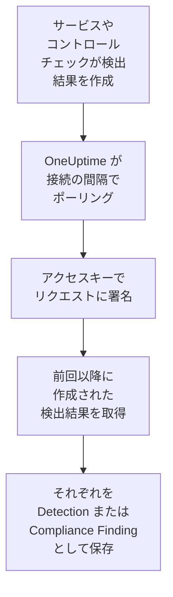

# AWS Security Hub

[AWS Security Hub](https://aws.amazon.com/security-hub/) の検出結果を OneUptime のセキュリティイベントにインポートします。GuardDuty、Inspector、Macie、IAM Access Analyzer の検出結果、Security Hub 自身のコントロールチェック、パートナー製品の検出結果が対象です。そこではログ、トレース、メトリクスと並べて検索し、他のあらゆるソースと相関付け、重要なものについてオンコールを呼び出せます。OneUptime は、読み取り専用のアクション 1 つだけを許可した、作成したアクセスキーで読み取り、AWS では何も変更しません。エージェント、EventBridge ルール、S3 エクスポートの設定は不要です。

:::cards
- [接続を設定する](#接続を設定する): IAM ポリシー、アクセスキー、接続のフォーム。
- [インポートされる内容](#インポートされる内容): 各検出結果がセキュリティイベントになる仕組み。
- [ポーリングの仕組み](#ポーリングの仕組み): 各ポーリングが読み取る時間枠と、それが前回と 30 分重なる理由。
- [トラブルシューティング](#トラブルシューティング): 各エラーの意味と変更すべき点。
:::

## 仕組み



OneUptime は 1 分ごとに、ポーリング間隔が経過した有効な接続をそれぞれポーリングします。ポーリングは、前回のポーリング以降に作成された検出結果を対象に、[Signature Version 4](https://docs.aws.amazon.com/IAM/latest/UserGuide/reference_sigv-create-signed-request.html) で署名したリクエストでリージョンの Security Hub の `GetFindings` を呼び出します。そして各検出結果を [OCSF](https://schema.ocsf.io/) イベントとして保存します。コントロールチェックは Compliance Finding（クラス `2003`）、それ以外の検出結果は Detection Finding（クラス `2004`）です。その後、検出ルール、モニター、ダッシュボードは、それを他のソースのセキュリティイベントと同じように扱います。

## 前提条件

- OneUptime で Project Owner、Project Admin、または Security Admin のロール。Security Member と Security Viewer は接続とその実行履歴を見ることはできますが、変更はできません。
- 接続するリージョンで Security Hub が有効になっている AWS アカウント。Security Hub はリージョン単位です。1 つの接続が読むのは、1 つのアカウントが 1 つのリージョンに持つ検出結果です。
- すべてのアカウントとリージョンの検出結果を 1 つの接続で読むには、Security Hub の委任管理者アカウントを、その[リージョン間集約](https://docs.aws.amazon.com/securityhub/latest/userguide/finding-aggregation.html)を有効にしたホームリージョンで使います。ホームリージョンは **Security Hub → Settings → Regions** に表示されます。
- OneUptime のアプリと worker から `securityhub.<region>.amazonaws.com`（中国では `securityhub.<region>.amazonaws.com.cn`）への送信 HTTPS と、それらのホストの正確な時計。AWS は 5 分を超えてずれた署名のリクエストを拒否します。

## 接続を設定する

接続は IAM アクセスキーでリクエストに署名します。キーの ID に必要なのは `securityhub:GetFindings` という 1 つのアクションだけで、それ以外は不要です。接続が検出結果を変更することはありません。

:::steps
### 検出結果の読み取りを許可する

[IAM コンソール](https://console.aws.amazon.com/iam/)で **Policies → Create policy** を開き、**JSON** を選んで、このポリシーを貼り付けます。名前を付けます（例: `OneUptimeSecurityHubRead`）:

```json
{
  "Version": "2012-10-17",
  "Statement": [
    {
      "Effect": "Allow",
      "Action": "securityhub:GetFindings",
      "Resource": "*"
    }
  ]
}
```

`GetFindings` はリソースで制限できないため、`Resource` は `*` のままです。マネージドポリシー `AWSSecurityHubReadOnlyAccess` でも動作しますが、より多くを許可します。

### アクセスキーを作成する

1. **Users → Create user** を開き、ユーザーに名前を付け（例: `oneuptime-security-hub`）、コンソールアクセスはオフのまま、ポリシーをアタッチします。他のアカウントの検出結果を読むには、委任管理者アカウントでこれを行います。
2. ユーザーを開き、**Security credentials → Access keys → Create access key** を開いて、**Third-party service** を選びます。
3. **アクセス キー ID** と **シークレット アクセス キー** をコピーします。AWS はシークレットを一度しか表示しません。

### OneUptime で接続を追加する

**製品 → セキュリティイベント → 接続**（`/dashboard/{projectId}/security-events/connections`）を開き、**接続を追加** をクリックして **AWS Security Hub** を選び、**次へ** をクリックします。下の表の設定を入力して **次へ** をクリックし、シークレットを **シークレット アクセス キー** に貼り付けます。

### 保存する前にテストする

**保存前にテスト** の下にある **これらの設定をテスト** をクリックします。テストはフォームの値でリクエストに署名し、何も保存しません。そのため、キーの誤りや権限の不足は接続を作成する前にわかります。続いて **次へ** をクリックし、接続に **名前** を付けて作成します。
:::

| 設定 | 入力する内容 |
| --- | --- |
| **リージョン** | リージョンのコード。例: `us-east-1`、`eu-central-1`、`us-gov-west-1`。他のアカウントの検出結果を読む場合は、管理者アカウントのホームリージョン。 |
| **アクセス キー ID** | キーの ID。16～128 文字の英字または数字で、通常は `AKIA` で始まる 20 文字です。一時的な認証情報では `ASIA` で始まります。 |
| **シークレット アクセス キー** | キーのシークレット。暗号化され、API から返されることはなく、再表示もされません。置き換えるには、接続の **認証情報を更新** を使います。 |
| **Session token** | 一時的な認証情報の場合のみ必要です。`ASIA` キーはこれがないと拒否され、`AKIA` キーはこれがあると拒否されます。 |

`aws sts assume-role` や `aws sts get-session-token` で得た一時的な認証情報は期限切れになります（引き受けたロールでは最長 12 時間）。期限が切れると、**認証情報を更新** で新しいものを貼り付けるまでポーリングは止まります。この狭いポリシーを持つ長期キーを自分のスケジュールでローテーションすれば、無人でポーリングを続けられます。一時的な認証情報から長期キーに切り替えるには、**認証情報を更新** に新しいキーを入力し、**Remove the stored Session token** をオンにします。

**ポーリング** ステップには、任意の **説明**、`1`～`1440` の整数で初期値 `5` の **ポーリング間隔（分）**、初期状態でオンの **有効** もあります。

## インポートされる内容

各検出結果は、ベンダー `Amazon Web Services`、製品 `AWS Security Hub` の 1 つのイベントになります。`Compliance` オブジェクトを持つ検出結果、つまり AWS Foundational Security Best Practices や CIS などの標準に対するコントロールチェックは、Compliance Finding（OCSF クラス `2003`）になります。それ以外の検出結果は Detection Finding（OCSF クラス `2004`）になります。

| 検出結果のフィールド | OneUptime の列 |
| --- | --- |
| `Id`（AWS が作成する検出結果では ARN） | イベント UID。重複の除外にも使われます |
| `CreatedAt`、なければ `UpdatedAt`、なければ `FirstObservedAt` | イベント時刻 |
| `Title` | ルール名 |
| `GeneratorId`（GuardDuty の検出結果タイプやコントロールの ID など） | ルール ID |
| `Title`、なければ `Description` | メッセージ |
| `Severity.Label`、なければ `Severity.Normalized` の区分 | 重大度 |
| `Workflow.Status`: `NEW`、`NOTIFIED`、`RESOLVED`、`SUPPRESSED`。なければ旧来の `WorkflowState` | ステータス |
| `TTPs/` の下の `Types`: `TTPs/Initial Access/...` は `TA0001` になります | MITRE ATT&CK の戦術と手法 |
| アクセスキーまたはユーザーリソースの IAM ユーザー、`Network.SourceIpV4` または `SourceIpV6`、`Process.Name` または `Process.Path` | 主体のユーザー、IP、プロセス |
| `Process.Name`、`Process.Path` | プロセスの名前とパス。検出結果にはコマンドラインも親プロセスもありません。 |
| `AwsEc2Instance` リソースのインスタンス ID、`Network.DestinationIpV4` または `DestinationIpV6`、`Network.DestinationPort`、最初の `Resources[].Id` | ターゲットのホスト、IP、ポート、リソース |
| それらに加え、各 `Resources[].Id`、`AwsAccountId`、ネットワークのドメイン、マルウェア名、脅威インテリジェンスの値 | オブザーバブル |
| 検出結果全体。`Compliance.Status` や `Remediation.Recommendation.Url` のようなドット区切りのキーに展開されます | `attributes` |

検出結果に `Severity.Label` がない場合は `Severity.Normalized` で決まります。`0` は Informational、`1`～`39` は Low、`40`～`69` は Medium、`70`～`89` は High、`90`～`100` は Critical です。Security Hub が後で更新した検出結果（新しい `Workflow.Status` や、合格するようになったコントロール）は同じ `Id` を保つため、再インポートされません。イベントにはインポート時点の検出結果が残ります。

## ポーリングの仕組み

各ポーリングは、自分の時間枠で作成された検出結果を古い順に、1 ページ 100 件ずつ取得し、時間枠全体を読み終えるまで `NextToken` をたどります:

```text
POST https://securityhub.{region}.amazonaws.com/findings
    {"Filters": {"CreatedAt": [{"Start": "{window start}", "End": "{window end}"}]},
     "SortCriteria": [{"Field": "CreatedAt", "SortOrder": "asc"}],
     "MaxResults": 100}
```

- **作成時刻がカーソルです。** 検出結果は `FirstObservedAt` ではなく `CreatedAt` で一覧取得されます。GuardDuty は十分なアクティビティを確認してから検出結果を作成し、コントロールチェックは Security Hub がリソースを初めてチェックしたときに作成されます。どちらもアクティビティの開始から数時間後や数日後のことがあります。観測時刻を基準にしたカーソルでは、それらを飛ばしてしまいます。
- **最初のポーリングは 24 時間前までさかのぼります**。そのため、新しい接続にはすぐに最近の検出結果が表示されます。
- **以降の各ポーリングは、保存されたカーソルの 30 分前から始まります。** `CreatedAt` は問題を見つけたサービスが設定し、検出結果が Security Hub に届くのはその後です。GuardDuty は新しい検出結果を 5 分以内に送り、EventBridge 経由の配信が失敗した場合は最長 24 時間再試行されます。重なりによって、そうした検出結果は次のポーリングで読まれます。`CreatedAt` から 30 分を超えて届いた検出結果はカーソルの後ろに取り残されることがあるため、その時間範囲をインポートして回収してください。
- **1 回のポーリングで読むのは、カーソルから最大 24 時間先までです。** カーソルが遅れた接続は、24 時間の時間枠を続けて読んで追いつき、その **ヘルス** には **Catching up** と表示されます。
- **重複は検出結果の `Id` で除外されます**。対象はプロジェクト内で、重なり、再試行された時間枠、インポートによって検出結果が二重に保存されることはありません。

### 1 回のポーリングで読み切れないほど時間枠にデータがある場合

1 回のポーリングで送るのは、100 件の検出結果を取得するリクエストが最大 20 件、つまり 2,000 件です。時間枠にそれより多く含まれていると、実行は **部分的** になり、次のような警告が出ます:

```text
Stopped after 20 findings requests (the per-run request limit) before the window was fully read. The last finding read was created at 2026-09-14T08:12:44.000Z.
```

検出結果は古い順に読まれるため、OneUptime はカーソルを最後に読んだ検出結果の作成時刻に移し、次のポーリングは 30 分の重なりなしに、同じ時間枠の長さでそこから始まります。負荷の高いアカウントは、同じものを読み直すのではなく、ポーリングごとに約 2,000 件ずつ追いつきます。カーソルがその地点から 30 分先に進むと、重なりが戻ります。

たとえば 30 分の重なりだけで 2,000 件を超える検出結果があり、実行が保存されたカーソルより先にまったく進めない場合、OneUptime は代わりに時間枠を短くします:

1. **縮める。** 次のポーリングは同じ開始点から半分の長さの時間枠を読み、時間枠を最後まで読めるようになるまで、最短 1 分まで半分にし続けます。実行の警告にはそのことが示されます: `This window holds more records than one poll can read; the next poll reads a {n} minute window from the same starting point.`
2. **元に戻す。** 時間枠を最後まで読めたら、次の時間枠は再び 2 倍になり、最長 24 時間まで戻ります。
3. **1 分を飛ばす。** 1 分間でさえ 1 回のポーリングで読み切れないほどある場合、ポーリングはその 1 分を飛ばして先に進み、新しい検出結果が届き続けるようにします。以降のポーリングの重なりも、その 1 分までは戻りません。実行は **部分的** のままで、**最終エラー** には `More records were created in the one minute from {cursor} to {end} than one poll can read. Polling moved past this minute so newer records keep arriving; use Import this time range in Diagnostics on this minute to recover what one run can read.` と表示されます。1 回の実行で読める分を回収するには、**この時間範囲をインポート** でその 1 分をインポートします。

AWS のエラーで完全に失敗した実行は、カーソルと時間枠の長さを保ち、次のポーリングが同じ時間枠を読み直します。唯一の例外はタイムアウトしたリクエストです。カーソルはそのままですが、次の時間枠は半分の長さになります。時間内に応答できないほど重い時間枠は、何度試してもタイムアウトするからです。**ポーリング間隔（分）** を変えても、これは何も変わりません。この設定が決めるのはポーリングを開始する頻度であって、時間枠の開始位置ではありません。

### オンデマンドで実行、プレビュー、インポートする

接続の **診断** をクリックすると、最近の実行を確認し、手動で操作できます。これらを開始できるのは接続を変更できるユーザーで、履歴は接続を見られるユーザーなら誰でも読めます。

- **今すぐ実行** は、接続が **有効** でなくても、通常のカーソルでただちにポーリングを開始します。
- **Preview findings** は最大 7 日間の時間範囲を読み取り、何もインポートしません。
- **この時間範囲をインポート** は、確認後、カーソルを動かさずに最大 7 日間の範囲をインポートします。インポート済みの検出結果はスキップされます。
- 実行の **診断情報をコピー** は、サポート向けにその実行のレポートをコピーします。認証情報は含まれません。

## 接続をテスト

接続の行にある **接続をテスト** と、フォームの **これらの設定をテスト** は、バックグラウンド worker ではなく API プロセスで実行されます。そのため、worker に問題がある場合でもテストは応答します。テストは次のチェックを順に実行します。

| チェック | 確認内容 |
| --- | --- |
| **構成** | すべての設定が存在し、形式が正しいこと。失敗した場合はどこにも接続しません。 |
| **Authenticate with AWS** | 過去 24 時間に作成された検出結果一件を対象に、署名付きの `GetFindings` リクエストを AWS が受け入れること。AWS は IAM ポリシーより先に署名を確認するため、ポリシーによる拒否でもこのチェックは成功します。キーは正しいということです。 |
| **Read findings** | Security Hub がそのリクエストに応答すること。ID が `securityhub:GetFindings` を呼び出せ、そのリージョンで Security Hub が有効になっています。 |
| **Findings available to import** | 過去 24 時間と過去 7 日間に作成された検出結果の数。それぞれ 100 件の一ページ分なので、`100+` はそれ以上を意味します。7 日間に一件もない場合は失敗ではなく警告です。 |
| **Background workers**, **Poll scheduler**, **Security event storage** | OneUptime 側の状態。プロセスが Worker キューのジョブを取得していること、ポーリングジョブが毎分実行されていること、セキュリティイベントのストアが応答すること。 |
| **スケジュールされたポーリング** | 保存済みの接続について、ポーリングがオンであること、worker を待って止まっている実行がないこと、ポーリングが予定どおり実行されていること。 |

テスト内の各リクエストの期限は 20 秒です。テストは何もインポートせず、カーソルも動かしません。失敗した各チェックは、何を変更すべきかを示します。

## トラブルシューティング

接続の **最終エラー** は、認証情報を伏せたうえで完全なエラーメッセージを保持し、その前に失敗したステップを示すプレフィックスを付けます。接続にエラーがある場合は、その **アクション** 列で **エラーを表示** を選んで読み、ダイアログの **エラーをコピー** でコピーします。どのメッセージも `AWS Security Hub findings request` で始まります。その後に続く内容を読んでください。

:::details 最終エラーに `failed (HTTP 401)` または `failed (HTTP 403)` と表示される
AWS がリクエストを拒否しました。メッセージには AWS のエラーコード、またはコードが送られなかった場合は AWS 自身の言葉が引用されています:

- `AccessDeniedException` または `is not authorized to perform`: キーは正しいものの、その ID は `securityhub:GetFindings` を呼び出せません。[接続を設定する](#接続を設定する) のポリシーをアタッチしてください。アクセス許可の境界やサービスコントロールポリシーが拒否している場合もあります。
- `InvalidAccessException` または `is not subscribed to AWS Security Hub`: この **リージョン** でこのアカウントの Security Hub が有効になっていないか、アカウントがそこで Security Hub の管理者ではありません。
- `InvalidSignatureException` または `SignatureDoesNotMatch`、または `The request signature we calculated does not match`: **シークレット アクセス キー** が **アクセス キー ID** に対応していません。新しいアクセスキーを作成し、**認証情報を更新** で保存します。
- `UnrecognizedClientException` または `InvalidClientTokenId`、または `The security token included in the request is invalid`: AWS は **アクセス キー ID** を認識していません。入力ミス、削除済み、無効化済み、別のパーティションのもの、または **Session token** のない一時キーです。
- `ExpiredTokenException` または `The security token included in the request is expired`: 一時的な認証情報の期限が切れました。新しいものを発行するか、長期キーに切り替えてください。
- `RequestTimeTooSkewed` または `RequestExpired`、または `Signature expired`: OneUptime のホストの時計が 5 分を超えてずれています。アプリと worker のホストで NTP を修正してください。
- コードがまったくない: キーとポリシーのどちらが拒否したかを AWS は示していません。まずキーを、次にポリシーを確認してください。
:::

:::details 最終エラーに別のステータスで `failed (HTTP ...)` と表示される
- `HTTP 404`: この **リージョン** では Security Hub のエンドポイントが応答しませんでした。AWS コンソールのリージョンメニューと比べてください。`us-east1` や `N. Virginia` ではなく `us-east-1` です。
- `HTTP 429`: アカウントが Security Hub の上限（リージョンごとに毎秒 3 件の `GetFindings` リクエスト）に達しました。次のポーリングで再試行します。繰り返し発生する場合は、同じアカウントとリージョンを読んでいる別のツールや接続を探してください。
- `HTTP 5xx`: Security Hub 側で問題が発生しました。次のポーリングで再試行します。
- `HTTP 400`: Security Hub がクエリを拒否しました。クエリは設定ではなく OneUptime が組み立てるものです。メッセージを OneUptime のサポートに送ってください。
:::

:::details 最終エラーに `returned`、`timed out`、`Could not reach data source` と表示される
- `returned a non-JSON body` または `returned an unrecognized response shape`: プロキシのサインインページや応答を書き換えるゲートウェイなど、Security Hub 以外のものが応答しました。空の時間枠として扱わずに報告されるため、誰も読んでいない検出結果をカーソルが飛ばすことはありません。
- `timed out after 60 seconds with no response` または `failed: Could not reach data source`: リクエストに応答がありませんでした。Security Hub のエンドポイントはパブリックなので、OneUptime のアプリおよび worker と `securityhub.<region>.amazonaws.com` の間の DNS、ファイアウォール、プロキシを確認してください。
:::

:::details 最終ポーリングが Never で、最終エラーが空
この接続ではまだポーリングが一度も完了していません。**接続をテスト** を実行すると、その **Background workers** と **Poll scheduler** のチェックが原因を示します。セルフホスト環境でよくある原因は、ジョブを処理する別の worker デプロイがないままアプリで `DISABLE_QUEUE_WORKERS=true` になっていることです。`false` に設定するか、worker デプロイを実行します（Helm: `worker.enabled: true`）。
:::

:::details 実行が部分的
- `Stopped after 20 findings requests`: 時間枠に、1 回の実行で読む 2,000 件を超える検出結果がありました。何も失われません。次のポーリングは最後に読んだ検出結果の後から始まります。ポーリングのたびに **部分的** のままの接続は滞留分に追いつこうとしているところで、**最終ポーリング** と **最後にインポートしたイベント** は進み続けます。いつまでも追いつかない場合、アカウントはポーリング間隔ごとに 2,000 件を超える検出結果を作成しています。**ポーリング間隔（分）** を短くしてください。
- `More records were created in the one minute from ... than one poll can read`: ポーリングはその 1 分を飛ばしました。**診断** の **この時間範囲をインポート** でインポートします。インポートは 1 回のポーリングと同じだけ読み取ります。
:::

:::details テストは成功するが何もインポートされない
テストのレポートで **Findings available to import** を確認します。過去 7 日間が `0` の場合、Security Hub はこのアカウントとリージョンで検出結果を作成していません。そこで GuardDuty、Inspector、またはセキュリティ標準がオンになっていることを確認してください。他のアカウントやリージョンの検出結果を見るには、管理者アカウントをそのホームリージョンで接続します。
:::

:::details Security Hub コンソールにある検出結果が届かない
その `CreatedAt` と、Security Hub が受け取った時刻である `ProcessedAt` を比べます。`CreatedAt` から 30 分を超えて届いた検出結果はカーソルの後ろに取り残されることがあるため、**この時間範囲をインポート** でその `CreatedAt` をインポートしてください。
:::

## 得られるもの

- **検索。** セキュリティイベントのエクスプローラーで、重大度、ステータス、ルール、アカウント、リソース、任意のオブザーバブルで検出結果を絞り込み、他のすべてのソースと並べて確認できます。
- **相関付け。** 各検出結果のユーザー、インスタンス、IP、リソース ARN、アカウント ID はオブザーバブルとしてインデックス化されるため、1 回の検索でそれらに言及するものをすべて見つけられます。
- **検出ルール。** セキュリティイベントに対してスケジュールで実行され、オンコールを呼び出すアラートを作成する Sigma ルール。
- **モニター。** セキュリティイベントのモニターは、GuardDuty の新しい重大な検出結果や失敗したコントロールなどの一致するイベントを数え、しきい値を超えるとインシデントやアラートを作成します。

セキュリティイベントは、他のテレメトリと同様に取り込み GB 単位で課金されます。[料金](https://oneuptime.com/pricing) を参照してください。

## 次のステップ

:::cards
- [セキュリティイベント](/docs/telemetry/security-events): インポートしたものを検索、相関付けし、アラートを出します。
- [Okta System Log](/docs/integrations/okta): ID プロバイダーのサインインもインポートします。
- [ロール](/docs/permissions/reference#ロール): Security ロールが閲覧・変更できる内容。
- [インテグレーションの概要](/docs/integrations/index): 接続できるその他のツール。
:::
