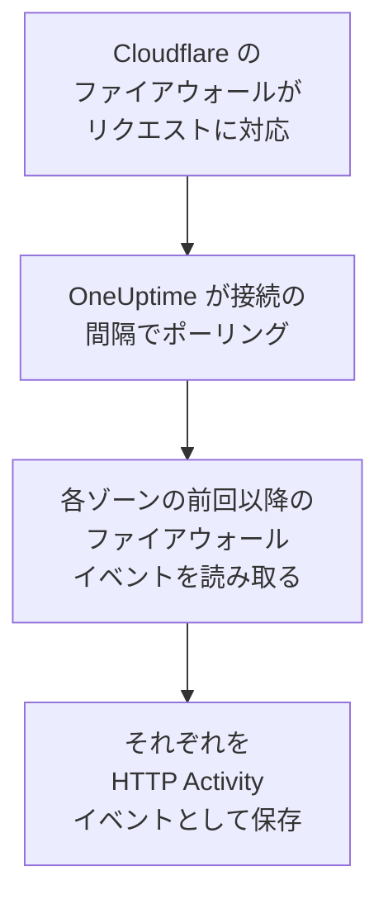

# Cloudflare

[Cloudflare](https://www.cloudflare.com) のファイアウォールがエッジで行ったことを OneUptime のセキュリティイベントにインポートします。対象は、マネージドルールとカスタムルールの WAF、レート制限、IP Access Rules、ボット管理、HTTP DDoS 保護がブロック、チャレンジ、またはログ記録したリクエストです。それぞれがアプリ自身のリクエストの横に並ぶため、ケースには Cloudflare が止めたものと、それでもアプリに到達したものが示されます。OneUptime は読み取り専用の API トークンでこれらを読み取り、Cloudflare では何も変更しません。

:::cards
- [接続を設定する](#接続を設定する): 2 つの読み取り権限を持つ API トークンと、接続のフォーム。
- [インポートされる内容](#インポートされる内容): どのイベントが対象で、各イベントがどのようにセキュリティイベントになるか。
- [ポーリングの仕組み](#ポーリングの仕組み): 各ポーリングが読み取る時間枠と、それが 10 分重なる理由。
- [トラブルシューティング](#トラブルシューティング): 各エラーの意味と変更すべき点。
:::

## 仕組み

OneUptime は 1 分ごとに、ポーリング間隔が過ぎた有効な接続をそれぞれポーリングします。ポーリングはアカウントのゾーンを一覧し、GraphQL Analytics API の settings ノードから各ゾーンのプランで許可されている内容を読み取り、`firewallEventsAdaptive` データセット ([Security Events](https://developers.cloudflare.com/waf/analytics/security-events/)) から前回のポーリング以降の各ゾーンのファイアウォールイベントを古い順に読み取ります。各イベントは [OCSF](https://schema.ocsf.io/) の HTTP Activity イベントとして保存されます。

## 前提条件

- OneUptime でプロジェクト所有者、プロジェクト管理者、またはセキュリティ管理者のロール。セキュリティメンバーとセキュリティ閲覧者は接続とその実行履歴を見ることはできますが、変更はできません。
- アカウントのゾーンの API トークンを作成できる Cloudflare ユーザー。
- トラフィックが Cloudflare を通るゾーン。DNS レコードがプロキシされている必要があります。
- OneUptime のアプリとワーカーから `api.cloudflare.com` への送信 HTTPS。

## 接続を設定する

この接続は [API トークン](https://developers.cloudflare.com/fundamentals/api/get-started/create-token/)で読み取り、Global API Key は使いません。トークンはアカウントとそのゾーンに限定され、単独で取り消せます。必要な[権限](https://developers.cloudflare.com/fundamentals/api/reference/permissions/)は 2 つで、どちらも読み取り専用です。

| 権限 | OneUptime がこれで読み取る内容 |
| --- | --- |
| `Zone > Zone > Read` | ゾーンと、そのアカウントとプラン。 |
| `Zone > Analytics > Read` | GraphQL Analytics API を通じた各ゾーンのファイアウォールイベント。 |

:::steps
### API トークンを作成する

1. Cloudflare のダッシュボードで **My Profile → API Tokens** を開き、**Create Token** を選択して **Create Custom Token** を選びます。
2. 名前を `oneuptime-security-events` にします。**Permissions** で `Zone > Zone > Read` と `Zone > Analytics > Read` を追加します。
3. **Zone Resources** で、アカウントのすべてのゾーン、またはインポートするゾーンを含めます。
4. **Continue to summary**、続いて **Create Token** を選択し、トークンをコピーします。Cloudflare はトークンを一度しか表示しません。

### OneUptime で接続を追加する

**製品 → セキュリティイベント → 接続** (`/dashboard/{projectId}/security-events/connections`) を開き、**接続を追加** をクリックし、**クラウドセキュリティ** の下の **Cloudflare** を選んで **次へ** をクリックします。トークンを **API トークン** に貼り付けます。OneUptime がトークンで読み取れるアカウントとゾーンを一覧するので、**アカウント** を選び、**ゾーン** は **すべてのゾーン** のままにするか、インポートするゾーンを選びます。

### 保存する前にテストする

**保存前にテスト** の下の **これらの設定をテスト** をクリックします。テストはフォームの値で各権限を確認し、足りないものを示し、何も保存しません。その後 **次へ** をクリックし、接続に **名前** を付けて作成します。
:::

| 設定 | 入力する内容 |
| --- | --- |
| **アカウント** | 読み取る Cloudflare アカウント。API トークンが読み取れるアカウントから選びます。アカウントを一つだけ読み取るトークンでは、自動で選ばれます。 |
| **ゾーン** | 任意。空のままにすると、後から追加されたゾーンも含め、アカウントのすべての有効なゾーンを読み取ります。一つの接続で読み取れるのは最大 50 ゾーンです。 |
| **API トークン** | `Bearer` を付けないトークンそのもの。暗号化され、API から返されることはなく、二度と表示されません。接続の **認証情報を更新** で置き換えます。 |

**ポーリング** ステップには、任意の **説明**、`1` から `1440` までの整数で `5` から始まる **ポーリング間隔（分）**、オンで始まる **有効** もあります。Cloudflare のイベントはアラートではなくリクエストなので、フォームは **ケースを開く重大度** を尋ねません。ケースはこれらを読み取る検出ルールから作られます。

### 書き込みアクセスは別の選択です

この接続は Cloudflare で何も変更しません。そこでアドレスをブロックするのは別のオプトインで、書き込み権限が必要です。リストには `Account > Account Filter Lists > Edit`、ブロックする各ゾーンには `Zone > Zone WAF > Edit`、リストが足りないプランには `Account > Account Firewall Access Rules > Edit` です。トークンに追加するのは、ブロックをオンにするときだけにしてください。

## インポートされる内容

すべてのイベントのベンダーは `Cloudflare`、製品は `Cloudflare WAF` で、HTTP Activity (`4002`) イベントです。

| Cloudflare のフィールド | セキュリティイベントでの値 |
| --- | --- |
| `clientIP` | プリンシパル IP と `client.address` |
| `clientRequestHTTPHost`, `clientRequestPath`, `clientRequestQuery` | ターゲットホスト、ターゲットリソース（パスとクエリ）、`url.original` |
| `clientRequestHTTPMethodName`, `userAgent` | アクティビティ、`http.request.method`、`user_agent.original` |
| `action` | ステータスと `oneuptime.edge.action` |
| `source`, `ruleId`, `description` | ルール ID、ルール名、`cloudflare.source` |
| `rayName`, `clientCountryName`, `clientAsn` | `cloudflare.ray_id`、`cloudflare.client.country`、`cloudflare.client.asn` |
| `sampleInterval` | `oneuptime.edge.sample_interval` |

| Cloudflare が行ったこと | ステータス | `oneuptime.edge.action` | リクエストの結果 | 重大度 |
| --- | --- | --- | --- | --- |
| ブロックした、接続を閉じた、またはチャレンジに失敗した | Blocked、閉じた接続では Dropped | `blocked` | Rejected | Low |
| マネージド、JS、またはインタラクティブなチャレンジで応答した | Challenge | `challenged` | Rejected | Low |
| チャレンジに合格した、またはすでに合格していた訪問者 | Allowed | `passed-challenge` | なし | Informational |
| ログに記録して通過させた | Logged | `logged` | オリジンのステータスコード | Medium、オリジンが失敗した場合は High、リクエストを拒否した場合は Low |
| あなたの skip または allow ルールで通過させた | Allowed | `let-through` | オリジンのステータスコード | ログ記録したリクエストと同じ |

あなた自身の skip または allow ルールが通過させたリクエストは、攻撃（SQL インジェクション、パストラバーサル、Log4Shell のルックアップ）を含む場合、または Cloudflare の WAF attack score が攻撃と判断した場合にだけインポートされます。それ以外は、監視などあなたが意図して許可しているトラフィックで、各実行はその数を数えてインポートしません。

Cloudflare は混雑したゾーンのイベントをサンプリングします。各イベントは、それが代表する同様のリクエストの数であるサンプル間隔を保持し、OneUptime がそこから出す数にはすべて *約* が付きます。

イベントはイベント、キャンペーン（アドレスごとの攻撃リクエスト）、エンティティリスク、検出ルールに表示されます。アドレスに関するケースは、影響の **エッジ** に、そのアドレスのリクエストに Cloudflare が何をしたかを、アプリに到達したものと並べて表示します。ルールライブラリの Cloudflare ルールは、ここでインポートされた形でそれらを読み取ります。1 つのアドレスからのマネージドルールの多数のヒット、チャレンジに合格した後に攻撃を送ったアドレス、Cloudflare が通過させてアプリに到達した攻撃です。

## プランの制限

すべてのプランで、API を通じてファイアウォールイベントを使えます。**接続をテスト** の **What each zone's plan gives** は、各ゾーン自身の制限を Cloudflare から読み取ります。

| プラン | Free | Pro | Business | Enterprise |
| --- | --- | --- | --- | --- |
| 保持されるファイアウォールイベント | 31 日 | 31 日 | 31 日 | 31 日 |
| 最長のクエリ | 30 日 | 30 日 | 30 日 | 31 日 |

Cloudflare の Logpush もファイアウォールイベントを送信でき、2026 年 9 月 30 日からすべてのプランで使用量に応じた料金で使えます。この接続は代わりにポーリングするので、2 つの読み取り権限以外は何も必要ありません。

## ポーリングの仕組み

- **イベントはエッジで発生した時刻で読み取られます。** Cloudflare の分析データは、リクエストの 1、2 分後にクエリできます。
- **最初のポーリングは 24 時間前までさかのぼります**。そのため、新しい接続にはすぐに最近のイベントが表示されます。
- **以降のポーリングは保存されたカーソルの 10 分前から始まります**。そのため、Cloudflare が遅れて読み取れるようにしたイベントは次のポーリングで読み取られ、重複はプロジェクト内で各イベントの Ray ID によって除かれます。
- **1 回のポーリングで読むのは、カーソルから最大 24 時間先までです。** カーソルが遅れた接続は、24 時間の時間枠を続けて読んで追いつきます。
- **ゾーンは順番に読み取られます**。各ゾーン最大 2,000 イベントの 1 ページずつなので、混雑したゾーンが、静かなゾーンが読み取られる前にポーリングを使い切ることはありません。
- **Cloudflare のレート制限を守ります。** Cloudflare は 5 分間に REST リクエスト 1,200 件と GraphQL クエリ 300 件を許可します。30 秒以内の待機を求める `429` は待ってから再度要求し、それより長いものはポーリングを止め、次のポーリングが続きを行います。
- **トークンが読み取れないゾーンがあっても何も止まりません。** ほかのゾーンはインポートされ、実行は **部分的** になり、その警告がゾーンを示します。そのゾーンでトークンに `Zone > Analytics > Read` を付与してから、**この時間範囲をインポート** を使って時間枠を取り戻します。
- **失敗した実行は何も変えません。** ネットワークエラーや Cloudflare のエラーステータスの後も、カーソルと時間枠の長さはそのままで、次のポーリングが同じ時間枠を再度読み取ります。唯一の例外はタイムアウトしたリクエストです。カーソルはそのままですが、次の時間枠は半分の長さになります。時間内に応答できないほど重い時間枠は、毎回タイムアウトするからです。

### 1 回のポーリングで読み切れないほど時間枠にデータがある場合

1 回のポーリングが送るリクエストは最大 120 件、読み取るイベントは最大 20,000 件で、4 分後に停止します。イベントは古い順に読み取られるため、予算でポーリングが止まると実行は **部分的** になり、次のポーリングは未完了のゾーンが読み取られた最も古いイベントから再開します。すべてのゾーンを一度も読み取れなかった場合、OneUptime は代わりに時間枠を短くします。

1. **絞り込む。** 次のポーリングは同じ開始点から半分の長さの時間枠を読み取り、時間枠を完全に読み取れるまで、1 分まで半分にし続けます。実行の警告はこう伝えます: `This window holds more records than one poll can read; the next poll reads a {n} minute window from the same starting point.` 長い時間枠からすでにインポートされたイベントは重複としてスキップされます。
2. **元に戻す。** 時間枠を最後まで読めたら、カーソルはその終わりに移り、次の時間枠は再び 2 倍になり、最長 24 時間まで戻ります。
3. **1 分だけ先に進む。** 1 分間でさえ 1 回のポーリングで読み取れる量を超える場合、ポーリングはその分を越えて進み、新しいイベントが届き続けるようにします。実行は **部分的** のままで、**最終エラー** には `More records were created in the one minute from {cursor} to {end} than one poll can read. Polling moved past this minute so newer records keep arriving; use Import this time range in Diagnostics on this minute to recover what one run can read.` と表示されます。その 1 分を **この時間範囲をインポート** でインポートすると、1 回の実行で読み取れる分を取り戻せます。

**ポーリング間隔（分）** を変えても、これは何も変わりません。この設定が決めるのはポーリングを開始する頻度であって、時間枠の開始位置ではありません。

### オンデマンドで実行、プレビュー、インポートする

接続の **診断** をクリックすると、最近の実行を確認し、手動で操作できます。これらを開始できるのは接続を変更できるユーザーで、履歴は接続を見られるユーザーなら誰でも読めます。

- **今すぐ実行** は、接続が **有効** でなくても、通常のカーソルでただちにポーリングを開始します。
- **ファイアウォールイベントをプレビュー** は最大 7 日間の時間範囲を読み取り、何もインポートしません。
- **この時間範囲をインポート** は、確認後に最大 7 日間の範囲をインポートし、カーソルは動かしません。すでにインポートされたイベントはスキップされます。Cloudflare はファイアウォールイベントを 31 日間保持します。
- 実行の **診断情報をコピー** は、サポート向けにその実行のレポートをコピーします。認証情報は含まれません。

## 接続をテスト

接続の行にある **接続をテスト** と、フォームの **これらの設定をテスト** は、バックグラウンド worker ではなく API プロセスで実行されます。そのため、worker に問題がある場合でもテストは応答します。テストは次のチェックを順に実行します。

| チェック | 確認内容 |
| --- | --- |
| **構成** | トークン、アカウント、ゾーンの形式が正しいこと。これが失敗した場合は何にも接続しません。 |
| **Verify the API token** | Cloudflare がトークン（ユーザーのトークン、またはアカウントが所有するトークン）を受け入れ、有効であること。14 日以内に期限切れになるトークンは警告です。 |
| **List the zones** | トークンに `Zone > Zone > Read` があること。アカウントのゾーンと、選択した各ゾーンを一覧します。 |
| **Read firewall events** | トークンに各ゾーンで `Zone > Analytics > Read` があること。失敗すると、権限が足りないゾーンを示します。 |
| **What each zone's plan gives** | 各ゾーンのプランがファイアウォールイベントを保持する期間と、一回のクエリの長さ。プランにイベントがないゾーンは警告です。 |
| **Firewall events available to import** | 過去 24 時間と過去 7 日間のイベントのおおよその数。一件もなければ警告です。 |
| **Background workers**, **Poll scheduler**, **Security event storage** | OneUptime 側の状態。プロセスが Worker キューのジョブを取得していること、ポーリングジョブが毎分実行されていること、セキュリティイベントのストアが応答すること。 |
| **スケジュールされたポーリング** | 保存済みの接続について、ポーリングがオンであること、worker を待って止まっている実行がないこと、ポーリングが予定どおり実行されていること。 |

テスト内の各リクエストの期限は 20 秒です。テストは何もインポートせず、カーソルも動かしません。失敗した各チェックは、何を変更すべきかを示します。

## トラブルシューティング

接続の **最終エラー** は、認証情報を伏せた完全なエラーメッセージを保持します。接続にエラーがある場合は、**アクション** 列の **エラーを表示** を選択して読み、ダイアログの **エラーをコピー** でコピーします。各メッセージは失敗したリクエストを示し、Cloudflare 自身の理由を引用します。

:::details 最終エラーが `Invalid API Token (1000)` の場合
Cloudflare はそのトークンを知りません。削除されたか、更新されたか、全体が貼り付けられていません。Global API Key は送信前に拒否されます。上記の手順でトークンを作成し、**認証情報を更新** で保存します。
:::

:::details 最終エラーが `Unauthorized to access requested resource (9109)` の場合
トークンでゾーンを一覧できません。**Zone Resources** にインポートするゾーンを含めて、`Zone > Zone > Read` を付与します。
:::

:::details 最終エラーが `cannot read the analytics of` の場合
メッセージが示すゾーンで、トークンに `Zone > Analytics > Read` がありません。そのゾーンに付与してから、**この時間範囲をインポート** を使って、インポートされなかった分を取り戻します。
:::

:::details 最終エラーが `rate limit` の場合
同じ Cloudflare ユーザーを使う別の何かがクォータを使い切りました。5 分が過ぎるとポーリングは自動で続きます。クォータを分けるには、OneUptime 専用のユーザーのトークンを使います。
:::

:::details 最終エラーに `did not complete` と表示される
リクエストに応答がありませんでした。タイムアウト、解決できない名前、または拒否されたアドレスです。OneUptime のアプリとワーカーが、使用しているプロキシを経由して `api.cloudflare.com` に到達できることを確認します。
:::

:::details ケースに Cloudflare の対応は表示されるが、アプリにそのアドレスのリクエストがない場合
Cloudflare の背後では、アプリが `CF-Connecting-IP` ヘッダーから訪問者のアドレスを読み取らない限り、アプリには Cloudflare のアドレスが見えます。そのアドレスを `client.address` としてログとトレースに書き込むと、OneUptime はアプリのリクエストを Cloudflare が対応したアドレスと照合できます。
:::

:::details テストは成功するが、最終ポーリングが Never
ポーリングジョブが一度も実行されていません。**Background workers** と **Poll scheduler** のチェックを確認します。セルフホスト環境でよくある原因は、ジョブを処理する別の worker デプロイがないままアプリで `DISABLE_QUEUE_WORKERS=true` になっていることです。`false` に設定するか、worker デプロイを実行します（Helm: `worker.enabled: true`。既定値は `false`）。
:::

## 次のステップ

:::cards
- [セキュリティイベント](/docs/telemetry/security-events): インポートしたものを検索、相関付けし、アラートを出します。
- [セキュリティケース](/docs/telemetry/security-cases): Cloudflare が行ったことを、アプリに到達したものと並べて確認します。
- [インテグレーションの概要](/docs/integrations/index): 接続できるその他のツール。
:::
