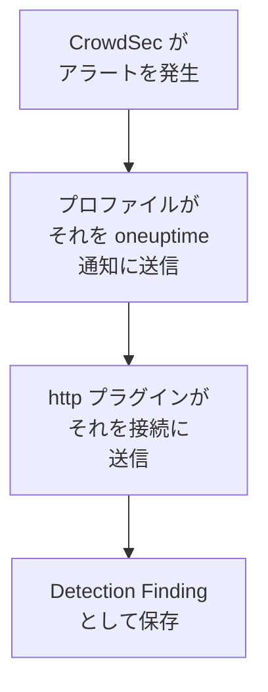

# CrowdSec

[CrowdSec](https://www.crowdsec.net/) が発生させたアラートを、その都度 OneUptime のセキュリティイベントで受信し、プロジェクトのブロックリストにあるアドレスを CrowdSec でブロックします。CrowdSec 自身の通知プラグインが各アラートを CrowdSec 接続に送信し、接続は CrowdSec の検出からケースを開きます。ブロックをオンにすると、OneUptime はブロックした各アドレスを CrowdSec の Local API を通じて BAN し、その Local API を読み取るすべてのバウンサーがそのアドレスをブロックします。

:::cards
- [接続を設定する](#接続を設定する): 接続と、CrowdSec のアラートをそこへ送信する通知。
- [受信される内容](#受信される内容): 各 CrowdSec アラートがどのようにセキュリティイベントになるか。
- [CrowdSec でアドレスをブロック](#crowdsec-でアドレスをブロック): ブロックリストにあるアドレスを CrowdSec で BAN します。
- [CrowdSec のブロックリストを読み込む](#crowdsec-のブロックリストを読み込む): CrowdSec Console が提供するリストを、脅威インテリジェンスのフィードとして。
- [トラブルシューティング](#トラブルシューティング): 各エラーの意味と変更すべき点。
:::

## 仕組み



CrowdSec の Local API は、プロファイルが通知に送る各アラートを、その通知のプラグインに渡します。接続の通知は CrowdSec の `http` プラグインを使います。このプラグインはアラートを CrowdSec 独自の JSON のまま、取り込みキーを付け、接続を指定して、セキュリティイベントの取り込み口に POST します。OneUptime はそれを [OCSF](https://schema.ocsf.io/) の Detection Finding イベント（クラス `2004`）として保存し、検出ルールと照合し、接続の **ケースを開く重大度** 以上の CrowdSec 自身の検出ごとにケースを開きます。ポーリングは行いません。アラートは CrowdSec が発生させてから数秒で届きます。

## 前提条件

- OneUptime でプロジェクト所有者、プロジェクト管理者、またはセキュリティ管理者のロール。セキュリティメンバーとセキュリティ閲覧者は接続を見ることはできますが、変更はできません。
- CrowdSec 1.5 以降と、その Local API、および同梱の `http` 通知プラグイン。このページは CrowdSec v1.8.2 に基づいて書かれています。
- CrowdSec の Local API を実行するホストから OneUptime への送信 HTTPS。
- アドレスもブロックする場合: OneUptime から到達できる Local API と、OneUptime 用のマシン ([CrowdSec でアドレスをブロック](#crowdsec-でアドレスをブロック) を参照)。

## 接続を設定する

:::steps
### OneUptime で接続を追加する

**製品 → セキュリティイベント → 接続** (`/dashboard/{projectId}/security-events/connections`) を開き、**接続を追加** をクリックし、**CrowdSec** を選んで **次へ** をクリックします。アラートを受信するだけなら、下の表の設定はすべて空のままにします。アドレスもブロックするなら、それらを入力します。

### 保存する前にテストする

**保存前にテスト** の下の **これらの設定をテスト** をクリックします。Local API が設定されていなければ、テストはそのことを伝え、どこにも接続しません。設定されていれば、Local API に到達してマシンとしてサインインし、何も保存しません。その後 **次へ** をクリックし、**アラート** ステップで接続に **名前** を付け、**ケースを開く重大度** を選んで作成します。

### CrowdSec ホストに通知を保存する

接続を作成すると、その **アラートを送信** が開きます。これは接続の行から再び開けます。**取り込みキーを選択** してから、キーと接続が入力済みの状態で表示される通知を、CrowdSec の Local API を実行するホストに保存します。

```yaml title="/etc/crowdsec/notifications/oneuptime.yaml"
type: http
name: oneuptime

# info or quieter: at debug, CrowdSec logs each request's headers.
log_level: info

format: |
  {{.|toJson}}

url: https://oneuptime.com/security-events/v1/ingest?connection=YOUR_CONNECTION_ID&format=crowdsec
method: POST
headers:
  Content-Type: application/json
  x-oneuptime-token: YOUR_INGESTION_TOKEN
```

### プロファイルのアラートをこの通知に送信する

`/etc/crowdsec/profiles.yaml` で、OneUptime に受信させたいアラートを持つ各プロファイルの `notifications` に `oneuptime` を追加し、CrowdSec をリロードします。

```yaml title="/etc/crowdsec/profiles.yaml"
notifications:
  - oneuptime
```

```bash
sudo systemctl reload crowdsec
```

### テストアラートを送信する

```bash
sudo cscli notifications test oneuptime
```

**アラートを送信** にはアラートが届いた時刻が表示され、**アラートを表示** でセキュリティイベント内のそのアラートを開けます。これは重大度 Informational のイベントで、ケースは開きません。
:::

| 設定 | 入力する内容 |
| --- | --- |
| **Local API の URL** | アドレスをブロックする場合のみ。OneUptime が CrowdSec の Local API に到達する場所で、例えば `https://crowdsec.example.com:8080` です。ネットワークをまたぐ場合は必ず `https` を使います。 |
| **マシン ID** | アドレスをブロックする場合のみ。OneUptime がサインインするマシンで、CrowdSec ホストで `sudo cscli machines add oneuptime --auto -f -` により追加します。 |
| **CrowdSec でアドレスをブロック** | 新しい接続ではオフです。オンにすると、ブロックリストにあるアドレスと範囲を CrowdSec で BAN し、他の三つの設定が必要です ([CrowdSec でアドレスをブロック](#crowdsec-でアドレスをブロック) を参照)。 |
| **マシンのパスワード** | アドレスをブロックする場合のみ。`cscli` がマシンについて出力したパスワード。暗号化され、API から返されることはなく、二度と表示されません。接続の **認証情報を更新** で置き換えます。 |

**アラート** ステップには、任意の **説明** と、オンで始まる **有効** もあります。有効になっていない接続は、受信したアラートをイベントとして保持し、それらからケースを開きません。

コンテナでは、通知は `/etc/crowdsec/notifications/` にマウントされたフォルダーに置き、コンテナを再起動すると読み込まれます。Kubernetes へのインストールでは、Helm の値の `config.notifications` で指定し、`profiles.yaml` はその隣の `config` に置きます。

## 受信される内容

CrowdSec が送信する各アラートは、ベンダーと製品が `CrowdSec` の 1 つの Detection Finding イベント（OCSF クラス `2004`）になります。

| CrowdSec のフィールド | OneUptime の列 |
| --- | --- |
| `uuid`、またはそれがないアラートではそのハッシュ | イベント UID。重複の除外にも使われます |
| `stop_at`、または `start_at` | イベント時刻 |
| `scenario` | ルール ID とルール名。ルール名は CrowdSec Hub でのシナリオのタイトル、またはその名前 |
| `source.ip`、または `Ip` アラートの `source.value` | 主体の IP |
| アラートまたはそのイベントの `target_fqdn` か `target_host`、なければそのイベントが示す `machine` | ターゲットホスト |
| `target_user`, `target_uri` | ターゲットのユーザーとリソース |
| 最初の決定の `type` | ステータス。BAN なら `Blocked`、CAPTCHA なら `Challenge`、決定がないかシミュレーションモードなら `Logged` |
| シナリオの振る舞い | 重大度と、その MITRE ATT&CK の戦術と手法 |
| `source.cn`、`source.as_name`、`events_count` など、その他すべて | `attributes`。ドット区切りのキーに展開したアラートのフィールド、最初の 10 件のイベントそのもの、そして `crowdsec.` の下に OneUptime による解釈 |

CrowdSec のアラートには独自の重大度がないため、OneUptime は CrowdSec Hub のラベル（`ssh:bruteforce`、`http:exploit`）に従い、シナリオが検出する内容から重大度を決めます。

| 振る舞い | 重大度 |
| --- | --- |
| CVE や AppSec コンポーネントがブロックしたものなどのエクスプロイト、または侵入後に攻撃者が行うこと | High |
| ブルートフォース、サービス拒否、不正行為、あり得ないサインイン、または OneUptime が分類できない振る舞い | Medium |
| スキャン、プローブ、クロール、ボット、スパム、クラウド監査で検出された変更 | Low |
| CrowdSec 自身のテストシナリオ | Informational |

**ケースを開く重大度** が **高以上** の場合、CrowdSec のエクスプロイトはケースを開き、スキャナーやパスワード推測者に対する日常的な BAN は検出ルールのためのイベントのままになります。ケースを開くのは CrowdSec 自身の検出だけです。誰かが `cscli` または CrowdSec Console で追加した決定、CrowdSec のブロックリストにあるアドレス、テストアラート、そして戻ってきた OneUptime 自身の BAN は重大度 Informational で、ケースを開きません。`cscli notifications reinject` のように 2 回送信されたアラートは、1 回だけ保存されます。

## CrowdSec でアドレスをブロック

接続で **CrowdSec でアドレスをブロック** をオンにすると、プロジェクトの [ブロックリスト](/docs/telemetry/security-cases#ブロックリスト) にあるアドレスと範囲が CrowdSec で BAN されます。その Local API を読み取るすべてのバウンサー (ファイアウォール、nginx、Traefik のバウンサーなど) は、CrowdSec 自身の BAN と同じように、それぞれが動作する場所でそれらをブロックします。ブロックは、ブロックリストが適用される他のすべての場所と同じ承認、同じ自動対応の上限、同じ **解除** を経ます。

新しい接続ではこのスイッチはオフです。オンにするには次のようにします。

1. CrowdSec ホストで OneUptime 用のマシンを追加します。そのパスワードが出力されます。

   ```bash
   sudo cscli machines add oneuptime --auto -f -
   ```

2. OneUptime が Local API に到達できるようにします。Local API は、特に指定しない限り `127.0.0.1:8080` で待ち受けます。CrowdSec の `config.yaml` で `api.server.listen_uri` を設定し、Local API を TLS で、または `https` プロキシの背後で提供し、ファイアウォールで OneUptime のアドレスを通します。
3. 接続を編集し、**Local API の URL** と **マシン ID** を入力し、パスワードを **マシンのパスワード** に入れ、**CrowdSec でアドレスをブロック** をオンにして保存します。その後 **接続をテスト** が、何も変更せずに、マシンがサインインして OneUptime の BAN を読み取れることを確認します。

BAN の作成と終了の仕組み:

- 各ブロックは、`cscli decisions add` と同じ方法で、シナリオ `oneuptime/blocklist` の下に作成される 1 つの BAN の決定です。CrowdSec はこれを手動の決定として保持するため、手動の決定を共有していない限り、CrowdSec の Central API と共有されることはありません。OneUptime が読み取って削除するのは自身の BAN だけで、人や CrowdSec が作成したものには触れません。
- 終了日時のあるブロックは、まさにその日時までの BAN で、その時点で CrowdSec が、OneUptime から到達できるかどうかにかかわらず、自ら解除します。解除されるまで続くブロックは 7 日間の BAN で、残りが 3 日以下になると更新されるため、OneUptime がもう維持しない BAN は 1 週間以内に終わります。
- **解除** は、次の処理で 1 分以内に BAN を削除します。CrowdSec で `cscli decisions delete` やフラッシュによって削除された BAN は、ブロックが続く限り次の処理で再び作成されます。
- CrowdSec の許可リストのいずれかにあるアドレスや範囲は BAN されません。ブロックには、そこでは適用されていないことが許可リストの名前とともに表示され、すでに作成された BAN は、許可リストにアドレスが入った時点で削除されます。
- **信頼済みプロキシ**、ロードバランサー、エッジなど、プロジェクト自身のアドレスは、CrowdSec を含め、どこでもブロックされません。
- CrowdSec が行うのは BAN だけです。チャレンジはそこでは適用されず、ドメイン、URL、ファイルは CrowdSec に送られません。

Local API に到達できないとき、CrowdSec では何も変わりません。保持している BAN はそのまま残り、期限が来れば終わります。**ブロックリスト** の **適用先** には、CrowdSec が各ブロックを最後に保持していた時刻が表示され、OneUptime は 1 分後に再試行し、その後は毎回待ち時間を 2 倍にして最大 30 分まで待ちます。新しいブロックは、作成できるようになるまで待ちます。

## CrowdSec のブロックリストを読み込む

CrowdSec Console は、組織が購読しているブロックリストを Raw IP List 連携として提供します。1 行に 1 つのアドレスで、ユーザー名とパスワードで保護されています。[脅威インテリジェンスのフィード](/docs/telemetry/threat-intelligence) がそれらを読み込み、イベントと照合します。

1. CrowdSec Console で、IP 集約 (IP aggregation) をオフにした Raw IP List 連携を作成します。OneUptime が照合するのはアドレスで、範囲ではありません。その連携のエンドポイント、ユーザー名、パスワードをコピーします。
2. OneUptime で **製品 → セキュリティイベント → 検出 → 脅威インテリジェンス** を開き、**脅威インテリジェンスのフィードを作成** をクリックし、**インジケーターのリスト** を選びます。
3. エンドポイントを **リストの URL** に貼り付け、**サインイン** で **ユーザー名とパスワード** を選び、両方を貼り付けます。1 日 1 回のダウンロードしか許可されない CrowdSec の Community プランでは、**ポーリング間隔（分）** を `1440` に設定します。

リストは CrowdSec のものです。自分のツールで使うことはできますが、他に渡すことはできません。OneUptime は独自のリストを提供しません。

## 接続をテスト

接続の行にある **接続をテスト** と、フォームの **これらの設定をテスト** は、バックグラウンド worker ではなく API プロセスで実行されます。次のチェックを順に実行します。

| チェック | 確認内容 |
| --- | --- |
| **構成** | 設定がすべて空か、すべて入力されていて、形式が正しいこと。これが失敗した場合は何にも接続しません。 |
| **Reach CrowdSec's Local API** | `GET /health` が応答すること。Local API が設定されていない場合、チェックは接続がアラートを受信するだけであることを伝え、次の三つは実行されません。 |
| **Sign in to the Local API** | `POST /v1/watchers/login` がマシンとそのパスワードを受け付けること。 |
| **Read CrowdSec's allowlists** | `GET /v1/allowlists` が応答すること、および許可リストに含まれるアドレスと範囲の数。許可リストを持たない 1.6.8 より古い Local API は合格します。 |
| **Block with CrowdSec** | **CrowdSec でアドレスをブロック** がオンの場合のみ。マシンが OneUptime の BAN を読み戻せること、および有効な BAN の数。何も変更しません。 |
| **Background workers**, **Security event storage** | OneUptime 側の状態。CrowdSec が送信したものを保存する Worker キューのジョブをプロセスが取得していること、およびセキュリティイベントのストアが応答すること。 |
| **Alerts received** | 保存済みの接続について、最後のアラートが届いた時刻。まだ届いていない場合は警告になり、テストアラートの送信方法が示されます。 |

テストが BAN や削除を行うことはありません。**レポートをコピー** は、チェックリストをパスワードやトークンを含まない JSON としてコピーします。

## トラブルシューティング

接続の **ヘルス** は、最初のアラートが届くまで **アラート待ち**、その後は次のアラートまでどれだけ時間がかかっても **アラート受信中** と表示されます。**ケース一時停止中** は、接続が有効になっていないことを意味します。CrowdSec はプラグインが受け取った応答を自身のログ `/var/log/crowdsec.log` に `HTTP server returned non 200 status code` として書き込みます。

:::details アラートが届かない
- `sudo cscli notifications list` を実行します。`oneuptime` が一覧にあり、プロファイルで有効になっている必要があります。どのプロファイルにも指定されていない通知は何も送信しません。
- `401`: `x-oneuptime-token` の取り込みキーがない、誤っている、または期限切れです。`422`: キーがオフになっています。**アラートを送信** でキーを選び、通知をコピーし直します。
- `400`: アドレスがこのプロジェクトの CrowdSec 接続を指していません。接続の **アラートを送信** からアドレスをコピーします。アドレスの末尾は接続の ID です。
- ログに何もない: CrowdSec ホストから OneUptime に到達できません。そのホストからの送信 HTTPS と、そのプロキシを確認します。
:::

:::details 接続テストが Reach CrowdSec's Local API で失敗する
`CrowdSec Local API health check could not be completed` は、何も応答しなかったことを意味します。Local API は既定で `127.0.0.1` で待ち受けるため、`api.server.listen_uri` とファイアウォールが許可するまで OneUptime は到達できません。`http` で応答しているという警告は、マシンのパスワードが暗号化されずにネットワークを通ることを意味します。Local API を TLS で提供するか、その前に `https` プロキシを置いてください。
:::

:::details 接続テストが Sign in to the Local API で失敗する
`CrowdSec Local API login failed (HTTP 401)` の末尾には対処法が示されます。`sudo cscli machines list` でマシン ID とパスワードを確認するか、まだ検証されていないマシンを `sudo cscli machines validate oneuptime` で検証するか、パスワードでサインインするマシンを追加します。新しいパスワードは **認証情報を更新** で保存します。
:::

:::details ブロックが CrowdSec で適用されない
その **適用先** にカーソルを合わせます。アドレスを含む許可リスト、CrowdSec が適用しないチャレンジ、または Local API のエラーが示されます。Local API に到達できない間も OneUptime は再試行を続け、CrowdSec がすでに保持している BAN は有効なままです。
:::

:::details CrowdSec はアラートを送信するが、何も保存されない
CrowdSec が送信したものは、バックグラウンド worker が保存します。ジョブを処理する別の worker デプロイがないままアプリで `DISABLE_QUEUE_WORKERS=true` になっているセルフホスト環境では、アラートは受け付けられても保存されません。**接続をテスト** では、**Background workers** のチェックの失敗として表示されます。`false` に設定するか、worker デプロイを実行します（Helm: `worker.enabled: true`）。
:::

## 次のステップ

:::cards
- [セキュリティイベント](/docs/telemetry/security-events): CrowdSec が送信したものを検索、相関付けし、アラートを出します。
- [セキュリティケース](/docs/telemetry/security-cases): CrowdSec の検出が開いたケースに対応し、そこからブロックします。
- [脅威インテリジェンス](/docs/telemetry/threat-intelligence): イベントを CrowdSec のブロックリストと照合します。
- [インテグレーションの概要](/docs/integrations/index): 接続できるその他のツール。
:::
