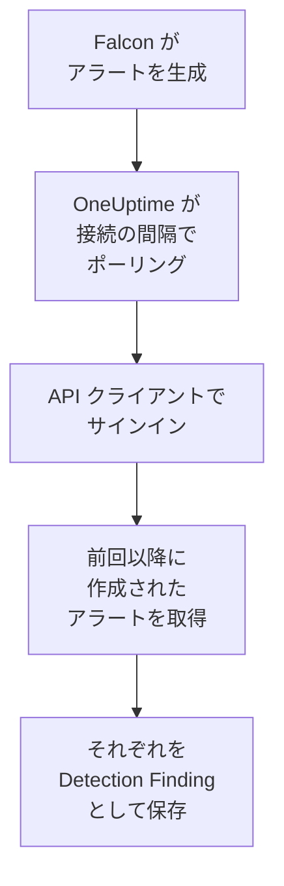

# CrowdStrike Falcon

エンドポイント、ID、クラウドの検出による [CrowdStrike Falcon](https://www.crowdstrike.com/platform/) のアラートを、OneUptime のセキュリティイベントにインポートします。そこではログ、トレース、メトリクスと並べて検索し、他のあらゆるソースと相関付け、重要なものについてオンコールを呼び出せます。OneUptime は作成した API クライアントを使って Falcon Alerts API からアラートを読み取り、Falcon に書き込むことはありません。

:::cards
- [接続を設定する](#接続を設定する): 1 つのスコープを持つ API クライアントと、接続のフォーム。
- [インポートされる内容](#インポートされる内容): 各 Falcon アラートがセキュリティイベントになる仕組み。
- [ポーリングの仕組み](#ポーリングの仕組み): 各ポーリングが読み取る時間枠と、負荷の高い CID での動作。
- [トラブルシューティング](#トラブルシューティング): 各エラーの意味と変更すべき点。
:::

## 仕組み



OneUptime は 1 分ごとに、ポーリング間隔が経過した有効な接続をそれぞれポーリングします。ポーリングは API クライアントの ID とシークレットで Falcon クラウドにサインインし、前回のポーリング以降に作成されたアラートを Alerts API に問い合わせ、それぞれを [OCSF](https://schema.ocsf.io/) の Detection Finding イベント（クラス `2004`）として保存します。以降、検出ルール、モニター、ダッシュボードは、他のソースからのセキュリティイベントと同じようにそれを扱います。

## 前提条件

- OneUptime で Project Owner、Project Admin、または Security Admin のロール。Security Member と Security Viewer は接続とその実行履歴を見ることはできますが、変更はできません。
- Falcon の顧客 ID（CID）と、API クライアントを管理できる Falcon コンソールのユーザー。Falcon Administrator ロール、または API clients and keys の権限を持つカスタムロール。
- OneUptime のアプリと worker から、下の **Falcon cloud** に記載されている Falcon クラウドの API ホストへの送信 HTTPS。

## 接続を設定する

:::steps
### API クライアントを作成する

1. Falcon コンソールで **Support and resources → API clients and keys** を開き、**Create API client** を選びます。
2. `OneUptime security events` などの名前を付けます。**API scopes** で **Alerts → Read** をオンにし、他のスコープはすべてオフのままにします。接続が Falcon に書き込むことはありません。
3. クライアントを作成します。Falcon はクライアント ID、シークレット、ベース URL を一度だけ表示します。3 つともすぐにコピーしてください。シークレットは後でリセットできますが、二度と表示されません。

### Falcon クラウドを確認する

Falcon が表示したベース URL から、CID がどのクラウドにあるかがわかります。**API clients and keys** ページでも、各クライアントの横に表示されます。あるクラウドのクライアントは、他のクラウドでは拒否されます。

| Falcon が表示するベース URL | Falcon クラウド |
| --- | --- |
| `https://api.crowdstrike.com` | US-1 |
| `https://api.us-2.crowdstrike.com` | US-2 |
| `https://api.eu-1.crowdstrike.com` | EU-1 |
| `https://api.laggar.gcw.crowdstrike.com` | US-GOV-1 |

### OneUptime で接続を追加する

**製品 → セキュリティイベント → 接続**（`/dashboard/{projectId}/security-events/connections`）を開き、**接続を追加** をクリックし、**CrowdStrike Falcon** を選んで **次へ** をクリックします。下の表の設定を入力して **次へ** をクリックし、シークレットを **クライアントシークレット** に貼り付けます。

### 保存する前にテストする

**保存前にテスト** の下にある **これらの設定をテスト** をクリックします。テストはフォームの値でサインインしてアラートを読み取りますが、何も保存しないため、クラウドの誤りやスコープの不足は接続を作成する前にわかります。その後 **次へ** をクリックし、接続に **名前** を付けて作成します。
:::

| 設定 | 入力する内容 |
| --- | --- |
| **クライアント ID** | クライアント作成時に Falcon が表示した API クライアントの ID。 |
| **Falcon cloud** | CID があるクラウド。**US-1 (api.crowdstrike.com)**、**US-2 (api.us-2.crowdstrike.com)**、**EU-1 (api.eu-1.crowdstrike.com)**、**US-GOV-1 (api.laggar.gcw.crowdstrike.com)** のいずれか。すべてのリクエストはそのクラウドの API ホストに送られます。 |
| **クライアントシークレット** | API クライアントのシークレット。暗号化され、API から返されることはなく、二度と表示されません。接続の **認証情報を更新** で置き換えます。 |

**ポーリング** ステップには、任意の **説明**、`1`～`1440` の整数で初期値 `5` の **ポーリング間隔（分）**、初期状態でオンの **有効** もあります。有効になっていない接続でも、テストや手動のポーリングはできます。

## インポートされる内容

接続は Falcon のアラートを読み取ります。対象は、Falcon コンソールの **Endpoint security → Endpoint detections** と **Next-Gen SIEM → Alerts** に一覧表示されるもので、アラートを生成するすべての製品のものです。各アラートは、ベンダー `CrowdStrike`、製品 `Falcon` の 1 つの Detection Finding イベント（OCSF クラス `2004`）になります。

| Falcon のフィールド | OneUptime の列 |
| --- | --- |
| `composite_id` | イベント UID。重複の除外にも使われます |
| `created_timestamp` | イベント時刻 |
| `display_name` または `name` | ルール名 |
| `pattern_id` | ルール ID |
| `description` またはルール名 | メッセージ |
| `severity_name` または 0～100 の `severity` | 重大度 |
| `status`（`new`、`in_progress`、`closed` など） | ステータス |
| `tactic_id`, `technique_id` | MITRE ATT&CK の戦術と手法 |
| `device.hostname`, `device.local_ip`, `user_name`, `filename` または `cmdline` | 主体のホスト、IP、ユーザー、プロセス |
| `filename`、`filepath`、`cmdline`、`parent_details.filename`、`parent_details.filepath`、`parent_details.cmdline` | プロセスの名前、パス、コマンドライン。親プロセスの名前、パス、コマンドライン |
| `device.hostname`, `device.local_ip`, `device.external_ip`, `user_name`, `sha256` | オブザーバブル |
| `device.platform_name`、`falcon_host_link`、`product`、`timestamp` など、その他すべて | `attributes`。ドット区切りのキーに展開されます |

イベントの時刻は、意図的に Falcon がアラートを作成した時刻にしています。その背後にある振る舞いの時刻 `timestamp` は `attributes.timestamp` に残ります。

## ポーリングの仕組み

- **作成時刻がカーソルです。** アラートは、その背後にある振る舞いの時刻ではなく、`created_timestamp` で一覧取得されます。Falcon は記述するアクティビティよりかなり後にアラートを生成することがあり、アクティビティ時刻を基準にしたカーソルでは、そのようなアラートがすべて飛ばされます。
- **最初のポーリングは 24 時間前までさかのぼります**。そのため、新しい接続にはすぐに最近のアラートが表示されます。
- **以降の各ポーリングは、保存されたカーソルの 1 分前から始まります**。そのため、2 つの時間枠の境界で作成されたアラートが失われることはありません。
- **1 回のポーリングで読むのは、カーソルから最大 24 時間先までです。** カーソルが遅れた接続は、24 時間の時間枠を続けて読んで追いつきます。
- **重複は `composite_id` で除外されます**。対象はプロジェクト内で、重なりや再試行された時間枠によってアラートが二重に保存されることはありません。
- **各時間枠のコストは**、トークンの有効期間中は保持される 1 回のトークンリクエストと、1,000 件のアラートごとに 1 回のアラートクエリと 1 回のアラート取得で、それぞれに独自のタイムアウトがあります。

### 1 回のポーリングで読み切れないほど時間枠にデータがある場合

1 回のポーリングで送るリクエストは最大 20 件です。トークンリクエストが 1 件、1,000 件のアラートごとに 2 件のリクエストが必要なので、読めるのは最大 9,000 件のアラートです。時間枠にそれより多く含まれていると、実行は **部分的** になり、次のような警告が出ます。

```text
Stopped after 19 requests before reading the whole window. Alerts are read oldest first; every alert created before 2026-09-14T08:12:44.995Z was read.
```

アラートクエリは `created_timestamp` で古い順に並べ替えられるため、OneUptime はカーソルを最後に読んだアラートの作成時刻に移し、次のポーリングは同じ時間枠の長さで、オフセット `0` からそこを始めます。負荷の高い CID は、同じものを読み直すのではなく、1 回のポーリングでおよそ 9,000 件ずつ追いつきます。まったく同じ時刻に作成されたアラートは 2 回読まれますが、重複チェックが 2 つ目を除外します。

Falcon のアラートクエリは 10,000 件の結果（`limit` と `offset` の合計）より先をページングできません。リクエスト数の上限により、実行はこの上限に達する前の 9,000 件で止まります。万一この上限で読み取りが止まった場合も同じように扱われます。実行は **部分的** になり、カーソルは最後に読んだアラートに移り、次のクエリは再びオフセット `0` から始まります。

たとえば 9,000 件を超えるアラートが重なりの 1 分間に集中していて、実行が保存されたカーソルより先にまったく進めない場合、OneUptime は代わりに時間枠を短くします。

1. **縮める。** 次のポーリングは同じ開始点から半分の長さの時間枠を読み、時間枠を最後まで読めるようになるまで、最短 1 分まで半分にし続けます。実行の警告にはそのことが示されます: `This window holds more records than one poll can read; the next poll reads a {n} minute window from the same starting point.`
2. **元に戻す。** 時間枠を最後まで読めたら、次の時間枠は再び 2 倍になり、最長 24 時間まで戻ります。
3. **1 分を飛ばす。** 1 分間でさえ 1 回のポーリングで読み切れないほどある場合、ポーリングはその 1 分を飛ばして先に進み、新しいアラートが届き続けるようにします。実行は **部分的** のままで、**最終エラー** には `More records were created in the one minute from {cursor} to {end} than one poll can read. Polling moved past this minute so newer records keep arriving; use Import this time range in Diagnostics on this minute to recover what one run can read.` と表示されます。その 1 分を **この時間範囲をインポート** でインポートすると、1 回の実行で読める分を取り戻せます。

Falcon のエラーで完全に失敗した実行は、カーソルと時間枠の長さを保ち、次のポーリングが同じ時間枠を読み直します。唯一の例外はタイムアウトしたリクエストです。カーソルはそのままですが、次の時間枠は半分の長さになります。時間内に応答できないほど重い時間枠は、何度試してもタイムアウトするからです。**ポーリング間隔（分）** を変えてもこれらは何も変わりません。間隔はポーリングを開始する頻度を決めるものであり、時間枠の開始位置を決めるものではありません。

### オンデマンドで実行、プレビュー、インポートする

接続の **診断** をクリックすると、最近の実行を確認し、手動で操作できます。これらを開始できるのは接続を変更できるユーザーで、履歴は接続を見られるユーザーなら誰でも読めます。

- **今すぐ実行** は、接続が **有効** でなくても、通常のカーソルでただちにポーリングを開始します。
- **Preview alerts** は最大 7 日間の時間範囲を読み取り、何もインポートしません。
- **この時間範囲をインポート** は、確認後、カーソルを動かさずに最大 7 日間の範囲をインポートします。インポート済みのアラートはスキップされます。
- 実行の **診断情報をコピー** は、サポート向けにその実行のレポートをコピーします。認証情報は含まれません。

## 接続をテスト

接続の行にある **接続をテスト** と、フォームの **これらの設定をテスト** は、バックグラウンド worker ではなく API プロセスで実行されます。そのため、worker に問題がある場合でもテストは応答します。テストは次のチェックを順に実行します。

| チェック | 確認内容 |
| --- | --- |
| **構成** | **クライアント ID**、**Falcon cloud**、**クライアントシークレット** が存在し、形式が正しいこと。失敗した場合はどこにも接続しません。 |
| **Authenticate with CrowdStrike Falcon** | クラウドのホストで、API クライアントの ID とシークレットを使った `POST /oauth2/token` がトークンを返すこと。 |
| **Read alerts from the Falcon Alerts API** | 過去 24 時間を対象とした一件のアラート（`limit=1`）のクエリが受け入れられること。これにより **Alerts → Read** スコープが確認できます。 |
| **Alerts available to import** | 過去 24 時間と過去 7 日間に作成されたアラートの数。7 日間に一件もない場合は失敗ではなく警告です。ポーリングは Falcon が作成するたびに新しいアラートをインポートします。 |
| **Background workers**, **Poll scheduler**, **Security event storage** | OneUptime 側の状態。プロセスが Worker キューのジョブを取得していること、ポーリングジョブが毎分実行されていること、セキュリティイベントのストアが応答すること。 |
| **スケジュールされたポーリング** | 保存済みの接続について、ポーリングがオンであること、worker を待って止まっている実行がないこと、ポーリングが予定どおり実行されていること。 |

テスト内の各リクエストの期限は 20 秒です。テストは何もインポートせず、カーソルも動かしません。失敗した各チェックは、何を変更すべきかを示します。**レポートをコピー** は、チェックリストを認証情報やトークンを含まない JSON としてコピーします。

## トラブルシューティング

接続の **最終エラー** と失敗した各チェックは、認証情報を伏せたうえで完全なエラーメッセージを保持し、その前に失敗したステップを示すプレフィックスを付けます。接続にエラーがある場合は、その **アクション** 列で **エラーを表示** を選んで読み、ダイアログの **エラーをコピー** でコピーします。まずプレフィックスを読んでください。

:::details 最終エラーが `CrowdStrike Falcon token request` で始まる
- `CrowdStrike Falcon token request failed (HTTP 401)` または `(HTTP 403)`: Alerts API に接続する前に、Falcon が API クライアントの ID とシークレットを拒否しました。別のクラウドのクライアントはここで拒否されるため、**Falcon cloud** が CID のクラウドであること、**クライアント ID** がそのクライアントのものであること、**クライアントシークレット** がそのクライアントとともに発行されたシークレットであることを確認します。シークレットを紛失した場合は、Falcon コンソールでリセットし、**認証情報を更新** で保存します。
- `CrowdStrike Falcon token request returned ...`: Falcon が、JSON でない本文や `access_token` のない本文など、使えない応答を返しました。通常は認証情報ではなく、間にあるプロキシやゲートウェイが原因です。
:::

:::details 最終エラーが `CrowdStrike Falcon alerts` で始まる
- `CrowdStrike Falcon alerts query failed (HTTP 403)`: トークンは受け入れられましたが、API クライアントに **Alerts → Read** スコープがありません。**API clients and keys** でクライアントのスコープをオンにして保存します。反映されるのは次のトークンからなので、1 分ほど待ってから再度テストします。
- `CrowdStrike Falcon alerts query failed (HTTP 401)`: Alerts API がトークンを拒否しました。ほとんどの場合、**Falcon cloud** がクライアントを発行したクラウドではありません。
- `CrowdStrike Falcon alerts query failed (HTTP 429)` または `CrowdStrike Falcon alerts fetch failed (HTTP 429)`: Falcon がこの API クライアントのレートを制限しています。OneUptime の HTTP クライアントはエラー時に応答ヘッダーを保持しないため、メッセージは値を示す代わりに通常 `the X-RateLimit-RetryAfter header was not available` で終わります。スケジュールされたポーリングは自動的に再試行します。続く場合は、他のツールと共有するのではなく、OneUptime 専用の API クライアントを用意します。
- `CrowdStrike Falcon alerts query failed (HTTP 400)`: Falcon がクエリを拒否しました。接続は `created_timestamp` に対する固定の FQL フィルターを送信するため、レポートをコピーして OneUptime サポートに送ってください。
- `CrowdStrike Falcon alerts query returned ...` または `CrowdStrike Falcon alerts fetch returned ...`: Falcon は `200` を返しましたが、本文が JSON でないか、接続が知らない形式でした。誰も読んでいないアラートをカーソルが飛び越えないよう、空の時間枠とは見なさずに報告します。
- `CrowdStrike Falcon alerts fetch failed (HTTP ...)`: アラートの一覧は取得できましたが、その取得がクエリと同じ理由で失敗しました。ここでの `403` は、2 つの呼び出しの間にスコープが削除されたことを意味します。
:::

:::details 最終エラーにリクエストを完了できなかったと表示される
`CrowdStrike Falcon token request could not be completed`、`CrowdStrike Falcon alerts query could not be completed`、`CrowdStrike Falcon alerts fetch could not be completed` は、何も返ってこなかったことを意味します。タイムアウト、DNS の失敗、または送信トラフィックのブロックです。OneUptime のアプリと worker から、`api.crowdstrike.com` などクラウドの API ホストへの送信 HTTPS を確認します。
:::

:::details 最終エラーに不明なクラウドが表示される
`CrowdStrike Falcon cloud "..." is not one of us-1, us-2, eu-1, us-gov-1` は、保存されたクラウドが接続の知らないものであることを意味します。接続を編集し、一覧からクラウドを選びます。
:::

:::details 実行が部分的
- `Stopped after 19 requests before reading the whole window`: 時間枠に、1 回の実行で読む 9,000 件を超えるアラートがありました。何も失われません。次のポーリングは最後に読んだアラートの後から始まります。ポーリングのたびに **部分的** のままの接続はバックログに追いついている最中で、その **最終ポーリング** と **最後にインポートしたイベント** は進み続けます。実行中にトークンが更新された場合、件数は 19 を少し超えることがあります。
- `Falcon returned alerts out of created_timestamp order, so this run cannot name a point to resume from.`: クエリが古い順の並びを無視したため、実行はカーソルを最後のアラートに移せず、次のポーリングは代わりに短い時間枠を読みます。繰り返し発生する場合は、実行のレポートを OneUptime サポートに送ってください。
- `More records were created in the one minute from ... than one poll can read`: ポーリングはその 1 分を飛ばしました。**診断** の **この時間範囲をインポート** でインポートします。インポートは 1 回のポーリングと同じだけ読み取ります。
:::

:::details 最終ポーリングが Never で、最終エラーが空
ポーリングが一度も実行されていないため、Falcon には何も届いていません。**接続をテスト** では、**Background workers** または **Poll scheduler** のチェックの失敗として表示されます。セルフホスト環境でよくある原因は、ジョブを処理する別の worker デプロイがないままアプリで `DISABLE_QUEUE_WORKERS=true` になっていることです。`false` に設定するか、worker デプロイを実行します（Helm: `worker.enabled: true`）。
:::

:::details テストは成功するがイベントが表示されない
**Alerts available to import** を確認します。そこに警告がある場合、過去 7 日間に Falcon がアラートを作成していないということなので、まだインポートするものがありません。そうでなければ **診断** を開き、最後のポーリングの時間枠と件数を確認し、実行の **この時間範囲のイベントを表示** で、その実行がインポートしたアラートの時間範囲を開きます。
:::

## 得られるもの

- **検索。** セキュリティイベントのエクスプローラーで、重大度、ステータス、MITRE の戦術、ホスト、ユーザー、任意のオブザーバブルで Falcon のアラートを絞り込み、そのホストのログやメトリクスと並べて確認できます。
- **相関付け。** 各アラートのホスト名、IP、ユーザー、ファイルハッシュはオブザーバブルとしてインデックス化されるため、1 回の検索で、すべてのソースにわたってそのホストに言及するものを見つけられます。
- **検出ルール。** セキュリティイベントに対してスケジュールで実行され、オンコールを呼び出すアラートを作成する Sigma ルール。
- **モニター。** セキュリティイベントのモニターは一致するイベントを数え、しきい値を超えるとインシデントやアラートを作成します。

セキュリティイベントは、他のテレメトリと同様に取り込み GB 単位で課金されます。[料金](https://oneuptime.com/pricing) を参照してください。

## 次のステップ

:::cards
- [セキュリティイベント](/docs/telemetry/security-events): インポートしたものを検索、相関付けし、アラートを出します。
- [Microsoft Defender XDR](/docs/integrations/microsoft-defender-xdr): Microsoft の Defender ワークロードのアラートもインポートします。
- [ロール](/docs/permissions/reference#ロール): Security ロールが閲覧・変更できる内容。
- [インテグレーションの概要](/docs/integrations/index): 接続できるその他のツール。
:::
