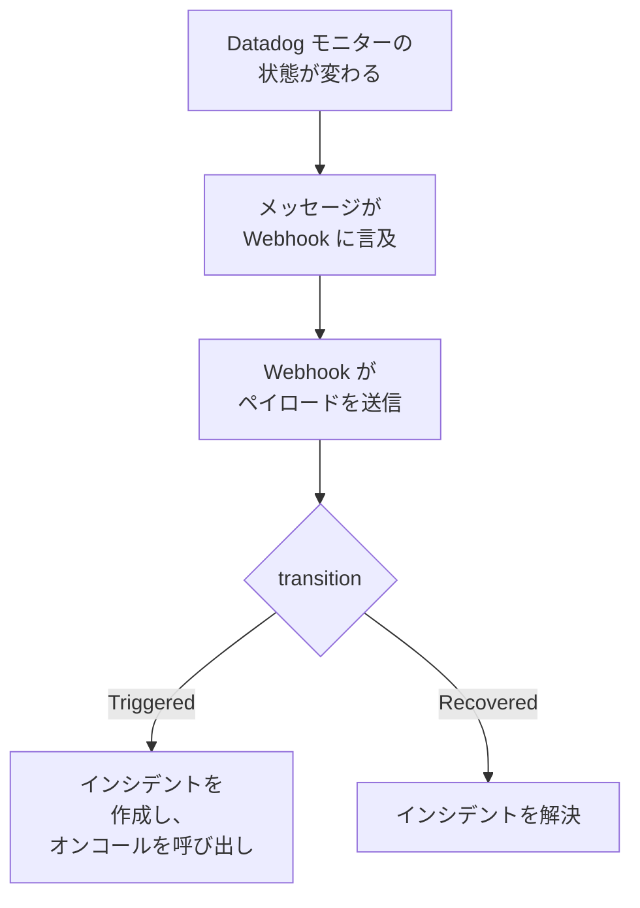

# Datadog

[Datadog](https://www.datadoghq.com) のモニターアラートを OneUptime に送信すると、各アラートがオンコールチームを呼び出すインシデントになり、Datadog のモニターが回復すると解決されます。Datadog は [Webhooks インテグレーション](https://docs.datadoghq.com/integrations/webhooks/) を通じてアラートを送信するため、どちら側にもインストールするものはありません。

:::cards
- [OneUptime でアラートを受け取る方法を選ぶ](#oneuptime-でアラートを受け取る方法を選ぶ): 受信リクエスト モニター、または独自のワークフロー。
- [モニターでアラートを受け取る](#モニターでアラートを受け取る): アラートごとに 1 つのインシデント、回復時に解決。
- [Datadog を設定する](#datadog-を設定する): Webhook と、それに通知するモニター。
- [トラブルシューティング](#トラブルシューティング): アラートが届かない場合や、インシデントが開いたままの場合。
:::

## 仕組み



Datadog のモニターは、状態が変わったとき、つまり発火、警告、回復、データなしになったときに、メッセージで言及されている Webhook に通知します。Webhook の JSON 本文は Datadog の [テンプレート変数](https://docs.datadoghq.com/integrations/webhooks/#usage) を使って自分で書くため、このガイドでは各アラートに名前を付け、何が起きたかを伝える本文を用意しています。

## 前提条件

- インテグレーションを設定し、モニターを編集できる Datadog アカウント。
- OneUptime でモニターを作成する権限。ワークフローを使う場合はワークフローを作成する権限。

## OneUptime でアラートを受け取る方法を選ぶ

まず OneUptime を設定します。Datadog の送信先となる URL が得られます。

| 方法 | 使う場面 |
| --- | --- |
| 受信リクエスト モニター（推奨） | すべてのアラートを、オンコールを呼び出し、Datadog のモニターが回復すると解決されるインシデントにしたい場合。構築するものはありません。 |
| Webhook トリガーを持つワークフロー | アラートの絞り込み、形の変換、先に他のシステムを呼び出すなど、独自のロジックが必要な場合。ワークフローは受け取ったアラートごとにインシデントを宣言し、回復時に解決しません。 |

どちらも同じ Webhook から同じ JSON を受け取るため、一方で始めて、後から Datadog の URL を 1 つ変えるだけで切り替えられます。

## モニターでアラートを受け取る

[受信リクエスト モニター](/docs/monitor/incoming-request-monitor) は URL を提供し、その条件が各アラートの処理を決めます。

:::steps
### モニターを作成する

**モニター** に移動し、**モニターを作成** をクリックします。**モニターの種類** で **受信リクエスト** を選び、名前を `Datadog` にして **次へ** をクリックします。

### アラートごとにインシデントを宣言する

**条件** ステップで、モニターをオフラインにする最初の条件を開きます。そのフィルターを **リクエストボディ**、**含む**、`"transition":"Triggered"` に設定します。この条件は、フィルターが一致するとすでにインシデントを宣言します。インシデントを次のように入力します。

- **インシデントタイトル**: `{{requestBody.title}}`。
- **説明** の下の **インシデントの説明**: `{{requestBody.body}}`、続いて別の行に `Datadog: {{requestBody.link}}`。
- **重大度**: これらのアラートに付けるインシデントの重大度。
- **オンコール** の下の **オンコールポリシー**: 呼び出すポリシー。
- **その他の項目** の下の **インシデントを自動解決**: 初期状態のままオンにしておきます。オフにすると回復が無視され、インシデントは開いたままになります。

### アラートごとに 1 つのインシデントを作成する

同じ条件で **設定** を開き、**ペイロードのフィールドでインシデントとアラートをグループ化** をオンにします。次のように入力すると、各アラートに独自のインシデントができ、その回復でインシデントが解決されます。

| フィールド | 値 |
| --- | --- |
| **次ごとに別々のインシデントを作成…** | `requestBody.alert_key` |
| **回復を示すフィールド** | `requestBody.transition` |
| **回復を意味する値** | `Recovered` |

### モニターをオンラインに戻す

モニターをオンラインにする 2 つ目の条件を開き、そのフィルターを **リクエストボディ**、**含む**、`"transition":"Recovered"` に設定します。

### URL をコピーする

**モニターを作成** をクリックします。モニターの **概要** ページに **ハートビート URL** が表示されます。Datadog 用にコピーします。

```text
https://oneuptime.com/heartbeat/<secret key>
```

セルフホスト環境では、`oneuptime.com` の代わりに独自のホストになります。
:::

以下のペイロードは `alert_key` に Datadog モニターの ID とアラートを出したグループのタグを設定するため、マルチアラートモニターの各グループに独自のインシデントができ、そのグループの回復でインシデントが解決されます。インシデントが開いている間にモニターが再発火したり再通知したりしても、2 つ目のインシデントは作成されません。各設定の働きについては、[他システムからのアラート受信](/docs/monitor/incoming-request-monitor#他システムからのアラート受信) を参照してください。

> [!NOTE]
> **Warn** や **No Data** の通知は、これらのフィルターではインシデントを作成しません。警告でも呼び出されるようにするには、**条件を追加** をクリックし、新しい条件にフィルター **リクエストボディ**、**含む**、`"transition":"Warn"`、独自の **重大度** を持つインシデント、同じグループ化設定を設定してから、最初の条件より上にドラッグします。条件は上から確認され、最初に一致したものが決定します。

## Datadog を設定する

:::steps
### Webhook を追加する

Datadog で [Webhooks インテグレーションのタイル](https://app.datadoghq.com/integrations/webhooks) を開き、まだインストールしていなければインストールします。次の設定で Webhook を追加して保存します。

- **Name**: `oneuptime`。モニターはこの名前で `@webhook-oneuptime` として Webhook に言及します。
- **URL**: OneUptime からコピーした URL。
- **Payload**:

  ```json
  {
    "alert_key": "$ALERT_ID $ALERT_SCOPE",
    "transition": "$ALERT_TRANSITION",
    "title": "$EVENT_TITLE",
    "body": "$TEXT_ONLY_MSG",
    "host": "$HOSTNAME",
    "priority": "$PRIORITY",
    "link": "$LINK"
  }
  ```

### モニターで Webhook に言及する

OneUptime を通じて呼び出すべき各 Datadog モニターで、モニターの通知メッセージに `@webhook-oneuptime` を追加し、モニターを保存します。以降、Datadog はそのモニターのアラートと回復を OneUptime に送信します。
:::

| 変数 | Datadog が入れる内容 |
| --- | --- |
| `$ALERT_ID` | アラートを出した Datadog モニターの ID。 |
| `$ALERT_SCOPE` | アラートを出したグループのタグ。たとえば `host:web-1`。 |
| `$ALERT_TRANSITION` | 何が起きたか。`Triggered`、`Re-Triggered`、`Warn`、`Recovered`、`No Data`、`Renotify` など。 |
| `$EVENT_TITLE` | イベントのタイトル。たとえば `[Triggered] High CPU`。 |
| `$TEXT_ONLY_MSG` | Markdown を除いたモニターのメッセージ。 |
| `$LINK` | Datadog 内のイベントへのリンク。 |

## テストする

Datadog と同じように、アラートを OneUptime に送信します。

```bash
curl -X POST "https://oneuptime.com/heartbeat/<secret key>" \
  -H "Content-Type: application/json" \
  -d '{
    "alert_key": "1234 host:web-1",
    "transition": "Triggered",
    "title": "[Triggered] High CPU",
    "body": "CPU is above 90% on web-1.",
    "host": "web-1",
    "priority": "normal",
    "link": "https://app.datadoghq.com/event/event?id=1"
  }'
```

`[Triggered] High CPU` というタイトルのインシデントが作成されます。`transition` を `Recovered` にして同じリクエストを送ると、インシデントが解決されます。

次に Datadog からテストします。Webhook に言及しているモニターを開き、**Test Notifications** をクリックして、その **Alert** 通知を送信します。届いたことを OneUptime のモニターのタイムラインで確認します。

## ワークフローでアラートを受け取る

Datadog とインシデントの間に独自のステップが必要な場合は、[ワークフロー](/docs/workflows/index) を使います。

:::steps
### ワークフローを作成する

**ワークフロー** に移動し、**ワークフローを作成**、続いて **ゼロから作成** をクリックします。名前を `Datadog alerts` にして **ワークフローを作成** をクリックします。

### Webhook トリガーを追加する

破線の **このワークフローを開始するものを選択** ブロックをクリックし、**Webhook** を選びます。トリガーをクリックしてから **URL をコピー** をクリックし、その URL を Datadog の Webhook に使います。

### モニターが発火したか確認する

**コンポーネントを追加** をクリックして **If / Else** ブロックを追加し、トリガーの **Out** ドットをそれにつなぎます。**Value to check** を `{{local.components.webhook-1.returnValues.request-body.transition}}`、**Comparison** を **is equal to**、**Compare with** を `Triggered` に設定します。

### インシデントを宣言する

**Create One Incident** ブロックを追加し、**If / Else** ブロックの **Yes** 側をそれにつなぎます。**Incident Template** で、重大度と呼び出すオンコールポリシーを設定するテンプレートを選びます（[インシデントテンプレート](/docs/incidents/settings#インシデントテンプレート) を参照）。**JSON Object** で、Datadog から来る内容を設定します。

```json
{
  "title": "{{local.components.webhook-1.returnValues.request-body.title}}",
  "description": "{{local.components.webhook-1.returnValues.request-body.body}}\nDatadog: {{local.components.webhook-1.returnValues.request-body.link}}"
}
```

テンプレートがない場合、**JSON Object** にはプロジェクトのインシデント重大度のいずれかの ID である `incidentSeverityId` も必要です。

### ワークフローをオンにする

**ビルダー** の上部で **有効** をオンにします。オフのワークフローは Datadog に `400` を返します。
:::

`Triggered` の通知はそれぞれ新しいインシデントを宣言します。回復は **If / Else** ブロックの **No** 側に進みますが、そこには何もつながっていないため、実行はそこで終わります。アラートごとに 1 つのインシデントを作成し、回復時に解決するには、モニターを使います。

## トラブルシューティング

:::details OneUptime に何も届かない
- Datadog モニターのメッセージが、Webhook の名前どおりの綴りで `@webhook-oneuptime` に言及しているか確認します。
- モニターは何かを確認する前に、シークレットキーが間違っていてもすぐに `200` を返します。アラートが届いているかは、モニターのタイムラインで確認します。
- オフのワークフローは `400` を返します。その **ビルダー** の上部で **有効** をオンにします。
:::

:::details インシデントは作成されるが解決されない
- Datadog モニターは回復も Webhook に通知する必要があります。条件ブロックの中でアラートのときだけ Webhook に言及するメッセージは、回復を送信しません。
- 条件のインシデントには、**その他の項目** の下の **インシデントを自動解決** が必要です。
- **回復を意味する値** は正確に `Recovered` でなければなりません。比較では大文字と小文字が区別されます。
- 回復の `alert_key` はアラートのものと同じでなければなりません。ペイロードの `$ALERT_ID $ALERT_SCOPE` はそのままにしてください。
:::

:::details フィールドに変数名が表示される、または何も表示されない
Datadog はイベントに当てはまる変数だけを埋めます。テスト通知を送り、届いた内容を確認します。モニターのタイムライン、ワークフローの場合は **ログ → 実行履歴** で確認できます。
:::

:::details モニターのすべてのアラートが 1 つのインシデントにまとめられる
各グループには独自の `alert_key` が必要です。ペイロードが `$ALERT_ID` と `$ALERT_SCOPE` の両方からそれを組み立てていること、グループ化のパスが `requestBody.alert_key` であることを確認します。
:::

## セキュリティ

- **URL はパスワードと同じように扱ってください。** URL を持っている人は誰でもインシデントを作成できます。漏えいした場合はリセットします。モニターの **設定** ページで **受信リクエストのシークレットキーをリセット**、またはワークフローの **Webhook** トリガーで **URL をリセット** を使います。その後、Datadog の Webhook の **URL** を更新します。
- **セルフホスト環境の場合は？** Datadog はインターネットから Webhook を送信するため、OneUptime にはインターネットから HTTPS で到達できる必要があります。

## 次のステップ

:::cards
- [受信リクエスト モニター](/docs/monitor/incoming-request-monitor): アラートを受け取るモニターのすべての設定。
- [Prometheus Alertmanager](/docs/integrations/prometheus-alertmanager): Alertmanager 向けの同じ設定。
- [エスカレーションルール](/docs/on-call/escalation-rules): オンコールポリシーが誰をいつ呼び出すかを決めます。
- [インテグレーションの概要](/docs/integrations/index): 接続できるその他のツール。
:::
