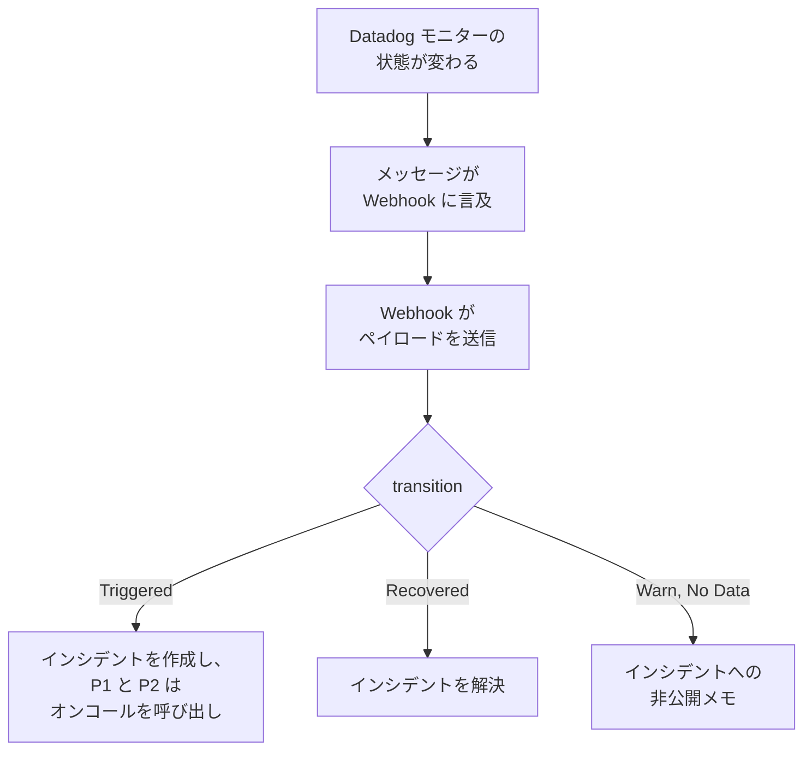

# Datadog

[Datadog](https://www.datadoghq.com) のモニターアラートを OneUptime に送信すると、各アラートがインシデントまたはアラートになり、緊急の場合はオンコールチームを呼び出し、Datadog のモニターが回復すると解決されます。Datadog は [Webhooks インテグレーション](https://docs.datadoghq.com/integrations/webhooks/) を通じてアラートを送信するため、どちら側にもインストールするものはありません。

:::cards
- [OneUptime でアラートを受け取る方法を選ぶ](#oneuptime-でアラートを受け取る方法を選ぶ): ワークフローテンプレート、または受信リクエストモニター。
- [テンプレートから始める](#テンプレートから始める): 呼び出す相手を選び、URL をコピーして、各アラートの動作を確認します。
- [モニターでアラートを受け取る](#モニターでアラートを受け取る): アラートごとに 1 つのインシデント、回復時に解決。
- [Datadog を設定する](#datadog-を設定する): Webhook と、それに通知するモニター。
- [トラブルシューティング](#トラブルシューティング): アラートが届かない場合や、インシデントが開いたままの場合。
:::

## 仕組み



Datadog のモニターは、状態が変わったとき、つまり発火、警告、回復、データなしになったときに、メッセージで言及されている Webhook に通知します。Webhook の JSON 本文は Datadog の [テンプレート変数](https://docs.datadoghq.com/integrations/webhooks/#usage) を使って自分で書くため、このガイドでは各アラートに名前を付け、何が起きたかを伝える本文を用意しています。

## 前提条件

- インテグレーションを設定し、モニターを編集できる Datadog アカウント。
- OneUptime では、ワークフローを作成する権限、またはモニターの方法を選ぶ場合はモニターを作成する権限。OneUptime Cloud では、ワークフローに **Growth** プラン以上が必要です。

## OneUptime でアラートを受け取る方法を選ぶ

まず OneUptime を設定します。Datadog の送信先となる URL が得られます。

| 方法 | 使う場面 |
| --- | --- |
| ワークフローテンプレート (推奨) | モニターの優先度に応じた重大度で、各アラートをインシデントまたはアラートにし、P1 と P2 ではオンコールを呼び出し、警告は非公開メモに残し、回復で解決したい場合。構築するものはありません。 |
| 受信リクエストモニター | ワークフローなしで、どのプランでもインシデントを作成し、ステータスが Datadog に従うモニターが欲しい場合。 |

どちらも同じ Webhook から同じ JSON を受け取るため、一方で始めて、後から Datadog の URL を 1 つ変えるだけで切り替えられます。

## テンプレートから始める

**ワークフローを作成** ダイアログには、カテゴリー一覧の **Datadog** の下に 2 つの Datadog テンプレートがあります。**Declare an incident when a Datadog monitor triggers** はインシデント用、**Create an alert when a Datadog monitor triggers** はアラート用です。どちらも同じ動作で、作成するものの種類だけが違います。

:::steps
1. **ワークフロー** に移動し、**ワークフローを作成** をクリックします。**またはテンプレートから始める** で、カテゴリー一覧の **Datadog** を選び、**Declare an incident when a Datadog monitor triggers** またはアラート用の **Create an alert when a Datadog monitor triggers** をクリックして、**このテンプレートを使う** をクリックします。
2. **Who to page for P1 and P2 monitors** で呼び出すオンコールポリシーを選び（誰も呼び出さない場合は選ばない）、**ワークフローを作成** をクリックします。ワークフローはオフの状態で **ビルダー** に開きます。
3. **Webhook** トリガーをクリックしてから **URL をコピー** をクリックし、URL を Datadog 用に控えておきます。
4. **ビルダー** の上部で **有効** をオンにします。オフのワークフローは Datadog に `400` で応答します。
:::

次に、その URL にアラートを送信するように [Datadog を設定します](#datadog-を設定する)。ワークフローの `read-event-1` ステップには同じ設定があらかじめ入っているため、**ビルダー** に戻ったときに参照できます。

### ワークフローの動作

**Webhook** トリガーの後、**Check With JavaScript** ステップ `read-event-1` が Datadog の送る `transition` を読み取り、**Incident From Another Tool**（アラートのテンプレートでは **Alert From Another Tool**）が、アラートのサイクルキーをもとにその意味どおりに処理します。Datadog はアラートが発火してから回復するまでこのキーを保持し、次に発火したときのキーは新しくなるため、そのたびに独自のインシデントができます。インシデントはキーをカスタムフィールド `datadogAlertCycleKey` に保持します。

| Transition | ワークフローの動作 |
| --- | --- |
| `Triggered`, `Re-Triggered` | `Datadog: <monitor>` というタイトルのインシデントを、モニターの優先度に対応する重大度で宣言し、ステータスページには表示しません。説明には Datadog のアラートへのリンクと、優先度、ホスト、スコープ、モニターのメッセージを記載します。そのアラートのインシデントがすでにある通知では、新しいインシデントは作成されず、誰も再び呼び出されません。 |
| `Recovered` | アラートのインシデントがまだ解決されていなければ解決します。理由はタイムラインに残ります。 |
| `Warn`, `Re-Warn`, `No Data`, `Re-No Data` | モニターの現在の状態を伝える非公開メモを、アラートのインシデントに追加します。 |
| `Renotify` | 何もしません。アラートはまだ継続中です。 |

インシデントのないアラートの警告や回復では、何も変わりません。それ以外のもの (別のツールからのリクエストなど) はそのままにされ、`read-event-1` が **No** に進み、実行の **ステップ** にその理由が示されます。Datadog には何も戻りません。Datadog は信号が回復するとアラートを自分で解決し、それがインシデントの解決につながります。

### 優先度と呼び出し

新しいインシデントは、モニターが P1 または P2 の場合、あるいは優先度がない場合に、選んだオンコールポリシーを呼び出します。P3、P4、P5 はインシデントを作成するだけで、誰も呼び出しません。新しいプロジェクトでは、優先度は次のインシデントとアラートの重大度に対応付けられます:

| Datadog の優先度 | インシデント | アラート | オンコール |
| --- | --- | --- | --- |
| P1 | Critical Incident | High | 呼び出す |
| P2 | Critical Incident | High | 呼び出す |
| 優先度なし | Critical Incident | High | 呼び出す |
| P3 | Major Incident | Low | 呼び出さない |
| P4 | Minor Incident | Low | 呼び出さない |
| P5 | Minor Incident | Low | 呼び出さない |

独自の重大度がある場合、P1、P2、優先度なしは最も重いものに、P3 は中間のものに、P4 と P5 は最も軽いものに対応します。

- 優先度を名前で自分の重大度に対応付けるには、`read-event-1` ステップの `SEVERITY_BY_NAME` を編集します。たとえば `{ P3: 'Minor Incident' }` です。
- P3 でも呼び出すには、`if-page-1` の **If / Else** ステップの **Compare with** を `3` にします。

## モニターでアラートを受け取る

[受信リクエスト モニター](/docs/monitor/incoming-request-monitor) は URL を提供し、その条件が各アラートの処理を決めます。

:::steps
### モニターを作成する

**モニター** に移動し、**モニターを作成** をクリックします。**モニターの種類** で **受信リクエスト** を選び、名前を `Datadog` にして **次へ** をクリックします。

### アラートごとにインシデントを宣言する

**条件** ステップで、モニターをオフラインにする最初の条件を開きます。そのフィルターを **リクエストボディ**、**含む**、`"transition":"Triggered"` に設定します。この条件は、フィルターが一致するとすでにインシデントを宣言します。インシデントを次のように入力します。

- **インシデントタイトル**: `{{requestBody.title}}`。
- **説明** の下の **インシデントの説明**: `{{requestBody.body}}`、続いて別の行に `Datadog: {{requestBody.link}}`。
- **重大度**: これらのアラートに付けるインシデントの重大度。
- **オンコール** の下の **オンコールポリシー**: 呼び出すポリシー。
- **その他の項目** の下の **インシデントを自動解決**: 初期状態のままオンにしておきます。オフにすると回復が無視され、インシデントは開いたままになります。

### アラートごとに 1 つのインシデントを作成する

同じ条件で **設定** を開き、**ペイロードのフィールドでインシデントとアラートをグループ化** をオンにします。次のように入力すると、各アラートに独自のインシデントができ、その回復でインシデントが解決されます。

| フィールド | 値 |
| --- | --- |
| **次ごとに別々のインシデントを作成…** | `requestBody.alert_key` |
| **回復を示すフィールド** | `requestBody.transition` |
| **回復を意味する値** | `Recovered` |

### モニターをオンラインに戻す

モニターをオンラインにする 2 つ目の条件を開き、そのフィルターを **リクエストボディ**、**含む**、`"transition":"Recovered"` に設定します。

### URL をコピーする

**モニターを作成** をクリックします。モニターの **概要** ページに **ハートビート URL** が表示されます。Datadog 用にコピーします。

```text
https://oneuptime.com/heartbeat/<secret key>
```

セルフホスト環境では、`oneuptime.com` の代わりに独自のホストになります。
:::

以下のペイロードは `alert_key` に Datadog モニターの ID とアラートを出したグループのタグを設定するため、マルチアラートモニターの各グループに独自のインシデントができ、そのグループの回復でインシデントが解決されます。インシデントが開いている間にモニターが再発火したり再通知したりしても、2 つ目のインシデントは作成されません。各設定の働きについては、[他システムからのアラート受信](/docs/monitor/incoming-request-monitor#他システムからのアラート受信) を参照してください。

> [!NOTE]
> **Warn** や **No Data** の通知は、これらのフィルターではインシデントを作成しません。警告でも呼び出されるようにするには、**条件を追加** をクリックし、新しい条件にフィルター **リクエストボディ**、**含む**、`"transition":"Warn"`、独自の **重大度** を持つインシデント、同じグループ化設定を設定してから、最初の条件より上にドラッグします。条件は上から確認され、最初に一致したものが決定します。

## Datadog を設定する

:::steps
### Webhook を追加する

Datadog で [Webhooks インテグレーションのタイル](https://app.datadoghq.com/integrations/webhooks) を開き、まだインストールしていなければインストールします。次の設定で Webhook を追加して保存します。

- **Name**: `oneuptime`。モニターはこの名前で `@webhook-oneuptime` として Webhook に言及します。
- **URL**: OneUptime からコピーした URL。
- **Payload**:

  ```json
  {
    "alert_key": "$ALERT_ID $ALERT_SCOPE",
    "alert_cycle_key": "$ALERT_CYCLE_KEY",
    "transition": "$ALERT_TRANSITION",
    "alert_priority": "$ALERT_PRIORITY",
    "title": "$EVENT_TITLE",
    "body": "$TEXT_ONLY_MSG",
    "host": "$HOSTNAME",
    "scope": "$ALERT_SCOPE",
    "priority": "$PRIORITY",
    "link": "$LINK"
  }
  ```

### モニターで Webhook に言及する

OneUptime を通じて呼び出すべき各 Datadog モニターで、モニターの通知メッセージに `@webhook-oneuptime` を追加し、モニターを保存します。以降、Datadog はそのモニターのアラートと回復を OneUptime に送信します。
:::

| 変数 | Datadog が入れる内容 |
| --- | --- |
| `$ALERT_ID` | アラートを出した Datadog モニターの ID。 |
| `$ALERT_SCOPE` | アラートを出したグループのタグ。たとえば `host:web-1`。 |
| `$ALERT_CYCLE_KEY` | アラートが発火してから回復するまで変わらない ID。 |
| `$ALERT_TRANSITION` | 何が起きたか。`Triggered`、`Re-Triggered`、`Warn`、`Recovered`、`No Data`、`Renotify` など。 |
| `$ALERT_PRIORITY` | Datadog モニターの優先度。`P1` から `P5`、優先度のないモニターでは何もなし。 |
| `$EVENT_TITLE` | イベントのタイトル。たとえば `[Triggered] High CPU`。 |
| `$TEXT_ONLY_MSG` | Markdown を除いたモニターのメッセージ。 |
| `$LINK` | Datadog 内のイベントへのリンク。 |

1 つのペイロードで両方の方法に対応できます。テンプレートは `alert_cycle_key` と `alert_priority` を、モニターは `alert_key` を使います。すべて残しておけば、URL を変えるだけで後から切り替えられます。

## テストする

Datadog と同じように、コピーした URL にアラートを送信します:

```bash
curl -X POST "<url>" \
  -H "Content-Type: application/json" \
  -d '{
    "alert_key": "1234 host:web-1",
    "alert_cycle_key": "7151157925468446720",
    "transition": "Triggered",
    "alert_priority": "P1",
    "title": "[Triggered] High CPU",
    "body": "CPU is above 90% on web-1.",
    "host": "web-1",
    "scope": "host:web-1",
    "priority": "normal",
    "link": "https://app.datadoghq.com/event/event?id=1"
  }'
```

テンプレートでは、`Datadog: High CPU` というタイトルのインシデントが作成され、選んだオンコールポリシーが呼び出されます。モニターでは、`[Triggered] High CPU` というタイトルのインシデントが作成されます。`transition` を `Recovered` にして同じリクエストを送ると、インシデントが解決されます。

次に Datadog からテストします。Webhook に言及しているモニターを開き、**Test Notifications** をクリックして、その **Alert** 通知を送信します。届いたことを確認するには、ワークフローの **ログ → 実行履歴** か、OneUptime のモニターのタイムラインを開きます。

## トラブルシューティング

:::details OneUptime に何も届かない
- Datadog モニターのメッセージが、Webhook の名前どおりの綴りで `@webhook-oneuptime` に言及しているか確認します。
- モニターは何かを確認する前に、シークレットキーが間違っていてもすぐに `200` を返します。アラートが届いているかは、モニターのタイムラインで確認します。
- オフのワークフローは `400` を返します。その **ビルダー** の上部で **有効** をオンにします。
:::

:::details ワークフローは実行されるが、何も作成されない
**ログ → 実行履歴** で実行を開きます。その **ステップ** の `read-event-1` の項目に、**No** に進んだ理由が示されます。

- `Datadog named no alert cycle key`: Datadog の Webhook のペイロードに `"alert_cycle_key": "$ALERT_CYCLE_KEY"` を追加します。
- `Datadog named no transition`: Datadog の Webhook のペイロードに `"transition": "$ALERT_TRANSITION"` を追加します。
:::

:::details オンコールが呼び出されない
- P1 と P2 のモニターと、優先度のないモニターだけが呼び出します。[優先度と呼び出し](#優先度と呼び出し) を参照してください。
- そのインシデントがすでにあるアラートの通知は、誰も再び呼び出しません。
- **ワークフローを作成** ダイアログで誰も選ばなかった場合、ワークフローには呼び出すステップがありません。
:::

:::details インシデントは作成されるが解決されない
- Datadog モニターは回復も Webhook に通知する必要があります。条件ブロックの中でアラートのときだけ Webhook に言及するメッセージは、回復を送信しません。
- テンプレートでは、**ログ → 実行履歴** で回復の実行を開きます。最後のステップに理由が示されます。回復の `alert_cycle_key` はアラートのものと同じでなければならないため、ペイロードの `$ALERT_CYCLE_KEY` はそのままにしてください。
- モニターでは、条件のインシデントに **インシデントを自動解決** が必要です。**その他の項目** の下にあります。
- **回復を意味する値** は正確に `Recovered` でなければなりません。比較では大文字と小文字が区別されます。
- 回復の `alert_key` はアラートのものと同じでなければなりません。ペイロードの `$ALERT_ID $ALERT_SCOPE` はそのままにしてください。
:::

:::details フィールドに変数名が表示される、または何も表示されない
Datadog はイベントに当てはまる変数だけを埋めます。テスト通知を送り、届いた内容を確認します。モニターのタイムライン、ワークフローの場合は **ログ → 実行履歴** で確認できます。
:::

:::details モニターのすべてのアラートが 1 つのインシデントにまとめられる
モニターでは、各グループに独自の `alert_key` が必要です。ペイロードが `$ALERT_ID` と `$ALERT_SCOPE` の両方からそれを組み立てていること、グループ化のパスが `requestBody.alert_key` であることを確認します。
:::

## セキュリティ

- **URL はパスワードと同じように扱ってください。** URL を持つ人は誰でもインシデントを作成できます。漏れた場合はリセットします: ワークフローの **Webhook** トリガーの **URL をリセット**、またはモニターの **設定** ページの **受信リクエストのシークレットキーをリセット** です。その後、Datadog の Webhook の **URL** を更新します。
- **リンクは Datadog を指します。** テンプレートは、リクエストの内容にかかわらず、Datadog のサイト上のアラートにだけリンクし、Datadog が送信したものはテキストとして書き込みます。
- **セルフホスト環境の場合は？** Datadog はインターネットから Webhook を送信するため、OneUptime にはインターネットから HTTPS で到達できる必要があります。

## 次のステップ

:::cards
- [ワークフローテンプレート](/docs/workflows/authoring): テンプレートからワークフローを作成し、ビルダーで変更します。
- [受信リクエスト モニター](/docs/monitor/incoming-request-monitor): アラートを受け取るモニターのすべての設定。
- [New Relic](/docs/integrations/new-relic): 同じテンプレートを New Relic の課題向けにしたもの。
- [エスカレーションルール](/docs/on-call/escalation-rules): オンコールポリシーが誰をいつ呼び出すかを決めます。
- [インテグレーションの概要](/docs/integrations/index): 接続できるその他のツール。
:::
