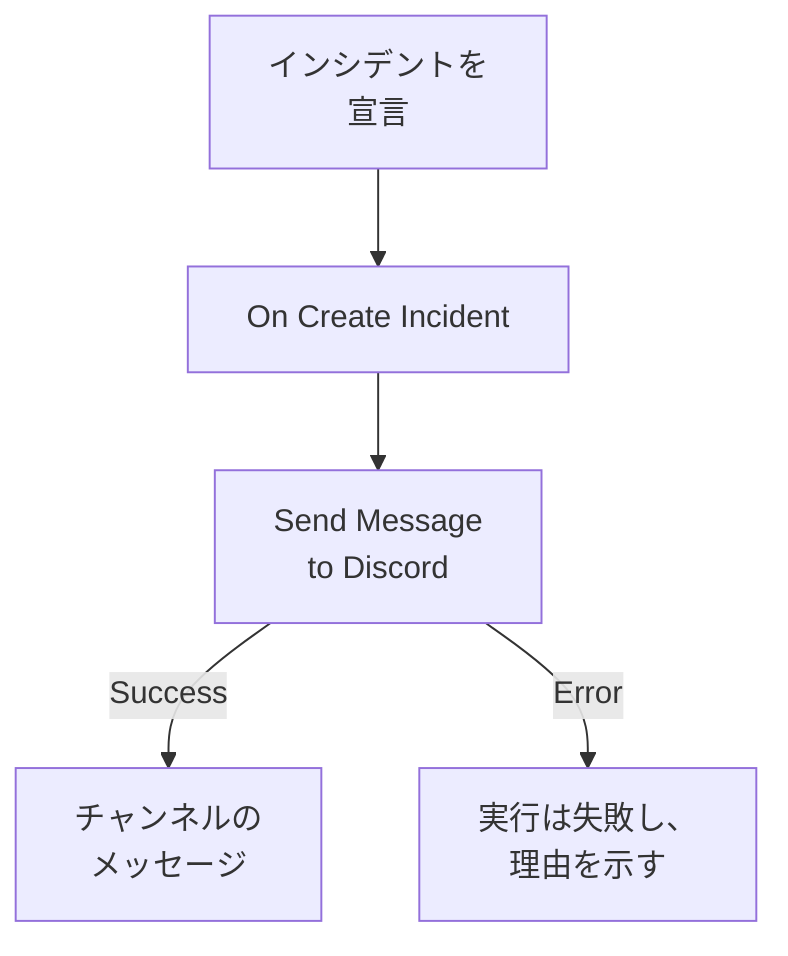

# Discord

インシデントが開かれたときに [Discord](https://discord.com) のチャンネルにメッセージを投稿し、そのチャンネルを見ている人がすぐに気付けるようにします。OneUptime のワークフローステップ **Send Message to Discord** はチャンネルの Webhook を通じて投稿し、既製のテンプレートがワークフロー全体を作成します。この連携は **アウトバウンド** です。OneUptime はチャンネルに投稿するだけで、そこでの発言は読みません。

:::cards
- [仕組み](#仕組み): インシデントが開かれたときにワークフローが行うこと。
- [セットアップ](#連携を設定する): Discord の Webhook、次にワークフロー。テンプレートからでも、ゼロからでも。
- [ヒント](#ヒント): 書式設定、長いメッセージ、その他のイベント。
- [トラブルシューティング](#トラブルシューティング): ステップのエラーの意味と、変えるべきところ。
:::

## 仕組み



ステップは **Message Text** をチャンネルの Webhook に投稿します。Discord がメッセージを受け付けると **Success** 出力に進み、Discord が拒否すると、Discord の理由とともに **Error** 出力に進みます。テンプレートのように **Error** に何も接続されていなければ、投稿できなかった実行は失敗し、その **ステップ** に理由が示されます。

## 前提条件

- Discord で、チャンネルの **Manage Webhooks** 権限。
- OneUptime で、ワークフローと変数を作成する権限。OneUptime Cloud では、ワークフローには **Growth** 以上のプランが必要です。

## 連携を設定する

:::steps
### Discord で Webhook を作成する

1. Discord で **Edit Channel** からチャンネルの設定を開き、**Integrations → Webhooks** を開いて、**New Webhook** を選択します。
2. 名前を付け（例: `OneUptime`）、正しいチャンネルに投稿されることを確認します。
3. **Copy Webhook URL** を選択します。

URL を知っている人は誰でもチャンネルに投稿できるため、パスワードと同じように厳重に保管してください。

### ワークフローを作る

ワークフロー全体を作成するテンプレートから始めるか、ゼロから始めます。

:::tabs
@tab テンプレートから
1. **ワークフロー** を開き、**ワークフローを作成** をクリックします。
2. **テンプレートを検索…** に `Discord` と入力し、**Tell Discord when an incident opens** をクリックしてから **このテンプレートを使う** をクリックします。
3. 名前は **Notify Discord on new incident** のままにするか変更して、**次へ** をクリックします。
4. URL を **Discord Webhook URL** に貼り付け、**ワークフローを作成** をクリックします。

ワークフローは 2 つのステップを持った状態で **ビルダー** に開きます。 **On Create Incident** と、インシデントの番号、タイトル、重大度、状態を投稿する **Send Message to Discord** です。URL はワークフローのシークレット変数 `discordWebhookUrl` として保存されます。
@tab ゼロから
1. URL をシークレットのグローバル変数として保存します。**ワークフロー → グローバル変数** に移動し、**ワークフロー変数を作成** をクリックして、名前を `DISCORD_WEBHOOK_URL` にし、**次へ** をクリックします。URL を **コンテンツ** に貼り付け、**シークレット** をオンにして、**ワークフロー変数を作成** をクリックします。
2. **ワークフロー** に移動し、**ワークフローを作成** をクリックして **ゼロから作成** を選び、ワークフローに名前を付けて **ワークフローを作成** をクリックします。
3. **ビルダー** で **このワークフローを開始するものを選択** をクリックし、**人気** の下の **On Create Incident** を選びます。トリガーをクリックします。その **Fields to pass on** は **タイトル** から始まるので、**フィールドを追加** をクリックし、メッセージに表示するほかのフィールド（例: **プレフィックス付きのインシデント番号**）を選びます。
4. **コンポーネントを追加** をクリックし、`discord` を検索して **Send Message to Discord** をクリックします。トリガーの **Success** 出力をそこにつなぎます。
5. 新しいステップをクリックします。**Discord Incoming Webhook URL** で **{ }** をクリックし、**グローバル変数** の下の `DISCORD_WEBHOOK_URL` を選びます。**Message Text** にメッセージを書き、**{ }** でインシデントのフィールドを挿入します。
:::

ゼロから作ったメッセージは、次のような参照でインシデントのフィールドを読み取ります:

```text
🚨 **Incident {{local.components.incident-on-create-1.returnValues.model.incidentNumberWithPrefix}} declared**
**Title:** {{local.components.incident-on-create-1.returnValues.model.title}}
```

### オンにしてテストする

**ビルダー** の上部で **有効** をオンにします。これ以降、新しいインシデントはすべてチャンネルに投稿されます。

インシデントを開かずにテストするには、**ワークフローを実行** をクリックし、**インシデント** で既存のインシデントを選びます。最近のものが一覧に表示され、番号やタイトルの一部を入力すれば別のインシデントも見つかります。**ワークフローを手動で実行** をクリックし、**実行** で確定します。**ワークフローの実行** パネルで実行を追跡でき、メッセージがチャンネルに表示されます。ステップが代わりに **Error** に進んだ場合は、実行が失敗し、 **ステップ** にあるそのステップの項目に理由が示されます。[トラブルシューティング](#トラブルシューティング) を参照してください。
:::

## ヒント

- **Discord の Markdown で書式設定する。** テキストは入力したとおりに送られるため、Discord の Markdown が使えます。単語をアスタリスクで囲むと太字になり、URL はリンクとして表示されます。
- **2,000 文字の上限に注意する。** Discord が受け付けるメッセージは最大 2,000 文字です。それより長いメッセージは拒否されるのではなく切り詰められ、末尾が "… (truncated — see OneUptime for the full text)" になります。
- **新しいインシデント以外も投稿する。** 状態の変化には **On Update Incident**、アラートには **On Create Alert** で、同じステップを使った別のワークフローを作ります。一部のインシデントだけを投稿するには、ステップの前に **If / Else** ブロックを置きます。
- **Discord 自身のアドレスだけ。** ステップは `discord.com` または `discordapp.com` の `https` URL に投稿し、リダイレクトはたどらないため、他の場所を指す URL では実行が止まります。

## トラブルシューティング

ステップが **Error** に進むと実行は失敗し、実行の **ステップ** にあるそのステップの項目に Discord の理由が示されます。

:::details Discord が "Unknown Webhook" または "Invalid Webhook Token" を返す
Webhook が削除されたか、URL のコピーを誤りました。新しい Webhook を作成し、URL を置き換えます。テンプレートのワークフローでは変数 `discordWebhookUrl`、自分で作ったワークフローでは `DISCORD_WEBHOOK_URL` の内容です。
:::

:::details Discord が "You are being rate limited" を返す
Discord は 1 つの Webhook が投稿できる頻度を制限しています。インシデントが集中するとこの上限に達することがあります。一部の重大度だけにするなど、投稿するメッセージを減らしてください。
:::

:::details 実行が "Discord Webhook URL must be an https URL on discord.com or discordapp.com" で止まる
**Discord Incoming Webhook URL** に Discord の Webhook 以外のものが入っているか、読み取る変数が空です。**Copy Webhook URL** の URL をもう一度貼り付けてください。
:::

## 次のステップ

:::cards
- [ワークフロー コンポーネント](/docs/workflows/components#discord): ステップの各設定と、出力の意味。
- [Telegram](/docs/integrations/telegram): 同じことを Telegram のチャットで。
- [ワークフロー 実行履歴](/docs/workflows/runs-and-logs): ワークフローの各実行で何が起きたかを確認します。
- [インテグレーションの概要](/docs/integrations/index): アウトバウンドのパターンと、接続できるほかのツール。
:::
