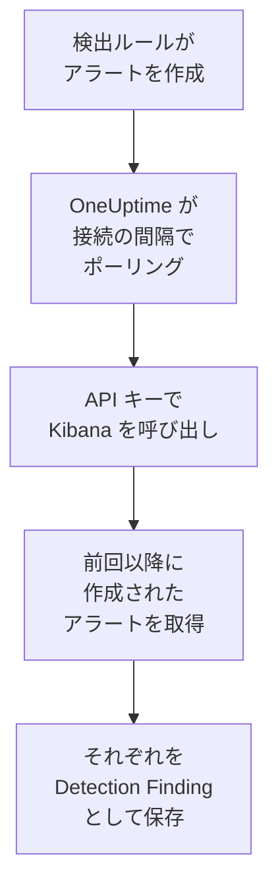

# Elastic Security

[Elastic Security](https://www.elastic.co/security) のルールが生成する検出アラートを、OneUptime のセキュリティイベントにインポートします。そこではログ、トレース、メトリクスと並べて検索し、他のあらゆるソースと相関付け、重要なものについてオンコールを呼び出せます。OneUptime は、作成した API キーを使って Kibana の検出エンジン API 経由で読み取り、Elastic では何も変更しません。

:::cards
- [接続を設定する](#接続を設定する): API キー、その権限、接続のフォーム。
- [インポートされる内容](#インポートされる内容): 各検出アラートがセキュリティイベントになる仕組み。
- [ポーリングの仕組み](#ポーリングの仕組み): 各ポーリングが読み取る時間枠と、負荷の高いスペースでの動作。
- [トラブルシューティング](#トラブルシューティング): 各エラーの意味と変更すべき点。
:::

## 仕組み



OneUptime は 1 分ごとに、ポーリング間隔が経過した有効な接続をそれぞれポーリングします。ポーリングは、前回のポーリング以降にスペースで作成された検出アラートを一度に 1,000 件ずつ Kibana に問い合わせ、それぞれを [OCSF](https://schema.ocsf.io/) Detection Finding イベント（クラス `2004`）として保存します。カスタムクエリ、しきい値、EQL、インジケーター一致、機械学習、新しい用語と、すべてのルールタイプが対象です。その後、検出ルール、モニター、ダッシュボードは、アラートを他のソースのセキュリティイベントと同じように扱います。

## 前提条件

- OneUptime で Project Owner、Project Admin、または Security Admin のロール。Security Member と Security Viewer は接続とその実行履歴を見ることはできますが、変更はできません。
- Elastic Cloud または独自の Elastic スタック上の Elastic Security 8.x 以降で、Kibana スペースで検出ルールが実行されていること。
- そのスペースの検出アラートを見られる Kibana アクセス。`.alerts-security.alerts-<space-id>` に対するインデックス権限 `read` と `view_index_metadata`、およびそこでアラートを読める Kibana の Security 機能権限が必要です。
- OneUptime が HTTPS で到達できる Kibana。OneUptime Cloud はインターネットから接続するため、Kibana には Elastic Cloud のデプロイメントのようなパブリックアドレスが必要です。プライベートアドレスは拒否されます。セルフホストの OneUptime はアプリと worker のコンテナから接続し、`DATA_SOURCE_BLOCK_PRIVATE_ADDRESSES` が `true` でない限り、プライベートネットワーク上の Kibana にも到達できます。

## 接続を設定する

:::steps
### API キーを作成する

1. Kibana で **Stack Management → API keys** を開き、**Create API key** を選択します。
2. 名前を付けます（例: `oneuptime-security-events`）。キーは、権限を絞らない限り、作成したユーザーの権限を持ちます。必要なのは上記の権限だけです。
3. 有効期限を選ぶか、無期限にします。期限切れのキーは、置き換えるまで接続を止めます。
4. キーを作成し、その **Base64** 値をコピーします。Kibana は一度しか表示しません。キーの ID や `id:api_key` のペアではありません。

### スペースの ID を確認する

アラートはスペースごとに保存されます。ルールが実行されているスペースを開きます。その ID は Kibana のアドレスの `/s/` の後ろの部分で、たとえば `https://kibana.example.com/s/security/app/security` の `security` です。デフォルトスペースには `/s/` の部分がなく、ID は不要です。

### OneUptime で接続を追加する

**製品 → セキュリティイベント → 接続**（`/dashboard/{projectId}/security-events/connections`）を開き、**接続を追加** をクリックして **Elastic Security** を選び、**次へ** をクリックします。下の表の設定を入力して **次へ** をクリックし、キーを **API キー** に貼り付けます。

### 保存する前にテストする

**保存前にテスト** の下にある **これらの設定をテスト** をクリックします。テストはフォームの値で認証してアラートを読み取り、何も保存しません。そのため、スペースの誤りや権限の不足は接続を作成する前にわかります。続いて **次へ** をクリックし、接続に **名前** を付けて作成します。
:::

| 設定 | 入力する内容 |
| --- | --- |
| **Kibana URL** | Kibana が提供されているアドレス。例: `https://kibana.example.com` や `https://<deployment>.kb.<region>.cloud.es.io`。パスは付けません。`/app/security` も `/api` も `/s/<space>` の部分も不要です。 |
| **Kibana space** | スペースの名前ではなく ID。英字、数字、ハイフン、アンダースコアです。デフォルトスペースの場合は空のままにします。 |
| **API キー** | キーの **Base64** 値そのもの。`ApiKey` スキームは OneUptime が自分で付けます。暗号化され、API から返されることはなく、再表示もされません。置き換えるには、接続の **認証情報を更新** を使います。 |

**ポーリング** ステップには、任意の **説明**、`1`～`1440` の整数で初期値 `5` の **ポーリング間隔（分）**、初期状態でオンの **有効** もあります。

## インポートされる内容

各検出アラートは、ベンダー `Elastic`、製品 `Elastic Security` の Detection Finding イベント（OCSF クラス `2004`）になります:

| アラートのフィールド | OneUptime の列 |
| --- | --- |
| `_id`（アラートの ID） | イベント UID。重複の除外にも使われます |
| `kibana.alert.original_time`、なければ `kibana.alert.start`、なければ `@timestamp` | イベント時刻 |
| `kibana.alert.rule.name` | ルール名 |
| `kibana.alert.rule.uuid`、なければ `kibana.alert.rule.rule_id` | ルール ID |
| `kibana.alert.reason`、なければルール名、なければ `kibana.alert.rule.description` | メッセージ |
| `kibana.alert.severity`、なければ `kibana.alert.risk_score` の区分 | 重大度 |
| `kibana.alert.workflow_status`: `open`、`acknowledged`、`closed` | ステータス |
| `kibana.alert.rule.threat`（サブテクニックを含む） | MITRE ATT&CK の戦術と手法 |
| `user.name`、`host.name`、`source.ip` または `host.ip`、`process.name` または `process.executable` | 主体のユーザー、ホスト、IP、プロセス |
| `process.name`、`process.executable`、`process.command_line`、`process.parent.name`、`process.parent.executable`、`process.parent.command_line` | プロセスの名前、パス、コマンドライン。親プロセスの名前、パス、コマンドライン |
| `user.target.name`、`destination.domain`、`destination.ip`、`destination.port`、`file.path` | ターゲットのユーザー、ホスト、IP、ポート、リソース |
| それらに加え、`related.*`、`dns.question.name`、`url.domain`、ファイルハッシュ | オブザーバブル |
| アラート全体。`_index` と `_id` とともに、ドット区切りのキーに展開されます | `attributes` |

アラートの時刻は、意図的にそのアラートが扱うアクティビティの時刻にしています。ルールがアラートを作成した時刻である `@timestamp` がポーリングで読むものなので、昨日のアクティビティについて今日作成されたアラートは、セキュリティイベントのエクスプローラーでは昨日の日付に表示されます。アラートに重大度がない場合はリスクスコアで決まります。`74` 以上は Critical、`48` 以上は High、`22` 以上は Medium、それ未満は Low です。

## ポーリングの仕組み

各ポーリングは、自分の時間枠で作成されたアラートを古い順に、1 ページ 1,000 件ずつ取得します。デフォルト以外のスペースでは、パスは `/s/{Kibana space}` で始まります:

```text
POST {Kibana URL}/api/detection_engine/signals/search
    {"query": {"range": {"@timestamp": {"gte": "{window start}", "lt": "{window end}"}}},
     "size": 1000, "sort": [{"@timestamp": "asc"}]}
```

- **作成時刻がカーソルです。** アラートは、扱うアクティビティの時刻ではなく、ルールの実行がアラートを作成した時刻である独自の `@timestamp` で一覧取得されます。1 時間ごとに実行されるルールは最大 1 時間前のアクティビティについてアラートを作成するため、アクティビティ時刻を基準にしたカーソルではそれらをすべて飛ばしてしまいます。
- **最初のポーリングは 24 時間前までさかのぼります**。そのため、新しい接続にはすぐに最近のアラートが表示されます。
- **以降の各ポーリングは、保存されたカーソルの 1 分前から始まります**。そのため、2 つの時間枠の境界で作成されたアラートが失われることはありません。
- **1 回のポーリングで読むのは、カーソルから最大 24 時間先までです。** カーソルが遅れた接続は、24 時間の時間枠を続けて読んで追いつき、その **ヘルス** には **Catching up** と表示されます。
- **重複はアラートの `_id` で除外されます**。対象はプロジェクト内で、重なり、再試行された時間枠、インポートによってアラートが二重に保存されることはありません。

Kibana のアラート検索はサイズと並べ替え順を受け付けますが、ページトークンはありません。そのため OneUptime は、範囲の開始を各ページの最後のアラートに移しながらページを進め、その瞬間にすでに読んだアラートを `_id` で除外します。1 回のルール実行で多くのアラートに同じ時刻が付くことはよくありますが、そのようなグループもページごとに読まれ、二重に読まれることも飛ばされることもありません。

### 1 回のポーリングで読み切れないほど時間枠にデータがある場合

1 回のポーリングで読むのは、最大 20 件のリクエストで最大 10,000 件のアラートです。時間枠にそれより多く含まれていると、実行は **部分的** になり、次のような警告が出ます:

```text
Stopped after collecting 10000 alerts; the window holds more.
```

アラートは古い順に読まれるため、OneUptime はカーソルを最後に読んだアラートの作成時刻に移し、次のポーリングは同じ時間枠の長さでそこから始まります。負荷の高いスペースは、同じものを読み直すのではなく、ポーリングごとに 10,000 件ずつ追いつきます。まったく同じ瞬間に作成されたアラートは 2 回読まれ、重複チェックが 2 つ目のコピーを除外します。

除外する ID は各リクエストに含めて送られ、Kibana はリクエストのサイズを制限しています。1 つのリクエストで除外できるより多くのアラート（約 7,800 件）が同じ瞬間を共有している場合、実行はそこで **部分的** として止まり、その瞬間を示す警告が出ます。

実行が保存されたカーソルより先にまったく進めない場合、OneUptime は代わりに時間枠を短くします。

1. **縮める。** 次のポーリングは同じ開始点から半分の長さの時間枠を読み、時間枠を最後まで読めるようになるまで、最短 1 分まで半分にし続けます。実行の警告にはそのことが示されます: `This window holds more records than one poll can read; the next poll reads a {n} minute window from the same starting point.`
2. **元に戻す。** 時間枠を最後まで読めたら、次の時間枠は再び 2 倍になり、最長 24 時間まで戻ります。
3. **1 分を飛ばす。** 1 分間でさえ 1 回のポーリングで読み切れないほどある場合、ポーリングはその 1 分を飛ばして先に進み、新しいアラートが届き続けるようにします。実行は **部分的** のままで、**最終エラー** には `More records were created in the one minute from {cursor} to {end} than one poll can read. Polling moved past this minute so newer records keep arriving; use Import this time range in Diagnostics on this minute to recover what one run can read.` と表示されます。その 1 分を **この時間範囲をインポート** でインポートすると、1 回の実行で読める分を取り戻せます。

Kibana のエラーで完全に失敗した実行は、カーソルと時間枠の長さを保ち、次のポーリングが同じ時間枠を読み直します。唯一の例外はタイムアウトしたリクエストです。カーソルはそのままですが、次の時間枠は半分の長さになります。時間内に応答できないほど重い時間枠は、何度試してもタイムアウトするからです。**ポーリング間隔（分）** を変えても、これは何も変わりません。この設定が決めるのはポーリングを開始する頻度であって、時間枠の開始位置ではありません。

### オンデマンドで実行、プレビュー、インポートする

接続の **診断** をクリックすると、最近の実行を確認し、手動で操作できます。これらを開始できるのは接続を変更できるユーザーで、履歴は接続を見られるユーザーなら誰でも読めます。

- **今すぐ実行** は、接続が **有効** でなくても、通常のカーソルでただちにポーリングを開始します。
- **Preview alerts** は最大 7 日間の時間範囲を読み取り、何もインポートしません。
- **この時間範囲をインポート** は、確認後、カーソルを動かさずに最大 7 日間の範囲をインポートします。インポート済みのアラートはスキップされます。
- 実行の **診断情報をコピー** は、サポート向けにその実行のレポートをコピーします。認証情報は含まれません。

## 接続をテスト

接続の行にある **接続をテスト** と、フォームの **これらの設定をテスト** は、バックグラウンド worker ではなく API プロセスで実行されます。そのため、worker に問題がある場合でもテストは応答します。テストは次のチェックを順に実行します。

| チェック | 確認内容 |
| --- | --- |
| **構成** | すべての設定が存在し、形式が正しいこと。失敗した場合はどこにも接続しません。 |
| **Authenticate with Kibana** | Kibana の `/api/status` が完全な内容で応答すること。Kibana は認証していない呼び出し元にも少ない内容で応答するため、短い応答ではこのチェックは失敗します。 |
| **Read detection alerts** | 過去 24 時間に作成されたアラートを一件読めること。これで権限とスペースが確認できます。 |
| **Alerts available to import** | 過去 24 時間と過去 7 日間に作成されたアラートの数。Elasticsearch が一部しか数えなかった場合は `+` が付きます。7 日間に一件もない場合は失敗ではなく警告です。 |
| **Background workers**, **Poll scheduler**, **Security event storage** | OneUptime 側の状態。プロセスが Worker キューのジョブを取得していること、ポーリングジョブが毎分実行されていること、セキュリティイベントのストアが応答すること。 |
| **スケジュールされたポーリング** | 保存済みの接続について、ポーリングがオンであること、worker を待って止まっている実行がないこと、ポーリングが予定どおり実行されていること。 |

テスト内の各リクエストの期限は 20 秒です。テストは何もインポートせず、カーソルも動かしません。失敗した各チェックは、何を変更すべきかを示します。

## Elastic Security にセキュリティイベントを送る

OneUptime は見つけたものを、データストリーム内の Elastic Common Schema (ECS) ドキュメントとして Elasticsearch にも送ることができ、Elastic Security のアラート、タイムライン、検出ルールで OneUptime の検出を自分の検出と並べて見られます。検出は `event.kind` が `alert` のドキュメントになり、それ以外のイベントは `event.kind` が `event` になります。

:::steps
### 書き込める API キーを作成する

Kibana で **Stack Management → API keys** を開き、**Create API key** をクリックし、下の権限を付与して、その **Encoded** の値をコピーします。

### 送信先を追加する

**製品 → セキュリティイベント → 接続** を開きます。**SIEM に送信** で **送信先を追加** をクリックし、**SIEM** で Elastic Security を選んで **次へ** をクリックします。**Elasticsearch の URL** には Kibana ではなくデプロイメントの Elasticsearch エンドポイントを入力し、キーを **API キー** に貼り付けます。**データストリーム** は任意です。空のままにすると、ドキュメントは `logs-oneuptime.security-default` に送られ、Elasticsearch が最初の書き込みで作成します。

### テストイベントを送信して送信を開始する

**テストイベントを送信** をクリックすると、データストリームにドキュメントがひとつ届きます。続いて **送信内容** で **検出のみ** のままにするか **すべてのセキュリティイベント** を選び、 **送信を開始** をクリックします。
:::

既定のデータストリーム用のキーの権限:

```json title="oneuptime-writer-role.json"
{
  "oneuptime-writer": {
    "indices": [
      {
        "names": [
          "logs-oneuptime.security-*"
        ],
        "privileges": [
          "create_doc",
          "auto_configure"
        ]
      }
    ]
  }
}
```

- ドキュメントは最大 500 件ずつのバッチで送られ、それぞれにイベント自身の ID が付くので、二度送られたイベントも一度だけ保存されます。
- Elasticsearch がマッピングできないドキュメントは除外されて **エラーを表示** に示され、今は受け付けられないドキュメント (`429`) は再送されます。
- OneUptime が Elastic Security からインポートしたアラートは、決して Elastic Security に送り返されません。

## トラブルシューティング

接続の **最終エラー** は、認証情報を伏せたうえで完全なエラーメッセージを保持し、その前に失敗したステップを示すプレフィックスを付けます。接続にエラーがある場合は、その **アクション** 列で **エラーを表示** を選んで読み、ダイアログの **エラーをコピー** でコピーします。まずプレフィックスを読んでください。

:::details 最終エラーが `Elastic Security status request` で始まる
- `Elastic Security status request failed (HTTP ...)`: Kibana がステータスリクエストを拒否しました。
  - `HTTP 401`: Kibana は API キーを受け入れませんでした。**Base64** 値ではないか、期限切れか、無効化されています。新しいキーを作成し、**認証情報を更新** で保存します。
  - `HTTP 404`: **Kibana URL** にパスが付いているか、Kibana ではありません。
  - `HTTP 503`: Kibana が自分を利用不可と報告しています。通常は Elasticsearch に到達できないためです。
  - `HTTP 3xx`: Kibana がリクエストをリダイレクトしましたが、リダイレクトは拒否されます。Kibana が提供されているアドレスを使ってください。
- `Elastic Security status request returned ...`: サインインページやプロキシなど、Kibana 以外のものが応答しました。
- テストだけが失敗し、Kibana が `answered without authenticating the request` と表示される場合、キーは Kibana に届いていません。**Base64** 値であること、また Kibana の前にあるプロキシが `Authorization` ヘッダーを削除していないことを確認してください。
:::

:::details 最終エラーが `Elastic Security alerts search` で始まる
- `Elastic Security alerts search failed (HTTP ...)`: Kibana がアラート検索を拒否しました。
  - `HTTP 403`: キーでサインインはできますが、スペースのアラートを読めません。[前提条件](#前提条件) の権限を付与してください。
  - `HTTP 404`: その **Kibana space** の ID を持つスペースがないか、そのスペースで Elastic Security が有効になっていません。
  - `HTTP 429` または `HTTP 5xx`: Kibana または Elasticsearch がリクエストを制限しているか、失敗しています。次のポーリングで再試行します。
- `Elastic Security alerts search returned ...`: Kibana は `200` で応答しましたが、読み取れるアラートのページがなく、Kibana 自身のエラーなどが返りました。メッセージにその内容が引用されています。空の時間枠として扱わずに報告されるため、誰も読んでいないアラートをカーソルが飛ばすことはありません。
:::

:::details 最終エラーが `did not complete` で終わる
`Elastic Security alerts search did not complete`（ステータスリクエストも同様）は、リクエストに応答がなかったことを意味します。タイムアウト、解決できない名前、拒否された接続、または拒否されたプライベートアドレスです。OneUptime のアプリと worker が正しいスキームとポートで Kibana に到達できることを確認してください。タイムアウトの後、次のポーリングは半分の長さの時間枠を読みます。
:::

:::details 最終ポーリングが Never で、最終エラーが空
この接続ではまだポーリングが一度も完了していません。**接続をテスト** を実行すると、その **Background workers** と **Poll scheduler** のチェックが原因を示します。セルフホスト環境でよくある原因は、ジョブを処理する別の worker デプロイがないままアプリで `DISABLE_QUEUE_WORKERS=true` になっていることです。`false` に設定するか、worker デプロイを実行します（Helm: `worker.enabled: true`）。
:::

:::details 実行が部分的
- `Stopped after collecting 10000 alerts; the window holds more`: 時間枠に、1 回の実行で読む 10,000 件を超えるアラートがありました。何も失われません。次のポーリングは最後に読んだアラートの後から始まります。ポーリングのたびに **部分的** のままの接続は滞留分に追いつこうとしているところで、**最終ポーリング** と **最後にインポートしたイベント** は進み続けます。いつまでも追いつかない場合、スペースはポーリング間隔ごとに 10,000 件を超えるアラートを作成しています。**ポーリング間隔（分）** を短くしてください。
- `More records were created in the one minute from ... than one poll can read`: ポーリングはその 1 分を飛ばしました。**診断** の **この時間範囲をインポート** でインポートします。インポートは 1 回のポーリングと同じだけ読み取ります。
:::

:::details テストは成功するが何もインポートされない
テストのレポートで **Alerts available to import** を確認します。過去 7 日間が `0` の場合、そのスペースではどのルールもアラートを作成していません。そこでルールが有効になっていること、また **Kibana space** がルールの実行されているスペースであることを確認してください。アラートがある場合は、セキュリティイベントのエクスプローラーで時間範囲を広げます。アラートはアクティビティの時刻に表示され、それは作成時刻よりかなり前のことがあります。
:::

## 得られるもの

- **検索。** セキュリティイベントのエクスプローラーで、重大度、ステータス、ルール、MITRE ATT&CK の手法、ユーザー、ホスト、任意のオブザーバブルでアラートを絞り込み、他のすべてのソースと並べて確認できます。
- **相関付け。** 各アラートのユーザー、ホスト、IP、ドメイン、ハッシュはオブザーバブルとしてインデックス化されるため、1 回の検索でそれらに言及するものをすべて見つけられます。
- **検出ルール。** セキュリティイベントに対してスケジュールで実行され、オンコールを呼び出すアラートを作成する Sigma ルール。
- **モニター。** セキュリティイベントのモニターは、新しい重大なアラートなどの一致するイベントを数え、しきい値を超えるとインシデントやアラートを作成します。

セキュリティイベントは、他のテレメトリと同様に取り込み GB 単位で課金されます。[料金](https://oneuptime.com/pricing) を参照してください。

## 次のステップ

:::cards
- [セキュリティイベント](/docs/telemetry/security-events): インポートしたものを検索、相関付けし、アラートを出します。
- [Splunk Enterprise Security](/docs/integrations/splunk): Splunk のサーチヘッドの notable event もインポートします。
- [ロール](/docs/permissions/reference#ロール): Security ロールが閲覧・変更できる内容。
- [インテグレーションの概要](/docs/integrations/index): 接続できるその他のツール。
:::
