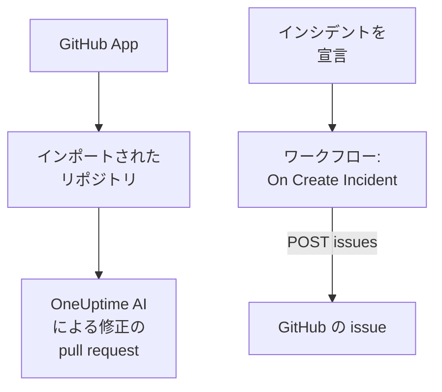

# GitHub

OneUptime は 2 つの方法で [GitHub](https://github.com) と連携します。OneUptime の GitHub App でリポジトリを接続すると、OneUptime の AI が見つけた問題を修正する pull request を作成し、issue や pull request でメンションされると応答します。または、インシデントごとに GitHub の issue を作成するワークフローを作れば、フォローアップ作業をそのサービスを所有するリポジトリで追跡できます。

:::cards
- [接続方法を選ぶ](#接続方法を選ぶ): GitHub App とワークフロー、それぞれでできること。
- [リポジトリを接続する](#リポジトリを接続する): 修正の pull request のための GitHub App。
- [インシデントごとに issue を作成する](#インシデントごとに-github-の-issue-を作成する): 1 つのワークフローと 2 つのブロック。
- [トラブルシューティング](#トラブルシューティング): GitHub がリクエストを拒否したとき。
:::

## 仕組み



2 つは独立しており、どちらか一方でも両方でも使えます。GitHub App はインストールしたリポジトリで動作します。ワークフローに必要なのはトークンだけで、他の API と同じように GitHub の [REST API](https://docs.github.com/en/rest/issues/issues#create-an-issue) を呼び出します。

## 接続方法を選ぶ

| 方法 | できること | 必要なもの |
| --- | --- | --- |
| GitHub App | リポジトリをインポートします。OneUptime の AI が、例外、遅いトレース、調査で見つかった原因を修正する pull request をそこで作成し、issue や pull request でのメンションに応答します。 | アプリをインストールする組織またはアカウント。OneUptime Cloud では **Growth** プラン。 |
| ワークフロー | インシデントごとに、選んだリポジトリに GitHub の issue を作成します。 | issue を作成できる GitHub トークンと、二つのブロックでできたワークフロー。 |

## リポジトリを接続する

**製品 → コード → タスク** を開き、**コードリポジトリ** を開いて、**GitHub App で接続** をクリックします。GitHub がアプリのインストール先と、使用できるリポジトリを尋ねます。インストールに含まれるすべてのリポジトリがインポートされ、インストールにリポジトリを追加したり外したりすると、それに合わせて更新されます。

セルフホストのインスタンスでは、まず独自の GitHub App が必要です。作成方法は [GitHub 統合](/docs/self-hosted/github-integration) を参照してください。その後は [修正タスク](/docs/ai/ai-agent) がリポジトリに pull request を作成し、issue や pull request でアプリをメンションしたときの動作は [GitHub App](/docs/ai/github-app) のページで説明しています。

## 前提条件

このページの残りでは、ワークフローを作ります。必要なもの:

- リポジトリで issue を作成できる GitHub トークン。そのリポジトリ用の fine-grained personal access token で **Issues** 権限を **Read and write** にしたもの、または `repo` スコープを持つクラシックトークンです。GitHub の [トークン設定](https://github.com/settings/tokens) で作成します。
- OneUptime では、ワークフローとグローバル変数を作成する権限。OneUptime Cloud では、ワークフローに **Growth** プラン以上が必要です。

## トークンを保存する

:::steps
1. **ワークフロー → グローバル変数** に移動し、**ワークフロー変数を作成** をクリックします。
2. 名前を `GITHUB_TOKEN` にして **次へ** をクリックします。
3. トークンを **コンテンツ** に貼り付け、**シークレット** をオンにして、**ワークフロー変数を作成** をクリックします。
:::

シークレット変数は実行ログで `[REDACTED]` に置き換えられるため、トークンが実行に表示されることはありません。

## インシデントごとに GitHub の issue を作成する

:::steps
### ワークフローを作成する

**ワークフロー** に移動し、**ワークフローを作成** をクリックしてから **ゼロから作成** をクリックします。名前を `Incidents to GitHub` にして **ワークフローを作成** をクリックします。

### トリガーを追加する

破線の **このワークフローを開始するものを選択** ブロックをクリックし、**On Create Incident** を選びます。トリガーをクリックします。その **Fields to pass on** は **タイトル** から始まるので、**フィールドを追加** をクリックして **説明** と **プレフィックス付きのインシデント番号** を選びます。

### issue を作成する

**コンポーネントを追加** をクリックし、**API Post (JSON)** ブロックを追加して、トリガーの **Success** の点をそこにつなぎます。その **URL** を `https://api.github.com/repos/your-org/your-repo/issues` に設定し、リポジトリのオーナーと名前に置き換えます。**その他の項目** で、その **Request Headers** を次のように設定します:

```json
{
  "Authorization": "Bearer {{global.variables.GITHUB_TOKEN}}",
  "Accept": "application/vnd.github+json",
  "X-GitHub-Api-Version": "2022-11-28"
}
```

**Request Body** は次のとおりです:

```json
{
  "title": "{{local.components.incident-on-create-1.returnValues.model.title}}",
  "body": "{{local.components.incident-on-create-1.returnValues.model.description}}\n\nOpened by OneUptime for incident {{local.components.incident-on-create-1.returnValues.model.incidentNumberWithPrefix}}.",
  "labels": ["incident"]
}
```

### テストしてからオンにする

**ワークフローを実行** をクリックし、**インシデント** でテスト用インシデントを選んで実行します。**API Post (JSON)** ステップには、新しい issue を含む `201` の応答が、その `number` と `html_url` とともに表示されます。その後、**ビルダー** の上部で **有効** をオンにします。
:::

フォローアップ作業は通常インシデントより長く続くため、インシデントが解決しても issue は開いたままです。インシデントと双方向で同期されるチケットについては、[Jira](/docs/integrations/jira) を参照してください。

## ヒント

- **GitHub Enterprise Server.** 代わりに自分のサーバーにリクエストを送ります: `https://your-github-host/api/v3/repos/your-org/your-repo/issues`。プライベートネットワークのアドレスにあるサーバーには、管理者がそれを許可したセルフホストの OneUptime が必要です。[送信ネットワークアクセス](/docs/workflows/configuration#送信ネットワークアクセス) を参照してください。
- **担当者を割り当てる。** 本文に `"assignees": ["octocat"]` や `"milestone": 3` を追加します。トークンがリポジトリに push できない場合、GitHub はラベル、担当者、マイルストーンを何も言わずに破棄します。
- **一部のインシデントだけ。** トリガーと API ブロックの間に **If / Else** ブロックを置き、その **Yes** 側でだけ issue を作成します。たとえば特定の重大度の場合だけにします。

## トラブルシューティング

GitHub がリクエストを拒否すると、**API Post (JSON)** ステップは **Error** に進みます。実行の **Response Status** と **Response Body** に理由が示されます。

:::details GitHub が 401 を返す
トークンが誤っているか、期限切れか、取り消されています。新しいトークンを作成し、`GITHUB_TOKEN` の内容を置き換えます。
:::

:::details GitHub が 403 を返す
トークンはそこで issue を作成できません。このリポジトリで **Issues** が **Read and write** になっていない fine-grained token、組織が承認していないトークン、または組織のシングルサインオンで承認されていないクラシックトークンです。本文がレート制限に触れている 403 は、トークンが送ったリクエストが多すぎることを意味します。しばらく待つか、issue を作成するインシデントを減らしてください。
:::

:::details GitHub が 404 を返す
**URL** のオーナーかリポジトリが誤っているか、トークンがリポジトリを見られません。トークンが見られないプライベートリポジトリに対して、GitHub は 403 ではなく 404 を返します。
:::

:::details GitHub が 410 または 422 を返す
- `410`: リポジトリの設定で issues がオフになっています。
- `422`: GitHub は本文を読み取れません。有効な JSON であること、`title` が設定されていること、`labels` と `assignees` がリストであることを確認してください。
:::

## 次のステップ

:::cards
- [GitHub App](/docs/ai/github-app): GitHub から直接、OneUptime の AI に変更、修正、レビューを依頼します。
- [GitLab](/docs/integrations/gitlab): 同じワークフローを GitLab の issue で。
- [ワークフロー コンポーネント](/docs/workflows/components#api): API ブロックのすべての設定。
- [インテグレーションの概要](/docs/integrations/index): 各インテグレーションの背後にあるパターン。
:::
