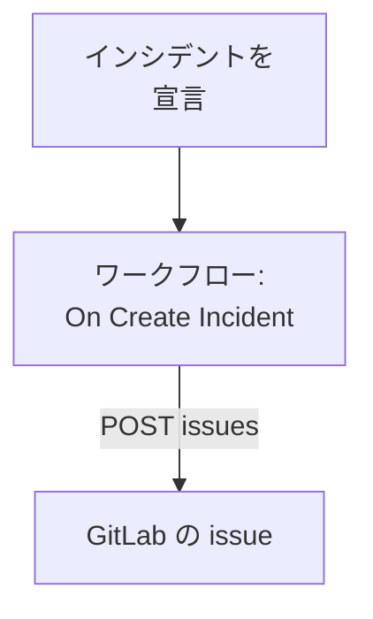

# GitLab

OneUptime のインシデントごとに [GitLab](https://gitlab.com) の issue を作成し、フォローアップ作業をそのサービスを所有するプロジェクトで追跡できるようにします。ワークフローは、GitLab.com または自前の GitLab で、GitLab の [Issues API](https://docs.gitlab.com/api/issues/#new-issue) を呼び出します。

:::cards
- [トークンを保存する](#トークンを保存する): GitLab のトークンをワークフローに直接書かないようにします。
- [インシデントごとに issue を作成する](#インシデントごとに-gitlab-の-issue-を作成する): 1 つのワークフローと 2 つのブロック。
- [ヒント](#ヒント): 自前の GitLab、プロジェクトのパス、担当者。
- [トラブルシューティング](#トラブルシューティング): GitLab がリクエストを拒否したとき。
:::

> [!NOTE]
> OneUptime の AI は GitLab のリポジトリでも作業できます。アクセストークンで「コード」に接続すると、修正ごとにマージリクエストを作成します。[リポジトリを接続する](/docs/ai/ai-agent#リポジトリを接続する) を参照してください。

## 仕組み



ワークフローは新しいインシデントごとに 1 回実行されます。その **API Post (JSON)** ブロックが、アクセストークンで署名して、インシデントのタイトルと説明をプロジェクトの issues に送ります。

## 前提条件

- GitLab プロジェクトの ID。プロジェクトの概要ページでアクションメニュー（縦の三点リーダー）を選び、**Copy project ID** を選択します。
- `api` スコープを持つ GitLab のアクセストークン。プロジェクトでのロールが issue を作成できるユーザーまたはボットのもので、プロジェクト、グループ、パーソナルのいずれかのアクセストークンです。プロジェクト、グループ、またはユーザー設定の **Settings → Access tokens** で作成します。
- OneUptime では、ワークフローとグローバル変数を作成する権限。OneUptime Cloud では、ワークフローに **Growth** プラン以上が必要です。

## トークンを保存する

:::steps
1. **ワークフロー → グローバル変数** に移動し、**ワークフロー変数を作成** をクリックします。
2. 名前を `GITLAB_TOKEN` にして **次へ** をクリックします。
3. トークンを **コンテンツ** に貼り付け、**シークレット** をオンにして、**ワークフロー変数を作成** をクリックします。
:::

シークレット変数は実行ログで `[REDACTED]` に置き換えられるため、トークンが実行に表示されることはありません。

## インシデントごとに GitLab の issue を作成する

:::steps
### ワークフローを作成する

**ワークフロー** に移動し、**ワークフローを作成** をクリックしてから **ゼロから作成** をクリックします。名前を `Incidents to GitLab` にして **ワークフローを作成** をクリックします。

### トリガーを追加する

破線の **このワークフローを開始するものを選択** ブロックをクリックし、**On Create Incident** を選びます。トリガーをクリックします。その **Fields to pass on** は **タイトル** から始まるので、**フィールドを追加** をクリックして **説明** と **プレフィックス付きのインシデント番号** を選びます。

### issue を作成する

**コンポーネントを追加** をクリックし、**API Post (JSON)** ブロックを追加して、トリガーの **Success** の点をそこにつなぎます。その **URL** を `https://gitlab.com/api/v4/projects/12345678/issues` に設定し、`12345678` をプロジェクトの ID に置き換えます。**その他の項目** で、その **Request Headers** を次のように設定します:

```json
{
  "PRIVATE-TOKEN": "{{global.variables.GITLAB_TOKEN}}"
}
```

**Request Body** は次のとおりです:

```json
{
  "title": "{{local.components.incident-on-create-1.returnValues.model.title}}",
  "description": "{{local.components.incident-on-create-1.returnValues.model.description}}\n\nOpened by OneUptime for incident {{local.components.incident-on-create-1.returnValues.model.incidentNumberWithPrefix}}.",
  "labels": "incident,oneuptime"
}
```

### テストしてからオンにする

**ワークフローを実行** をクリックし、**インシデント** でテスト用インシデントを選んで実行します。**API Post (JSON)** ステップには、新しい issue を含む `201` の応答が、その `iid` と `web_url` とともに表示されます。その後、**ビルダー** の上部で **有効** をオンにします。
:::

ブロックは JSON を送るため、`Content-Type` ヘッダーは不要です。GitLab は見たことのないラベルを作成するため、`incident` と `oneuptime` の準備は不要です。フォローアップ作業は通常インシデントより長く続くため、インシデントが解決しても issue は開いたままです。

## ヒント

- **自前の GitLab。** 代わりに自分のサーバーにリクエストを送ります: `https://gitlab.example.com/api/v4/projects/12345678/issues`。プライベートネットワークのアドレスにあるサーバーには、管理者がそれを許可したセルフホストの OneUptime が必要です。[送信ネットワークアクセス](/docs/workflows/configuration#送信ネットワークアクセス) を参照してください。
- **ID の代わりにプロジェクトのパス。** パスは ID の代わりに使え、その `/` は `%2F` と書きます: `projects/your-group%2Fyour-project/issues`。URL は書いたとおりに送られるため、エンコードは自分で行ってください。
- **担当者を割り当てる。** 本文に `"assignee_ids": [42]` や `"due_date": "2026-12-31"` を追加するか、プロジェクトのメンバーだけに表示するには `"confidential": true` を追加します。
- **一部のインシデントだけ。** トリガーと API ブロックの間に **If / Else** ブロックを置き、その **Yes** 側でだけ issue を作成します。たとえば特定の重大度の場合だけにします。

## トラブルシューティング

GitLab がリクエストを拒否すると、**API Post (JSON)** ステップは **Error** に進みます。実行の **Response Status** と **Response Body** に理由が示されます。

:::details GitLab が 401 を返す
トークンが誤っているか、期限切れか、取り消されています。新しいトークンを作成し、`GITLAB_TOKEN` の内容を置き換えます。
:::

:::details GitLab が 403 を返す
トークンに `api` スコープがないか、そのユーザーのプロジェクトでのロールでは issue を作成できません。スコープが原因の場合、本文に `insufficient_scope` と示されます。
:::

:::details GitLab が 404 を返す
**URL** のプロジェクト ID が誤っているか、トークンがプロジェクトを見られません。トークンが見られないプライベートプロジェクトに対して、GitLab は 403 ではなく 404 を返します。
:::

:::details GitLab が 400 を返す
GitLab は本文を読み取れません。`title` がないか、フィールドの型が誤っています。本文にそのフィールドが示されます。
:::

## 次のステップ

:::cards
- [GitHub](/docs/integrations/github): 同じワークフローの GitHub 版と、GitHub App。
- [ワークフロー コンポーネント](/docs/workflows/components#api): API ブロックのすべての設定。
- [ワークフロー 実行履歴](/docs/workflows/runs-and-logs): 各リクエストが送信した内容と受け取った内容を確認します。
- [インテグレーションの概要](/docs/integrations/index): 各インテグレーションの背後にあるパターン。
:::
