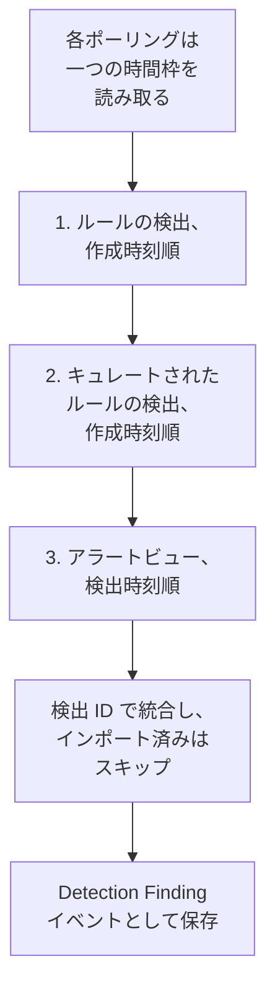

# Google SecOps

[Google SecOps](https://cloud.google.com/security/products/security-operations)（旧 Chronicle）のアラートと検出を OneUptime のセキュリティイベントに取り込みます。そこではログ、トレース、メトリクスと並べて検索し、他のあらゆるソースと相関付け、重要なものについてオンコールを呼び出せます。

:::cards
- [接続方法を選ぶ](#接続方法を選ぶ): SOAR プレイブックの Webhook、マネージドコネクター、または UDM の転送。
- [マネージドコネクターを設定する](#マネージドコネクターを設定する): サービスアカウントキーと接続のフォーム。
- [コネクターのポーリングの仕組み](#コネクターのポーリングの仕組み): 各時間枠を 3 通りに読む方法と、その予算。
- [トラブルシューティング](#トラブルシューティング): 最終エラーの意味と対処方法。
- [Google SecOps にセキュリティイベントを送る](#google-secops-にセキュリティイベントを送る): OneUptime の検出を Google SecOps で。
:::

## 接続方法を選ぶ

| 方法 | 届くもの | 使う場面 |
| --- | --- | --- |
| SOAR プレイブックの Webhook | プレイブックが送信する各アラート（数秒以内） | SOAR プレイブックを運用していて、そのアラートをポーリングなしで OneUptime に届けたい場合。 |
| マネージドコネクター | アラートと、選択した場合はルールの検出。一定の間隔でポーリング | SecOps 側で何も設定せずに、OneUptime に取得してほしい場合。 |
| UDM イベントの転送 | 完全な検索と相関付けのための未加工の UDM イベント | すでに UDM イベントをエクスポートしていて、そのすべてが必要な場合。 |

どの方法でも、届いたデータは OneUptime がすべてのセキュリティイベントを保存する Open Cybersecurity Schema Framework である [OCSF](https://schema.ocsf.io/) に正規化されるため、検出ルールやダッシュボードはソースにかかわらず同じように動作します。

## 前提条件

- マネージドコネクターの場合、OneUptime で Project Owner、Project Admin、または Security Admin のロール。Security Member と Security Viewer は接続を閲覧できますが、作成はできません。
- Webhook と UDM の転送の場合、取り込みキー。**プロジェクト設定 → テレメトリと APM → 取り込みキー** を開き、**取り込みキーを作成** をクリックします。
- マネージドコネクターの場合、SecOps インスタンスが紐付いているプロジェクトで Google Cloud サービスアカウントを作成する権限。

## SOAR プレイブックからアラートを送信する

Google SecOps の SOAR プレイブックは、任意の HTTP エンドポイントにアラートを送信できます。その送信先を OneUptime のセキュリティイベントの取り込み口にします。

:::steps
### HTTP request アクションを追加する

SecOps の SOAR プレイブックに、新しいアラートで実行される **HTTP request** アクションを追加します。

### OneUptime を送信先にする

**Method** を `POST`、**URL** を `https://oneuptime.com/security-events/v1/ingest`（セルフホスト環境では `https://<your-host>/security-events/v1/ingest`）に設定します。次のヘッダーを追加します。

```text
Content-Type: application/json
x-oneuptime-token: <your telemetry ingestion key>
```

アラートの JSON を **Body** として送信します。検出（`collectionElements` の下に一致した UDM イベントを含むルールの詳細）は自動的に認識されて Detection Finding イベントとして保存され、一致したイベントのユーザー、ホスト、IP はオブザーバブルとして保持されます。

### アラートが届くことを確認する

プレイブックを実行します。そのアラートは数秒以内に **製品 → セキュリティイベント** に表示されます。
:::

## UDM イベントを転送する

完全な検索と相関付けのために、UDM イベントそのものを転送します。たとえば BigQuery のエクスポートパイプライン、Cloud Function、またはすでに運用しているフォワーダーから転送できます。

```bash
curl -X POST "https://oneuptime.com/security-events/v1/ingest?format=udm" \
  -H "Content-Type: application/json" \
  -H "x-oneuptime-token: <your telemetry ingestion key>" \
  -d '{
    "events": [
      {
        "metadata": {
          "event_type": "USER_LOGIN",
          "event_timestamp": "2026-08-21T10:00:00Z",
          "vendor_name": "Google",
          "product_name": "Google SecOps"
        },
        "principal": { "user": { "userid": "alice" }, "ip": ["203.0.113.7"] },
        "target": { "hostname": "vpn-gw-01" },
        "security_result": [{ "severity": "HIGH", "action": ["BLOCK"] }]
      }
    ]
  }'
```

- `format` には `udm`、`ocsf`、`google-secops-alert`、`generic` を指定できます。省略すると、イベントごとに形式が判別されます。
- 本文は 1 つのイベント、イベントのリスト、または `{ "events": [...] }` にできます。
- `x-oneuptime-service-name` は、イベントが属するテレメトリサービスの名前です。指定しない場合、イベントはペイロードの製品名にちなんだサービスに属します。

## マネージドコネクターを設定する

OneUptime は、SOAR の設定なしで、テナントの検出とアラートを一定の間隔でポーリングします。Google SecOps は Security Event Connections のプロバイダーの一つなので、他のマネージドコネクターと同じページで同じように作成、テスト、ポーリング、診断されます。

:::steps
### サービスアカウントキーを作成する

Google Cloud で、SecOps インスタンスが紐付いているプロジェクトにサービスアカウントを作成し、**Chronicle API Viewer** ロール（`roles/chronicle.viewer`）を付与します。このロールには、コネクターが読み取りに使う `legacySearchDetections`、`legacySearchCuratedDetections`、`countAllCuratedRuleSetDetections`、`legacyFetchAlertsView` のアクセス許可が含まれます。

サービスアカウントの **Keys** タブで **JSON** 形式のキーを追加してダウンロードします。ファイル全体を接続に貼り付けます。その `token_uri` は Google のホスト上の `https` URL である必要がありますが、Google Cloud からダウンロードしたキーはすでにそうなっています。

### リージョンとインスタンスのリソース名を確認する

Google SecOps で **SIEM Settings → Profile** を開きます。インスタンスのリソース名は `projects/{project}/locations/{location}/instances/{instance}` の形式で、インスタンスの部分は SecOps インスタンスの ID です。接続の表示名やサービスアカウント名では代わりになりません。リージョンはその場所を担当するリージョン エンドポイントで、インスタンスのリソース名の locations セグメントと一致している必要があります。一致しないと、保存時に接続が拒否されます。

### 接続を追加する

**製品 → セキュリティイベント → 接続**（`/dashboard/{projectId}/security-events/connections`）を開き、**接続を追加** を選び、**Google SecOps** を選んで、下の表の設定でフォームに入力します。

### 保存する前にテストする

保存する前に、**保存前にテスト** の下にある **これらの設定をテスト** を選びます。テストは何も保存せずにフォームの値で実行されるため、形式の誤ったキー、ロールの不足、インスタンスの誤りは接続を作成する前に見つかります。編集フォームでは、同じボタンが画面に表示されている **リージョン**、**インスタンスのリソース名**、**Data to import** を保存済みのキーでテストします。認証情報のフィールドを空のままにすると、保存済みのキーが使われます。新しく入力したキーを含め、テストした内容が接続に保存されている内容と異なる場合、接続はまだその設定を持っていないため、実行履歴の行は記録されません。
:::

| 設定 | 確認場所 | 必須 |
| --- | --- | --- |
| **リージョン** | インスタンスのリソース名の場所に一致する Google SecOps のリージョン エンドポイント（`us`、`europe`、`asia-southeast1`、...）。既定値はないため、米国以外のテナントが誤ったエンドポイントを誤って保存することはありません。 | はい |
| **インスタンスのリソース名** | Google SecOps の **SIEM Settings → Profile**: `projects/{project}/locations/{location}/instances/{instance}`。 | はい |
| **ケースがクローズされたらアラートもクローズする** | フォームの最後のステップにあり、オンにするまではオフです。オンにすると、ケースをクローズしたときにその Google SecOps のアラートもクローズされます。 [ケースがクローズされたらアラートもクローズする](#ケースがクローズされたらアラートもクローズする) を参照してください。 | いいえ |
| **サービスアカウント JSON** | Google Cloud のサービスアカウントの **Keys** タブ。JSON キーファイル全体を貼り付けます。書き込み専用で、保存時に暗号化され、API から返されることはなく、ページに再表示されることもありません。ローテーションするには接続の **認証情報を更新** を使います。 | はい |
| **Data to import** | Google のアラート API は常にアラートを返すため、**アラート** は常にインポートされます。アラートを生成しなかったルールの一致もインポートするには **検出** を選びます。これは未加工の UDM イベントを転送しません。それは上記のように自分で転送します。 | アラートは常に |

フォームのポーリングのステップでは、**名前**、任意の **説明**、接続の **有効** 設定、**ポーリング間隔（分）**（`1`～`1440` の整数、既定値 `5`）を入力します。この範囲外の値は保存時に拒否されます。

新しい検出は、`Google SecOps` テレメトリサービスに関連付けられた Detection Finding イベントとしてインポートされます。

## 接続のヘルスを読み取る

接続の一覧には、**名前**（その下に接続のプロバイダーと Data to import の選択）、**ヘルス**、**最終ポーリング**、**最後にインポートしたイベント** が表示されます。**ステータス**（Enabled または Disabled）、**間隔（分）**、**前回成功したポーリング** は **列をカスタマイズ** にあります。接続にエラーがある場合、その **アクション** 列の **接続をテスト**、**今すぐ実行**、**診断**、**編集**、**認証情報を更新** の横に **エラーを表示** が表示されます。Enabled は自動ポーリングが設定されていることを意味します。最終ポーリングは試行を記録するものであり、成功した空の時間枠は特定の検出がインポートされたことを示すものではありません。

**ヘルス** が **Last poll succeeded** になるのは、イベントが一つでもインポートされた後です。それまでは、成功している接続でも **Polling, no events imported yet** と表示されます。これは接続をテストで調べるべき状態です。その他の状態は **No records returned**、**Partial import**、**Catching up**、**Last poll failed**、**Poll overdue**、**Schedule paused**、**最初のポーリング待ち** です。状態にカーソルを合わせると意味が表示されます。

> [!NOTE]
> コネクターは、Google がプレ GA として提供している Chronicle `v1alpha` のレガシー検出 API とアラート API を使います。ポーリングが失敗すると、接続の **最終エラー** フィールドは、認証情報を伏せたうえで完全なエラーメッセージを保持し、その前に失敗したステップを示すプレフィックスを付けます。Chronicle が `200` を返して本文の中で拒否を返す場合も同じです。接続の **アクション** 列で **エラーを表示** を選んでメッセージを読み、ダイアログの **エラーをコピー** でサポート用にコピーします。

## コネクターのポーリングの仕組み



バックグラウンド worker は 1 分に 1 回、前回のポーリングから間隔が経過した有効な接続ごとにポーリングをキューに入れます。各ポーリングは接続の履歴上の 1 回の実行で、worker が実行します。ポーリングは 1 つの時間枠を 3 通りの方法で読み、結果を検出 ID で統合するため、複数のパスで返されたレコードも 1 回だけ保存されます。

1. **作成時刻順のルールの検出。** `ruleId=-`（すべてのルールのすべてのリビジョン）と `listBasis=CREATED_TIME` を指定した `legacy:legacySearchDetections` で、最後のページになるまで `nextPageToken` をたどります。
2. **作成時刻順のキュレートされたルールの検出。** `legacy:legacySearchCuratedDetections` を同じ方法で、キュレートされた（Google が作成した）ルールごとに 1 回呼び出します。このエンドポイントはキュレートされたルールの ID（`ur_...`）を 1 つだけ受け取り、「すべてのルール」を表すワイルドカードがないため、パスはまず時間枠の 1 週間前から時間枠の終わりまでを対象に `:countAllCuratedRuleSetDetections` を呼び出し、検出を生成したキュレートされたルールごとに検索します。その週に発火しなかったキュレートされたルールには、インポートするものがありません。キュレートされたルールへのアクセス権がないテナントは、このパスに `400`、`403`、`404` で応答しますが、これは失敗ではなく実行の警告として記録されます。
3. **検出時刻順のアラートビュー。** ルールのアラートに加え、テレメトリのアラート、SOAR のアラート、マシンインテリジェンスのアラートも対象とする `legacy:legacyFetchAlertsView` です。このエンドポイントにはページングがないため、Google が制限した応答はより小さな時間枠に分割して読み直されます。

アラートビューは検出時刻でしか絞り込めず、Google は検出時刻よりずっと後になってからアラートを読み取れるようにすることがよくあります（取り込みの遅延、スケジュールされたルール、遅れて届いたデータに対する再実行）。そのため、スケジュールされたポーリングは **自分の時間枠より前の 24 時間についてもアラートビューを確認します**。対象はアラートだけで、**Read late alerts by detection time** チェックとして記録されます。インポート済みのレコードはスキップされるため、この確認で繰り返し読まれたものは **Already imported** に表示されます。この確認はベストエフォートです。Google が制限した場合、予算を使い切った場合、または失敗した場合、実行には警告が付きますが、ポーリングが部分的や失敗になることはなく、カーソルはそのまま進みます。さかのぼる 1 日分は、それ以前のポーリングですでに読まれているからです。

**作成時刻** でポーリングすることが、この設計の要です。Google SecOps のルールはスケジュール（10 分ごと、1 時間ごと、毎日）で実行され、作成される検出の `detectionTime` はルールの時間枠の終わりか一致したイベントの時刻ですが、`createdTime` は検出エンジンが実際に検出を生成した時刻です。09:00 に終わる時間枠について 10:05 に作成された検出の検出時刻は、数回前のポーリングで 09:00 を過ぎたカーソルよりすでに前にあるため、検出時刻でポーリングするコネクターはそれを決して見つけられず、遅れて届いたイベントも同様です。作成時刻で読むことで、各ポーリングは「前回確認してから Google が何を作成したか」という、答えのある問いを投げることになります。各実行は作成の遅延、つまり取得したレコードのうち検出時刻から 1 回のポーリング間隔（と 1 分）より後に作成されたものの数と、最大の差を記録するため、その影響は診断で確認できます。

新しい接続の最初のポーリングは、作成時刻で **24 時間** さかのぼります。以降の各ポーリングは、**1 分** の重なりを持たせて接続の保存済みカーソルから再開します。時間枠の境界で作成されたレコードは両方のポーリングで読まれますが、ポーリングは同じソース識別子ですでに保存されているイベントをスキップするため、保存は 1 回だけです。スケジュールされた各ポーリングはカーソルから最大 **24 時間** 先までを読むため、保存済みのカーソルが古い接続は、間の検出を捨てるのではなく、連続した 24 時間の時間枠で追いつきます（ヘルスには **Catching up** と表示されます）。最初の 24 時間の時間枠より前に作成されたレコードには、診断の **この時間範囲をインポート** を使います。

### 1 回のポーリングで読み切れないほど時間枠にデータがある場合

コネクターは各ポーリングに固定の予算を与えます。ルールの検出のパスには **20** ページの検索、キュレートされたパスには最大 **200** 件のリクエスト（件数の取得に加え、過去 1 週間に発火したキュレートされたルールごとに少なくとも 1 ページ。最も活発なルールから順に）、アラートビューとその遅延アラートの確認には合わせて **16** 件のリクエストが割り当てられ、読み取り全体は **4 分** で止まります。キュレートされたパスは、その時間の 60% を使った時点で新たなキュレートされたルールを開始しないため、アラートビューは必ず実行されます。アクティブなキュレートされたルールをすべて検索できなかった場合、ポーリングはカーソルを止めるのではなく、検索しなかった数を示す警告を記録します。時間枠を短くしても、それらのルールをすべて検索する必要があることに変わりはないからです。予算によって途中で止められたパスは、その予算を示す警告のチェックとして記録され（例: `Read rule detections by created time was stopped by the request budget after 20 requests.`）、予算のために開始できなかったパスは、実行の警告に同じ理由が記されたスキップされたチェックになり、成功にはなりません。これを超える数の検出を含む時間枠は 1 回のポーリングでは読めず、ポーリングが同じ時間枠をいつまでも読み直すことはありません。

1. **縮める。** Google の検索エンドポイントは新しい検出から順に返すため、途中で止まったポーリングには再開できる地点がありません。ポーリングは **部分的** として記録され、カーソルはそのままで、次のポーリングは同じ開始点から半分の長さの時間枠を読み、`This window holds more records than one poll can read; the next poll reads a {n} minute window from the same starting point.` という警告が付きます。時間枠が収まるまで、最短 1 分まで半分にし続けます。
2. **元に戻す。** 最後まで読めたポーリングのたびに次の時間枠は 2 倍になり、最大 24 時間まで戻ります。そのため、バーストが接続をずっと遅くすることはなく、数回の短いポーリングで済みます。
3. **1 分を飛ばす。** 1 分間でさえ 1 回のポーリングで読み切れないほどの検出がある場合、ポーリングはその 1 分の先にカーソルを移し、新しい検出が届き続けるようにします。実行は **部分的** になり、同じテキストが **最終エラー** の先頭に表示されます: `More records were created in the one minute from {start} to {end} than one poll can read. Polling moved past this minute so newer records keep arriving; use Import this time range in Diagnostics on this minute to recover what one run can read.` 1 回の実行で読める分を取り戻すには、**診断** を開き、その 1 分を含むカスタム範囲を選び（範囲の入力はローカル時刻で、メッセージは UTC です）、**この時間範囲をインポート** を実行します。インポートには、ポーリングと同じ 1 回あたりの上限があります。インポート済みの検出はスキップされます。

部分的なポーリングは警告も **最終エラー** に保存し、最後まで読めたポーリングがそれを消すまで残ります。完全に失敗したポーリング（レコードが多すぎるのではなくエラーの場合）はカーソルと時間枠の長さを保ち、次のティックで再試行されます。唯一の例外はタイムアウトしたリクエストです。次のポーリングは同じ開始点から半分の長さの時間枠を読みます（`The source did not answer in time for this window; the next poll reads a {n} minute window from the same starting point.`）。そうしないと、時間内に応答できないほど重い時間枠は、再試行のたびにタイムアウトするからです。ポーリング間隔を短くしてもこれらは何も変わりません。時間枠を決めるのはカーソルと直前のポーリングの結果であり、ポーリングの頻度ではありません。

## 接続をテスト

**接続をテスト** は、接続の行または **診断** から、API プロセス内で同期的に実行されます。バックグラウンド worker を必要としないため、worker が動いていないことも知らせることができます。チェックリストは次のとおりです。

1. **構成**: すべてのフィールドが存在し、形式が正しいこと。インスタンスの場所に一致するサポート対象の **リージョン**、正しい形式の **インスタンスのリソース名**、そして `client_email`、読み取り可能な `private_key`、Google の `token_uri` を含む **サービスアカウント JSON** キー。失敗した場合はどこにも接続しません。
2. **Authenticate with Google**: Chronicle に接続する前に、Google の OAuth エンドポイントでキーをアクセストークンと交換します。
3. **Read rule detections**、**Read curated rule detections**、**Read the alerts view**: 過去 24 時間を対象に、各パスでレコードを一件だけ試しに読み取ります。キュレートされたルールのチェックは、過去 7 日間のキュレートされたルールの件数を読み、最も検出の多いキュレートされたルールを試します。その週に発火したキュレートされたルールがない場合は、試すものがないまま成功します。キュレートされたルールの読み取りが `400`、`403`、`404` で応答された場合は警告になります。テナントにキュレートされたルールへのアクセス権がないだけかもしれないからです。
4. **Detections available to import**: 保存済みの **Data to import** の選択と、もう一方の選択（アラートのみ、またはアラートと **検出**）で、過去 24 時間と過去 7 日間に Google にあるもの。アラートビューの一致件数と範囲ごとの作成時刻での検索 1 ページで、数値または `1000+` として報告されます。保存済みの選択では何もないのにもう一方ではある場合、チェックは警告を出します。ルールは検出を作成していますが、アラートが有効になっていません。接続を編集して **Data to import** で **検出** を選ぶか、Google SecOps でルールのアラートを有効にします。
5. **Background workers**、**Poll scheduler**、**Security event storage**: OneUptime の Worker キューを処理しているプロセスがあるか、毎分のポーリングジョブが登録されているか、そしてポーリングが挿入のたびに実行するのと同じ重複検索にセキュリティイベントのストアが応答するか。これにより、壊れた分析データベースは 1 時間後のポーリングエラーではなく、ここで名前付きで失敗します。
6. **スケジュールされたポーリング**（保存済みの接続のみ）: ポーリングが有効か、キューに入った実行が worker を待って止まっていないか、接続がスケジュールどおりにポーリングされているか。

テスト内の各リクエストの期限は 20 秒です。テストはポーリングのカーソルとイベントストアに影響しません。保存済みの設定でテストした保存済みの接続には、種類が test の実行履歴の行が追加され、その行の詳細には同じチェックリストが表示されます。

## オンデマンドでプレビュー、実行、インポートする

接続の **診断** を開くと、最近の実行を確認し、コネクターを操作できます。操作を開始できるのは、プロジェクトのオーナー、プロジェクト管理者、セキュリティ管理者です。セキュリティのメンバーと閲覧者は履歴を読めます。

- **今すぐ実行** は、スケジュールされたポーリングが無効でも、通常のカーソルと取り込み経路でただちにポーリングをキューに入れます。worker がリクエストを処理している間、キュー待ちと実行中の状態は表示されたままです。実行がキューに入ったままの場合は、worker が Worker キューを処理しているか確認します。接続をテストの **Background workers** チェックで、処理しているプロセスがあるかわかります。
- **Preview detections** は、インポートやカーソルの変更をせずに、選んだ時間範囲を読み取ります。直近 1 時間、24 時間、7 日間、または最大 7 日間のカスタム範囲を使えます。この範囲は、検出時刻で読む SecOps のアラートビューに対応し、2 つの検索パスは、その範囲内に作成された検出と、検出時刻がその範囲内にある検出の両方を読みます。そのため昨日をプレビューすると、昨日作成された古いイベントに関する検出も表示されます。プレビューでは検出時刻と作成時刻が別々に表示されます。結果は接続の保存済みの **Data to import** の選択に従います。
- **この時間範囲をインポート** は、確認後、ポーリングのカーソルを動かさずに選んだ範囲をインポートします。前述のとおり、ポーリングが飛ばした 1 分を取り戻す方法でもあります。先に範囲をプレビューしてください。ポーリングやインポートを繰り返しても、プロジェクト内で同じソース識別子ですでに保存されたイベントはスキップされます。インポートは、スケジュールされたポーリングと同じように、設定済みの検出ルールやモニターを起動することがあります。

各実行の詳細には、**リクエストした時間枠（UTC）**、接続の **Data to import** の選択、そして 5 つの件数が表示されます。

| 件数 | 数える対象 |
| --- | --- |
| **Returned by Google SecOps** | 三つのパスで Google が返したレコードを、ID で統合した後の数。 |
| **Imported into OneUptime** | イベントストアに書き込まれた行。 |
| **Already imported** | 同じソース識別子がこのプロジェクトにすでに保存されているためにスキップされたレコード。1 分の重なりと再実行があるため、これは正常です。 |
| **却下** | Google SecOps の検出ではない、返されたオブジェクト。件数が数えられて警告されますが、再試行されることはなく、カーソルを止めることもありません。 |
| **失敗** | 正規化できなかったレコード。ポーリングはより短い時間枠でそれらを再試行します。 |

**プロバイダーの詳細** には、**Time basis read**、各パスで返されたレコード **Returned by each pass**（ルールの検出、キュレートされたルールの検出、アラートビュー）、**Creation lag** が加わります。その後に、パスごとのチェック、警告、検出のサンプルが続きます。スケジュールされたポーリングの詳細には、**このポーリングで読み取った時間枠** と **次回の予定ポーリングで読み取る内容** も表示され、部分的なポーリングは、開始点を保って次の時間枠を縮めたのか、示された 1 分を飛ばしたのかを示します。**成功**、**No records returned**、**部分的**、**失敗** はそれぞれ別の結果です。

実行の **この時間範囲のイベントを表示** を使うと、その実行が返した検出のイベント時刻の範囲が開きます。そうしないと、昨日の検出時刻を持つ今日作成された検出が、最近のイベントの絞り込みで隠れてしまうことがあります。実行履歴は、後で最後まで読めたポーリングが最終エラーを消した後も、失敗を保持します。サポートに問い合わせる際は **診断情報をコピー** を使います。サービスアカウントの認証情報とトークンは含まれません。

## イベントが表示されないのはなぜですか？

次の項目を順に確認してください。それぞれは **診断** または **接続をテスト** で次の項目と区別できます。

1. **Data to import.** 既定ではインポートされるのは **アラート** だけで、ルールの検出がアラートになるのは、Google SecOps でそのルールのアラートが有効になっている場合だけです。アラートなしで検出を作成するルールを持つテナントは、ずっと正直に空のポーリングを続けます。**接続をテスト** を実行すると、**Detections available to import** チェックが **検出** ありとなしで件数を数え、選択するとレコードが増える場合はそう示します。接続を編集して **Data to import** で **検出** を選ぶか、ルールのアラートを有効にします。
2. **ルールの実行頻度と検出の遅延。** 検出はルールの実行時に作成され、記述するイベントから最大 1 時間や 1 日後になることがあります。コネクターは作成時刻でポーリングするため、検出は検出時刻ではなく、Google が作成した後の最初のポーリングで届きます。有効にしたばかりのルールはまだ何も作成しておらず、静かなテナントには作成するものがありません。可用性チェックは過去 24 時間と 7 日間に作成された検出の数を報告します。**検出** ありとなしの両方で 0 なら、OneUptime がインポートできるものは Google にまだありません。
3. **直近の実行の件数を読みます。** 診断で、**Returned by Google SecOps** があり、**Imported into OneUptime** が 0 で、それに見合う **Already imported** があれば、コネクターは設計どおりに動作しています。それらの検出は以前のポーリングでインポート済みです。**却下** のレコードは、Google が返したもののうち検出ではないオブジェクトです。
4. **そもそもポーリングされていますか？** 最終ポーリングが `Never` で最終エラーが空なら、この接続ではポーリングが一度も完了していません。接続をテストは、**Background workers**（Worker キューを処理しているプロセス）、**Poll scheduler**（毎分のスケジューラーの登録）、**スケジュールされたポーリング**（期限切れのポーリングやキューで止まった実行を含む、この接続自体のスケジュール）を報告します。原因となるデプロイ設定については、下のトラブルシューティングの項目を参照してください。
5. **正しい場所を見ます。** イベントは検出時刻で保存され、それは作成・インポートされた時刻より数時間から数日前になることがあります。そのため、セキュリティイベントで「直近 1 時間」の絞り込みを使うと、1 分前にインポートされた昨日に関する検出が隠れてしまいます。診断の実行で **この時間範囲のイベントを表示** を使うと、その実行が返した検出のイベント時刻の範囲が開きます。

## 重大度の決まり方

Google SecOps は、ルールを書いたのが誰かによって検出の重大度を異なる場所に保存します。OneUptime は次の順に読み取り、最初に重大度を示しているものを使います。

1. **Google 自身の重大度**（`detection[].severity`）。Google は、Applied Threat Intelligence やキュレートされたルールセットなど、キュレートされたルールにこれを設定します。
2. **アラートの重大度**（Collection の `severity`）。SOAR のアラートと Webhook の本文で使われます。
3. **ルールの `meta` の重大度。** カスタムの YARA-L ルールでは、Google は `detection[].severity` を空のままにし、ルールの `meta` セクションを `ruleLabels` として返します。OneUptime は `severity` ラベルを読みます。これは Google SecOps のルールダッシュボードに表示される値です。Info、Informational、Low、Medium、High、Critical が大文字小文字を問わず認識されます。
4. **ルールの `$risk_score` の結果**。ルールが重大度を設定していない場合に、[Google の推奨範囲](https://docs.cloud.google.com/chronicle/docs/yara-l/outcome-syntax) で分類します: 90–100 Critical、80–89 High、50–79 Medium、20–49 Low、1–19 Informational。OneUptime が使うのはルール自身が設定したスコアだけです。スコアを持たないルールに Google が入れる `riskScore`（アラートを生成するルールは 40、それ以外は 15）は無視します。その既定値は検出の重大さについて何も語らないからです。

これらのどれでも分類されない検出は Unknown として表示されます。カスタムルールを分類するには、Google SecOps でその `meta` セクションに `severity = "High"` のような重大度を追加するか、`outcome` セクションで `$risk_score` を設定します。それ以降にルールが作成する検出は、その重大度でインポートされます。

## ケースがクローズされたらアラートもクローズする

**ケースがクローズされたらアラートもクローズする** がオンのとき、 [セキュリティケース](/docs/telemetry/security-cases#ケースをクローズする) をクローズすると、そのケースの元になった Google SecOps のアラートがクローズされます。各アラートはケースの判定でクローズとマークされ、True Positive は悪意あり、False Positive と Benign Positive は悪意なしになり、ケースのクローズ時のメモとケースへのリンクが付きます。何件のアラートをクローズしたかはケースのタイムラインに示されます。

- サービスアカウントには `chronicle.legacies.legacyUpdateAlert` が必要で、これは `roles/chronicle.editor` ロールにあります。 `roles/chronicle.viewer` ロールはアラートを読めますがクローズはできず、その場合はケースに `403` と表示されます。
- Google SecOps にもう存在しないアラートはスキップされます。Google SecOps に接続できないときは、OneUptime が約 1 時間再試行し、その後クローズできなかったものをケースに書き込みます。

## ほかのイベントでそのインジケーターを監視する

**ソース** が **Google SecOps** の [脅威インテリジェンスのフィード](/docs/telemetry/threat-intelligence#google-secops-の読み方) は、この接続を通じて Google SecOps の脅威インテリジェンスがそのイベントの中で見つけたインジケーターを読み、プロジェクトの残りのイベントでそれらを監視します。Google SecOps が見ていないサインイン、ネットワークフロー、エンドポイントのイベントです。

## Google SecOps にセキュリティイベントを送る

OneUptime は見つけたものを Google SecOps にも送れます。チームが使っている SIEM で、OneUptime の検出をその SIEM 自身の検出と並べて見られます。各セキュリティイベントは、重大度、MITRE ATT&CK のタグ、検出したルールとともに、次の UDM イベントとしてインポートされます。

| セキュリティイベント | UDM イベントタイプ |
| --- | --- |
| サインイン | `USER_LOGIN` |
| プロセスの起動、オープン、インジェクション、終了 | `PROCESS_LAUNCH`, `PROCESS_OPEN`, `PROCESS_INJECTION`, `PROCESS_TERMINATION` |
| 権限を昇格したプロセス | `PROCESS_PRIVILEGE_ESCALATION` |
| その他のプロセスのアクティビティ | `PROCESS_UNCATEGORIZED` |
| ネットワーク接続 | `NETWORK_CONNECTION` |
| それ以外、またはそのタイプに必要なフィールドがないイベント | `GENERIC_EVENT` |

プロセスのイベントでは、`principal` は動作したプロセス、`target` は動作の対象になったプロセスです。起動の場合は、親プロセスと、それが起動したプロセスがそれにあたります。

:::steps
### イベントをインポートできるキーを作成する

Google Cloud で、SecOps インスタンスが紐づくプロジェクトにサービスアカウントを作成し、**Chronicle API Editor** (`roles/chronicle.editor`) など `chronicle.events.import` 権限を持つロールを付与します。その **Keys** タブで種類が **JSON** のキーを追加し、ダウンロードします。

### 送信先を追加する

**製品 → セキュリティイベント → 接続** を開きます。**SIEM に送信** で **送信先を追加** をクリックし、**SIEM** で Google SecOps を選んで **次へ** をクリックします。**リージョン** を選び、上のコネクターと同じように **インスタンスのリソース名** を入力し、キーを **サービスアカウント JSON** に貼り付けます。

### テストイベントを送る

**テストイベントを送信** をクリックします。製品 `OneUptime Security Events` の `GENERIC_EVENT` が 1 件、フォームの設定で Google SecOps に送られ、何も保存されません。数分以内に Google SecOps に表示されます。

### 送信する内容を選ぶ

**送信内容** では **検出のみ** (ルールと脅威インテリジェンスが見つけたもの、および接続済み製品が発したアラート) のままにするか、**すべてのセキュリティイベント** を選びます。**送信を開始** をクリックします。
:::

- 送信先は保存した時点以降に届いたイベントを送り、プロジェクトの履歴は送りません。新しいイベントは毎分送られます。
- OneUptime が Google SecOps からインポートしたアラートが Google SecOps に送り返されることはありません。
- Google SecOps が応答しない場合やバッチを拒否した場合、送信先はその位置を保ったまま次の実行で再試行します。**ステータス** は **失敗中** になり、**エラーを表示** で Google SecOps の応答を確認できます。

## トラブルシューティング

:::details カスタムルールの検出は重大度が Unknown で、キュレートされたものは分類されている
ルールが重大度を設定していません。ルールの `meta` セクションに `severity = "Low"`、`"Medium"`、`"High"`、`"Critical"` のいずれかを追加するか、`outcome` セクションで `$risk_score` を設定します（[重大度の決まり方](#重大度の決まり方) を参照）。この変更より前のリリースは、カスタムルールの `meta` の重大度も無視していました。アップグレードすると、各検出とともに保存されたルールラベルを使って、それらのリリースがインポートした検出が分類し直されます。
:::

:::details アラートは Google SecOps に表示されるが OneUptime には表示されない
キュレートされたルールの検出をキュレートされたルールごとに読み、遅延アラートのためにアラートビューを確認するリリースにアップグレードしてください。以前のリリースはワイルドカードのない `legacySearchCuratedDetections` に `ruleId=-` を送っていたため、Google はキュレートされた検索のたびに空の成功を返していました。また、アラートビューをポーリング自身の数分間の検出時刻についてしか読んでいなかったため、Google が後から読み取れるようにしたアラートは決して見つかりませんでした。どちらも健全で静かな接続のように見えていました。アップグレード後に、診断の **この時間範囲をインポート** で過去 7 日間をインポートします。
:::

:::details Google が返すレコードが 0 件
診断で正確な時間枠、時刻の基準、保存済みの **Data to import** の選択を確認し、接続をテストを実行して **検出** ありとなしの可用性の件数を読みます。アラートを生成しないルールの一致には **検出** チェックボックスが必要です。検出時刻と作成時刻の両方を含む期間をプレビューします。最初のスケジュールされたポーリングは作成時刻で 24 時間さかのぼります。それより古いレコードには **この時間範囲をインポート** を使います。
:::

:::details ヘルスが Partial import
**診断** で最新の実行を開き、その警告を読みます。同じ警告が最終エラーにもあります。`This window holds more records than one poll can read; ...` は、ポーリングが同じ開始点から時間枠を縮めていることを意味し、対処は不要です。ポーリングが最後まで読めるようになると元に戻ります。`More records were created in the one minute from ...` は、ポーリングがその 1 分を飛ばしたことを意味します。**この時間範囲をインポート** でインポートすると、スキップされた検出を取り戻せます。リクエスト予算やポーリングの時間予算によってパスが止められた、または実行されなかったことを示す警告は、途中で打ち切られたパスを示しています。ポーリング間隔を短くしても時間枠は変わりません。最終エラーが空であるだけでは、完全に取り込めたことの証明にはなりません。
:::

:::details ヘルスが Poll overdue
スケジュールされたポーリングが予定どおり実行されていません。worker のキューを確認し、接続をテストを実行して **Background workers** と **スケジュールされたポーリング** のチェックを確認します。
:::

:::details ステータスが Disabled
スケジュールされたポーリングはこの接続をスキップします。権限のあるユーザーは、引き続きテスト、プレビュー、**今すぐ実行** でのポーリング、診断からのインポートができます。
:::

:::details 最終ポーリングが `Never` で、最終エラーが空
この接続ではポーリングが一度も完了していません。**診断** を開きます。実行履歴にポーリングがない、またはキューで止まったものしかない場合、バックグラウンド worker がポーリングジョブをまったく実行しておらず、Chronicle には何も届いていません。セルフホストのデプロイでよくある原因は、キューを処理する別の worker デプロイがないままアプリのコンテナで `DISABLE_QUEUE_WORKERS=true` になっていることです。`DISABLE_QUEUE_WORKERS=false`（Docker Compose に同梱される `config.example.env` の既定値）に設定するか、専用の worker デプロイを実行します（Helm: `worker.enabled: true`。既定値は `false`）。接続をテストでは、**Background workers**、**Poll scheduler**、または **スケジュールされたポーリング** のチェックの失敗として報告されます。実行されたものの接続に到達する前に止まったポーリングは、代わりにその履歴で失敗した実行になります。`Another poll or import for this source is still running in this project` は、このプロジェクトの別の Google SecOps のポーリングまたはインポートがソースのロックを保持していたことを意味し、接続は次のティックで再びキューに入ります。ポーリングをキューに入れることさえできなかったスケジューラーは、`Scheduler could not queue a poll:` とその理由を最終エラーに書き込みます。
:::

:::details 最終エラーに値が入っている
ポーリングが試行されてその中の何かが失敗したか、ポーリングが時間枠全体を読めなかったか、スケジューラーがポーリングをキューに入れられませんでした。失敗したポーリングの場合、このフィールドは認証情報を伏せたうえで完全なエラーメッセージを保持します。接続にエラーがある場合は、その **アクション** 列で **エラーを表示** を選んで完全なメッセージを開き、ダイアログの **エラーをコピー** でサポート用にコピーします。このフィールドは次に最後まで読めたポーリングで消え、**エラーを表示** アクションもなくなりますが、実行履歴には残ります。まずプレフィックスを読んでください。`More records were created in the one minute from` で始まるメッセージは失敗ではなく、飛ばされた 1 分を示しています。上の **ヘルスが Partial import** を参照してください。HTTP ステータスを含むのは 4 つのプレフィックスだけなので、ステータスのないメッセージは OneUptime 側の不具合の証拠ではありません。

- `Google token exchange failed (HTTP ...)`: Chronicle に接続する前に、Google の OAuth エンドポイントでサービスアカウントの認証情報が拒否されました。通常は、形式の誤ったキー、取り消されたキー、または別のプロジェクトのキーです。
- `Google token exchange returned ...`: 同じ OAuth エンドポイントが応答しましたが、`access_token` がない、または JSON でない本文など、使えない内容でした。これも Chronicle より前の段階で、通常はキーそのものではなく間にあるプロキシやゲートウェイが原因です。
- `Google SecOps detections search failed (HTTP ...)`: Chronicle 自身が作成時刻での検索（`legacySearchDetections` または `legacySearchCuratedDetections`）を拒否しました。`403` は通常、インスタンスが紐付いているプロジェクトでサービスアカウントに **Chronicle API Viewer** ロールがないことを意味します。キュレートされたパスでは、テナントにキュレートされたルールへのアクセス権がないだけかもしれないため、`400`、`403`、`404` は警告に格下げされます。
- `Google SecOps detections search returned ...`: Chronicle は検索に `200` を返しましたが、本文が空、JSON でない、またはパーサーが認識しない形式で、読み取れる検出のページではありませんでした。カーソルが見落としたものを越えて進まないよう、静かな時間枠とは数えずに報告します。
- `Google SecOps curated rule detection counts failed (HTTP ...)`: Chronicle が、キュレートされたパスが検索するキュレートされたルールを示す呼び出し `countAllCuratedRuleSetDetections` を拒否しました。`400`、`403`、`404` は、キュレートされた検索と同じ理由で警告に格下げされます。それ以外はポーリングを失敗させます。
- `Google SecOps curated rule detection counts returned ...`: Chronicle はキュレートされたルールの件数に `200` を返しましたが、本文が空、JSON でない、またはパーサーが認識しない形式でした。キュレートされた検出が黙ってスキップされないよう、「発火したキュレートされたルールはない」とは読まずに報告します。
- `Google SecOps alerts fetch failed (HTTP ...)`: Chronicle 自身がアラートビューへのリクエストを拒否しました。`403` は通常、インスタンスが紐付いているプロジェクトでサービスアカウントに **Chronicle API Viewer** ロールがないことを意味します。`404` は通常、インスタンスのリソース名が別のインスタンスを指しているか、リージョンのプレフィックスが Chronicle の提供しているものではないことを意味します。
- `Google SecOps alerts fetch returned ...`: Chronicle は `200` を返しましたが、本文が空、JSON でない、またはパーサーが認識しない形式で、読み取れる検出アラートのストリームではありませんでした。意図的に空の時間枠とは数えずに報告します。読み取れなかった本文を「アラートなし」として扱うと、カーソルが見落としたものすべてを越えて進んでしまうからです。
- `Google SecOps alerts query was rejected by Chronicle on an HTTP 200`: Chronicle はリクエストを受け付けて実行しましたが、返した本文の中でクエリを拒否しました（`validSnapshotQuery` または `validBaselineQuery` が false、または `queryValidationErrors`）。これは Google による拒否で、HTTP ステータスはどこにも含まれません。
- `timed out after 60 seconds with no response`: クライアントがあきらめる前に、Google の OAuth エンドポイントも Chronicle も応答しませんでした（接続テストはリクエストごとに 20 秒の期限を使い、その数値で同じ文言を報告します）。何も返ってこなかったため、メッセージはどちら側の問題とも判断しません。テナントだけでなく、OneUptime の worker からの送信も確認してください。
- 上記のいずれにも当てはまらないメッセージは Google からのものではありません。フィールド名 `Region`、`Instance resource name`、`Service account JSON` で始まるメッセージは、保存された設定が検証を通らないことを意味します。接続を編集するか、**認証情報を更新** でキーを置き換えます。以前の Google SecOps コネクターから移行された接続で、保存された設定が現在のルールを満たさなくなったものは、編集されるまでここに該当します。それ以外の場合、失敗は OneUptime 側にあります。通常は検出は届いていて、テレメトリストアへの書き込みが失敗しています。
:::

:::details 最終エラーに `Unknown name "pageSize": Cannot bind query parameter` と表示される
メッセージは `Google SecOps alerts fetch failed (HTTP 400)` で、アラートビューでサポートされていないリクエストパラメーターを示しています。アップストリームの **13.0.0** では、このエンドポイントの `pageSize` はすでに `alertListOptions.maxReturnedAlerts` に置き換えられています。このエラーがまだ表示される場合は、カスタムビルドや別にデプロイした worker を含め、実際のアプリと worker のイメージを確認してください。サービスアカウントキーをローテーションしても、サポートされていないクエリパラメーターは修正されません。OAuth トークンの交換に成功していれば認証情報が受け入れられたことは確認できますが、パラメーターの拒否だけでは認証や認可については何もわかりません。
:::

### アラートのリクエストがまだ `400 INVALID_ARGUMENT` を返す

OAuth トークンの交換に成功していれば、Google がサービスアカウントの認証情報を受け入れたことは確認できます。しかし、SecOps インスタンスのリソース名や、そのインスタンスを読み取る権限は確認できません。一般的な `Request contains an invalid argument` の応答からは、どの引数が失敗したかはわかりません。

アップストリームの **13.0.0** リリースは、アラートビューですでに `alertListOptions.maxReturnedAlerts` を使っています。そのバージョンを報告しているデプロイがまだそこで `pageSize` を送っている場合は、別にデプロイした worker やカスタムビルドを含め、ポーリングを行うすべての worker が実際に使っているイメージを確認してください。

1. **実行中のアプリと worker のイメージのバージョン** を確認します。ローカルのコネクターのソースファイルを更新したり、サービスアカウントの JSON をアップロードし直したりしても、デプロイ済みのコンテナは更新されません。ポーリングジョブを実行するすべてのアプリまたは専用の worker に、コネクターの修正を含むイメージをデプロイします。独自にイメージをビルドしている場合は、修正済みのソースでビルドし直し、新しい不変のタグをデプロイします。古いイメージのまま pod を再起動するだけでは不十分です。
2. アラートビューへのリクエストを [Google API リファレンス](https://docs.cloud.google.com/chronicle/docs/reference/rest/v1alpha/projects.locations.instances.legacy/legacyFetchAlertsView) と照合します。リクエストは `timeRange.startTime`、`timeRange.endTime`、`snapshotQuery=`（空の値はすべてのアラートステータスを含みます）、`alertListOptions.maxReturnedAlerts`、そして保存済みの **Data to import** の選択から明示的に設定した `includeNonAlertingDetections` を使います。このエンドポイントに `pageSize` や `pageToken` を送ってはいけません。作成時刻による 2 つのパスは [`legacySearchDetections`](https://docs.cloud.google.com/chronicle/docs/reference/rest/v1alpha/projects.locations.instances.legacy/legacySearchDetections) と `legacySearchCuratedDetections` を使い、そこでは `ruleId`、`listBasis`、`alertState`、`pageSize`、`pageToken` が文書化されたパラメーターで、それらの失敗には代わりに検出検索のプレフィックスが付きます。`legacySearchCuratedDetections` は常にキュレートされたルールの ID を 1 つ受け取り、`-` を受け取ることはありません。クローズ済みのアラートを除外するフィルターで置き換えないでください。検出が失われます。
3. `projects/{project}/locations/{location}/instances/{instance}` のリソース全体を、Google SecOps テナントの設定の値と比べます。インスタンスの部分は SecOps インスタンスの ID でなければならず、接続の表示名やサービスアカウント名では代わりになりません。リージョン エンドポイントがインスタンスの場所と一致していることを確認します。
4. ロールアウトが完了したら、次に設定されたポーリング間隔まで待ちます。**最終ポーリング** が進み、最後まで読めたポーリングで **最終エラー** が消えるはずです。時間枠に検出が含まれていれば、**製品 → セキュリティイベント** に表示されるはずです。静かな時間枠では、取り込まれるイベントが 0 件でも正常です。

同じエラーが続く場合は、接続の **アクション** 列から **エラーを表示** を開き、ダイアログの **エラーをコピー** を使って、そのメッセージ、イメージのタグまたはダイジェスト、リージョン、インスタンスのリソース名をサポートに伝えてください。記録されたメッセージ内の認証情報は伏せられています。サービスアカウントの秘密鍵、JWT アサーション、アクセストークンを別途送らないでください。アップグレード前に記録されたエラーは、すでに切り詰められている場合があります。その後に失敗したポーリングは完全なメッセージを記録します。失敗したポーリングは再試行のために時間枠を保持し、部分的なポーリングは次の時間枠を縮めるか、最終エラーに示した 1 分を飛ばします。スケジュールされた追い上げは、1 回の実行で最大 24 時間分を処理します。

## 以前の Google SecOps コネクターからのアップグレード

Google SecOps には以前、独自の接続カード、API、ポーラーがありました。現在は Security Event Connections のプロバイダーの一つになっており、アップグレードすると既存の接続が自動的に移行されます。

- **接続は自動的に移行されます。** アップグレードしたリリースがデータ移行を実行すると、各 Google SecOps 接続はプロバイダー `google-secops` として Security Event Connections にコピーされます。ID、名前、**リージョン**、**インスタンスのリソース名**、サービスアカウントキー、**有効** の状態、ポーリング間隔、**Data to import** の選択、ポーリングのカーソル、最終ポーリング、前回成功したポーリング、最後にインポートしたイベント、最終エラーが引き継がれるため、ポーリングは止まったところから再開します。コネクターは以前のコネクターがインポートに使っていた `Google` / `Google SecOps` という ID を保持するため、インポート済みの検出は二重に保存されず **Already imported** として数えられます。
- **最近の実行履歴も移行されます。** 各接続の最新 500 件の実行が、**診断** のその接続の実行履歴にコピーされます。まだキューにあったか実行中だった実行は、`This operation was still in progress when Google SecOps moved to Security Event Connections, so its outcome was not recorded here. Check the imported security events before running it again.` とともに失敗としてコピーされます。
- **以前の行は削除されず、無効化されます。** そのため、ローリングデプロイ中にまだ動いている古い worker が、同じインスタンスを 2 回ポーリングすることはありません。以前のコネクターを含むリリースにロールバックするには、それらの行を再び有効にする必要があります。
- **移行できない接続は元の場所に残ります。** 保存されたキーがない接続や、このサーバーの `ENCRYPTION_SECRET` でキーを復号できない接続はスキップされ、worker のログに名前が記録されます。**製品 → セキュリティイベント → 接続** で追加し直してください。保存された設定が現在の検証を通らなくなった接続も移行はされますが、編集するまで、そのポーリングはフィールドを示すメッセージとともに失敗します。一時的なデータベースエラーで中断された接続は、次の worker の起動時に移行が再実行されると移行され、ポーリングはコピーされたカーソルから再開します。
- **API のルートが変わりました。** `/google-secops-connection/test` と `/google-secops-connection/:connectionId/run` を含む `/google-secops-connection` と `/google-secops-connection-run` のルートは、プロバイダー `google-secops` の `/security-event-connection` と `/security-event-connection-run` に置き換えられます。操作は `/security-event-connection/test` と `/security-event-connection/:connectionId/run` です。以前のトップレベルのフィールドは `config` と `secrets` に移ります。

  ```json
  {
    "data": {
      "name": "Google SecOps production",
      "provider": "google-secops",
      "config": {
        "region": "us",
        "instanceResourceName": "projects/{project}/locations/{location}/instances/{instance}"
      },
      "secrets": {
        "serviceAccountJson": "<the service account key file, as a JSON string>"
      },
      "alertingOnly": true,
      "pollIntervalInMinutes": 5,
      "isEnabled": true
    }
  }
  ```

  `alertingOnly` は以前の `includeNonAlertingDetections` の逆です。**検出** もインポートするには `false` に設定します。`serviceAccountJson` と同じく、`secrets` は書き込み専用です。

- **イベントに新しい接続属性が付きます。** 移行前にインポートされた検出は、属性 `oneuptime.google_secops.connection_id` を保持します。移行後にインポートされた検出は、他のマネージドコネクターと同じく `oneuptime.security_connection.id`（`oneuptime.security_connection.provider` は `google-secops`）を持ちます。どちらも同じ接続 ID を保持しているため、アップグレードをまたいで検索するには両方で絞り込みます。移行された実行の **この時間範囲のイベントを表示** は、そのイベントが書き込まれたときの属性を使います。

## 得られるもの

- **検索。** セキュリティイベントのエクスプローラーで、重大度、OCSF クラス、アクター、ターゲット、任意のオブザーバブルでイベントを絞り込みます。
- **相関付け。** 各イベントのユーザー、ホスト、IP、ドメインはオブザーバブルとしてインデックス化されるため、1 回の検索でそのホストに言及するものすべてを、そのホストのログやメトリクスと並べて見つけられます。
- **検出ルール。** セキュリティイベントに対してスケジュールで実行され、オンコールを呼び出すアラートを作成し、Detection Finding イベントを書き込む Sigma ルール。
- **モニター。** セキュリティイベントのモニターは一致するイベントを数え、しきい値を超えるとインシデントやアラートを作成します。
- **ダッシュボードと AI。** Sankey のフロービューを含むダッシュボードのセキュリティイベントウィジェットと、自然な言葉で質問できる AI ツール `search_security_events` と `security_event_summary`。

セキュリティイベントは、他のテレメトリと同様に取り込み GB 単位で課金されます。[料金](https://oneuptime.com/pricing) を参照してください。

## 次のステップ

:::cards
- [セキュリティイベント](/docs/telemetry/security-events): インポートしたものを検索、相関付けし、アラートを出します。
- [Microsoft Sentinel](/docs/integrations/microsoft-sentinel): Sentinel ワークスペースのインシデントもインポートします。
- [ロール](/docs/permissions/reference#ロール): Security ロールが閲覧・変更できる内容。
- [インテグレーションの概要](/docs/integrations/index): 接続できるその他のツール。
:::
