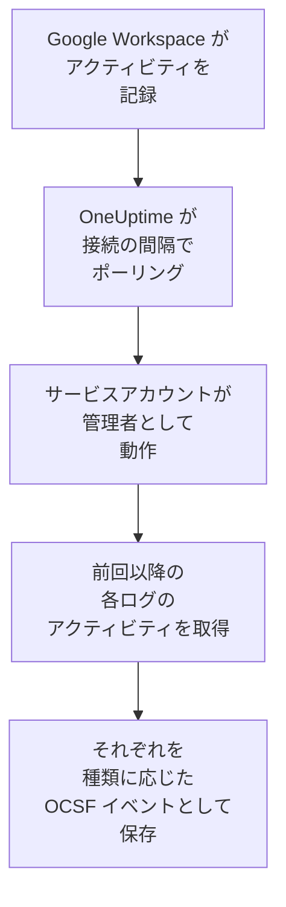

# Google Workspace

[Google Workspace](https://workspace.google.com) の監査ログを OneUptime のセキュリティイベントにインポートします。対象は、サインインとそれについて Google が検出した内容、管理者による変更、データへのアクセスを許可されたアプリ、シングル サインオン、アカウント自身のセキュリティ設定、そして必要なら、組織外と共有されたファイルや Google ドライブでダウンロードされたファイルです。そこではログ、トレース、メトリクスと並べて検索し、他のあらゆるソースと相関付け、重要なものについてオンコールを呼び出せます。OneUptime は管理者の 1 人として動作するサービスアカウントで読み取り、Google Workspace では何も変更しません。

:::cards
- [接続を設定する](#接続を設定する): サービスアカウント、ドメイン全体の委任、接続のフォーム。
- [インポートされる内容](#インポートされる内容): どのアクティビティが対象で、各アクティビティがどのようにセキュリティイベントになるか。
- [ポーリングの仕組み](#ポーリングの仕組み): 各ポーリングが読み取る時間枠と、それが 2 時間重なる理由。
- [トラブルシューティング](#トラブルシューティング): 各エラーの意味と変更すべき点。
:::

## 仕組み

OneUptime は 1 分ごとに、ポーリング間隔が経過した有効な接続をそれぞれポーリングします。ポーリングは指定した管理者に代わってサービスアカウントとしてサインインし、前回のポーリング以降の各監査ログのアクティビティを一覧します（[Activities: list](https://developers.google.com/admin-sdk/reports/reference/rest/v1/activities/list)）。対象は管理、サインイン、OAuth トークン、SAML、アカウントのセキュリティで、**ドライブのアクティビティ** オプションがオンのときはドライブも対象です。アクティビティの各イベントは [OCSF](https://schema.ocsf.io/) イベントとして保存されます。サインインは Authentication イベント、管理者ロールの割り当ては User Access Management イベント、Google が検出したサインインは Detection Finding になります。

## 前提条件

- OneUptime で Project Owner、Project Admin、または Security Admin のロール。Security Member と Security Viewer は接続とその実行履歴を見ることはできますが、変更はできません。
- ドメイン全体の委任を許可するための Google Workspace の特権管理者と、サービスアカウントが代わりに動作する、Reports 権限を持つ管理者。特権管理者はこの権限を持っています。
- サービスアカウントを作成し、Admin SDK API をオンにできる Google Cloud プロジェクト。
- ドライブのアクティビティには、Business Standard、Business Plus、Enterprise、Education など、ドライブの監査ログがあるエディション。
- OneUptime のアプリと worker から `oauth2.googleapis.com` と `admin.googleapis.com` への送信 HTTPS。

## 接続を設定する

接続はサービスアカウントの鍵と [ドメイン全体の委任](https://developers.google.com/identity/protocols/oauth2/service-account#delegatingauthority) でサインインし、読み取り専用のスコープを 1 つだけ使います: `https://www.googleapis.com/auth/admin.reports.audit.readonly`。

:::steps
### サービスアカウントと鍵を作成する

1. [Google Cloud コンソール](https://console.cloud.google.com) でプロジェクトを選び、**APIs & Services → Library** を開いて **Admin SDK API** を見つけ、**Enable** を選びます。
2. **IAM & Admin → Service accounts → Create service account** を開き、名前を `oneuptime-security-events` にして **Done** を選びます。プロジェクトでのロールは必要ありません。
3. サービスアカウントを開き、委任で指定するクライアント ID である **Unique ID** をコピーします。**Keys** タブで **Add key → Create new key → JSON** を選び、ファイルを保管します。これが鍵です。

### ドメイン全体の委任を許可する

1. [Google 管理コンソール](https://admin.google.com) で特権管理者として **Security → Access and data control → API controls → Manage domain-wide delegation** を開き、**Add new** を選びます。
2. **Client ID** にサービスアカウントの **Unique ID** を、**OAuth scope** に `https://www.googleapis.com/auth/admin.reports.audit.readonly` を入力します。**Authorize** を選びます。Google での反映には数分かかることがあります。
3. プレイブックでユーザーの停止、停止の解除、サインアウトを行うには ( [封じ込め](/docs/telemetry/security-cases#封じ込め) を参照)、同じクライアントのスコープに `https://www.googleapis.com/auth/admin.directory.user` と `https://www.googleapis.com/auth/admin.directory.user.security` をカンマ区切りで追加します。その場合、接続が代理で動作する管理者は、それらのユーザーを管理する管理者である必要があります。

### OneUptime で接続を追加する

**製品 → セキュリティイベント → 接続**（`/dashboard/{projectId}/security-events/connections`）を開き、**接続を追加** をクリックし、**アイデンティティ** の下の **Google Workspace** を選んで **次へ** をクリックします。**Administrator email** を入力して **次へ** をクリックし、鍵ファイルの内容を **サービスアカウント JSON** に貼り付けます。**ポーリング** ステップで **ドライブのアクティビティ** をオンにすると、ドライブも読み取ります。

### 保存する前にテストする

**保存前にテスト** の下にある **これらの設定をテスト** をクリックします。テストはフォームの値でサインインしてサインインと管理のログを読み取りますが、何も保存しないため、委任の不足は接続を作成する前にわかります。その後 **次へ** をクリックし、接続に **名前** を付けて作成します。
:::

| 設定 | 入力する内容 |
| --- | --- |
| **Administrator email** | サービスアカウントが代わりに動作する管理者のアドレス（例: `admin@example.com`）。Reports 権限が必要です。 |
| **ドライブのアクティビティ** | 任意。既定ではオフ。オンにすると、各ポーリングでドライブの共有とダウンロードも読み取ります。 |
| **サービスアカウント JSON** | `client_email` と `private_key` を含む鍵ファイル全体。暗号化され、API から返されることはなく、二度と表示されません。接続の **認証情報を更新** で置き換えます。 |

**ポーリング** ステップには、任意の **説明**、`1`～`1440` の整数で初期値 `5` の **ポーリング間隔（分）**、初期状態でオンの **有効** もあります。

## インポートされる内容

どのイベントもベンダーは `Google`、製品は `Google Workspace` です。複数のイベントを含むアクティビティは、イベントごとに 1 つのセキュリティイベントになります。どのイベントも、アクティビティのフィールドと自身のフィールドを `event.name`、`event.type`、`parameters.<name>` として保持するため、ルールは Google の名前で読み取れます。

| ログ | イベント | OCSF クラス | 重大度 |
| --- | --- | --- | --- |
| サインイン (`login`) | `login_success`、理由付きの `login_failure`、`login_challenge`。ログアウトは読み取られますがインポートされません。 | Authentication (`3002`) | Informational。失敗は Low。Google が `is_suspicious` と示した場合は Medium |
| Google による検出 (`login`) | `suspicious_login` とその種類、`gov_attack_warning`、`account_disabled_hijacked`、および Google が無効化したその他のアカウント | Detection Finding (`2004`) | Medium。政府の支援を受けた攻撃、乗っ取られたアカウント、漏えいしたパスワードは High |
| 管理 (`admin`) | 付与または取り消された管理者権限とロール、ドメイン全体の委任、作成、削除、停止されたユーザー、オフにされた 二段階認証プロセス、グループのメンバー、設定 | User Access Management (`3005`)、Account Change (`3001`)、Group Management (`3006`)、Entity Management (`3004`) | 権限の付与は Medium。ユーザーの削除や 二段階認証プロセスのオフは Low |
| OAuth トークン (`token`) | 誰かのデータへのアクセスをスコープ付きで許可されたアプリ、またはそのアクセスを取り消されたアプリ | Authorize Session (`3003`) | Informational |
| SAML (`saml`) | アプリへのシングル サインオン | Authentication (`3002`) | 失敗は Low |
| アカウントのセキュリティ (`user_accounts`) | 二段階認証プロセス、パスワード、再設定の変更 | Account Change (`3001`) | アカウントを弱める場合は Low |
| ドライブ (`drive`)、オプションがオンの場合 | `change_user_access`、`change_document_visibility`、`change_document_access_scope`、`change_acl_editors`、`download` | File Hosting Activity (`6006`) | 所有者のドメイン外と共有されたファイル、またはリンクで公開されたファイルは Low |

ルールライブラリの Google Workspace 用ルールは、Google が検出したサインイン、付与された管理者権限、ドライブで公開されたファイルなどのルールを含め、ここでインポートされる形のまま読み取ります。

## ポーリングの仕組み

- **アクティビティは発生した時刻で読み取られます。** Reports API には一覧に使える別の時刻がなく、Google によるとログは数分から数時間遅れて届きます。
- **最初のポーリングは 24 時間前までさかのぼります**。そのため、新しい接続にはすぐに最近のアクティビティが表示されます。
- **以降の各ポーリングは、保存されたカーソルの 120 分前から始まります**。そのため、Google が最大 2 時間遅れて読み取れるようにしたアクティビティは次のポーリングで読まれ、重複はプロジェクト内で各イベントの ID によって除外されます。それより遅れて届いたアクティビティはポーリングでは読まれないため、**診断** からその時間範囲をインポートしてください。
- **1 回のポーリングで読むのは、カーソルから最大 24 時間先までです。** カーソルが遅れた接続は、24 時間の時間枠を続けて読んで追いつきます。
- **ドライブは 1 イベントずつ読み取られます**。ドライブは誰かが開いたすべてのファイルを記録するためです。Google がドライブのログを拒否すると実行は警告を出し、他のログは引き続きインポートされます。
- **失敗した実行は何も変えません。** ネットワークエラーや Google のエラーステータスの後は、カーソルと時間枠の長さはそのままで、次のポーリングが同じ時間枠を読み直します。唯一の例外はタイムアウトしたリクエストです。カーソルはそのままですが、次の時間枠は半分の長さになります。時間内に応答できないほど重い時間枠は、何度試してもタイムアウトするからです。

### 1 回のポーリングで読み切れないほど時間枠にデータがある場合

各ログには、1,000 件のアクティビティのページ単位で独自の予算があります。サインインは 10、管理、OAuth トークン、SAML はそれぞれ 5、アカウントのセキュリティは 3、ドライブの各イベントは 4 です。ポーリングは 4 分で止まります。予算によって時間枠の終わりより前にログの読み取りが止まると、実行は **部分的** になり、その警告にはログと予算が示されます。Google は新しいアクティビティから順に返すため、OneUptime は到達しなかったアクティビティを越えてカーソルを進めるのではなく、時間枠を短くします。

1. **縮める。** 次のポーリングは同じ開始点から半分の長さの時間枠を読み、時間枠を最後まで読めるようになるまで、最短 1 分まで半分にし続けます。実行の警告にはそのことが示されます: `This window holds more records than one poll can read; the next poll reads a {n} minute window from the same starting point.` 長い時間枠からすでにインポートされたアクティビティは、重複としてスキップされます。
2. **元に戻す。** 時間枠を最後まで読めたら、カーソルはその終わりに移り、次の時間枠は再び 2 倍になり、最長 24 時間まで戻ります。
3. **1 分を飛ばす。** 1 分間でさえ 1 回のポーリングで読める量を超える場合、ポーリングはその 1 分を飛ばして先に進み、新しいアクティビティが届き続けるようにします。実行は **部分的** のままで、**最終エラー** には `More records were created in the one minute from {cursor} to {end} than one poll can read. Polling moved past this minute so newer records keep arriving; use Import this time range in Diagnostics on this minute to recover what one run can read.` と表示されます。その 1 分を **この時間範囲をインポート** でインポートすると、1 回の実行で読める分を取り戻せます。

**ポーリング間隔（分）** を変えても、これは何も変わりません。この設定が決めるのはポーリングを開始する頻度であって、時間枠の開始位置ではありません。

### オンデマンドで実行、プレビュー、インポートする

接続の **診断** をクリックすると、最近の実行を確認し、手動で操作できます。これらを開始できるのは接続を変更できるユーザーで、履歴は接続を見られるユーザーなら誰でも読めます。

- **今すぐ実行** は、接続が **有効** でなくても、通常のカーソルでただちにポーリングを開始します。
- **Preview audit events** は最大 7 日間の時間範囲を読み取り、何もインポートしません。
- **この時間範囲をインポート** は、確認後、カーソルを動かさずに最大 7 日間の範囲をインポートします。インポート済みのアクティビティはスキップされます。Google は監査ログを 6 か月間保持します。
- 実行の **診断情報をコピー** は、サポート向けにその実行のレポートをコピーします。認証情報は含まれません。

## 接続をテスト

接続の行にある **接続をテスト** と、フォームの **これらの設定をテスト** は、バックグラウンド worker ではなく API プロセスで実行されます。そのため、worker に問題がある場合でもテストは応答します。テストは次のチェックを順に実行します。

| チェック | 確認内容 |
| --- | --- |
| **構成** | 管理者のアドレスと鍵の形式が正しいこと。失敗した場合はどこにも接続しません。 |
| **Authenticate with Google** | Google がサービスアカウントに管理者として動作することを許可すること。つまり、ドメイン全体の委任が設定されていること。 |
| **Read the audit logs** | 過去 24 時間のサインインと管理のログを読み取れること。 |
| **Read Drive activity** | オプションがオンの場合のみ。ドライブのログを読み取れること。 |
| **Activities available to import** | 過去 24 時間のサインインと管理のアクティビティの件数。それぞれ最大 1,000 件までなので、`1000+` はそれ以上を意味します。まったくない場合は警告です。 |
| **Background workers**, **Poll scheduler**, **Security event storage** | OneUptime 側の状態。プロセスが Worker キューのジョブを取得していること、ポーリングジョブが毎分実行されていること、セキュリティイベントのストアが応答すること。 |
| **スケジュールされたポーリング** | 保存済みの接続について、ポーリングがオンであること、worker を待って止まっている実行がないこと、ポーリングが予定どおり実行されていること。 |

テスト内の各リクエストの期限は 20 秒です。テストは何もインポートせず、カーソルも動かしません。失敗した各チェックは、何を変更すべきかを示します。

## トラブルシューティング

接続の **最終エラー** は、認証情報を伏せたうえで完全なエラーメッセージを保持します。接続にエラーがある場合は、その **アクション** 列で **エラーを表示** を選んで読み、ダイアログの **エラーをコピー** でコピーします。どのメッセージも `Google Workspace` で始まり、続いて失敗したリクエストを示し、Google 自身の理由を引用します。

:::details 最終エラーに `token request failed` と表示される
- `unauthorized_client`: サービスアカウントにこのスコープのドメイン全体の委任がありません。**Manage domain-wide delegation** で、その **Unique ID** を `https://www.googleapis.com/auth/admin.reports.audit.readonly` とともに追加します。
- `Invalid email or User ID` を伴う `invalid_grant`: **Administrator email** がこの Google Workspace のユーザーではありません。
- `Invalid JWT Signature` を伴う `invalid_grant`: 鍵が削除または無効化されています。新しい鍵を作成し、**認証情報を更新** で保存します。
:::

:::details 最終エラーに `activities request failed (HTTP 403)` と表示される
- 理由 `SERVICE_DISABLED` または `accessNotConfigured`: サービスアカウントのプロジェクトで Admin SDK API がオフになっています。オンにして、数分後に再度テストします。
- 理由 `forbidden`: 管理者に Reports 権限がありません。Google 管理コンソールの **Account → Admin roles** で割り当てるか、特権管理者を指定します。
:::

:::details ドライブのアクティビティが読み取られない
ドライブのログには、それがあるエディションと、Reports 権限を持つ管理者が必要です。各実行は `Drive activity was not read` と警告し、他のログは引き続きインポートされます。エディションにドライブのログがない場合は、**ドライブのアクティビティ** をオフにしてください。
:::

:::details 最終エラーに `did not complete` と表示される
リクエストに応答がありませんでした。タイムアウト、名前解決の失敗、またはアドレスの拒否です。OneUptime のアプリと worker が、使用しているプロキシを経由して `oauth2.googleapis.com` と `admin.googleapis.com` に到達できることを確認してください。
:::

:::details テストは成功するが、最終ポーリングが Never
ポーリングジョブが一度も実行されていません。**Background workers** と **Poll scheduler** のチェックを確認します。セルフホスト環境でよくある原因は、ジョブを処理する別の worker デプロイがないままアプリで `DISABLE_QUEUE_WORKERS=true` になっていることです。`false` に設定するか、worker デプロイを実行します（Helm: `worker.enabled: true`。既定値は `false`）。
:::

## 次のステップ

:::cards
- [セキュリティイベント](/docs/telemetry/security-events): インポートしたものを検索、相関付けし、アラートを出します。
- [Microsoft Entra ID](/docs/integrations/microsoft-entra-id): Microsoft のサインインとディレクトリの変更をインポートします。
- [Google SecOps](/docs/integrations/google-secops): Google SecOps の検出も取り込みます。
- [インテグレーションの概要](/docs/integrations/index): 接続できるその他のツール。
:::
