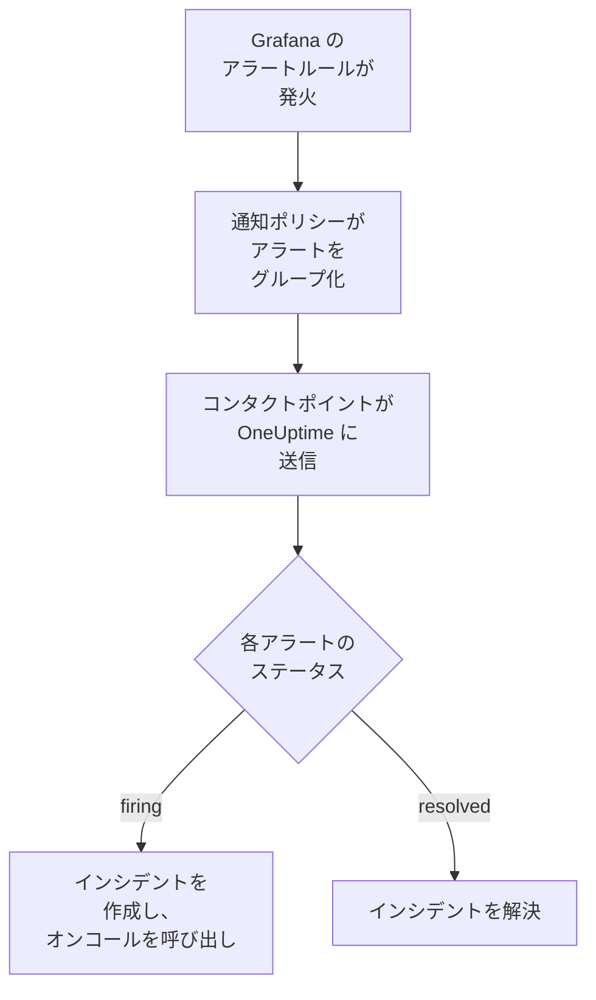

# Grafana

[Grafana](https://grafana.com) のアラートを OneUptime に送信すると、発火した各アラートがオンコールチームを呼び出すインシデントになり、アラートが回復すると解決されます。Grafana は Webhook コンタクトポイントを通じてアラートを送信するため、どちら側にもインストールするものはありません。

:::cards
- [OneUptime でアラートを受け取る方法を選ぶ](#oneuptime-でアラートを受け取る方法を選ぶ): 受信リクエスト モニター、または独自のワークフロー。
- [モニターでアラートを受け取る](#モニターでアラートを受け取る): アラートごとに 1 つのインシデント、回復時に解決。
- [Grafana を設定する](#grafana-を設定する): Webhook コンタクトポイントと、それを使うポリシー。
- [トラブルシューティング](#トラブルシューティング): アラートが届かない場合や、インシデントが開いたままの場合。
:::

## 仕組み



Grafana の通知ポリシーは発火したアラートをグループ化し、Webhook コンタクトポイントが各グループを 1 つの JSON 通知として送信します。この通知は [Prometheus Alertmanager](/docs/integrations/prometheus-alertmanager) の通知と同じ形をしています。`status`、各アラートが独自の `status` と `fingerprint` を持つ `alerts` リスト、そしてアラートが共有する `commonLabels` と `commonAnnotations` です。Grafana は人が読むための `title` と `message` を追加します。

## 前提条件

- Grafana 9 以降で、Grafana 9 から既定になっている Grafana Alerting を使用していること。HTTPS で OneUptime に到達できる必要があります。
- OneUptime でモニターを作成する権限。ワークフローを使う場合はワークフローを作成する権限。

## OneUptime でアラートを受け取る方法を選ぶ

まず OneUptime を設定します。Grafana の送信先となる URL が得られます。

| 方法 | 使う場面 |
| --- | --- |
| 受信リクエスト モニター（推奨） | すべてのアラートを、オンコールを呼び出し、アラートが回復すると解決されるインシデントにしたい場合。構築するものはありません。 |
| Webhook トリガーを持つワークフロー | アラートの絞り込み、形の変換、先に他のシステムを呼び出すなど、独自のロジックが必要な場合。ワークフローはアラートごとではなく通知ごとに一つのインシデントを作成し、回復時に解決しません。 |

どちらも同じコンタクトポイントから同じ JSON を受け取るため、一方で始めて、後から Grafana の URL を 1 つ変えるだけで切り替えられます。

## モニターでアラートを受け取る

[受信リクエスト モニター](/docs/monitor/incoming-request-monitor) は URL を提供し、その条件が各通知の処理を決めます。

:::steps
### モニターを作成する

**モニター** に移動し、**モニターを作成** をクリックします。**モニターの種類** で **受信リクエスト** を選び、名前を `Grafana` にして **次へ** をクリックします。

### 発火したアラートごとにインシデントを宣言する

**条件** ステップで、モニターをオフラインにする最初の条件を開きます。そのフィルターを **リクエストボディ**、**含む**、`"status":"firing"` に設定します。この条件は、フィルターが一致するとすでにインシデントを宣言します。インシデントを次のように入力します。

- **インシデントタイトル**: `{{requestBody.commonLabels.alertname}}`。
- **説明** の下の **インシデントの説明**: `{{requestBody.message}}`。Grafana が通知用に書くテキストです。
- **重大度**: これらのアラートに付けるインシデントの重大度。
- **オンコール** の下の **オンコールポリシー**: 呼び出すポリシー。
- **その他の項目** の下の **インシデントを自動解決**: 初期状態のままオンにしておきます。オフにすると回復が無視され、インシデントは開いたままになります。

### アラートごとに 1 つのインシデントを作成する

同じ条件で **設定** を開き、**ペイロードのフィールドでインシデントとアラートをグループ化** をオンにします。次のように入力すると、各アラートに独自のインシデントができ、その回復でインシデントが解決されます。

| フィールド | 値 |
| --- | --- |
| **次ごとに別々のインシデントを作成…** | `requestBody.alerts[*].fingerprint` |
| **回復を示すフィールド** | `requestBody.alerts[*].status` |
| **回復を意味する値** | `resolved` |

### モニターをオンラインに戻す

モニターをオンラインにする 2 つ目の条件を開き、そのフィルターを **リクエストボディ**、**含む**、`"status":"resolved"` に設定します。

### URL をコピーする

**モニターを作成** をクリックします。モニターの **概要** ページに **ハートビート URL** が表示されます。Grafana 用にコピーします。

```text
https://oneuptime.com/heartbeat/<secret key>
```

セルフホスト環境では、`oneuptime.com` の代わりに独自のホストになります。
:::

通知内の各アラートは、**1 回のリクエストあたりの最大インシデント数**（変更しない限り `100`）を上限として、独自のインシデントを作成します。各アラート自身の `status` が、そのインシデントがいつ解決されるかを決めます。Grafana の `fingerprint` はラベルによってアラートを識別するため、グループ化に使うのはこの値です。各設定の働きについては、[他システムからのアラート受信](/docs/monitor/incoming-request-monitor#他システムからのアラート受信) を参照してください。

> [!WARNING]
> 通知内のすべてのアラートが共有するラベルでグループ化しないでください。Grafana の既定の通知ポリシーはアラートを `grafana_folder` と `alertname` でグループ化するため、1 つの通知内のアラートはすべて同じ `alertname` を持ちます。`requestBody.alerts[*].labels.alertname` でグループ化すると、通知全体が 1 つのインシデントにまとめられます。

`{{requestBody.commonLabels.alertname}}` と `{{requestBody.message}}` は通知全体を表し、既定のポリシーではそれが 1 つのアラートルールに相当します。グループ化キーも変数 `{{fingerprint}}` ですが、ハッシュなので対応者には何も伝えません。使用できるすべての変数は [インシデント & アラート テンプレート](/docs/monitor/incident-alert-templating) を参照してください。

## Grafana を設定する

:::steps
### Webhook コンタクトポイントを追加する

Grafana で **Alerting → Contact points** に移動し、**+ Add contact point** をクリックします。Grafana 11 以降では、**Alerting** は **Alerts & IRM** の下にあり、**Contact points** は **Notification configuration** のタブです。

コンタクトポイントに `OneUptime` という名前を付け、**Integration** で **Webhook** を選び、コピーした URL を **URL** に貼り付けます。**HTTP Method** は `POST` のままにして、**Save contact point** をクリックします。

### アラートをそこに送る

**Alerting → Notification policies** に移動します。既定のポリシーのコンタクトポイントを `OneUptime` に設定するか、OneUptime に送るアラートに一致する子ポリシーを追加し、そのコンタクトポイントを `OneUptime` にします。
:::

Grafana は `Content-Type: application/json` を送信し、モニターはこれを使って通知のフィールドを読みます。コンタクトポイントの **Max Alerts** 設定は 1 つの通知に含まれるアラートの数を制限します。`0`（無制限）のままにするか、モニターの **1 回のリクエストあたりの最大インシデント数** 以下にしてください。

## テストする

1. Grafana で `OneUptime` コンタクトポイントを開き、**Test** をクリックします。Grafana が発火中のテストアラートを送信し、OneUptime でインシデントが作成されます。テストアラートは回復しないため、そのインシデントは手動で解決します。
2. たとえばしきい値を一時的に下げて実際のアラートルールを発火させ、インシデントが作成され、しきい値を戻すと解決されることを確認します。

## ワークフローでアラートを受け取る

Grafana とインシデントの間に独自のステップが必要な場合は、[ワークフロー](/docs/workflows/index) を使います。

:::steps
### ワークフローを作成する

**ワークフロー** に移動し、**ワークフローを作成**、続いて **ゼロから作成** をクリックします。名前を `Grafana alerts` にして **ワークフローを作成** をクリックします。

### Webhook トリガーを追加する

破線の **このワークフローを開始するものを選択** ブロックをクリックし、**Webhook** を選びます。トリガーをクリックしてから **URL をコピー** をクリックし、その URL を Grafana のコンタクトポイントに使います。

### 通知が発火中か確認する

**コンポーネントを追加** をクリックして **If / Else** ブロックを追加し、トリガーの **Out** ドットをそれにつなぎます。**Value to check** を `{{local.components.webhook-1.returnValues.request-body.status}}`、**Comparison** を **is equal to**、**Compare with** を `firing` に設定します。

### インシデントを宣言する

**Create One Incident** ブロックを追加し、**If / Else** ブロックの **Yes** 側をそれにつなぎます。**Incident Template** で、重大度と呼び出すオンコールポリシーを設定するテンプレートを選びます（[インシデントテンプレート](/docs/incidents/settings#インシデントテンプレート) を参照）。**JSON Object** で、Grafana から来る内容を設定します。

```json
{
  "title": "{{local.components.webhook-1.returnValues.request-body.title}}",
  "description": "{{local.components.webhook-1.returnValues.request-body.message}}"
}
```

テンプレートがない場合、**JSON Object** にはプロジェクトのインシデント重大度のいずれかの ID である `incidentSeverityId` も必要です。

### ワークフローをオンにする

**ビルダー** の上部で **有効** をオンにします。オフのワークフローは Grafana に `400` を返します。
:::

1 回の実行は 1 つの通知を処理するため、通知に含まれるアラートの数にかかわらず、宣言するインシデントは 1 つです。`resolved` の通知は **If / Else** ブロックの **No** 側に進みますが、そこには何もつながっていないため、実行はそこで終わります。アラートごとに 1 つのインシデントを作成し、回復時に解決するには、モニターを使います。

## トラブルシューティング

:::details OneUptime に何も届かない
- コンタクトポイントで **Test** をクリックします。URL に到達できない場合、Grafana はエラーを表示します。詳細は Grafana のサーバーログにあります。
- モニターは何かを確認する前に、シークレットキーが間違っていてもすぐに `200` を返します。通知が届いているかは、モニターのタイムラインで確認します。
- オフのワークフローは `400` を返します。その **ビルダー** の上部で **有効** をオンにします。
:::

:::details インシデントは作成されるが解決されない
- 条件のインシデントには、**その他の項目** の下の **インシデントを自動解決** が必要です。
- **回復を示すフィールド** は `requestBody.alerts[*].status`、**回復を意味する値** は正確に `resolved` でなければなりません。比較では大文字と小文字が区別されます。
- グループ化のパスは `requestBody.` で始まる必要があり、リストを読むのはパス内の最初の `[*]` だけです。どちらかのルールに反するパスは、エラーもなく何にも一致しません。
:::

:::details アラートが多数含まれる通知でインシデントが 1 つだけ
既定のポリシーでの `alertname` のように、通知内のすべてのアラートで同じになるラベルでグループ化しています。代わりに `requestBody.alerts[*].fingerprint` でグループ化してください。
:::

:::details インシデントに値ではなく参照が表示される
通知にないフィールドへの参照は、中括弧も含めて書かれたまま残ります。フィールド名を Grafana が送信した内容と比べてください。ワークフローの場合は **ログ → 実行履歴** で実行を開き、トリガーが受け取った内容と比べます。
:::

[Prometheus Alertmanager](/docs/integrations/prometheus-alertmanager#トラブルシューティング) のガイドでは他のケースも扱っており、それらは Grafana の通知にも当てはまります。

## セキュリティ

- **URL はパスワードと同じように扱ってください。** URL を持っている人は誰でもインシデントを作成できます。漏えいした場合はリセットします。モニターの **設定** ページで **受信リクエストのシークレットキーをリセット**、またはワークフローの **Webhook** トリガーで **URL をリセット** を使います。その後、Grafana のコンタクトポイントの **URL** を更新します。
- **セルフホスト環境の場合は？** Grafana がファイアウォール越しに HTTPS で OneUptime に到達できるようにしてください。

## 次のステップ

:::cards
- [受信リクエスト モニター](/docs/monitor/incoming-request-monitor): アラートを受け取るモニターのすべての設定。
- [Prometheus Alertmanager](/docs/integrations/prometheus-alertmanager): 同じ設定に、アラート自体を見張るデッドマンスイッチを加えたもの。
- [メトリクス モニター](/docs/monitor/metrics-monitor): 同じメトリクスに対して OneUptime 自体でアラートを出します。
- [インテグレーションの概要](/docs/integrations/index): 接続できるその他のツール。
:::
