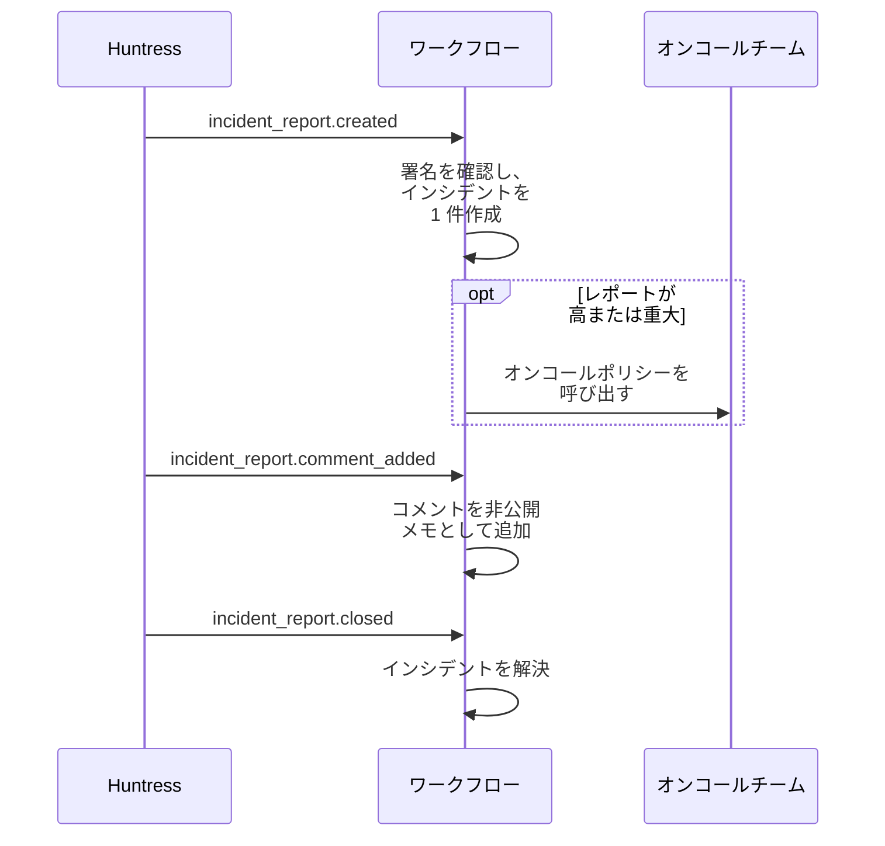

# Huntress 連携

ワークフローを使って、Huntress のインシデントレポートでオンコールチームを呼び出します。Huntress の SOC がエンドポイントや ID についてインシデントレポートを送ると、ワークフローはそのレポートにつき 1 件のインシデントを作成し、選んだオンコールポリシーを呼び出し、Huntress で付いたコメントを非公開メモとして追加し、Huntress でレポートがクローズされるとインシデントを解決します。

この連携は **インバウンド** です。Huntress はインシデントレポートのイベントを、ワークフロー専用の URL に、エンドポイントの署名シークレットで署名して送信します。OneUptime から Huntress を呼び出すことはないため、Huntress の API キーは不要です。

:::cards
- [仕組み](#仕組み): レポートのイベントごとにワークフローが行うこと。
- [設定手順](#連携を設定する): ワークフローを作成し、Huntress にエンドポイントを追加し、署名シークレットを保存して、テストを送信します。
- [トリガー](#huntress-incident-report-トリガー): レポートがワークフローに渡す値と、トリガーの設定。
- [トラブルシューティング](#トラブルシューティング): トリガーのエラーの意味と、変更すべき点。
:::

## 仕組み

Huntress は、レポートが送信されたとき、誰かがコメントしたとき、クローズされたときに、インシデントレポートのイベントを送信します。**Huntress Incident Report** トリガーはイベントごとにワークフローを 1 回開始し、その **Event** がどのイベントだったか (`created`、`comment-added`、`closed`) を示します。

1. **確認する。** リクエストは、到着の 5 分前以内にエンドポイントの署名シークレットで署名されている必要があります。それ以外は拒否され、トリガーの設定に理由が表示されます。
2. **ワークフローを開始する。** イベントごとに 1 回の実行が始まり、レポートのフィールドがトリガーの値になります。Huntress が再送したイベントでは、それ以上何も開始されません。
3. **インシデントを 1 件作成する。** `created` では、ワークフローが `Huntress: Incident on DESKTOP-01 (Acme Corp)` のようにレポートにちなんだタイトルのインシデントを作成します。説明には、レポートの概要、Huntress での重大度、組織、影響を受けたホストまたは ID、Huntress が見つけたインジケーター、Huntress のレポートへのリンクが含まれます。インシデントにはレポートの組織のラベルが付き、レポートが高または重大なら、選んだオンコールポリシーを呼び出します。
4. **レポートを追跡する。** `comment-added` では、コメントがインシデントの非公開メモになります。`closed` では、インシデントが解決され、その理由がタイムラインに残ります。

インシデントはレポートの番号をカスタムフィールドに `huntressReportId` として保持します。Huntress がレポートにコメントしたりクローズしたりしたとき、ワークフローはこれでインシデントを見つけます。こうして作成されたインシデントがステータスページに表示されることはなく、インシデントのルール (オンコール、オーナー、ラベル、プライバシーのルール) は、ほかのインシデントと同じように適用されます。

## 始める前に

- OneUptime で、ワークフローを作成・編集できるロール (**プロジェクト所有者**、**プロジェクト管理者**、**ワークフロー管理者** など)。
- Huntress の **Account Admin** ロール。Webhook を追加できるのはアカウント管理者だけです。
- 呼び出すオンコールポリシー。
- OneUptime Cloud では、ワークフローを含むプラン (Growth 以上)。Huntress が送るイベント 1 件が、ワークフローの実行 1 回です。
- セルフホストの場合は、Huntress がインターネットから HTTPS で到達できる OneUptime。Huntress は `https://` の URL にしか Webhook を送信しません。

## 連携を設定する

:::steps
### ワークフローを作成する

**ワークフロー** を開き、**ワークフローを作成** をクリックします。**またはテンプレートから始める** でカテゴリ **Huntress** を選び、**Open an incident for each Huntress incident report** を選んで **このテンプレートを使う** をクリックします。

### 呼び出す相手を選ぶ

続いてダイアログが誰を呼び出すかを尋ねます。 **Who to page for high and critical reports** で呼び出すオンコールポリシーを選び（誰も呼び出さない場合は選ばない）、 **ワークフローを作成** をクリックします。ワークフローはオフの状態で **ビルダー** に開きます。後で呼び出す相手を変えるには、 **Page an On-Call Policy** ステップをクリックし、その **オンコールポリシー** を変更します。

### Huntress に Webhook エンドポイントを追加する

**Huntress Incident Report** トリガーをクリックし、**Huntress に Webhook エンドポイントを追加する** の **URL をコピー** をクリックします。URL は `https://oneuptime.com/workflow/huntress/<key>` のような形です。セルフホストでは自分のホストで始まります。

Huntress で右上のメニューを開き、**Integrations** を選びます。**Add an Integration** をクリックし、**Webhooks** を選んで **Add Endpoint** をクリックします。URL を貼り付け、**Incident Reports** をオンにして保存します。**Escalations**、**Platform Actions**、**Account Notices** はオフのままにします。トリガーはこれらのイベントを受け付けますが、何も開始しません。

### エンドポイントの署名シークレットを保存する

Huntress でエンドポイントのメニュー (⋯) を開き、**View Signing Secret** を選びます。全体をコピーします。`whsec_` で始まります。トリガーで **署名シークレットを保存** をクリックし、貼り付けて **署名シークレットを保存** をクリックします。シークレットは暗号化され、二度と表示されません。

シークレットを保存するまで、トリガーはリクエストをすべて拒否します。拒否されたイベントは Huntress があとで再送するので、今拒否されたイベントもあとで届きます。

### ワークフローをオンにして、テストを送信する

**ビルダー** の上部で **有効** をオンにします。Huntress でエンドポイントのメニュー (⋯) を開き、**Send Test** を選びます。数秒以内に、トリガーに **レポート受信中** と表示されます。

> [!NOTE]
> テストの内容にかかわらず、トリガーにはテストが届いたことが表示されます。インシデントレポートを含むテストは、ほかのレポートと同じようにワークフローを開始します。
:::

## ワークフローが行うこと

トリガーの後、 **Incident From Another Tool** がレポートの番号をもとに、 **Event** ごとに求められた処理をします。

| Event | ワークフローが行うこと |
| --- | --- |
| `created` | トリガーの **Incident Severity ID** でインシデントを作成し、**Organization Label ID** のラベルを付けます。高または重大のレポートでは **Page an On-Call Policy** がポリシーを呼び出します。低のレポートでは誰も呼び出しません。すでにインシデントがあるレポートは、別のインシデントを作成しません。 |
| `comment-added` | レポートのインシデントを見つけ、コメントを非公開メモとして追加します。 |
| `closed` | レポートのインシデントを見つけ、まだ解決されていなければ解決します。理由はタイムラインに残ります: Huntress がレポートをクローズしました。 |

ほかのワークフローと同じなので、動作は変更できます。**Incident From Another Tool** の後の **If / Else** が比較する内容を変えて重大のレポートだけ呼び出す、Slack や Microsoft Teams のステップで各レポートをチャットチャンネルに投稿する、**Organization** に対する **Switch / Case** で組織ごとに別のオンコールポリシーへ送る、などです。各実行はワークフローの実行一覧に、各ステップが行ったことと一緒に表示されます。

### 重大度

Huntress はインシデントレポートごとに 3 つの重大度のいずれかを付けます。トリガーの **Incident Severity ID** は、レポートを作成するときのインシデントの重大度です。対応する設定で選んだもの、設定がなければ **インシデント → 設定 → インシデントの重大度** に並ぶ順位で決まります。

| Huntress の重大度 | Huntress での意味 | 設定 | 設定が空のときのインシデントの重大度 |
| --- | --- | --- | --- |
| Critical | 攻撃者による直接操作、危険なマルウェア、進行中の侵害。すぐに封じ込めが必要です。 | **重大レポートの重大度** | 最も高いもの |
| High | 早急な対処が必要な確認済みのマルウェア、または対応が必要な ID の侵害。 | **高レポートの重大度** | 2 番目 |
| Low | 望ましくない可能性のあるプログラム、マルウェアの残骸、ID に関する過去の検出結果。 | **低レポートの重大度** | 3 番目 |

重大度が少ないプロジェクトでは、残りに最も低い重大度が使われます。重大度のないレポートは高として扱われます。選んだ重大度が削除されると、再び順位で決まります。

### 組織

トリガーの **Organization Label ID** は、_Acme Corp_ のようにレポートの Huntress 組織名を付けたラベルで、その組織のレポートが初めて届いたときに作成されます。1 つのワークフローは Huntress アカウントのすべての組織のレポートを受信し、トリガーの **対象の組織** で絞り込めます。1 行に組織名または組織 ID を 1 つ書き、名前の大文字と小文字は区別しません。

> [!TIP]
> 顧客ごとのチームを呼び出すには、組織ごとにインシデントのオンコールルールを追加します。たとえば「**インシデントのラベル** が _Acme Corp_ のいずれかを含む場合」に、その顧客のポリシーを実行するルールです。[インシデントのオンコールルール](/docs/incidents/settings#インシデントのオンコールルール) を参照してください。

## Huntress Incident Report トリガー

トリガーを開くと Huntress の情報が表示されます。URL、完了した設定手順ごとのチェック、Huntress が最後に送ったものです。設定はすべて任意で、**その他の項目** にまとまっています: **対象の組織**、**重大レポートの重大度**、**高レポートの重大度**、**低レポートの重大度**。

| 値 | 内容 |
| --- | --- |
| **Event** | `created`、`comment-added`、`closed` のいずれか。すでにクローズまたは却下されたレポートは、どのイベントで届いても `closed` です。 |
| **Report ID** | Huntress でのレポートの番号。 |
| **Severity** | `critical`、`high`、`low` のいずれか。 |
| **Status** | Huntress でのレポートのステータス (`sent`、`closed`、`dismissed` など)。 |
| **Subject** | Huntress が書いたままのレポートの件名。 |
| **Summary** | SOC のアナリストが書いた内容。 |
| **Organization**、**Organization ID** | レポートの対象となる Huntress の組織。 |
| **Affected** | レポートの対象となるホストまたは ID。 |
| **Platform**、**Indicators** | Huntress がどこで何を見つけたか。 |
| **Comment** | `comment-added` で、誰かが追加したコメント。 |
| **Report URL** | Huntress でレポートを開く場所。 |
| **Incident Title**、**Incident Description** | レポートについてのインシデントのタイトルと Markdown の説明。 |
| **Note** | イベントについてのメモの Markdown。コメント、または Huntress がレポートをクローズしたこと。 |
| **Incident Severity ID**、**Organization Label ID** | 上記のインシデントの重大度とラベル。 |
| **Received At** | OneUptime がイベントを受信した日時。 |

**Summary** と **Comment** は Huntress のアナリストが書いたテキストです。インシデントやメモに入れるときは **Incident Description** と **Note** を使ってください。書式が保たれ、画像を読み込んだり誰かにメンションしたりすることはありません。

Huntress なしでワークフローを試すには、**ビルダー** で **ワークフローを実行** をクリックし、**Event**、**Report ID**、必要なフィールドを入力します。同じ **Report ID** を使うと、1 件のレポートを `created` から `closed` まで追えます。

## 以前に作成した Huntress 接続

Huntress は以前、**インシデント → 連携 → Huntress** で設定していました。各 Huntress 接続は、同じ名前のオンのワークフローになり、接続が行っていたことをそのまま行います。同じレポートで同じオンコールポリシーを呼び出し、同じラベルを付け、同じように解決 (またはメモのみ) します。URL は接続のもの (`https://oneuptime.com/api/huntress/webhook/<connection-id>`) のままで、署名シークレットも同じなので、Huntress で変更するものはありません。接続が作成したインシデントはレポートの番号を保持しているので、Huntress がそれらのレポートにコメントしたりクローズしたりすると、ワークフローがそのインシデントを見つけます。

## セキュリティ

- **署名済みのリクエストのみ。** トリガーは、Huntress が送る `svix-id`、`svix-timestamp`、`svix-signature` ヘッダーを、届いたままのリクエスト本文と照合します。保存したシークレットで署名されていないリクエストや、5 分以上前後にずれて署名されたリクエストは拒否されます。
- **シークレットは秘密のまま。** 暗号化して保存され、API から返されることも、再び表示されることもありません。トリガーの **署名シークレットを置き換える** で、新しいエンドポイントのシークレットなど別のシークレットを保存できます。
- **URL はアドレスであり、パスワードではありません。** URL の末尾はワークフローのキーです。ワークフローを開始するのは、エンドポイントのシークレットで署名されたリクエストだけです。
- **ワークフローごとにエンドポイント 1 つ。** ワークフローごとに独自の URL とシークレットがあります。2 つ目の Huntress アカウントのレポートを受信するには、2 つ目のワークフローを作成します。

## 代わりにメールを使う

Huntress はインシデントレポートをメールでも送信し、[受信メールモニター](/docs/monitor/incoming-email-monitor) でそのメールからインシデントを作成することもできます。たとえば件名に `Critical Incident Report` が含まれる場合です。ただし、メールは 1 つのモニターのステータスとして扱われます。そのインシデントが開いている間は次のレポートでインシデントは作成されず、インシデントは Huntress がレポートをクローズしたときではなく、モニターの条件で解決されます。ワークフローはレポートごとに 1 件のインシデントを作成し、それぞれをレポートとともに解決するので、こちらをお勧めします。ワークフローがレポートを受信し始めたら、モニターへのメール送信をやめてください。そうしないと、レポートごとに 2 回呼び出されます。

## トラブルシューティング

トリガーがリクエストを拒否すると、トリガーの設定の **最後のリクエストは拒否されました** に理由が表示されます。Huntress では、エンドポイントのメニュー (⋯) の **View Delivery Attempts** に、各配信と OneUptime の応答が一覧表示されます。

:::details "A request arrived but was refused, because no signing secret is saved for this workflow yet"
エンドポイントの署名シークレットを保存してください。[連携を設定する](#連携を設定する) を参照してください。拒否されたリクエストは Huntress が再送します。
:::

:::details "The request's signature does not match the signing secret"
保存したシークレットが、このエンドポイントのものではありません。エンドポイントごとにシークレットがあります。Huntress でエンドポイントのメニュー (⋯) を開き、**View Signing Secret** を選んで全体をコピーし、**署名シークレットを置き換える** で保存してください。
:::

:::details "The request was signed more than five minutes from now"
Huntress と OneUptime サーバーの時計が 5 分以上ずれているか、リクエストが以前のリクエストの使い回しです。セルフホストの場合は、サーバーの時計が正しいか確認してください。
:::

:::details "A request arrived while this workflow is off"
**ビルダー** の上部で **有効** をオンにしてください。拒否されたリクエストは Huntress が再送し、そのときにワークフローが開始されます。
:::

:::details "No Huntress workflow has this address."
ワークフローが削除またはアーカイブされたか、トリガーが **Huntress Incident Report** ではなくなったか、Huntress のエンドポイントの URL がこのワークフローのものではありません。トリガーから URL をコピーし、Huntress のエンドポイントに貼り直してください。
:::

:::details インシデントが作成されなかった
ワークフローの実行一覧から、そのレポートの実行を開きます。 **Incident From Another Tool** が `This project has no incident severities to put the incident at.` で失敗した場合は、 **インシデント → 設定 → インシデントの重大度** で追加してください。
:::

:::details 誰も呼び出されなかった
低のレポートは、呼び出しなしでインシデントを作成します。それ以外の場合は、そのレポートの実行に **Page an On-Call Policy** が行ったことが表示され、インシデントの **オンコールの実行** ページで各ポリシーの動作を確認できます。
:::

## 次のステップ

:::cards
- [ワークフロー トリガー](/docs/workflows/triggers): ワークフローを開始するほかの方法。
- [インシデントのオンコールルール](/docs/incidents/settings#インシデントのオンコールルール): 組織ごとのチームを、そのラベルで呼び出します。
- [インシデントの状態と重大度](/docs/incidents/states-and-severities): Huntress のレポートで使う重大度の順位を決めます。
- [インテグレーションの概要](/docs/integrations/index): 接続できるほかのツール。
:::
