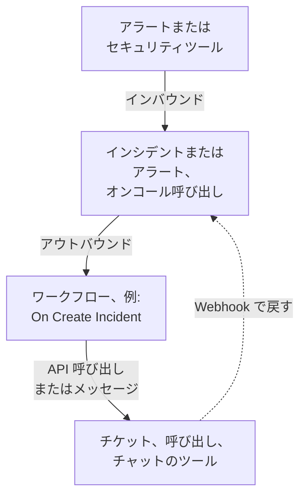

# インテグレーションの概要

OneUptime は、チームがすでに使っているツールと連携します。アラートツールは OneUptime にインシデントを作成し、OneUptime は他のツールにチケット、オンコールの呼び出し、チャットメッセージを作成します。フォームから接続するツールもあれば、既製のワークフローテンプレートから接続するツールもあります。Webhook または API を持つその他のツールは、自分で構築するワークフローを通じて接続します。

:::cards
- [接続方法を選ぶ](#接続方法を選ぶ): 4 つの接続方法と、それぞれを使う場面。
- [カタログ](#カタログ): ガイドのあるすべてのツールを、役割ごとに分類。
- [独自のインテグレーションを構築する](#独自のインテグレーションを構築する): あらゆるツールに使える、インバウンドとアウトバウンドのパターン。
- [認証情報を安全に保つ](#認証情報を安全に保つ): シークレット変数と、各ツールが求めるヘッダー。
:::

## インテグレーションの仕組み

どのインテグレーションも、データを一方向または双方向に移動します。**インバウンド** では、別のツールが OneUptime に問題を知らせ、OneUptime がインシデントまたはアラートを作成してオンコールチームを呼び出します。**アウトバウンド** では、OneUptime で何かが起こると、ワークフローがそれを別のツールに伝え、チケットの作成、担当者の呼び出し、メッセージの投稿を行います。



Jira や Dynamics 365 のような双方向のインテグレーションは、両方向を使います。1 つのワークフローがインシデントを外部に送り、もう 1 つのワークフローが相手のツールの Webhook で開始されて変更を取り込みます。

## 接続方法を選ぶ

| 方法 | 最適な用途 | 例 |
| --- | --- | --- |
| 組み込みの接続 | OneUptime が自ら接続するツール。フォームに入力するだけで、構築するものはありません。 | [Slack](/docs/workspace-connections/slack)、[Microsoft Teams](/docs/workspace-connections/microsoft-teams)、[セキュリティイベント](/docs/telemetry/security-events) の接続 |
| ワークフローテンプレート | 双方向で同期を保つチケットツール、監視の障害、セキュリティインシデントレポート、チャットメッセージ。テンプレートを選び、いくつかの設定を入力します。 | [Jira](/docs/integrations/jira)、[Microsoft Dynamics 365](/docs/integrations/microsoft-dynamics-365)、[Huntress](/docs/integrations/huntress)、[Zabbix](/docs/integrations/zabbix) |
| 受信リクエストモニター | Webhook を送信するアラートツール。ワークフローなしで、アラートごとに個別のインシデントが作成され、オンコールが呼び出され、アラートが回復すると解決されます。 | [Zabbix](/docs/integrations/zabbix)、[Prometheus Alertmanager](/docs/integrations/prometheus-alertmanager)、[Grafana](/docs/integrations/grafana) |
| 自分で構築するワークフロー | Webhook または REST API を持つあらゆるツールと、独自のロジック。 | [PagerDuty](/docs/integrations/pagerduty)、[Opsgenie](/docs/integrations/opsgenie)、[ServiceNow](/docs/integrations/servicenow) |

表の上から検討してください。上にある方法ほど、保守の手間が少なくなります。

## カタログ

### 監視とアラートのツール

| ツール | 方向 | 機能 |
| --- | --- | --- |
| [Zabbix](/docs/integrations/zabbix) | 双方向 | Zabbix の障害をインシデントまたはアラートにし、回復すると解決し、OneUptime から障害を確認済みにしたりクローズしたりします。 |
| [Prometheus Alertmanager](/docs/integrations/prometheus-alertmanager) | インバウンド | Alertmanager の通知をインシデントにします。 |
| [Grafana](/docs/integrations/grafana) | インバウンド | Grafana のアラートをインシデントにします。 |
| [Datadog](/docs/integrations/datadog) | インバウンド | Datadog モニターのアラートをインシデントにします。 |

### セキュリティツール

| ツール | 方向 | 機能 |
| --- | --- | --- |
| [Huntress](/docs/integrations/huntress) | インバウンド | Huntress のインシデントレポートでオンコールを呼び出し、レポートがクローズされるとインシデントを解決します。 |
| [Google SecOps](/docs/integrations/google-secops) | 双方向 | Google SecOps の検出とインジケーターをセキュリティイベントに取り込み、OneUptime が見つけたものを Google SecOps に送ります。 |
| [Microsoft Sentinel](/docs/integrations/microsoft-sentinel) | 双方向 | Microsoft Sentinel のインシデントをセキュリティイベントに取り込み、OneUptime が見つけたものを Microsoft Sentinel に送ります。 |
| [Microsoft Defender XDR](/docs/integrations/microsoft-defender-xdr) | インバウンド | Microsoft Defender XDR のアラートをセキュリティイベントに取り込みます。 |
| [CrowdStrike Falcon](/docs/integrations/crowdstrike-falcon) | インバウンド | CrowdStrike Falcon のアラートをセキュリティイベントに取り込みます。 |
| [Splunk Enterprise Security](/docs/integrations/splunk) | 双方向 | Splunk の notable event をセキュリティイベントに取り込み、OneUptime が見つけたものを Splunk に送ります。 |
| [Elastic Security](/docs/integrations/elastic-security) | 双方向 | Elastic Security の検出アラートをセキュリティイベントに取り込み、OneUptime が見つけたものを Elastic Security に送ります。 |
| [AWS Security Hub](/docs/integrations/aws-security-hub) | インバウンド | AWS Security Hub の検出結果をセキュリティイベントに取り込みます。 |
| [Okta System Log](/docs/integrations/okta) | インバウンド | Okta のサインイン、アカウントの変更、脅威の検出をセキュリティイベントに取り込みます。 |
| [Microsoft Entra ID](/docs/integrations/microsoft-entra-id) | インバウンド | Microsoft Entra ID のサインインとディレクトリの変更、Microsoft 365 監査ログをセキュリティイベントに取り込みます。 |
| [Google Workspace](/docs/integrations/google-workspace) | インバウンド | Google Workspace のサインイン、管理者による変更、Google 自身の検出をセキュリティイベントに取り込みます。 |

### チケットと IT サービス管理

| ツール | 方向 | 機能 |
| --- | --- | --- |
| [Jira](/docs/integrations/jira) | 双方向 | インシデントまたはアラートごとに Jira の課題を作成し、ステータスの変更とコメントを取り込みます。 |
| [Microsoft Dynamics 365](/docs/integrations/microsoft-dynamics-365) | 双方向 | インシデントまたはアラートごとに Dynamics 365 のサポート案件を作成し、ステータスの変更とメモを取り込みます。 |
| [ServiceNow](/docs/integrations/servicenow) | アウトバウンド | OneUptime のインシデントごとに ServiceNow のインシデントを作成し、インシデントとともに解決します。 |
| [GitHub](/docs/integrations/github) | アウトバウンド | インシデントに対して GitHub の issue を作成します。 |
| [GitLab](/docs/integrations/gitlab) | アウトバウンド | インシデントに対して GitLab の issue を作成します。 |

### 呼び出しツール

| ツール | 方向 | 機能 |
| --- | --- | --- |
| [PagerDuty](/docs/integrations/pagerduty) | アウトバウンド | OneUptime のインシデントごとに PagerDuty のインシデントをトリガーし、インシデントとともに解決します。 |
| [Opsgenie](/docs/integrations/opsgenie) | アウトバウンド | OneUptime のインシデントごとに Opsgenie のアラートを作成し、インシデントとともにクローズします。 |

### チャットツール

| ツール | 方向 | 機能 |
| --- | --- | --- |
| [Slack](/docs/workspace-connections/slack) | 双方向 | 組み込みの接続: インシデントチャンネル、Slack からの操作、オンコール。 |
| [Microsoft Teams](/docs/workspace-connections/microsoft-teams) | 双方向 | 組み込みの接続: インシデントチャンネル、Teams からの操作、オンコール。 |
| [Mattermost](/docs/workflows/components#mattermost) | アウトバウンド | インシデントの更新を Mattermost のチャンネルに投稿します。 |
| [Discord](/docs/integrations/discord) | アウトバウンド | インシデントの更新を Discord のチャンネルに投稿します。 |
| [Telegram](/docs/integrations/telegram) | アウトバウンド | アラートが発生したときに Telegram のチャットにメッセージを送信します。 |
| [IRC](/docs/integrations/irc) | アウトバウンド | インシデントの更新を IRC のチャンネルに投稿します。 |

> [!TIP]
> Slack と Microsoft Teams にはワークフローのステップもあります。インシデントチャンネルとオンコールには組み込みの接続を使い、チャンネルにメッセージを送るだけでよい場合はワークフローのステップを使います。

### ホスティングプラットフォーム

| ツール | 方向 | 機能 |
| --- | --- | --- |
| [Vercel](/docs/integrations/vercel) | インバウンド | Vercel Marketplace から OneUptime を追加します。Vercel プロジェクトのトレース、ログ、稼働監視モニター、ステータスページが手に入ります。 |

## 別のツールから移行する

別のオンコール、稼働監視、ステータスページのツールから移行するには、2 つを接続するのではなく、チームを移行します。**プロジェクト設定 → 詳細 → 別のツールからインポート** は API キーでアカウントを読み取り、見つかったものを表示し、チェックを入れたものを作成します。ツールごとにガイドがあります:

- オンコールとインシデントのツール: [Opsgenie](/docs/moving-to-oneuptime/opsgenie)、[PagerDuty](/docs/moving-to-oneuptime/pagerduty)、[incident.io](/docs/moving-to-oneuptime/incident-io)、[Splunk On-Call](/docs/moving-to-oneuptime/splunk-on-call)、[Grafana OnCall](/docs/moving-to-oneuptime/grafana-oncall)。
- 稼働監視とステータスページのツール: [UptimeRobot](/docs/moving-to-oneuptime/uptimerobot)、[Atlassian Statuspage](/docs/moving-to-oneuptime/atlassian-statuspage)、[Better Stack](/docs/moving-to-oneuptime/better-stack)、[Pingdom](/docs/moving-to-oneuptime/pingdom)、[StatusCake](/docs/moving-to-oneuptime/statuscake)、[Uptime Kuma](/docs/moving-to-oneuptime/uptime-kuma)。

## 独自のインテグレーションを構築する

ガイドのないツールも、2 つのパターンのどちらかに当てはまります。Webhook を送信できるならインバウンドのパターンを、REST API があるならアウトバウンドのパターンを使います。どちらもワークフローです。始めるには [ワークフロー 概要](/docs/workflows/index) を参照してください。

### インバウンド: 別のツールが OneUptime にデータを送る

アラートツールの場合は、まず [受信リクエストモニター](/docs/monitor/incoming-request-monitor#他システムからのアラート受信) から始めます。アラートごとに 1 件のインシデントを作成し、回復時に解決するので、構築するものはありません。独自のロジックが必要な場合はワークフローを構築します:

:::steps
1. **ワークフロー** を開き、**ワークフローを作成** をクリックしてから **ゼロから作成** をクリックします。ワークフローに名前を付け、**ワークフローを作成** をクリックします。
2. 点線の **このワークフローを開始するものを選択** ブロックをクリックし、**Webhook** を選びます。トリガーをクリックしてから **URL をコピー** をクリックします。
3. 相手のツールで、その Webhook を `Content-Type: application/json` 付きの `POST` としてその URL に送信します。
4. それに応じて動作するブロックを追加します。ブロックは `{{local.components.webhook-1.returnValues.request-body.status}}` のような参照でリクエストを読み取ります。フィールドを確認する **If / Else** ブロックの後に、インシデントを宣言する **Create One Incident** を置きます。
5. **ビルダー** の上部で **有効** をオンにし、相手のツールからテストを送信して、**ログ → 実行履歴** を開いて届いた内容を確認します。
:::

URL が唯一の認証情報なので、パスワードと同じように扱ってください。[Webhook](/docs/workflows/triggers#webhook) を参照してください。

### アウトバウンド: OneUptime が別のツールにデータを送る

:::steps
1. ツールの API キーを、[下記](#認証情報を安全に保つ) のとおりシークレットのグローバル変数として保存します。
2. ワークフローを作成し、点線のブロックをクリックして、**On Create Incident** などのイベントトリガーを選びます。トリガーをクリックします。その **Fields to pass on** は **タイトル** から始まるので、**フィールドを追加** をクリックし、**説明** など送信するほかのフィールドを選びます。
3. **コンポーネントを追加** をクリックし、**API Post (JSON)** ブロックを追加します。トリガーの **Success** の点をそのブロックに接続します。
4. **URL** を入力し、**Request Headers** に `Authorization` ヘッダーを、**Request Body** に `{{local.components.incident-on-create-1.returnValues.model.title}}` などのインシデントのフィールドを入力します。
5. **ワークフローを実行** をクリックし、**インシデント** でインシデントを選んで実行します。テスト実行でも実際にリクエストが送信されます。その後、**有効** をオンにします。
:::

ツールが別の形のデータを必要とする場合は、2 つのブロックの間に [Run Custom JavaScript](/docs/workflows/components#custom-code) ブロックを追加します。Zendesk、New Relic、AWS (SNS 経由)、StatusCake など、その他すべてのツールでも手順は同じで、変わるのは URL と本文だけです。

## 認証情報を安全に保つ

API キーやトークンをブロックに直接貼り付けないでください。シークレットのグローバル変数として一度だけ保存します:

:::steps
1. **ワークフロー → グローバル変数** に移動し、**ワークフロー変数を作成** をクリックします。
2. `JIRA_AUTH` などの名前を付け、**次へ** をクリックします。
3. キーを **コンテンツ** に貼り付け、**シークレット** をオンにして、**ワークフロー変数を作成** をクリックします。
:::

どのブロックも `{{global.variables.JIRA_AUTH}}` として読み取ります。変数の内容は保存後に読み返せず、シークレット変数の内容は実行ログで `[REDACTED]` に置き換えられます。Microsoft Entra ID のトークンのように期限切れになるトークンには、[OAuth 2.0 変数](/docs/workflows/variables#oauth-20-変数自動で更新されるトークン) が自動で新しいトークンを取得します。[ワークフロー 変数](/docs/workflows/variables#グローバル変数) を参照してください。

### 認証のチートシート

ほとんどのアウトバウンドのインテグレーションは、キーをリクエストヘッダーに入れます。よくある形式:

| 方式 | 送信する内容 | 使用するツール |
| --- | --- | --- |
| Bearer トークン | `Authorization: Bearer {{global.variables.TOKEN}}` | GitHub と最近のほとんどの API |
| Basic 認証 | `Authorization: Basic {{global.variables.BASE64_USER_PASS}}` | Jira Cloud、ServiceNow |
| API キーヘッダー | `Authorization: GenieKey {{global.variables.OPSGENIE_KEY}}` | Opsgenie |
| プライベートトークンヘッダー | `PRIVATE-TOKEN: {{global.variables.GITLAB_TOKEN}}` | GitLab |
| 本文内のキー | JSON 本文の `routing_key` | PagerDuty Events API |
| OAuth 2.0 クライアント資格情報 | OAuth 2.0 変数から取得した `Authorization: Bearer {{local.variables.dynamicsAccessToken}}` | Microsoft Dynamics 365 |

Basic 認証では、`username:password` または `email:api_token` を一度だけエンコードし、その結果をシークレットとして保存します。macOS または Linux の場合:

```bash
printf '%s' 'you@example.com:your_api_token' | base64 | tr -d '\n'
```

`echo` ではなく `printf` を使ってください。`echo` は改行を追加し、それが残りと一緒にエンコードされて認証情報が壊れます。`tr` は長い結果を 1 行に保ちます。

## セルフホストのインストール

セルフホストの OneUptime は自分のネットワークから他のツールを呼び出し、他のツールは相手のネットワークから OneUptime を呼び出します:

- **アウトバウンド:** プライベートネットワークのアドレスへのワークフローのリクエストは、管理者が許可しない限り拒否されます。[アウトバウンドのネットワークアクセス](/docs/workflows/configuration#送信ネットワークアクセス) を参照してください。
- **インバウンド:** ツールの Webhook は HTTPS で OneUptime に届く必要があるため、クラウド上のツールには呼び出せるパブリックアドレスが必要です。
- **組み込みのインテグレーション** には、それぞれセットアップガイドがあります: [Slack](/docs/self-hosted/slack-integration)、[Microsoft Teams](/docs/self-hosted/microsoft-teams-integration)、[GitHub](/docs/self-hosted/github-integration)、[Twilio](/docs/self-hosted/twilio-integration)、[SendGrid Inbound Email](/docs/self-hosted/sendgrid-inbound-email)、[Push Notifications](/docs/self-hosted/push-notifications)。

## 次のステップ

:::cards
- [ワークフロー 概要](/docs/workflows/index): ワークフローの実行の仕組みと、最初のワークフローの作り方。
- [受信リクエスト モニター](/docs/monitor/incoming-request-monitor): ワークフローなしで、あらゆるツールからアラートを受信します。
- [Jira](/docs/integrations/jira): テンプレートから作る、完全な双方向インテグレーション。
- [ワークフロー 変数](/docs/workflows/variables): ブロック間でデータを渡し、シークレットをブロックに含めないようにします。
:::
