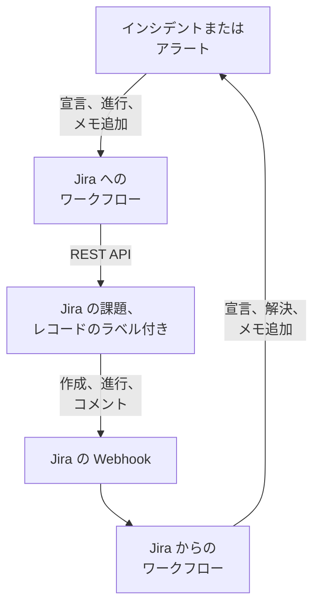

# Jira

[Jira](https://www.atlassian.com/software/jira) の課題を、OneUptime のインシデントやアラートと双方向に同期させます。既製のワークフローテンプレートが、インシデントやアラートごとに課題を作成し、レコードの進行に合わせて課題を進め、メモをコメントとしてコピーします。ほかのテンプレートは、新しい課題からインシデントを宣言し、ステータスの変更、コメント、編集を取り込みます。プラグインはありません。ワークフローが Jira の REST API を呼び出し、Jira がワークフローの Webhook URL を呼び出します。

:::cards
- [テンプレートから始める](#テンプレートから始める): 17 のテンプレート、尋ねられる内容、設定方法。
- [テンプレートの仕組み](#テンプレートの仕組み): 課題とレコードがループなしでリンクされ続ける仕組み。
- [自分で構築する](#自分で構築する): テンプレートが合わないときに、各方向を手動で構築します。
- [トラブルシューティング](#トラブルシューティング): Jira の応答の意味。
:::

> [!NOTE]
> Atlassian は Jira Cloud の名称を変更しています。UI の多くの場所で、**プロジェクト** は **スペース** に、**課題** は **作業項目** になりました。サイトによってどちらの用語も使われているため、用語が重要な箇所ではここで両方を併記しています。

## 仕組み



各テンプレートは小さなワークフローなので、インシデント、アラート、またはその両方について、必要な方向だけを使えます。OneUptime → Jira のテンプレートは OneUptime のイベントで開始され、Jira の REST API を呼び出します。Jira → OneUptime のテンプレートは Jira の Webhook で開始されます。どのテンプレートも、課題に付いた 2 つのラベルで互いのレコードを見つけます。

このページの内容はすべて **Jira Cloud** 向けです。自己管理型の Jira で変わる点は [Jira Data Center](#jira-data-center) にまとめています。

## 前提条件

- `https://your-domain.atlassian.net` のような Jira Cloud サイトと、課題を作成するプロジェクト。
- インテグレーション用の Jira ユーザーと、そのユーザーの API トークン。そのユーザーに、プロジェクトの **Browse Projects**、**Create Issues**、**Edit Issues**、**Add Comments**、**Transition Issues** を付与します。
- Jira → OneUptime のテンプレートが必要とする Webhook を登録するための Jira 管理者。
- OneUptime では、ワークフローを作成する権限。OneUptime Cloud では、ワークフローに **Growth** プラン以上が必要です。

## テンプレートから始める

**ワークフローを作成** ダイアログには、カテゴリ一覧の **Jira** の下に 17 の Jira テンプレートがあります。インシデント用が 9 つ、続いてアラート用が 8 つで、それぞれ見出しの下にまとめられています。どのテンプレートも Jira の課題に付けるラベルという 1 つの規約を共有しているため、どの組み合わせでも一緒に動作します。

### インシデント用のテンプレート

| テンプレート | 動作 | 尋ねられる内容 |
| --- | --- | --- |
| **OneUptime → Jira** | | |
| Create a Jira issue when an incident is declared | 新しいインシデントごとに課題を作成し、インシデントの ID をラベルとして付けます。Jira から宣言されたインシデントとプライベートインシデントはスキップされます。 | API URL, API token, project key, issue type, OneUptime URL |
| Move the Jira issue when the incident is acknowledged or resolved | リンクされた課題を進めます。インシデントが確認されると In Progress のステータスへ、解決されると Done のステータスへ移します。後ろに戻すことはありません。 | API URL, API token |
| Copy incident private notes to the Jira issue | 新しい非公開メモをそれぞれ、リンクされた課題にコメントとして投稿します。Jira Service Management では内部コメントになります。 | API URL, API token |
| Copy incident public notes to the Jira issue | 新しい公開メモをそれぞれ、リンクされた課題にコメントとして投稿します。 | API URL, API token |
| Comment on the Jira issue when the incident is edited | インシデントのタイトル、重大度、説明、根本原因、修復メモが変わると、インシデントの現在の内容を Jira Service Management の内部コメントとして投稿します。 | API URL, API token |
| **Jira → OneUptime** | | |
| Declare an incident when a Jira issue is created | 新しい課題ごとに、ステータスページには表示しないインシデントを、課題の優先度に応じた重大度で宣言し、課題にラベルを付けて両者をリンクします。 | Site URL、API URL、API token と **Issue created** 用の Jira の Webhook |
| Acknowledge or resolve the incident when its Jira issue moves | リンクされた課題が In Progress のステータスに移るとインシデントを確認し、Done のステータスに移ると解決します。 | **Issue updated** 用の Jira の Webhook |
| Add Jira comments to the incident as private notes | リンクされた課題の各コメントを、非公開メモとしてインシデントにコピーします。 | Site URL、API URL、API token と **Comment created** 用の Jira の Webhook |
| Add Jira issue changes to the incident as private notes | 優先度、担当者、要約など、リンクされた課題の各編集を、非公開メモとしてインシデントに記録します。ステータスの変更は上のテンプレートに任せます。 | Site URL と **Issue updated** 用の Jira の Webhook |

### アラート用のテンプレート

アラート用のテンプレートは、同じ処理をアラートに対して行います。アラートには公開メモがないため、1 つ少なくなっています。その他の違いは [アラートでの違い](#アラートでの違い) にまとめています。

| テンプレート | 動作 | 尋ねられる内容 |
| --- | --- | --- |
| **OneUptime → Jira** | | |
| Create a Jira issue when an alert is created | モニターが発生させるアラートを含め、新しいアラートごとに課題を作成し、アラートの ID をラベルとして付けます。Jira から作成されたアラートとプライベートアラートはスキップされます。 | API URL, API token, project key, issue type, OneUptime URL |
| Move the Jira issue when the alert is acknowledged or resolved | リンクされた課題を進めます。アラートが確認されると In Progress のステータスへ、解決されると Done のステータスへ移します。後ろに戻すことはありません。 | API URL, API token |
| Copy alert private notes to the Jira issue | 新しい非公開メモをそれぞれ、リンクされた課題にコメントとして投稿します。Jira Service Management では内部コメントになります。 | API URL, API token |
| Comment on the Jira issue when the alert is edited | アラートのタイトル、重大度、説明、根本原因、修復メモが変わると、アラートの現在の内容を Jira Service Management の内部コメントとして投稿します。 | API URL, API token |
| **Jira → OneUptime** | | |
| Create an alert when a Jira issue is created | 新しい課題ごとに、課題の優先度に応じた重大度でアラートを作成し、課題にラベルを付けて両者をリンクします。 | Site URL、API URL、API token と **Issue created** 用の Jira の Webhook |
| Acknowledge or resolve the alert when its Jira issue moves | リンクされた課題が In Progress のステータスに移るとアラートを確認し、Done のステータスに移ると解決します。 | **Issue updated** 用の Jira の Webhook |
| Add Jira comments to the alert as private notes | リンクされた課題の各コメントを、非公開メモとしてアラートにコピーします。 | Site URL、API URL、API token と **Comment created** 用の Jira の Webhook |
| Add Jira issue changes to the alert as private notes | 優先度、担当者、要約など、リンクされた課題の各編集を、非公開メモとしてアラートに記録します。ステータスの変更は上のテンプレートに任せます。 | Site URL と **Issue updated** 用の Jira の Webhook |

OneUptime → Jira のテンプレートは、[**プライベートインシデント**](/docs/incidents/declaring-incidents#ステップ-1-インシデントの詳細) が付いたインシデントや **プライベートアラート** が付いたアラートを Jira に送りません。レコードも、その状態も、メモも、編集も、オンにしない限り送られません。[制限事項](#制限事項) を参照してください。

### アラートでの違い

アラート用の各テンプレートは、インシデント用の対応するテンプレートと同じ手順で構築されています。アラートがインシデントと異なる点では、テンプレートも異なります:

- **公開メモはありません。** アラートには非公開メモしかないため、アラート用テンプレートが投稿するコメントはすべて Jira Service Management の内部コメントになります。
- **ステータスページはありません。** アラートがステータスページに載ることはないため、**Create an alert when a Jira issue is created** が書き込むのは重大度、タイトル、説明、`customFields.jiraIssueKey` だけです。
- **重大度は 2 つなので、Medium は Low になります。** 新しいプロジェクトには、インシデントの重大度が 3 つあるのに対し、アラートの重大度は High と Low の 2 つです。作成テンプレートは、Jira の優先度をプロジェクトにある重大度に割り振ります。既定の 2 つの場合、Highest、High、Critical、Blocker は High になり、Medium と Major を含むそれ以外の優先度はすべて Low になります。Medium を High に送るには、`prepare-alert-1` スクリプトの `PRIORITY_RANK` にある `medium: 1` を `medium: 0` に変更します。
- **アラートのリンクとラベル。** 課題は `/dashboard/<project id>/alerts/<alert id>` にリンクし、`oneuptime-alert-<alert id>` のラベルが付きます。
- **番号は何の番号かを示します。** 既定の接頭辞 `#` では、アラートとインシデントのどちらも `#12` になりうるため、テンプレートは `Alert #12` や `Incident #12` と書きます。`ALT-12` のように独自の接頭辞を持つ番号はそのまま書かれます。
- **プライベートアラート。** 手動またはアラートのプライバシールールで **プライベートアラート** が付いたアラートは、`SYNC_PRIVATE_ALERTS` を `true` にしない限り Jira に送られません。

**モニターは自動でアラートを発生させ、その数は多くなることがあります。** **Create a Jira issue when an alert is created** は、そのすべてに課題を作成します。すべてのアラートにチケットが必要なわけではないなら、Jira のステップの前に条件を置きます。High のアラートだけに課題を作成するには:

1. ワークフローの **ビルダー** を開き、**If / Else** ブロックを追加します。
2. **Value to check** を `{{local.components.alert-on-create-1.returnValues.model.alertSeverity.name}}`、**Comparison** を **is equal to**、**Compare with** を `High` に設定します。
3. 線の端を点からドラッグして外し、`alert-on-create-1` から `prepare-issue-1` への線を削除します ([整理する](/docs/workflows/authoring#整理する) を参照)。トリガーの **Success** を **If / Else** ブロックに、その **Yes** を `prepare-issue-1` に接続します。

**No** 側に進んだアラートはそこで実行を終え、課題は作成されません。

### テンプレートが尋ねる内容

作成ウィザードの **設定** ステップでは、最大 5 つの値を尋ねられます。どのテンプレートでどれが必要かは、上の表に示しています。

- **Jira Site URL** — Jira を開くアドレス。例: `https://your-domain.atlassian.net`。Jira Data Center ではそのベース URL で、例は `https://jira.example.com:8443` や `https://example.com/jira` です。Jira を OneUptime に取り込むテンプレートは、書き込む説明やメモに課題へのリンクを入れ、そのリンクはイベントの内容にかかわらず常にこのサイトを指します。そのため、このフィールドはサイトのアドレスだけを受け付けます。スキーム、ホスト、ポート (ある場合)、Data Center では Jira が動作するパスです。サイト内のページのアドレス、クエリ、ユーザー名は拒否され、代わりに何を入力すべきかが表示されます。末尾のスラッシュは問題ありません。後で変数を空にすると、課題はリンクなしで示されます。
- **Jira API URL** — ワークフローが Jira へのリクエストを送る先。`https://your-domain.atlassian.net` のような自分のサイトを、末尾のスラッシュなしで指定します。スコープ付きの API トークン (サービスアカウントのトークンはすべてこれに該当) では、代わりに `https://api.atlassian.com/ex/jira/<cloudId>` を使います。`cloudId` は `https://your-domain.atlassian.net/_edge/tenant_info` の JSON にあります。クラシックトークンでは **Jira Site URL** と同じアドレスになるため、両方を尋ねるテンプレートでは、自分で入力するまでウィザードが **Jira Site URL** から入力します。
- **Jira API Token (base64 of email:token)** — トークン単体ではなく、アカウントのメールアドレスとトークンを一緒にエンコードしたもの。これが Jira Cloud の Basic 認証の受け付け方です。方法は [API トークンを作成する](#api-トークンを作成する) にあります。トークンには有効期限があり、既定では作成から 1 年なので、日付を控えておいてください。
- **Jira Project Key** — 新しい課題を作成するプロジェクト (スペース)。`OPS-123` の `OPS` です。
- **Jira Issue Type** — 作成する課題のタイプ。そのプロジェクトでの表記どおりに書きます。例: `Task`、`Bug`、`Incident`。
- **OneUptime URL** — OneUptime を開くアドレス。`https://oneuptime.com` または独自のホストです。課題の説明は、これを使ってインシデントやアラートにリンクします。

### API トークンを作成する

:::steps
1. 個人ではなく、インテグレーション専用の Jira ユーザー (インテグレーションだけが使う通常の Atlassian アカウント) 用にトークンを作成します。課題とコメントはトークンの所有者によるものとして記録されます。そのユーザーでサインインし、[id.atlassian.com/manage-profile/security/api-tokens](https://id.atlassian.com/manage-profile/security/api-tokens) でトークンを作成します。クラシックトークン (**Create API token**) はサイトの URL で使えます。スコープ付きトークン (**Create API token with scopes**) は、上記の `api.atlassian.com` のアドレスでのみ使えます。クラシックのスコープ `read:jira-work` と `write:jira-work` で、テンプレートが行うすべての呼び出しをカバーできます。
2. そのアカウントのメールアドレスとトークンをエンコードします:

   ```bash
   printf '%s' 'jira-bot@example.com:your_api_token' | base64 | tr -d '\n'
   ```

   `echo` ではなく `printf` を使ってください。`echo` は改行を追加し、それが残りと一緒にエンコードされるため、Jira が認証情報を受け付けなくなります。サイトの URL では、これが `401` として現れることはほとんどありません ([制限事項](#制限事項) を参照)。`tr` は出力を 1 行に保ちます。Linux の GNU `base64` は 76 文字ごとに改行を入れ、現在のトークンは改行されるほど長いためです。

3. 出力を **Jira API Token (base64 of email:token)** に貼り付けます。
:::

Atlassian の **サービスアカウント** も使えます。組織の管理者が [admin.atlassian.com](https://admin.atlassian.com) の **Directory → Service accounts** で、サービスアカウントとそのトークンを作成します。そのトークンは必ずスコープ付きなので、**Jira API URL** は `https://api.atlassian.com/ex/jira/<cloudId>` のアドレスにする必要があり (**Jira Site URL** は自分のサイトのまま)、エンコードするメールアドレスはサービスアカウント自身のものです。ほかのユーザーと同じように、上記のプロジェクト権限をサービスアカウントに付与してください。

### ワークフローを作成する

:::steps
1. **ワークフロー → ワークフローを作成** を開きます。**またはテンプレートから始める** の下でカテゴリ一覧から **Jira** を選ぶか、**テンプレートを検索…** に `Jira` と入力して、使いたいテンプレートをクリックします。テンプレートが開き、その動作と尋ねられる設定が表示されます。**このテンプレートを使う** をクリックします。
2. **名前** はテンプレートから入力されます。必要なら変更します。
3. **設定** で上記の値を尋ねられます。値はワークフロー自身の変数として、メニューの **ワークフロー変数** に保存されます。API トークンはシークレットとして保存されます。**ログ → 実行履歴** ではマスクされ、Jira への呼び出しの `Authorization` ヘッダーにだけ使われます。
4. **ワークフローを作成** をクリックします。ワークフローはすべてオフの状態で作成されます。**ビルダー** の上部で **有効** をオンにしてください。
:::

まず **Create a Jira issue when an incident is declared** (アラートの場合は **Create a Jira issue when an alert is created**) から始めてください。同じ種類のほかの OneUptime → Jira テンプレートは、このテンプレートが付けるラベルで課題を見つけます。オンにして、テスト用のインシデントを宣言するかテスト用のアラートを作成し、ワークフローの **ログ → 実行履歴** を開きます。実行は **実行済み** で終わり、最後のステップ `create-issue-1` の **Response Body** に新しい課題が示されるはずです。

各ワークフローは、これらの値を個別にコピーして持ちます。トークンを交換するときは、トークンを尋ねたすべての Jira ワークフローの **ワークフロー変数** で `jiraBasicAuthToken` を更新します。Jira のアドレスが変わった場合は、`jiraSiteUrl` と `jiraBaseUrl` を同じように更新します。

### Webhook テンプレートを接続する

Jira → OneUptime のテンプレート (インシデント用 4 つ、アラート用 4 つ) は [Webhook トリガー](/docs/workflows/triggers#webhook) で開始されるため、イベントの送信先を Jira に設定する必要があります。次の順序で行います:

1. ワークフローを作成し、**先にオンにします**。オフのワークフローは Jira に `400` を返し、Jira は `4xx` で拒否された配信を再試行しません。オンにする前に送られたイベントは、キューに入らずに失われます。
2. ワークフローの **ビルダー** を開き、**Webhook** トリガーブロック (`webhook-1`) をクリックして、設定の上部にある **URL をコピー** をクリックします。URL は次のようになります:

   ```text
   https://<your OneUptime host>/workflow/trigger/<webhook secret key>
   ```

3. Jira で **Settings → System → WebHooks** (**Advanced** の下) に移動し、**Create a WebHook** をクリックします。URL を貼り付け、**Issue related events** の下で下の表のイベントにチェックを入れ、プロジェクトの課題だけが発火させるように JQL フィルターを入力します。**Exclude body** はチェックしないでください。ワークフローはすべてを本文から読み取ります。

| テンプレート | Jira のイベント | JQL フィルター |
| --- | --- | --- |
| **インシデント** | | |
| Declare an incident when a Jira issue is created | **Issue created** | `project = OPS AND (labels is EMPTY OR labels != oneuptime)` |
| Acknowledge or resolve the incident when its Jira issue moves | **Issue updated** | `project = OPS` |
| Add Jira comments to the incident as private notes | **Comment created** | `project = OPS` |
| Add Jira issue changes to the incident as private notes | **Issue updated** | `project = OPS` |
| **アラート** | | |
| Create an alert when a Jira issue is created | **Issue created** | `project = OPS AND (labels is EMPTY OR labels != oneuptime)` |
| Acknowledge or resolve the alert when its Jira issue moves | **Issue updated** | `project = OPS` |
| Add Jira comments to the alert as private notes | **Comment created** | `project = OPS` |
| Add Jira issue changes to the alert as private notes | **Issue updated** | `project = OPS` |

`OPS` は自分のプロジェクトキーに置き換えます。レコードを作成する 2 つのテンプレートのフィルターは、OneUptime が作成した課題がそもそも届かないようにします。届いてもスキップされますが、届かないイベントは実行を消費しません。`labels != oneuptime` だけだとラベルのない課題もすべて除外されるため、`labels is EMPTY` を入れています。ほかのテンプレートはリンクされた課題にしか作用しないので、`project = OPS AND labels = oneuptime` のほうが絞り込まれたフィルターになります。

ワークフローごとに URL が異なるため、ワークフローごとに Jira の Webhook が必要です。**Issue updated** を使うテンプレートが 2 つなら Webhook も 2 つ、アラート用も使うなら 4 つです。

**レコードを作成する両方のテンプレートを使いますか?** **Declare an incident when a Jira issue is created** と **Create an alert when a Jira issue is created** は、どちらも **Issue created** を待ち受けます。どちらも何かを作成する前に Jira で課題のラベルを確認しますが、2 つの配信は同時に届くため、新しい課題にインシデントとアラートの両方が作成されることがあります。プロジェクトや課題タイプで分けて、2 つを別々の課題用に登録してください:

```text
project = OPS AND issuetype = Incident AND (labels is EMPTY OR labels != oneuptime)
project = OPS AND issuetype = Alert AND (labels is EMPTY OR labels != oneuptime)
```

プロジェクトに存在する課題タイプを、Jira での表記どおりに使ってください。

これに頼る前に:

- **Jira は許可されたポートに HTTPS でのみ呼び出します。** OneUptime Cloud なら問題ありません。セルフホストのインストールは、インターネットから Jira の一覧にあるポートの HTTPS で到達できる必要があります。
- **URL を持つ人は誰でもワークフローを開始できます。** Jira の Webhook にはワークフローが検証できる情報が含まれないため、URL が唯一のシークレットです。URL を持つ人は、インシデントの宣言やアラートの作成ができ (レコードを作成するテンプレートは、指定された課題が存在し、まだリンクされていないかを Jira に確認しますが、タイトル、説明、優先度はリクエストから取ります)、ID や Jira の課題キーを知っているインシデントやアラートを進めたり、メモを追加したりできます。そうしたリクエストの内容はテキストとして書き込まれ ([制限事項](#制限事項) を参照)、課題へのリンクはリクエストの内容にかかわらず **Jira Site URL** が示すサイトを指します。URL は Jira の中だけに保管してください。漏れた場合は、ワークフローの **ビルダー** で **Webhook** トリガーをクリックし、**URL をリセット** をクリックして、新しい URL を Jira の Webhook に貼り付けます。古い URL はすぐに使えなくなります。
- **すべてのイベントが 1 回の実行になります。** OneUptime Cloud では、テンプレートがスキップするものも含め、すべての配信がプランのワークフロー実行数に数えられます。JQL フィルターでこの数を抑えられます。[プランの上限](/docs/workflows/configuration#プランの上限) を参照してください。

### 動作を確認する

各実行の **ステップ** にはテンプレートが何をしたかが示されるので、 **ログ → 実行履歴** で実行を開き、どう終わったかを見てください:

- **実行済み**: 処理を完了しました。最後のステップに課題、インシデント、またはアラートが示されます。
- **実行済み** で、 **Check With JavaScript** ステップが **No** に進んだ: 意図的にイベントをスキップしました。そのステップに理由が示されます。課題がこの種類のレコードにリンクされていない、メモが Jira から来た、レコードがプライベートである、新しい状態に対応する Jira のステータスがない、のいずれかです。
- **エラー**: ステップが失敗しました。 **ステップ** にあるその項目に理由が示されます。Jira への呼び出しの場合は、Jira の応答も含まれます。
- `link-issue-1` で **エラー**: Jira の課題からレコードを作成するテンプレートがレコードを作成したものの、Jira がリンク用のラベルを受け付けなかったため、ほかのテンプレートがまだ見つけられません。ラベルを手動で追加してください。

スキップは正常です。Jira のイベントの大半は、特定のテンプレートが処理する対象ではありません。[ワークフロー 実行履歴](/docs/workflows/runs-and-logs) を参照してください。

## テンプレートの仕組み

### 両側がリンクされ続ける仕組み

リンクを保持するのは Jira です。インシデントやアラートに属する課題には、2 つのラベルが付きます:

- `oneuptime`: 課題がリンクされていることを示します。
- `oneuptime-incident-<incident id>` (インシデントの場合) または `oneuptime-alert-<alert id>` (アラートの場合): レコードを示します。ID は、ダッシュボード上のレコードのアドレスの最後の部分です: `/dashboard/<project id>/incidents/<incident id>`。

課題を作成する 2 つのテンプレートは課題の作成時に両方のラベルを付け、Jira の課題からレコードを作成する 2 つのテンプレートはレコードができた時点で両方を付けます。ほかのすべてのテンプレートは、これらのラベルを手がかりに反対側を参照します。OneUptime → Jira のテンプレートはレコードのラベルで Jira を検索し、Jira → OneUptime のテンプレートは課題のラベルからレコードの ID を読み取ります。そのため、名前を変えたり削除したりしないでください。手動で作成した課題をリンクするには、レコードにまだ課題がない場合に限り、2 つのラベルを自分で付けます。

**課題がリンクされるのは、インシデントかアラートのどちらか一方だけです。** レコードを作成するテンプレートは、`oneuptime`、または `oneuptime-incident-` か `oneuptime-alert-` で始まるラベルを持つ課題をすべてスキップします。また、一方の種類のテンプレートは、もう一方にリンクされた課題を無視します。手動で課題をリンクするときは、両方ではなく 1 つのレコードラベルだけを付けてください。

**1 つのレコードに課題は 1 つです。** 課題に投稿したり課題を進めたりするテンプレートは、レコードのラベルを持つ課題がちょうど 1 つの場合にだけ動作します。Jira で課題を複製するとラベルもコピーされるため、リンクされた課題の複製は同じレコードを主張します。それ以降、これらのテンプレートは停止し、各実行は両方の課題を示すスキップで終わります:

```text
More than one Jira issue is labelled oneuptime-incident-<id> (OPS-17, OPS-30). A cloned issue copies the label: remove it from every issue except the one filed for the incident.
```

逆方向にはこの確認がありません。複製に対するステータスの変更、コメント、編集は、元の課題に対して行われたかのようにレコードに届きます。リンクされた課題を複製するときは、複製から両方のラベルを削除してください。

Jira から作成されたインシデントやアラートは、作成時に書き込まれる `customFields.jiraIssueKey` に課題キーも保持します。課題を作成するテンプレートは、これを見てレコードにすでに課題があることを判断します。

### テンプレートがループを避ける仕組み

一方向への書き込みは、もう一方向ではイベントになります。Jira に投稿したコメントは **Comment created** の Webhook として戻り、OneUptime で追加したメモはメモのトリガーを発火させます。3 つの仕組みがこの反響を止めます:

- **テキスト内のマーカー。** テンプレートが Jira に投稿するコメントは、すべて `Synced from OneUptime` で始まります。Jira から書き込まれるメモと、Jira からの状態変更の根本原因は、すべて `Synced from Jira` で始まります。各方向は、相手側のマーカーを含むテキストをスキップします。誰かがマーカーを引用したコメントでも同じです。
- **新しい課題のラベル。** OneUptime が作成した課題には `oneuptime` ラベルが付いており、レコードを作成するテンプレートはそれらをスキップします。何かを作成する前に、イベントを信用せずに課題のラベルを Jira に問い合わせます。Jira から作成されたレコードには `customFields.jiraIssueKey` があり、課題を作成するテンプレートはそれらをスキップします。
- **状態は両側とも前にしか進みません。** ステータスのテンプレートは、**解決** ボタンと同じようにレコードの状態タイムラインに新しい行を書き込み、常に後の状態へ進めます。遷移のテンプレートも課題を後ろに戻しません。そのため、一方が解決すると、もう一方はすでに完了しており、何も変わりません。

テンプレートを編集するときは、マーカーを残してください。各スクリプト冒頭のヘルパーブロックにある定数 `FROM_ONEUPTIME` と `FROM_JIRA` がそれです。マーカーなしで書かれたコメントやメモは、すぐにコピーし返されます。

### 遷移のテンプレートがステータスを選ぶ仕組み

Jira には「Done に移動する」という呼び出しはありません。課題は遷移によって進み、利用できる遷移は課題のワークフローとステータスによって決まります。そこで **Move the Jira issue when the incident is acknowledged or resolved** とそのアラート版は、課題で利用できる遷移を読み取り、遷移先のステータスによって 1 つを選びます:

- **前方向のみ。** Jira はステータスを To Do、In Progress、Done の 3 つのカテゴリに分けます。テンプレートは、`STATE_TO_JIRA_STATUS` で指定したステータスであっても、課題のカテゴリより前のカテゴリへの遷移を選びません。課題がすでに Done のインシデントを確認すると、`Jira issue OPS-17 is already Done, so it was not moved back to an In Progress status.` で終わります。
- **まずは一般的な名前。** 解決されたレコードでは、Done、Resolved、Closed、Complete、Completed、Fixed という名前のステータスが優先されます。確認されたレコードでは、In Progress または Work in Progress が優先されます。正しいカテゴリにある別の名前のステータスは、それしか合わない場合に使われます。
- **作業を放棄するような推測はしません。** Canceled、Declined、Rejected、Won't Do、Duplicate、Obsolete、Waiting、Pending、Escalated、On Hold、Blocked のような名前のステータスは、`STATE_TO_JIRA_STATUS` で指定しない限り選ばれません。そのため、Resolved にも Canceled にも移れる Jira Service Management のリクエストは Resolved に移ります。
- **同じステータスへの 2 つの経路。** 2 つの遷移が同じステータスに通じる場合は、画面のない遷移を選びます。

それでも判断できない場合は何も動かさず、その理由を示します。2 つのステータスが同じくらい合っている、またはどの遷移も自分で選んでよいものではない、のいずれかです。

```text
Jira issue OPS-17 could move to Released or Deployed for a Done status. Name the one to use in STATE_TO_JIRA_STATUS.
Jira issue OPS-17 has no transition from In Review to a Done status that can be chosen without naming it in STATE_TO_JIRA_STATUS.
```

その場合は、`plan-transition-1` スクリプト冒頭の `STATE_TO_JIRA_STATUS` に、OneUptime の状態名でステータスを指定します。ここに挙げた状態は、後ろに戻る場合を除き、カテゴリにかかわらず名前でそのステータスに課題を移します:

```javascript
const STATE_TO_JIRA_STATUS = {
  Resolved: "Resolved",
  Acknowledged: "In Progress",
};
```

### テンプレートの動作を変更する

ワークフローの **ビルダー** を開き、変更したいブロックをクリックします。変更することが多い設定は、スクリプト冒頭の定数です。**Check With JavaScript** ブロックの **JavaScript Code** の、共有ヘルパーブロックのすぐ下にあります。テンプレートのインシデント版とアラート版は、同じブロックに同じ定数を持っています:

| 定数 | テンプレートとブロック | 制御する内容 |
| --- | --- | --- |
| `STATE_TO_JIRA_STATUS` | Move the Jira issue when the incident (or alert) is acknowledged or resolved — `plan-transition-1` | `{ Resolved: 'Resolved', Acknowledged: 'In Progress' }` のように、OneUptime の状態名を Jira のステータス名に対応付けます。一覧にない状態は意味で判断されます。確認されると課題は In Progress のステータスへ、解決されると Done のステータスへ移り、それ以外の状態はスキップされます。実行ログで求められたら、ここにステータスを指定してください。[遷移のテンプレートがステータスを選ぶ仕組み](#遷移のテンプレートがステータスを選ぶ仕組み) を参照してください。 |
| `PREFERRED_STATUS`, `NEVER_GUESS` | Move the Jira issue when the incident (or alert) is acknowledged or resolved — `plan-transition-1` | テンプレートが意味で判断するときに優先するステータス名と、`STATE_TO_JIRA_STATUS` で指定しない限り選ばないステータス名。どちらも、大文字と小文字を区別せずにステータス名と照合される正規表現です。 |
| `SYNC_PRIVATE_INCIDENTS` | OneUptime → Jira のすべてのインシデント用テンプレート — `prepare-issue-1`、`plan-transition-1`、`build-comment-1` | `false` は、**プライベートインシデント** が付いたインシデントを Jira に送りません。課題は作成されず、その課題は進まず、メモも編集も投稿されません。それでも送るには `true` にします。テンプレートごとに個別のコピーがあるため、送るべきすべてのテンプレートで設定してください。 |
| `SYNC_PRIVATE_ALERTS` | OneUptime → Jira のすべてのアラート用テンプレート — `prepare-issue-1`、`plan-transition-1`、`build-comment-1` | **プライベートアラート** が付いたアラートについて同じことを行います。`false` は同じように Jira に送らず、`true` はそれでも送ります。送るべきすべてのアラート用テンプレートで設定してください。 |
| `JIRA_STATUS_TO_STATE` | Acknowledge or resolve the incident (or alert) when its Jira issue moves — `read-event-1` | `{ 'In Review': 'Monitoring' }` のように、Jira のステータス名を OneUptime の状態名に対応付けます。一覧にないステータスは Jira のステータスカテゴリで判断されます。In Progress はインシデントやアラートを確認し、Done は解決し、To Do は何にも対応しません。 |
| `PRIORITY_RANK` | Declare an incident when a Jira issue is created — `prepare-incident-1`; Create an alert when a Jira issue is created — `prepare-alert-1` | 小文字で書いた Jira の優先度を、`0` (最も重大な重大度)、`1`、`2` (最も軽い重大度) に対応付け、その間の重大度は範囲内に割り振ります。一覧にない優先度は中央になります。新しいプロジェクトにある二つのアラートの重大度では、`0` が High、`1` と `2` はどちらも Low なので、`medium: 0` に変更しない限り Medium は Low になります。 |
| `EVENTS` | Add Jira comments to the incident (or alert) as private notes — `read-comment-1` | メモになるコメントのイベント。編集もコピーするには `'comment_updated'` を追加し (編集はそれぞれ新しいメモになります)、Jira の Webhook で **Comment updated** にもチェックを入れます。 |
| `IGNORED_FIELDS` | Add Jira issue changes to the incident (or alert) as private notes — `read-changes-1` | 変更をメモにする価値のない Jira のフィールド (小文字)。フィールドの ID か名前のどちらかが一覧にあると、その変更は除外されます。これにより、`customfield_10019` のような ID で届くカスタムフィールドの Rank を `'rank'` で捕まえられます。ステータスはステータスのテンプレートが扱うため、一覧に含まれています。 |

キーとして使う状態名とステータス名は、大文字を含めて名前どおりに正確に書く必要があります。コードに `{{` を含めないでください。スクリプトは実行前にほかの設定と同じように値が埋め込まれるため、開き波かっこが 2 つ続くと参照として読まれます。

新しい課題により多くのフィールドを送るには、課題を作成するテンプレートの `create-issue-1` ブロックの **Request Body** を編集します。ここには課題のプロジェクト、タイプ、要約、ラベル、説明があり、`fields` の中に、[その他のフィールドを入力する](#その他のフィールドを入力する) で説明する形式で、優先度、コンポーネント、担当者、カスタムフィールドを追加できます。両方のラベルは残してください。要約と説明の文言は `prepare-issue-1` スクリプトにあります。説明には、レコードの重大度、状態、説明に続き、ある場合は根本原因と修復メモが入ります。モニターはインシデントやアラートを発生させるときにこれらを入力し、多くの場合それが原因を説明しています。

非公開メモと編集のコメントは、`post-comment-1` ブロックの **Request Body** にある `properties` のエントリ `sd.public.comment` によって内部コメントとしてマークされます。これを読むのは Jira Service Management だけです。顧客にそれらのコメントを見せる場合にのみ削除してください。

### 制限事項

- **Jira Cloud のみ。** テンプレートは Basic 認証で Jira Cloud の REST API v3 を呼び出します。Data Center には v3 がなく、個人用アクセストークンを `Bearer` として受け付けるため、すべての API ブロックに [Jira Data Center](#jira-data-center) の変更が必要です。`/rest/api/2/...` のパス、Atlassian Document Format の本文の代わりの単純な文字列、そしてヘッダーです。最も大きく変わるのは `find-issue-1` ブロックです。Data Center には `/search/jql` がないため、代わりに `/rest/api/2/search` に `POST` する必要があります。
- **Jira から宣言されたインシデントは公開されません。** 課題のテキストは顧客向けに書かれたものではないため、ステータスページから非表示の状態で、ステータスページの購読者に通知せずに作成されます。表示するには、インシデントの **設定** ページで **ステータスページに表示** をオンにするか ([インシデントをステータスページに表示しない](/docs/incidents/states-and-severities#インシデントをステータスページに出さない) を参照)、テンプレートの `incident-from-another-tool-1` ブロックで、 **その他の項目** の下にある **Show On Status Pages** をオンにします。
- **プライベートなインシデントとアラートは OneUptime に留まります。** OneUptime → Jira のテンプレートはそれらをスキップし、スキップのたびに **ログ → 実行履歴** にその旨が記録されます。それでも送るには、`SYNC_PRIVATE_INCIDENTS` または `SYNC_PRIVATE_ALERTS` を `true` にします。後からレコードをプライベートにすると、その時点から同期は止まりますが、Jira にすでにあるものは取り消されません。Jira → OneUptime のテンプレートはこれを確認しないため、リンクされた課題のコメント、編集、ステータスの変更は、プライベートなレコードにも届きます。
- **何も後ろに戻りません。** Jira の課題を再オープンしても OneUptime では何も変わらず、To Do カテゴリのステータスはどの状態にも対応しません。[順序は実際の制約です](/docs/incidents/states-and-severities#順序は表示上の好みではなく実際の制約) を参照してください。遷移のテンプレートも、課題を前のステータスカテゴリに移しません。
- **すべてのアラートに課題が作成されます。** プライベートアラートを除き、課題を作成するアラート用テンプレートは、モニターが発生させるものを含め、すべてのアラートに課題を作成します。条件を追加する方法は [アラートでの違い](#アラートでの違い) にあります。
- **最初の数秒は課題を見逃すことがあります。** Jira の検索は課題の変更に少し遅れて追いつくため、レコードの作成直後の数秒間に行われたメモ、状態変更、編集は新しい課題を見つけられず、`No Jira issue is labelled …` のスキップで終わることがあります。その実行は再試行されません。Jira からレコードが作成された直後も、ラベルが追加されるまでは同様です。
- **Jira では非公開と公開の意味が異なります。** Jira Service Management のプロジェクトでは、根本原因と修復を含む非公開メモと編集のコメントは内部コメントになり、インシデントの公開メモは顧客が見られるコメントになります。それ以外の種類のプロジェクトでは、どれも課題を見られる人なら誰でも読める通常のコメントです。
- **編集のコメントは、変更ではなく保存に反応します。** インシデントとアラートの詳細フォームは、保存のたびにタイトルと重大度を送信するため、ラベルやプライベート設定だけを変えて保存しても、前回と同じ値のコメントが投稿されます。トリガーがワークフローに渡すのは、何が変わったかではなく、現在のレコードです。
- **書式は引き継がれません。** メモはプレーンテキストとして Jira に投稿されるため、Markdown は生の文字のまま届きます。Jira のリッチテキストは、Jira の Webhook が送る `*bold*` のような Wiki 記法として OneUptime に届き、書かれたとおりに読めます。課題、コメント、ステータス、名前に入力された画像、リンク、HTML、図、`<!channel>` のようなチャットのメンションは、それらを開始する文字の後に見えない word joiner が入るため、文字として表示されるだけで何もしません。テキストをコピーしても word joiner は残ります。課題へのリンクは、ワークフローの **Jira Site URL** が示すサイトを指します。ワークフローは作成時のスクリプトを保持するため、古いバージョンのテンプレートから作成したワークフローは、そのバージョンのとおりにテキストを書きます。この動作にするには、テンプレートから作成し直してください。
- **Jira Site URL より前に作成されたワークフローは、イベントが示すサイトで課題にリンクします。** ワークフローは作成時のスクリプトと設定を保持するため、テンプレートが **Jira Site URL** を尋ねるようになる前に作成された、課題からの作成、コメント、課題の変更のワークフローは、課題へのリンクのサイトを引き続きイベント内の課題のアドレスから取ります。自分のサイトにリンクするには、**Jira Site URL** を尋ねるテンプレートからワークフローを作成し直します。新しいワークフローをオンにし、その Webhook URL を古いものの代わりに Jira の Webhook に貼り付けてから (ワークフローごとに URL は異なります)、古いワークフローを削除します。
- **間違ったトークンや期限切れのトークンは、それとわかりにくいです。** サイトの URL では、Jira は認証できない呼び出しに `401` ではなく、匿名の訪問者と同じように応答します。そのため、間違ったトークンや期限切れのトークンは、作成テンプレートの `The target project doesn't exist or you don't have permission to create issues in it` (`400`)、`Issue does not exist or you do not have permission to see it` (`404`)、またはスキップの `No Jira issue is labelled oneuptime-incident-<id>, or the Jira credentials cannot see it.` として現れます。単純な `401` を返すのは主に `api.atlassian.com` のアドレスです。値をテストするには `/rest/api/3/myself` に送信します。値が有効ならアカウントの名前とメールアドレスが、無効なら `401` が返ります。

  ```bash
  curl -H 'Authorization: Basic <the encoded value>' https://your-domain.atlassian.net/rest/api/3/myself
  ```

- **同じイベントが 2 回届くことがあります。** Jira は、サーバーエラーやタイムアウトで失敗した配信を再試行します。OneUptime がすでに実行を開始していた場合、コメントと課題の変更のテンプレートは 2 つ目のメモを追加します。レコードを作成するテンプレートは 2 つ目を作成しません。まず Jira に課題のラベルを問い合わせ、再試行が届くころには最初の実行が課題にラベルを付けているためです。ただし、最初の実行がレコードを作成したものの Jira がラベルを拒否した場合は効果がありません。その実行は `link-issue-1` で失敗するので、ラベルを手動で追加してください。

## 自分で構築する

テンプレートは一般的なケースをカバーしています。方向を自分で構築したり、定数の範囲を超えて変更したりするために、このセクションではインシデント用に両方向を手動で構築します。アラートへの適用方法は [アラートでも同じことをする](#アラートでも同じことをする) にあります。

### Jira の認証情報を保存する

Jira Cloud は、[テンプレートが尋ねる内容](#テンプレートが尋ねる内容) と同じように、アカウントのメールアドレスと API トークンを一緒にエンコードした Basic 認証を受け付けます。

1. **ワークフロー → グローバル変数** に移動し、**ワークフロー変数を作成** をクリックします。名前を `JIRA_AUTH` にし、エンコードした値を **コンテンツ** に貼り付け、**シークレット** をオンにして作成します。
2. 末尾のスラッシュなしの `https://your-domain.atlassian.net` を値とする 2 つ目の変数 `JIRA_URL` を作成し、**シークレット** はオフのままにします。

これで、どのブロックも `Authorization` ヘッダーとして `Basic {{global.variables.JIRA_AUTH}}` を送信でき、トークンがワークフローやその実行に表示されることはありません。スコープ付きトークンでは、`JIRA_URL` は代わりに `https://api.atlassian.com/ex/jira/<cloudId>` になり、以下のパスはすべてそのままその後ろに付きます。

トークンは既定で 1 年後に期限切れになり、更新されません。手動で交換せずに済むように、Atlassian の一元的なユーザー管理を使う組織は、サービスアカウントに [OAuth 2.0 の認証情報](https://support.atlassian.com/user-management/docs/create-oauth-2-0-credential-for-service-accounts/) を付与できます。これはクライアント ID とシークレットで、ワークフローが短期間有効なトークンと交換します。[Microsoft Dynamics 365](/docs/integrations/microsoft-dynamics-365) のページと同じやり方です。

### インシデントごとに Jira の課題を作成する

:::steps
1. `Incidents to Jira` という名前のワークフローをゼロから作成します。点線のブロックをクリックし、**On Create Incident** トリガーを追加します。その **Fields to pass on** は **タイトル** から始まります。**フィールドを追加** をクリックし、**説明** と **インシデント番号** を選びます。ID は常に引き渡されます。**識別子** は `incident-on-create-1` のままにします。
2. **コンポーネントを追加** をクリックし、**API Post (JSON)** ブロックを追加して、トリガーの **Success** の点をそのブロックに接続します。**識別子** を `create-issue`、**URL** を `{{global.variables.JIRA_URL}}/rest/api/3/issue` にし、**その他の項目** で **Request Headers** を `{"Authorization": "Basic {{global.variables.JIRA_AUTH}}", "Accept": "application/json"}` に設定します。
3. **Request Body** に課題を設定し、`OPS` と `Bug` を自分のプロジェクトキーとそのプロジェクトの課題タイプに置き換えます:

   ```json
   {
     "fields": {
       "project": { "key": "OPS" },
       "issuetype": { "name": "Bug" },
       "summary": "OneUptime #{{local.components.incident-on-create-1.returnValues.model.incidentNumber}}: {{local.components.incident-on-create-1.returnValues.model.title}}",
       "labels": ["oneuptime"],
       "description": {
         "type": "doc",
         "version": 1,
         "content": [
           {
             "type": "paragraph",
             "content": [
               {
                 "type": "text",
                 "text": "{{local.components.incident-on-create-1.returnValues.model.description}}"
               }
             ]
           }
         ]
       }
     }
   }
   ```

4. **有効** をオンにし、テスト用のインシデントを宣言して、**ログ → 実行履歴** を開きます。`create-issue` ステップに `201` と、新しい課題の `id`、`key`、`self` を含む本文が表示されます。
:::

説明が重く見えるのは、Jira Cloud の v3 API がリッチテキストを文字列ではなくドキュメントツリーである **Atlassian Document Format** で受け付けるためです。上の本文には、最小の有効なドキュメント (1 つのテキストノードを持つ 1 つの段落) が入っています。`environment` と複数行テキストのカスタムフィールドも同様です。後続のブロックは、新しいキーを `{{local.components.create-issue.returnValues.response-body.key}}` として読み取ります。

### その他のフィールドを入力する

`fields` の中に、次のものを追加できます:

- **優先度**: `"priority": { "id": "20000" }`。サイトの優先度 ID を使います。
- **担当者**: `"assignee": { "id": "<accountId>" }`。Jira Cloud は人を Atlassian のアカウント ID で表します。
- **ラベル**: `"labels": ["oneuptime", "sev1"]`。スペースを含まない文字列のリストです。
- **コンポーネント**: `"components": [{ "id": "10000" }]`。
- **カスタムフィールド**: `"customfield_10034": "..."`。フィールド自身の ID で指定します。単一選択は `{"value": "red"}` を、複数行テキストフィールドは説明と同じようなドキュメントを受け付けます。

推測せず、プロジェクトに何が必要かを Jira に尋ねてください。1 つ目の呼び出しはプロジェクトの課題タイプを、2 つ目はそのうち 1 つのフィールド、必須かどうか、`customfield_NNNNN` の ID を一覧にします:

```bash
curl -u 'you@example.com:your_api_token' \
  'https://your-domain.atlassian.net/rest/api/3/issue/createmeta/OPS/issuetypes'

curl -u 'you@example.com:your_api_token' \
  'https://your-domain.atlassian.net/rest/api/3/issue/createmeta/OPS/issuetypes/10001'
```

### インシデントの ID を Jira に渡す

双方向同期のそれぞれの側では、一方のシステムがもう一方の ID を保持する必要があります。インシデントの ID を課題に保持してください。そうすると Jira がイベントのたびにそれを返し、受信側のワークフローがリクエストから読み取ります。[テンプレート](#両側がリンクされ続ける仕組み) が使うのと同じラベルに入れれば、自分のワークフローとテンプレートが互いの課題を見つけられます:

```json
"labels": ["oneuptime", "oneuptime-incident-{{local.components.incident-on-create-1.returnValues.model._id}}"]
```

代わりに、Jira の管理者が短いテキストのカスタムフィールド (例: OneUptime Incident ID という名前) を追加し、それを `"customfield_10050": "{{local.components.incident-on-create-1.returnValues.model._id}}"` として設定することもできます。ラベルよりも読み返すのが簡単です。

Jira の全員が戻れる道を用意するには、`create-issue` の後に、`{{global.variables.JIRA_URL}}/rest/api/3/issue/{{local.components.create-issue.returnValues.response-body.key}}/remotelink` にリモートリンクを投稿する **API Post (JSON)** ブロックを追加します:

```json
{
  "globalId": "system=https://oneuptime.com&id={{local.components.incident-on-create-1.returnValues.model._id}}",
  "object": {
    "url": "https://oneuptime.com/dashboard/{{local.components.incident-on-create-1.returnValues.model.projectId.value}}/incidents/{{local.components.incident-on-create-1.returnValues.model._id}}",
    "title": "OneUptime incident #{{local.components.incident-on-create-1.returnValues.model.incidentNumber}}"
  }
}
```

このために、トリガーの **Fields to pass on** で **フィールドを追加** をクリックして **プロジェクト ID** を選び、`.value` は残してください。別のレコードの ID を持つ列は `{"_type": "ObjectID", "value": "..."}` として届きます。`globalId` によって、呼び出しを安全に繰り返せます。Jira は 2 つ目を追加せず、それを持つリンクを更新します。

### インシデントの進行に合わせてコメントし、遷移させる

これは 2 つ目のワークフローとして構築し、ここでの失敗が課題の作成を妨げないようにします。

:::steps
1. **On Update Incident** トリガーを持つ `Incident updates to Jira` という名前のワークフローを作成します。**Fields to watch** で **フィールドを追加** をクリックして **現在のインシデントの状態** を選びます。**Fields to pass on** で **フィールドを追加** をクリックし、**現在のインシデントの状態** を開いて **名前** を選びます。
2. **If / Else** ブロックを追加します: **Value to check** を `{{local.components.incident-on-update-1.returnValues.model.currentIncidentState.name}}`、**Comparison** を **is equal to**、**Compare with** を `Resolved` (または自分の解決済み状態の名前) にします。
3. その **Yes** 側の後に、**識別子** が `find-issue` で `{{global.variables.JIRA_URL}}/rest/api/3/search/jql` に投稿する **API Post (JSON)** ブロックで課題を見つけます:

   ```json
   {
     "jql": "project = OPS AND labels = \"oneuptime-incident-{{local.components.incident-on-update-1.returnValues.model._id}}\"",
     "fields": ["key"],
     "maxResults": 1
   }
   ```

4. 課題の ID を `{{local.components.find-issue.returnValues.response-body.issues[0].id}}` として読み取り、以下の呼び出しで使います。
:::

JQL は URL に入れず、本文で投稿してください。URL は書かれたとおりに送信され、自動ではエンコードされませんが、JQL にはスペース、引用符、`=` 記号が多く含まれます。クエリには範囲の限定が必要なため、`project =` の句を入れています。Cloud のエンドポイントは `/rest/api/3/search/jql` で、古い `/rest/api/3/search` はなくなりました。

- **コメント**: `{{global.variables.JIRA_URL}}/rest/api/3/issue/<id>/comment` への **API Post (JSON)** ブロックで、`body` としてドキュメントを送ります: `{"body": {"type": "doc", "version": 1, "content": [{"type": "paragraph", "content": [{"type": "text", "text": "Resolved in OneUptime."}]}]}}`。
- **遷移**: `{{global.variables.JIRA_URL}}/rest/api/3/issue/<id>/transitions` に対する **API Get (JSON)** ブロックが、課題のステータスから利用できる遷移を一覧にします。それぞれに `id`、`name`、遷移先のステータス `to` があります。同じ URL に `{"transition": {"id": "31"}}` を送る **API Post (JSON)** ブロックが遷移を実行し、`204` を返します。

遷移の ID は課題の Jira ワークフローに属するため、そのワークフローを編集した Jira の管理者が、ハードコードされた ID を壊すことがあります。テンプレートのように実行時に一覧を読み取れば、これを避けられます。

### Jira から変更を受け取る

まず、受信側のワークフローを構築します:

1. **Webhook** トリガーを持つ `Jira to OneUptime` という名前のワークフローを作成します。
2. ワークフローの **ビルダー** を開き、**Webhook** トリガーをクリックして、設定の上部にある **URL をコピー** をクリックします。URL は次のようになります:

   ```text
   https://oneuptime.com/workflow/trigger/<webhook secret key>
   ```

   セルフホストのインストールでは独自のホストを使います。URL はパスワードと同じように扱ってください。URL を持つ人は誰でもワークフローを開始できます。漏れた場合は、同じ場所で **URL をリセット** をクリックすると、古い URL はすぐに使えなくなります。

3. トリガーから **Update One Incident** ブロックを追加します。**Query** を `{"_id": "{{local.components.webhook-1.returnValues.request-body.oneuptimeIncidentId}}"}` に、**Data (JSON Object)** を新しい `currentIncidentStateId` などの変更内容に設定します。クエリ `{"name": "Resolved"}` を持つ **Find One Incident State** ブロックで、その ID を `{{local.components.incident-state-find-one-1.returnValues.model._id}}` として得られます。

オンにしてから、自動化ルールまたは Webhook で Jira から呼び出されるようにします:

:::tabs
@tab Automation rule
1. Jira でプロジェクトの自動化を開きます: **Space settings → Automation** (古いサイトでは **Project settings → Automation**)。複数のプロジェクトの場合は **Settings → System → Global automation** を使います。
2. **Work item transitioned** トリガー (古いサイトでは **Issue transitioned**) を使い、ステータスが **Done** に移ったときに実行されるルールを作成します。**Work item updated** トリガーはステータスの変更を含みません。
3. **Send web request** アクションを追加します: **Web request URL** にワークフローの URL、**HTTP method** に `POST`、`Content-Type: application/json` ヘッダー、**Custom data** の本文を設定します:

   ```json
   {
     "oneuptimeIncidentId": "{{issue.customfield_10050}}",
     "issueKey": "{{issue.key}}",
     "status": "{{issue.status.name}}"
   }
   ```

   カスタムフィールドではなくラベルを使う場合は、`"labels": "{{issue.labels}}"` を送り、**Run Custom JavaScript** ブロックで ID を取り出します。

4. ルールをオンにし、テスト用の課題を Done に移します。Jira でルールの監査ログを、OneUptime で **ログ → 実行履歴** を確認します。

リクエストが自分のルールから来たことを確かめるには、2 つ目のヘッダー `X-OneUptime-Secret` を自分で決めた値で追加し、アクションの **Hide** オプションを適用します。ワークフローでは、更新の前に **If / Else** ブロックを置きます: **Value to check** に `{{local.components.webhook-1.returnValues.request-headers.x-oneuptime-secret}}`、**Comparison** に **is equal to**、**Compare with** にシークレットのグローバル変数に保存した同じ値を設定します。

Send web request が呼び出すのは、ポート 80、8080、443、6017、8443、8444、7990、8090、8085、8060、8900、9900 だけです。Jira Cloud はルールの実行をプランに応じた月間の上限に対して数えるため、忙しいプロジェクトのすべての遷移で動くルールはすぐに上限に近づきます。
@tab Jira webhook
1. Jira の管理者として **Settings → System → WebHooks** (**Advanced** の下) に移動し、**Create a WebHook** をクリックします。
2. ワークフローの URL を貼り付け、**Issue updated** にチェックを入れて、`project = OPS AND labels = oneuptime` などの JQL フィルターを入力します。
3. ワークフローでは、Jira 独自のペイロードを読み取ります。`issue` には課題が、`changelog.items` には変更された各フィールドの変更前と変更後が入っています。ステータスの変更では、`field` が `status` の項目を使います。読み取るには **Run Custom JavaScript** ブロックが最も簡単です。

Webhook にはシークレットを設定でき、その場合 Jira は `X-Hub-Signature` ヘッダーで本文に署名します。Webhook トリガーはすでに JSON として読み取った本文を渡すため、ワークフローではこれを検証できません。Jira は失敗した配信を最大 5 回再試行するため、ワークフローは同じイベントを 2 回受け取っても問題がないようにする必要があります。
:::

いずれの場合も、ワークフローの URL は認証情報です。Jira の中に保管し、漏れたらリセットしてください。

### アラートでも同じことをする

まずは [テンプレートから始める](#テンプレートから始める) のアラート用テンプレートから始めてください。アラート用のワークフローを手動で構築するには、各ブロックとフィールドのアラート版を使って上の手順に従います:

| インシデント | アラート |
| --- | --- |
| **On Create Incident** (`incident-on-create-1`) | **On Create Alert** (`alert-on-create-1`) |
| **On Update Incident** (`incident-on-update-1`) | **On Update Alert** (`alert-on-update-1`) |
| **On Create Incident Internal Note** | **On Create Alert Internal Note** |
| **On Create Incident Public Note** | なし: アラートには公開メモがありません |
| `incidentNumber`, `currentIncidentState`, `incidentSeverity` | `alertNumber`, `currentAlertState`, `alertSeverity` |
| **Find One Incident State** | **Find One Alert State** |
| **Update One Incident** | **Update One Alert** |
| ラベル `oneuptime-incident-<incident id>` | ラベル `oneuptime-alert-<alert id>` |
| `/dashboard/<project id>/incidents/<incident id>` | `/dashboard/<project id>/alerts/<alert id>` |

ワークフローのトリガーはちょうど 1 つなので、インシデントとアラートにはそれぞれ別のワークフローが必要です。両方に同じ Jira の処理を行うには、**Manual** トリガーを持つワークフローで一度だけ構築し、両方から **Execute Workflow** ブロックで開始します。

## Jira Data Center

自己管理型の Jira も、いくつかの置き換えで同じように動作します。Jira Server は 2024 年 2 月にサポートが終了したため、自己管理型の対象は Data Center です。

| Cloud | Data Center |
| --- | --- |
| `/rest/api/3/...` | `/rest/api/2/...`: Data Center には v3 がありません |
| JQL で検索する `POST /rest/api/3/search/jql` | `POST /rest/api/2/search`: Data Center には `/search/jql` がありません。本文には `jql`、`fields`、`maxResults` を残し、`expand` はリスト `["transitions"]` で送ります |
| Atlassian Document Format のドキュメントとしての `description` | Wiki 記法の単純な文字列としての `description` |
| `Authorization: Basic base64(email:api_token)` | `Authorization: Bearer <personal access token>` |
| id.atlassian.com の API トークン | 自分の Jira アカウントの **Profile → Personal access tokens → Create token** |
| 自動化アクション **Send web request** | 自動化アクション **Send outgoing web request** |

そのため、課題を作成するブロックは、単純な説明を持つ `/rest/api/2/issue` への `POST` になります:

```json
{
  "fields": {
    "project": { "key": "OPS" },
    "issuetype": { "name": "Bug" },
    "summary": "OneUptime #123: Checkout is down",
    "description": "Plain text goes straight in here."
  }
}
```

その他に考慮すべき違い:

- **Jira Site URL はベース URL です**。**Administration → System → General configuration** に表示されるとおり、ポートと Jira が動作するパスを含みます: `https://jira.example.com:8443` または `https://example.com/jira`。テンプレートは課題を `<base URL>/browse/<key>` でリンクします。このフィールドは `/jira` のような 1 セグメントのパスを受け付け、それより長いパスは Jira のベース URL ではなくページのアドレスなので拒否します。
- **個人用アクセストークン** は、Jira Core と Jira Software 8.14、Jira Service Management 4.15 から使えます。有効期限があり、既定では 365 日後に切れます。パスワードによる Basic 認証もまだ使えますが、数回のサインイン失敗で CAPTCHA が表示され、誰かがブラウザーで解除するまでアカウントは REST API から締め出されます。トークンを使ってください。
- **自動化は組み込まれています**。Jira Data Center 10.0 以降です。それより前は、別途インストールする Automation for Jira アプリでした。
- **Webhook の配信は非同期です**。Data Center 10.0 以降のため、イベントが順不同で届くことがあります。受信側のワークフローがそれに対応できるようにしてください。

## トラブルシューティング

まず **ログ → 実行履歴** で失敗したステップを開きます。Jira は拒否した内容を示す JSON 本文で応答し、API ブロックはそれを `response-body` に保持します。

:::details 401 Unauthorized
`echo` ではなく `printf` で `email:api_token` をエンコードし直し、トークンを更新します。よくある原因は末尾の改行です。次に、トークンのアカウントがプロジェクトで課題を作成できることを確認します。Data Center では、`Basic` ではなく `Bearer` を送っていることを確認します。Cloud のサイト URL では、間違った認証情報は次の項目のように見えることのほうが多いです。
:::

:::details 存在するプロジェクトや課題が存在しないと言われる、または検索で何も見つからない
Cloud のサイト URL では、原因は通常データではなく認証情報です。Jira は、認証できない呼び出しに匿名の訪問者と同じように応答します。[制限事項](#制限事項) のとおり、エンコードした値を `/rest/api/3/myself` に送信してください。`401` が返ったら、エンコードし直すかトークンを交換します。正しいアカウントが返ったら、そのアカウントにプロジェクトの権限が不足しています。課題を見るには **Browse Projects**、作成するには **Create Issues** が必要です。
:::

:::details フィールドを示す 400 Bad Request
課題タイプがプロジェクトに存在しないか、送っていない必須フィールドがプロジェクトにあります。[その他のフィールドを入力する](#その他のフィールドを入力する) の `createmeta` の呼び出しをそのプロジェクトと課題タイプで実行し、比較してください。`description` に関する `400` は、Cloud の v3 API が Atlassian Document Format のドキュメントではなく文字列を受け取ったことを意味します。
:::

:::details 404 Not Found
ベース URL と API のバージョンを確認します: Cloud では `/rest/api/3/...`、Data Center では `/rest/api/2/...` です。
:::

:::details 429 Too Many Requests
Jira が呼び出しの速度を制限しています。応答には秒単位の `Retry-After` が含まれます。1 つの課題への書き込みは厳しく制限されているため、短時間にコメントと遷移を続けて行うワークフローは制限にかかることがあります。呼び出しの間に **Sleep** ブロックを置くか、大量の処理をスケジュールされたワークフローに移します。
:::

:::details 遷移の呼び出しが 400 を返す
その遷移 ID は、課題の現在のステータスからは利用できません。その課題の `/transitions` を取得し、応答にある ID を使ってください。
:::

:::details Jira ではルールや Webhook が実行されたと表示されるのに、OneUptime に何も届かない
まずポートを確認します。Jira は許可されたポートしか呼び出しません。次に、`curl` で自分からワークフローの URL にリクエストを送り、**ログ → 実行履歴** で探します。自分のリクエストは届き Jira のものは届かない場合、問題は Jira 側にあります。実行はあるのに拒否されている場合は、ワークフローがオンになっていることを確認してください。
:::

:::details ワークフローは実行されるのに、インシデントが変わらない
**Update One Incident** ブロックは、クエリに一致するものがないと `Items Updated: 0` を報告します。これはエラーではなく成功です。リクエストの ID が本当に OneUptime のインシデントのものか、`_id` でクエリしているかを確認してください。
:::

:::details Jira の課題に参照が書かれたまま表示される
解決できない参照は、空にされず、波かっこも含めて書かれたまま送信されます。実行の **ステップ** タブでは、それが入っていた設定に **解決しませんでした** と表示されます。原因は通常、ブロックの識別子の入力ミスか、名前を変えた変数です。
:::

## 次のステップ

:::cards
- [Microsoft Dynamics 365](/docs/integrations/microsoft-dynamics-365): Dynamics 365 のサポート案件向けの同じ双方向同期。
- [ワークフロー 変数](/docs/workflows/variables): シークレットと、あるブロックの値を次のブロックで読み取る方法。
- [ワークフロー 設定と安全性](/docs/workflows/configuration): Webhook のセキュリティ、アウトバウンドのネットワークアクセス、プランの上限。
- [インテグレーションの概要](/docs/integrations/index): 接続できるその他のツール。
:::
