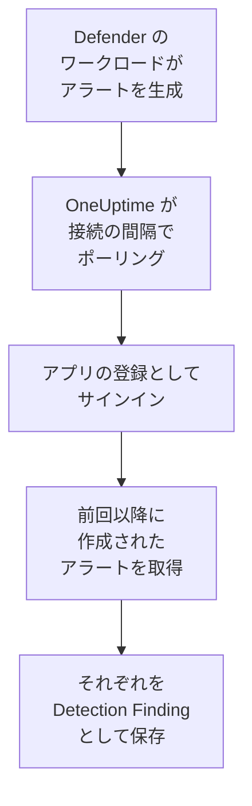

# Microsoft Defender XDR

エンドポイント、ID、メール、クラウドアプリなど、[Microsoft Defender XDR](https://learn.microsoft.com/en-us/defender-xdr/) のすべてのワークロードのアラートを、OneUptime のセキュリティイベントにインポートします。そこではログ、トレース、メトリクスと並べて検索し、他のあらゆるソースと相関付け、重要なものについてオンコールを呼び出せます。OneUptime は作成したアプリの登録を使い、Microsoft Graph セキュリティ API を通じてアラートを読み取ります。エージェント、プレイブック、Sentinel ワークスペースは必要ありません。

:::cards
- [接続を設定する](#接続を設定する): アプリの登録、1 つのアクセス許可、接続のフォーム。
- [インポートされる内容](#インポートされる内容): 各 Defender アラートがセキュリティイベントになる仕組み。
- [ポーリングの仕組み](#ポーリングの仕組み): 各ポーリングが読み取る時間枠と、負荷の高いテナントでの動作。
- [トラブルシューティング](#トラブルシューティング): 各エラーの意味と変更すべき点。
:::

## 仕組み



OneUptime は 1 分ごとに、ポーリング間隔が経過した有効な接続をそれぞれポーリングします。ポーリングはアプリの登録として Microsoft Entra ID にサインインし、前回のポーリング以降に作成されたアラートを Microsoft Graph に問い合わせ（[List alerts_v2](https://learn.microsoft.com/en-us/graph/api/security-list-alerts_v2)）、それぞれを [OCSF](https://schema.ocsf.io/) の Detection Finding イベント（クラス `2004`）として保存します。以降、検出ルール、モニター、ダッシュボードは、他のソースからのセキュリティイベントと同じようにそれを扱います。

## 前提条件

- OneUptime で Project Owner、Project Admin、または Security Admin のロール。Security Member と Security Viewer は接続とその実行履歴を見ることはできますが、変更はできません。
- Microsoft Defender XDR のライセンスを持つ Microsoft Entra テナント。Defender for Endpoint、for Identity、for Office 365、for Cloud Apps など、Microsoft Defender ポータルにオンボードされた任意の Defender ワークロード。
- アプリケーション管理者など、アプリケーションを登録できる Entra ロールと、管理者の同意を付与するためのグローバル管理者または特権ロール管理者。
- OneUptime のアプリと worker から `login.microsoftonline.com` と `graph.microsoft.com`、Azure Government の場合は `login.microsoftonline.us` と `graph.microsoft.us` への送信 HTTPS。

## 接続を設定する

接続は [OAuth 2.0 クライアント資格情報フロー](https://learn.microsoft.com/en-us/entra/identity-platform/v2-oauth2-client-creds-grant-flow) でサインインします。人ではなく常にアプリケーションとして、1 つのアプリケーションのアクセス許可でサインインします。

:::steps
### アプリケーションを登録する

1. [Azure portal](https://portal.azure.com) にサインインし、**Microsoft Entra ID** を開きます。
2. **App registrations → New registration** に移動します。名前を `OneUptime Security Events` にし、**Supported account types** は **Accounts in this organizational directory only** のまま、リダイレクト URI は空のままにして、**Register** を選びます。
3. アプリの **Overview** ページで、**アプリケーション (クライアント) ID** と **ディレクトリ (テナント) ID** をコピーします。

### アラートの読み取りを許可する

1. **API permissions → Add a permission → Microsoft Graph → Application permissions** に移動し、`SecurityAlert.Read.All` を選んで **Add permissions** を選びます。これは [List alerts_v2](https://learn.microsoft.com/en-us/graph/api/security-list-alerts_v2#permissions) 呼び出しがアプリケーションに受け入れる最小権限のアクセス許可です。`SecurityAlert.ReadWrite.All` は追加しないでください。
2. テナントに対して **Grant admin consent for** を選び、確認します。アクセス許可の状態は **Granted** になっている必要があります。同意がないと、すべての読み取りが `403` で拒否されます。

### クライアントシークレットを作成する

**Certificates & secrets → Client secrets → New client secret** に移動し、有効期限を選んで **Add** を選びます。ページを離れる前に、シークレットの **Secret ID** ではなく **Value** をコピーします。この値は二度と表示されません。

シークレットの有効期限を控えておきます。その日になると、**認証情報を更新** で置き換えるまで、ポーリングは `Microsoft Defender XDR token request failed (HTTP 401)` で止まります。

### OneUptime で接続を追加する

**製品 → セキュリティイベント → 接続**（`/dashboard/{projectId}/security-events/connections`）を開き、**接続を追加** をクリックし、**EDR / XDR** の下の **Microsoft Defender XDR** を選んで **次へ** をクリックします。下の表の設定を入力して **次へ** をクリックし、シークレットの値を **クライアントシークレット** に貼り付けます。

### 保存する前にテストする

**保存前にテスト** の下にある **これらの設定をテスト** をクリックします。テストはフォームの値でサインインしてアラートを読み取りますが、何も保存しないため、シークレットの誤りや同意の不足は接続を作成する前にわかります。その後 **次へ** をクリックし、接続に **名前** を付けて作成します。
:::

| 設定 | 確認場所 |
| --- | --- |
| **ディレクトリ (テナント) ID** | アプリの **Overview** ページ。テナントの GUID、または `contoso.onmicrosoft.com` のような検証済みドメイン。 |
| **アプリケーション (クライアント) ID** | アプリの **Overview** ページ。`SecurityAlert.Read.All` を持つアプリの GUID。 |
| **クラウド** | Microsoft 365 GCC も対象とする **Azure パブリック クラウド**、または GCC High 向けの **Azure Government (米国)**（`login.microsoftonline.us` と `graph.microsoft.us`）。Microsoft 365 DoD と中国の 21Vianet クラウドはサポートされていません。 |
| **クライアントシークレット** | シークレットの **Value**。暗号化され、API から返されることはなく、二度と表示されません。接続の **認証情報を更新** で置き換えます。 |

**ポーリング** ステップには、任意の **説明**、`1`～`1440` の整数で初期値 `5` の **ポーリング間隔（分）**、初期状態でオンの **有効** もあります。

## インポートされる内容

Defender XDR の各 [アラート](https://learn.microsoft.com/en-us/graph/api/resources/security-alert) は、ベンダー `Microsoft`、製品 `Microsoft Defender XDR` の 1 つの Detection Finding イベント（OCSF クラス `2004`）になり、テレメトリサービス `Microsoft Defender XDR` に関連付けられます。

| OCSF の列 | アラートのフィールド |
| --- | --- |
| `eventUid` | `id`。Graph のアラート ID で、重複の除外にも使われます |
| `time` | `firstActivityDateTime`、ない場合は `createdDateTime` |
| `message`, `ruleName` | `title` |
| `ruleId` | `detectorId`、ない場合は `alertPolicyId` |
| `severityName` | `severity`: `informational`、`low`、`medium`、`high`。`unknown` は Unknown のまま |
| `statusName` | `status`: `new` は New、`inProgress` は In Progress、`resolved` は Resolved |
| `mitreTechniques` | `mitreTechniques` |
| `mitreTactics` | `categories` または `category` が ATT&CK の戦術である場合。`CredentialAccess` は `TA0006` になります。その他のカテゴリは `attributes` に残ります。 |
| `principalHost`, `principalUser`, `principalIp`, `principalProcess` | `source`、`attacker`、`compromised` のロールを持つ `evidence`、それがない場合は種類ごとの最初のもの |
| `processName`, `processPath`, `processCommandLine`, `parentProcessName`, `parentProcessPath` | `principalProcess` の取得元のプロセスのエビデンスの `imageFile`、`processCommandLine`、`parentProcessImageFile`。Graph は親プロセスのコマンドラインを返しません。 |
| `targetHost`, `targetUser`, `targetIp`, `targetResource` | `destination` や `attacked` など、ターゲットのロールを持つ `evidence`。URL、メールボックス、クラウドリソースは `targetResource` に入ります。 |
| `observables` | `evidence` に含まれるすべてのホスト名、IP、ユーザー、ファイル名、SHA-1 と SHA-256、URL、ドメイン、メールボックス、リソース ID |
| `attributes` | アラート全体を、`evidence.0.hostName`、`serviceSource`、`incidentId` のようなドット区切りのキーに展開したもの |

すべての `serviceSource` のアラートがインポートされます。Sentinel を Defender ポータルに接続している場合は Microsoft Sentinel のアラートも含まれます。インシデントはインポートされませんが、各アラートは `attributes` に `incidentId` と `incidentWebUrl` を保持します。

## ポーリングの仕組み

各ポーリングは、時間枠内に作成されたアラートを 1 ページ 100 件で一覧取得し、時間枠全体を読み終えるまで Graph の `@odata.nextLink` をたどります。

```text
GET https://graph.microsoft.com/v1.0/security/alerts_v2?$filter=createdDateTime ge {start} and createdDateTime lt {end}&$top=100
```

- **作成時刻がカーソルです。** Defender はアラートを `firstActivityDateTime` の数時間後に作成することがよくあり、アクティビティ時刻を基準にしたカーソルでは、そのようなアラートがすべて飛ばされます。
- **最初のポーリングは 24 時間前までさかのぼります**。そのため、新しい接続にはすぐに最近のアラートが表示されます。
- **以降の各ポーリングは、保存されたカーソルの 1 分前から始まります**。そのため、2 つの時間枠の境界で作成されたアラートは 2 回読まれ、1 回だけインポートされます。
- **1 回のポーリングで読むのは、カーソルから最大 24 時間先までです。** worker が停止していたりテナントが制限されていたりしてカーソルが遅れた接続は、24 時間の時間枠を続けて読んで追いつきます。
- **重複はアラートの `id` で除外されます**。対象は `Microsoft` / `Microsoft Defender XDR` からのプロジェクトのイベントで、重なり、再試行された時間枠、インポートのいずれでも、アラートが二重に保存されることはありません。
- **失敗した実行は何も変えません。** ネットワークエラーや Graph のエラーステータスの後は、カーソルと時間枠の長さはそのままで、次のポーリングが同じ時間枠を読み直します。唯一の例外はタイムアウトしたリクエストです。カーソルはそのままですが、次の時間枠は半分の長さになります。時間内に応答できないほど重い時間枠は、何度試してもタイムアウトするからです。

### 1 回のポーリングで読み切れないほど時間枠にデータがある場合

1 回のポーリングで読むのは最大 20 ページ × 100 件、つまり 2,000 件のアラートです。この上限で時間枠の終わりより前に止まると、実行は **部分的** になり、次の警告が出ます。

```text
Stopped after 20 alerts requests (the per-run request limit) before reading the whole window. Microsoft Graph lists alerts newest first and documents no way to sort them oldest first, so this run cannot name a point to resume from.
```

[List alerts_v2](https://learn.microsoft.com/en-us/graph/api/security-list-alerts_v2) には `$filter`、`$top`、`$skip`、`$count` が記載されていますが `$orderby` はなく、新しいアラートから順に返されます。止まった実行が読んだ 2,000 件は時間枠内の最新のものなので、カーソルをその先に動かすと、まだ読んでいない古いアラートが飛ばされてしまいます。そこで OneUptime は代わりに時間枠を短くします。

1. **縮める。** 次のポーリングは同じ開始点から半分の長さの時間枠を読み、時間枠を最後まで読めるようになるまで、最短 1 分まで半分にし続けます。実行の警告にはそのことが示されます: `This window holds more records than one poll can read; the next poll reads a {n} minute window from the same starting point.` 長い時間枠からすでにインポートされたアラートは、重複としてスキップされます。
2. **元に戻す。** 時間枠を最後まで読めたら、カーソルはその終わりに移り、次の時間枠は再び 2 倍になり、最長 24 時間まで戻ります。
3. **1 分を飛ばす。** 1 分間でさえ 2,000 件を超えるアラートがある場合、ポーリングはその 1 分を飛ばして先に進み、新しいアラートが届き続けるようにします。実行は **部分的** のままで、**最終エラー** には `More records were created in the one minute from {cursor} to {end} than one poll can read. Polling moved past this minute so newer records keep arriving; use Import this time range in Diagnostics on this minute to recover what one run can read.` と表示されます。その 1 分を **この時間範囲をインポート** でインポートすると、1 回の実行で読める分を取り戻せます。

セキュリティイベントとして読み取れなかったアラートなど、別の理由で **部分的** になった実行も、同じ開始点から同じように再試行されます。**ポーリング間隔（分）** を変えてもこれらは何も変わりません。間隔はポーリングを開始する頻度を決めるものであり、時間枠の開始位置を決めるものではありません。

### オンデマンドで実行、プレビュー、インポートする

接続の **診断** をクリックすると、最近の実行を確認し、手動で操作できます。これらを開始できるのは接続を変更できるユーザーで、履歴は接続を見られるユーザーなら誰でも読めます。

- **今すぐ実行** は、接続が **有効** でなくても、通常のカーソルでただちにポーリングを開始します。
- **Preview alerts** は最大 7 日間の時間範囲を読み取り、何もインポートしません。
- **この時間範囲をインポート** は、確認後、カーソルを動かさずに最大 7 日間の範囲をインポートします。インポート済みのアラートはスキップされます。
- 実行の **診断情報をコピー** は、サポート向けにその実行のレポートをコピーします。認証情報は含まれません。

## 接続をテスト

接続の行にある **接続をテスト** と、フォームの **これらの設定をテスト** は、バックグラウンド worker ではなく API プロセスで実行されます。そのため、worker に問題がある場合でもテストは応答します。テストは次のチェックを順に実行します。

| チェック | 確認内容 |
| --- | --- |
| **構成** | 四つの設定が存在し、形式が正しいこと。失敗した場合はどこにも接続しません。 |
| **Authenticate with Microsoft Entra** | 選んだクラウドで、Microsoft Entra ID が Microsoft Graph 用のトークンを発行すること。シークレットの誤りや期限切れ、テナント ID やクライアント ID の誤り、クラウドの誤りで失敗します。 |
| **Read alerts from Microsoft Graph** | 過去 24 時間に作成されたアラートを一件読み取れること（`$top=1`）。ここでの `403` は、`SecurityAlert.Read.All` のアクセス許可の不足、管理者の同意の不足、または Defender XDR のないテナントを意味します。 |
| **Alerts available to import** | 過去 24 時間と過去 7 日間に作成されたアラートの数。それぞれ一ページ 100 件までなので、`100+` はそれ以上を意味します。7 日間に一件もない場合は失敗ではなく警告です。 |
| **Background workers**, **Poll scheduler**, **Security event storage** | OneUptime 側の状態。プロセスが Worker キューのジョブを取得していること、ポーリングジョブが毎分実行されていること、セキュリティイベントのストアが応答すること。 |
| **スケジュールされたポーリング** | 保存済みの接続について、ポーリングがオンであること、worker を待って止まっている実行がないこと、ポーリングが予定どおり実行されていること。 |

テスト内の各リクエストの期限は 20 秒です。テストは何もインポートせず、カーソルも動かしません。失敗した各チェックは、何を変更すべきかを示します。

## トラブルシューティング

接続の **最終エラー** は、認証情報を伏せたうえで完全なエラーメッセージを保持し、その前に失敗したステップを示すプレフィックスを付けます。接続にエラーがある場合は、その **アクション** 列で **エラーを表示** を選んで読み、ダイアログの **エラーをコピー** でコピーします。まずプレフィックスを読んでください。

:::details 最終エラーが `Microsoft Defender XDR token request` で始まる
- `Microsoft Defender XDR token request failed (HTTP ...)`: Microsoft Entra ID がトークンの発行を拒否したため、Graph には一切接続していません。メッセージの最後には、Entra の `error` コードに応じたヒントがあります。
  - `invalid_client`（`AADSTS7000215`）: シークレットが誤っているか、期限切れか、別のアプリのものです。**Certificates & secrets** で新しく作成し、**認証情報を更新** で保存します。
  - `unauthorized_client`（`AADSTS700016`）: **アプリケーション (クライアント) ID** がその **ディレクトリ (テナント) ID** に存在しないか、**クラウド** が誤っています。
  - `AADSTS90002`: そのテナントは存在しません。
  - `invalid_scope`: 選んだクラウドに Graph のスコープが存在しません。**クラウド** を確認します。
- `Microsoft Defender XDR token request returned ...`: Microsoft Entra ID が、JSON でない本文や `access_token` のない本文など、使えない応答を返しました。通常は認証情報ではなく、間にあるプロキシやゲートウェイが原因です。
- `Microsoft Defender XDR token request did not complete: ...`: トークンのエンドポイントに到達できないか、時間内に応答がありませんでした。OneUptime のアプリと worker から `login.microsoftonline.com` または `login.microsoftonline.us` への送信 HTTPS を確認します。
:::

:::details 最終エラーが `Microsoft Defender XDR alerts request` で始まる
- `Microsoft Defender XDR alerts request failed (HTTP ...)`: Graph がアラートの一覧取得を拒否しました。メッセージには Graph のエラーコードとヒントが含まれます。
  - `403`（`Authorization_RequestDenied`）: `SecurityAlert.Read.All` またはその管理者の同意がないか、テナントに Defender XDR のライセンスがありません。同意が反映されるまで数分かかります。
  - トークン発行後の `401`（`InvalidAuthenticationToken`）: 通常は **クラウド** がテナントと一致していません。
  - `429`（`TooManyRequests`）: Graph がアプリを制限しており、次のポーリングが同じ時間枠を読み直します。OneUptime の HTTP クライアントはエラー時に応答ヘッダーを保持しないため、メッセージに Graph の `Retry-After` を含めることはできません。続く場合は **ポーリング間隔（分）** を大きくします。
  - `5xx`: Graph 側の問題です。次のポーリングで再試行されます。
  - `400`: Graph がクエリを実行しませんでした。クエリを組み立てているのはあなたの設定ではなく OneUptime です。メッセージをコピーして OneUptime サポートに送ってください。
- `Microsoft Defender XDR alerts request returned ...`: Graph は `200` を返しましたが、JSON でない本文、`value` リストがない、またはクラウドの Graph ホスト上の `https://` リンクではない `@odata.nextLink` など、コネクターが使えない内容でした。そのようなリンクは拒否され、トークンが他の場所に送られることはありません。誰も読んでいないアラートをカーソルが飛び越えないよう、空の時間枠とは見なさずに報告します。
- `Microsoft Defender XDR alerts request did not complete: ...`: Graph に到達できないか、時間内に応答がありませんでした（ポーリングは 60 秒、テストは 20 秒）。`graph.microsoft.com` または `graph.microsoft.us` への送信 HTTPS を確認します。
:::

:::details テストは成功するが、最終ポーリングが Never
ポーリングジョブが一度も実行されていません。**Background workers** と **Poll scheduler** のチェックを確認します。セルフホスト環境でよくある原因は、ジョブを処理する別の worker デプロイがないままアプリで `DISABLE_QUEUE_WORKERS=true` になっていることです。`false` に設定するか、worker デプロイを実行します（Helm: `worker.enabled: true`。既定値は `false`）。
:::

:::details ポーリングは成功するが、既知のアラートがない
Defender ポータルでアラートの `createdDateTime` を確認し、**診断** の実行の時間枠と比べます。時間枠はアクティビティ時刻ではなく作成時刻に基づきます。

- 接続を作成する前に作成されたアラートは、最初の 24 時間のさかのぼりより古いものです。**この時間範囲をインポート** でインポートします。
- **部分的** の実行が 2,000 件の上限で止まりました。次のポーリングは同じ開始点から短い時間枠を読むため、そのアラートを含む時間枠を最後まで読めた時点でインポートされます。
- **最終エラー** にポーリングが飛ばした 1 分が示されている場合は、その 1 分を **この時間範囲をインポート** でインポートします。
:::

:::details 同じアラートが 2 回表示される
1 分の重なりが原因ではありません。2 回目の読み取りは重複として数えられ、保存されません。同じ `eventUid` を持つ 2 つのイベントが別々の製品としてインポートされています。たとえば、同じアラートが Microsoft Sentinel の接続経由でも届いている場合です。重複はベンダーと製品ごとに除外されます。
:::

## 得られるもの

- **検索。** セキュリティイベントのエクスプローラーで、重大度、ステータス、MITRE の手法、ホスト、ユーザー、IP、任意のオブザーバブルで Defender のアラートを絞り込み、そのホストのログやメトリクスと並べて確認できます。
- **相関付け。** 各アラートのエビデンス（デバイス、ユーザー、IP、ファイル、URL）はオブザーバブルとしてインデックス化されるため、1 回の検索で、すべてのソースにわたってそのホストに言及するものを見つけられます。
- **検出ルール。** セキュリティイベントに対してスケジュールで実行され、オンコールを呼び出すアラートを作成する Sigma ルール。
- **モニター。** セキュリティイベントのモニターは一致するイベントを数え、しきい値を超えるとインシデントやアラートを作成します。

セキュリティイベントは、他のテレメトリと同様に取り込み GB 単位で課金されます。[料金](https://oneuptime.com/pricing) を参照してください。

## 次のステップ

:::cards
- [セキュリティイベント](/docs/telemetry/security-events): インポートしたものを検索、相関付けし、アラートを出します。
- [Microsoft Sentinel](/docs/integrations/microsoft-sentinel): Sentinel ワークスペースのインシデントもインポートします。
- [ロール](/docs/permissions/reference#ロール): Security ロールが閲覧・変更できる内容。
- [インテグレーションの概要](/docs/integrations/index): 接続できるその他のツール。
:::
