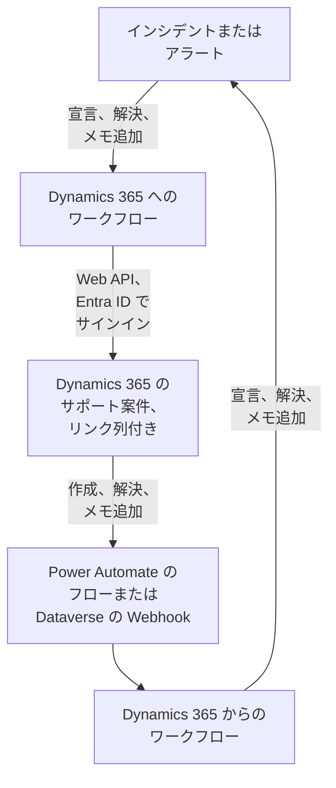

# Microsoft Dynamics 365

[Microsoft Dynamics 365](https://www.microsoft.com/dynamics-365) のサポート案件を、OneUptime のインシデントやアラートと双方向に同期させます。既製のワークフローテンプレートが、インシデントやアラートごとにサポート案件を作成し、レコードが解決されるとそれをクローズし、メモをコピーします。ほかのテンプレートは、新しいサポート案件からインシデントを宣言し、解決とメモを取り込みます。プラグインはありません。ワークフローが Dataverse Web API を呼び出し、Dynamics 365 がワークフローの Webhook URL を呼び出します。

:::cards
- [Dynamics 365 を準備する](#dynamics-365-を準備する): アプリの登録、アプリケーションユーザー、リンク列。
- [テンプレートから始める](#テンプレートから始める): 13 のテンプレート、尋ねられる内容、設定方法。
- [テンプレートの仕組み](#テンプレートの仕組み): サポート案件とレコードがループなしでリンクされ続ける仕組み。
- [自分で構築する](#自分で構築する): テンプレートが合わないときに、各方向を手動で構築します。
:::

## 仕組み



各テンプレートは小さなワークフローなので、インシデント、アラート、またはその両方について、必要な方向だけを使えます。OneUptime → Dynamics 365 のテンプレートは、Microsoft Entra ID を通じてアプリケーションとしてサインインし、Dataverse Web API を呼び出します。Dynamics 365 → OneUptime のテンプレートは、Power Automate のフローまたは Dataverse の Webhook から呼び出されると開始されます。Case テーブルに追加するテキスト列が、各サポート案件をそのレコードにリンクします。

## 前提条件

- **Case** テーブルを持つ Dynamics 365 環境。サポート案件は Dynamics 365 Customer Service に含まれます。それがない Dataverse 環境には、書き込む先の `incident` テーブルがありません。
- **Microsoft Entra ID** でアプリケーションを登録する権限と、環境にアプリケーションユーザーを作成する権限。これらは別々の管理者であることがよくあります。
- OneUptime では、ワークフローを作成する権限。OneUptime Cloud では、ワークフローに **Growth** プラン以上が必要です。

> [!NOTE]
> このページでは、Dynamics のフォームのラベルではなく Dataverse の名前を使います。サポート案件は `incident` テーブルで、URL でのコレクションは `incidents`、キーは `incidentid`、タイトル列は `title` です。表示されるサポート案件番号は `ticketnumber` です。

## Dynamics 365 を準備する

テンプレートにも、自分で構築するワークフローにも、これが必要です。OneUptime は、OAuth 2.0 のクライアント資格情報フローを使い、人ではなくアプリケーションとしてサインインします。

:::steps
### Microsoft Entra ID でアプリケーションを登録する

1. Dynamics 環境のテナントの管理者として [Azure portal](https://portal.azure.com) にサインインし、**Microsoft Entra ID** を開きます。
2. **App registrations → New registration** に移動します。名前を `OneUptime Integration` にし、**Supported account types** を **Accounts in this organizational directory only** のままにして、**Register** を選びます。
3. アプリの **Overview** ページで、**Application (client) ID** と **Directory (tenant) ID** をコピーします。
4. **Certificates & secrets → Client secrets → New client secret** に移動し、ページを離れる前に、シークレットの ID ではなく **Value** をコピーします。二度と表示されません。クライアントシークレットの有効期間は最長 24 か月なので、期限を控えておいてください。

API のアクセス許可は追加せず、管理者の同意も与えないでください。サインインしたユーザーがいないため、効果がありません。アプリケーションに何を許可するかは、そのアプリケーションユーザーを通じて Dynamics 365 が決めます。

### アプリケーションユーザーを作成する

1. [Power Platform 管理センター](https://admin.powerplatform.microsoft.com/) で **Manage → Environments** を選び、自分の環境を選びます。
2. **Settings → Users + permissions → Application users** を選び、**+ New app user**、**+ Add an app** の順に選びます。登録を選び、**Add** を選びます。
3. **Business unit** を選び、**Security roles** の横の編集アイコンからカスタムのセキュリティロールを割り当てます。Organization レベルで、ロールには次が必要です:
   - **Case**: Create、Read、Write、Append、Append To。
   - **Note**: Create、Read、Append (メモのテンプレート用)。
   - **Activity**: Create、Read、Append (サポート案件をクローズすると、活動の一種である Case Resolution が記録されるため)。
   - **Account**、およびサポート案件を取引先担当者に対して作成する場合は **Contact**: Read と Append To。
4. **Save**、**Create** の順に選びます。

アプリケーションユーザーにはカスタムロールしか割り当てられません。既存のロールをコピーして絞り込んでください。このユーザーがなくても Microsoft Entra ID はトークンを発行しますが、Dynamics 365 へのすべての呼び出しが `403` と `0x80072560` (「The user isn't a member of the organization.」) で失敗します。

### Case テーブルにリンク列を追加する

Dataverse には Jira のラベルのようなものがないため、サポート案件と OneUptime のレコードは、追加した列を通じて互いを見つけます。

1. [make.powerapps.com](https://make.powerapps.com) で環境を選び、**Tables → Case → Columns** を開いて、**New column** を選びます。
2. 名前を `OneUptime Link` にし、**Data type** を **Single line of text** のままにして保存します。既定の最大長 100 で十分です。テンプレートが書き込むのは最大 55 文字です。
3. 新しい列を開き、`new_oneuptimelink` のような **Logical name** をコピーします。接頭辞はソリューションの発行者によって決まるため、`cr4f2_oneuptimelink` のように異なる場合があります。

エージェントにリンクを見せたい場合は、Case フォームに列を追加します。
:::

## テンプレートから始める

**ワークフローを作成** ダイアログには、カテゴリ一覧の **Dynamics 365** の下に 13 の Dynamics 365 テンプレートがあります。インシデント用が 7 つ、続いてアラート用が 6 つで、それぞれ見出しの下にまとめられています。どれもリンク列を共有しているため、どの組み合わせでも一緒に動作します。

### インシデント用のテンプレート

| テンプレート | 動作 | 尋ねられる内容 |
| --- | --- | --- |
| **OneUptime → Dynamics 365** | | |
| Create a Dynamics 365 case when an incident is declared | 新しいインシデントごとに、重大度に応じた優先度と、リンク列にインシデントの ID を入れたサポート案件を作成します。Dynamics 365 から宣言されたインシデントとプライベートインシデントはスキップされます。 | Dynamics 365 の五つの設定、新しいサポート案件の顧客、OneUptime の URL |
| Resolve the Dynamics 365 case when the incident is resolved | インシデントが解決されると、リンクされたサポート案件を **Problem Solved** としてクローズし、手動で解決したときと同じように Case Resolution を記録します。サポート案件を再オープンすることはありません。 | Dynamics 365 の五つの設定 |
| Copy incident private notes to the Dynamics 365 case | 新しい非公開メモをそれぞれ、リンクされたサポート案件にメモとして追加します。 | Dynamics 365 の五つの設定 |
| Copy incident public notes to the Dynamics 365 case | 新しい公開メモをそれぞれ、リンクされたサポート案件にメモとして追加し、エージェントがステータスページの内容を顧客に伝えられるようにします。 | Dynamics 365 の五つの設定 |
| **Dynamics 365 → OneUptime** | | |
| Declare an incident when a Dynamics 365 case is created | 新しいサポート案件ごとに、ステータスページには表示しないインシデントを、サポート案件の優先度に応じた重大度で宣言し、サポート案件のリンク列にインシデントの ID を書き込みます。 | Dynamics 365 の五つの設定と、新しいサポート案件用のフローまたは Webhook |
| Resolve the incident when its Dynamics 365 case is resolved | リンクされたサポート案件が解決されると、インシデントを解決します。 | Dynamics 365 の五つの設定と、サポート案件のステータス変更用のフローまたは Webhook |
| Add Dynamics 365 case notes to the incident as private notes | エージェントがリンクされたサポート案件に追加した各メモを、非公開メモとしてインシデントにコピーします。 | Dynamics 365 の五つの設定と、新しいメモ用のフローまたは Webhook |

### アラート用のテンプレート

アラート用のテンプレートは、同じ処理をアラートに対して行います。アラートには公開メモがないため 1 つ少なく、アラートはステータスページに載らないため、**Create an alert when a Dynamics 365 case is created** はステータスページの設定を書き込みません。

| テンプレート | 動作 | 尋ねられる内容 |
| --- | --- | --- |
| **OneUptime → Dynamics 365** | | |
| Create a Dynamics 365 case when an alert is created | モニターが発生させるアラートを含め、新しいアラートごとにサポート案件を作成します。Dynamics 365 から作成されたアラートとプライベートアラートはスキップされます。 | Dynamics 365 の五つの設定、新しいサポート案件の顧客、OneUptime の URL |
| Resolve the Dynamics 365 case when the alert is resolved | アラートが解決されると、リンクされたサポート案件を **Problem Solved** としてクローズします。 | Dynamics 365 の五つの設定 |
| Copy alert private notes to the Dynamics 365 case | 新しい非公開メモをそれぞれ、リンクされたサポート案件にメモとして追加します。 | Dynamics 365 の五つの設定 |
| **Dynamics 365 → OneUptime** | | |
| Create an alert when a Dynamics 365 case is created | 新しいサポート案件ごとに、サポート案件の優先度に応じた重大度でアラートを作成し、サポート案件のリンク列にアラートの ID を書き込みます。 | Dynamics 365 の五つの設定と、新しいサポート案件用のフローまたは Webhook |
| Resolve the alert when its Dynamics 365 case is resolved | リンクされたサポート案件が解決されると、アラートを解決します。 | Dynamics 365 の五つの設定と、サポート案件のステータス変更用のフローまたは Webhook |
| Add Dynamics 365 case notes to the alert as private notes | エージェントがリンクされたサポート案件に追加した各メモを、非公開メモとしてアラートにコピーします。 | Dynamics 365 の五つの設定と、新しいメモ用のフローまたは Webhook |

OneUptime → Dynamics 365 のテンプレートは、**プライベートインシデント** が付いたインシデントや **プライベートアラート** が付いたアラートを Dynamics 365 に送りません。レコードも、その状態も、メモも、オンにしない限り送られません。[テンプレートの動作を変更する](#テンプレートの動作を変更する) を参照してください。

**モニターは自動でアラートを発生させ、その数は多くなることがあります。** **Create a Dynamics 365 case when an alert is created** は、そのすべてにサポート案件を作成します。すべてのアラートにサポート案件が必要なわけではないなら、トリガーとワークフローの残りの部分の間に **If / Else** ブロックを置き (たとえば `{{local.components.alert-on-create-1.returnValues.model.alertSeverity.name}}` で判定)、その **Yes** 側だけを先に接続します。

### テンプレートが尋ねる内容

作成ウィザードの **設定** ステップでは、最大 7 つの値を尋ねられます。どのテンプレートも最初の 5 つ (Dynamics 365 の設定) を尋ね、サポート案件を作成する 2 つのテンプレートは最後の 2 つも尋ねます。このステップは、何かを作成する前に Dynamics 365 の各設定の形式を確認し、代わりに入力すべきものを示します。形式の誤った値は、実行するまでどこでもエラーにならないためです。

- **Dynamics 365 Environment URL** — 環境のアドレス。例: `https://yourorg.crm.dynamics.com`。[Power Platform 管理センター](https://admin.powerplatform.microsoft.com/) の **Environments**、自分の環境、**Environment URL** で確認できます。アドレスのみを入力し、`/api/data/v9.2` で終わる Web API のエンドポイントは使わず、末尾にスラッシュを付けません。
- **Directory (Tenant) ID** — アプリの登録の **Overview** ページから。
- **Application (Client) ID** — 同じページから。
- **Client Secret Value** — **Certificates & secrets** にあるクライアントシークレットの **Value**。GUID である **Secret ID** ではありません。ウィザードはここで GUID を拒否します。
- **Case Link Column** — リンク列の論理名。例: `new_oneuptimelink`。
- **Customer for New Cases** — サポート案件を作成する 2 つのテンプレートだけが尋ねます。すべてのサポート案件には顧客が必要ですが、OneUptime のインシデントには顧客がないため、新しいサポート案件はすべて 1 つの顧客に対して作成されます。取引先企業の ID を貼り付けるか、取引先担当者の場合は `contacts(<id>)` を貼り付けます。Dynamics 365 でレコードを開くと、アドレスの `id=` の後の部分が ID です。
- **OneUptime URL** — サポート案件を作成する 2 つのテンプレートだけが尋ねます。OneUptime を開くアドレスで、例は `https://oneuptime.com` です。サポート案件の説明は、これを使ってインシデントやアラートにリンクします。

**テンプレートのサインイン方法。** ウィザードは、テナント、クライアント ID、シークレットを、ワークフローの **ワークフロー変数** にある 1 つの [OAuth 2.0 変数](/docs/workflows/variables#oauth-20-変数自動で更新されるトークン) `dynamicsAccessToken` に保存します。内容は Client Credentials、トークン URL `https://login.microsoftonline.com/<tenant>/oauth2/v2.0/token`、スコープ `<environment URL>/.default`、そしてリクエスト本文で送信され暗号化して保存されるクライアントシークレットです。Dynamics 365 へのすべての呼び出しは `Authorization: Bearer {{local.variables.dynamicsAccessToken}}` を送信します。OneUptime は、ステップが最初に必要とするときにトークンを取得し、期限切れの前に新しいトークンを取得し、実行ログとステップのトレースでは `[REDACTED]` に置き換えます。

何かを実行する前にサインインを確認するには、**ワークフロー変数** を開き、`dynamicsAccessToken` の **表示** をクリックしてから **今すぐ更新** をクリックします。**Access Token Fetched** と表示されれば、アプリの登録は正しく設定されています。そうでなければ、`AADSTS7000215: Invalid client secret provided` のような Microsoft Entra ID のエラーが問題点を示します。

各ワークフローは個別のコピーを持ちます。クライアントシークレットを交換するときは、すべての Dynamics 365 ワークフローで `dynamicsAccessToken` を開き、**認証情報を更新** を使います。

### ワークフローを作成する

:::steps
1. **ワークフロー → ワークフローを作成** を開きます。**またはテンプレートから始める** の下でカテゴリ一覧から **Dynamics 365** を選ぶか、**テンプレートを検索…** に `Dynamics` と入力して、使いたいテンプレートをクリックします。テンプレートが開き、その動作と尋ねられる設定が表示されます。**このテンプレートを使う** をクリックします。
2. **名前** はテンプレートから入力されます。必要なら変更します。
3. **設定** で上記の値を尋ねられます。
4. **ワークフローを作成** をクリックします。ワークフローはすべてオフの状態で作成されます。**ビルダー** の上部で **有効** をオンにしてください。
:::

まず **Create a Dynamics 365 case when an incident is declared** (アラートの場合は **Create a Dynamics 365 case when an alert is created**) から始めてください。同じ種類のほかの OneUptime → Dynamics 365 テンプレートは、このテンプレートが書き込むリンクでサポート案件を見つけます。オンにして、テスト用のインシデントを宣言するかテスト用のアラートを作成し、ワークフローの **ログ → 実行履歴** を開きます。実行は **実行済み** で終わり、最後のステップ `create-case-1` の **Response Body** に、 `CAS-01001-X1Y2Z3` のような新しいサポート案件の `ticketnumber` が含まれるはずです。

### Dynamics 365 → OneUptime のテンプレートを接続する

Dynamics 365 → OneUptime のテンプレート (インシデント用 3 つ、アラート用 3 つ) は [Webhook トリガー](/docs/workflows/triggers#webhook) で開始されるため、イベントの送信先を Dynamics 365 に設定する必要があります。次の順序で行います:

1. ワークフローを作成し、**先にオンにします**。オフのワークフローは配信を拒否し、配信はキューに入りません。
2. ワークフローの **ビルダー** を開き、**Webhook** トリガーブロック (`webhook-1`) をクリックして、設定の上部にある **URL をコピー** をクリックします。URL は次のようになります:

   ```text
   https://<your OneUptime host>/workflow/trigger/<webhook secret key>
   ```

3. Power Automate のフローまたは Dataverse の Webhook から、Dynamics 365 がこの URL に送信するようにします。

各テンプレートが知る必要があるのは、どの行が変更されたかだけです。何かを行う前にその行を Dynamics 365 から読み直すため、サポート案件のタイトル、ステータス、リンクをリクエストから取ることはなく、どちらの方法で送られても動作します。

:::tabs
@tab Power Automate flow
[Power Automate](https://make.powerautomate.com) で、**Microsoft Dataverse** のトリガー **When a row is added, modified or deleted** を使う **Automated cloud flow** を作成し、下のように設定して、**Scope** を **Organization** にします。組み込みの **HTTP** アクションを追加し、**Method** に `POST`、**URI** にワークフローの URL、`Content-Type: application/json` ヘッダー、下の本文を設定します。行の ID はトリガーの動的コンテンツから選びます。

| テンプレート | Change type | Table name | Select columns | Body |
| --- | --- | --- | --- | --- |
| サポート案件の作成時にインシデントを宣言 / アラートを作成 | Added | Cases | | `{"PrimaryEntityId": "<Case>"}` |
| サポート案件の解決時にインシデント / アラートを解決 | Modified | Cases | `statecode,statuscode` | `{"PrimaryEntityId": "<Case>"}` |
| サポート案件のメモを非公開メモとしてインシデント / アラートに追加 | Added | Notes | | `{"PrimaryEntityId": "<Note>"}` |

一部のサポート案件だけを送るには、トリガーの **Filter rows** を使います。たとえば優先度が高いサポート案件なら `prioritycode eq 1` です。本文では、Dataverse の Webhook と同じように、行を `PrimaryEntityId` で指定します。テンプレートは行そのものを Dynamics 365 から読み直します。
@tab Dataverse webhook
[Plug-in Registration Tool](https://learn.microsoft.com/en-us/power-apps/developer/data-platform/register-web-hook) で URL を登録します: **Register New WebHook** を、**HttpHeader** 認証と独自のヘッダーで登録します。URL 自体がシークレットです。次に、下の各イベントについて、**Event Pipeline Stage of Execution** を **PostOperation**、**Execution Mode** を **Asynchronous** にしたステップをその Webhook に登録します。

| テンプレート | Message | Primary Entity | Filtering Attributes |
| --- | --- | --- | --- |
| サポート案件の作成時にインシデントを宣言 / アラートを作成 | `Create` | `incident` | |
| サポート案件の解決時にインシデント / アラートを解決 | `Close`、およびほかの人によるステータス変更用の `Update` | `incident` | `statecode, statuscode` (Update) |
| サポート案件のメモを非公開メモとしてインシデント / アラートに追加 | `Create` | `annotation` | |

サポート案件を解決すると、**Update** ではなく **Close** メッセージが発生するため、そのテンプレートには両方が必要です。Webhook はプラグインの実行コンテキストを送信し、行は `PrimaryEntityId` に、**Close** の場合はその `IncidentResolution` に示されます。テンプレートはそこから読み取ります。Dataverse の Webhook が呼び出すのはポート 80 と 443 だけで、独自の行フィルターはありません。`ONLY_PRIORITIES` で絞り込まない限り、すべての新しいサポート案件が作成テンプレートに届きます。
:::

どちらかに頼る前に:

- **URL を持つ人は誰でもワークフローを開始できます。** テンプレートはすべての行を Dynamics 365 から読み直すため、リクエストにできるのは、実在するサポート案件やメモを見させることだけです。それでも、まだリンクされていないサポート案件に対して作成テンプレートを動作させることはできます。URL はフローまたは Webhook の中だけに保管してください。漏れた場合は、ワークフローの **ビルダー** で **Webhook** トリガーをクリックし、**URL をリセット** をクリックして、新しい URL をフローまたは Webhook に貼り付けます。古い URL はすぐに使えなくなります。
- **すべてのイベントが 1 回の実行になります**。テンプレートがスキップするものも含みます。OneUptime Cloud では、それぞれがプランのワークフロー実行数に数えられるため、フローで絞り込むと数を抑えられます。[プランの上限](/docs/workflows/configuration#プランの上限) を参照してください。
- **サポート案件からレコードを作成する両方のテンプレートを使いますか?** **Declare an incident when a Dynamics 365 case is created** と **Create an alert when a Dynamics 365 case is created** は、どちらも送られてきたすべてのサポート案件に作用します。どちらも先にリンク列を確認しますが、1 つの新しいサポート案件に対する 2 つの配信は同時に届くため、サポート案件にインシデントとアラートの両方が作成されることがあります。たとえばサポート案件の種類で分けて、2 つに別々のサポート案件を送ってください。

### 動作を確認する

各実行の **ステップ** にはテンプレートが何をしたかが示されるので、 **ログ → 実行履歴** で実行を開き、どう終わったかを見てください:

- **実行済み**: 処理を完了しました。最後のステップにサポート案件、インシデント、またはアラートが示されます。
- **実行済み** で、 **Check With JavaScript** ステップが **No** に進んだ: 意図的にイベントをスキップしました。そのステップに理由が示されます。サポート案件がこの種類のレコードにリンクされていない、メモが相手側から来た、レコードがプライベートである、新しい状態ではサポート案件がクローズされない、のいずれかです。
- **エラー**: ステップが失敗しました。 **ステップ** にあるその項目に理由が示されます。Dynamics 365 への呼び出しの場合は、Dynamics 365 の応答も含まれます。
- `link-case-1` で **エラー**: サポート案件からレコードを作成するテンプレートがレコードを作成したものの、Dynamics 365 がリンクを受け付けなかったため、ほかのテンプレートがまだ見つけられません。サポート案件の列にリンクを手動で入力してください。

実行が最初の Dynamics 365 のステップで `Could not get an OAuth 2.0 access token for {{local.variables.dynamicsAccessToken}}` と表示されて止まる場合は、サインインの設定が間違っており、メッセージに Microsoft Entra ID の応答が引用されています。[テンプレートが尋ねる内容](#テンプレートが尋ねる内容) を参照してください。

## テンプレートの仕組み

### 両側がリンクされ続ける仕組み

リンクを保持するのはサポート案件です。インシデントに属するサポート案件のリンク列には `oneuptime-incident-<incident id>` が、アラートに属するサポート案件には `oneuptime-alert-<alert id>` が入ります。ID は、ダッシュボード上のレコードのアドレスの最後の部分です。

サポート案件を作成するテンプレートはサポート案件の作成時にこれを書き込み、サポート案件からレコードを作成するテンプレートはレコードができた時点で書き込みます。ほかのすべてのテンプレートは、これを手がかりに反対側を参照します。OneUptime → Dynamics 365 のテンプレートはリンクでサポート案件を検索し、Dynamics 365 → OneUptime のテンプレートはサポート案件からレコードの ID を読み取ります。手動で作成したサポート案件をリンクするには、レコードにまだサポート案件がない場合に限り、そのリンク列に値を自分で入力します。

**サポート案件がリンクされるのは、インシデントかアラートのどちらか一方だけです。** 1 つの列が両方の種類に使われます。インシデント用のテンプレートはアラートにリンクされたサポート案件を無視し、その逆も同様です。また、サポート案件からレコードを作成するテンプレートは、リンク列に何か入っているサポート案件には手を付けません。

**1 つのレコードにサポート案件は 1 つです。** サポート案件に書き込むテンプレートは、レコードのリンクを持つサポート案件がちょうど 1 つの場合にだけ動作します。リンクが 2 つ目のサポート案件にコピーされると停止し、各実行は両方を示すスキップで終わります:

```text
More than one Dynamics 365 case holds the link oneuptime-incident-<id> (CAS-01001-X1Y2Z3, CAS-01002-K4L5M6). Clear it on every case except the one opened for the incident.
```

サポート案件から作成されたインシデントやアラートは、作成時に書き込まれる `customFields.dynamicsCaseId` と `customFields.dynamicsCaseNumber` に、サポート案件の ID と番号も保持します。サポート案件を作成するテンプレートは、これを見てレコードにすでにサポート案件があることを判断します。

### テンプレートがループを避ける仕組み

一方向への書き込みは、もう一方向ではイベントになります。サポート案件に追加したメモは新しいメモとして戻り、OneUptime で追加した非公開メモはメモのトリガーを発火させます。4 つの仕組みがこの反響を止めます:

- **テキスト内のマーカー。** テンプレートがサポート案件に追加するメモには、記録する Case Resolution の件名と同じく、すべて `Synced from OneUptime: …` というタイトルが付きます。Dynamics 365 から書き込まれるメモと、そこからの状態変更の根本原因は、すべて `Synced from Dynamics 365` で始まります。各方向は、相手側のマーカーを含むテキストをスキップします。誰かがマーカーを引用したメモでも同じです。
- **最初の保存からのリンク。** OneUptime が作成するサポート案件は、作成された時点からリンクを持っているため、その **Create** が戻ってきても、サポート案件からレコードを作成するテンプレートはリンク済みと判断して何もしません。
- **`customFields.dynamicsCaseId`.** サポート案件から作成されたレコードはこれを持ち、サポート案件を作成するテンプレートはそうしたレコードをスキップします。
- **状態は両側とも前にしか進みません。** レコードを解決するとサポート案件がクローズされ、サポート案件の **Close** はすでに解決済みのレコードを見つけます。サポート案件が先に解決された場合はレコードが解決され、その更新はすでにクローズされたサポート案件を見つけます。すでに解決またはキャンセルされたサポート案件が再オープンされることはありません。

テンプレートを編集するときは、マーカーを残してください。各スクリプト冒頭のヘルパーブロックにある定数 `FROM_ONEUPTIME` と `FROM_DYNAMICS` がそれです。

### テンプレートの動作を変更する

ワークフローの **ビルダー** を開き、変更したいブロックをクリックします。変更することが多い設定は、スクリプト冒頭の定数です。**Check With JavaScript** ブロックの **JavaScript Code** の、共有ヘルパーブロックのすぐ下にあります。インシデント版とアラート版は、同じブロックに同じ定数を持っています。

| 定数 | テンプレートとブロック | 制御する内容 |
| --- | --- | --- |
| `SYNC_PRIVATE_INCIDENTS`, `SYNC_PRIVATE_ALERTS` | OneUptime → Dynamics 365 のすべてのテンプレート — `prepare-case-1`、`plan-case-1`、`build-note-1` | `false` は、プライベートなレコードを Dynamics 365 に送りません。サポート案件は作成されず、そのサポート案件は変更されず、メモも追加されません。送るべき各テンプレートで `true` にしてください。 |
| `SEVERITY_TO_PRIORITY`, `DEFAULT_PRIORITY` | Dynamics 365 のサポート案件を作成 — `prepare-case-1` | プロジェクトの重大度は、順序に従ってサポート案件の優先度に割り振られます。最も重大なものは High (`1`)、最も軽いものは Low (`3`)、その間は Normal (`2`) のサポート案件になります。重大度を小文字の名前で指定すると、優先度を自分で選べます。例: `{ 'major incident': 1 }`。`DEFAULT_PRIORITY` (`2`) は、プロジェクトの一覧にない重大度や、重大度が一つしかないプロジェクトに使われます。 |
| `CASE_ORIGIN`, `CASE_TYPE` | Dynamics 365 のサポート案件を作成 — `prepare-case-1` | 新しいサポート案件の `caseorigincode` (`3`、Web) と `casetypecode` (`2`、Problem)。ほかの列を設定するには、同じスクリプトの `CASE` に論理名で追加します。 |
| `MAX_TITLE_LENGTH`, `MAX_DESCRIPTION_LENGTH` | Dynamics 365 のサポート案件を作成 — `prepare-case-1` | Case テーブル自体の上限である 200 文字と 2000 文字。どれだけ切り詰められても、説明には OneUptime へのリンクが残ります。Case テーブルでより多く許可している場合は上げてください。 |
| `RESOLVED_CASE_STATUS` | Dynamics 365 のサポート案件を解決 — `plan-case-1` | 解決されたレコードがサポート案件をクローズするときのステータス。`5` は Problem Solved、`1000` は Information Provided です。 |
| `STATE_TO_CASE_STATUS` | Dynamics 365 のサポート案件を解決 — `plan-case-1` | 独自の解決済みの状態で、状態の名前によって、別の解決済みステータスでサポート案件をクローズします。 `{ Closed: 1000 }` は Information Provided としてクローズします。サポート案件が変わるのはレコードが解決されたときだけで、Researching のようなアクティブなステータスが設定されることはありません。 |
| `PRIORITY_RANK` | Dynamics 365 のサポート案件から作成 — `prepare-incident-1`、`prepare-alert-1` | サポート案件の優先度 (`1` High、`2` Normal、`3` Low) を、`0` (最も重大な重大度)、`1`、`2` (最も軽い重大度) に対応付けます。一覧にない優先度は中央になります。新しいプロジェクトにある二つのアラートの重大度では、`2: 1` を `2: 0` に変えない限り、Normal は Low になります。 |
| `ONLY_PRIORITIES` | Dynamics 365 のサポート案件から作成 — `prepare-incident-1`、`prepare-alert-1` | 空の場合は、フローまたは Webhook が送るすべてのサポート案件を受け付けます。`[1]` にすると、優先度が高いサポート案件にだけレコードを作成します。 |
| `CASE_STATUS_TO_STATE`, `CASE_STATE_TO_STATE_FLAG` | Dynamics 365 のサポート案件の解決時に解決 — `decide-state-1` | `{ Researching: 'Acknowledged' }` のように、サポート案件のステータスを名前で OneUptime の状態に対応付けます。それ以外は、サポート案件の状態で決まります。Resolved はレコードを解決します。サポート案件がキャンセルされたときにも解決するには、`2: 'isResolvedState'` を追加します。 |
| `MESSAGES` | Dynamics 365 → OneUptime のすべてのテンプレート — `read-event-1`、または `prepare-incident-1` と `prepare-alert-1` | テンプレートが作用するイベント。編集されたメモもコピーするには、メモのテンプレートの一覧に `'Update'` を追加します。編集はそれぞれ新しいメモになります。 |
| `MAX_NOTE_LENGTH` | メモのテンプレート — `build-note-1`、`read-note-1` | それぞれが書き込むメモの最大長。Dynamics 365 へはメモ自体の上限である 100,000 文字、OneUptime へは 30,000 文字です。 |

キーとして使う状態名とステータス名は、大文字を含めて名前どおりに正確に書く必要があります。コードに `{{` を含めないでください。スクリプトは実行前にほかの設定と同じように値が埋め込まれるため、開き波かっこが 2 つ続くと参照として読まれます。

### 制限事項

- **Microsoft の商用クラウド。** トークン URL は `login.microsoftonline.com` です。US Government (GCC High、DoD) や中国のクラウドでは、`dynamicsAccessToken` を開いて **設定を編集** を使い、トークン URL を `login.microsoftonline.us` のような自分のクラウドのサインインホストに変更します。
- **Dynamics 365 がサポート案件の解決を拒否することがあります。** Customer Service の設定によっては、未完了の活動や未完了の子サポート案件があるあいだはサポート案件を解決できず、ビジネスルールやプラグインが拒否することもあります。実行は Dynamics 365 の理由とともに `close-case-1` で失敗し、サポート案件はそのまま残ります。
- **レコードとサポート案件は後ろに戻りません。** サポート案件を再オープンしても OneUptime では何も変わらず、解決済みのレコードが再オープンされることもありません。すでに解決またはキャンセルされたサポート案件を、クローズし直すために再オープンすることもありません。
- **メモと説明はプレーンテキストです。** Dynamics 365 のリッチテキストエディターで書かれたメモは、表示されているテキストとして OneUptime に届きます。エディターで書かれた、またはメールから取り込まれたサポート案件の説明も同様で、段落と改行は残り、書式、画像、メール独自のスタイルは失われます。OneUptime のメモは、Markdown を含めて生の文字のまま Dynamics 365 に届きます。サポート案件のタイトルと説明、メモ、ステータス・優先度・顧客・人の名前など、Dynamics 365 から来るテキストは書かれたとおりに読めます。そこに入力された画像、リンク、HTML、図、`<!channel>` のようなチャットのメンションは、それらを開始する文字の後に見えない word joiner が入るため、文字として表示されるだけで何もしません。テキストをコピーしても word joiner は残ります。ワークフローは作成時のスクリプトを保持するため、古いバージョンのテンプレートから作成したワークフローは、そのバージョンのとおりにテキストを書きます。この動作にするには、テンプレートから作成し直してください。添付ファイルは Dynamics 365 に残り、OneUptime のメモにはファイル名が示されます。
- **編集されたメモはコピーされません**。新しいメモだけがコピーされます。`MESSAGES` に `'Update'` を追加すれば変わります。
- **プライベートなインシデントとアラートは OneUptime に留まります**。ただし Dynamics 365 → OneUptime のテンプレートはこれを確認しないため、リンクされたサポート案件のメモやステータスの変更は、プライベートなレコードにも届きます。
- **すべてのサポート案件にレコードが作成されます。** フローで絞り込むか `ONLY_PRIORITIES` を設定しない限り、サポート案件からレコードを作成するテンプレートは、送られてきたすべての新しいサポート案件にインシデントまたはアラートを作成します。忙しいカスタマーサービス環境では、その数は大量になります。
- **同じイベントが 2 回届くことがあります。** Dataverse の Webhook は、OneUptime が `502`、`503`、`504` を返したときに 1 回だけ再試行します。最初の実行がサポート案件をリンクした後に届いた再試行の **Create** は、何も起こしません。最初の実行がまだ処理中のときに届いたものは、2 つ目のレコードを作成することがあります。

## 自分で構築する

テンプレートは一般的なケースをカバーしています。方向を自分で構築するために、このセクションでは [Dynamics 365 を準備する](#dynamics-365-を準備する) の後、インシデント用に両方向を手動で構築します。アラートへの適用方法は [アラートでも同じことをする](#アラートでも同じことをする) にあります。

### OAuth 2.0 変数でサインインする

すべてのワークフロー用に、トークンを [OAuth 2.0 変数](/docs/workflows/variables#oauth-20-変数自動で更新されるトークン) として一度だけ作成します:

1. **ワークフロー → グローバル変数** に移動し、**ワークフロー変数を作成** の横にある **その他** メニュー (**⋯**) を開いて、**OAuth 2.0 変数を作成** を選びます。名前を `DYNAMICS_TOKEN` にします。
2. **プロバイダー** で **Microsoft Entra ID** を選び、**トークン URL** の `{tenant-id}` を自分の Directory (tenant) ID に置き換え、**Client Credentials** を選びます。
3. **認証情報** で **クライアント ID** と **クライアントシークレット** を入力します。**詳細** でスコープを `https://yourorg.crm.dynamics.com/.default` に設定し、変数を作成します。

これで、どのブロックも `Authorization` ヘッダーで `Bearer {{global.variables.DYNAMICS_TOKEN}}` を送信します。OneUptime はトークンを取得し、期限切れの前に新しいトークンを取得し、実行ログには含めません。

スコープは、環境の URL の後に `/.default` を付けたものでなければなりません。環境の URL の誤りは、`AADSTS70011: The provided value for the input parameter 'scope' is not valid` のよくある原因です。

### インシデントごとにサポート案件を作成する

:::steps
1. `Incidents to Dynamics 365` という名前のワークフローをゼロから作成します。点線のブロックをクリックし、**On Create Incident** トリガーを追加します。その **Fields to pass on** は **タイトル** から始まります。**フィールドを追加** をクリックし、**説明** と **インシデント番号** を選びます。ID は常に引き渡されます。
2. **コンポーネントを追加** をクリックし、**API Post (JSON)** ブロックを追加して、トリガーの **Success** の点をそのブロックに接続します。**識別子** を `create-case`、**URL** を `https://yourorg.crm.dynamics.com/api/data/v9.2/incidents?$select=incidentid,ticketnumber` に設定します。
3. **その他の項目** で、**Request Headers** を次のように設定します:

   ```json
   {
     "Authorization": "Bearer {{global.variables.DYNAMICS_TOKEN}}",
     "OData-MaxVersion": "4.0",
     "OData-Version": "4.0",
     "Accept": "application/json",
     "If-None-Match": "null",
     "Prefer": "return=representation"
   }
   ```

4. **Request Body** に、サポート案件が属する取引先企業の GUID を使ってサポート案件を設定します:

   ```json
   {
     "title": "OneUptime #{{local.components.incident-on-create-1.returnValues.model.incidentNumber}}: {{local.components.incident-on-create-1.returnValues.model.title}}",
     "description": "{{local.components.incident-on-create-1.returnValues.model.description}}",
     "caseorigincode": 3,
     "prioritycode": 1,
     "new_oneuptimelink": "oneuptime-incident-{{local.components.incident-on-create-1.returnValues.model._id}}",
     "customerid_account@odata.bind": "/accounts(00000000-0000-0000-0000-000000000000)"
   }
   ```

5. **有効** をオンにし、テスト用のインシデントを宣言して、**ログ → 実行履歴** を開きます。`create-case` ステップに `201` と、新しい `incidentid` と `ticketnumber` を含む本文が表示されます。
:::

すべてのサポート案件には顧客が必要なので、`customerid` は必須です。取引先企業と取引先担当者のどちらも指せるため、`customerid_account@odata.bind` または `customerid_contact@odata.bind` と正確に書きます。`Prefer: return=representation` を付けると、応答がサポート案件そのものを含む `201` になり、次のブロックが `{{local.components.create-case.returnValues.response-body.incidentid}}` を読み取れます。付けない場合、Dynamics 365 は本文なしの `204` を返します。

`new_oneuptimelink` は [Dynamics 365 を準備する](#dynamics-365-を準備する) のリンク列で、テンプレートが書き込むのと同じ値を持つため、自分のワークフローとテンプレートが互いのサポート案件を見つけられます。自分の列の論理名を使ってください。

### 優先度とステータスを対応付ける

Dynamics 365 の `severitycode` には選択肢が 1 つしかないため、代わりに `prioritycode` を設定し、重大度ごとの優先度にするには **If / Else** ブロックでインシデントの重大度ごとに分岐します。次の列は数値として送ります:

| 列 | 値 |
| --- | --- |
| `prioritycode` | `1` High、`2` Normal、`3` Low |
| `caseorigincode` | `1` Phone、`2` Email、`3` Web、`2483` Facebook、`3986` Twitter、`700610000` IoT |
| `casetypecode` | `1` Question、`2` Problem、`3` Request |
| `statecode` | `0` Active、`1` Resolved、`2` Cancelled |
| `statuscode` | `1` In Progress、`2` On Hold、`3` Waiting for Details、`4` Researching、`5` Problem Solved、`6` Cancelled、`1000` Information Provided、`2000` Merged |

`statuscode` はカスタマイズできるため、環境によっては独自の値があります。

### インシデントが解決されたらサポート案件を解決する

これは 2 つ目のワークフローとして構築し、ここでの失敗がサポート案件の作成を妨げないようにします。

:::steps
1. **On Update Incident** トリガーを持つ `Close Dynamics 365 cases` という名前のワークフローを作成します。**Fields to watch** で **フィールドを追加** をクリックして **現在のインシデントの状態** を選びます。**Fields to pass on** で **フィールドを追加** をクリックし、**現在のインシデントの状態** を開いて **解決済みの状態** を選びます。
2. **If / Else** ブロックを追加します: **Value to check** を `{{local.components.incident-on-update-1.returnValues.model.currentIncidentState.isResolvedState}}`、**Comparison** を **is true** にします。
3. その **Yes** 側の後に、**識別子** が `find-case` で、`Prefer` を除いた同じヘッダーと次の **URL** を持つ **API Get (JSON)** ブロックを追加します:

   ```text
   https://yourorg.crm.dynamics.com/api/data/v9.2/incidents?$select=incidentid&$filter=new_oneuptimelink%20eq%20'oneuptime-incident-{{local.components.incident-on-update-1.returnValues.model._id}}'
   ```

4. その後に、同じヘッダーと次の本文で `https://yourorg.crm.dynamics.com/api/data/v9.2/CloseIncident` に送る **API Post (JSON)** ブロックを追加します:

   ```json
   {
     "IncidentResolution": {
       "@odata.type": "Microsoft.Dynamics.CRM.incidentresolution",
       "subject": "Resolved in OneUptime",
       "incidentid@odata.bind": "/incidents({{local.components.find-case.returnValues.response-body.value[0].incidentid}})"
     },
     "Status": 5
   }
   ```
:::

URL は書かれたとおりに送信されるため、`$filter` のスペースは `%20` と書いています。クエリは `value` のリストで応答し、`value[0]` が最初のサポート案件です。`Status` は Resolved 状態の `statuscode` で、`5` は Problem Solved です。

解決には `statecode` の `PATCH` ではなく `CloseIncident` を使ってください。解決済みのサポート案件に必要な Case Resolution を記録し、管理者がステータスの遷移を設定している環境では `PATCH` が拒否されるためです。優先度やタイトルなどそれ以外の変更には、`https://yourorg.crm.dynamics.com/api/data/v9.2/incidents(<the case id>)` に **API Patch (JSON)** ブロックを送り、新しいサポート案件の作成を防ぐ `If-Match: *` ヘッダーと、変更する列だけを含めます。

### Dynamics 365 から変更を受け取る

まず、受信側のワークフローを構築します:

1. **Webhook** トリガーを持つ `Dynamics 365 to OneUptime` という名前のワークフローを作成します。
2. ワークフローの **ビルダー** を開き、**Webhook** トリガーをクリックして、設定の上部にある **URL をコピー** をクリックします。URL は次のようになります:

   ```text
   https://oneuptime.com/workflow/trigger/<webhook secret key>
   ```

   セルフホストのインストールでは、URL に独自のホストが入ります。URL はパスワードと同じように扱ってください。URL を持つ人は誰でもワークフローを開始できます。漏れた場合は、同じ場所で **URL をリセット** をクリックすると、古い URL はすぐに使えなくなります。

3. ほかの何よりも先に共有シークレットを確認する **If / Else** ブロックを追加します: **Value to check** に `{{local.components.webhook-1.returnValues.request-headers.x-oneuptime-secret}}`、**Comparison** に **is equal to**、**Compare with** にシークレットのグローバル変数に保存した自分で決めた値を設定します。
4. その **Yes** 側の後に、**Update One Incident** ブロックを追加します。**Query** を `{"_id": "{{local.components.webhook-1.returnValues.request-body.oneuptimeIncidentId}}"}` に、**Data (JSON Object)** を新しい `currentIncidentStateId` などの変更内容に設定します。クエリ `{"name": "Resolved"}` を持つ **Find One Incident State** ブロックで、その ID を `{{local.components.incident-state-find-one-1.returnValues.model._id}}` として得られます。

オンにしてから、Dynamics 365 から呼び出されるようにします:

:::tabs
@tab Power Automate flow
1. [Power Automate](https://make.powerautomate.com) で、**Microsoft Dataverse** のトリガー **When a row is added, modified or deleted** を使う **Automated cloud flow** を作成します: **Change type** は `Modified`、**Table name** は `Cases`、**Scope** は `Organization`、**Select columns** は `statecode,statuscode` にして、ステータスの変更時だけ発火するようにします。
2. トリガーの行 ID を使って、`Cases` に対する **Get a row by ID** を追加します。更新には変更された列しか含まれないためです。
3. 組み込みの **HTTP** アクションを追加します: **Method** に `POST`、**URI** にワークフローの URL、`Content-Type: application/json` と `X-OneUptime-Secret: <your secret>` のヘッダー、そして行から組み立てた本文を設定します。`oneuptimeIncidentId` は `oneuptime-incident-` を除いたリンク列で、`replace(<link column>, 'oneuptime-incident-', '')` のように作り、`ticketnumber` と `statecode` と並べます。
4. フローを保存し、オンにします。

Microsoft Dataverse コネクタはプレミアムです。フローの所有者にライセンスが必要で、ライセンスが切れるとフローは停止します。配信には通常数秒かかります。
@tab Dataverse webhook
1. [Plug-in Registration Tool](https://learn.microsoft.com/en-us/power-apps/developer/data-platform/register-web-hook) でワークフローの URL を登録します: **Register New WebHook** を、**HttpHeader** 認証と `X-OneUptime-Secret` ヘッダーで登録します。
2. `incident` に対する **Update** メッセージのステップを、必要な列に限定した **Filtering Attributes**、**PostOperation**、**Asynchronous** で登録します。
3. ワークフローでペイロードを読み取ります。これはプラグインの実行コンテキストで、`InputParameters` は `{key, value}` のペアのリスト、変更された行は `Target` の下にあります。読み取るには **Run Custom JavaScript** ブロックが最も簡単です。

Dataverse が呼び出すのはポート 80 と 443 だけで、応答を 60 秒待ち、`502`、`503`、`504` の場合に限って 1 回だけ再試行します。更新には変更された列しか含まれないため、それ以外の列にはポストイメージを登録してください。
:::

### アラートでも同じことをする

アラートも同じように動作します。レコードの種類を入れ替えるだけで、ほかは何も変わりません:

| インシデント | アラート |
| --- | --- |
| **On Create Incident** (`incident-on-create-1`) | **On Create Alert** (`alert-on-create-1`) |
| **On Update Incident** (`incident-on-update-1`) | **On Update Alert** (`alert-on-update-1`) |
| `incidentNumber`, `currentIncidentState`, `incidentSeverity` | `alertNumber`, `currentAlertState`, `alertSeverity` |
| **Find One Incident State** | **Find One Alert State** |
| **Update One Incident** | **Update One Alert** |

ワークフローのトリガーはちょうど 1 つなので、インシデントとアラートにはそれぞれ別のワークフローが必要です。両方に同じ Dynamics 365 の処理を行うには、**Manual** トリガーを持つワークフローで一度だけ構築し、両方から **Execute Workflow** ブロックで開始します。

## トラブルシューティング

まず **ログ → 実行履歴** で失敗したステップを開きます。Microsoft のどちらのエンドポイントも問題を説明する JSON 本文で応答し、API ブロックはそれを `response-body` に保持します。

:::details AADSTS70011 を伴う 400、スコープが無効
スコープが、環境の URL の後に `/.default` を付けたものになっていません。Power Platform 管理センターから URL をコピーし、末尾のスラッシュと `/api/data/...` のパスを取り除いてください。
:::

:::details Dynamics 365 からの 401 Unauthorized
`Authorization` ヘッダーがないか、形式が間違っています。`Bearer`、スペース 1 つ、トークンの順になっている必要があります。
:::

:::details 0x80072560 を伴う 403 Forbidden
「The user isn't a member of the organization」: アプリケーションユーザーがないか、別のアプリの登録に属しています。トークンは問題ありません。[Dynamics 365 を準備する](#dynamics-365-を準備する) のとおりにユーザーを作成してください。
:::

:::details 特権のエラーを伴う 403 Forbidden
アプリケーションユーザーは存在しますが、そのセキュリティロールに、呼び出しに必要な特権 (**Case** に対する Create、Read、Write など) がありません。
:::

:::details 顧客に関する 400 Bad Request
`customerid` は必須です。`customerid_account@odata.bind` または `customerid_contact@odata.bind` を、`/accounts(<guid>)` のようなアドレスとともに正確に送ってください。
:::

:::details CloseIncident で 404 Not Found
`CloseIncident` は、Dataverse 単体ではなく Dynamics 365 Customer Service に含まれます。環境の `$metadata` で探してください。
:::

:::details DuplicateRecord を伴う 412 Precondition Failed
重複検出ルールに一致しました。ルールを絞り込むか、ルールが照合するフィールドを送らないようにします。
:::

:::details 429 Too Many Requests
Dataverse のサービス保護の制限では、任意の 5 分間にユーザーあたり約 6,000 件のリクエストと 20 分の実行時間が許可されます。応答には秒単位の `Retry-After` が含まれます。まとめて処理するワークフローには **Sleep** ブロックを入れるか、処理をスケジュールされたワークフローに移します。
:::

:::details OneUptime に何も届かない
`curl` で自分から Webhook の URL にリクエストを送り、**ログ → 実行履歴** で探します。自分のリクエストは届き Dynamics 365 のものは届かない場合は、上流を確認します。フロー自体の実行履歴や、Dataverse の Webhook の失敗した System Jobs です。
:::

:::details ワークフローは実行されるのに、インシデントが変わらない
**Update One Incident** ブロックは、クエリに一致するものがないと `Items Updated: 0` を報告します。これはエラーではなく成功です。リクエストの ID が本当に OneUptime のインシデントのものか、`_id` でクエリしているかを確認してください。
:::

## 次のステップ

:::cards
- [Jira](/docs/integrations/jira): Jira の課題向けの同じ双方向同期。
- [ワークフロー 変数](/docs/workflows/variables#oauth-20-変数自動で更新されるトークン): OAuth 2.0 変数と、それが更新し続けるトークン。
- [ワークフロー 設定と安全性](/docs/workflows/configuration): Webhook のセキュリティ、アウトバウンドのネットワークアクセス、プランの上限。
- [IP アドレス](/docs/configuration/ip-addresses): Dynamics 365 が許可リストの内側にある場合の、OneUptime の送信元アドレス。
:::
