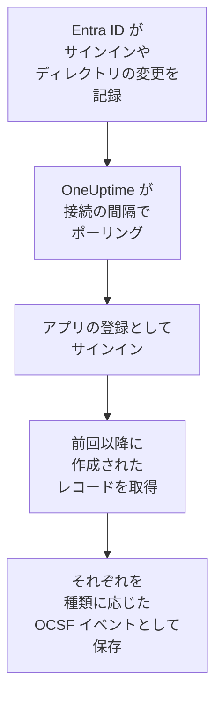

# Microsoft Entra ID

[Microsoft Entra ID](https://learn.microsoft.com/en-us/entra/identity/) のサインインとディレクトリの変更を、OneUptime のセキュリティイベントにインポートします。必要なら、[Microsoft 365 監査ログ](https://learn.microsoft.com/en-us/purview/audit-log-activities) にある Exchange、SharePoint、OneDrive、Teams のアクティビティもインポートできます。そこではログ、トレース、メトリクスと並べて検索し、他のあらゆるソースと相関付け、重要なものについてオンコールを呼び出せます。OneUptime は作成したアプリの登録で読み取り、テナントでは何も変更しません。

:::cards
- [接続を設定する](#接続を設定する): アプリの登録、そのアクセス許可、接続のフォーム。
- [インポートされる内容](#インポートされる内容): どのレコードが対象で、各レコードがどのようにセキュリティイベントになるか。
- [ポーリングの仕組み](#ポーリングの仕組み): 各ポーリングが読み取る時間枠と、それが前回と 30 分重なる理由。
- [トラブルシューティング](#トラブルシューティング): 各エラーの意味と変更すべき点。
:::

## 仕組み

OneUptime は 1 分ごとに、ポーリング間隔が経過した有効な接続をそれぞれポーリングします。ポーリングはアプリの登録として Microsoft Entra ID にサインインし、前回のポーリング以降に記録されたディレクトリの変更（[List directoryAudits](https://learn.microsoft.com/en-us/graph/api/directoryaudit-list)）とサインイン（[List signIns](https://learn.microsoft.com/en-us/graph/api/signin-list)）をこの順に読み取り、**Microsoft 365 監査ログ** オプションがオンのときは、続いて監査ログの新しいコンテンツ（[Office 365 Management Activity API](https://learn.microsoft.com/en-us/office/office-365-management-api/office-365-management-activity-api-reference)）を読み取ります。各レコードは [OCSF](https://schema.ocsf.io/) イベントとして保存されます。サインインは Authentication イベント、ロールの割り当ては User Access Management イベント、フィッシングの判定は Detection Finding になります。

## 前提条件

- OneUptime で Project Owner、Project Admin、または Security Admin のロール。Security Member と Security Viewer は接続とその実行履歴を見ることはできますが、変更はできません。
- サインインには、Microsoft 365 E3、E5、Business Premium に含まれる Microsoft Entra ID P1 または P2。Microsoft Graph はこうしたテナントにしかサインインを提供しません。ディレクトリの変更はどのテナントでも読み取れます。
- アプリケーション管理者など、アプリケーションを登録できる Entra ロールと、管理者の同意を付与するためのグローバル管理者または特権ロール管理者。
- Microsoft 365 監査ログには、テナントで監査がオンになっていること（既定でオン）。[Microsoft Purview ポータル](https://purview.microsoft.com) の **Audit** に **Start recording user and admin activity** が表示されていてはいけません。
- OneUptime のアプリと worker から `login.microsoftonline.com`、`graph.microsoft.com`、`manage.office.com` への送信 HTTPS。Azure Government では `login.microsoftonline.us`、`graph.microsoft.us`、`manage.office365.us` への送信 HTTPS。

## 接続を設定する

接続は [OAuth 2.0 クライアント資格情報フロー](https://learn.microsoft.com/en-us/entra/identity-platform/v2-oauth2-client-creds-grant-flow) でサインインします。人ではなく常にアプリケーションとして、読み取り専用のアクセス許可でサインインします。

:::steps
### アプリケーションを登録する

1. [Microsoft Entra 管理センター](https://entra.microsoft.com) にサインインし、**App registrations** を開きます。
2. **New registration** を選びます。名前を `OneUptime Security Events` にし、**Supported account types** は **Accounts in this organizational directory only** のまま、リダイレクト URI は空のままにして、**Register** を選びます。
3. アプリの **Overview** ページで、**アプリケーション (クライアント) ID** と **ディレクトリ (テナント) ID** をコピーします。

### ログの読み取りを許可する

1. **API permissions → Add a permission → Microsoft Graph → Application permissions** に移動し、`AuditLog.Read.All` を選んで **Add permissions** を選びます。Microsoft によると、サインインの一覧では `Directory.Read.All` も求められることがあります。同意を付与した後もサインインが `403` で拒否される場合は追加してください。
2. Microsoft 365 監査ログには、2 つ目のアクセス許可を追加します。**Add a permission → Office 365 Management APIs → Application permissions** を選び、`ActivityFeed.Read` を追加します。
3. プレイブックでユーザーの無効化、有効化、サインアウトを行うには ( [封じ込め](/docs/telemetry/security-cases#封じ込め) を参照)、同じ手順で `User.Read.All`、 `User.EnableDisableAccount.All`、 `User.RevokeSessions.All` を追加します。管理者のアカウントを変更できるのは、Privileged Authentication Administrator ロールも持つアプリだけです。
4. テナントに対して **Grant admin consent for** を選び、確認します。各アクセス許可の状態は **Granted** になっている必要があります。同意がないと、すべての読み取りが `403` で拒否されます。

### クライアントシークレットを作成する

**Certificates & secrets → Client secrets → New client secret** に移動し、有効期限を選んで **Add** を選びます。ページを離れる前に、シークレットの **Secret ID** ではなく **Value** をコピーします。この値は二度と表示されません。有効期限の日になると、**認証情報を更新** で置き換えるまで、ポーリングは `Microsoft Entra ID token request failed (HTTP 401)` で止まります。

### OneUptime で接続を追加する

**製品 → セキュリティイベント → 接続**（`/dashboard/{projectId}/security-events/connections`）を開き、**接続を追加** をクリックし、**アイデンティティ** の下の **Microsoft Entra ID** を選んで **次へ** をクリックします。下の表の設定を入力して **次へ** をクリックし、シークレットの値を **クライアントシークレット** に貼り付けます。**ポーリング** ステップで **Microsoft 365 監査ログ** をオンにすると、それも読み取ります。

### 保存する前にテストする

**保存前にテスト** の下にある **これらの設定をテスト** をクリックします。テストはフォームの値でサインインして各ログを読み取りますが、何も保存しないため、シークレットの誤りや同意の不足は接続を作成する前にわかります。その後 **次へ** をクリックし、接続に **名前** を付けて作成します。
:::

| 設定 | 確認場所 |
| --- | --- |
| **ディレクトリ (テナント) ID** | アプリの **Overview** ページ。テナントの GUID、または `contoso.onmicrosoft.com` のような検証済みドメイン。**Microsoft 365 監査ログ** がオンの場合は GUID。Management API はテナントを GUID でしか識別しません。 |
| **アプリケーション (クライアント) ID** | アプリの **Overview** ページ。`AuditLog.Read.All` を持つアプリの GUID。 |
| **クラウド** | **Azure パブリック クラウド**、または GCC High 向けの **Azure Government (米国)**（`login.microsoftonline.us`、`graph.microsoft.us`、`manage.office365.us`）。 |
| **Microsoft 365 監査ログ** | 任意。既定ではオフ。オンにすると、各ポーリングで Microsoft 365 監査ログも読み取ります。アプリには `ActivityFeed.Read` が必要です。 |
| **クライアントシークレット** | シークレットの **Value**。暗号化され、API から返されることはなく、二度と表示されません。接続の **認証情報を更新** で置き換えます。 |

**ポーリング** ステップには、任意の **説明**、`1`～`1440` の整数で初期値 `5` の **ポーリング間隔（分）**、初期状態でオンの **有効** もあります。

## インポートされる内容

どのイベントもベンダーは `Microsoft`、製品は `Microsoft Entra ID` です。属性 `entra.log` はサインインや変更がどのログから来たかを示し、Microsoft 365 のレコードの `microsoft365.contentType` はそのコンテンツの種類を示します。

| レコード | OCSF クラス | 重大度 |
| --- | --- | --- |
| 成功したサインイン | Authentication (`3002`)、ステータス `Success` | Informational |
| MFA (`50074`、`50076`) やパスワード変更の求めなど、次のステップを待っているサインイン | Authentication (`3002`)、ステータス `Interrupted` | Informational: 失敗ではなく途中のステップ |
| 失敗したサインイン（Entra の理由とエラーコード付き） | Authentication (`3002`)、ステータス `Failure` | Low |
| Identity Protection が中または高のリスクと評価したサインイン | Authentication (`3002`) | Medium または High |
| 変更されたユーザー、グループ、ロール（カテゴリ別） | Account Change (`3001`)、Group Management (`3006`)、User Access Management (`3005`)、それ以外は Entity Management (`3004`) | Global Administrator などの特権ロールは Medium、失敗した変更は Low |

**Microsoft 365 監査ログ** がオンのときは、セキュリティチームが対応するレコードがそこからインポートされ、開いたファイルや読んだメールなどの残りは件数だけが数えられます。

| Microsoft 365 のレコード | OCSF クラス | 重大度 |
| --- | --- | --- |
| `New-InboxRule` や `Set-Mailbox` などの Exchange コマンドレット、Outlook で作成された受信トレイのルール、他人として送信されたメール | API Activity (`6003`) | メールを転送する場合は Medium で、`microsoft365.forwardsMail` が `true` になります |
| `Add-MailboxPermission` などで付与されたメールボックスのアクセス許可 | User Access Management (`3005`) | Low |
| SharePoint または OneDrive で共有されたファイル | File Hosting Activity (`6006`) | ゲストや誰でも開けるリンクとの共有は Low で、`microsoft365.sharedOutside` が `true` になります |
| 追加または削除されたサイト コレクションの管理者 | User Access Management (`3005`) | Low |
| Microsoft Defender for Office 365 が見つけたマルウェアやフィッシングのメール | Detection Finding (`2004`) | マルウェアは High、フィッシングは Medium |
| Microsoft 365 が発生させたアラート | Detection Finding (`2004`) | アラート自身の重大度 |
| チームに追加されたアプリ、ボット、コネクタ | Application Lifecycle (`6002`) | Low |

Exchange 自身のシステムアカウントで実行される内部処理は、メールを転送しない限り除外されます。どのイベントもレコード全体を `status.errorCode` や `Parameters.ForwardTo` のようなドット区切りのキーに平坦化して保持するため、ルールは Microsoft が付けた名前でどのフィールドでも読み取れます。ルールライブラリの Entra ID 用ルールは、ここでインポートされる形のまま読み取ります。

同じサインインとディレクトリの変更は、Azure の診断設定でエクスポートし [ログ](/docs/telemetry/security-events#ログからセキュリティイベントを見つける) で読み取るログとして OneUptime に届けることもできます。どちらの経路でも各レコードには同じイベント ID が付きますが、両方の経路で読み取ったレコードは 2 回保存されます。Entra ID はどちらか一方の経路で読み取ってください。

## ポーリングの仕組み

- **レコードは Entra ID が記録した時刻で読み取られます**。変更は `activityDateTime`、サインインは `createdDateTime` です。
- **最初のポーリングは 24 時間前までさかのぼります**。そのため、新しい接続にはすぐに最近のレコードが表示されます。
- **以降の各ポーリングは、保存されたカーソルの 30 分前から始まります。** Microsoft によると、どちらのログも数分遅れて届きます。重なりによって遅れたレコードは次のポーリングで読まれ、重複はプロジェクト内でレコード ID によって除外されます。
- **1 回のポーリングで読むのは、カーソルから最大 24 時間先までです。** カーソルが遅れた接続は、24 時間の時間枠を続けて読んで追いつきます。
- **Microsoft Entra ID P1 も P2 もないテナント** はディレクトリの変更をインポートし、各実行の **Read sign-ins** チェックが、サインインを読み取れなかったことを警告します。
- **失敗した実行は何も変えません。** ネットワークエラーや Graph のエラーステータスの後は、カーソルと時間枠の長さはそのままで、次のポーリングが同じ時間枠を読み直します。唯一の例外はタイムアウトしたリクエストです。カーソルはそのままですが、次の時間枠は半分の長さになります。時間内に応答できないほど重い時間枠は、何度試してもタイムアウトするからです。

Microsoft 365 監査ログは、Microsoft が各コンテンツ BLOB を利用可能にした時刻で、1 日ずつ、Microsoft が保持する 7 日を超えない範囲で読み取られます。最初のポーリングでアプリを `Audit.Exchange`、`Audit.SharePoint`、`Audit.General` にサブスクライブし、Microsoft は新しいサブスクリプションの最初のレコードを 12 時間以内に利用可能にします。監査ログが Entra ID のログを止めることはありません。アクセス許可の不足は警告になり時間枠は先に進みますが、`HTTP 503` のような Microsoft 側の障害は実行を **部分的** にし、時間枠が読み直されます。

### 1 回のポーリングで読み切れないほど時間枠にデータがある場合

各ログには独自の予算があります。ディレクトリの変更は 500 件のページを 10 ページ、サインインは 500 件のページを 20 ページ、Microsoft 365 監査ログは 120 リクエストと 10,000 レコードです。ポーリングは 4 分で止まります。予算によって時間枠の終わりより前にログの読み取りが止まると、実行は **部分的** になり、その警告にはログと予算が示されます。Microsoft Graph は新しいレコードから順に返すため、OneUptime は到達しなかったレコードを越えてカーソルを進めるのではなく、時間枠を短くします。

1. **縮める。** 次のポーリングは同じ開始点から半分の長さの時間枠を読み、時間枠を最後まで読めるようになるまで、最短 1 分まで半分にし続けます。実行の警告にはそのことが示されます: `This window holds more records than one poll can read; the next poll reads a {n} minute window from the same starting point.` 長い時間枠からすでにインポートされたレコードは、重複としてスキップされます。
2. **元に戻す。** 時間枠を最後まで読めたら、カーソルはその終わりに移り、次の時間枠は再び 2 倍になり、最長 24 時間まで戻ります。
3. **1 分を飛ばす。** 1 分間でさえ 1 回のポーリングで読める量を超える場合、ポーリングはその 1 分を飛ばして先に進み、新しいレコードが届き続けるようにします。実行は **部分的** のままで、**最終エラー** には `More records were created in the one minute from {cursor} to {end} than one poll can read. Polling moved past this minute so newer records keep arriving; use Import this time range in Diagnostics on this minute to recover what one run can read.` と表示されます。その 1 分を **この時間範囲をインポート** でインポートすると、1 回の実行で読める分を取り戻せます。

**ポーリング間隔（分）** を変えても、これは何も変わりません。この設定が決めるのはポーリングを開始する頻度であって、時間枠の開始位置ではありません。

### オンデマンドで実行、プレビュー、インポートする

接続の **診断** をクリックすると、最近の実行を確認し、手動で操作できます。これらを開始できるのは接続を変更できるユーザーで、履歴は接続を見られるユーザーなら誰でも読めます。

- **今すぐ実行** は、接続が **有効** でなくても、通常のカーソルでただちにポーリングを開始します。
- **Preview records** は最大 7 日間の時間範囲を読み取り、何もインポートしません。
- **この時間範囲をインポート** は、確認後、カーソルを動かさずに最大 7 日間の範囲をインポートします。インポート済みのレコードはスキップされます。Microsoft Entra ID は、P1 または P2 があればサインインとディレクトリの変更を 30 日間、なければ 7 日間保持します。
- 実行の **診断情報をコピー** は、サポート向けにその実行のレポートをコピーします。認証情報は含まれません。

## 接続をテスト

接続の行にある **接続をテスト** と、フォームの **これらの設定をテスト** は、バックグラウンド worker ではなく API プロセスで実行されます。そのため、worker に問題がある場合でもテストは応答します。テストは次のチェックを順に実行します。

| チェック | 確認内容 |
| --- | --- |
| **構成** | すべての設定が存在し、形式が正しいこと。失敗した場合はどこにも接続しません。 |
| **Authenticate with Microsoft Entra** | 選んだクラウドで、Entra ID がアプリに Microsoft Graph 用のトークンを発行すること。 |
| **Read sign-ins** | 過去 24 時間のサインインを読み取れること。P1 も P2 もないテナントでは、失敗ではなく警告になります。 |
| **Read directory changes** | 過去 24 時間のディレクトリの変更を読み取れること。 |
| **Read the Microsoft 365 audit log** | オプションがオンの場合のみ。Management API が応答すること、およびアプリがどのコンテンツの種類にサブスクライブしているか。 |
| **Records available to import** | 過去 24 時間のサインインとディレクトリの変更の件数。それぞれ最大 500 件までなので、`500+` はそれ以上を意味します。まったくない場合は警告です。 |
| **Background workers**, **Poll scheduler**, **Security event storage** | OneUptime 側の状態。プロセスが Worker キューのジョブを取得していること、ポーリングジョブが毎分実行されていること、セキュリティイベントのストアが応答すること。 |
| **スケジュールされたポーリング** | 保存済みの接続について、ポーリングがオンであること、worker を待って止まっている実行がないこと、ポーリングが予定どおり実行されていること。 |

テスト内の各リクエストの期限は 20 秒です。テストは何もインポートせず、カーソルも動かしません。失敗した各チェックは、何を変更すべきかを示します。

## トラブルシューティング

接続の **最終エラー** は、認証情報を伏せたうえで完全なエラーメッセージを保持します。接続にエラーがある場合は、その **アクション** 列で **エラーを表示** を選んで読み、ダイアログの **エラーをコピー** でコピーします。どのメッセージも `Microsoft Entra ID` で始まり、続いて失敗したリクエストを示し、Microsoft のエラーコードがあればそれを引用します。

:::details 最終エラーに `token request failed` と表示される
- `HTTP 401` と `invalid_client`: クライアントシークレットが間違っているか、期限切れです。新しいシークレットを作成し、**認証情報を更新** で保存します。
- アプリケーション (クライアント) ID またはテナントを示す `HTTP 400`: アプリの **Overview** ページで両方を確認し、**クラウド** がテナントのクラウドであることも確認します。
:::

:::details 最終エラーに `sign-ins request failed (HTTP 403)` または `audit logs request failed (HTTP 403)` と表示される
- エラーコード `Authorization_RequestDenied`: アプリに `AuditLog.Read.All` がないか、同意が付与されていません。管理者の同意を付与し、数分待ってから再度テストします。サインインについては `Directory.Read.All` も付与します。
- エラーコード `Authentication_RequestFromNonPremiumTenantOrB2CTenant`: テナントに Microsoft Entra ID P1 も P2 もありません。ディレクトリの変更は引き続きインポートされます。
:::

:::details Microsoft 365 監査ログが読み取られない
- `AF10001` を伴う `subscriptions request failed (HTTP 401)` または `(HTTP 403)`: アプリに Office 365 Management APIs の `ActivityFeed.Read` がないか、同意が付与されていません。
- `AF20010` から `AF20013`: Management API が **ディレクトリ (テナント) ID** を認識していません。テナントの GUID を使用してください。
- `AF20023` を伴う `subscription start failed`: 管理者がサブスクリプションをオフにしています。サブスクライブできないコンテンツの種類は実行の警告に示され、他の種類は引き続き読み取られます。
- 最初のポーリングから何時間もレコードがない: Microsoft は新しいサブスクリプションの最初のコンテンツを 12 時間以内に利用可能にします。
:::

:::details 最終エラーに `did not complete` と表示される
リクエストに応答がありませんでした。タイムアウト、名前解決の失敗、またはアドレスの拒否です。OneUptime のアプリと worker が、使用しているプロキシを経由して [前提条件](#前提条件) のホストに到達できることを確認してください。
:::

:::details テストは成功するが、最終ポーリングが Never
ポーリングジョブが一度も実行されていません。**Background workers** と **Poll scheduler** のチェックを確認します。セルフホスト環境でよくある原因は、ジョブを処理する別の worker デプロイがないままアプリで `DISABLE_QUEUE_WORKERS=true` になっていることです。`false` に設定するか、worker デプロイを実行します（Helm: `worker.enabled: true`。既定値は `false`）。
:::

## 次のステップ

:::cards
- [セキュリティイベント](/docs/telemetry/security-events): インポートしたものを検索、相関付けし、アラートを出します。
- [Okta システムログ](/docs/integrations/okta): 別の ID プロバイダーのサインインをインポートします。
- [Google Workspace](/docs/integrations/google-workspace): Google のサインインと管理者による変更をインポートします。
- [インテグレーションの概要](/docs/integrations/index): 接続できるその他のツール。
:::
