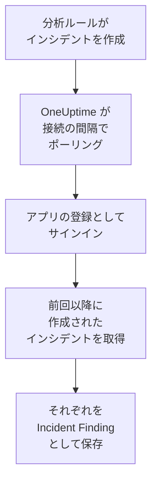

# Microsoft Sentinel

[Microsoft Sentinel](https://learn.microsoft.com/en-us/azure/sentinel/overview) の分析ルールが作成するインシデントを、OneUptime のセキュリティイベントにインポートします。そこではログ、トレース、メトリクスと並べて検索し、他のあらゆるソースと相関付け、重要なものについてオンコールを呼び出せます。OneUptime は作成したアプリの登録を使ってインシデントを読み取り、Azure 側は何も変更しません。

:::cards
- [接続を設定する](#接続を設定する): アプリの登録、ロール、接続のフォーム。
- [インポートされる内容](#インポートされる内容): 各 Sentinel インシデントがセキュリティイベントになる仕組み。
- [ポーリングの仕組み](#ポーリングの仕組み): 各ポーリングが読み取る時間枠と、負荷の高いワークスペースでの動作。
- [トラブルシューティング](#トラブルシューティング): 各エラーの意味と変更すべき点。
:::

## 仕組み



OneUptime は 1 分ごとに、ポーリング間隔が経過した有効な接続をそれぞれポーリングします。ポーリングはアプリの登録として Microsoft Entra ID にサインインし、前回のポーリング以降に作成されたインシデントを Azure Resource Manager に問い合わせ、それぞれを [OCSF](https://schema.ocsf.io/) の Incident Finding イベント（クラス `2005`）として保存します。以降、検出ルール、モニター、ダッシュボードは、他のソースからのセキュリティイベントと同じようにそれを扱います。

## 前提条件

- OneUptime で Project Owner、Project Admin、または Security Admin のロール。Security Member と Security Viewer は接続とその実行履歴を見ることはできますが、変更はできません。
- Microsoft Sentinel を有効にした Log Analytics ワークスペース（Azure パブリッククラウドまたは Azure Government (US)）。
- Microsoft Entra ID で、アプリの登録とクライアントシークレットを作成する権限。
- ワークスペースを含むリソースグループで、所有者やユーザー アクセス管理者など、ロールを割り当てる権限。

## 接続を設定する

接続は OAuth 2.0 クライアント資格情報フローでサインインします。人ではなく、常にアプリケーションとしてサインインします。アクセス権は Azure のロールから得るため、アプリの登録に API のアクセス許可は必要ありません。

:::steps
### アプリケーションを登録する

1. [Azure portal](https://portal.azure.com) にサインインし、**Microsoft Entra ID** を開きます。
2. **App registrations → New registration** に移動します。名前を `OneUptime Sentinel connector` にし、**Supported account types** は **Accounts in this organizational directory only** のまま、リダイレクト URI は空のままにして、**Register** を選びます。
3. アプリの **Overview** ページで、**Application (client) ID** と **Directory (tenant) ID** をコピーします。
4. **Certificates & secrets → Client secrets → New client secret** に移動し、有効期限を選んで **Add** を選びます。ページを離れる前に、シークレットの **Secret ID** ではなく **Value** をコピーします。この値は二度と表示されません。

### インシデントの読み取りを許可する

1. Azure portal で、Log Analytics ワークスペースを含むリソースグループを開きます。
2. **Access control (IAM) → Add → Add role assignment** を選びます。
3. **Role** タブで **Microsoft Sentinel Reader** を選びます。
4. **Members** タブで **User, group, or service principal** を選び、**Select members** をクリックして、名前でアプリの登録を選びます。
5. **Review + assign** を選びます。

このロールにより、アプリはインシデントを読み取れますが（`Microsoft.SecurityInsights/incidents/read`）、何も書き込めません。Microsoft は、インシデントの提供元である `SecurityInsights` ソリューションも対象になるよう、ワークスペースではなくリソースグループに割り当てることを推奨しています。新しい割り当てが反映されるまで数分かかることがあります。

### ワークスペースの詳細を確認する

Azure portal で Log Analytics ワークスペースを開きます。その **Overview** ページに、**Subscription ID**、**Resource group**、ワークスペースの名前が表示されます。ワークスペースのリソース ID にも同じ 3 つが含まれます。

```text
/subscriptions/{Subscription ID}/resourceGroups/{Resource group}/providers/Microsoft.OperationalInsights/workspaces/{Workspace name}
```

### OneUptime で接続を追加する

**製品 → セキュリティイベント → 接続**（`/dashboard/{projectId}/security-events/connections`）を開き、**接続を追加** をクリックし、**Microsoft Sentinel** を選んで **次へ** をクリックします。下の表の設定を入力して **次へ** をクリックし、シークレットの値を **クライアントシークレット** に貼り付けます。

### 保存する前にテストする

**保存前にテスト** の下にある **これらの設定をテスト** をクリックします。テストはフォームの値でサインインしてインシデントを読み取りますが、何も保存しないため、シークレットの誤りやロールの不足は接続を作成する前にわかります。その後 **次へ** をクリックし、接続に **名前** を付けて作成します。
:::

| 設定 | 確認場所 |
| --- | --- |
| **Directory (tenant) ID** | アプリの **Overview** ページ。テナントの GUID、または `contoso.onmicrosoft.com` のような検証済みドメイン。 |
| **Application (client) ID** | アプリの **Overview** ページ。GUID。 |
| **Subscription ID** | ワークスペースの **Overview** ページ。GUID。 |
| **Resource group** | ワークスペースの **Overview** ページ。1～90 文字の英字、数字、アンダースコア、ハイフン、ピリオド、かっこで、末尾はピリオド以外。 |
| **Workspace name** | ワークスペースの **Overview** ページ。3～90 文字の英字、数字、ハイフンで、先頭と末尾は英字または数字。 |
| **クラウド** | **Azure public cloud**（`login.microsoftonline.com`、`management.azure.com`）または **Azure Government (US)**（`login.microsoftonline.us`、`management.usgovcloudapi.net`）。 |
| **クライアントシークレット** | シークレットの **Value**。暗号化され、API から返されることはなく、二度と表示されません。接続の **認証情報を更新** で置き換えます。 |

**ポーリング** ステップには、任意の **説明**、`1`～`1440` の整数で初期値 `5` の **ポーリング間隔（分）**、初期状態でオンの **有効** もあります。

## インポートされる内容

各 Sentinel インシデントは、1 つの Incident Finding イベント（OCSF クラス `2005`、アクティビティ `Create`）になり、テレメトリサービス `Microsoft Sentinel` に関連付けられます。

| OCSF の列 | Sentinel インシデントのフィールド |
| --- | --- |
| `time` | `properties.createdTimeUtc`。Sentinel がインシデントを作成した時刻 |
| `eventUid` | `name`。インシデントの GUID で、重複の除外にも使われます |
| `message`, `ruleName` | `properties.title` |
| `ruleId` | `properties.relatedAnalyticRuleIds` の最初のエントリの末尾にあるルール GUID |
| `severityName` | `properties.severity`: `High`、`Medium`、`Low`、`Informational` |
| `statusName` | `properties.status`: `New`、`Active`、`Closed` |
| `mitreTactics` | `properties.additionalData.tactics` を ATT&CK ID にしたもの。`Persistence` は `TA0003` になります |
| `principalUser` | `properties.owner.userPrincipalName` または `properties.owner.email` |
| `targetResource` | `properties.incidentUrl`。Azure portal のインシデントへのリンク |
| `observables` | 所有者の UPN、メールアドレス、オブジェクト ID、および各ラベルの名前 |
| `attributes` | インシデント全体を、`properties.classification` や `properties.firstActivityTimeUtc` のようなドット区切りのキーに展開したもの |

ポーリングの時間枠内に作成されたクローズ済みのインシデントもインポートされます。開いているものだけを見るには、セキュリティイベントのエクスプローラーで `statusName` で絞り込みます。

## ポーリングの仕組み

各ポーリングは、時間枠内に作成されたインシデントを古い順に 1 ページ 50 件で一覧取得し、時間枠全体を読み終えるまで API の `nextLink` をたどります。

```text
GET https://management.azure.com/subscriptions/{sub}/resourceGroups/{rg}/providers/Microsoft.OperationalInsights/workspaces/{ws}/providers/Microsoft.SecurityInsights/incidents
    ?api-version=2024-03-01
    &$filter=(properties/createdTimeUtc ge {windowStart}) and (properties/createdTimeUtc lt {windowEnd})
    &$orderby=properties/createdTimeUtc asc
    &$top=50
```

- **作成時刻がカーソルです。** 1 時間ごとに実行されるスケジュール済みの分析ルールは、検出したアクティビティよりかなり後にインシデントを作成し、インシデントの `firstActivityTimeUtc` は数時間から数日前になることがあります。アクティビティ時刻を基準にしたカーソルでは、そのようなインシデントがすべて飛ばされます。アクティビティ時刻は `attributes` に残り、診断のサンプルには両方が表示されます。
- **最初のポーリングは 24 時間前までさかのぼります**。そのため、新しい接続にはすぐに最近のインシデントが表示されます。
- **以降の各ポーリングは、保存されたカーソルの 1 分前から始まります**。そのため、2 つの時間枠の境界で作成されたインシデントが飛ばされることはありません。
- **1 回のポーリングで読むのは、カーソルから最大 24 時間先までです。** カーソルが遅れた接続は、24 時間の時間枠を続けて読んで追いつき、その **ヘルス** には **Catching up** と表示されます。
- **重複はインシデントの GUID（`name`）でプロジェクト内で除外されます**。そのため、重なり、再試行された時間枠、インポートのいずれでも、インシデントが二重に保存されることはありません。

### 1 回のポーリングで読み切れないほど時間枠にデータがある場合

1 回のポーリングで読むのは最大 20 ページ × 50 件、つまり 1,000 件のインシデントです。この上限で時間枠の終わりより前に止まると、実行は **部分的** になり、次のような警告が出ます。

```text
Stopped after 20 incidents requests (the per-run request limit) before reading the whole window. Incidents are read oldest first; every incident created before 2026-09-14T08:12:44.000Z was read.
```

インシデントは古い順に読まれるため、OneUptime はカーソルを最後に読んだインシデントの作成時刻に移し、次のポーリングは同じ時間枠の長さでそこから始まります。負荷の高いワークスペースは、同じものを読み直すのではなく、1 回のポーリングでおよそ 1,000 件ずつ追いつきます。まったく同じ時刻に作成されたインシデントは 2 回読まれますが、重複チェックが 2 つ目を除外します。

実行が保存されたカーソルより先にまったく進めない場合、OneUptime は代わりに時間枠を短くします。

1. **縮める。** 次のポーリングは同じ開始点から半分の長さの時間枠を読み、時間枠を最後まで読めるようになるまで、最短 1 分まで半分にし続けます。実行の警告にはそのことが示されます: `This window holds more records than one poll can read; the next poll reads a {n} minute window from the same starting point.`
2. **元に戻す。** 時間枠を最後まで読めたら、次の時間枠は再び 2 倍になり、最長 24 時間まで戻ります。
3. **1 分を飛ばす。** 1 分間でさえ 1 回のポーリングで読み切れないほどある場合、ポーリングはその 1 分を飛ばして先に進み、新しいインシデントが届き続けるようにします。実行は **部分的** のままで、**最終エラー** には `More records were created in the one minute from {cursor} to {end} than one poll can read. Polling moved past this minute so newer records keep arriving; use Import this time range in Diagnostics on this minute to recover what one run can read.` と表示されます。その 1 分を **この時間範囲をインポート** でインポートすると、1 回の実行で読める分を取り戻せます。

Microsoft Entra ID や Azure Resource Manager のエラーで完全に失敗した実行は、カーソルと時間枠の長さを保ち、次のポーリングが同じ時間枠を読み直します。唯一の例外はタイムアウトしたリクエストです。カーソルはそのままですが、次の時間枠は半分の長さになります。時間内に応答できないほど重い時間枠は、何度試してもタイムアウトするからです。**ポーリング間隔（分）** を変えてもこれらは何も変わりません。間隔はポーリングを開始する頻度を決めるものであり、時間枠の開始位置を決めるものではありません。

### オンデマンドで実行、プレビュー、インポートする

接続の **診断** をクリックすると、最近の実行を確認し、手動で操作できます。これらを開始できるのは接続を変更できるユーザーで、履歴は接続を見られるユーザーなら誰でも読めます。

- **今すぐ実行** は、接続が **有効** でなくても、通常のカーソルでただちにポーリングを開始します。
- **Preview incidents** は最大 7 日間の時間範囲を読み取り、何もインポートしません。
- **この時間範囲をインポート** は、確認後、カーソルを動かさずに最大 7 日間の範囲をインポートします。インポート済みのインシデントはスキップされます。
- 実行の **診断情報をコピー** は、サポート向けにその実行のレポートをコピーします。認証情報は含まれません。

## 接続をテスト

接続の行にある **接続をテスト** と、フォームの **これらの設定をテスト** は、バックグラウンド worker ではなく API プロセスで実行されます。そのため、worker に問題がある場合でもテストは応答します。テストは次のチェックを順に実行します。

| チェック | 確認内容 |
| --- | --- |
| **構成** | すべての設定が存在し、形式が正しいこと。失敗した場合はどこにも接続しません。 |
| **Authenticate with Microsoft Entra** | Microsoft Entra ID が、アプリの登録に Azure Resource Manager 用のトークンを発行すること。 |
| **Read incidents** | 過去 24 時間に作成されたインシデントを一件読み取れること（`$top=1`）。これによりロールとワークスペースの詳細が確認できます。 |
| **Incidents available to import** | 過去 24 時間と過去 7 日間に作成されたインシデントの数。それぞれ一ページ 50 件までなので、`50+` はそれ以上を意味します。7 日間に一件もない場合は失敗ではなく警告です。 |
| **Background workers**, **Poll scheduler**, **Security event storage** | OneUptime 側の状態。プロセスが Worker キューのジョブを取得していること、ポーリングジョブが毎分実行されていること、セキュリティイベントのストアが応答すること。 |
| **スケジュールされたポーリング** | 保存済みの接続について、ポーリングがオンであること、worker を待って止まっている実行がないこと、ポーリングが予定どおり実行されていること。 |

テスト内の各リクエストの期限は 20 秒です。テストは何もインポートせず、カーソルも動かしません。失敗した各チェックは、何を変更すべきかを示します。

## トラブルシューティング

接続の **最終エラー** は、認証情報を伏せたうえで完全なエラーメッセージを保持し、その前に失敗したステップを示すプレフィックスを付けます。接続にエラーがある場合は、その **アクション** 列で **エラーを表示** を選んで読み、ダイアログの **エラーをコピー** でコピーします。まずプレフィックスを読んでください。

:::details 最終エラーが `Microsoft Sentinel token request` で始まる
- `Microsoft Sentinel token request failed (HTTP ...)`: Microsoft Entra ID がトークンの発行を拒否したため、Azure には一切接続していません。メッセージには Entra のコードが含まれます。
  - `AADSTS7000215` または `invalid_client`: **クライアントシークレット** が誤っているか期限切れ、または値ではなくシークレットの ID です。新しいシークレットを作成し、**認証情報を更新** で保存します。
  - `AADSTS700016` または `unauthorized_client`: **Application (client) ID** が指定された **Directory (tenant) ID** に存在しません。両方をアプリの **Overview** ページと照合します。
  - `AADSTS90002` または `HTTP 404`: そのテナントは存在しません。**Directory (tenant) ID** が誤っているか、もう一方のクラウドにあります。**クラウド** を確認します。
  - `HTTP 429` または `HTTP 5xx`: Microsoft Entra ID がリクエストを制限しているか、利用できません。次のポーリングで再試行されます。
- `Microsoft Sentinel token request returned ...`: Microsoft Entra ID が、JSON でない本文や `access_token` のない本文など、使えない応答を返しました。通常は間にあるプロキシやゲートウェイが原因です。
- ステータスのない `Microsoft Sentinel token request failed:`、または `Microsoft Sentinel token request timed out after ... seconds with no response`: リクエストに応答がありませんでした。OneUptime のアプリと worker から `login.microsoftonline.com` への DNS、TLS、送信 HTTPS を確認します。
:::

:::details 最終エラーが `Microsoft Sentinel incidents list` で始まる
- `Microsoft Sentinel incidents list failed (HTTP ...)`: Azure Resource Manager がリクエストを拒否しました。
  - `HTTP 401`: トークンが受け入れられませんでした。ほとんどの場合、**クラウド** がテナントと一致していないか、アプリの登録が削除されています。2 つのページの間で期限切れになったトークンは、自動的に更新され 1 回だけ再試行されます。
  - `HTTP 403` または `AuthorizationFailed`: アプリにまだリソースグループの **Microsoft Sentinel Reader** がありません。割り当ててから数分待ちます。
  - `HTTP 404`: その **Subscription ID**、**Resource group**、**Workspace name** を持つワークスペースがないか、そこで Microsoft Sentinel が有効になっていません。ワークスペースの **Overview** ページからコピーします。
  - `HTTP 429` または `HTTP 5xx`: Azure Resource Manager がリクエストを制限しているか、利用できません。次のポーリングで再試行されます。
  - `HTTP 400`: Azure Resource Manager がリクエストを拒否しました。リクエストを組み立てているのはあなたの設定ではなく OneUptime です。メッセージを OneUptime サポートに送ってください。
- `Microsoft Sentinel incidents list returned ...`: Azure は `200` を返しましたが、読み取れるインシデントのページがないか、別のホストへの `nextLink` が含まれていました。接続はこのリンクを拒否し、トークンが Azure Resource Manager の外に出ないようにします。誰も読んでいないインシデントをカーソルが飛び越えないよう、空の時間枠とは見なさずに報告します。
- ステータスのない `Microsoft Sentinel incidents list failed:`、または `Microsoft Sentinel incidents list timed out after ... seconds with no response`: リクエストに応答がありませんでした。OneUptime の worker から `management.azure.com` または `management.usgovcloudapi.net` への送信 HTTPS を確認します。
:::

:::details 最終ポーリングが Never で、最終エラーが空
この接続ではまだポーリングが一度も完了していません。**接続をテスト** を実行すると、その **Background workers** と **Poll scheduler** のチェックが原因を示します。セルフホスト環境でよくある原因は、ジョブを処理する別の worker デプロイがないままアプリで `DISABLE_QUEUE_WORKERS=true` になっていることです。`false` に設定するか、worker デプロイを実行します（Helm: `worker.enabled: true`）。
:::

:::details 実行が部分的
- `Stopped after 20 incidents requests (the per-run request limit) before reading the whole window`: 時間枠に、1 回の実行で読む 1,000 件を超えるインシデントがありました。何も失われません。次のポーリングは最後に読んだインシデントの後から始まります。ポーリングのたびに **部分的** のままの接続はバックログに追いついている最中で、その **最終ポーリング** と **最後にインポートしたイベント** は進み続けます。
- `Microsoft Sentinel returned incidents out of creation-time order, so this run cannot name a point to resume from.`: API が古い順の並びを無視したため、実行はカーソルを最後のインシデントに移せず、次のポーリングは代わりに短い時間枠を読みます。繰り返し発生する場合は、実行のレポートを OneUptime サポートに送ってください。
- `More records were created in the one minute from ... than one poll can read`: ポーリングはその 1 分を飛ばしました。**診断** の **この時間範囲をインポート** でインポートします。インポートは 1 回のポーリングと同じだけ読み取ります。
:::

:::details テストは成功するが何もインポートされない
テストのレポートで **Incidents available to import** を確認します。過去 7 日間で `0` の場合、ワークスペースの分析ルールがインシデントを作成していないということで、接続の問題ではありません。Microsoft Sentinel で、ルールが有効でインシデントを作成するよう設定されていることを確認します。
:::

## Azure Government

**クラウド** を **Azure Government (US)** に設定します。すると接続はスコープ `https://management.usgovcloudapi.net/.default` で `login.microsoftonline.us` にサインインし、`management.usgovcloudapi.net` からインシデントを読み取ります。ロールの割り当てを含め、それ以外はすべて同じです。

## 得られるもの

- **検索。** セキュリティイベントのエクスプローラーで、重大度、ステータス、所有者、ラベル、戦術でインシデントを絞り込み、他のあらゆるソースと並べて確認できます。
- **相関付け。** 各インシデントの所有者とラベルはオブザーバブルとしてインデックス化されるため、1 回の検索でそれらに言及するものをすべて見つけられます。
- **検出ルール。** セキュリティイベントに対してスケジュールで実行され、オンコールを呼び出すアラートを作成する Sigma ルール。
- **モニター。** セキュリティイベントのモニターは、新しい High のインシデントなど一致するイベントを数え、しきい値を超えるとインシデントやアラートを作成します。

セキュリティイベントは、他のテレメトリと同様に取り込み GB 単位で課金されます。[料金](https://oneuptime.com/pricing) を参照してください。

## 次のステップ

:::cards
- [セキュリティイベント](/docs/telemetry/security-events): インポートしたものを検索、相関付けし、アラートを出します。
- [Microsoft Defender XDR](/docs/integrations/microsoft-defender-xdr): すべての Defender ワークロードのアラートもインポートします。
- [ロール](/docs/permissions/reference#ロール): Security ロールが閲覧・変更できる内容。
- [インテグレーションの概要](/docs/integrations/index): 接続できるその他のツール。
:::
