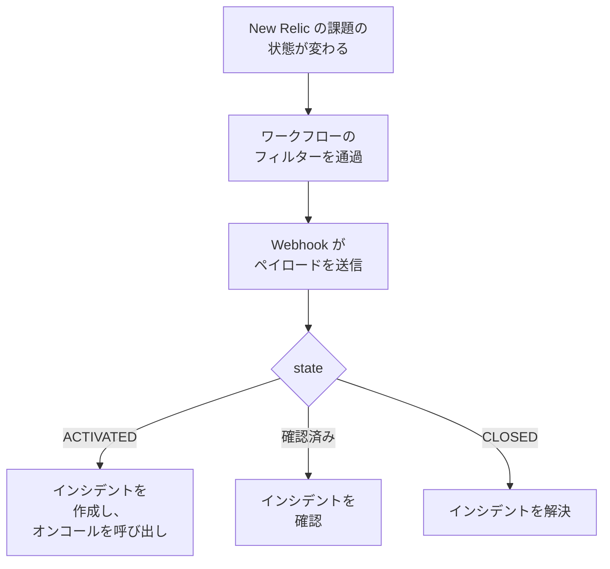

# New Relic

[New Relic](https://newrelic.com) の課題を OneUptime に送信すると、各課題がオンコールチームを呼び出すインシデントまたはアラートになり、誰かが課題を確認するとそのインシデントも確認され、課題がクローズすると解決されます。New Relic は [Webhook 送信先](https://docs.newrelic.com/docs/alerts/get-notified/notification-integrations/) を通じて課題を送信するため、どちら側にもインストールするものはありません。

:::cards
- [テンプレートから始める](#テンプレートから始める): 呼び出す相手を選び、URL をコピーして、各課題の動作を確認します。
- [New Relic を設定する](#new-relic-を設定する): Webhook 送信先と、そこに通知するワークフロー。
- [テストする](#テストする): 自分で課題を送信し、次に New Relic から送信します。
- [トラブルシューティング](#トラブルシューティング): 課題が届かない場合や、インシデントが開いたままの場合。
:::

## 仕組み



New Relic のワークフローは、フィルターで送信する課題を選び、課題が有効化、確認、またはクローズされると、New Relic が埋める JSON ペイロードを付けて Webhook 送信先に通知します。OneUptime は課題の ID で、作成済みのインシデントを見つけます。

## 前提条件

- 送信先とワークフローを作成できる New Relic アカウント。
- OneUptime でワークフローを作成する権限。OneUptime Cloud では、ワークフローに **Growth** プラン以上が必要です。

## テンプレートから始める

まず OneUptime を設定します。New Relic の送信先となる URL が得られます。**ワークフローを作成** ダイアログには、カテゴリー一覧の **New Relic** の下に 2 つの New Relic テンプレートがあります。**Declare an incident for each New Relic issue** はインシデント用、**Create an alert for each New Relic issue** はアラート用です。どちらも同じ動作で、作成するものの種類だけが違います。

:::steps
1. **ワークフロー** に移動し、**ワークフローを作成** をクリックします。**またはテンプレートから始める** で、カテゴリー一覧の **New Relic** を選び、**Declare an incident for each New Relic issue** またはアラート用の **Create an alert for each New Relic issue** をクリックして、**このテンプレートを使う** をクリックします。
2. **Who to page for new New Relic issues** で呼び出すオンコールポリシーを選び（誰も呼び出さない場合は選ばない）、**ワークフローを作成** をクリックします。ワークフローはオフの状態で **ビルダー** に開きます。
3. **Webhook** トリガーをクリックしてから **URL をコピー** をクリックし、URL を New Relic 用に控えておきます。
4. **ビルダー** の上部で **有効** をオンにします。オフのワークフローは New Relic に `400` で応答します。
:::

次に、その URL に課題を送信するように [New Relic を設定します](#new-relic-を設定する)。ワークフローの `read-event-1` ステップには同じ設定があらかじめ入っているため、**ビルダー** に戻ったときに参照できます。

### ワークフローの動作

**Webhook** トリガーの後、**Check With JavaScript** ステップ `read-event-1` が New Relic の送る `state` を読み取り、**Incident From Another Tool**（アラートのテンプレートでは **Alert From Another Tool**）が、課題の ID をもとにその意味どおりに処理します。インシデントは ID をカスタムフィールド `newRelicIssueId` に保持します。

| New Relic が送るもの | ワークフローの動作 |
| --- | --- |
| `state` が `ACTIVATED` または `CREATED` | `New Relic: <issue>` というタイトルのインシデントを、課題の優先度に対応する重大度で宣言し、ステータスページには表示しません。説明には New Relic の課題へのリンクと、優先度、エンティティ、ポリシー、条件を記載します。選んだオンコールポリシーを呼び出します。New Relic が CRITICAL に引き上げた場合など、同じ課題が再び届いても、新しいインシデントは作成されず、誰も再び呼び出されません。 |
| `state` が `ACTIVATED` で `isAcknowledged` が `true` | 課題のインシデントを確認し、オンコールのエスカレーションを止めます。理由はタイムラインに残ります。 |
| `state` が `CLOSED` | 課題のインシデントがまだ解決されていなければ解決します。理由はタイムラインに残ります。 |

インシデントのない課題の確認やクローズでは、何も変わりません。それ以外のもの (別のツールからのリクエストなど) はそのままにされ、`read-event-1` が **No** に進み、実行の **ステップ** にその理由が示されます。New Relic には何も戻りません。New Relic は信号が回復すると課題を自分でクローズし、それがインシデントの解決につながります。

### 優先度と呼び出し

新しい課題はすべて、優先度にかかわらず、選んだオンコールポリシーを呼び出します。New Relic は課題を HIGH から CRITICAL に、同じ課題のまま引き上げるため、CRITICAL になるのを待つと、HIGH で開いて悪化した課題では呼び出されません。呼び出す課題を減らすには、New Relic のワークフローのフィルターを絞り込みます。通過したものだけが OneUptime に届きます。新しいプロジェクトでは、優先度は次のインシデントとアラートの重大度に対応付けられます:

| New Relic の優先度 | インシデント | アラート | オンコール |
| --- | --- | --- | --- |
| CRITICAL | Critical Incident | High | 呼び出す |
| HIGH | Major Incident | Low | 呼び出す |
| MEDIUM | Minor Incident | Low | 呼び出す |
| LOW | Minor Incident | Low | 呼び出す |

独自の重大度がある場合、CRITICAL は最も重いものに、HIGH は中間のものに、MEDIUM と LOW は最も軽いものに対応します。New Relic が課題を引き上げても、インシデントは開いたときの重大度のままです。

優先度を名前で自分の重大度に対応付けるには、`read-event-1` ステップの `SEVERITY_BY_NAME` を編集します。たとえば `{ HIGH: 'Critical Incident' }` です。

## New Relic を設定する

:::steps
### Webhook 送信先を追加する

New Relic で **Alerts → Destinations** に移動し、**Webhook** 送信先を追加します。**Webhook name** を `OneUptime`、**Endpoint URL** を OneUptime からコピーした URL にして保存します。**Use authorization** はオフのままにします。URL が唯一の認証情報です。

### ワークフローを追加する

**Alerts → Workflows** に移動し、**Add a workflow** をクリックします。名前を `OneUptime` にします。そのフィルターで、OneUptime に届く課題を決めます。たとえば CRITICAL のものだけ、または特定のチームのものだけです。

### 送信先に通知する

作成した **Webhook** 送信先をワークフローに追加します。New Relic が埋めるペイロードはそのままにし、`state` の後に `isAcknowledged` の行を追加して、課題とともにインシデントも確認されるようにします:

```json
{
  "id": {{ json issueId }},
  "issueUrl": {{ json issuePageUrl }},
  "title": {{ json annotations.title.[0] }},
  "priority": {{ json priority }},
  "impactedEntities": {{ json entitiesData.names }},
  "totalIncidents": {{ json totalIncidents }},
  "state": {{ json state }},
  "isAcknowledged": {{ json isAcknowledged }},
  "trigger": {{ json triggerEvent }},
  "isCorrelated": {{ json isCorrelated }},
  "createdAt": {{ createdAt }},
  "updatedAt": {{ updatedAt }},
  "sources": {{ json accumulations.source }},
  "alertPolicyNames": {{ json accumulations.policyName }},
  "alertConditionNames": {{ json accumulations.conditionName }},
  "workflowName": {{ json workflowName }}
}
```

追加する行は `"isAcknowledged": {{ json isAcknowledged }},` です。その後、**Update message** をクリックします。

### 有効化、確認、クローズで通知する

送信先の三点メニューをクリックして **Notify when** を選びます。**Activated**、**Acknowledged**、**Closed** はオンのままにします。

### ワークフローを有効化する

**Activate workflow** をクリックします。
:::

OneUptime のワークフローはペイロードの次のフィールドを読み取り、ほかは無視します:

| フィールド | New Relic が入れる内容 |
| --- | --- |
| `id` | 課題の ID。 |
| `issueUrl` | New Relic 内の課題へのリンク。 |
| `title` | 課題のタイトル。 |
| `priority` | 課題の緊急度: `CRITICAL`、`HIGH`、`MEDIUM`、`LOW` のいずれか。 |
| `state` | 課題の状況: `CREATED`、`ACTIVATED`、`CLOSED` のいずれか。 |
| `isAcknowledged` | New Relic で誰かが課題を確認すると `true` になります。 |
| `impactedEntities` | 課題の対象となるエンティティの名前。 |
| `alertPolicyNames` | 課題の元になっているポリシーの名前。 |
| `alertConditionNames` | 課題の元になっている条件の名前。 |

## テストする

コピーした URL に、New Relic と同じように課題を送信します:

```bash
curl -X POST "<url>" \
  -H "Content-Type: application/json" \
  -d '{
    "id": "7d4a2e1c-3b5f-4c8e-9a1d-2f6b8c0e4a71",
    "issueUrl": "https://radar-api.service.newrelic.com/accounts/1234567/issues/7d4a2e1c-3b5f-4c8e-9a1d-2f6b8c0e4a71?notifier=WEBHOOK",
    "title": "High CPU on checkout-service",
    "priority": "CRITICAL",
    "impactedEntities": ["checkout-service"],
    "state": "ACTIVATED",
    "isAcknowledged": false,
    "alertPolicyNames": ["Production"],
    "alertConditionNames": ["CPU above 90%"]
  }'
```

インシデントが作成され、タイトルは `New Relic: High CPU on checkout-service` になり、選んだオンコールポリシーが呼び出されます。`isAcknowledged` を `true` にして同じリクエストを送ると、インシデントが確認されます。`state` を `CLOSED` にして送ると、インシデントが解決されます。

次に New Relic からテストします。ワークフローの Webhook メッセージを開き、**Send test notification** をクリックします。届いたことを確認するには、OneUptime のワークフローの **ログ → 実行履歴** を開きます。

## トラブルシューティング

:::details OneUptime に何も届かない
- New Relic のワークフローが有効で、そのフィルターが課題を通していることを確認します。
- 送信先の **Endpoint URL** が **Webhook** トリガーの URL になっていることを確認します。
- オフのワークフローは `400` を返します。その **ビルダー** の上部で **有効** をオンにします。
:::

:::details ワークフローは実行されるが、何も作成されない
**ログ → 実行履歴** で実行を開きます。その **ステップ** の `read-event-1` の項目に、**No** に進んだ理由が示されます。

- `New Relic named no issue ID`: ペイロードの行 `"id": {{ json issueId }},` を残します。
- `is in no state`: ペイロードの行 `"state": {{ json state }},` を残します。
:::

:::details インシデントが確認されない
- ペイロードには `"isAcknowledged": {{ json isAcknowledged }},` の行が必要です。ないと、インシデントは作成され課題とともに解決されますが、確認されることはありません。
- New Relic のワークフローでは、**Notify when** の **Acknowledged** をオンにしておく必要があります。
:::

:::details インシデントは作成されるが解決されない
- New Relic のワークフローでは、**Notify when** の **Closed** をオンにしておく必要があります。
- **ログ → 実行履歴** でクローズの実行を開きます。最後のステップに理由が示されます。クローズの `id` は課題のものと同じでなければならないため、ペイロードの `"id": {{ json issueId }},` はそのままにしてください。
:::

:::details 呼び出される課題が多すぎる
OneUptime に届く新しい課題はすべて呼び出します。New Relic のワークフローのフィルターを絞り込み、呼び出すべき課題だけが届くようにします。[優先度と呼び出し](#優先度と呼び出し) を参照してください。
:::

:::details オンコールが呼び出されない
- そのインシデントがすでにある課題の通知は誰も再び呼び出さないため、CRITICAL への引き上げでも誰も呼び出されません。
- **ワークフローを作成** ダイアログで誰も選ばなかった場合、ワークフローには呼び出すステップがありません。
:::

## セキュリティ

- **URL はパスワードと同じように扱ってください。** URL を持つ人は誰でもインシデントを作成できます。漏れた場合は、ワークフローの **Webhook** トリガーで **URL をリセット** をクリックします。その後、New Relic の送信先の **Endpoint URL** を更新します。
- **リンクは New Relic を指します。** テンプレートは、リクエストの内容にかかわらず、New Relic のサイト上の課題にだけリンクし、New Relic が送信したものはテキストとして書き込みます。
- **セルフホストの場合は?** New Relic はインターネットから Webhook を送信するため、OneUptime にはインターネットから HTTPS で到達できる必要があります。

## 次のステップ

:::cards
- [ワークフローテンプレート](/docs/workflows/authoring): テンプレートからワークフローを作成し、ビルダーで変更します。
- [Datadog](/docs/integrations/datadog): 同じテンプレートを Datadog のモニター向けにしたもの。
- [エスカレーションルール](/docs/on-call/escalation-rules): オンコールポリシーが誰をいつ呼び出すかを決めます。
- [インテグレーションの概要](/docs/integrations/index): 接続できるその他のツール。
:::
