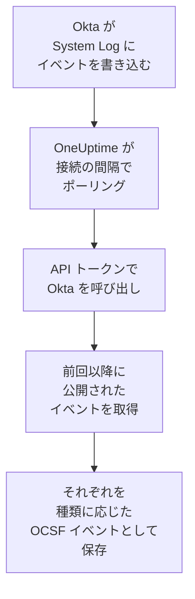

# Okta システムログ

[Okta System Log](https://developer.okta.com/docs/reference/system-log-query/) を OneUptime のセキュリティイベントにインポートします。サインイン、MFA チャレンジ、アカウントとグループの変更、Okta 自身の脅威検出が対象です。そこではログ、トレース、メトリクスと並べて検索し、他のあらゆるソースと相関付け、重要なものについてオンコールを呼び出せます。OneUptime は作成した API トークンで読み取り、Okta では何も変更しません。

:::cards
- [接続を設定する](#接続を設定する): API トークンと接続のフォーム。
- [インポートされる内容](#インポートされる内容): どのイベントが対象で、各イベントがどのようにセキュリティイベントになるか。
- [ポーリングの仕組み](#ポーリングの仕組み): 各ポーリングが読み取る時間枠と、それが前回と 15 分重なる理由。
- [トラブルシューティング](#トラブルシューティング): 各エラーの意味と変更すべき点。
:::

## 仕組み



OneUptime は 1 分ごとに、ポーリング間隔が経過した有効な接続をそれぞれポーリングします。ポーリングは、前回のポーリング以降に公開された System Log のイベントを Okta に問い合わせ、それぞれを [OCSF](https://schema.ocsf.io/) イベントとして保存します。サインインは Authentication イベント、アカウントの編集は Account Change、Okta の検出は Detection Finding です。その後、検出ルール、モニター、ダッシュボードは、それを他のソースのセキュリティイベントと同じように扱います。`okta.com`、`oktapreview.com`、`okta-emea.com` のすべての Okta セル、およびカスタムドメインの組織で動作します。

## 前提条件

- OneUptime で Project Owner、Project Admin、または Security Admin のロール。Security Member と Security Viewer は接続とその実行履歴を見ることはできますが、変更はできません。
- トークンを作成するための、System Log を閲覧できる Okta 管理者。トークンはその管理者ができることをすべてできるため、Read-only Administrator を使ってください。System Log を読むだけで、何も変更しません。読み取り専用の管理者もユーザー、グループ、アプリ、設定を閲覧できるため、トークンはパスワードと同じように厳重に保管してください。
- できれば、その管理者用のサービスアカウント。Okta は、管理者が無効化されたときと、30 日間使われなかったときにトークンを無効化します。ポーリングは数分ごとにトークンを使うため、接続が有効な間は使われ続けます。
- 組織がネットワークゾーンからの API 呼び出しだけを受け付けている場合は、OneUptime の呼び出し元アドレスを含むゾーン。OneUptime Cloud ではその送信元アドレス、セルフホスト環境ではアプリと worker のホストのパブリックアドレスです。

## 接続を設定する

:::steps
### API トークンを作成する

1. 読み取り専用の管理者として Okta の **Admin Console** にサインインします。
2. **Security → API** を開き、**Tokens** タブで **Create token** を選択します。
3. 名前を付けます（例: `OneUptime security events`）。組織でゾーンが必要でない限り、呼び出し元の設定は **Any IP** のままにします。
4. **Create token** を選択し、**Token Value** をコピーします。Okta は一度しか表示しません。

各トークンは組織の API レート制限の一部を使えます。その割り当ては **Tokens** タブのトークンの行に表示されます。1 回のポーリングで送るリクエストは最大 20 件なので、他のツールが同じトークンを使わない限り、デフォルトの割り当てで十分です。

### OneUptime で接続を追加する

**製品 → セキュリティイベント → 接続**（`/dashboard/{projectId}/security-events/connections`）を開き、**接続を追加** をクリックして **Okta System Log** を選び、**次へ** をクリックします。下の表の設定を入力して **次へ** をクリックし、トークンを **API token** に貼り付けます。

### 保存する前にテストする

**保存前にテスト** の下にある **これらの設定をテスト** をクリックします。テストはフォームの値でサインインしてイベントを読み取り、何も保存しません。そのため、URL の誤りや不正なフィルターは接続を作成する前にわかります。続いて **次へ** をクリックし、接続に **名前** を付けて作成します。
:::

| 設定 | 入力する内容 |
| --- | --- |
| **Okta organization URL** | ユーザーがサインインするアドレス。例: `https://acme.okta.com`、`https://acme.oktapreview.com`、`https://login.example.com`。`https` を使い、パスは付けません。Admin Console の `-admin` アドレスは API を提供しないため使えません。 |
| **Event filter** | 任意。インポートするイベントを選ぶ [System Log フィルター](https://developer.okta.com/docs/reference/core-okta-api/#filter)。例: `eventType sw "user.session" or eventType sw "security"`。空の場合は下のファミリーをインポートします。最大 2,000 文字で一行にし、`published` は条件にできません。時間範囲は OneUptime が自分で設定します。 |
| **API token** | トークンの値そのもの。`SSWS` スキームは OneUptime が自分で付けます。暗号化され、API から返されることはなく、再表示もされません。置き換えるには、接続の **認証情報を更新** を使います。 |

**ポーリング** ステップには、任意の **説明**、`1`～`1440` の整数で初期値 `5` の **ポーリング間隔（分）**、初期状態でオンの **有効** もあります。

## インポートされる内容

**Event filter** がない場合、OneUptime はセキュリティチームが注視するイベントファミリーを `eventType` のプレフィックスでインポートします。独自のフィルターは、このリストに追加されるのではなく、このリストを置き換えます:

| プレフィックス | イベント |
| --- | --- |
| `user.session` | サインインとサインアウト、Admin Console へのアクセス、なりすまし |
| `user.authentication` | シングルサインオンを含む認証結果 |
| `user.mfa` | 要素の登録、チャレンジ、リセット |
| `user.account` | パスワードの変更とリセット、ロックアウト、プロファイルと権限の変更 |
| `user.lifecycle` | ユーザーの作成、有効化、一時停止、無効化、削除 |
| `security.` | ThreatInsight、不審なアクティビティの報告、その他の Okta の検出 |
| `policy.` | サインオンポリシーの評価とポリシーの変更 |
| `system.api_token` | API トークンの作成と取り消し |
| `application.user_membership` | アプリの割り当て |
| `group.user_membership` | グループメンバーシップの変更 |

各イベントは、ベンダー `Okta`、製品 `Okta System Log` の 1 つの OCSF イベントになり、そのクラスは `eventType` によって決まります:

| `eventType` | OCSF クラス | アクティビティ |
| --- | --- | --- |
| `user.session.start` | Authentication (`3002`) | `Logon` |
| `user.session.end` | Authentication (`3002`) | `Logoff` |
| `user.authentication.*` | Authentication (`3002`) | `Logon` |
| `user.mfa.*` | Authentication (`3002`) | `Authentication Ticket` |
| その他の `user.session.*` イベント | Authentication (`3002`) | `Other` |
| `user.account.*`, `user.lifecycle.*` | Account Change (`3001`) | イベントタイプの最後の部分（例: `Update Password`） |
| `group.*` | Group Management (`3006`) | イベントタイプの最後の部分（例: `Add`） |
| `security.*`、およびアクセスを拒否した `policy.evaluate_sign_on` | Detection Finding (`2004`) | `Create`。ルール名はイベントタイプ |
| その他すべて | `0`。イベントタイプにちなんだ名前 | イベントタイプの最後の部分 |

これらのどのクラスにも当てはまらないイベントも、すべてのフィールドを保持し、どのフィールドでも検索できます。すべてのイベントが次の列を埋めます:

| Okta のフィールド | OneUptime の列 |
| --- | --- |
| `uuid` | イベント UID。重複の除外にも使われます |
| `published`（イベントが起きた時刻） | イベント時刻 |
| `displayMessage`、なければイベントタイプと `outcome.reason` | メッセージ |
| `severity`: `DEBUG` と `INFO` は Informational、`WARN` は Medium、`ERROR` は High | 重大度 |
| `outcome.result`（`SUCCESS`、`FAILURE`、`ALLOW`、`DENY` など） | ステータス |
| `actor.alternateId`、なければ `actor.displayName`。`client.ipAddress` | 主体のユーザーと IP |
| `target` 内の `User` の `alternateId` | ターゲットのユーザー |
| `target` 内の `AppInstance` の `alternateId` | ターゲットのリソース |
| アクター、各ターゲット、クライアントの IP | オブザーバブル |
| イベント全体。`client.userAgent.browser` や `debugContext.debugData.requestUri` のようなドット区切りのキーに展開されます | `attributes` |

`INFO` の失敗したサインインや拒否されたサインインは、成功したものと区別できるよう Low に引き上げられます。System Log には MITRE ATT&CK の参照がないため、それらの列は空のままです。

## ポーリングの仕組み

各ポーリングは、自分の時間枠で公開されたイベントを古い順に、1 ページ 1,000 件ずつ取得し、Okta が送る `next` リンクを最後のページまでたどります:

```text
GET {Okta organization URL}/api/v1/logs?since={window start}&until={window end}&sortOrder=ASCENDING&limit=1000&filter={Event filter}
```

- **公開時刻がカーソルです。** System Log のイベントはアクティビティそのものなので、`published` は、それが起きた時刻であり、ポーリングが読むものでもあります。
- **最初のポーリングは 24 時間前までさかのぼります**。そのため、新しい接続にはすぐに最近のイベントが表示されます。
- **以降の各ポーリングは、保存されたカーソルの 15 分前から始まります。** Okta によると、終了時刻を指定したリクエストでは遅延したイベントが漏れることがあり、それはまれだとされています。重なりによって、そうしたイベントは次のポーリングで読まれます。15 分を超えて遅延したイベントはカーソルの後ろに取り残されることがあるため、その時間範囲をインポートして回収してください。
- **1 回のポーリングで読むのは、カーソルから最大 24 時間先までです。** カーソルが遅れた接続は、24 時間の時間枠を続けて読んで追いつき、その **ヘルス** には **Catching up** と表示されます。
- **重複は `uuid` で除外されます**。対象はプロジェクト内で、重なり、再試行された時間枠、インポートによってイベントが二重に保存されることはありません。

トークンはすべてのリクエストに付くため、**Okta organization URL** 以外の場所を指す `next` リンクはたどりません。

### 1 回のポーリングで読み切れないほど時間枠にデータがある場合

1 回のポーリングで読むのは、最大 20 件のリクエストで最大 10,000 件のイベントです。時間枠にそれより多く含まれていると、実行は **部分的** になり、次のような警告が出ます:

```text
Stopped after collecting 10000 events; the window holds more. The last event read was published at 2026-09-14T08:12:44.000Z.
```

イベントは古い順に読まれるため、OneUptime はカーソルを最後に読んだイベントの公開時刻に移し、次のポーリングは 15 分の重なりなしに、同じ時間枠の長さでそこから始まります。負荷の高い組織は、同じものを読み直すのではなく、ポーリングごとに 10,000 件ずつ追いつきます。カーソルがその地点から 15 分先に進むと、重なりが戻ります。

たとえば 15 分の重なりだけで 10,000 件を超えるイベントがあり、実行が保存されたカーソルより先にまったく進めない場合、OneUptime は代わりに時間枠を短くします:

1. **縮める。** 次のポーリングは同じ開始点から半分の長さの時間枠を読み、時間枠を最後まで読めるようになるまで、最短 1 分まで半分にし続けます。実行の警告にはそのことが示されます: `This window holds more records than one poll can read; the next poll reads a {n} minute window from the same starting point.`
2. **元に戻す。** 時間枠を最後まで読めたら、次の時間枠は再び 2 倍になり、最長 24 時間まで戻ります。
3. **1 分を飛ばす。** 1 分間でさえ 1 回のポーリングで読み切れないほどある場合、ポーリングはその 1 分を飛ばして先に進み、新しいイベントが届き続けるようにします。以降のポーリングの重なりも、その 1 分までは戻りません。実行は **部分的** のままで、**最終エラー** には `More records were created in the one minute from {cursor} to {end} than one poll can read. Polling moved past this minute so newer records keep arriving; use Import this time range in Diagnostics on this minute to recover what one run can read.` と表示されます。1 回の実行で読める分を回収するには **この時間範囲をインポート** でその 1 分をインポートするか、**Event filter** を絞り込みます。

Okta のエラーで完全に失敗した実行は、カーソルと時間枠の長さを保ち、次のポーリングが同じ時間枠を読み直します。唯一の例外はタイムアウトしたリクエストです。カーソルはそのままですが、次の時間枠は半分の長さになります。時間内に応答できないほど重い時間枠は、何度試してもタイムアウトするからです。**ポーリング間隔（分）** を変えても、これは何も変わりません。この設定が決めるのはポーリングを開始する頻度であって、時間枠の開始位置ではありません。

### オンデマンドで実行、プレビュー、インポートする

接続の **診断** をクリックすると、最近の実行を確認し、手動で操作できます。これらを開始できるのは接続を変更できるユーザーで、履歴は接続を見られるユーザーなら誰でも読めます。

- **今すぐ実行** は、接続が **有効** でなくても、通常のカーソルでただちにポーリングを開始します。
- **Preview log events** は最大 7 日間の時間範囲を読み取り、何もインポートしません。
- **この時間範囲をインポート** は、確認後、カーソルを動かさずに最大 7 日間の範囲をインポートします。インポート済みのイベントはスキップされます。Okta は System Log を 90 日間保持します。
- 実行の **診断情報をコピー** は、サポート向けにその実行のレポートをコピーします。認証情報は含まれません。

## 接続をテスト

接続の行にある **接続をテスト** と、フォームの **これらの設定をテスト** は、バックグラウンド worker ではなく API プロセスで実行されます。そのため、worker に問題がある場合でもテストは応答します。テストは次のチェックを順に実行します。

| チェック | 確認内容 |
| --- | --- |
| **構成** | すべての設定が存在し、形式が正しいこと。失敗した場合はどこにも接続しません。 |
| **Authenticate with Okta** | フィルターなしでイベントを一件読み取り、Okta が System Log 用のトークンを受け入れること。 |
| **Read System Log events** | ポーリングが使うフィルター（独自のものかデフォルト）を通して、過去 24 時間のイベントを一件読めること。そのため、不正な **Event filter** は最初のポーリングではなくここで失敗します。 |
| **Events available to import** | 過去 24 時間と過去 7 日間に公開されたイベントの数。それぞれ 1,000 件の一ページ分なので、`1000+` はそれ以上を意味します。7 日間に一件もない場合は失敗ではなく警告です。 |
| **Background workers**, **Poll scheduler**, **Security event storage** | OneUptime 側の状態。プロセスが Worker キューのジョブを取得していること、ポーリングジョブが毎分実行されていること、セキュリティイベントのストアが応答すること。 |
| **スケジュールされたポーリング** | 保存済みの接続について、ポーリングがオンであること、worker を待って止まっている実行がないこと、ポーリングが予定どおり実行されていること。 |

テスト内の各リクエストの期限は 20 秒です。テストは何もインポートせず、カーソルも動かしません。失敗した各チェックは、何を変更すべきかを示します。

## トラブルシューティング

接続の **最終エラー** は、認証情報を伏せたうえで完全なエラーメッセージを保持し、その前に失敗したステップを示すプレフィックスを付けます。接続にエラーがある場合は、その **アクション** 列で **エラーを表示** を選んで読み、ダイアログの **エラーをコピー** でコピーします。どのメッセージも `Okta System Log events request` で始まり、ステータスの後に Okta 自身のエラーコードが引用されます。その後に続く内容を読んでください。

:::details 最終エラーに `failed (HTTP 400)` と表示される
Okta がリクエストのパラメーターを拒否しました（`E0000053`）。トークンが機能していた場合、原因はほぼ必ず **Event filter** です。演算子（`eq`、`ne`、`co`、`sw`、`ew`、`pr`、`gt`、`ge`、`lt`、`le`）、`and` と `or`、値を囲む二重引用符を確認するか、フィルターを空にしてデフォルトのファミリーを使ってください。インポートの場合は、範囲の開始が 180 日より前であることを意味する場合もあります。
:::

:::details 最終エラーに `failed (HTTP 401)` または `failed (HTTP 403)` と表示される
- `HTTP 401`: Okta はトークンを受け入れませんでした（`E0000011`）。取り消されたか、30 日間使われなかったか、管理者とともに無効化されたか、`SSWS` や余分な文字を含めて貼り付けられています。読み取り専用の管理者として新しいトークンを作成し、**認証情報を更新** で保存します。
- `HTTP 403`: トークンでサインインはできますが、その管理者は System Log を読めません（`E0000006`）。Read-only Administrator または Super Administrator としてトークンを作成し、そのネットワークゾーンが OneUptime の呼び出し元アドレスを許可していることを確認してください。
:::

:::details 最終エラーに別のステータスで `failed (HTTP ...)` と表示される
- `HTTP 404`: その URL は Okta の API を提供していません。組織自身のアドレス（例: `https://acme.okta.com`）を、パスを付けず、`-admin` のアドレスではなく使ってください。
- `HTTP 3xx`: Okta がリクエストをリダイレクトしましたが、トークンはすべてのリクエストに付くため、リダイレクトは拒否されます。組織自身のアドレスを使ってください。
- `HTTP 429`: Okta がトークンを制限しています（`E0000047`）。次のポーリングで再試行します。繰り返し発生する場合は、**Tokens** タブでトークンのレート制限の割り当てを増やすか、OneUptime 専用のトークンを用意するか、ポーリングの頻度を下げてください。
- `HTTP 5xx`: Okta が失敗したか、クエリが Okta の 30 秒の上限を超えました（`E0000009`）。次のポーリングで再試行します。繰り返し発生する場合は [status.okta.com](https://status.okta.com) を確認してください。
:::

:::details 最終エラーに `returned` または `did not complete` と表示される
- `returned a non-JSON body.` または `returned an unrecognized response shape`: サインインページやプロキシなど Okta の API 以外のものが応答したか、Okta がエラーで応答しました。空の時間枠として扱わずに報告されるため、誰も読んでいないイベントをカーソルが飛ばすことはありません。
- `returned a next link outside the Okta organization URL`: `next` リンクが別の場所を指していたため、たどりませんでした。Okta 自身がこうすることはありません。ヘッダーを書き換えるプロキシを探してください。
- `did not complete`: リクエストに応答がありませんでした。タイムアウト、解決できない名前、OneUptime が信頼しない証明書、または拒否されたアドレスです。OneUptime のアプリと worker が、使用しているプロキシを経由して HTTPS で組織に到達できることを確認してください。
:::

:::details 最終ポーリングが Never で、最終エラーが空
この接続ではまだポーリングが一度も完了していません。**接続をテスト** を実行すると、その **Background workers** と **Poll scheduler** のチェックが原因を示します。セルフホスト環境でよくある原因は、ジョブを処理する別の worker デプロイがないままアプリで `DISABLE_QUEUE_WORKERS=true` になっていることです。`false` に設定するか、worker デプロイを実行します（Helm: `worker.enabled: true`）。
:::

:::details 実行が部分的
- `Stopped after collecting 10000 events`: 時間枠に、1 回の実行で読む 10,000 件を超えるイベントがありました。何も失われません。次のポーリングは最後に読んだイベントの後から始まります。ポーリングのたびに **部分的** のままの接続は滞留分に追いつこうとしているところで、**最終ポーリング** と **最後にインポートしたイベント** は進み続けます。いつまでも追いつかない場合、組織はポーリング間隔に収まらないほど多くの一致するイベントを公開しています。**Event filter** を絞り込むか、**ポーリング間隔（分）** を短くしてください。
- `More records were created in the one minute from ... than one poll can read`: ポーリングはその 1 分を飛ばしました。**診断** の **この時間範囲をインポート** でインポートします。インポートは 1 回のポーリングと同じだけ読み取ります。
:::

:::details テストは成功するが何もインポートされない
テストのレポートで **Events available to import** を確認します。デフォルトのフィルターでは、ユーザーがいる組織は常にサインインを公開しているため、過去 7 日間が `0` の場合、その URL はサンドボックスか使われていない組織です。独自の **Event filter** の場合は、フィルターが何も見つけなかったことを意味します。Admin Console の System Log のイベントタイプと比べてください。
:::

## 得られるもの

- **検索。** セキュリティイベントのエクスプローラーで、重大度、ステータス、ユーザー、IP、任意のオブザーバブルで、サインイン、MFA の結果、アカウントの変更、Okta の検出を絞り込み、他のすべてのソースと並べて確認できます。
- **相関付け。** 各イベントのユーザー、アプリ、IP はオブザーバブルとしてインデックス化されるため、1 回の検索で、1 人のユーザーが行ったすべてのことを、そのアプリ自身のログと並べて見つけられます。
- **検出ルール。** IP ごとのサインイン失敗やユーザーごとの MFA 拒否など、セキュリティイベントに対してスケジュールで実行され、オンコールを呼び出すアラートを作成する Sigma ルール。
- **モニター。** セキュリティイベントのモニターは一致するイベントを数え、しきい値を超えるとインシデントやアラートを作成します。

セキュリティイベントは、他のテレメトリと同様に取り込み GB 単位で課金されます。[料金](https://oneuptime.com/pricing) を参照してください。

## 次のステップ

:::cards
- [セキュリティイベント](/docs/telemetry/security-events): インポートしたものを検索、相関付けし、アラートを出します。
- [AWS Security Hub](/docs/integrations/aws-security-hub): クラウドの検出結果もインポートします。
- [ロール](/docs/permissions/reference#ロール): Security ロールが閲覧・変更できる内容。
- [インテグレーションの概要](/docs/integrations/index): 接続できるその他のツール。
:::
