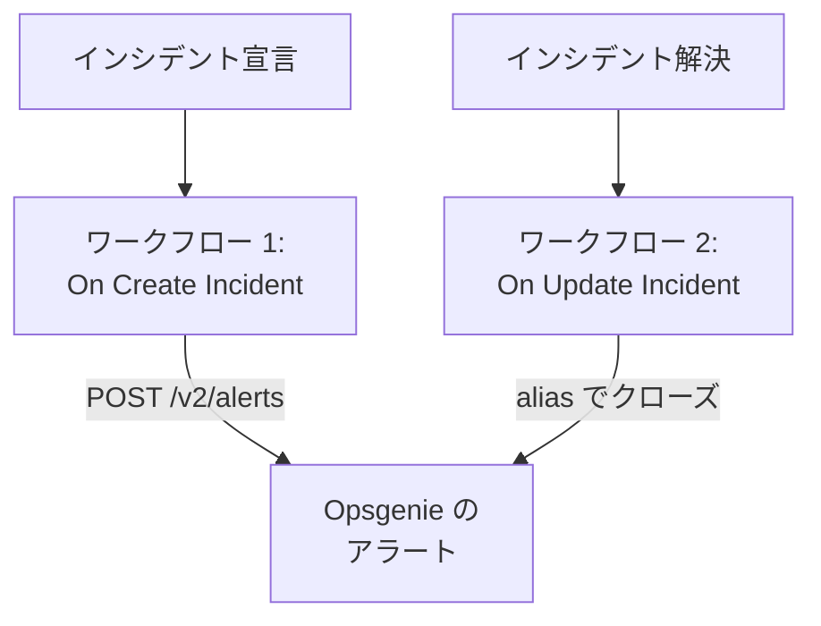

# Opsgenie

OneUptime のインシデントを [Opsgenie](https://www.atlassian.com/software/opsgenie) に送信します。1 つ目のワークフローは OneUptime のインシデントが宣言されると Opsgenie のアラートを作成し、2 つ目のワークフローは OneUptime のインシデントが解決されるとそれをクローズします。Opsgenie がまだチームを呼び出し、OneUptime でシステムを監視している間に使います。

:::cards
- [API キーを保存する](#api-キーを保存する): Opsgenie のキーをワークフローに含めないようにします。
- [Opsgenie のアラートを作成する](#インシデントごとに-opsgenie-のアラートを作成する): 1 つのワークフローと 2 つのブロック。
- [それらをクローズする](#opsgenie-のアラートをクローズする): インシデントの状態を追う 2 つ目のワークフロー。
- [トラブルシューティング](#トラブルシューティング): Opsgenie がリクエストを拒否する場合。
:::

> [!IMPORTANT]
> Atlassian は 2025 年 6 月に Opsgenie の販売を終了し、2027 年 4 月にサポートを終了します。OneUptime も、オンコールポリシー、スケジュール、エスカレーションルールで担当者を呼び出せます。チームを移行するには、[Opsgenie からの移行](/docs/moving-to-oneuptime/opsgenie) を参照してください。インポートでユーザー、チーム、スケジュール、エスカレーションを移行できます。

## 仕組み



どちらのワークフローも [Opsgenie の Alert API](https://docs.opsgenie.com/docs/alert-api) を呼び出します。1 つ目はアラートに OneUptime のインシデントの ID から作った `alias` を付け、2 つ目はその alias でアラートをクローズします。

## 前提条件

- **API** タイプの Opsgenie インテグレーションとその **API Key**。Opsgenie の **Settings → Integrations** で追加するか、特定のチームにアラートを送る場合はそのチームの **Integrations** で追加します。
- Opsgenie のリージョン。`app.eu.opsgenie.com` でサインインするヨーロッパのアカウントは `api.eu.opsgenie.com` を使います。それ以外はすべて `api.opsgenie.com` を使います。
- OneUptime では、ワークフローとグローバル変数を作成する権限。OneUptime Cloud では、ワークフローに **Growth** プラン以上が必要です。

## API キーを保存する

:::steps
1. **ワークフロー → グローバル変数** に移動し、**ワークフロー変数を作成** をクリックします。
2. 名前を `OPSGENIE_KEY` にして **次へ** をクリックします。
3. API キーを **コンテンツ** に貼り付け、**シークレット** をオンにして、**ワークフロー変数を作成** をクリックします。
:::

シークレット変数は実行ログで `[REDACTED]` に置き換えられるため、キーが実行に表示されることはありません。

## インシデントごとに Opsgenie のアラートを作成する

:::steps
### ワークフローを作成する

**ワークフロー** に移動し、**ワークフローを作成** をクリックしてから **ゼロから作成** をクリックします。名前を `Incidents to Opsgenie` にして **ワークフローを作成** をクリックします。

### トリガーを追加する

点線の **このワークフローを開始するものを選択** ブロックをクリックし、**On Create Incident** を選びます。トリガーをクリックし、**Fields to pass on** で `title` と `description` を選びます。

### アラートを作成する

**コンポーネントを追加** をクリックし、**API Post (JSON)** ブロックを追加して、トリガーの **Success** の点をそのブロックに接続します。**URL** を `https://api.opsgenie.com/v2/alerts` (ヨーロッパでは `https://api.eu.opsgenie.com/v2/alerts`) に設定します。**その他の項目** で、**Request Headers** を次のように設定します:

```json
{ "Authorization": "GenieKey {{global.variables.OPSGENIE_KEY}}" }
```

**Request Body** は次のとおりです:

```json
{
  "message": "{{local.components.incident-on-create-1.returnValues.model.title}}",
  "alias": "oneuptime-{{local.components.incident-on-create-1.returnValues.model._id}}",
  "description": "{{local.components.incident-on-create-1.returnValues.model.description}}",
  "priority": "P1",
  "source": "OneUptime"
}
```

### テストしてからオンにする

**ワークフローを実行** をクリックし、**インシデント** でテスト用インシデントを選んで実行します。**API Post (JSON)** ステップに `202` の応答が表示され、少し後に Opsgenie にアラートが表示されます。その後、**ビルダー** の上部で **有効** をオンにします。
:::

Opsgenie の方式は、`GenieKey` という語、スペース、キーの順です。Opsgenie は `message` を 130 文字までに制限し、優先度は `P1` から `P5` までです。インシデントごとの優先度を送るには、[優先度を対応付ける](#優先度を対応付ける) を参照してください。

## Opsgenie のアラートをクローズする

ワークフローのトリガーは 1 つだけなので、クローズには、インシデントの状態が変わったときに開始される 2 つ目のワークフローが必要です。

:::steps
### On Update Incident トリガーを追加する

`Close Opsgenie alerts` という名前のワークフローを作成し、トリガーに **On Update Incident** を選びます。**Fields to watch** で `currentIncidentStateId` を選び、状態が変わったときだけ実行されるようにします。**Fields to pass on** で、新しい状態が解決済みの状態かどうかを要求します:

```json
{ "_id": true, "currentIncidentState": { "isResolvedState": true } }
```

### インシデントが解決されたことを確認する

トリガーの後に **If / Else** ブロックを追加します。**Value to check** を `{{local.components.incident-on-update-1.returnValues.model.currentIncidentState.isResolvedState}}`、**Comparison** を **is true** に設定します。

### アラートをクローズする

**Yes** 側の後に、同じ **Request Headers** と次の **URL** を持つ **API Post (JSON)** ブロックを追加します:

```text
https://api.opsgenie.com/v2/alerts/oneuptime-{{local.components.incident-on-update-1.returnValues.model._id}}/close?identifierType=alias
```

**Request Body** を `{ "source": "OneUptime", "note": "Resolved in OneUptime" }` に設定します。

### オンにする

**有効** をオンにし、OneUptime でテスト用インシデントを解決します。Opsgenie が自分のアラートをクローズします。
:::

`identifierType=alias` は、アドレスがアラート自体の ID ではなく alias でアラートを指定していることを Opsgenie に伝えます。

## 優先度を対応付ける

インシデントごとの重大度を Opsgenie の優先度として送るには、トリガーと **API Post (JSON)** ブロックの間に **Run Custom JavaScript** ブロックを追加します。

1. トリガーの **Fields to pass on** で、重大度の `name` も選びます: `{ "incidentSeverity": { "name": true } }`。
2. ブロックの **Arguments** を `{ "severity": "{{local.components.incident-on-create-1.returnValues.model.incidentSeverity.name}}" }` に、**JavaScript Code** を次のように設定します:

   ```javascript
   // Your incident severities, by name, to Opsgenie's priorities.
   const PRIORITY = {
     "Critical Incident": "P1",
     "Major Incident": "P2",
     "Minor Incident": "P3",
   };

   return { priority: PRIORITY[args.severity] || "P3" };
   ```

3. リクエスト本文で、`"priority"` を `"{{local.components.javascript-1.returnValues.returnValue.priority}}"` に設定します。

上の名前は、新しいプロジェクトが最初に持つ 3 つの重大度です。名前を変えている場合は、自分の名前を使ってください。

## トラブルシューティング

:::details Opsgenie が 401 または 403 を返す
キーが間違っているか、別のリージョンのキーです。ヘッダーが `GenieKey`、スペース、キーの順になっていること、キーが **API** インテグレーションのものであること、ホストがリージョンに合っていること (`api.opsgenie.com` または `api.eu.opsgenie.com`) を確認してください。
:::

:::details クローズが 404 を返す
その alias を持つアラートがありません。両方のワークフローが、`oneuptime-` の後にインシデントの `_id` を付けて同じ方法で alias を作る必要があり、URL は `?identifierType=alias` で終わる必要があります。
:::

:::details ステップは 202 を示すのに、アラートが表示されない
Opsgenie はリクエストを処理する前に `202` を返すため、後で拒否されたリクエストも `202` と表示されます。Opsgenie のログでリクエストを探し、拒否された理由 (オフになっているインテグレーションなど) を確認してください。
:::

:::details ワークフローが一度も実行されない
オンになっていることを確認します: **ビルダー** の上部の **有効** です。次に **ログ → 実行履歴** を開きます。**If / Else** ブロックの **No** 側に進んだ実行は、解決ではない更新です。
:::

## 次のステップ

:::cards
- [Opsgenie からの移行](/docs/moving-to-oneuptime/opsgenie): Opsgenie の終了前に、チーム、スケジュール、エスカレーションを移行します。
- [エスカレーションルール](/docs/on-call/escalation-rules): OneUptime 自体から担当者を呼び出します。
- [PagerDuty](/docs/integrations/pagerduty): PagerDuty 用の同じ 2 つのワークフロー。
- [インテグレーションの概要](/docs/integrations/index): 各インテグレーションの背後にあるパターン。
:::
