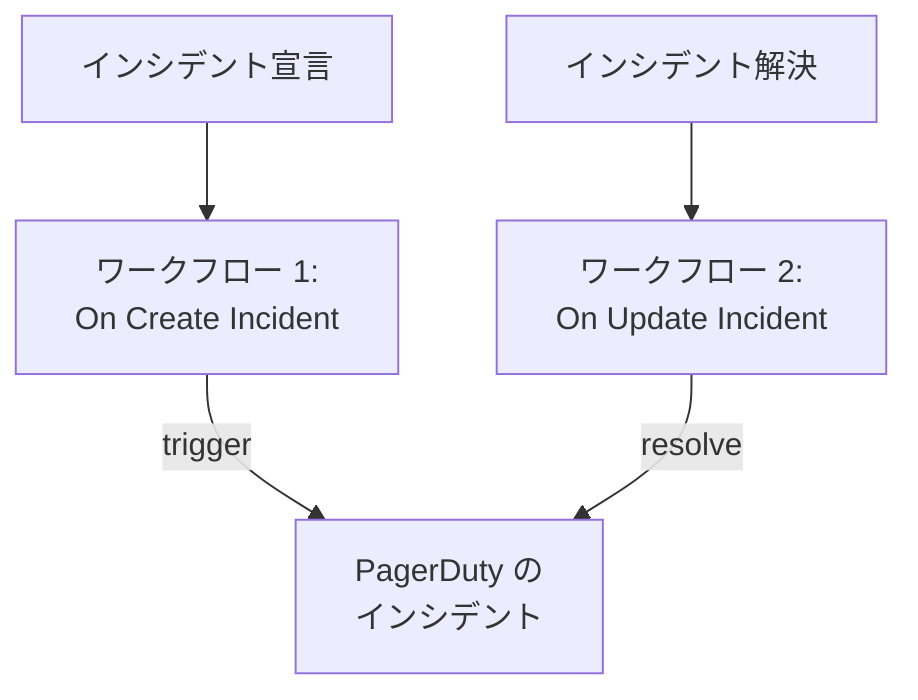

# PagerDuty

OneUptime のインシデントを [PagerDuty](https://www.pagerduty.com) に送信します。1 つ目のワークフローは OneUptime のインシデントが宣言されると PagerDuty のインシデントをトリガーし、2 つ目のワークフローは OneUptime のインシデントが解決されるとそれを解決します。PagerDuty でチームを呼び出し、OneUptime でシステムを監視している場合に使います。

:::cards
- [ルーティングキーを保存する](#ルーティングキーを保存する): PagerDuty のキーをワークフローに含めないようにします。
- [PagerDuty のインシデントをトリガーする](#インシデントごとに-pagerduty-のインシデントをトリガーする): 1 つのワークフローと 2 つのブロック。
- [それらを解決する](#pagerduty-のインシデントを解決する): インシデントの状態を追う 2 つ目のワークフロー。
- [トラブルシューティング](#トラブルシューティング): PagerDuty がイベントを拒否する場合。
:::

> [!TIP]
> OneUptime も、オンコールポリシー、スケジュール、エスカレーションルールで担当者を呼び出せます。チームを PagerDuty から移行するには、[PagerDuty からの移行](/docs/moving-to-oneuptime/pagerduty) を参照してください。インポートでユーザー、スケジュール、エスカレーションポリシーを移行できます。

## 仕組み



どちらのワークフローも、OneUptime のインシデントの ID から作った同じ `dedup_key` を付けて PagerDuty の [Events API v2](https://developer.pagerduty.com/docs/events-api-v2/overview/) を呼び出します。このキーによって、PagerDuty は resolve イベントが trigger イベントで開いたインシデントを閉じるものだと判断します。

## 前提条件

- Events API v2 インテグレーションを持つ PagerDuty サービス。PagerDuty でサービスを開き、**Integrations** を開いて **Add an integration** をクリックし、**Events API V2** を選びます。その **Integration Key** をコピーします。Events API ではこれをルーティングキーと呼びます。
- OneUptime では、ワークフローとグローバル変数を作成する権限。OneUptime Cloud では、ワークフローに **Growth** プラン以上が必要です。

## ルーティングキーを保存する

:::steps
1. **ワークフロー → グローバル変数** に移動し、**ワークフロー変数を作成** をクリックします。
2. 名前を `PAGERDUTY_ROUTING_KEY` にして **次へ** をクリックします。
3. インテグレーションキーを **コンテンツ** に貼り付け、**シークレット** をオンにして、**ワークフロー変数を作成** をクリックします。
:::

シークレット変数は実行ログで `[REDACTED]` に置き換えられるため、キーが実行に表示されることはありません。

## インシデントごとに PagerDuty のインシデントをトリガーする

:::steps
### ワークフローを作成する

**ワークフロー** に移動し、**ワークフローを作成** をクリックしてから **ゼロから作成** をクリックします。名前を `Incidents to PagerDuty` にして **ワークフローを作成** をクリックします。

### トリガーを追加する

点線の **このワークフローを開始するものを選択** ブロックをクリックし、**On Create Incident** を選びます。トリガーをクリックします。その **Fields to pass on** は **タイトル** から始まるので、**フィールドを追加** をクリックして **説明** を選びます。

### trigger イベントを送信する

**コンポーネントを追加** をクリックし、**API Post (JSON)** ブロックを追加して、トリガーの **Success** の点をそのブロックに接続します。**URL** を `https://events.pagerduty.com/v2/enqueue` に、**Request Body** を次のように設定します:

```json
{
  "routing_key": "{{global.variables.PAGERDUTY_ROUTING_KEY}}",
  "event_action": "trigger",
  "dedup_key": "oneuptime-{{local.components.incident-on-create-1.returnValues.model._id}}",
  "payload": {
    "summary": "{{local.components.incident-on-create-1.returnValues.model.title}}",
    "source": "OneUptime",
    "severity": "critical",
    "custom_details": {
      "description": "{{local.components.incident-on-create-1.returnValues.model.description}}"
    }
  }
}
```

### テストしてからオンにする

**ワークフローを実行** をクリックし、**インシデント** でテスト用インシデントを選んで実行します。**API Post (JSON)** ステップに `"status": "success"` を含む `202` の応答が表示され、PagerDuty でインシデントが開きます。その後、**ビルダー** の上部で **有効** をオンにします。
:::

ブロックは JSON を送信するため、`Content-Type` ヘッダーは不要です。PagerDuty の `severity` は `critical`、`error`、`warning`、`info` のいずれかです。インシデントごとの重大度を送るには、[重大度を対応付ける](#重大度を対応付ける) を参照してください。

## PagerDuty のインシデントを解決する

ワークフローのトリガーは 1 つだけなので、解決には、インシデントの状態が変わったときに開始される 2 つ目のワークフローが必要です。

:::steps
### On Update Incident トリガーを追加する

`Resolve PagerDuty incidents` という名前のワークフローを作成し、トリガーに **On Update Incident** を選びます。**Fields to watch** で **フィールドを追加** をクリックして **現在のインシデントの状態** を選び、状態が変わったときだけ実行されるようにします。**Fields to pass on** で、新しい状態が解決済みの状態かどうかを要求します。**フィールドを追加** をクリックし、**現在のインシデントの状態** を開いて **解決済みの状態** を選びます。または **JSON として編集** をクリックし、JSON を次の内容に置き換えます:

```json
{ "_id": true, "currentIncidentState": { "isResolvedState": true } }
```

### インシデントが解決されたことを確認する

トリガーの後に **If / Else** ブロックを追加します。**Value to check** を `{{local.components.incident-on-update-1.returnValues.model.currentIncidentState.isResolvedState}}`、**Comparison** を **is true** に設定します。

### resolve イベントを送信する

**Yes** 側の後に、同じ **URL** と次の **Request Body** を持つ **API Post (JSON)** ブロックを追加します:

```json
{
  "routing_key": "{{global.variables.PAGERDUTY_ROUTING_KEY}}",
  "event_action": "resolve",
  "dedup_key": "oneuptime-{{local.components.incident-on-update-1.returnValues.model._id}}"
}
```

### オンにする

**有効** をオンにし、OneUptime でテスト用インシデントを解決します。PagerDuty が自分のインシデントを解決します。
:::

状態の名前ではなく `isResolvedState` を確認すると、状態の名前を変えても動作し続けます。[インシデントの状態と重大度](/docs/incidents/states-and-severities) を参照してください。

## 重大度を対応付ける

インシデントごとの重大度を送るには、トリガーと **API Post (JSON)** ブロックの間に **Run Custom JavaScript** ブロックを追加し、その応答を本文で読み取ります。

1. トリガーの **Fields to pass on** で **フィールドを追加** をクリックし、**インシデントの重大度** を開いて **名前** を選びます。
2. ブロックの **Arguments** を `{ "severity": "{{local.components.incident-on-create-1.returnValues.model.incidentSeverity.name}}" }` に、**JavaScript Code** を次のように設定します:

   ```javascript
   // Your incident severities, by name, to PagerDuty's.
   const SEVERITY = {
     "Critical Incident": "critical",
     "Major Incident": "error",
     "Minor Incident": "warning",
   };

   return { severity: SEVERITY[args.severity] || "info" };
   ```

3. リクエスト本文で、`"severity"` を `"{{local.components.javascript-1.returnValues.returnValue.severity}}"` に設定します。

上の名前は、新しいプロジェクトが最初に持つ 3 つの重大度です。名前を変えている場合は、自分の名前を使ってください。

## トラブルシューティング

:::details PagerDuty が 400 を返す
応答本文に PagerDuty が拒否した内容が書かれており、実行の **API Post (JSON)** ステップに表示されます。多くの場合、ルーティングキーが Events API v2 のインテグレーションキーではありません。サービスの **Integrations** からコピーし直してください。`summary`、`source`、`severity` のないイベントも拒否されます。
:::

:::details resolve イベントが何も閉じない
2 つのイベントは、まったく同じ `dedup_key` を持つ必要があります。両方の本文が `oneuptime-` の後にインシデントの `_id` を付けて作っていること、解決用のワークフローがオンになっていることを確認してください。
:::

:::details ワークフローが一度も実行されない
オンになっていることを確認します: **ビルダー** の上部の **有効** です。次に **ログ → 実行履歴** を開きます。**If / Else** ブロックの **No** 側に進んだ実行は、解決ではない更新です。
:::

:::details PagerDuty に値ではなく参照が表示される
解決できない参照は、波かっこも含めて書かれたまま送信されます。ブロックの識別子、フィールド名、大文字と小文字を区別する変数名を確認してください。実行の **ステップ** タブでは、そのような参照を含む設定に **解決しませんでした** と表示されます。
:::

## 次のステップ

:::cards
- [PagerDuty からの移行](/docs/moving-to-oneuptime/pagerduty): チーム、スケジュール、エスカレーションポリシーを移行します。
- [エスカレーションルール](/docs/on-call/escalation-rules): OneUptime 自体から担当者を呼び出します。
- [Opsgenie](/docs/integrations/opsgenie): Opsgenie 用の同じ 2 つのワークフロー。
- [インテグレーションの概要](/docs/integrations/index): 各インテグレーションの背後にあるパターン。
:::
