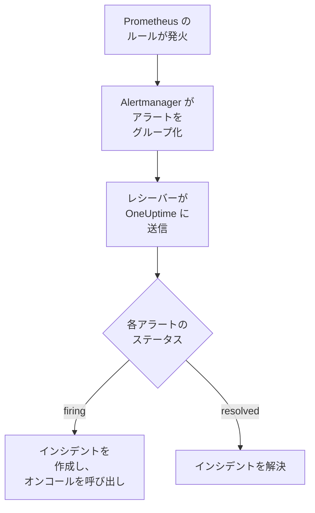

# Prometheus Alertmanager

[Prometheus Alertmanager](https://prometheus.io/docs/alerting/latest/alertmanager/) のアラートを OneUptime に送信すると、発火した各アラートがオンコールチームを呼び出すインシデントになり、アラートが回復すると解決されます。Alertmanager は通知を Webhook レシーバーに送信するため、どちら側にもインストールするものはありません。

:::cards
- [OneUptime でアラートを受け取る方法を選ぶ](#oneuptime-でアラートを受け取る方法を選ぶ): 受信リクエスト モニター、または独自のワークフロー。
- [モニターでアラートを受け取る](#モニターでアラートを受け取る): アラートごとに 1 つのインシデント、回復時に解決。
- [Alertmanager を設定する](#alertmanager-を設定する): Webhook レシーバーと、それを使うルート。
- [トラブルシューティング](#トラブルシューティング): アラートが届かない場合や、インシデントが開いたままの場合。
:::

## 仕組み



Prometheus はアラートルールを評価し、発火したアラートを Alertmanager に送信します。Alertmanager はルートの `group_by` にあるラベルでアラートをグループ化し、各グループを 1 つの JSON 通知として Webhook レシーバーに送信します。通知の `alerts` リストにはグループ内のすべてのアラートが含まれ、それぞれに独自の `status`（`firing` または `resolved`）、ラベルとアノテーション、そしてアラートを識別する `fingerprint` があります。

## 前提条件

- `alertmanager.yml` を編集でき、HTTPS で OneUptime に到達できる Alertmanager。
- OneUptime でモニターを作成する権限。ワークフローを使う場合はワークフローを作成する権限。

## OneUptime でアラートを受け取る方法を選ぶ

まず OneUptime を設定します。Alertmanager の送信先となる URL が得られます。

| 方法 | 使う場面 |
| --- | --- |
| 受信リクエスト モニター（推奨） | すべてのアラートを、オンコールを呼び出し、アラートが回復すると解決されるインシデントにしたい場合。構築するものはありません。 |
| Webhook トリガーを持つワークフロー | アラートの絞り込み、形の変換、先に他のシステムを呼び出すなど、独自のロジックが必要な場合。ワークフローはアラートごとではなく通知ごとに一つのインシデントを作成し、回復時に解決しません。 |

どちらも同じレシーバーから同じ JSON を受け取るため、一方で始めて、後から `alertmanager.yml` の URL を 1 つ変えるだけで切り替えられます。

## モニターでアラートを受け取る

[受信リクエスト モニター](/docs/monitor/incoming-request-monitor) は URL を提供し、その条件が各通知の処理を決めます。

:::steps
### モニターを作成する

**モニター** に移動し、**モニターを作成** をクリックします。**モニターの種類** で **受信リクエスト** を選び、名前を `Alertmanager` にして **次へ** をクリックします。

### 発火したアラートごとにインシデントを宣言する

**条件** ステップで、モニターをオフラインにする最初の条件を開きます。そのフィルターを **リクエストボディ**、**含む**、`"status":"firing"` に設定します。この条件は、フィルターが一致するとすでにインシデントを宣言します。インシデントを次のように入力します。

- **インシデントタイトル**: `{{requestBody.commonLabels.alertname}} on {{requestBody.commonLabels.instance}}`。
- **重大度**: これらのアラートに付けるインシデントの重大度。
- **オンコール** の下の **オンコールポリシー**: 呼び出すポリシー。
- **その他の項目** の下の **インシデントを自動解決**: 初期状態のままオンにしておきます。オフにすると回復が無視され、インシデントは開いたままになります。

### アラートごとに 1 つのインシデントを作成する

同じ条件で **設定** を開き、**ペイロードのフィールドでインシデントとアラートをグループ化** をオンにします。次のように入力すると、各アラートに独自のインシデントができ、その回復でインシデントが解決されます。

| フィールド | 値 |
| --- | --- |
| **次ごとに別々のインシデントを作成…** | `requestBody.alerts[*].fingerprint` |
| **回復を示すフィールド** | `requestBody.alerts[*].status` |
| **回復を意味する値** | `resolved` |

### モニターをオンラインに戻す

モニターをオンラインにする 2 つ目の条件を開き、そのフィルターを **リクエストボディ**、**含む**、`"status":"resolved"` に設定します。

### URL をコピーする

**モニターを作成** をクリックします。モニターの **概要** ページに **ハートビート URL** が表示されます。Alertmanager 用にコピーします。

```text
https://oneuptime.com/heartbeat/<secret key>
```

セルフホスト環境では、`oneuptime.com` の代わりに独自のホストになります。
:::

`[*]` は通知内のすべてのアラートを読むため、3 つのアラートを含む通知は、**1 回のリクエストあたりの最大インシデント数**（変更しない限り `100`）を上限として、3 つのインシデントを作成できます。各アラート自身の `status` が、そのインシデントの扱いを決めます。通知内の 1 つのアラートが解決し、2 つがまだ発火している場合、閉じられるのは解決したアラートのインシデントだけです。各設定の働きについては、[他システムからのアラート受信](/docs/monitor/incoming-request-monitor#他システムからのアラート受信) を参照してください。

> [!WARNING]
> 1 つの通知内でアラートごとに異なる値でグループ化してください。Alertmanager の `fingerprint` はアラートのラベルセット全体のハッシュなので、常に異なります。ルートの `group_by` にあるラベルは決して異なりません。それこそがアラートを 1 つの通知にまとめているものだからです。以下のルートで `requestBody.alerts[*].labels.alertname` でグループ化すると、通知内のすべてのアラートが 1 つのインシデントにまとめられ、そのインシデントは最初のアラートのステータスになります。

## インシデントに名前を付ける

上のタイトルは、通知内のすべてのアラートが共有するラベルを読みます。`commonLabels` にはそれらのラベルが、`commonAnnotations` には共有されるアノテーションが含まれます。`alertname` と `instance` でグループ化する以下のルートでは、どちらも含まれます。**説明** の下で、インシデントに次のような **インシデントの説明** を設定します。

```text
{{requestBody.commonAnnotations.summary}}

{{requestBody.commonAnnotations.description}}
Severity: {{requestBody.commonLabels.severity}}
Alertmanager: {{requestBody.externalURL}}
```

- グループ化キーも変数で、パスの最後のセグメントにちなんで `{{fingerprint}}` という名前になります。ハッシュなので、対応者には何も伝えません。
- `{{requestBody.alerts[0].annotations.summary}}` は通知の最初のアラートを読みますが、それがインシデントを作成したアラートとは限りません。
- 通知にないフィールドへの参照は、空にされず、中括弧も含めて書かれたまま残ります。

使用できるすべての変数は [インシデント & アラート テンプレート](/docs/monitor/incident-alert-templating) を参照してください。

## Alertmanager を設定する

:::steps
### Webhook レシーバーを追加する

`alertmanager.yml` に、コピーした URL に送信するレシーバーを追加し、それをルートのレシーバーにします。

```yaml title="alertmanager.yml"
route:
  receiver: oneuptime
  group_by: ["alertname", "instance"]

receivers:
  - name: oneuptime
    webhook_configs:
      - url: "https://oneuptime.com/heartbeat/<secret key>"
        send_resolved: true
```

`send_resolved: true` は Alertmanager の既定値ですが、オンのままにするために明示しています。これがないと、OneUptime はアラートの回復を知ることができません。Alertmanager は `Content-Type: application/json` を送信し、モニターはこれを使って通知のフィールドを読みます。

### Alertmanager を再読み込みする

設定を再読み込みするか、Alertmanager を再起動します。

```bash
curl -X POST http://localhost:9093/-/reload
```
:::

このルートは Alertmanager の既定のタイミングを使います。新しいグループを送信する前に `30s`（`group_wait`）、新しいアラートを含むグループを再送する前に `5m`（`group_interval`）、変化のない通知を繰り返す前に `4h`（`repeat_interval`）待ちます。

## テストする

Alertmanager と同じように、発火中の 2 つのアラートを含む通知を OneUptime に送信します。

```bash
curl -X POST "https://oneuptime.com/heartbeat/<secret key>" \
  -H "Content-Type: application/json" \
  -d '{
    "version": "4",
    "status": "firing",
    "receiver": "oneuptime",
    "groupLabels": { "alertname": "DiskFull", "instance": "web-1" },
    "commonLabels": { "alertname": "DiskFull", "instance": "web-1", "severity": "critical" },
    "commonAnnotations": { "summary": "Disk almost full on web-1" },
    "externalURL": "http://alertmanager:9093",
    "alerts": [
      {
        "status": "firing",
        "labels": { "alertname": "DiskFull", "instance": "web-1", "severity": "critical", "device": "/dev/sda1" },
        "fingerprint": "a1b2c3d4e5f60001"
      },
      {
        "status": "firing",
        "labels": { "alertname": "DiskFull", "instance": "web-1", "severity": "critical", "device": "/dev/sdb1" },
        "fingerprint": "a1b2c3d4e5f60002"
      }
    ]
  }'
```

`fingerprint` ごとに 1 つずつ、2 つのインシデントが作成され、どちらのタイトルも `DiskFull on web-1` になります。各 `status` を `resolved` にして同じリクエストを送ると、両方が解決されます。

Alertmanager からの経路全体をテストするには、`amtool` でアラートを発火させます。Alertmanager は `group_wait` の後にアラートを送信し、数分後にアラートが期限切れになると回復を送信します。

```bash
amtool alert add test_alert severity=warning \
  --annotation=summary="Test from Alertmanager" \
  --alertmanager.url=http://localhost:9093
```

## ワークフローでアラートを受け取る

Alertmanager とインシデントの間に独自のステップが必要な場合は、[ワークフロー](/docs/workflows/index) を使います。

:::steps
### ワークフローを作成する

**ワークフロー** に移動し、**ワークフローを作成**、続いて **ゼロから作成** をクリックします。名前を `Alertmanager alerts` にして **ワークフローを作成** をクリックします。

### Webhook トリガーを追加する

破線の **このワークフローを開始するものを選択** ブロックをクリックし、**Webhook** を選びます。トリガーをクリックしてから **URL をコピー** をクリックし、その URL を `alertmanager.yml` のレシーバーに使います。

### 通知が発火中か確認する

**コンポーネントを追加** をクリックして **If / Else** ブロックを追加し、トリガーの **Out** ドットをそれにつなぎます。**Value to check** を `{{local.components.webhook-1.returnValues.request-body.status}}`、**Comparison** を **is equal to**、**Compare with** を `firing` に設定します。

### インシデントを宣言する

**Create One Incident** ブロックを追加し、**If / Else** ブロックの **Yes** 側をそれにつなぎます。**Incident Template** で、重大度と呼び出すオンコールポリシーを設定するテンプレートを選びます（[インシデントテンプレート](/docs/incidents/settings#インシデントテンプレート) を参照）。**JSON Object** で、Alertmanager から来る内容を設定します。

```json
{
  "title": "{{local.components.webhook-1.returnValues.request-body.commonLabels.alertname}}",
  "description": "{{local.components.webhook-1.returnValues.request-body.commonAnnotations.summary}}\nAlertmanager: {{local.components.webhook-1.returnValues.request-body.externalURL}}"
}
```

テンプレートがない場合、**JSON Object** にはプロジェクトのインシデント重大度のいずれかの ID である `incidentSeverityId` も必要です。

### ワークフローをオンにする

**ビルダー** の上部で **有効** をオンにします。オフのワークフローは Alertmanager に `400` を返します。
:::

1 回の実行は 1 つの通知を処理するため、通知に含まれるアラートの数にかかわらず、宣言するインシデントは 1 つです。`resolved` の通知は **If / Else** ブロックの **No** 側に進みますが、そこには何もつながっていないため、実行はそこで終わります。アラートごとに 1 つのインシデントを作成し、回復時に解決するには、モニターを使います。

## Alertmanager 自体を監視する

どちらの方法も、Prometheus や Alertmanager が動かなくなったことには気付きません。アラートが届かない状態は、すべてが正常な状態とまったく同じに見えるからです。そこで、常に発火しているアラートを 2 つ目のモニターに送り、そのアラートが届かなくなったときにインシデントを宣言させます。[kube-prometheus-stack](https://github.com/prometheus-community/helm-charts/tree/main/charts/kube-prometheus-stack) には、`Watchdog` という名前のそのようなアラートが付属しています。素の Prometheus では、`vector(1)` のように式が常に真になる `Watchdog` という名前のアラートルールを追加します。

:::steps
### ウォッチドッグ モニターを作成する

`Alertmanager watchdog` という名前で 2 つ目の受信リクエスト モニターを作成します。モニターをオフラインにする最初の条件のフィルターを **受信リクエスト**、**Not Recieved In Minutes**、`10` に、2 つ目の条件のフィルターを **受信リクエスト**、**Recieved In Minutes**、`10` に設定します。ダッシュボードではどちらもこの綴りで表示されます。新しいモニターの **ハートビート URL** をコピーします。

### ウォッチドッグ アラートをそこに送る

ウォッチドッグ モニターの URL 用のレシーバーと、`Watchdog` を 5 分ごとにそこへ送るルートを追加します。子ルートは親のレシーバーより先に確認されるため、`Watchdog` はウォッチドッグ モニターに送られ、それ以外のアラートは引き続き最初のモニターに送られます。

```yaml title="alertmanager.yml"
route:
  receiver: oneuptime
  group_by: ["alertname", "instance"]
  routes:
    - receiver: oneuptime-watchdog
      matchers:
        - alertname = "Watchdog"
      group_wait: 0s
      group_interval: 5m
      repeat_interval: 5m

receivers:
  - name: oneuptime
    webhook_configs:
      - url: "https://oneuptime.com/heartbeat/<secret key>"
        send_resolved: true
  - name: oneuptime-watchdog
    webhook_configs:
      - url: "https://oneuptime.com/heartbeat/<watchdog secret key>"
```
:::

ウォッチドッグ アラートが 10 分間届かないと、ウォッチドッグ モニターはオフラインになり、インシデントを宣言します。次のウォッチドッグ通知でモニターはオンラインに戻り、インシデントが解決されます。

## トラブルシューティング

:::details OneUptime に何も届かない
- Alertmanager のログで、レシーバーへの配信エラーを確認します。
- モニターは何かを確認する前に、シークレットキーが間違っていてもすぐに `200` を返します。通知が届いているかは、モニターのタイムラインで確認します。
- オフのワークフローは `400` を返します。その **ビルダー** の上部で **有効** をオンにします。
:::

:::details インシデントは作成されるが解決されない
- `send_resolved: false` を設定しているレシーバーがないか確認します。その場合、Alertmanager は回復を一切送信しません。
- 条件のインシデントには、**その他の項目** の下の **インシデントを自動解決** が必要です。
- **回復を示すフィールド** は `requestBody.alerts[*].status`、**回復を意味する値** は正確に `resolved` でなければなりません。比較では大文字と小文字が区別されます。
- **1 回のリクエストあたりの最大インシデント数** を超える通知内のアラートはまったく読まれないため、その回復も失われます。
- バースト中にスキップされた回復（下記を参照）は、そのインシデントを開いたままにします。Alertmanager は発火中のアラートを繰り返し送りますが、回復は繰り返しません。そのようなインシデントは手動で解決します。
:::

:::details インシデントが作成されない
グループ化のパスは `requestBody.` で始まる必要があり、リストを読むのはパス内の最初の `[*]` だけです。どちらかのルールに反するパスは、エラーもなく何にも一致しません。
:::

:::details アラートが多数含まれる通知でインシデントが 1 つだけ
通知内のすべてのアラートで同じになるラベル、多くの場合ルートの `group_by` にあるラベルでグループ化しています。代わりに `requestBody.alerts[*].fingerprint` でグループ化してください。
:::

:::details インシデントに値ではなく参照が表示される
通知にないフィールドへの参照は、中括弧も含めて書かれたまま残ります。ルールによって設定するアノテーションは異なるため、`commonAnnotations` や各アラートの `annotations` など、ルールが実際に設定するフィールドを使ってください。
:::

:::details インシデントが多すぎる
ルートをより少ないラベルでグループ化するか、`group_interval` を増やして、Alertmanager が関連するアラートをまとめて送るようにします。**1 回のリクエストあたりの最大インシデント数** を下げると 1 つの通知から作成されるインシデントは制限されますが、上限を超えたアラートは読まれないため、その回復も失われます。
:::

:::details バースト中に通知がスキップされる
前のリクエストが評価される前に新しいリクエストがモニターに届くと、OneUptime は最新のものだけを評価します。これにより、1 つの送信元がモニターをあふれさせることを防ぎます。バーストの最後の通知は必ず評価されますが、Alertmanager は各グループを同じ URL に送るため、別のアラートに関する前の通知はスキップされることがあります。`group_wait` と `group_interval` を増やして通知の間隔を空けてください。セルフホスト環境では、すべてのリクエストを評価するために OneUptime アプリの環境で `INCOMING_REQUEST_INGEST_COALESCE_ENABLED=false` を設定します。
:::

## セキュリティ

- **URL はパスワードと同じように扱ってください。** URL を持っている人は誰でもインシデントを作成できます。漏えいした場合はリセットします。モニターの **設定** ページで **受信リクエストのシークレットキーをリセット**、またはワークフローの **Webhook** トリガーで **URL をリセット** を使います。その後、`alertmanager.yml` のレシーバーの `url` を更新します。
- **セルフホスト環境の場合は？** Alertmanager がファイアウォール越しに HTTPS で OneUptime に到達できるようにしてください。

## 次のステップ

:::cards
- [受信リクエスト モニター](/docs/monitor/incoming-request-monitor): アラートを受け取るモニターのすべての設定。
- [Grafana](/docs/integrations/grafana): Grafana のアラート向けの同じ設定。
- [エスカレーションルール](/docs/on-call/escalation-rules): オンコールポリシーが誰をいつ呼び出すかを決めます。
- [インテグレーションの概要](/docs/integrations/index): 接続できるその他のツール。
:::
