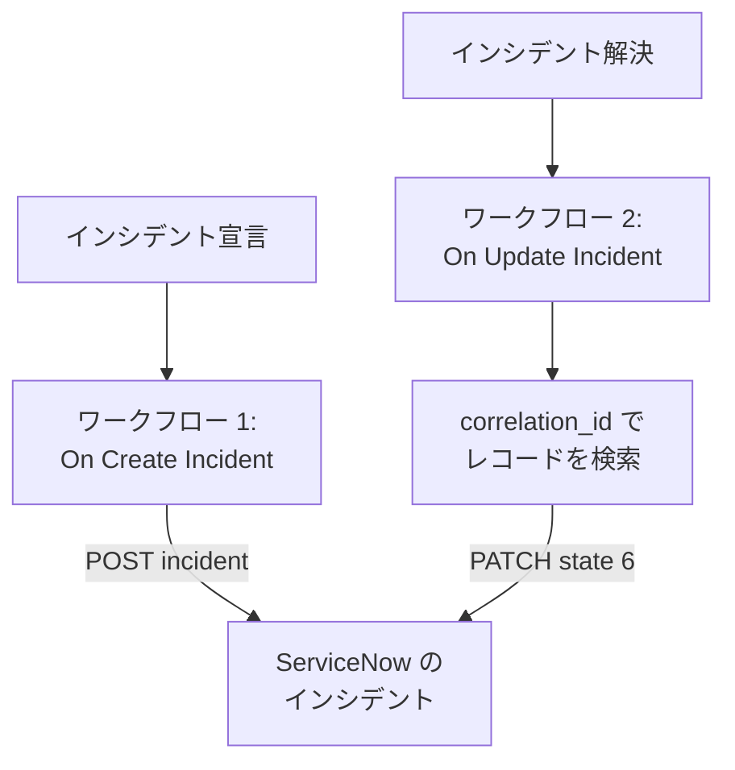

# ServiceNow

OneUptime のインシデントごとに [ServiceNow](https://www.servicenow.com) のインシデントを作成し、OneUptime のインシデントが解決されたらそれを解決して、サービスデスクが監視の状況を追えるようにします。2 つのワークフローが ServiceNow の [Table API](https://developer.servicenow.com/dev.do#!/reference/api/latest/rest/c_TableAPI) を呼び出します。

:::cards
- [認証情報を保存する](#認証情報を保存する): ServiceNow のパスワードをワークフローに含めないようにします。
- [ServiceNow のインシデントを作成する](#インシデントごとに-servicenow-のインシデントを作成する): 1 つのワークフローと 2 つのブロック。
- [それらを解決する](#servicenow-のインシデントを解決する): レコードを見つけてからクローズします。
- [トラブルシューティング](#トラブルシューティング): ServiceNow がリクエストを拒否する場合。
:::

## 仕組み



1 つ目のワークフローは、OneUptime のインシデントの ID をレコードの `correlation_id` に書き込みます。2 つ目はその ID でレコードを見つけ、解決します。

## 前提条件

- `https://your-instance.service-now.com` のような ServiceNow インスタンス。
- `incident` テーブルのレコードを作成・更新できる、インテグレーション用の ServiceNow ユーザー (通常は `itil` ロールを持つ)。その名前とパスワードでリクエストに署名します。
- OneUptime では、ワークフローとグローバル変数を作成する権限。OneUptime Cloud では、ワークフローに **Growth** プラン以上が必要です。

## 認証情報を保存する

Table API は Basic 認証を受け付けます。ユーザーの名前とパスワードを一緒にエンコードしたものです。

:::steps
1. macOS または Linux で、一度だけエンコードします:

   ```bash
   printf '%s' 'integration.user:password' | base64 | tr -d '\n'
   ```

   `echo` ではなく `printf` を使ってください。`echo` は改行を追加し、それが残りと一緒にエンコードされて認証情報が壊れます。

2. OneUptime で **ワークフロー → グローバル変数** に移動し、**ワークフロー変数を作成** をクリックします。名前を `SERVICENOW_AUTH` にして **次へ** をクリックします。
3. エンコードした値を **コンテンツ** に貼り付け、**シークレット** をオンにして、**ワークフロー変数を作成** をクリックします。
:::

## インシデントごとに ServiceNow のインシデントを作成する

:::steps
### ワークフローを作成する

**ワークフロー** に移動し、**ワークフローを作成** をクリックしてから **ゼロから作成** をクリックします。名前を `Incidents to ServiceNow` にして **ワークフローを作成** をクリックします。

### トリガーを追加する

点線の **このワークフローを開始するものを選択** ブロックをクリックし、**On Create Incident** を選びます。トリガーをクリックし、**Select Fields** で `title` と `description` を選びます。

### レコードを作成する

**コンポーネントを追加** をクリックし、**API Post (JSON)** ブロックを追加して、トリガーの **Success** の点をそのブロックに接続します。**URL** を `https://your-instance.service-now.com/api/now/table/incident` に設定します。**その他の項目** で、**Request Headers** を次のように設定します:

```json
{
  "Authorization": "Basic {{global.variables.SERVICENOW_AUTH}}",
  "Accept": "application/json"
}
```

**Request Body** は次のとおりです:

```json
{
  "short_description": "OneUptime: {{local.components.incident-on-create-1.returnValues.model.title}}",
  "description": "{{local.components.incident-on-create-1.returnValues.model.description}}",
  "urgency": "1",
  "impact": "1",
  "correlation_id": "oneuptime-{{local.components.incident-on-create-1.returnValues.model._id}}"
}
```

### テストしてからオンにする

**ワークフローを実行** をクリックし、テスト用インシデントの **インシデント ID** を入力して実行します。**API Post (JSON)** ステップに、新しいレコード、その `sys_id`、`INC0012345` のような `number` を含む `201` の応答が表示されます。その後、**ビルダー** の上部で **有効** をオンにします。
:::

`urgency` と `impact` は、高に `1`、中に `2`、低に `3` を取り、ServiceNow はこの 2 つから優先度を算出します。`incident` テーブルのその他の列も、列名を使って本文に含められます。

## ServiceNow のインシデントを解決する

ワークフローのトリガーは 1 つだけなので、解決には、インシデントの状態が変わったときに開始される 2 つ目のワークフローが必要です。

:::steps
### On Update Incident トリガーを追加する

`Resolve ServiceNow incidents` という名前のワークフローを作成し、トリガーに **On Update Incident** を選びます。**Listen on** で `currentIncidentStateId` を選び、状態が変わったときだけ実行されるようにします。**Select Fields** で、新しい状態が解決済みの状態かどうかを要求します:

```json
{ "_id": true, "currentIncidentState": { "isResolvedState": true } }
```

### インシデントが解決されたことを確認する

トリガーの後に **If / Else** ブロックを追加します。**Value to check** を `{{local.components.incident-on-update-1.returnValues.model.currentIncidentState.isResolvedState}}`、**Comparison** を **is true** に設定します。

### レコードを見つける

**Yes** 側の後に、同じ **Request Headers** と次の **URL** を持つ **API Get (JSON)** ブロックを追加します:

```text
https://your-instance.service-now.com/api/now/table/incident?sysparm_query=correlation_id=oneuptime-{{local.components.incident-on-update-1.returnValues.model._id}}&sysparm_fields=sys_id&sysparm_limit=1
```

### レコードを解決する

検索ブロックの **Success** の後に、同じ **Request Headers** と次の **URL** を持つ **API Patch (JSON)** ブロックを追加します:

```text
https://your-instance.service-now.com/api/now/table/incident/{{local.components.api-get-1.returnValues.response-body.result[0].sys_id}}
```

**Request Body** を次のように設定します:

```json
{
  "state": "6",
  "close_code": "Solution provided",
  "close_notes": "Resolved in OneUptime"
}
```

### オンにする

**有効** をオンにし、OneUptime でテスト用インシデントを解決します。対応する ServiceNow のインシデントが Resolved に移ります。
:::

ServiceNow の既定のインシデントの状態では、`state` `6` が Resolved です。`close_code` は、インスタンスの解決コードのいずれかでなければなりません。多くのインスタンスは解決コードとメモがないとインシデントを解決しないので、両方を送信してください。

## トラブルシューティング

:::details ServiceNow が 401 を返す
認証情報が間違っています。`echo` ではなく `printf` で `username:password` をエンコードし直し、`SERVICENOW_AUTH` の内容を置き換えます。
:::

:::details ServiceNow が 403 を返す
ユーザーが `incident` テーブルに書き込めません。`itil` ロールまたは同じ権限を持つロールを割り当て、アクセス制御ルールがそのユーザーの Table API をブロックしていないことを確認してください。
:::

:::details ServiceNow が 400 を返す、または解決しても何も変わらない
列名または値がインスタンスに合っていません。カスタマイズされた `state` の一覧や、インスタンスにない `close_code` などです。ServiceNow の **System Definition → Tables** の `incident` テーブルや、レコード自体のフォームと照らし合わせてください。
:::

:::details 解決が 404 を返す
検索ステップでレコードが見つからなかったため、URL に参照が書かれたまま残りました。1 つ目のワークフローが `correlation_id` を書き込んだこと、両方のワークフローが同じ方法 (`oneuptime-` の後にインシデントの `_id`) で作っていることを確認してください。
:::

## 次のステップ

:::cards
- [Jira](/docs/integrations/jira): 既製のテンプレートで同期を保つ、双方向のインテグレーション。
- [ワークフロー コンポーネント](/docs/workflows/components#api): API ブロックのすべての設定。
- [ワークフロー 実行履歴](/docs/workflows/runs-and-logs): 各リクエストが送信した内容と受け取った内容を確認します。
- [インテグレーションの概要](/docs/integrations/index): 各インテグレーションの背後にあるパターン。
:::
