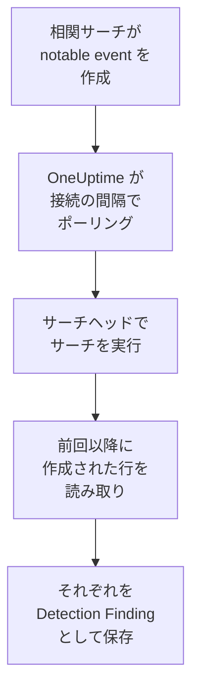

# Splunk Enterprise Security

[Splunk Enterprise Security](https://www.splunk.com/en_us/products/enterprise-security.html) の相関サーチが作成する notable event を、OneUptime のセキュリティイベントにインポートします。そこではログ、トレース、メトリクスと並べて検索し、他のあらゆるソースと相関付け、重要なものについてオンコールを呼び出せます。OneUptime は、作成した Splunk ユーザーとしてサーチヘッドでサーチを実行して読み取り、Splunk では何も変更しません。ただのサーチなので、notable event だけでなく、任意のインデックスや任意の保存済みサーチの出力もインポートできます。

:::cards
- [接続を設定する](#接続を設定する): トークン、ロール、接続のフォーム。
- [インポートされる内容](#インポートされる内容): サーチの各行がセキュリティイベントになる仕組み。
- [ポーリングの仕組み](#ポーリングの仕組み): 各ポーリングが読み取る時間枠と、負荷の高いサーチヘッドでの動作。
- [トラブルシューティング](#トラブルシューティング): 各エラーの意味と変更すべき点。
:::

## 仕組み



OneUptime は 1 分ごとに、ポーリング間隔が経過した有効な接続をそれぞれポーリングします。ポーリングはサーチヘッドの REST API を通じて、前回のポーリング以降に作成された行を対象にサーチを実行し、各行を [OCSF](https://schema.ocsf.io/) Detection Finding イベント（クラス `2004`）として保存します。その後、検出ルール、モニター、ダッシュボードは、それを他のソースのセキュリティイベントと同じように扱います。

## 前提条件

- OneUptime で Project Owner、Project Admin、または Security Admin のロール。Security Member と Security Viewer は接続とその実行履歴を見ることはできますが、変更はできません。
- Splunk Enterprise 9.0.1 以降を実行するサーチヘッド、または Splunk Cloud Platform。OneUptime は管理ポート（通常は `8089`）でその REST API と通信します。ポート `8000` の Splunk Web は REST API を提供しません。
- OneUptime 用の Splunk ユーザー。そのロールには `search` ケイパビリティがあり、サーチが読むインデックス（notable event の場合は `notable`）を読めることが必要です。Enterprise Security の `ess_analyst` と `ess_user` ロールはその両方を付与します。接続は読み取るだけなので、ロールにはそれ以外は必要ありません。
- OneUptime が HTTPS で到達できるサーチヘッド。OneUptime Cloud はインターネットから接続するため、サーチヘッドにはパブリックアドレスが必要です。プライベートアドレスは拒否されます。セルフホストの OneUptime はアプリと worker のコンテナから接続し、`DATA_SOURCE_BLOCK_PRIVATE_ADDRESSES` が `true` でない限り、プライベートネットワーク上のサーチヘッドにも到達できます。

## 接続を設定する

接続は Splunk の認証トークン、またはユーザー名とパスワードで認証します。

:::steps
### 認証トークンを作成する

1. Splunk Web で **Settings → Tokens** を開きます。トークン認証が無効だと表示された場合は、先に **Enable Token Authentication** を選択します。
2. **New Token** を選択します。**User** には OneUptime 用に作成した Splunk ユーザーを入力し、**Audience** にはトークンの用途（例: `OneUptime security events`）を入力します。
3. **Expiration** を選択するか、期限なしにします。期限切れのトークンは、置き換えるまで接続を止めます。
4. **Create** を選択し、トークンをコピーします。Splunk はトークンを一度しか表示しません。

代わりにパスワードで認証する場合は、この手順を飛ばして、ユーザーの名前とパスワードを手元に用意しておきます。

### OneUptime で接続を追加する

**製品 → セキュリティイベント → 接続**（`/dashboard/{projectId}/security-events/connections`）を開き、**接続を追加** をクリックして **Splunk Enterprise Security** を選び、**次へ** をクリックします。下の表の設定を入力して **次へ** をクリックし、トークンを **Authentication token** に、またはパスワードを **パスワード** に貼り付けます。

### 保存する前にテストする

**保存前にテスト** の下にある **これらの設定をテスト** をクリックします。テストはフォームの値で認証してサーチを実行し、何も保存しません。そのため、ポートの誤りやロールの不足は接続を作成する前にわかります。続いて **次へ** をクリックし、接続に **名前** を付けて作成します。
:::

| 設定 | 入力する内容 |
| --- | --- |
| **Splunk management URL** | サーチヘッドの REST API。例: `https://splunk.example.com:8089`。`https` を使い、クエリ文字列は付けません。パスの下で API を提供するリバースプロキシのために、パスは保持されます。 |
| **検索** | インポートするものを選ぶサーチで、変更しない限り `index=notable` です。たとえば `index=notable urgency IN (high, critical)` のように絞り込みます。時間範囲は OneUptime が自分で追加するため、サーチで `earliest` や `latest` を指定したり、パイプで始めたりすることはできません。先頭の `search` は取り除かれます。 |
| **ユーザー名** | Splunk ユーザーの名前。パスワードで認証する場合のみ。 |
| **Authentication token** | 最初の手順のトークン。トークンが保存されている場合は、ユーザー名とパスワードではなくトークンが使われます。 |
| **パスワード** | Splunk ユーザーのパスワード。トークンを使わない場合のみ。 |

**Authentication token** と **パスワード** は暗号化され、API から返されることはなく、再表示もされません。置き換えるには、接続の **認証情報を更新** を使います。認証方法を切り替えるには、そこで新しいほうを入力し、**Remove the stored Authentication token** または **Remove the stored Password** をオンにします。

**ポーリング** ステップには、任意の **説明**、`1`～`1440` の整数で初期値 `5` の **ポーリング間隔（分）**、初期状態でオンの **有効** もあります。

## インポートされる内容

サーチが返す各行は、ベンダー `Splunk`、製品 `Splunk Enterprise Security` の Detection Finding イベント（OCSF クラス `2004`）になります。notable event の場合:

| Splunk のフィールド | OneUptime の列 |
| --- | --- |
| `event_id`、なければ `_bkt` と `_cd`、なければ行のハッシュ | イベント UID。重複の除外にも使われます |
| `_time`（相関サーチが notable event を作成した時刻） | イベント時刻 |
| `rule_name`、なければ `search_name`、なければ `source` | ルール名 |
| `search_name`、なければ `source`、なければ `rule_name` | ルール ID |
| `rule_title`、なければ `rule_description`、なければルール名 | メッセージ |
| `urgency`、なければ `severity` | 重大度 |
| `status_label`、なければ `status_description`、なければ `status` が持つレビューステータスの名前 | ステータス |
| `annotations.mitre_attack`、および `mitre_technique_id` や `mitre_tactic` などのフィールド | MITRE ATT&CK の戦術と手法 |
| `user` または `src_user`、`src`、`src_ip` または `src_host`、`process`、`process_name` または `parent_process` | 主体のユーザー、IP、ホスト、プロセス |
| `process_name` または `process_exec`、`process_path`、`process`、`parent_process_name` または `parent_process_exec`、`parent_process_path`、`parent_process` | プロセスの名前、パス、コマンドライン。親プロセスの名前、パス、コマンドライン |
| `dest_user`、`dest`、`dest_ip` または `dest_host`、`dest_port` | ターゲットのユーザー、IP、ホスト、ポート |
| `file_path`、`url` または `risk_object` | ターゲットのリソース |
| 各ユーザー、ホスト、IP、および `dvc`、`host`、`file_hash`、`file_name`、`url`、`domain`、`query`、`risk_object` | オブザーバブル |
| 行のすべてのフィールド（例: `security_domain`、`owner`、`orig_sid`、`_raw`） | `attributes`（フィールド本来の名前で） |

他のインデックスの行も同じようにインポートされます。そのフィールドで埋まらない列は空のままで、各フィールドは引き続き `attributes` で検索できます。

## ポーリングの仕組み

各ポーリングは、自分の時間枠を対象にエクスポートサーチを古い順に実行します:

```text
POST {Splunk management URL}/services/search/v2/jobs/export
    search=search index=notable | fields * | sort 0 _time | head 10001
    earliest_time={window start}
    latest_time={window end}
    output_mode=json
```

- **作成時刻がカーソルです。** 時間枠は `_time` が対象で、これは notable event の場合、見つかったアクティビティが起きた時刻ではなく、相関サーチがそれを作成した時刻です。1 時間ごとに実行されるサーチは notable event に自分の実行時刻を付けるため、カーソルより後ろに取り残されるものはありません。
- **最初のポーリングは 24 時間前までさかのぼります**。そのため、新しい接続にはすぐに最近の notable event が表示されます。
- **以降の各ポーリングは、保存されたカーソルの 1 分前から始まります**。そのため、2 つの時間枠の境界で作成された行が失われることはありません。
- **1 回のポーリングで読むのは、カーソルから最大 24 時間先までです。** カーソルが遅れた接続は、24 時間の時間枠を続けて読んで追いつき、その **ヘルス** には **Catching up** と表示されます。
- **重複は `event_id`、または Splunk 独自の `_bkt` と `_cd` で除外されます**。対象はプロジェクト内で、重なり、再試行された時間枠、インポートによって行が二重に保存されることはありません。

9.0.1 より古いサーチヘッドは、`search/v2/jobs/export` へのリクエストに `404` を返します。その場合、OneUptime は非推奨の `search/jobs/export` に送り、実行はそのことを警告で示します。サーチヘッドをアップグレードしてください。現在のバージョンではそのエンドポイントは無効になっています。

### 1 回のポーリングで読み切れないほど時間枠にデータがある場合

1 回のポーリングで読むのは最大 10,000 行です。時間枠にそれより多く含まれていると、実行は **部分的** になり、次のような警告が出ます:

```text
Stopped after collecting 10000 records; the window holds more. Records are read oldest first, and the last one read was created at 2026-09-14T08:12:44.000Z, where the next poll can resume.
```

サーチは時間枠を `_time` で古い順に並べ替えるため、OneUptime はカーソルを最後に読んだ行の作成時刻に移し、次のポーリングは同じ時間枠の長さでそこから始まります。負荷の高いサーチヘッドは、同じ行を読み直すのではなく、ポーリングごとに 10,000 行ずつ追いつきます。同じ瞬間に作成された行は 2 回読まれ、重複チェックが 2 つ目のコピーを除外します。Splunk は行を返す前に時間枠全体を並べ替えるため、必要以上に多くを見つける **検索** のサーチは、すべてのポーリングを遅くします。サーチは絞り込んでおきましょう。

実行が保存されたカーソルより先にまったく進めない場合、OneUptime は代わりに時間枠を短くします。

1. **縮める。** 次のポーリングは同じ開始点から半分の長さの時間枠を読み、時間枠を最後まで読めるようになるまで、最短 1 分まで半分にし続けます。実行の警告にはそのことが示されます: `This window holds more records than one poll can read; the next poll reads a {n} minute window from the same starting point.`
2. **元に戻す。** 時間枠を最後まで読めたら、次の時間枠は再び 2 倍になり、最長 24 時間まで戻ります。
3. **1 分を飛ばす。** 1 分間でさえ 1 回のポーリングで読み切れないほどある場合、ポーリングはその 1 分を飛ばして先に進み、新しい notable event が届き続けるようにします。実行は **部分的** のままで、**最終エラー** には `More records were created in the one minute from {cursor} to {end} than one poll can read. Polling moved past this minute so newer records keep arriving; use Import this time range in Diagnostics on this minute to recover what one run can read.` と表示されます。1 回の実行で読める分を回収するには、**この時間範囲をインポート** でその 1 分をインポートします。

Splunk のエラーで完全に失敗した実行は、カーソルと時間枠の長さを保ち、次のポーリングが同じ時間枠を読み直します。唯一の例外はタイムアウトしたリクエストです。カーソルはそのままですが、次の時間枠は半分の長さになります。時間内に応答できないほど重い時間枠は、何度試してもタイムアウトするからです。**ポーリング間隔（分）** を変えても、これは何も変わりません。この設定が決めるのはポーリングを開始する頻度であって、時間枠の開始位置ではありません。

### オンデマンドで実行、プレビュー、インポートする

接続の **診断** をクリックすると、最近の実行を確認し、手動で操作できます。これらを開始できるのは接続を変更できるユーザーで、履歴は接続を見られるユーザーなら誰でも読めます。

- **今すぐ実行** は、接続が **有効** でなくても、通常のカーソルでただちにポーリングを開始します。
- **Preview notable events** は最大 7 日間の時間範囲を読み取り、何もインポートしません。
- **この時間範囲をインポート** は、確認後、カーソルを動かさずに最大 7 日間の範囲をインポートします。インポート済みの行はスキップされます。
- 実行の **診断情報をコピー** は、サポート向けにその実行のレポートをコピーします。認証情報は含まれません。

## 接続をテスト

接続の行にある **接続をテスト** と、フォームの **これらの設定をテスト** は、バックグラウンド worker ではなく API プロセスで実行されます。そのため、worker に問題がある場合でもテストは応答します。テストは次のチェックを順に実行します。

| チェック | 確認内容 |
| --- | --- |
| **構成** | すべての設定が存在し、形式が正しいこと。失敗した場合はどこにも接続しません。 |
| **Authenticate with Splunk** | Splunk がトークン、またはユーザー名とパスワードを受け入れ、ユーザーとそのロールを示すこと。付与したかったロールと比べられます。 |
| **Run the search on Splunk** | **検索** のサーチが過去 24 時間を対象に一行分実行され、どのエクスポートエンドポイントが応答したかが示されること。 |
| **Notable events available to import** | **検索** のサーチが過去 24 時間と過去 7 日間に見つけた行の数。7 日間に一件もない場合は失敗ではなく警告です。 |
| **Background workers**, **Poll scheduler**, **Security event storage** | OneUptime 側の状態。プロセスが Worker キューのジョブを取得していること、ポーリングジョブが毎分実行されていること、セキュリティイベントのストアが応答すること。 |
| **スケジュールされたポーリング** | 保存済みの接続について、ポーリングがオンであること、worker を待って止まっている実行がないこと、ポーリングが予定どおり実行されていること。 |

テスト内の各リクエストの期限は 20 秒です。テストは何もインポートせず、カーソルも動かしません。失敗した各チェックは、何を変更すべきかを示します。

## Splunk にセキュリティイベントを送る

OneUptime は見つけたものを Splunk の HTTP Event Collector (HEC) を通じて Splunk に送ることもでき、サーチやダッシュボードで OneUptime の検出を自分の検出と並べて見られます。各セキュリティイベントは sourcetype が `oneuptime:security` の HEC イベントひとつになり、フィールドは Splunk の Common Information Model の名前になります: `src`、`src_ip`、`src_user`、`dest`、`dest_ip`、`dest_port`、`user`、`signature`、`severity`。

:::steps
### HEC トークンを作成する

Splunk Web で **Settings → Data inputs → HTTP Event Collector** を開き、**New Token** をクリックします。名前を付け、書き込めるインデックスと既定のインデックスを選び、トークンの値をコピーします。Splunk Cloud では HEC は `https://http-inputs-<stack>.splunkcloud.com` で待ち受け、Splunk Enterprise では **Global Settings** でトークンを有効にすると、ポート `8088` で待ち受けます。

### 送信先を追加する

**製品 → セキュリティイベント → 接続** を開きます。**SIEM に送信** で **送信先を追加** をクリックし、**SIEM** で Splunk を選んで **次へ** をクリックします。**HEC の URL** を入力し、トークンを **HEC トークン** に貼り付けます。**インデックス** と **ソースタイプ** は任意です。空のままにすると、イベントはトークンの既定のインデックスに sourcetype `oneuptime:security` で送られます。

### テストイベントを送信して送信を開始する

**テストイベントを送信** をクリックします。フォームの設定で情報レベルのイベントがひとつ Splunk に送られ、何も保存されません。 `sourcetype="oneuptime:security"` で検索してください。続いて **送信内容** で **検出のみ** のままにするか **すべてのセキュリティイベント** を選び、 **送信を開始** をクリックします。
:::

- **HEC の URL** は `https` を使い、OneUptime が信頼する証明書が必要です。証明書のチェックは決して省略されません。
- イベントは最大 500 件ずつのバッチで送られます。Splunk が拒否したイベントは除外されて **エラーを表示** に示され、混雑したコレクター (`503`) は再試行され、トークンやインデックスが拒否されたときは修正するまで送信が止まります。
- OneUptime が Splunk からインポートした notable event は、決して Splunk に送り返されません。

## トラブルシューティング

接続の **最終エラー** は、認証情報を伏せたうえで完全なエラーメッセージを保持し、その前に失敗したステップを示すプレフィックスを付けます。接続にエラーがある場合は、その **アクション** 列で **エラーを表示** を選んで読み、ダイアログの **エラーをコピー** でコピーします。まずプレフィックスを読んでください。

:::details 最終エラーが `Splunk Enterprise Security authentication request` で始まる
- `Splunk Enterprise Security authentication request failed (HTTP ...)`: Splunk は呼び出し元が誰かを示すことを拒否しました。
  - `HTTP 401`: Splunk は認証情報を受け入れませんでした。トークンが誤っているか、期限切れか、削除されている、サーチヘッドでトークン認証が無効になっている、またはユーザー名かパスワードが誤っています。新しいトークンを作成し、**認証情報を更新** で保存します。
  - `HTTP 404`: **Splunk management URL** が REST API ではありません。ポート `8000` の Splunk Web を指しているか、サーチヘッドが提供していないパスが付いています。
- `Splunk Enterprise Security authentication request returned ...`: ポート `8000` の Splunk Web の HTML やプロキシのページなど、サーチヘッドの REST API 以外のものが応答しました。URL を管理ポートに向けてください。
:::

:::details 最終エラーが `Splunk Enterprise Security search export` または `Splunk Enterprise Security count search` で始まる
- `Splunk Enterprise Security search export failed (HTTP ...)`: Splunk はサーチの実行を拒否しました。
  - `HTTP 400`: Splunk はサーチを解析できません。エラーを確認するには、**検索** のサーチを Splunk Web で実行します。
  - `HTTP 403`: ユーザーのロールに `search` ケイパビリティがないか、インデックスを読めません。ロールが検索できるインデックスに `notable`、またはお使いのインデックスを追加してください。
  - `HTTP 404`: その URL にはどちらのエクスポートエンドポイントも存在しないため、サーチヘッドの管理ポートではありません。
  - `HTTP 429` または `HTTP 5xx`: Splunk がユーザーを制限しているか、過負荷になっているか、サーチが上限のいずれかに達しました。次のポーリングで再試行します。
- `Splunk Enterprise Security search export was rejected by Splunk on an HTTP 200`: Splunk は応答しましたが、エラーでサーチを停止しました。メッセージにそのエラーが引用されています。
- `Splunk Enterprise Security search export returned a body that is not newline-delimited JSON.`: Splunk Web やプロキシのサインインページなど、REST API 以外のものが応答しました。空の時間枠として扱わずに報告されるため、誰も読んでいない行をカーソルが飛ばすことはありません。
- `Splunk Enterprise Security count search ...`: **Notable events available to import** の件数取得で起きた同じ失敗です。これはテストだけが実行します。
:::

:::details 最終エラーが `did not complete` で終わる
`Splunk Enterprise Security search export did not complete`（他のステップも同様）は、リクエストに応答がなかったことを意味します。タイムアウト、解決できない名前、OneUptime が信頼しない証明書、または拒否されたプライベートアドレスです。OneUptime のアプリと worker が管理ポートへの HTTPS 接続を開けることを確認してください。他のリクエストには応答するのにサーチでタイムアウトするサーチヘッドは、並べ替えの量が多すぎます。次のポーリングは半分の長さの時間枠を読み、**検索** のサーチをより絞り込めば根本的に解決します。
:::

:::details 最終ポーリングが Never で、最終エラーが空
この接続ではまだポーリングが一度も完了していません。**接続をテスト** を実行すると、その **Background workers** と **Poll scheduler** のチェックが原因を示します。セルフホスト環境でよくある原因は、ジョブを処理する別の worker デプロイがないままアプリで `DISABLE_QUEUE_WORKERS=true` になっていることです。`false` に設定するか、worker デプロイを実行します（Helm: `worker.enabled: true`）。
:::

:::details 実行が部分的
- `Stopped after collecting 10000 records; the window holds more`: 時間枠に、1 回の実行で読む 10,000 行を超える行がありました。何も失われません。次のポーリングは最後に読んだ行の後から始まります。ポーリングのたびに **部分的** のままの接続は滞留分に追いつこうとしているところで、**最終ポーリング** と **最後にインポートしたイベント** は進み続けます。いつまでも追いつかない場合、**検索** のサーチはポーリング間隔ごとに 10,000 行を超えて見つけています。サーチを絞り込むか、**ポーリング間隔（分）** を短くしてください。
- `More records were created in the one minute from ... than one poll can read`: ポーリングはその 1 分を飛ばしました。**診断** の **この時間範囲をインポート** でインポートします。インポートは 1 回のポーリングと同じだけ読み取ります。
:::

:::details テストは成功するが何もインポートされない
テストのレポートで **Notable events available to import** を確認します。過去 7 日間が `0` の場合、**検索** のサーチは Splunk で何も見つけていません。Incident Review で相関サーチが有効になっていて notable event を作成していること、また **検索** のサーチが意図より狭くないことを確認してください。
:::

## 得られるもの

- **検索。** セキュリティイベントのエクスプローラーで、緊急度、ステータス、ルール、ユーザー、ホスト、任意のオブザーバブルで notable event を絞り込み、他のすべてのソースと並べて確認できます。
- **相関付け。** 各行のユーザー、ホスト、IP、ドメインはオブザーバブルとしてインデックス化されるため、1 回の検索でそれらに言及するものをすべて見つけられます。
- **検出ルール。** セキュリティイベントに対してスケジュールで実行され、オンコールを呼び出すアラートを作成する Sigma ルール。
- **モニター。** セキュリティイベントのモニターは、新しい重大な notable event などの一致するイベントを数え、しきい値を超えるとインシデントやアラートを作成します。

セキュリティイベントは、他のテレメトリと同様に取り込み GB 単位で課金されます。[料金](https://oneuptime.com/pricing) を参照してください。

## 次のステップ

:::cards
- [セキュリティイベント](/docs/telemetry/security-events): インポートしたものを検索、相関付けし、アラートを出します。
- [Elastic Security](/docs/integrations/elastic-security): Elastic スタックの検出アラートもインポートします。
- [ロール](/docs/permissions/reference#ロール): Security ロールが閲覧・変更できる内容。
- [インテグレーションの概要](/docs/integrations/index): 接続できるその他のツール。
:::
