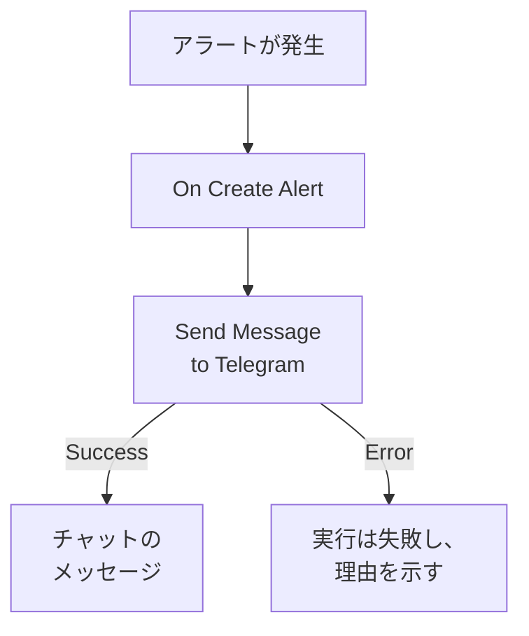

# Telegram

アラートが発生したときやインシデントが開かれたときに、[Telegram](https://telegram.org) のチャット、グループ、チャンネルにメッセージを送ります。OneUptime のワークフローステップ **Send Message to Telegram** は、作成したボットとしてメッセージを送り、既製のテンプレートがアラート用のワークフローを作成します。この連携は **アウトバウンド** です。ボットはメッセージを送るだけで、チャットでの発言は読みません。

:::cards
- [仕組み](#仕組み): アラートが発生したときにワークフローが行うこと。
- [セットアップ](#連携を設定する): ボット、そのチャット、次にワークフロー。テンプレートからでも、ゼロからでも。
- [ヒント](#ヒント): プレーンテキスト、長いメッセージ、インシデント。
- [トラブルシューティング](#トラブルシューティング): Telegram のエラーの意味と、変えるべきところ。
:::

## 仕組み



ステップは Telegram の Bot API を通じて、ボットとして **Message Text** をチャットに送ります。Telegram がメッセージを受け付けると **Success** 出力に進み、Telegram が拒否すると、Telegram の理由とともに **Error** 出力に進みます。テンプレートのように **Error** に何も接続されていなければ、送信できなかった実行は失敗し、その **ステップ** に理由が示されます。

## 前提条件

- ボットを作成してチャットに追加するための Telegram アカウント。
- OneUptime で、ワークフローと変数を作成する権限。OneUptime Cloud では、ワークフローには **Growth** 以上のプランが必要です。

## 連携を設定する

:::steps
### ボットを作成する

Telegram で [@BotFather](https://t.me/BotFather) に `/newbot` を送り、質問に答えます。ボットのトークン（例: `123456789:ABCdefGhIJKlmnoPQRstuVWxyz`）が発行されます。トークンを知っている人は誰でもボットとしてメッセージを送れるため、パスワードと同じように厳重に保管してください。

### チャットの ID を確認する

1. ボットをグループに追加するか、チャンネルの管理者にします。個人にメッセージを送るには、その人が先にボットとのチャットを始めます。
2. ボットに見えるように、グループでボットをメンションするメッセージ（例: `/start@your_bot`）を送ります。
3. ブラウザで `https://api.telegram.org/bot<token>/getUpdates` を開きます。`<token>` はボットのトークンに置き換えます。
4. 応答の中で `"chat":{"id":` を探します。その後ろの数値がチャットの ID です。グループの ID は `-` で、大きなグループの ID は `-100` で始まります。

公開チャンネルは、ID の代わりに `@username` で指定できます。

### ワークフローを作る

アラート用のワークフロー全体を作成するテンプレートから始めるか、ゼロから始めます。

:::tabs
@tab テンプレートから
1. **ワークフロー** を開き、**ワークフローを作成** をクリックします。
2. **テンプレートを検索…** に `Telegram` と入力し、**Tell Telegram when an alert fires** をクリックしてから **このテンプレートを使う** をクリックします。
3. 名前は **Notify Telegram on new alert** のままにするか変更して、**次へ** をクリックします。
4. トークンを **Telegram Bot Token** に、ID を **Telegram Chat ID** に貼り付け、**ワークフローを作成** をクリックします。

ワークフローは 2 つのステップを持った状態で **ビルダー** に開きます。 **On Create Alert** と、アラートの番号、タイトル、重大度、状態を送る **Send Message to Telegram** です。トークンはワークフローのシークレット変数 `telegramBotToken` として、ID は `telegramChatId` として保存されます。
@tab ゼロから
1. トークンをシークレットのグローバル変数として保存します。**ワークフロー → グローバル変数** に移動し、**ワークフロー変数を作成** をクリックして、名前を `TELEGRAM_BOT_TOKEN` にし、**次へ** をクリックします。トークンを **コンテンツ** に貼り付け、**シークレット** をオンにして、**ワークフロー変数を作成** をクリックします。
2. **ワークフロー** に移動し、**ワークフローを作成** をクリックして **ゼロから作成** を選び、ワークフローに名前を付けて **ワークフローを作成** をクリックします。
3. **ビルダー** で **このワークフローを開始するものを選択** をクリックし、**人気** の下の **On Create Alert** を選びます。トリガーをクリックします。その **Fields to pass on** は **タイトル** から始まるので、**フィールドを追加** をクリックし、メッセージに表示するほかのフィールド（例: **プレフィックス付きのアラート番号**）を選びます。
4. **コンポーネントを追加** をクリックし、`telegram` を検索して **Send Message to Telegram** をクリックします。トリガーの **Success** 出力をそこにつなぎます。
5. 新しいステップをクリックします。**Telegram Bot Token** で **{ }** をクリックし、**グローバル変数** の下の `TELEGRAM_BOT_TOKEN` を選びます。チャットの ID を **Chat ID** に入力し、**Message Text** にメッセージを書いて、**{ }** でアラートのフィールドを挿入します。
:::

ゼロから作ったメッセージは、次のような参照でアラートのフィールドを読み取ります:

```text
🚨 Alert {{local.components.alert-on-create-1.returnValues.model.alertNumberWithPrefix}} fired
Title: {{local.components.alert-on-create-1.returnValues.model.title}}
```

### オンにしてテストする

**ビルダー** の上部で **有効** をオンにします。これ以降、新しいアラートはすべてチャットに送られます。

アラートを発生させずにテストするには、**ワークフローを実行** をクリックし、**アラート** で既存のアラートを選びます。最近のものが一覧に表示され、番号やタイトルの一部を入力すれば別のアラートも見つかります。**ワークフローを手動で実行** をクリックし、**実行** で確定します。**ワークフローの実行** パネルで実行を追跡でき、メッセージがチャットに表示されます。ステップが代わりに **Error** に進んだ場合は、実行が失敗し、 **ステップ** にあるそのステップの項目に理由が示されます。[トラブルシューティング](#トラブルシューティング) を参照してください。
:::

## ヒント

- **プレーンテキスト。** ステップは Telegram の書式設定を使わず、入力したとおりにテキストを送るため、`*` と `_` はそのまま表示されます。
- **4,096 文字の上限に注意する。** Telegram が受け付けるメッセージは最大 4,096 文字です。それより長いメッセージは拒否されるのではなく切り詰められ、末尾が "… (truncated — see OneUptime for the full text)" になります。
- **インシデントにも。** 同じワークフローを **On Create Incident** で、または状態の変化には **On Update Incident** で作ります。一部のアラートだけを送るには、ステップの前に **If / Else** ブロックを置きます。
- **トークンの形式がチェックされる。** `123456789:ABCdef…` の形式でないトークンは、何かを送る前に実行を止めます。トークンがログに書き込まれることはありません。

## トラブルシューティング

ステップが **Error** に進むと実行は失敗し、実行の **ステップ** にあるそのステップの項目に Telegram の理由が示されます。ボットがチャットにいる必要があるので、まずそれを確認してください。

:::details Telegram が "Bad Request: chat not found" を返す
**Chat ID** が誤っているか、ボットがチャットを見られません。ボットをグループに追加するか、チャンネルの管理者にするか、相手にボットとのチャットを始めてもらってください。グループの ID は `-` で始まります。
:::

:::details Telegram が "Forbidden: bot was blocked by the user" または "bot is not a member" を返す
相手がボットをブロックしたか、ボットがグループやチャンネルから削除されました。もう一度追加するか、別のチャットに送ってください。
:::

:::details Telegram が "Unauthorized" を返す
Telegram はトークンを受け入れませんでした。@BotFather で取り消されたか、コピーを誤っています。@BotFather からボットの現在のトークンをコピーし、変数の値を置き換えてください。
:::

:::details Telegram が "Too Many Requests: retry after" を返す
Telegram は 1 つのボットが送る速度を、特にグループに対して制限しています。アラートが集中するとこの上限に達することがあります。一部の重大度だけにするなど、送るメッセージを減らしてください。
:::

## 次のステップ

:::cards
- [ワークフロー コンポーネント](/docs/workflows/components#telegram): ステップの各設定と、出力の意味。
- [Discord](/docs/integrations/discord): 同じことを Discord のチャンネルで。
- [ワークフロー 実行履歴](/docs/workflows/runs-and-logs): ワークフローの各実行で何が起きたかを確認します。
- [インテグレーションの概要](/docs/integrations/index): アウトバウンドのパターンと、接続できるほかのツール。
:::
